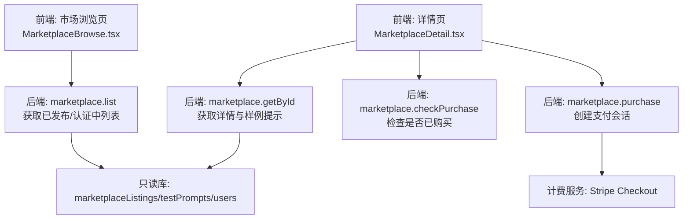
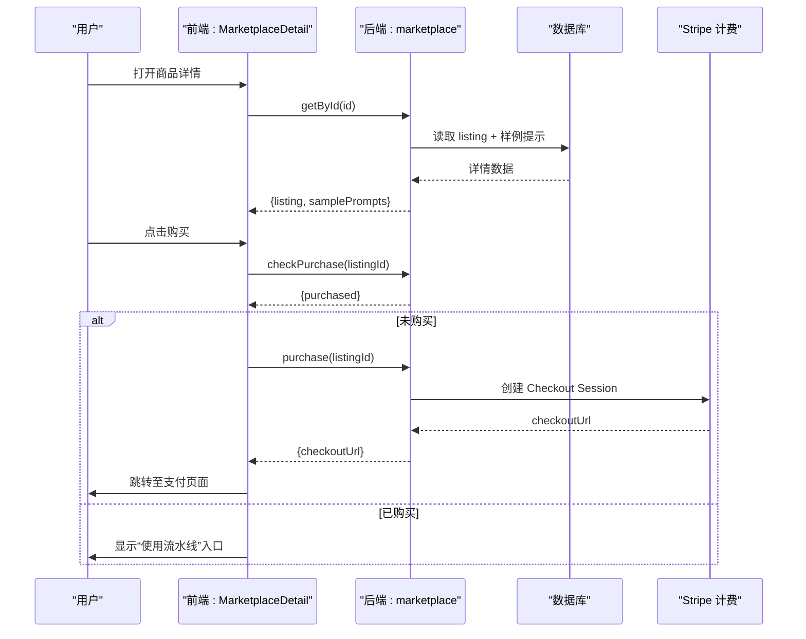
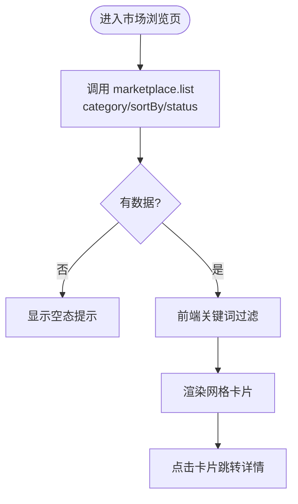
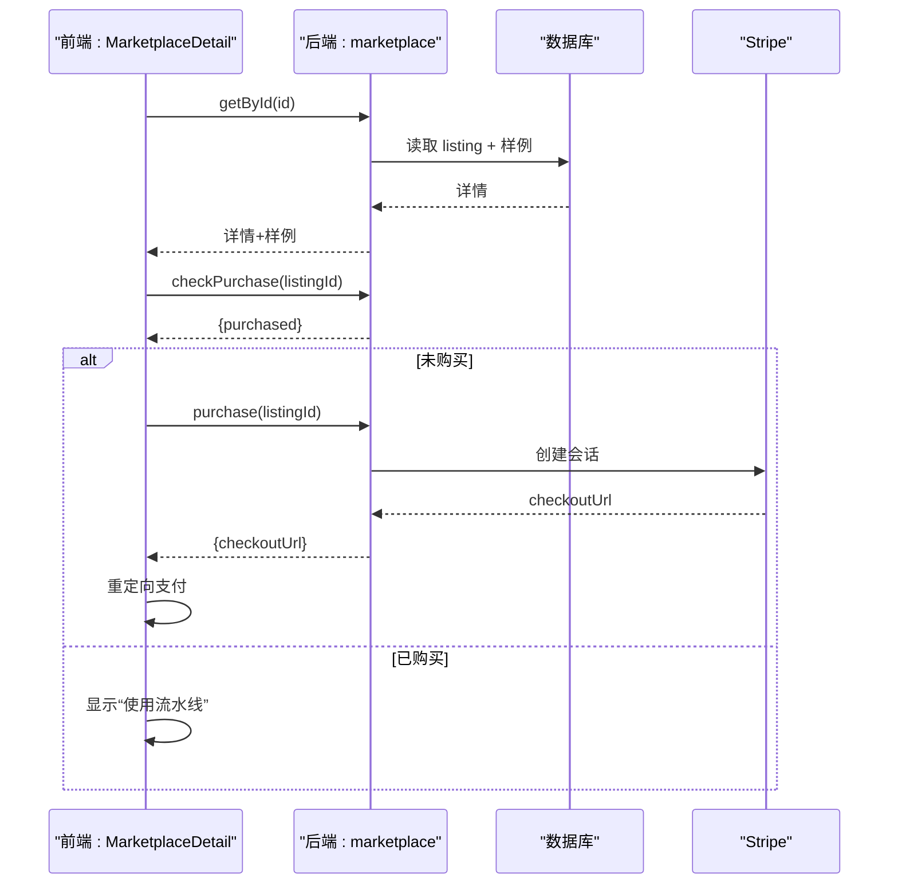
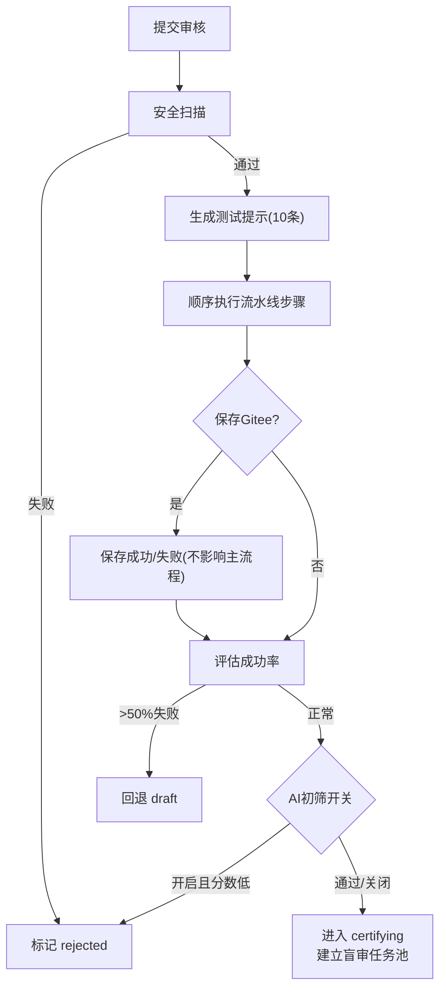
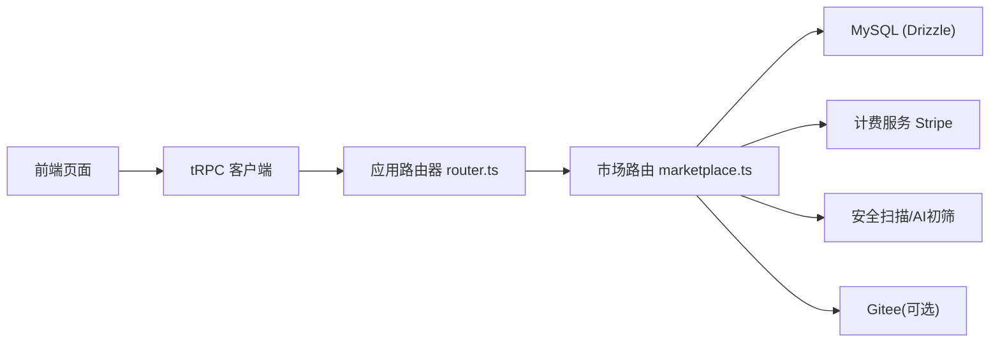

# 市场浏览页面

<cite>
**本文引用的文件**
- [MarketplaceBrowse.tsx](file://src/pages/MarketplaceBrowse.tsx)
- [MarketplaceDetail.tsx](file://src/pages/MarketplaceDetail.tsx)
- [ListingStatusBadge.tsx](file://src/components/marketplace/ListingStatusBadge.tsx)
- [marketplace.ts](file://api/routers/marketplace.ts)
- [router.ts](file://api/router.ts)
- [schema.ts](file://db/schema.ts)
</cite>

## 目录
1. [简介](#简介)
2. [项目结构](#项目结构)
3. [核心组件](#核心组件)
4. [架构总览](#架构总览)
5. [详细组件分析](#详细组件分析)
6. [依赖关系分析](#依赖关系分析)
7. [性能与缓存](#性能与缓存)
8. [故障排查指南](#故障排查指南)
9. [结论](#结论)
10. [附录：API 接口与数据模型](#附录api-接口与数据模型)

## 简介
本文件为 DeeWaanAI 市场浏览页面的完整技术文档，覆盖工具发现界面、搜索过滤与分类浏览、商品详情、用户评价与认证流程、购买流程、许可证与安装部署要点、更新机制、推荐与热门展示、收藏能力（当前未实现）以及市场 API 和数据模型。目标是帮助开发者快速理解前端页面、后端路由、数据库模型与关键业务流程的协作方式。

## 项目结构
市场功能由前端页面与后端 tRPC 路由组成，数据持久化在 MySQL（通过 Drizzle ORM）。前端通过 tRPC 调用后端查询列表、详情与购买；后端负责筛选、排序、安全扫描、测试用例生成、AI 初筛、盲审队列与认证决策。

图表来源
- [MarketplaceBrowse.tsx:42-46](file://src/pages/MarketplaceBrowse.tsx#L42-L46)
- [MarketplaceDetail.tsx:33-62](file://src/pages/MarketplaceDetail.tsx#L33-L62)
- [marketplace.ts:920-1022](file://api/routers/marketplace.ts#L920-L1022)
- [router.ts:53](file://api/router.ts#L53)

章节来源
- [MarketplaceBrowse.tsx:26-120](file://src/pages/MarketplaceBrowse.tsx#L26-L120)
- [MarketplaceDetail.tsx:25-88](file://src/pages/MarketplaceDetail.tsx#L25-L88)
- [marketplace.ts:920-1022](file://api/routers/marketplace.ts#L920-L1022)
- [router.ts:39-70](file://api/router.ts#L39-L70)

## 核心组件
- 市场浏览页：支持关键词搜索、分类筛选、多字段排序（最新、热门、评分、价格升/降），并展示状态徽章、评分、销量与 Kappa 一致性指标。
- 商品详情页：展示描述、质量验证信息、样例测试输入、购买卡片与统计信息；根据是否已购、是否为作者、是否处于认证中动态控制购买按钮。
- 状态徽章：统一渲染“认证中”和“已认证”两种状态，用于列表与详情页。

章节来源
- [MarketplaceBrowse.tsx:26-120](file://src/pages/MarketplaceBrowse.tsx#L26-L120)
- [MarketplaceDetail.tsx:88-295](file://src/pages/MarketplaceDetail.tsx#L88-L295)
- [ListingStatusBadge.tsx:5-33](file://src/components/marketplace/ListingStatusBadge.tsx#L5-L33)

## 架构总览
市场浏览的核心数据流如下：
- 浏览列表：前端按分类与排序参数调用 marketplace.list，后端组合 where/order by 返回公开可见的已发布或认证中条目，附带创作者名称等聚合字段。
- 查看详情：前端调用 getById 获取详情与随机样例提示，同时 checkPurchase 判断是否已购。
- 购买流程：前端触发 purchase，后端创建 Stripe Checkout 会话并返回 checkoutUrl，前端重定向完成支付。
- 提交审核：创作者提交后，后端执行安全扫描、生成测试提示、运行流水线、可选 AI 初筛，进入认证阶段并建立盲审任务池。
- 认证决策：当达到最小评审人数与每人最少评审数时，计算加权平均分与通过率，决定是否发布或拒绝，并记录等级、Kappa 等指标。

图表来源
- [MarketplaceDetail.tsx:33-62](file://src/pages/MarketplaceDetail.tsx#L33-L62)
- [marketplace.ts:980-1022](file://api/routers/marketplace.ts#L980-L1022)

## 详细组件分析

### 市场浏览页（工具发现界面）
- 搜索与过滤：
  - 关键词搜索在前端对标题与描述进行本地过滤。
  - 分类筛选通过 category 参数传递到后端，后端按枚举值过滤。
  - 排序支持 newest、popular、grade、price_asc、price_desc。
- 列表展示：
  - 展示类别标签、状态徽章、评分星级、价格（含订阅标识）、销量、评论数与 Kappa。
  - 链接到详情页 /marketplace/:id。
- 空态与加载：
  - 加载中显示旋转图标；无结果时展示引导文案。

图表来源
- [MarketplaceBrowse.tsx:42-52](file://src/pages/MarketplaceBrowse.tsx#L42-L52)
- [marketplace.ts:920-978](file://api/routers/marketplace.ts#L920-L978)

章节来源
- [MarketplaceBrowse.tsx:26-186](file://src/pages/MarketplaceBrowse.tsx#L26-L186)
- [marketplace.ts:920-978](file://api/routers/marketplace.ts#L920-L978)

### 商品详情页（购买与认证展示）
- 详情数据：
  - 基本信息：标题、描述、类别、价格、订阅标识、状态、评分、评论数、Kappa、销量、创建时间、创作者名。
  - 样例提示：从 testPrompts 随机抽取最多 10 条，便于预览。
- 购买逻辑：
  - 若已购买，显示“使用流水线”入口。
  - 若未购买且非作者且不在认证中，可发起购买；否则禁用按钮并给出提示。
  - 购买成功后跳转到 Stripe Checkout。
- 质量验证：
  - 展示 grade、reviewCount、kappaScore；高可靠性时给出提示。
  - 提供查看认证详情的链接。

图表来源
- [MarketplaceDetail.tsx:33-62](file://src/pages/MarketplaceDetail.tsx#L33-L62)
- [marketplace.ts:980-1022](file://api/routers/marketplace.ts#L980-L1022)

章节来源
- [MarketplaceDetail.tsx:88-295](file://src/pages/MarketplaceDetail.tsx#L88-L295)
- [marketplace.ts:980-1022](file://api/routers/marketplace.ts#L980-L1022)

### 状态徽章组件
- 仅对 published 与 certifying 状态渲染不同徽章；其他状态不显示。
- 用于列表与详情页一致的状态表达。

章节来源
- [ListingStatusBadge.tsx:5-33](file://src/components/marketplace/ListingStatusBadge.tsx#L5-L33)

### 提交审核与认证流程（创作者视角）
- 提交审核：
  - 安全扫描优先，失败直接拒绝并记录反馈。
  - 生成 10 个测试提示，顺序执行流水线步骤，记录中间输出。
  - 可选保存测试数据到 Gitee。
  - 若错误率过高或配额耗尽，回退为草稿。
  - 可选 AI 初筛，低于阈值则拒绝。
  - 通过后进入 certifying 并建立盲审任务池。
- 认证决策：
  - 达到最小评审人数与每人最少评审数后，计算加权平均分与通过率，决定是否发布或拒绝，并写入 grade、reviewCount、kappaScore 等。

图表来源
- [marketplace.ts:1135-1421](file://api/routers/marketplace.ts#L1135-L1421)
- [marketplace.ts:742-917](file://api/routers/marketplace.ts#L742-L917)

章节来源
- [marketplace.ts:1135-1421](file://api/routers/marketplace.ts#L1135-L1421)
- [marketplace.ts:742-917](file://api/routers/marketplace.ts#L742-L917)

### 推荐算法、热门展示与收藏
- 推荐与热门：
  - 列表支持按 popular（销量）与 grade（评分）排序，作为简单的推荐与热门展示策略。
  - 详情页展示销量、评分与 Kappa 一致性，辅助用户选择。
- 收藏功能：
  - 当前代码未发现收藏相关的前端组件或后端接口；如需实现，可在详情页增加收藏/取消收藏交互，并在后端新增对应表与接口。

章节来源
- [MarketplaceBrowse.tsx:108-118](file://src/pages/MarketplaceBrowse.tsx#L108-L118)
- [marketplace.ts:942-949](file://api/routers/marketplace.ts#L942-L949)

### 许可证管理、安装部署与更新机制
- 许可证与权限：
  - 购买完成后通过计费服务与权限系统授予使用能力；详情页根据 checkPurchase 结果控制“使用流水线”入口。
- 安装部署：
  - 市场路由挂载于应用路由器，需确保数据库迁移与 Stripe 配置正确。
- 更新机制：
  - 创作者可编辑草稿或被拒条目，重新提交审核；后台会清理历史评审产物并重新生成测试数据。

章节来源
- [MarketplaceDetail.tsx:38-62](file://src/pages/MarketplaceDetail.tsx#L38-L62)
- [router.ts:53](file://api/router.ts#L53)
- [marketplace.ts:1088-1133](file://api/routers/marketplace.ts#L1088-L1133)
- [marketplace.ts:1135-1162](file://api/routers/marketplace.ts#L1135-L1162)

## 依赖关系分析
- 前端依赖：
  - trpc 客户端调用 marketplace 路由。
  - 路由导航与状态管理使用 React Router 与本地状态。
- 后端依赖：
  - Drizzle ORM 访问 MySQL。
  - 计费服务（Stripe）处理支付。
  - 安全扫描与 AI 初筛服务。
  - Gitee 存储测试数据（可选）。
- 数据模型依赖：
  - marketplaceListings、testPrompts、listingReviews、users 等表。

图表来源
- [router.ts:39-70](file://api/router.ts#L39-L70)
- [marketplace.ts:920-1022](file://api/routers/marketplace.ts#L920-L1022)

章节来源
- [router.ts:39-70](file://api/router.ts#L39-L70)
- [marketplace.ts:920-1022](file://api/routers/marketplace.ts#L920-L1022)

## 性能与缓存
- 列表与详情接口设置 Cache-Control，浏览器短 TTL 与边缘长 TTL，适合低频变更的市场数据。
- 列表查询限制 100 条，避免一次性返回过多数据。
- 详情页样例提示随机抽取 10 条，降低重复展示。
- 提交审核采用后台异步执行，避免阻塞请求；对 LLM 调用加入超时与重试，提升鲁棒性。

章节来源
- [marketplace.ts:37-39](file://api/routers/marketplace.ts#L37-L39)
- [marketplace.ts:954-975](file://api/routers/marketplace.ts#L954-L975)
- [marketplace.ts:1008-1021](file://api/routers/marketplace.ts#L1008-L1021)
- [marketplace.ts:162-199](file://api/routers/marketplace.ts#L162-L199)
- [marketplace.ts:1231-1409](file://api/routers/marketplace.ts#L1231-L1409)

## 故障排查指南
- 无法购买：
  - 检查是否已登录、是否已购买、是否处于认证中；确认 Stripe 配置与回调 URL。
- 列表为空：
  - 确认是否有已发布或认证中的条目；检查分类与排序参数。
- 提交审核失败：
  - 检查安全扫描结果、LLM 提供商配置、配额与网络；关注错误率与回退为草稿的情况。
- 认证未通过：
  - 查看加权平均分与通过率是否达到阈值；检查评审人数与每人评审数是否满足要求。

章节来源
- [MarketplaceDetail.tsx:55-62](file://src/pages/MarketplaceDetail.tsx#L55-L62)
- [marketplace.ts:1164-1185](file://api/routers/marketplace.ts#L1164-L1185)
- [marketplace.ts:1344-1351](file://api/routers/marketplace.ts#L1344-L1351)
- [marketplace.ts:825-917](file://api/routers/marketplace.ts#L825-L917)

## 结论
市场浏览页面提供了完整的工具发现、详情展示与购买流程，结合安全扫描、测试生成、AI 初筛与盲审认证，构建了可信的工具生态。建议后续扩展收藏功能与更丰富的推荐策略，以提升用户转化与内容分发效率。

## 附录：API 接口与数据模型

### 市场 API 接口（tRPC）
- marketplace.list
  - 方法：查询
  - 入参：category（可选）、sortBy（newest/popular/grade/price_asc/price_desc，默认 newest）、status（published/all，默认 published）
  - 出参：列表项集合（包含 id、title、description、category、price、isSubscription、subscriptionPrice、status、grade、reviewCount、kappaScore、salesCount、createdAt、creatorName）
- marketplace.getById
  - 方法：查询
  - 入参：id（number）
  - 出参：详情对象 + samplePrompts（最多 10 条）
- marketplace.checkPurchase
  - 方法：查询
  - 入参：listingId（number）
  - 出参：{ purchased: boolean }
- marketplace.purchase
  - 方法：变更
  - 入参：listingId（number）
  - 出参：{ checkoutUrl: string }
- marketplace.create/update/submitForReview/creatorSelfTest
  - 方法：变更
  - 用途：创建/编辑草稿、提交审核、创作者自测

章节来源
- [marketplace.ts:920-1022](file://api/routers/marketplace.ts#L920-L1022)
- [marketplace.ts:1024-1133](file://api/routers/marketplace.ts#L1024-L1133)
- [marketplace.ts:1135-1421](file://api/routers/marketplace.ts#L1135-L1421)
- [marketplace.ts:1423-1599](file://api/routers/marketplace.ts#L1423-L1599)

### 数据模型（核心表）
- marketplaceListings：市场条目（id、creatorId、templateId、title、description、objectives、inputFormat、outputFormat、remarks、category、price、isSubscription、subscriptionPrice、status、grade、reviewCount、kappaScore、aiGrade、aiFeedback、aiReviewedAt、certifiedAt、salesCount、createdAt、updatedAt）
- testPrompts：测试提示（id、listingId、promptIndex、category、inputText、actualOutput、createdAt）
- listingReviews：条目评价（id、listingId、reviewerId、promptIndex、accuracy、completeness、clarity、tokenEfficiency、speed、consistency、weightedScore、reviewTime、createdAt）
- users：用户（id、name、email、role、tier 等）
- llmProviders：LLM 提供商（id、userId、slug、baseUrl、apiKeyRef、defaultModel、models、config、isEnabled）
- pipelineTemplates：流水线模板（id、userId、name、description、steps）
- encryptedPrompts：加密的系统提示（id、listingId、agentIndex、encryptedPrompt、iv）
- blindReviewTasks：盲审任务（id、listingId、promptIndex、reviewerId、status、assignedAt、completedAt）
- reviewerProfiles：评审者档案（id、userId、reviewsCompleted、pointsEarned、pointsBalance、isActive）

章节来源
- [schema.ts:1-200](file://db/schema.ts#L1-L200)
- [schema.ts:800-1200](file://db/schema.ts#L800-L1200)