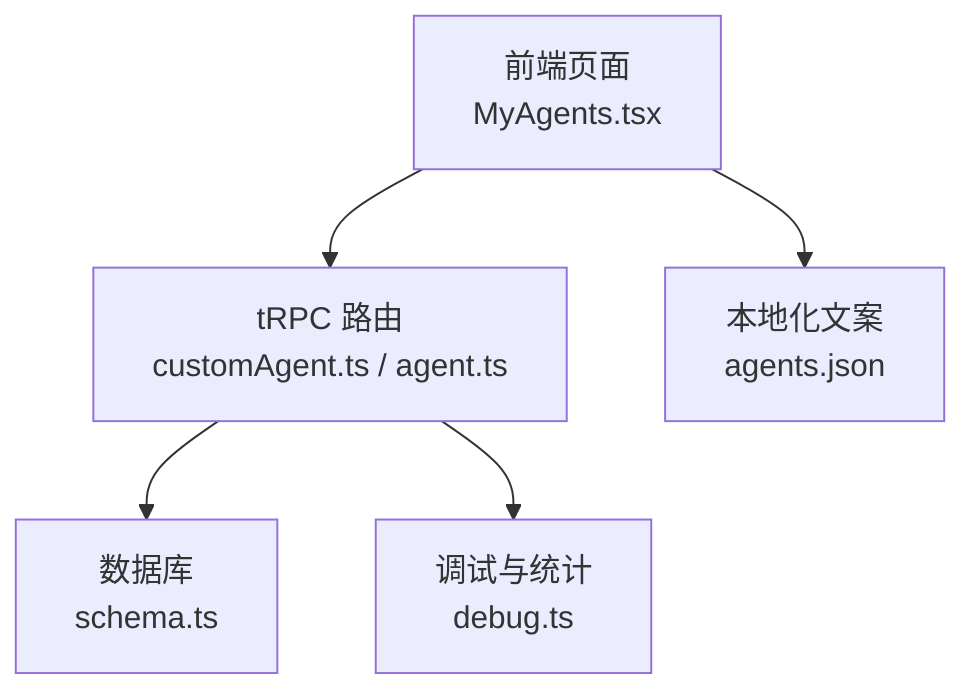
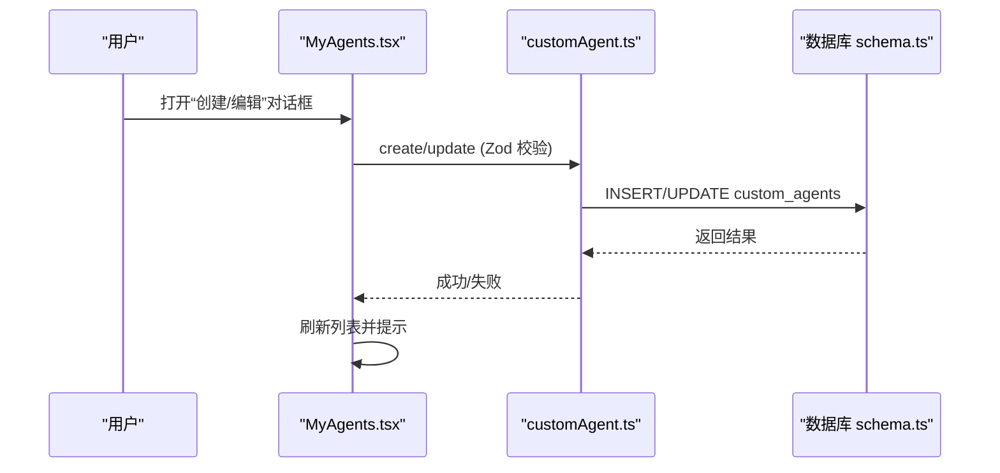
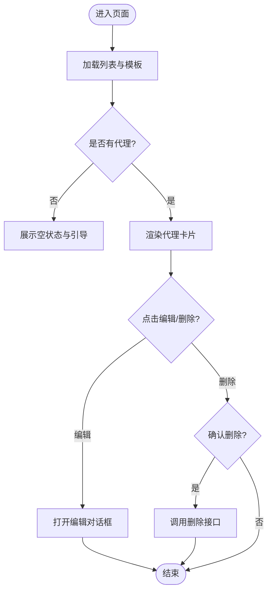
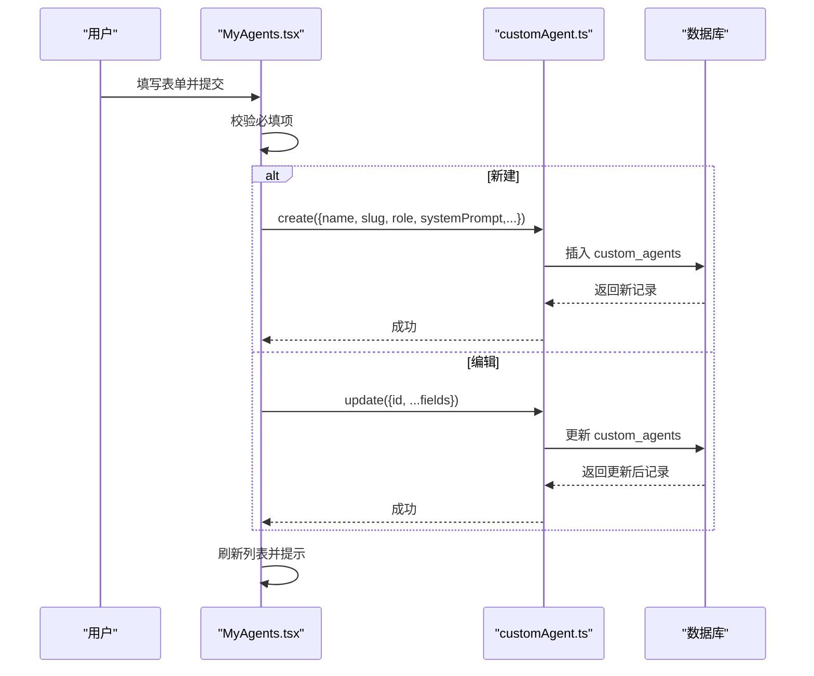
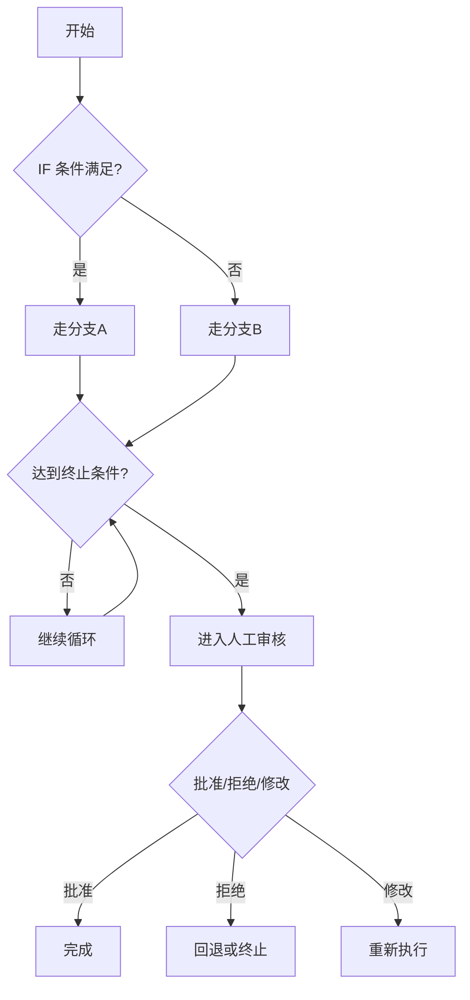
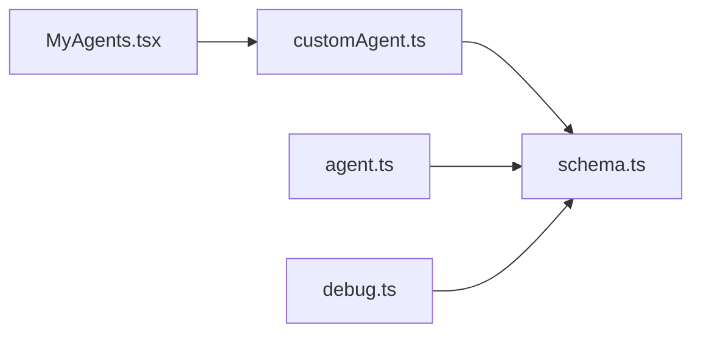

# 我的代理页面

<cite>
**本文引用的文件**
- [MyAgents.tsx](file://src/pages/MyAgents.tsx)
- [customAgent.ts](file://api/routers/customAgent.ts)
- [agent.ts](file://api/routers/agent.ts)
- [schema.ts](file://db/schema.ts)
- [agents.json](file://src/locales/zh/agents.json)
- [debug.ts](file://api/routers/debug.ts)
- [pipeline.ts](file://api/routers/pipeline.ts)
- [project.ts](file://api/routers/project.ts)
</cite>

## 目录
1. [简介](#简介)
2. [项目结构](#项目结构)
3. [核心组件](#核心组件)
4. [架构总览](#架构总览)
5. [详细组件分析](#详细组件分析)
6. [依赖关系分析](#依赖关系分析)
7. [性能与成本](#性能与成本)
8. [故障排查指南](#故障排查指南)
9. [结论](#结论)
10. [附录：开发指南与最佳实践](#附录开发指南与最佳实践)

## 简介
本页面提供“我的代理”的完整管理能力，包括代理列表展示、创建/编辑/删除、模板快速复用、LLM提供商与模型选择、温度与最大令牌数等运行参数配置。同时结合流水线能力，支持条件分支（IF）、循环（WHILE）和人工审核（Approval）等特殊步骤，便于构建可复用的智能体工作流。页面还集成了层级能力（匠人/大师/圣人），用于控制功能可见性与可用性。

## 项目结构
- 前端页面：位于 src/pages/MyAgents.tsx，负责用户交互、表单校验、调用 tRPC 接口、渲染列表与对话框。
- 后端路由：
  - 自定义代理：api/routers/customAgent.ts 提供 list/create/update/delete 等能力。
  - 项目内代理：api/routers/agent.ts 提供项目级代理的 CRUD。
- 数据模型：db/schema.ts 定义了 custom_agents、agents、pipeline_steps、agent_runs、agent_responses 等表结构。
- 国际化：src/locales/zh/agents.json 提供中文文案。
- 调试与统计：api/routers/debug.ts 提供按角色聚合的用量与延迟统计。

**图表来源**
- [MyAgents.tsx:75-183](file://src/pages/MyAgents.tsx#L75-L183)
- [customAgent.ts:67-166](file://api/routers/customAgent.ts#L67-L166)
- [schema.ts:430-450](file://db/schema.ts#L430-L450)
- [agents.json:1-74](file://src/locales/zh/agents.json#L1-L74)
- [debug.ts:116-173](file://api/routers/debug.ts#L116-L173)

**章节来源**
- [MyAgents.tsx:75-183](file://src/pages/MyAgents.tsx#L75-L183)
- [customAgent.ts:67-166](file://api/routers/customAgent.ts#L67-L166)
- [schema.ts:430-450](file://db/schema.ts#L430-L450)
- [agents.json:1-74](file://src/locales/zh/agents.json#L1-L74)
- [debug.ts:116-173](file://api/routers/debug.ts#L116-L173)

## 核心组件
- 代理列表与模板区：展示用户自定义代理与内置模板，支持一键使用模板创建新代理。
- 创建/编辑对话框：包含名称、标识符（slug）、角色、系统提示词、描述、LLM提供商与模型、温度、最大令牌数等字段。
- 权限与层级：根据当前用户能力（是否具备 pipeline:custom 或 pipeline:autodesign）控制创建按钮与特殊能力入口。
- 错误处理：表单必填校验失败时提示；后端重复 slug 等错误通过 toast 显示。

关键实现要点
- 列表与模板数据通过 trpc.customAgent.list.useQuery 获取。
- 创建/更新/删除分别调用 create/update/delete mutation，并在成功后刷新列表与提示。
- LLM提供商与模型采用双框联动：选择提供商后动态加载其可用模型。
- 表单提交前进行必填项校验，避免无效请求。

**章节来源**
- [MyAgents.tsx:84-183](file://src/pages/MyAgents.tsx#L84-L183)
- [MyAgents.tsx:405-577](file://src/pages/MyAgents.tsx#L405-L577)
- [customAgent.ts:82-126](file://api/routers/customAgent.ts#L82-L126)
- [agents.json:26-49](file://src/locales/zh/agents.json#L26-L49)

## 架构总览
页面通过 tRPC 将前端操作映射到后端路由，路由层对输入进行 Zod 校验并持久化到数据库。代理执行过程中产生的运行记录与响应被写入 agent_runs 与 agent_responses，供后续统计与质量评估使用。

**图表来源**
- [MyAgents.tsx:129-183](file://src/pages/MyAgents.tsx#L129-L183)
- [customAgent.ts:82-126](file://api/routers/customAgent.ts#L82-L126)
- [schema.ts:430-450](file://db/schema.ts#L430-L450)

**章节来源**
- [MyAgents.tsx:129-183](file://src/pages/MyAgents.tsx#L129-L183)
- [customAgent.ts:82-126](file://api/routers/customAgent.ts#L82-L126)
- [schema.ts:430-450](file://db/schema.ts#L430-L450)

## 详细组件分析

### 代理列表与模板
- 列表数据来源：trpc.customAgent.list.useQuery 返回 userAgents 与 templates。
- 模板区：点击模板卡片进入“使用模板”流程，自动填充表单字段。
- 空状态：无代理时展示引导信息。

**图表来源**
- [MyAgents.tsx:235-403](file://src/pages/MyAgents.tsx#L235-L403)
- [customAgent.ts:67-80](file://api/routers/customAgent.ts#L67-L80)

**章节来源**
- [MyAgents.tsx:235-403](file://src/pages/MyAgents.tsx#L235-L403)
- [customAgent.ts:67-80](file://api/routers/customAgent.ts#L67-L80)

### 创建与编辑代理
- 表单字段：名称、标识符（唯一）、角色、系统提示词、描述、LLM提供商与模型、温度、最大令牌数。
- 校验逻辑：名称、标识符、系统提示词为必填；slug 在创建时做唯一性检查。
- 提交行为：编辑模式调用 update，新建模式调用 create；成功后刷新列表并关闭对话框。

**图表来源**
- [MyAgents.tsx:151-183](file://src/pages/MyAgents.tsx#L151-L183)
- [customAgent.ts:82-126](file://api/routers/customAgent.ts#L82-L126)
- [customAgent.ts:128-155](file://api/routers/customAgent.ts#L128-L155)

**章节来源**
- [MyAgents.tsx:151-183](file://src/pages/MyAgents.tsx#L151-L183)
- [customAgent.ts:82-126](file://api/routers/customAgent.ts#L82-L126)
- [customAgent.ts:128-155](file://api/routers/customAgent.ts#L128-L155)

### 条件智能体（Sage 层级）
- IF 门控：根据输出关键词将流水线路由到不同代理。
- WHILE 循环：重复某一步骤直到质量达标，支持最大迭代次数。
- 人工审核：暂停流水线等待人工审批，支持批准、拒绝或修改并附带说明。
- 这些能力通过 pipeline_steps 的 stepType 与 ifConfig/whileConfig 表达。

**图表来源**
- [schema.ts:452-480](file://db/schema.ts#L452-L480)
- [MyAgents.tsx:267-319](file://src/pages/MyAgents.tsx#L267-L319)

**章节来源**
- [schema.ts:452-480](file://db/schema.ts#L452-L480)
- [MyAgents.tsx:267-319](file://src/pages/MyAgents.tsx#L267-L319)

### 项目内代理管理（项目维度）
- 提供项目维度的代理列表、创建、更新、删除以及默认代理初始化能力。
- 适用于在同一项目中编排多个代理顺序执行。

**章节来源**
- [agent.ts:8-68](file://api/routers/agent.ts#L8-L68)
- [agent.ts:70-99](file://api/routers/agent.ts#L70-L99)

## 依赖关系分析
- 前端依赖 tRPC 客户端与本地化资源。
- 后端路由依赖 Drizzle ORM 与数据库表结构。
- 条件与循环能力依赖 pipeline_steps 的配置字段。
- 统计与成本分析依赖 agent_runs 与 agent_responses 的运行记录。

**图表来源**
- [MyAgents.tsx:75-183](file://src/pages/MyAgents.tsx#L75-L183)
- [customAgent.ts:67-166](file://api/routers/customAgent.ts#L67-L166)
- [agent.ts:8-99](file://api/routers/agent.ts#L8-L99)
- [debug.ts:116-173](file://api/routers/debug.ts#L116-L173)
- [schema.ts:430-480](file://db/schema.ts#L430-L480)

**章节来源**
- [MyAgents.tsx:75-183](file://src/pages/MyAgents.tsx#L75-L183)
- [customAgent.ts:67-166](file://api/routers/customAgent.ts#L67-L166)
- [agent.ts:8-99](file://api/routers/agent.ts#L8-L99)
- [debug.ts:116-173](file://api/routers/debug.ts#L116-L173)
- [schema.ts:430-480](file://db/schema.ts#L430-L480)

## 性能与成本
- 运行指标：通过 debug.ts 的 getStats 接口可按项目维度汇总运行次数、响应数、总 Token 消耗、总延迟，并按角色分组统计平均 Token 与平均延迟。
- 成本估算：结合 provider 定价与每次运行的 tokensUsed，可计算单次运行成本；建议以 agent_responses.metadata.tokensUsed 中的 prompt/completion/total 作为依据。
- 优化建议：
  - 合理设置 temperature 与 maxTokens，避免过长输出导致成本上升。
  - 使用合适的 LLM 提供商与模型组合，平衡质量与成本。
  - 利用 WHILE 循环的最大迭代次数限制，防止无限循环造成资源浪费。

**章节来源**
- [debug.ts:116-173](file://api/routers/debug.ts#L116-L173)
- [schema.ts:262-333](file://db/schema.ts#L262-L333)

## 故障排查指南
- 表单必填校验失败：确保名称、标识符、系统提示词已填写。
- 重复标识符：后端会拒绝重复 slug 的创建请求，请更换唯一标识。
- 权限不足：未具备相应层级能力时，创建按钮将被锁定或提示升级。
- 列表不更新：mutation 成功后会触发 invalidate 刷新缓存，如未更新可尝试手动刷新页面。

**章节来源**
- [MyAgents.tsx:167-183](file://src/pages/MyAgents.tsx#L167-L183)
- [customAgent.ts:98-105](file://api/routers/customAgent.ts#L98-L105)
- [MyAgents.tsx:221-231](file://src/pages/MyAgents.tsx#L221-L231)

## 结论
“我的代理页面”提供了完整的代理生命周期管理能力，结合条件与循环能力，能够灵活构建复杂工作流。通过运行记录与统计接口，可实现用量监控与成本分析。建议在开发中遵循最小必要原则配置参数，并结合业务场景选择合适的提供商与模型，以获得更好的质量与成本平衡。

## 附录：开发指南与最佳实践
- 代理设计
  - 明确角色与职责，编写清晰、具体的系统提示词。
  - 使用模板快速起步，再按需定制。
- 参数调优
  - temperature 控制创造性，maxTokens 控制输出长度，需结合任务复杂度调整。
  - 优先选择性价比高的提供商与模型组合。
- 版本控制与灰度发布
  - 通过 pipeline_templates 保存可复用的流水线模板，便于版本管理与回滚。
  - 借助 feature flags 与 rollout 机制，逐步放量新功能或新代理。
- A/B 测试
  - 基于同一任务集对比不同代理/模板的效果，关注质量与成本两个维度。
  - 使用 agent_responses 的质量评分与人类评审数据进行评估。
- 质量评估指标
  - 参考权重维度：准确性、完整性、清晰度、Token 效率、速度、一致性。
  - 结合 kappa 一致性指标衡量评审者间的一致性。
- 安全与合规
  - 对敏感信息进行脱敏处理，避免在日志与存储中泄露。
  - 对异常输出进行标记与审查，必要时阻断执行。

**章节来源**
- [schema.ts:482-505](file://db/schema.ts#L482-L505)
- [schema.ts:511-564](file://db/schema.ts#L511-L564)
- [marketplace.ts:464-492](file://api/routers/marketplace.ts#L464-L492)
- [pipeline.ts:233-269](file://api/routers/pipeline.ts#L233-L269)
- [project.ts:169-190](file://api/routers/project.ts#L169-L190)