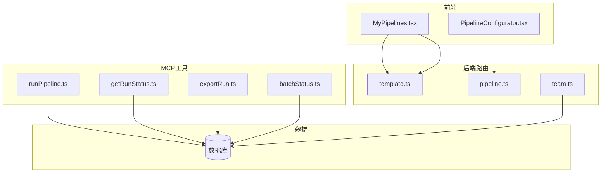
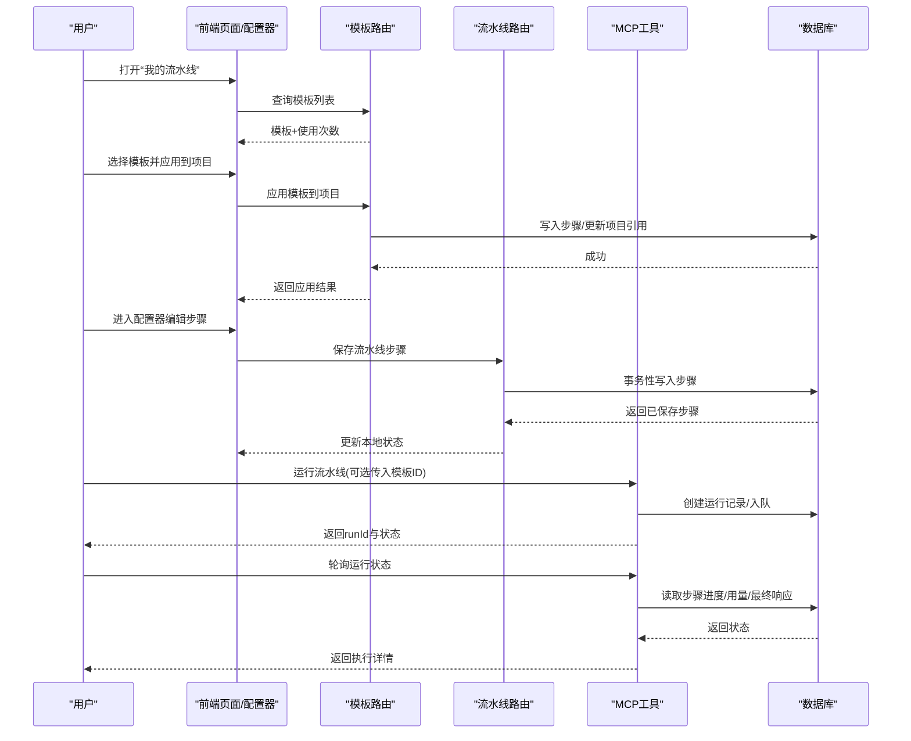
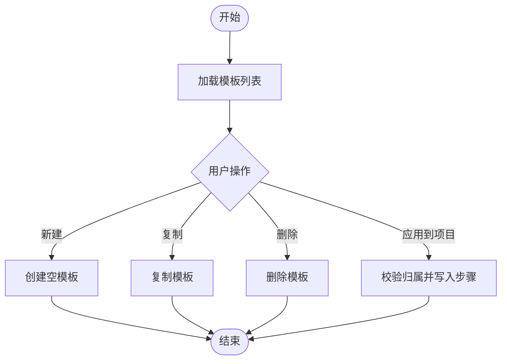
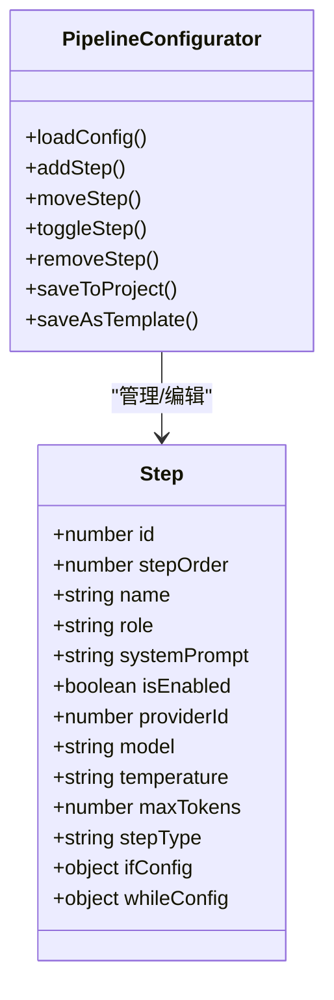
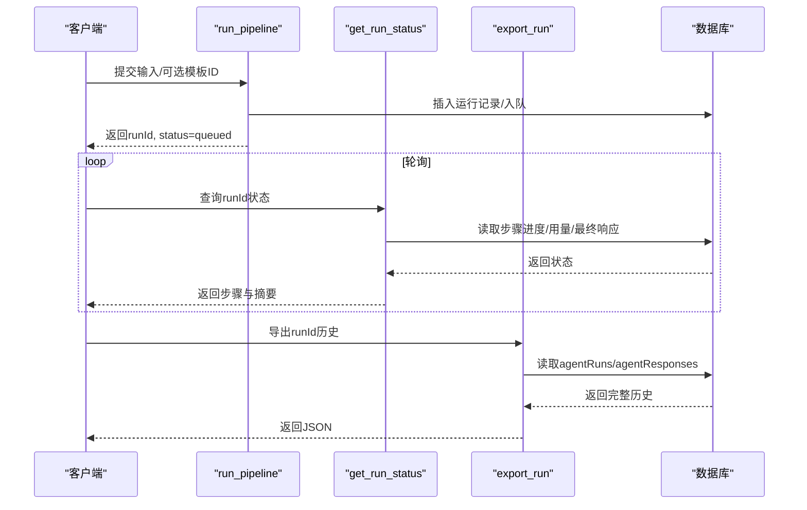
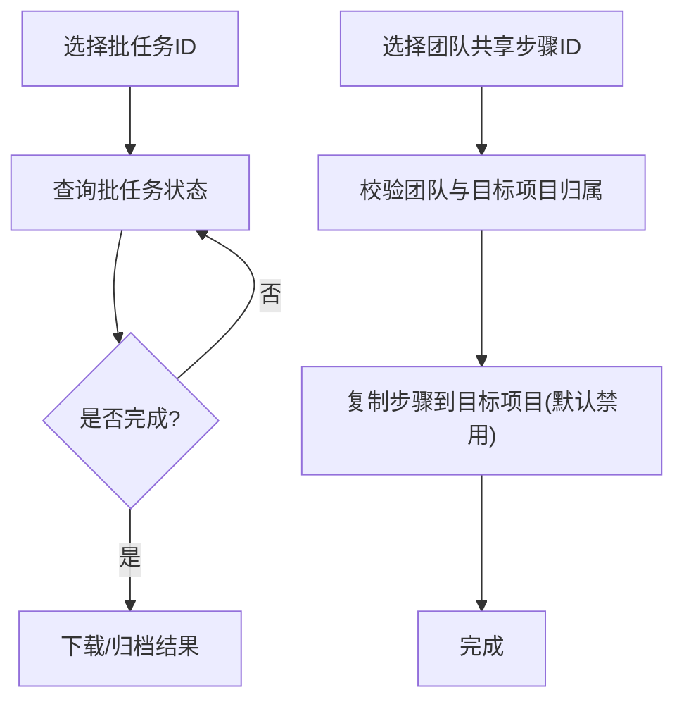
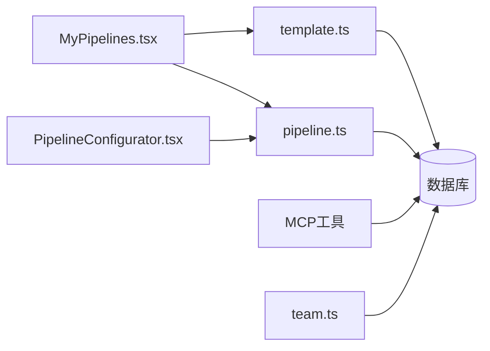

# 我的流水线页面

<cite>
**本文引用的文件**
- [src/pages/MyPipelines.tsx](file://src/pages/MyPipelines.tsx)
- [src/components/pipeline/PipelineConfigurator.tsx](file://src/components/pipeline/PipelineConfigurator.tsx)
- [api/routers/template.ts](file://api/routers/template.ts)
- [api/routers/pipeline.ts](file://api/routers/pipeline.ts)
- [api/mcp/tools/runPipeline.ts](file://api/mcp/tools/runPipeline.ts)
- [api/mcp/tools/getRunStatus.ts](file://api/mcp/tools/getRunStatus.ts)
- [api/mcp/tools/exportRun.ts](file://api/mcp/tools/exportRun.ts)
- [api/mcp/tools/batchStatus.ts](file://api/mcp/tools/batchStatus.ts)
- [api/routers/team.ts](file://api/routers/team.ts)
</cite>

## 目录
1. [简介](#简介)
2. [项目结构](#项目结构)
3. [核心组件](#核心组件)
4. [架构总览](#架构总览)
5. [详细组件分析](#详细组件分析)
6. [依赖关系分析](#依赖关系分析)
7. [性能考量](#性能考量)
8. [故障排查指南](#故障排查指南)
9. [结论](#结论)
10. [附录：API与自动化示例](#附录api与自动化示例)

## 简介
本页面面向“我的流水线”场景，提供以下能力：
- 流水线模板库管理：创建、复制、删除、应用到项目、查看使用次数。
- 版本历史与执行记录：通过运行入口创建执行记录，查询执行状态、步骤进度、资源消耗与最终结果；支持导出完整执行历史。
- 批量操作与导入导出：批量查询批任务状态；从团队共享项目中导入步骤或自定义智能体到个人项目。
- 执行监控与日志：按步骤维度查看令牌消耗、延迟、状态；失败时返回错误提示。
- 分享协作与权限控制：基于团队与项目访问控制，限制模板应用、运行、导入等操作的主体范围。
- API与自动化脚本：提供MCP工具接口用于流水线运行、状态查询与导出，便于集成自动化流程。

## 项目结构
前端以页面与配置器为核心，后端以路由与MCP工具暴露能力，数据层通过数据库持久化模板、步骤、运行记录与团队共享信息。

图表来源
- [src/pages/MyPipelines.tsx:1-341](file://src/pages/MyPipelines.tsx#L1-L341)
- [src/components/pipeline/PipelineConfigurator.tsx:1-534](file://src/components/pipeline/PipelineConfigurator.tsx#L1-L534)
- [api/routers/template.ts:1-265](file://api/routers/template.ts#L1-L265)
- [api/routers/pipeline.ts:1-327](file://api/routers/pipeline.ts#L1-L327)
- [api/mcp/tools/runPipeline.ts:1-156](file://api/mcp/tools/runPipeline.ts#L1-L156)
- [api/mcp/tools/getRunStatus.ts:1-81](file://api/mcp/tools/getRunStatus.ts#L1-L81)
- [api/mcp/tools/exportRun.ts:1-52](file://api/mcp/tools/exportRun.ts#L1-L52)
- [api/mcp/tools/batchStatus.ts:1-53](file://api/mcp/tools/batchStatus.ts#L1-L53)
- [api/routers/team.ts:1-721](file://api/routers/team.ts#L1-L721)

章节来源
- [src/pages/MyPipelines.tsx:1-341](file://src/pages/MyPipelines.tsx#L1-L341)
- [src/components/pipeline/PipelineConfigurator.tsx:1-534](file://src/components/pipeline/PipelineConfigurator.tsx#L1-L534)
- [api/routers/template.ts:1-265](file://api/routers/template.ts#L1-L265)
- [api/routers/pipeline.ts:1-327](file://api/routers/pipeline.ts#L1-L327)
- [api/routers/team.ts:1-721](file://api/routers/team.ts#L1-L721)
- [api/mcp/tools/runPipeline.ts:1-156](file://api/mcp/tools/runPipeline.ts#L1-L156)
- [api/mcp/tools/getRunStatus.ts:1-81](file://api/mcp/tools/getRunStatus.ts#L1-L81)
- [api/mcp/tools/exportRun.ts:1-52](file://api/mcp/tools/exportRun.ts#L1-L52)
- [api/mcp/tools/batchStatus.ts:1-53](file://api/mcp/tools/batchStatus.ts#L1-L53)

## 核心组件
- 我的流水线页面（模板列表）：展示用户模板卡片，支持新建空模板、复制、删除、应用到项目；根据能力位显示升级提示与功能开关。
- 流水线配置器（步骤编排）：编辑步骤顺序、启用/禁用、添加IF/WHILE/审批等特殊步骤；保存为模板或写入项目流水线；支持LLM提供者与模型选择、温度与最大Token设置。
- 模板路由：列出、获取、更新、创建空模板、从当前流水线创建模板、删除、复制、应用到项目。
- 流水线路由：读取项目步骤、覆盖保存步骤（含自动创建缺失的Agent）、创建默认流水线、查询可用LLM提供者。
- MCP工具：运行流水线、查询运行状态、导出完整执行历史、查询批任务状态。
- 团队协作：团队创建/加入/成员角色管理、项目共享/取消共享、导入团队共享的步骤或智能体、查询团队共享流水线与智能体。

章节来源
- [src/pages/MyPipelines.tsx:1-341](file://src/pages/MyPipelines.tsx#L1-L341)
- [src/components/pipeline/PipelineConfigurator.tsx:1-534](file://src/components/pipeline/PipelineConfigurator.tsx#L1-L534)
- [api/routers/template.ts:1-265](file://api/routers/template.ts#L1-L265)
- [api/routers/pipeline.ts:1-327](file://api/routers/pipeline.ts#L1-L327)
- [api/mcp/tools/runPipeline.ts:1-156](file://api/mcp/tools/runPipeline.ts#L1-L156)
- [api/mcp/tools/getRunStatus.ts:1-81](file://api/mcp/tools/getRunStatus.ts#L1-L81)
- [api/mcp/tools/exportRun.ts:1-52](file://api/mcp/tools/exportRun.ts#L1-L52)
- [api/mcp/tools/batchStatus.ts:1-53](file://api/mcp/tools/batchStatus.ts#L1-L53)
- [api/routers/team.ts:1-721](file://api/routers/team.ts#L1-L721)

## 架构总览
“我的流水线”由前端页面与配置器驱动，调用后端模板与流水线路由进行CRUD与保存；运行阶段通过MCP工具创建执行记录并交由工作队列处理；状态与导出通过MCP工具读取数据库中的运行与响应数据；团队协作通过团队路由实现共享与导入。

图表来源
- [src/pages/MyPipelines.tsx:1-341](file://src/pages/MyPipelines.tsx#L1-L341)
- [src/components/pipeline/PipelineConfigurator.tsx:1-534](file://src/components/pipeline/PipelineConfigurator.tsx#L1-L534)
- [api/routers/template.ts:1-265](file://api/routers/template.ts#L1-L265)
- [api/routers/pipeline.ts:1-327](file://api/routers/pipeline.ts#L1-L327)
- [api/mcp/tools/runPipeline.ts:1-156](file://api/mcp/tools/runPipeline.ts#L1-L156)
- [api/mcp/tools/getRunStatus.ts:1-81](file://api/mcp/tools/getRunStatus.ts#L1-L81)

## 详细组件分析

### 模板列表与生命周期
- 列表展示：按创建时间倒序，附带每个模板的使用次数统计。
- 创建空模板：生成包含默认步骤的模板，并跳转至编辑器。
- 复制/删除：支持快速复制模板或删除模板。
- 应用到项目：将模板步骤写入目标项目，若步骤中涉及Agent则按需创建或复用。

图表来源
- [api/routers/template.ts:1-265](file://api/routers/template.ts#L1-L265)
- [src/pages/MyPipelines.tsx:1-341](file://src/pages/MyPipelines.tsx#L1-L341)

章节来源
- [api/routers/template.ts:1-265](file://api/routers/template.ts#L1-L265)
- [src/pages/MyPipelines.tsx:1-341](file://src/pages/MyPipelines.tsx#L1-L341)

### 流水线配置器（步骤编排）
- 步骤类型：Agent、IF门控、WHILE循环、人工审批。
- 参数配置：LLM提供者、模型、温度、最大Token。
- 特殊步骤配置：
  - IF：定义选项与映射的目标步骤序号。
  - WHILE：设定回环目标步骤与最大迭代次数。
- 保存策略：
  - Pro用户：直接保存步骤集合（含stepType与配置）。
  - Standard用户：仅允许启用/禁用与提示词微调。
- 保存为模板：将当前步骤集保存为用户模板，并可关联项目。

图表来源
- [src/components/pipeline/PipelineConfigurator.tsx:1-534](file://src/components/pipeline/PipelineConfigurator.tsx#L1-L534)

章节来源
- [src/components/pipeline/PipelineConfigurator.tsx:1-534](file://src/components/pipeline/PipelineConfigurator.tsx#L1-L534)
- [api/routers/pipeline.ts:1-327](file://api/routers/pipeline.ts#L1-L327)

### 执行记录与状态监控
- 启动运行：通过MCP工具创建运行记录，可选择先应用模板到项目再运行；返回runId与初始状态。
- 状态查询：按runId查询当前步骤、每步Agent进度、令牌与延迟汇总、最终响应（完成时），失败时返回错误提示。
- 导出历史：导出单条运行的完整执行历史（步骤与响应内容），便于归档与分析。

图表来源
- [api/mcp/tools/runPipeline.ts:1-156](file://api/mcp/tools/runPipeline.ts#L1-L156)
- [api/mcp/tools/getRunStatus.ts:1-81](file://api/mcp/tools/getRunStatus.ts#L1-L81)
- [api/mcp/tools/exportRun.ts:1-52](file://api/mcp/tools/exportRun.ts#L1-L52)

章节来源
- [api/mcp/tools/runPipeline.ts:1-156](file://api/mcp/tools/runPipeline.ts#L1-L156)
- [api/mcp/tools/getRunStatus.ts:1-81](file://api/mcp/tools/getRunStatus.ts#L1-L81)
- [api/mcp/tools/exportRun.ts:1-52](file://api/mcp/tools/exportRun.ts#L1-L52)

### 批量操作与导入导出
- 批量状态：查询研究模式下的批任务整体进度、各子任务状态与总令牌消耗。
- 导入团队共享步骤：从团队共享项目中复制步骤到个人项目（默认禁用，需手动启用）。
- 导入团队共享智能体：将团队成员的自定义智能体复制到个人库（冲突时追加后缀）。

图表来源
- [api/mcp/tools/batchStatus.ts:1-53](file://api/mcp/tools/batchStatus.ts#L1-L53)
- [api/routers/team.ts:1-721](file://api/routers/team.ts#L1-L721)

章节来源
- [api/mcp/tools/batchStatus.ts:1-53](file://api/mcp/tools/batchStatus.ts#L1-L53)
- [api/routers/team.ts:1-721](file://api/routers/team.ts#L1-L721)

### 分享、协作与权限控制
- 项目访问控制：读取/保存流水线步骤前校验项目所有者或团队成员身份。
- 模板应用限制：仅模板所有者可将其应用到指定项目；运行流水线时如需应用模板，也要求模板与项目均属于当前用户。
- 团队共享：管理员/拥有者可共享项目给团队；团队成员可查看共享流水线与智能体，并导入到自己的项目。
- 成员角色：支持owner/admin/tester/viewer等角色，限制敏感操作（如移除成员、修改角色、共享/取消共享项目）。

章节来源
- [api/routers/pipeline.ts:1-327](file://api/routers/pipeline.ts#L1-L327)
- [api/routers/template.ts:1-265](file://api/routers/template.ts#L1-L265)
- [api/routers/team.ts:1-721](file://api/routers/team.ts#L1-L721)
- [api/mcp/tools/runPipeline.ts:1-156](file://api/mcp/tools/runPipeline.ts#L1-L156)

## 依赖关系分析
- 前端依赖：
  - MyPipelines.tsx 依赖模板路由进行列表与操作。
  - PipelineConfigurator.tsx 依赖流水线路由保存步骤与查询可用提供者。
- 后端依赖：
  - 模板路由依赖项目表统计使用次数，依赖步骤表写入/更新。
  - 流水线路由在保存步骤时批量解析/创建Agent，并在事务中写入步骤。
  - MCP工具依赖数据库表swarm_runs、agent_runs、agent_responses等。
  - 团队路由依赖teams、team_members、team_projects、projects、pipeline_steps、custom_agents等。

图表来源
- [src/pages/MyPipelines.tsx:1-341](file://src/pages/MyPipelines.tsx#L1-L341)
- [src/components/pipeline/PipelineConfigurator.tsx:1-534](file://src/components/pipeline/PipelineConfigurator.tsx#L1-L534)
- [api/routers/template.ts:1-265](file://api/routers/template.ts#L1-L265)
- [api/routers/pipeline.ts:1-327](file://api/routers/pipeline.ts#L1-L327)
- [api/mcp/tools/runPipeline.ts:1-156](file://api/mcp/tools/runPipeline.ts#L1-L156)
- [api/mcp/tools/getRunStatus.ts:1-81](file://api/mcp/tools/getRunStatus.ts#L1-L81)
- [api/mcp/tools/exportRun.ts:1-52](file://api/mcp/tools/exportRun.ts#L1-L52)
- [api/mcp/tools/batchStatus.ts:1-53](file://api/mcp/tools/batchStatus.ts#L1-L53)
- [api/routers/team.ts:1-721](file://api/routers/team.ts#L1-L721)

章节来源
- [src/pages/MyPipelines.tsx:1-341](file://src/pages/MyPipelines.tsx#L1-L341)
- [src/components/pipeline/PipelineConfigurator.tsx:1-534](file://src/components/pipeline/PipelineConfigurator.tsx#L1-L534)
- [api/routers/template.ts:1-265](file://api/routers/template.ts#L1-L265)
- [api/routers/pipeline.ts:1-327](file://api/routers/pipeline.ts#L1-L327)
- [api/routers/team.ts:1-721](file://api/routers/team.ts#L1-L721)

## 性能考量
- 批量解析Agent：保存流水线步骤时一次性查询并创建缺失的Agent，避免N+1查询。
- 事务写入：步骤保存与应用模板时使用事务保证一致性。
- 限制LLM数量：Pro用户每条流水线最多使用3个不同LLM提供者，防止过度分散。
- 分页与上限：查询运行状态时限制步骤行数与响应长度，避免过大负载。
- 缓存与失效：前端使用tRPC utils对模板列表等操作后主动失效缓存，保持UI一致。

章节来源
- [api/routers/pipeline.ts:1-327](file://api/routers/pipeline.ts#L1-L327)
- [api/routers/template.ts:1-265](file://api/routers/template.ts#L1-L265)
- [api/mcp/tools/getRunStatus.ts:1-81](file://api/mcp/tools/getRunStatus.ts#L1-L81)

## 故障排查指南
- 项目未找到/无权限：检查项目所有者或团队共享关系；确认当前用户具备所需能力位。
- 模板未找到：确认模板ID存在且属于当前用户；应用模板前确保模板与项目归属正确。
- 步骤保存失败：检查LLM提供者数量限制、必填字段与参数范围；查看服务端日志定位具体错误。
- 运行状态异常：轮询run_status直至完成或失败；失败时查看返回的错误提示；必要时导出完整历史进行分析。
- 批任务状态：使用批任务状态接口确认整体进度与失败项；针对失败项单独导出或重试。

章节来源
- [api/routers/pipeline.ts:1-327](file://api/routers/pipeline.ts#L1-L327)
- [api/routers/template.ts:1-265](file://api/routers/template.ts#L1-L265)
- [api/mcp/tools/getRunStatus.ts:1-81](file://api/mcp/tools/getRunStatus.ts#L1-L81)
- [api/mcp/tools/exportRun.ts:1-52](file://api/mcp/tools/exportRun.ts#L1-L52)
- [api/mcp/tools/batchStatus.ts:1-53](file://api/mcp/tools/batchStatus.ts#L1-L53)

## 结论
“我的流水线页面”围绕模板库、步骤编排、执行监控与团队协作构建了完整的流水线管理能力。通过模板化与标准化步骤，结合MCP工具的自动化能力，用户可以高效地设计、运行与审计AI流水线，并在团队范围内安全共享与复用。

## 附录：API与自动化示例
以下为常用API与MCP工具的使用要点（不展示代码内容，仅提供路径参考）：
- 模板管理
  - 列表/获取/更新/创建/删除/复制/应用到项目
  - 参考：[api/routers/template.ts:1-265](file://api/routers/template.ts#L1-L265)
- 流水线管理
  - 读取/保存步骤/创建默认流水线/查询可用提供者
  - 参考：[api/routers/pipeline.ts:1-327](file://api/routers/pipeline.ts#L1-L327)
- 运行与监控
  - 运行流水线（可选模板应用）
  - 查询运行状态（步骤进度、用量、最终响应）
  - 导出完整执行历史
  - 参考：
    - [api/mcp/tools/runPipeline.ts:1-156](file://api/mcp/tools/runPipeline.ts#L1-L156)
    - [api/mcp/tools/getRunStatus.ts:1-81](file://api/mcp/tools/getRunStatus.ts#L1-L81)
    - [api/mcp/tools/exportRun.ts:1-52](file://api/mcp/tools/exportRun.ts#L1-L52)
- 批量与导入
  - 批任务状态查询
  - 导入团队共享步骤/智能体
  - 参考：
    - [api/mcp/tools/batchStatus.ts:1-53](file://api/mcp/tools/batchStatus.ts#L1-L53)
    - [api/routers/team.ts:1-721](file://api/routers/team.ts#L1-L721)

章节来源
- [api/routers/template.ts:1-265](file://api/routers/template.ts#L1-L265)
- [api/routers/pipeline.ts:1-327](file://api/routers/pipeline.ts#L1-L327)
- [api/mcp/tools/runPipeline.ts:1-156](file://api/mcp/tools/runPipeline.ts#L1-L156)
- [api/mcp/tools/getRunStatus.ts:1-81](file://api/mcp/tools/getRunStatus.ts#L1-L81)
- [api/mcp/tools/exportRun.ts:1-52](file://api/mcp/tools/exportRun.ts#L1-L52)
- [api/mcp/tools/batchStatus.ts:1-53](file://api/mcp/tools/batchStatus.ts#L1-L53)
- [api/routers/team.ts:1-721](file://api/routers/team.ts#L1-L721)