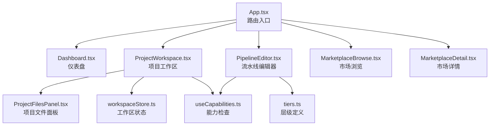
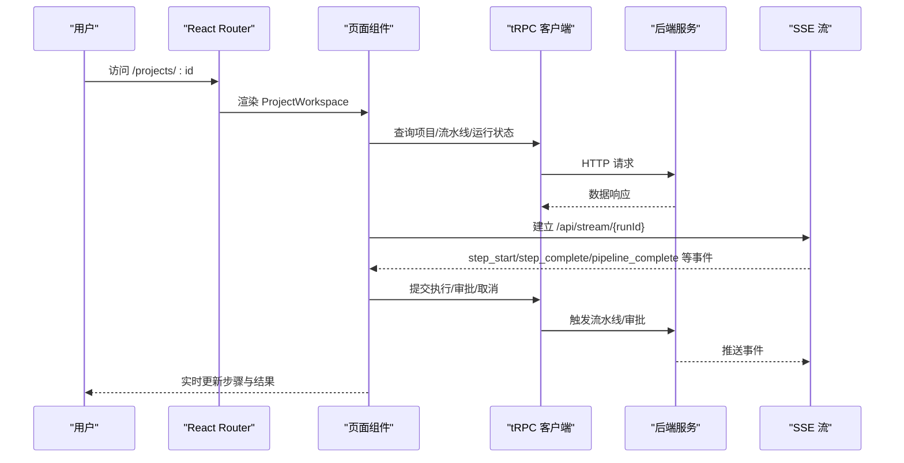
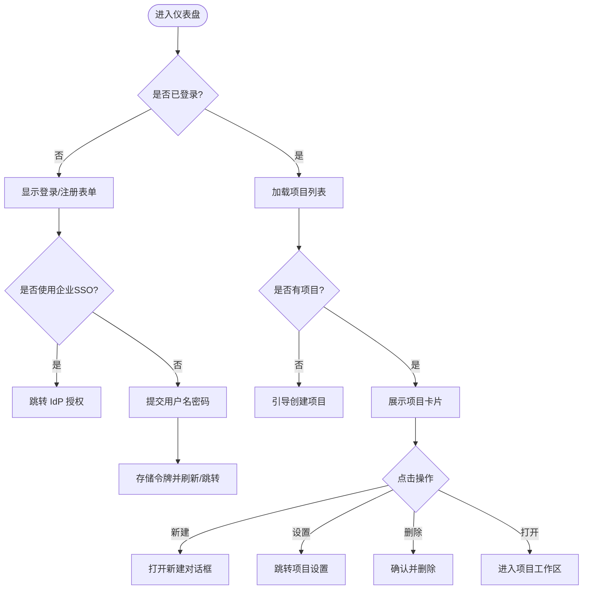
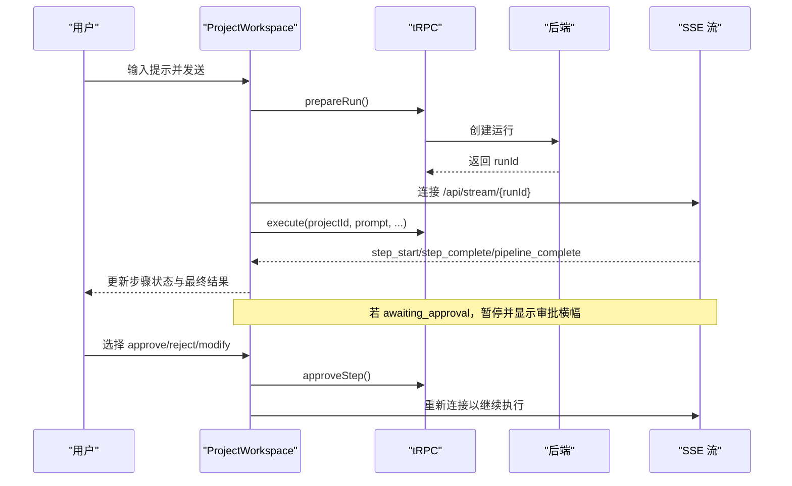
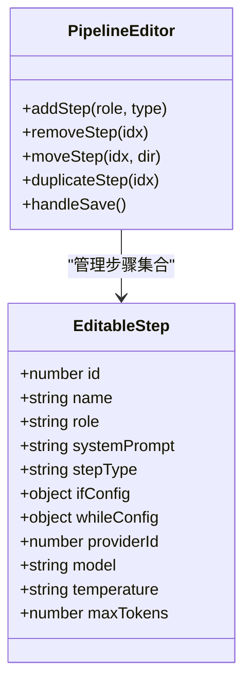
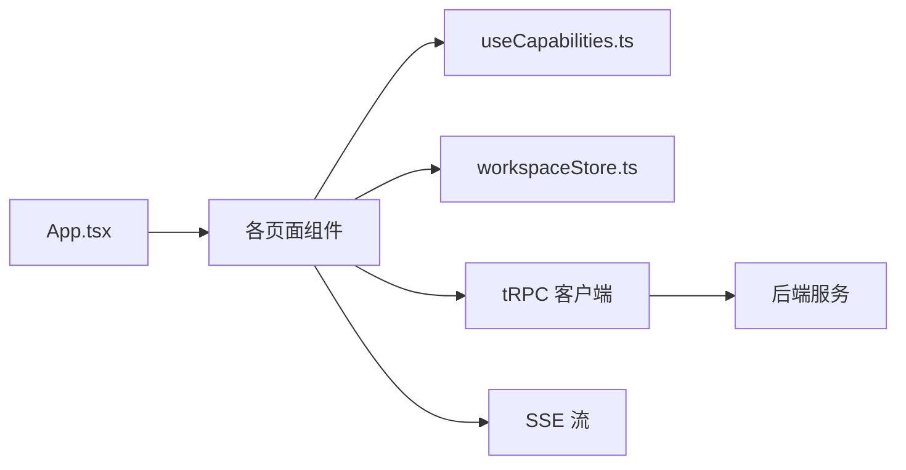

# 核心页面

<cite>
**本文引用的文件**
- [App.tsx](file://src/App.tsx)
- [Dashboard.tsx](file://src/pages/Dashboard.tsx)
- [ProjectWorkspace.tsx](file://src/pages/ProjectWorkspace.tsx)
- [PipelineEditor.tsx](file://src/pages/PipelineEditor.tsx)
- [MarketplaceBrowse.tsx](file://src/pages/MarketplaceBrowse.tsx)
- [MarketplaceDetail.tsx](file://src/pages/MarketplaceDetail.tsx)
- [ProjectFilesPanel.tsx](file://src/components/project/ProjectFilesPanel.tsx)
- [workspaceStore.ts](file://src/stores/workspaceStore.ts)
- [useCapabilities.ts](file://src/hooks/useCapabilities.ts)
- [tiers.ts](file://src/lib/tiers.ts)
</cite>

## 目录
1. [简介](#简介)
2. [项目结构](#项目结构)
3. [核心组件](#核心组件)
4. [架构总览](#架构总览)
5. [详细组件分析](#详细组件分析)
6. [依赖关系分析](#依赖关系分析)
7. [性能考虑](#性能考虑)
8. [故障排查指南](#故障排查指南)
9. [结论](#结论)
10. [附录](#附录)

## 简介
本文件为 DeeWaanAI 核心页面的权威文档，覆盖以下关键能力与交互：
- 仪表盘：项目概览、快速操作（创建项目、导入 ZIP）、用户认证与 SSO。
- 项目工作区：文件管理（本地文件夹链接、ZIP 导入、智能卡片）、代码编辑上下文开关、版本控制集成（Gitee）、流水线执行与监控（SSE 实时步骤状态、人工审批）。
- 流水线编辑器：可视化构建界面、步骤配置（Agent/条件分支/循环/人工审批）、保存与应用模板。
- 市场浏览器：工具发现、筛选排序、购买流程（Stripe Checkout）与用户评价/质量指标展示。
- 路由配置、权限控制（基于能力集 capabilities）与用户体验设计要点。
- 页面流程图与用户交互指南。

## 项目结构
前端采用 React + React Router 进行页面路由与懒加载；核心页面位于 src/pages，通用 UI 组件位于 src/components，全局状态通过 Zustand store 管理，权限由 useCapabilities 钩子提供。



图表来源
- [App.tsx:32-63](file://src/App.tsx#L32-L63)
- [Dashboard.tsx:485-555](file://src/pages/Dashboard.tsx#L485-L555)
- [ProjectWorkspace.tsx:87-160](file://src/pages/ProjectWorkspace.tsx#L87-L160)
- [PipelineEditor.tsx:47-96](file://src/pages/PipelineEditor.tsx#L47-L96)
- [MarketplaceBrowse.tsx:26-46](file://src/pages/MarketplaceBrowse.tsx#L26-L46)
- [MarketplaceDetail.tsx:25-41](file://src/pages/MarketplaceDetail.tsx#L25-L41)
- [ProjectFilesPanel.tsx:185-216](file://src/components/project/ProjectFilesPanel.tsx#L185-L216)
- [workspaceStore.ts:67-207](file://src/stores/workspaceStore.ts#L67-L207)
- [useCapabilities.ts:12-30](file://src/hooks/useCapabilities.ts#L12-L30)
- [tiers.ts:1-8](file://src/lib/tiers.ts#L1-L8)

章节来源
- [App.tsx:32-63](file://src/App.tsx#L32-L63)

## 核心组件
- 仪表盘（Dashboard）
  - 未登录时显示认证表单（本地账号或企业 SSO），支持 OAuth 返回路径安全校验。
  - 登录后展示项目列表，支持新建项目、可选上传 ZIP 初始化项目内容。
  - 项目卡片支持进入设置页、删除项目、打开工作区。
- 项目工作区（ProjectWorkspace）
  - 聊天式交互，支持“单 Agent 模式”和“多步流水线模式”。
  - 使用 SSE 实时接收流水线步骤事件，更新步骤状态与最终结果。
  - 支持人工审批（HITL）暂停与继续，支持自动设计生成流水线并持久化待运行提示。
  - 文件面板支持本地文件夹链接、ZIP 导入、智能卡片展示、搜索与上下文开关。
- 流水线编辑器（PipelineEditor）
  - 可视化编排步骤：Agent、条件分支（if）、循环（while）、人工审批（approval）。
  - 支持复制、移动、删除步骤，编辑系统提示词与参数（温度、最大 token）。
  - 保存后应用到项目或作为模板复用；受能力集限制（需 pro_designer）。
- 市场浏览器（MarketplaceBrowse / MarketplaceDetail）
  - 浏览已发布条目，支持分类筛选、排序、搜索。
  - 详情页展示描述、质量指标（评分、评论数、Kappa）、示例输入。
  - 购买流程跳转 Stripe Checkout，完成后回调至详情页；支持查看认证报告。

章节来源
- [Dashboard.tsx:38-311](file://src/pages/Dashboard.tsx#L38-L311)
- [Dashboard.tsx:315-481](file://src/pages/Dashboard.tsx#L315-L481)
- [ProjectWorkspace.tsx:58-160](file://src/pages/ProjectWorkspace.tsx#L58-L160)
- [ProjectWorkspace.tsx:235-652](file://src/pages/ProjectWorkspace.tsx#L235-L652)
- [ProjectFilesPanel.tsx:185-564](file://src/components/project/ProjectFilesPanel.tsx#L185-L564)
- [PipelineEditor.tsx:47-374](file://src/pages/PipelineEditor.tsx#L47-L374)
- [MarketplaceBrowse.tsx:26-192](file://src/pages/MarketplaceBrowse.tsx#L26-L192)
- [MarketplaceDetail.tsx:25-302](file://src/pages/MarketplaceDetail.tsx#L25-L302)

## 架构总览
前端通过 React Router 将 URL 映射到页面组件；页面通过 tRPC 调用后端 API；工作区使用 SSE 获取流水线执行进度；权限通过能力集动态控制 UI 行为。



图表来源
- [ProjectWorkspace.tsx:235-477](file://src/pages/ProjectWorkspace.tsx#L235-L477)
- [App.tsx:32-63](file://src/App.tsx#L32-L63)

## 详细组件分析

### 仪表盘（Dashboard）
- 功能要点
  - 认证表单：支持本地登录/注册与企业 SSO（OIDC/SAML），安全处理 next 参数。
  - 项目列表：展示项目名、描述、Gitee 仓库信息、创建时间；支持进入设置或删除。
  - 新建项目：可填写名称、描述，可选上传 ZIP 初始化项目内容。
- 路由与权限
  - 未登录时直接渲染认证表单；登录后刷新或跳转到 next。
  - 无额外权限门控，所有用户均可创建/删除自己的项目。
- 用户体验
  - 空状态引导创建项目；错误提示友好；SSO 失败给出明确原因。



图表来源
- [Dashboard.tsx:38-311](file://src/pages/Dashboard.tsx#L38-L311)
- [Dashboard.tsx:315-481](file://src/pages/Dashboard.tsx#L315-L481)
- [Dashboard.tsx:485-555](file://src/pages/Dashboard.tsx#L485-L555)

章节来源
- [Dashboard.tsx:38-311](file://src/pages/Dashboard.tsx#L38-L311)
- [Dashboard.tsx:315-481](file://src/pages/Dashboard.tsx#L315-L481)
- [Dashboard.tsx:485-555](file://src/pages/Dashboard.tsx#L485-L555)

### 项目工作区（ProjectWorkspace）
- 功能要点
  - 双模式执行：单 Agent 直调 LLM；多步流水线（SSE 实时反馈）。
  - 流水线可视化：顶部步骤条显示 pending/running/completed/error。
  - 人工审批：暂停等待用户 approve/reject/modify，支持恢复执行。
  - 自动设计：Pro Auto 能力可用时，根据任务自动生成流水线并保存待运行提示。
  - 文件面板：本地文件夹链接、ZIP 导入、智能卡片、搜索、上下文开关。
  - 消息持久化：按项目持久化聊天记录，支持跨设备恢复。
- 路由与权限
  - 路由：/projects/:id
  - 能力检查：pipeline:autodesign（自动设计）、pipeline:custom（自定义流水线编辑入口）。
- 用户体验
  - 运行中禁用重复发送；错误与取消有明确提示；审批状态跨导航保持。



图表来源
- [ProjectWorkspace.tsx:235-477](file://src/pages/ProjectWorkspace.tsx#L235-L477)
- [ProjectWorkspace.tsx:479-652](file://src/pages/ProjectWorkspace.tsx#L479-L652)

章节来源
- [ProjectWorkspace.tsx:58-160](file://src/pages/ProjectWorkspace.tsx#L58-L160)
- [ProjectWorkspace.tsx:235-652](file://src/pages/ProjectWorkspace.tsx#L235-L652)
- [ProjectFilesPanel.tsx:185-564](file://src/components/project/ProjectFilesPanel.tsx#L185-L564)
- [workspaceStore.ts:67-207](file://src/stores/workspaceStore.ts#L67-L207)
- [useCapabilities.ts:12-30](file://src/hooks/useCapabilities.ts#L12-L30)

### 流水线编辑器（PipelineEditor）
- 功能要点
  - 步骤类型：Agent、条件分支（if）、循环（while）、人工审批（approval）。
  - 步骤操作：添加、移动、复制、删除；展开编辑名称、角色、系统提示词、温度、最大 token。
  - 保存与复用：新建模板或更新现有模板；一键应用到项目；支持复制模板。
  - 权限控制：仅具备 pipeline:custom 的用户可编辑；自动设计需要 pipeline:autodesign。
- 路由与权限
  - 路由：/pipelines/new、/pipelines/:id/edit
  - 能力检查：pipeline:custom（编辑）、pipeline:autodesign（审批步骤）。
- 用户体验
  - 左侧为角色库与特殊步骤，右侧为步骤列表；折叠态显示系统提示摘要；保存成功/失败 toast 提示。



图表来源
- [PipelineEditor.tsx:17-36](file://src/pages/PipelineEditor.tsx#L17-L36)
- [PipelineEditor.tsx:114-179](file://src/pages/PipelineEditor.tsx#L114-L179)
- [PipelineEditor.tsx:185-194](file://src/pages/PipelineEditor.tsx#L185-L194)

章节来源
- [PipelineEditor.tsx:47-374](file://src/pages/PipelineEditor.tsx#L47-L374)
- [useCapabilities.ts:12-30](file://src/hooks/useCapabilities.ts#L12-L30)
- [tiers.ts:1-8](file://src/lib/tiers.ts#L1-L8)

### 市场浏览器（MarketplaceBrowse / MarketplaceDetail）
- 功能要点
  - 浏览：分类筛选、排序（最新/热门/评分/价格升序/降序）、关键词搜索。
  - 详情：展示描述、质量指标（评分、评论数、Kappa）、示例输入、认证报告入口。
  - 购买：未登录重定向至首页；已拥有则提示使用；否则跳转 Stripe Checkout。
- 路由与权限
  - 路由：/marketplace、/marketplace/:id
  - 能力检查：购买逻辑不依赖能力集，但认证状态影响购买入口。
- 用户体验
  - 列表项包含类别标签、状态徽章、评分与销量；详情页侧边栏突出购买卡片与统计。

```mermaid
sequenceDiagram
participant U as "用户"
participant MB as "MarketplaceBrowse"
MD as "MarketplaceDetail"
T as "tRPC"
S as "后端"
U->>MB : 浏览/筛选/搜索
MB->>T : marketplace.list(...)
T->>S : 获取已发布条目
S-->>T : 返回列表
MB-->>U : 展示条目网格
U->>MD : 点击条目查看详情
MD->>T : marketplace.getById(id)
T->>S : 获取详情
S-->>T : 返回详情
MD-->>U : 展示详情与质量指标
U->>MD : 点击购买
MD->>T : marketplace.purchase(listingId)
T->>S : 创建支付会话
S-->>T : 返回 checkoutUrl
MD-->>U : 跳转至支付页面
```

图表来源
- [MarketplaceBrowse.tsx:26-192](file://src/pages/MarketplaceBrowse.tsx#L26-L192)
- [MarketplaceDetail.tsx:25-302](file://src/pages/MarketplaceDetail.tsx#L25-L302)

章节来源
- [MarketplaceBrowse.tsx:26-192](file://src/pages/MarketplaceBrowse.tsx#L26-L192)
- [MarketplaceDetail.tsx:25-302](file://src/pages/MarketplaceDetail.tsx#L25-L302)

## 依赖关系分析
- 路由层：App.tsx 集中声明所有页面路由，并使用 Suspense 懒加载提升首屏性能。
- 权限层：useCapabilities 从 billing 接口拉取能力集，UI 通过 has(capability) 控制可见性与可操作项。
- 状态层：workspaceStore 持久化项目消息、审批状态、待运行提示与运行状态（部分），避免导航丢失。
- 数据层：tRPC 统一封装前后端契约；SSE 用于长连接事件推送。



图表来源
- [App.tsx:32-63](file://src/App.tsx#L32-L63)
- [useCapabilities.ts:12-30](file://src/hooks/useCapabilities.ts#L12-L30)
- [workspaceStore.ts:67-207](file://src/stores/workspaceStore.ts#L67-L207)

章节来源
- [App.tsx:32-63](file://src/App.tsx#L32-L63)
- [useCapabilities.ts:12-30](file://src/hooks/useCapabilities.ts#L12-L30)
- [workspaceStore.ts:67-207](file://src/stores/workspaceStore.ts#L67-L207)

## 性能考虑
- 懒加载：所有页面通过 lazy 加载，减少初始包体积。
- SSE 优化：仅在必要时建立连接，并在完成或错误时关闭；使用超时保护避免挂起。
- 状态持久化：Zustand 持久化策略剔除大附件 dataUrl，避免 localStorage 配额超限。
- 列表渲染：项目与工作区使用稳定键值与最小化更新，避免重渲染风暴。
- 网络重试：能力查询设置 staleTime 与单次重试，降低频繁请求。

[本节为通用指导，无需特定文件引用]

## 故障排查指南
- 认证与 SSO
  - 现象：登录后未跳转或报错。
  - 排查：检查 next 参数是否为同域 /oauth/*；确认 sso_token/sso_error 处理逻辑；查看本地令牌是否写入。
  - 参考实现位置：认证表单与 SSO 处理。
- 流水线执行
  - 现象：步骤卡住或无更新。
  - 排查：确认 SSE 连接是否建立；检查 step_start/step_complete/pipeline_complete 事件；验证 approve/reject/modify 后是否重新连接 SSE。
  - 参考实现位置：SSE 监听与事件处理。
- 文件导入
  - 现象：ZIP 导入失败或无法识别。
  - 排查：确认文件格式为 .zip；检查服务端返回的错误信息；验证本地文件夹权限与链接状态。
  - 参考实现位置：文件面板导入与本地文件夹链接。
- 市场购买
  - 现象：购买按钮不可用或跳转失败。
  - 排查：确认用户已登录；检查 listing 状态是否为 certifying；查看 purchase 返回的 checkoutUrl。
  - 参考实现位置：市场详情购买逻辑。

章节来源
- [Dashboard.tsx:38-311](file://src/pages/Dashboard.tsx#L38-L311)
- [ProjectWorkspace.tsx:235-477](file://src/pages/ProjectWorkspace.tsx#L235-L477)
- [ProjectFilesPanel.tsx:247-312](file://src/components/project/ProjectFilesPanel.tsx#L247-L312)
- [MarketplaceDetail.tsx:43-62](file://src/pages/MarketplaceDetail.tsx#L43-L62)

## 结论
DeeWaanAI 的核心页面围绕“项目—流水线—市场”三大主线构建：
- 仪表盘提供统一的入口与项目管理。
- 项目工作区以聊天式交互驱动流水线执行，结合 SSE 与 HITL 实现高可控的自动化流程。
- 流水线编辑器赋予高级用户强大的可视化编排能力。
- 市场浏览器打通工具发现与交易闭环，并通过质量指标增强信任。
整体架构清晰、权限解耦、体验连贯，适合持续扩展与团队协作。

[本节为总结性内容，无需特定文件引用]

## 附录

### 路由配置总览
- 根路径：/ → Dashboard
- 项目：/projects/:id → ProjectWorkspace；/projects/:id/settings → ProjectSettings；/projects/:id/audit → AuditPage
- 流水线：/pipelines → MyPipelines；/pipelines/new → PipelineEditor；/pipelines/:id/edit → PipelineEditor
- 市场：/marketplace → MarketplaceBrowse；/marketplace/:id → MarketplaceDetail
- 其他：/agents、/settings、/my-data、/team、/admin、/connect、/oauth/consent、/certification/:id、/pricing

章节来源
- [App.tsx:32-63](file://src/App.tsx#L32-L63)

### 权限控制要点
- 使用 useCapabilities 的 has(capability) 判断能力，而非直接比较 tier。
- 常见能力：
  - pipeline:custom：允许进入流水线编辑器与自定义流水线。
  - pipeline:autodesign：允许自动设计流水线与审批步骤。
  - marketplace:publish：创作者发布能力（在相关页面中使用）。
- 层级展示：TIERS 提供层级标签与描述，仅用于 UI 展示。

章节来源
- [useCapabilities.ts:12-30](file://src/hooks/useCapabilities.ts#L12-L30)
- [tiers.ts:1-8](file://src/lib/tiers.ts#L1-L8)
- [PipelineEditor.tsx:185-194](file://src/pages/PipelineEditor.tsx#L185-L194)

### 用户交互指南
- 仪表盘
  - 首次使用：注册或登录 → 创建项目 → 可选上传 ZIP 初始化。
  - 快捷操作：新建项目、进入设置、删除项目、打开工作区。
- 项目工作区
  - 单 Agent 模式：直接发送问题获得回答。
  - 流水线模式：发送提示后观察步骤条变化；如遇审批，按提示 approve/reject/modify。
  - 文件上下文：在文件面板切换“包含在聊天上下文中”，影响 AI 对项目的理解。
- 流水线编辑器
  - 从左侧角色库添加步骤；调整顺序与参数；保存后应用到项目或复用为模板。
- 市场
  - 浏览与筛选 → 查看详情 → 购买（如未拥有）→ 使用于新项目。

[本节为通用指导，无需特定文件引用]