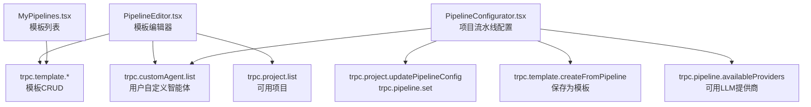
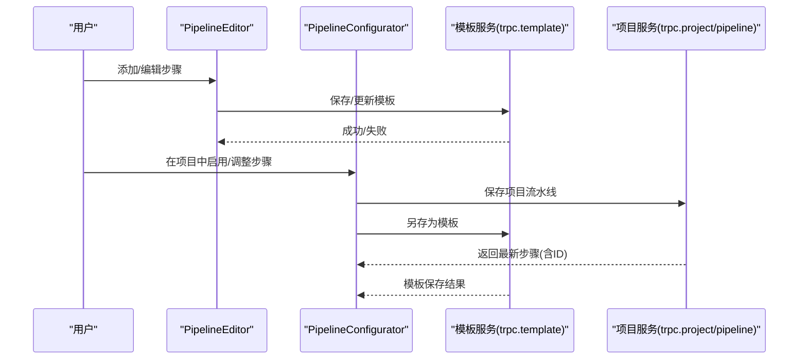
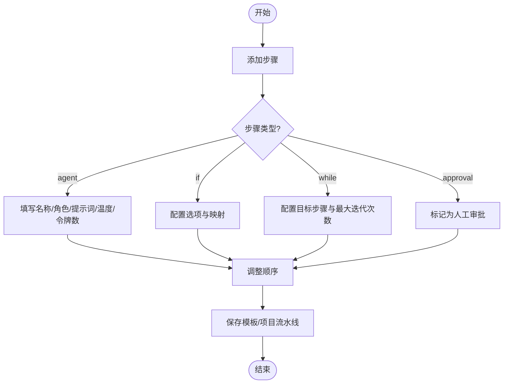
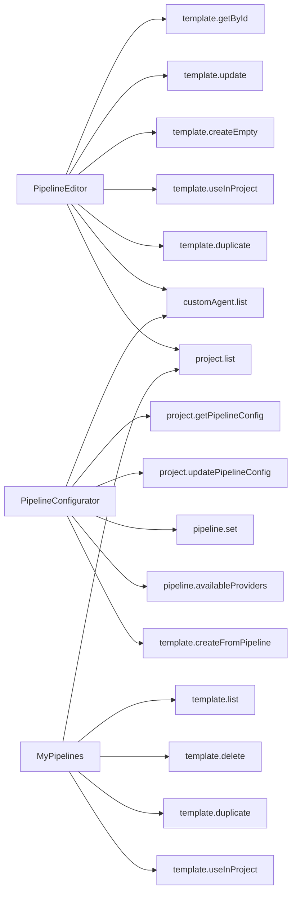

# 可视化流水线构建器

<cite>
**本文引用的文件**
- [src/pages/PipelineEditor.tsx](file://src/pages/PipelineEditor.tsx)
- [src/components/pipeline/PipelineConfigurator.tsx](file://src/components/pipeline/PipelineConfigurator.tsx)
- [src/pages/MyPipelines.tsx](file://src/pages/MyPipelines.tsx)
- [src/locales/en/pipeline.json](file://src/locales/en/pipeline.json)
- [src/locales/zh/pipeline.json](file://src/locales/zh/pipeline.json)
</cite>

## 目录
1. [简介](#简介)
2. [项目结构](#项目结构)
3. [核心组件](#核心组件)
4. [架构总览](#架构总览)
5. [详细组件分析](#详细组件分析)
6. [依赖关系分析](#依赖关系分析)
7. [性能考量](#性能考量)
8. [故障排查指南](#故障排查指南)
9. [结论](#结论)
10. [附录](#附录)

## 简介
本文件面向DeeWaanAI的“可视化流水线构建器”，聚焦以下目标：
- 说明如何在界面中通过拖拽/点击添加、排列与配置流水线步骤。
- 介绍步骤类型（agent、if、while、approval）的可视化表示与交互方式。
- 记录步骤的移动、复制、删除等编辑操作。
- 说明步骤展开/折叠、系统提示词编辑与参数配置界面。
- 提供流水线模板加载与保存功能的使用指南。

该构建器由两个主要前端模块组成：
- 模板编辑器：用于创建、编辑和保存可复用的流水线模板。
- 项目流水线配置器：用于在当前项目中启用/调整步骤，并保存为项目级流水线或另存为模板。

## 项目结构
与可视化流水线构建器直接相关的代码组织如下：
- 页面层
  - PipelineEditor：模板编辑器页面，负责模板的新建、编辑、保存、复用到项目。
  - MyPipelines：模板列表页，支持创建、应用、复制、删除模板。
- 组件层
  - PipelineConfigurator：项目内流水线配置面板，支持步骤增删改查、参数配置、保存为模板。
- 国际化
  - en/zh 下的 pipeline.json 提供界面文案。

图表来源
- [src/pages/PipelineEditor.tsx:59-112](file://src/pages/PipelineEditor.tsx#L59-L112)
- [src/components/pipeline/PipelineConfigurator.tsx:51-87](file://src/components/pipeline/PipelineConfigurator.tsx#L51-L87)
- [src/pages/MyPipelines.tsx:52-85](file://src/pages/MyPipelines.tsx#L52-L85)

章节来源
- [src/pages/PipelineEditor.tsx:1-374](file://src/pages/PipelineEditor.tsx#L1-L374)
- [src/components/pipeline/PipelineConfigurator.tsx:1-534](file://src/components/pipeline/PipelineConfigurator.tsx#L1-L534)
- [src/pages/MyPipelines.tsx:1-341](file://src/pages/MyPipelines.tsx#L1-L341)

## 核心组件
- 模板编辑器（PipelineEditor）
  - 左侧“智能体库”：内置角色（Builder/Critic/Refiner/Polisher/Expert/Translator）、特殊步骤（IF、WHILE、Approval），以及用户自定义智能体。
  - 右侧步骤列表：显示步骤序号、图标、名称、类型；支持展开/折叠、移动、复制、删除；展开后可编辑名称、角色、系统提示词、温度、最大令牌数、步骤类型及条件配置。
  - 顶部工具栏：命名、描述、复制到项目、复制模板、保存。
- 项目流水线配置器（PipelineConfigurator）
  - 步骤卡片：显示顺序号、角色标签、类型标签（IF/WHILE/Approval）、当前LLM信息、启用开关、删除按钮。
  - 编辑模式：点击提示词进入编辑，支持选择LLM提供商与模型、设置温度与最大令牌数；IF/WHILE步骤有专属配置区。
  - 记忆模式：保守/平衡/积极三种上下文保留策略。
  - 保存与导出：保存为项目流水线或另存为模板。
- 模板列表（MyPipelines）
  - 展示所有模板及其步骤类型统计、使用次数。
  - 支持新建、应用到项目、复制、删除。

章节来源
- [src/pages/PipelineEditor.tsx:17-136](file://src/pages/PipelineEditor.tsx#L17-L136)
- [src/components/pipeline/PipelineConfigurator.tsx:24-196](file://src/components/pipeline/PipelineConfigurator.tsx#L24-L196)
- [src/pages/MyPipelines.tsx:39-85](file://src/pages/MyPipelines.tsx#L39-L85)

## 架构总览
从用户操作到数据落盘的典型流程：

图表来源
- [src/pages/PipelineEditor.tsx:98-179](file://src/pages/PipelineEditor.tsx#L98-L179)
- [src/components/pipeline/PipelineConfigurator.tsx:55-87](file://src/components/pipeline/PipelineConfigurator.tsx#L55-L87)

## 详细组件分析

### 步骤类型与可视化表示
- agent：默认执行步骤，使用Bot图标，蓝色主题。
- if：条件分支，使用GitBranch图标，琥珀色主题；支持配置选项与映射。
- while：循环控制，使用RefreshCw图标，紫色主题；支持目标步骤与最大迭代次数。
- approval：人工审批，使用UserCheck图标，绿色主题；流水线暂停等待人工确认。

这些类型在编辑器与配置器中均有统一的视觉标识与交互入口。

章节来源
- [src/pages/PipelineEditor.tsx:31-45](file://src/pages/PipelineEditor.tsx#L31-L45)
- [src/components/pipeline/PipelineConfigurator.tsx:318-328](file://src/components/pipeline/PipelineConfigurator.tsx#L318-L328)
- [src/pages/MyPipelines.tsx:39-44](file://src/pages/MyPipelines.tsx#L39-L44)

### 步骤添加、排列与配置界面
- 添加步骤
  - 模板编辑器：左侧“智能体库”点击即添加；新增后自动展开以便编辑。
  - 项目配置器：点击“添加步骤”弹窗，可选择用户智能体、内置模板或特殊步骤（IF/WHILE/Approval）。
- 排列步骤
  - 模板编辑器：通过上下箭头移动步骤顺序。
  - 项目配置器：通过上下箭头移动，并自动重排stepOrder。
- 配置步骤
  - 通用字段：名称、角色、系统提示词、温度、最大令牌数、步骤类型。
  - IF配置：选项（逗号分隔关键词）与映射（关键词→目标步骤序号）。
  - WHILE配置：目标步骤、最大迭代次数。
  - 项目配置器还支持选择LLM提供商与模型。

图表来源
- [src/pages/PipelineEditor.tsx:114-136](file://src/pages/PipelineEditor.tsx#L114-L136)
- [src/components/pipeline/PipelineConfigurator.tsx:145-196](file://src/components/pipeline/PipelineConfigurator.tsx#L145-L196)

章节来源
- [src/pages/PipelineEditor.tsx:114-179](file://src/pages/PipelineEditor.tsx#L114-L179)
- [src/components/pipeline/PipelineConfigurator.tsx:122-236](file://src/components/pipeline/PipelineConfigurator.tsx#L122-L236)

### 步骤移动、复制、删除等编辑操作
- 移动：模板编辑器与项目配置器均提供上下移动按钮；项目配置器在移动时同步更新stepOrder。
- 复制：模板编辑器支持复制步骤；项目配置器可通过“添加步骤”弹窗重复添加相同智能体（已存在会禁用）。
- 删除：模板编辑器直接删除；项目配置器删除前弹出确认。

章节来源
- [src/pages/PipelineEditor.tsx:138-156](file://src/pages/PipelineEditor.tsx#L138-L156)
- [src/components/pipeline/PipelineConfigurator.tsx:122-143](file://src/components/pipeline/PipelineConfigurator.tsx#L122-L143)

### 步骤展开/折叠与系统提示词编辑
- 模板编辑器：点击步骤头部展开/折叠；折叠时显示提示词摘要，超过长度以省略号显示并提供展开提示。
- 项目配置器：点击提示词区域进入编辑模式，保存或取消后回到只读视图。

章节来源
- [src/pages/PipelineEditor.tsx:281-319](file://src/pages/PipelineEditor.tsx#L281-L319)
- [src/components/pipeline/PipelineConfigurator.tsx:337-350](file://src/components/pipeline/PipelineConfigurator.tsx#L337-L350)

### 参数配置界面
- 通用参数：温度（0-2）、最大令牌数（默认4096，项目配置器支持更大范围）。
- 项目配置器额外能力：
  - 选择LLM提供商与模型（受限于项目可用提供商）。
  - 限制每个流水线最多使用3个不同LLM（专业设计师版）。
  - 记忆模式：保守/平衡/积极，影响对话间上下文保留量。

章节来源
- [src/components/pipeline/PipelineConfigurator.tsx:352-458](file://src/components/pipeline/PipelineConfigurator.tsx#L352-L458)
- [src/components/pipeline/PipelineConfigurator.tsx:275-289](file://src/components/pipeline/PipelineConfigurator.tsx#L275-L289)

### 流水线模板加载与保存
- 加载模板
  - 模板编辑器：根据URL中的模板ID加载模板数据，若为新模板则预置一个基础Builder步骤。
  - 项目配置器：从项目配置中读取现有步骤，并映射到本地状态。
- 保存模板
  - 模板编辑器：新建时先创建空模板，再异步写入步骤；已有模板直接更新。
  - 项目配置器：可将当前项目流水线“另存为模板”，输入名称后保存。
- 应用到项目
  - 模板编辑器与模板列表页均可将模板应用到指定项目。

章节来源
- [src/pages/PipelineEditor.tsx:59-112](file://src/pages/PipelineEditor.tsx#L59-L112)
- [src/pages/PipelineEditor.tsx:158-179](file://src/pages/PipelineEditor.tsx#L158-L179)
- [src/components/pipeline/PipelineConfigurator.tsx:95-113](file://src/components/pipeline/PipelineConfigurator.tsx#L95-L113)
- [src/components/pipeline/PipelineConfigurator.tsx:476-486](file://src/components/pipeline/PipelineConfigurator.tsx#L476-L486)
- [src/pages/MyPipelines.tsx:58-85](file://src/pages/MyPipelines.tsx#L58-L85)

### 权限与版本差异
- 专业设计师版（Master）：可自定义流水线（排序、添加步骤、分配LLM等）。
- 标准版：仅能查看与微调（如启用/关闭、修改提示词），高级能力需升级。
- Sage能力：解锁“人工审批”等特殊步骤。

章节来源
- [src/pages/PipelineEditor.tsx:55-58](file://src/pages/PipelineEditor.tsx#L55-L58)
- [src/components/pipeline/PipelineConfigurator.tsx:47-49](file://src/components/pipeline/PipelineConfigurator.tsx#L47-L49)
- [src/pages/MyPipelines.tsx:68-73](file://src/pages/MyPipelines.tsx#L68-L73)

## 依赖关系分析
- 模板编辑器依赖
  - trpc.template.getById/update/createEmpty/useInProject/duplicate
  - trpc.customAgent.list
  - trpc.project.list
- 项目配置器依赖
  - trpc.project.getPipelineConfig/updatePipelineConfig
  - trpc.pipeline.set/availableProviders
  - trpc.template.createFromPipeline
  - trpc.customAgent.list
- 模板列表页依赖
  - trpc.template.list/delete/duplicate/useInProject
  - trpc.project.list

图表来源
- [src/pages/PipelineEditor.tsx:59-112](file://src/pages/PipelineEditor.tsx#L59-L112)
- [src/components/pipeline/PipelineConfigurator.tsx:51-87](file://src/components/pipeline/PipelineConfigurator.tsx#L51-L87)
- [src/pages/MyPipelines.tsx:52-85](file://src/pages/MyPipelines.tsx#L52-L85)

章节来源
- [src/pages/PipelineEditor.tsx:59-112](file://src/pages/PipelineEditor.tsx#L59-L112)
- [src/components/pipeline/PipelineConfigurator.tsx:51-87](file://src/components/pipeline/PipelineConfigurator.tsx#L51-L87)
- [src/pages/MyPipelines.tsx:52-85](file://src/pages/MyPipelines.tsx#L52-L85)

## 性能考量
- 渲染优化
  - 步骤列表采用扁平数组与索引管理，避免深层嵌套导致的重渲染。
  - 折叠状态下仅显示提示词摘要，减少DOM体积。
- 网络请求
  - 使用React Query（trpc）缓存与失效机制，减少重复请求。
  - 保存成功后主动invalidate相关查询，确保UI与数据一致。
- 内存与上下文
  - 记忆模式可在项目级别控制上下文保留量，平衡质量与成本。

[本节为通用指导，不直接分析具体文件]

## 故障排查指南
- 无法创建/编辑模板
  - 检查是否具备“pipeline:custom”能力；否则会被锁定并提示升级。
- 保存失败
  - 模板编辑器：确保名称非空；检查网络错误提示。
  - 项目配置器：确保至少有一个步骤；注意LLM数量限制（最多3个不同提供商）。
- 步骤未生效
  - 确认步骤处于启用状态；保存后刷新页面或等待状态同步。
- 提示词未保存
  - 在模板编辑器中，展开步骤后编辑提示词，失焦或显式保存；在项目配置器中，点击保存按钮。

章节来源
- [src/pages/PipelineEditor.tsx:158-183](file://src/pages/PipelineEditor.tsx#L158-L183)
- [src/components/pipeline/PipelineConfigurator.tsx:198-236](file://src/components/pipeline/PipelineConfigurator.tsx#L198-L236)

## 结论
DeeWaanAI的可视化流水线构建器提供了直观的步骤管理与配置能力，覆盖从模板创建到项目级流水线应用的完整工作流。通过统一的步骤类型表示、灵活的参数配置与清晰的权限控制，用户可以在不同层级高效地编排智能体执行序列，并将成果沉淀为可复用的模板。

[本节为总结性内容，不直接分析具体文件]

## 附录
- 界面文案与多语言
  - 英文与中文文案位于对应locale文件中，涵盖标题、提示、错误信息等。
- 常用操作速查
  - 添加步骤：左侧库或“添加步骤”弹窗。
  - 调整顺序：上下箭头。
  - 编辑提示词：点击提示词区域进入编辑。
  - 保存：模板编辑器“保存”；项目配置器“保存”或“另存为模板”。
  - 应用到项目：模板编辑器或模板列表页的“应用到项目”。

章节来源
- [src/locales/en/pipeline.json:1-51](file://src/locales/en/pipeline.json#L1-L51)
- [src/locales/zh/pipeline.json:1-51](file://src/locales/zh/pipeline.json#L1-L51)