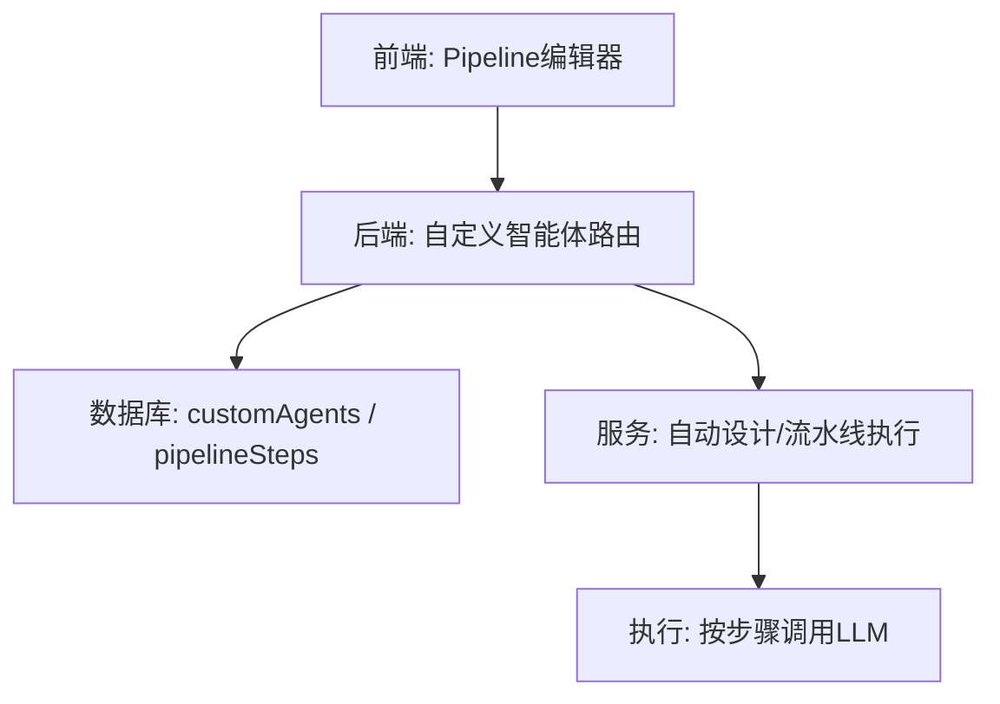
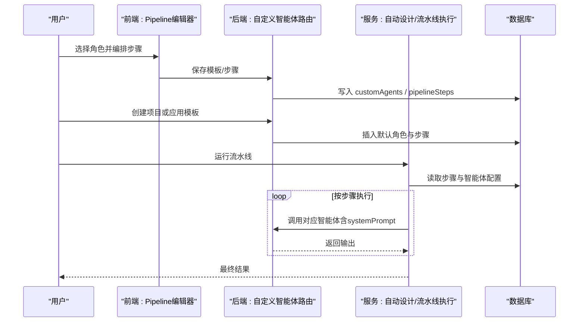
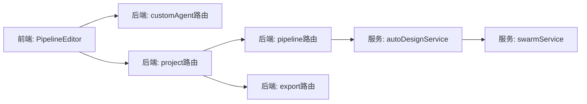

# 智能体角色库

<cite>
**本文引用的文件**
- [PipelineEditor.tsx](file://src/pages/PipelineEditor.tsx)
- [customAgent.ts](file://api/routers/customAgent.ts)
- [project.ts](file://api/routers/project.ts)
- [pipeline.ts](file://api/routers/pipeline.ts)
- [export.ts](file://api/routers/export.ts)
- [autoDesignService.ts](file://api/services/autoDesignService.ts)
- [swarmService.ts](file://api/services/swarmService.ts)
- [agents.json（中文）](file://src/locales/zh/agents.json)
- [agents.json（英文）](file://src/locales/en/agents.json)
</cite>

## 目录
1. [简介](#简介)
2. [项目结构](#项目结构)
3. [核心组件](#核心组件)
4. [架构总览](#架构总览)
5. [详细组件分析](#详细组件分析)
6. [依赖关系分析](#依赖关系分析)
7. [性能考量](#性能考量)
8. [故障排查指南](#故障排查指南)
9. [结论](#结论)
10. [附录](#附录)

## 简介
本文件为 DeeWaanAI 智能体角色库的权威文档，聚焦内置角色：Builder（内容构建者）、Critic（批评者）、Refiner（优化者）、Polisher（润色者）、Expert（专家）、Translator（翻译者）。文档说明每个角色的预设系统提示词、适用场景与使用模式；记录自定义角色的创建与管理方法；并总结角色在流水线中的协作模式与最佳实践。

## 项目结构
- 前端可视化编排器：提供角色模板、步骤编辑、条件分支与循环配置，便于用户组合出多角色流水线。
- 后端路由与服务：负责默认模板定义、项目初始化时自动创建默认角色与步骤、导入导出、以及执行时的流水线调度。
- 国际化资源：提供角色名称与描述的多语言文案。

图表来源
- [PipelineEditor.tsx:38-45](file://src/pages/PipelineEditor.tsx#L38-L45)
- [customAgent.ts:8-65](file://api/routers/customAgent.ts#L8-L65)
- [project.ts:218-224](file://api/routers/project.ts#L218-L224)
- [pipeline.ts:243-269](file://api/routers/pipeline.ts#L243-L269)

章节来源
- [PipelineEditor.tsx:38-45](file://src/pages/PipelineEditor.tsx#L38-L45)
- [customAgent.ts:8-65](file://api/routers/customAgent.ts#L8-L65)
- [project.ts:218-224](file://api/routers/project.ts#L218-L224)
- [pipeline.ts:243-269](file://api/routers/pipeline.ts#L243-L269)

## 核心组件
- 内置角色模板：由后端提供，包含名称、标识符、角色类型、系统提示词与描述。
- 前端角色面板：展示可用角色与特殊步骤（IF/WHILE/人工审核），支持拖拽式编排。
- 项目初始化：为新项目自动创建默认角色与步骤，确保开箱即用。
- 自定义智能体：用户可创建、更新、删除自己的智能体，并在流水线中复用。
- 流水线执行：根据步骤顺序与条件控制，依次调用各角色智能体完成内容生产与质量把关。

章节来源
- [customAgent.ts:8-65](file://api/routers/customAgent.ts#L8-L65)
- [PipelineEditor.tsx:38-45](file://src/pages/PipelineEditor.tsx#L38-L45)
- [project.ts:218-224](file://api/routers/project.ts#L218-L224)
- [pipeline.ts:243-269](file://api/routers/pipeline.ts#L243-L269)

## 架构总览
下图展示了从用户在前端编排到后端执行的核心流程，包括角色模板加载、项目默认流水线生成、以及执行时的步骤调度。

图表来源
- [PipelineEditor.tsx:114-136](file://src/pages/PipelineEditor.tsx#L114-L136)
- [customAgent.ts:82-126](file://api/routers/customAgent.ts#L82-L126)
- [project.ts:218-242](file://api/routers/project.ts#L218-L242)
- [pipeline.ts:243-269](file://api/routers/pipeline.ts#L243-L269)

## 详细组件分析

### 内置角色定义与系统提示词
- Builder（内容构建者）
  - 职责：基于请求生成完整、结构化且全面的初稿。
  - 典型系统提示词要点：强调完整性与准确性，产出良好结构的草稿。
  - 适用场景：首次内容生成、长文起草、方案初稿。
  - 使用模式：通常作为流水线首步。
  - 参考位置：[customAgent.ts:8-15](file://api/routers/customAgent.ts#L8-L15)、[project.ts:218-224](file://api/routers/project.ts#L218-L224)、[PipelineEditor.tsx:38-45](file://src/pages/PipelineEditor.tsx#L38-L45)

- Critic（批评者）
  - 职责：审阅输出，识别弱点、事实错误与改进点，给出具体建议。
  - 典型系统提示词要点：明确评估维度，结尾给出总体评估结论（如通过/需修改/重大修订）。
  - 适用场景：质量门禁、问题定位、评审反馈。
  - 使用模式：置于 Builder 之后，用于把关与打分。
  - 参考位置：[customAgent.ts:16-22](file://api/routers/customAgent.ts#L16-L22)、[project.ts:218-224](file://api/routers/project.ts#L218-L224)、[PipelineEditor.tsx:38-45](file://src/pages/PipelineEditor.tsx#L38-L45)

- Refiner（优化者）
  - 职责：依据反馈系统性修复问题，产出显著改进版本。
  - 典型系统提示词要点：逐条回应批评，保持原意同时提升质量。
  - 适用场景：迭代优化、纠错增强、质量提升。
  - 使用模式：紧随 Critic，形成“构建-批评-优化”闭环。
  - 参考位置：[customAgent.ts:23-29](file://api/routers/customAgent.ts#L23-L29)、[project.ts:218-224](file://api/routers/project.ts#L218-L224)、[PipelineEditor.tsx:38-45](file://src/pages/PipelineEditor.tsx#L38-L45)

- Polisher（润色者）
  - 职责：对优化后的内容进行最终打磨，确保表达清晰、连贯、专业。
  - 典型系统提示词要点：关注清晰度、流畅度、格式与语气，作为最终质量检查。
  - 适用场景：发布前终检、风格统一、可读性提升。
  - 使用模式：位于流水线末尾，作为交付前的最后一道关卡。
  - 参考位置：[customAgent.ts:30-36](file://api/routers/customAgent.ts#L30-L36)、[project.ts:218-224](file://api/routers/project.ts#L218-L224)、[PipelineEditor.tsx:38-45](file://src/pages/PipelineEditor.tsx#L38-L45)

- Expert（专家）
  - 职责：提供领域专业知识与深度分析，丰富内容专业性。
  - 典型系统提示词要点：强调领域专长、专业洞察与知识补充。
  - 适用场景：专业内容增强、技术/行业分析、知识注入。
  - 使用模式：可在任意阶段插入，用于强化特定领域的深度。
  - 参考位置：[PipelineEditor.tsx:38-45](file://src/pages/PipelineEditor.tsx#L38-L45)

- Translator（翻译者）
  - 职责：将上一轮输出翻译为目标语言，保持语义、语气与上下文。
  - 典型系统提示词要点：仅输出译文，不附加解释或JSON包装，保证自然流畅。
  - 适用场景：多语言内容生产、本地化、跨语种分发。
  - 使用模式：通常在内容定稿后，进行目标语言转换。
  - 参考位置：[PipelineEditor.tsx:38-45](file://src/pages/PipelineEditor.tsx#L38-L45)

章节来源
- [customAgent.ts:8-65](file://api/routers/customAgent.ts#L8-L65)
- [project.ts:218-224](file://api/routers/project.ts#L218-L224)
- [PipelineEditor.tsx:38-45](file://src/pages/PipelineEditor.tsx#L38-L45)

### 自定义角色的创建与管理
- 创建
  - 通过“我的智能体”页面，填写名称、唯一标识符（slug）、角色、系统提示词、可选描述与模型参数。
  - 支持从内置模板快速开始，或直接从零创建。
  - 校验规则：必填字段、唯一 slug、长度限制等。
  - 参考位置：[customAgent.ts:82-126](file://api/routers/customAgent.ts#L82-L126)、[agents.json（中文）:26-46](file://src/locales/zh/agents.json#L26-L46)

- 更新与删除
  - 可更新名称、系统提示词、描述及模型参数。
  - 支持删除已创建的自定义智能体。
  - 参考位置：[customAgent.ts:128-165](file://api/routers/customAgent.ts#L128-L165)

- 导入与导出
  - 支持批量导入自定义智能体（跳过重复slug）。
  - 支持导出流水线（包含步骤与智能体配置，含系统提示词）。
  - 参考位置：[export.ts:100-142](file://api/routers/export.ts#L100-L142)

- 在流水线中使用
  - 在 Pipeline 编辑器左侧“我的智能体”区域添加自定义智能体到步骤。
  - 可为每个步骤设置温度、最大令牌数、所属提供商与模型。
  - 参考位置：[PipelineEditor.tsx:257-269](file://src/pages/PipelineEditor.tsx#L257-L269)

章节来源
- [customAgent.ts:82-165](file://api/routers/customAgent.ts#L82-L165)
- [export.ts:100-142](file://api/routers/export.ts#L100-L142)
- [PipelineEditor.tsx:257-269](file://src/pages/PipelineEditor.tsx#L257-L269)
- [agents.json（中文）:26-46](file://src/locales/zh/agents.json#L26-L46)

### 流水线中的协作模式
- 经典四步流水线：Builder → Critic → Refiner → Polisher
  - 构建初稿 → 质量评审 → 针对性优化 → 最终打磨
  - 适合大多数内容生产任务，兼顾效率与质量。
  - 参考位置：[project.ts:218-242](file://api/routers/project.ts#L218-L242)、[pipeline.ts:243-269](file://api/routers/pipeline.ts#L243-L269)

- 条件门控（IF）
  - 在 Critic 或自定义评审步骤后加入 IF 门控，根据关键词（如 pass/revise）决定下一步。
  - 若判定需要修订，则回退到最近的 Refiner 或 Builder 继续优化。
  - 参考位置：[PipelineEditor.tsx:114-136](file://src/pages/PipelineEditor.tsx#L114-L136)、[autoDesignService.ts:82-94](file://api/services/autoDesignService.ts#L82-L94)

- 循环优化（WHILE）
  - 在 WHILE 步骤中，评审智能体输出“retry/pass”，达到阈值或质量达标后继续。
  - 可配置最大迭代次数，避免无限循环。
  - 参考位置：[PipelineEditor.tsx:114-136](file://src/pages/PipelineEditor.tsx#L114-L136)、[autoDesignService.ts:93-94](file://api/services/autoDesignService.ts#L93-L94)

- 人工审核（Approval）
  - 在关键节点暂停流水线，等待人工审批（批准/拒绝/修改并附说明）。
  - 适用于合规审查、敏感内容把关。
  - 参考位置：[PipelineEditor.tsx:114-136](file://src/pages/PipelineEditor.tsx#L114-L136)、[agents.json（中文）:63-72](file://src/locales/zh/agents.json#L63-L72)

- 执行与回退
  - 执行时读取步骤顺序与配置，按序调用智能体；遇到条件分支或循环时按配置跳转。
  - 若未配置自定义流水线，则回退到旧版级联代理执行。
  - 参考位置：[swarmService.ts:1336-1362](file://api/services/swarmService.ts#L1336-L1362)

章节来源
- [project.ts:218-242](file://api/routers/project.ts#L218-L242)
- [pipeline.ts:243-269](file://api/routers/pipeline.ts#L243-L269)
- [PipelineEditor.tsx:114-136](file://src/pages/PipelineEditor.tsx#L114-L136)
- [autoDesignService.ts:82-94](file://api/services/autoDesignService.ts#L82-L94)
- [agents.json（中文）:63-72](file://src/locales/zh/agents.json#L63-L72)
- [swarmService.ts:1336-1362](file://api/services/swarmService.ts#L1336-L1362)

### 最佳实践
- 角色分工明确：Builder 专注“从无到有”，Critic 专注“发现问题”，Refiner 专注“解决问题”，Polisher 专注“呈现质量”。
- 合理嵌入 Expert：在需要专业深度的环节插入 Expert，增强内容的权威性与可信度。
- 善用 Translator：在内容定稿后进行多语言转换，确保译文自然流畅且不附加多余信息。
- 质量控制：使用 IF/WHILE 门控与循环，结合 Critic 的评估结论，实现自动化质量闭环。
- 参数调优：针对不同步骤调整温度与最大令牌数，平衡创造性与稳定性。
- 可移植性：通过导出功能备份流水线与智能体配置，便于迁移与共享。

[本节为通用指导，无需代码引用]

## 依赖关系分析
- 前端依赖：PipelineEditor 暴露角色模板与步骤编辑器，供用户编排流水线。
- 后端依赖：
  - customAgent 路由提供默认模板与CRUD能力。
  - project/pipeline 路由在项目创建与模板应用时写入默认步骤与智能体。
  - export 路由支持导入/导出智能体与流水线。
  - autoDesignService 提供自动设计流水线的约束与策略。
  - swarmService 负责实际执行流水线，兼容新旧两种执行模式。

图表来源
- [PipelineEditor.tsx:38-45](file://src/pages/PipelineEditor.tsx#L38-L45)
- [customAgent.ts:8-65](file://api/routers/customAgent.ts#L8-L65)
- [project.ts:218-242](file://api/routers/project.ts#L218-L242)
- [pipeline.ts:243-269](file://api/routers/pipeline.ts#L243-L269)
- [export.ts:100-142](file://api/routers/export.ts#L100-L142)
- [autoDesignService.ts:82-94](file://api/services/autoDesignService.ts#L82-L94)
- [swarmService.ts:1336-1362](file://api/services/swarmService.ts#L1336-L1362)

章节来源
- [PipelineEditor.tsx:38-45](file://src/pages/PipelineEditor.tsx#L38-L45)
- [customAgent.ts:8-65](file://api/routers/customAgent.ts#L8-L65)
- [project.ts:218-242](file://api/routers/project.ts#L218-L242)
- [pipeline.ts:243-269](file://api/routers/pipeline.ts#L243-L269)
- [export.ts:100-142](file://api/routers/export.ts#L100-L142)
- [autoDesignService.ts:82-94](file://api/services/autoDesignService.ts#L82-L94)
- [swarmService.ts:1336-1362](file://api/services/swarmService.ts#L1336-L1362)

## 性能考量
- 步骤数量与复杂度：过多的步骤或深层嵌套会延长执行时间，建议精简必要步骤。
- 模型参数：较高的温度可能增加创造性但降低稳定性；较大的最大令牌数会增加成本与延迟。
- 条件与循环：合理使用 IF/WHILE，避免不必要的重试与死循环。
- 提供商限制：同一流水线最多使用有限数量的不同 LLM 提供商，注意配额与速率限制。

[本节为通用指导，无需代码引用]

## 故障排查指南
- 无法创建自定义智能体
  - 检查必填字段是否完整、slug 是否唯一。
  - 参考位置：[customAgent.ts:82-126](file://api/routers/customAgent.ts#L82-L126)

- 流水线未生效或步骤缺失
  - 确认项目创建时是否成功写入默认步骤；查看步骤顺序与启用状态。
  - 参考位置：[project.ts:218-242](file://api/routers/project.ts#L218-L242)

- 条件分支或循环异常
  - 检查 IF/WHILE 的配置（选项、映射、目标步骤、最大迭代次数）。
  - 参考位置：[PipelineEditor.tsx:114-136](file://src/pages/PipelineEditor.tsx#L114-L136)、[autoDesignService.ts:82-94](file://api/services/autoDesignService.ts#L82-L94)

- 执行失败或回退到旧模式
  - 若未配置自定义流水线，系统将回退到旧版级联代理执行；检查执行日志与步骤配置。
  - 参考位置：[swarmService.ts:1336-1362](file://api/services/swarmService.ts#L1336-L1362)

章节来源
- [customAgent.ts:82-126](file://api/routers/customAgent.ts#L82-L126)
- [project.ts:218-242](file://api/routers/project.ts#L218-L242)
- [PipelineEditor.tsx:114-136](file://src/pages/PipelineEditor.tsx#L114-L136)
- [autoDesignService.ts:82-94](file://api/services/autoDesignService.ts#L82-L94)
- [swarmService.ts:1336-1362](file://api/services/swarmService.ts#L1336-L1362)

## 结论
DeeWaanAI 的智能体角色库以“构建-批评-优化-润色”为核心范式，辅以专家注入与翻译扩展，配合条件门控与循环机制，形成灵活而强大的内容生产流水线。通过内置模板与自定义智能体，用户可按需组合角色，实现高质量、可复用的自动化工作流。建议在实践中遵循角色分工明确、质量控制闭环、参数调优与可移植性等最佳实践，以获得稳定高效的产出。

[本节为总结性内容，无需代码引用]

## 附录
- 常用术语
  - 系统提示词：赋予智能体角色与行为规范的指令文本。
  - 步骤：流水线中的一个执行单元，可为智能体、条件分支、循环或人工审核。
  - 门控：根据输出关键词决定后续流程的控制点。
  - 循环：重复执行某段步骤直到满足退出条件。

[本节为概念性说明，无需代码引用]