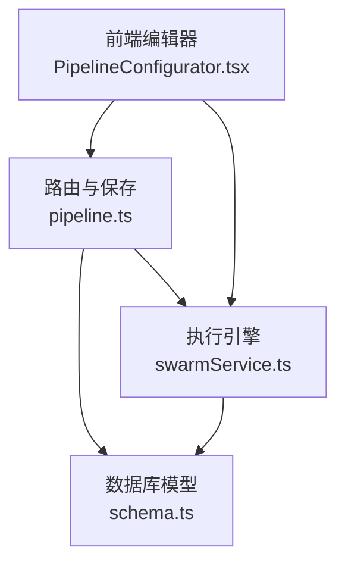
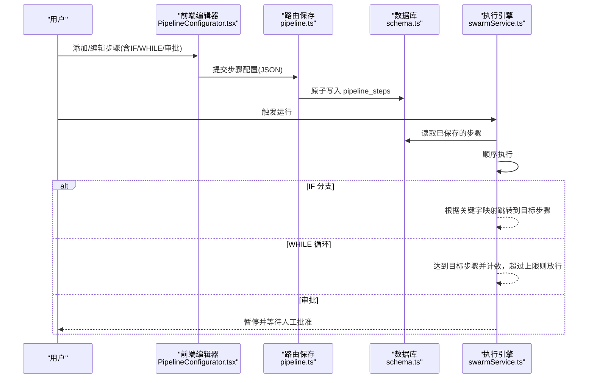
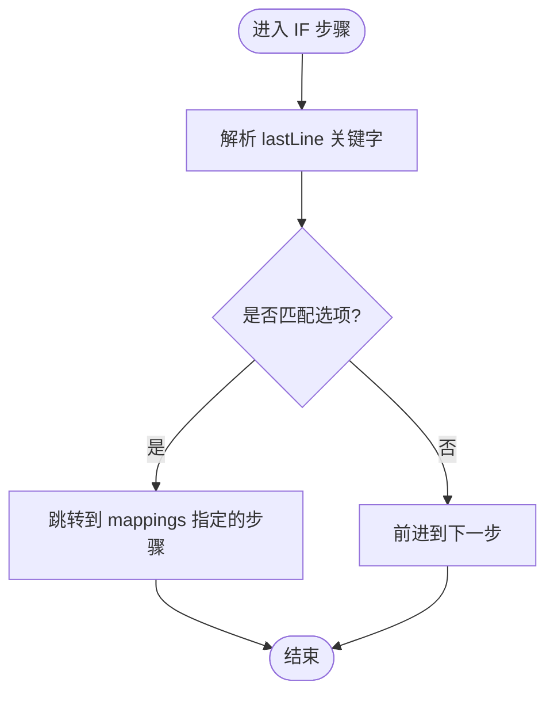
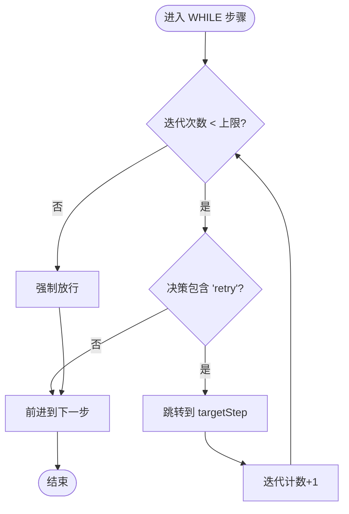
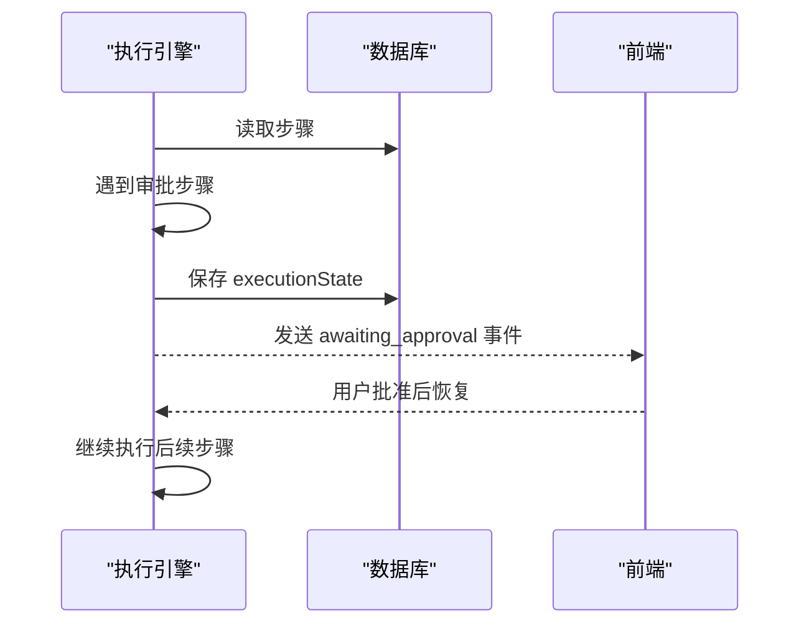
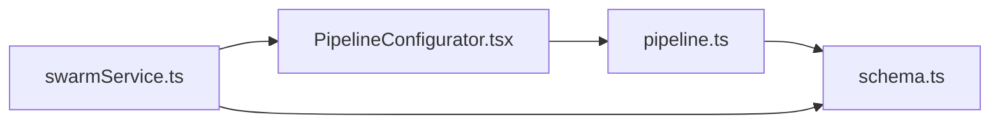

# 步骤类型与配置

<cite>
**本文引用的文件**
- [PipelineConfigurator.tsx](file://src/components/pipeline/PipelineConfigurator.tsx)
- [pipelineValidation.ts](file://api/mcp/tools/pipelineValidation.ts)
- [schema.ts](file://db/schema.ts)
- [pipeline.ts](file://api/routers/pipeline.ts)
- [swarmService.ts](file://api/services/swarmService.ts)
- [PipelineEditor.tsx](file://src/pages/PipelineEditor.tsx)
</cite>

## 目录
1. [简介](#简介)
2. [项目结构](#项目结构)
3. [核心组件](#核心组件)
4. [架构总览](#架构总览)
5. [详细组件分析](#详细组件分析)
6. [依赖关系分析](#依赖关系分析)
7. [性能考量](#性能考量)
8. [故障排查指南](#故障排查指南)
9. [结论](#结论)
10. [附录：参数与默认值速查](#附录参数与默认值速查)

## 简介
本文件为 DeeWaanAI 流水线“步骤类型与配置”的权威说明，覆盖四种步骤类型：Agent、IF 条件分支、WHILE 循环、审批（Approval）。文档聚焦以下方面：
- 每种步骤的功能与用途
- 配置参数、默认值与校验规则
- 步骤间依赖与数据传递机制
- 执行流程中的控制流（跳转、循环、暂停）
- 前端编辑器与后端验证/执行的衔接点

## 项目结构
围绕步骤类型的代码主要分布在以下位置：
- 前端编辑器与交互：src/components/pipeline/PipelineConfigurator.tsx、src/pages/PipelineEditor.tsx
- 后端输入校验与约束：api/mcp/tools/pipelineValidation.ts
- 数据库模型与持久化：db/schema.ts
- 路由与保存逻辑：api/routers/pipeline.ts
- 执行引擎与控制流：api/services/swarmService.ts

图表来源
- [PipelineConfigurator.tsx:163-196](file://src/components/pipeline/PipelineConfigurator.tsx#L163-L196)
- [pipeline.ts:128-219](file://api/routers/pipeline.ts#L128-L219)
- [schema.ts:470-480](file://db/schema.ts#L470-L480)
- [swarmService.ts:601-847](file://api/services/swarmService.ts#L601-L847)

章节来源
- [PipelineConfigurator.tsx:24-38](file://src/components/pipeline/PipelineConfigurator.tsx#L24-L38)
- [pipelineValidation.ts:7-14](file://api/mcp/tools/pipelineValidation.ts#L7-L14)
- [schema.ts:470-480](file://db/schema.ts#L470-L480)
- [pipeline.ts:128-219](file://api/routers/pipeline.ts#L128-L219)
- [swarmService.ts:601-847](file://api/services/swarmService.ts#L601-L847)

## 核心组件
- 步骤类型枚举与常量：agent、if、while、approval；最大步数、最大 WHILE 迭代次数等
- 输入校验：Zod schema 对 stepType 及对应配置进行强约束
- 存储模型：pipeline_steps 表包含 ifConfig、whileConfig 等 JSON 字段
- 保存路由：批量解析/创建 Agent，原子写入步骤
- 执行引擎：按顺序执行，处理 IF 跳转、WHILE 回环、审批暂停

章节来源
- [pipelineValidation.ts:7-14](file://api/mcp/tools/pipelineValidation.ts#L7-L14)
- [pipelineValidation.ts:26-52](file://api/mcp/tools/pipelineValidation.ts#L26-L52)
- [schema.ts:470-480](file://db/schema.ts#L470-L480)
- [pipeline.ts:128-219](file://api/routers/pipeline.ts#L128-L219)
- [swarmService.ts:601-847](file://api/services/swarmService.ts#L601-L847)

## 架构总览
下图展示从编辑到执行的端到端流程，以及四种步骤在运行时的行为。

图表来源
- [PipelineConfigurator.tsx:163-196](file://src/components/pipeline/PipelineConfigurator.tsx#L163-L196)
- [pipeline.ts:128-219](file://api/routers/pipeline.ts#L128-L219)
- [schema.ts:470-480](file://db/schema.ts#L470-L480)
- [swarmService.ts:601-847](file://api/services/swarmService.ts#L601-L847)

## 详细组件分析

### Agent 步骤
- 功能
  - 调用 LLM 生成或处理内容，可指定 provider/model/temperature/maxTokens
  - 支持启用/禁用开关
- 配置参数
  - name、role、systemPrompt（非审批步骤必填）
  - providerId、model、temperature、maxTokens
  - stepType 默认为 agent
- 默认值
  - temperature 默认 "0.7"
  - maxTokens 默认 4096
- 校验规则
  - role 与 systemPrompt 在非审批步骤中必须存在
  - 单条 step 的 maxTokens 范围 1..128000
  - 同一流水线最多 3 个不同 provider（仅统计 agent 步骤）
- 数据传递
  - 输出作为下一步输入上下文的一部分，由执行引擎维护链式上下文
- 典型用法
  - 构建器→批评者→精炼者→润色器的标准四步工作流

章节来源
- [pipelineValidation.ts:26-52](file://api/mcp/tools/pipelineValidation.ts#L26-L52)
- [pipeline.ts:162-208](file://api/routers/pipeline.ts#L162-L208)
- [PipelineConfigurator.tsx:145-161](file://src/components/pipeline/PipelineConfigurator.tsx#L145-L161)
- [PipelineConfigurator.tsx:352-386](file://src/components/pipeline/PipelineConfigurator.tsx#L352-L386)

### IF 条件分支
- 功能
  - 基于上一步输出的关键字进行路由跳转
- 配置参数
  - ifConfig.options：关键字数组（至少一个）
  - ifConfig.mappings：关键字 → 目标步骤序号（1-based）
- 默认值
  - 前端模板默认 options=["pass","revise"]，mappings 指向相邻步骤
- 校验规则
  - if 步骤必须提供 ifConfig
  - mappings 的值必须为正整数
  - 运行时若未匹配到关键字，将按默认策略前进（由执行引擎决定）
- 数据传递
  - 不改变上下文，仅改变下一步索引
- 典型用法
  - 质量门禁：通过/修订两条路径

图表来源
- [pipelineValidation.ts:16-19](file://api/mcp/tools/pipelineValidation.ts#L16-L19)
- [pipelineValidation.ts:46-48](file://api/mcp/tools/pipelineValidation.ts#L46-L48)
- [PipelineConfigurator.tsx:388-427](file://src/components/pipeline/PipelineConfigurator.tsx#L388-L427)

章节来源
- [pipelineValidation.ts:16-19](file://api/mcp/tools/pipelineValidation.ts#L16-L19)
- [pipelineValidation.ts:46-48](file://api/mcp/tools/pipelineValidation.ts#L46-L48)
- [PipelineConfigurator.tsx:163-174](file://src/components/pipeline/PipelineConfigurator.tsx#L163-L174)
- [PipelineConfigurator.tsx:388-427](file://src/components/pipeline/PipelineConfigurator.tsx#L388-L427)

### WHILE 循环
- 功能
  - 对某段步骤进行重复执行，直到满足退出条件或达到最大迭代次数
- 配置参数
  - whileConfig.targetStep：要回环的目标步骤序号（1-based）
  - whileConfig.maxIterations：最大迭代次数（上限 10）
- 默认值
  - 前端模板默认 targetStep=当前步骤前一步，maxIterations=3
- 校验规则
  - while 步骤必须提供 whileConfig
  - targetStep 必须小于等于当前步骤自身（防止向前跳太远）
  - maxIterations 上限 10
- 数据传递
  - 每次循环会累积访问计数，避免无限循环
- 典型用法
  - 质量检查循环：未达标则返回上一环节改进

图表来源
- [pipelineValidation.ts:21-24](file://api/mcp/tools/pipelineValidation.ts#L21-L24)
- [pipelineValidation.ts:72-83](file://api/mcp/tools/pipelineValidation.ts#L72-L83)
- [swarmService.ts:829-842](file://api/services/swarmService.ts#L829-L842)

章节来源
- [pipelineValidation.ts:21-24](file://api/mcp/tools/pipelineValidation.ts#L21-L24)
- [pipelineValidation.ts:72-83](file://api/mcp/tools/pipelineValidation.ts#L72-L83)
- [PipelineConfigurator.tsx:175-184](file://src/components/pipeline/PipelineConfigurator.tsx#L175-L184)
- [PipelineConfigurator.tsx:429-458](file://src/components/pipeline/PipelineConfigurator.tsx#L429-L458)
- [swarmService.ts:829-842](file://api/services/swarmService.ts#L829-L842)

### 审批步骤（Approval）
- 功能
  - 人工审核节点，流水线在此暂停，等待人类批准后方可继续
- 配置参数
  - 无需 role/systemPrompt（审批为纯人工门控）
  - 可设置名称、启用状态
- 默认值
  - 无特定温度/令牌限制（不触发 LLM）
- 校验规则
  - 审批步骤跳过角色与提示词校验
- 数据传递
  - 将上一步输出作为待审内容呈现给审核人
- 执行流程
  - 遇到审批时，执行引擎保存执行状态并通过事件通知前端暂停
  - 前端显示审批面板，用户批准后恢复执行

图表来源
- [swarmService.ts:1003-1016](file://api/services/swarmService.ts#L1003-L1016)
- [PipelineConfigurator.tsx:185-194](file://src/components/pipeline/PipelineConfigurator.tsx#L185-L194)

章节来源
- [pipelineValidation.ts:38-39](file://api/mcp/tools/pipelineValidation.ts#L38-L39)
- [PipelineConfigurator.tsx:185-194](file://src/components/pipeline/PipelineConfigurator.tsx#L185-L194)
- [swarmService.ts:1003-1016](file://api/services/swarmService.ts#L1003-L1016)

## 依赖关系分析
- 前端编辑器依赖后端提供的可用 Provider 列表与模板能力
- 保存路由负责：
  - 权限校验（项目归属/团队共享）
  - 批量解析/创建自定义 Agent
  - 原子写入 pipeline_steps（含 ifConfig/whileConfig）
- 执行引擎依赖：
  - 已保存的步骤序列
  - 全局保护（最大访问次数）与 WHILE 迭代计数
  - 审批暂停/恢复机制

图表来源
- [pipeline.ts:128-219](file://api/routers/pipeline.ts#L128-L219)
- [schema.ts:470-480](file://db/schema.ts#L470-L480)
- [swarmService.ts:601-847](file://api/services/swarmService.ts#L601-L847)

章节来源
- [pipeline.ts:128-219](file://api/routers/pipeline.ts#L128-L219)
- [schema.ts:470-480](file://db/schema.ts#L470-L480)
- [swarmService.ts:601-847](file://api/services/swarmService.ts#L601-L847)

## 性能考量
- 批量解析/创建 Agent：减少 N+1 查询，提升保存性能
- 原子事务：删除旧步骤后批量插入新步骤，保证一致性
- 执行保护：
  - 全局最大访问次数限制，防止死循环
  - WHILE 最大迭代次数限制，避免长时间阻塞
- 并发与资源：
  - 同一流水线最多 3 个不同 LLM provider，控制并发与成本

章节来源
- [pipeline.ts:13-80](file://api/routers/pipeline.ts#L13-L80)
- [pipeline.ts:178-210](file://api/routers/pipeline.ts#L178-L210)
- [swarmService.ts:606-614](file://api/services/swarmService.ts#L606-L614)
- [pipelineValidation.ts:13-14](file://api/mcp/tools/pipelineValidation.ts#L13-L14)

## 故障排查指南
- 保存失败
  - 检查是否超出最大步骤数（20）
  - 检查 IF/WHILE 配置是否完整且合法
  - 检查是否超过 3 个不同 provider 的限制
- 执行异常
  - IF 未匹配关键字：确认 lastLine 关键字与 options 一致
  - WHILE 无限循环：检查 targetStep 与 maxIterations，关注全局访问次数保护
  - 审批卡住：确认前端收到 awaiting_approval 事件并完成批准操作
- 常见问题定位
  - 使用浏览器控制台查看 SSE 事件（step_start/complete/error/awaiting_approval）
  - 检查后端日志中的 pipeline_error 与 step 执行信息

章节来源
- [pipelineValidation.ts:56-65](file://api/mcp/tools/pipelineValidation.ts#L56-L65)
- [swarmService.ts:983-1016](file://api/services/swarmService.ts#L983-L1016)
- [swarmService.ts:606-614](file://api/services/swarmService.ts#L606-L614)
- [swarmService.ts:829-842](file://api/services/swarmService.ts#L829-L842)

## 结论
DeeWaanAI 的流水线以“步骤”为核心抽象，通过统一的输入校验、持久化模型与执行引擎，实现了灵活的 Agent 编排、条件分支、循环与人工审批。前端编辑器提供直观的配置界面，后端保障数据一致性与执行安全。遵循本文的参数与规则，可快速搭建稳定高效的自动化流水线。

## 附录：参数与默认值速查
- Agent 步骤
  - 必填：name、role、systemPrompt
  - 可选：providerId、model、temperature（默认 "0.7"）、maxTokens（默认 4096）
  - 约束：maxTokens 1..128000；同流水线最多 3 个不同 provider
- IF 步骤
  - 必填：ifConfig.options（字符串数组，至少一项）、ifConfig.mappings（关键字→正整数）
  - 默认：options=["pass","revise"]，mappings 指向相邻步骤
- WHILE 步骤
  - 必填：whileConfig.targetStep（正整数，≤当前步骤）、whileConfig.maxIterations（1..10）
  - 默认：targetStep=前一步，maxIterations=3
- 审批步骤
  - 无需 role/systemPrompt；用于人工暂停与批准

章节来源
- [pipelineValidation.ts:26-52](file://api/mcp/tools/pipelineValidation.ts#L26-L52)
- [pipelineValidation.ts:13-14](file://api/mcp/tools/pipelineValidation.ts#L13-L14)
- [PipelineConfigurator.tsx:145-161](file://src/components/pipeline/PipelineConfigurator.tsx#L145-L161)
- [PipelineConfigurator.tsx:388-458](file://src/components/pipeline/PipelineConfigurator.tsx#L388-L458)
- [pipeline.ts:162-208](file://api/routers/pipeline.ts#L162-L208)