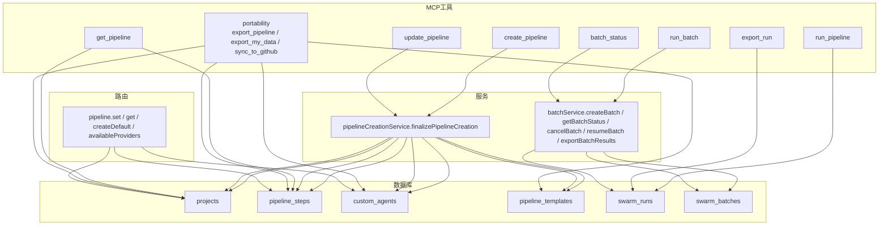
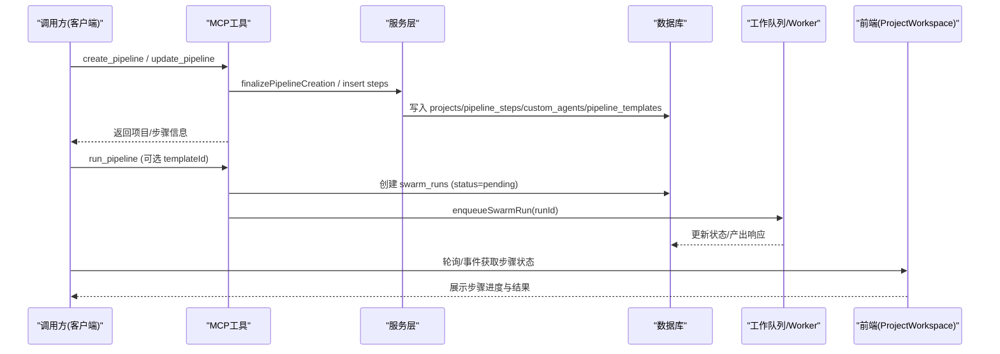
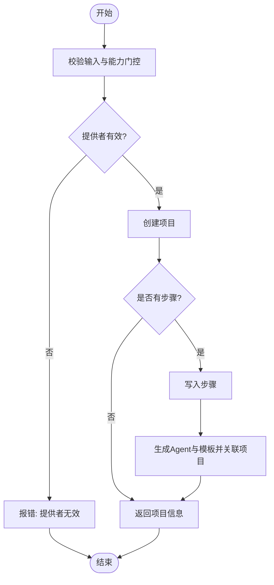
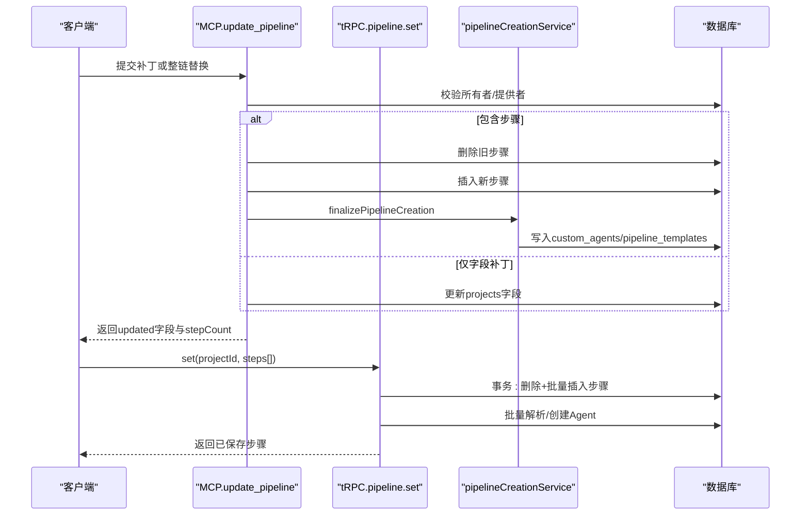
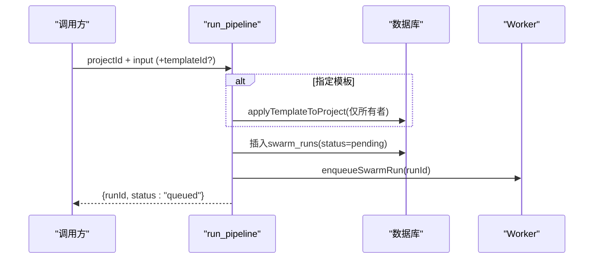
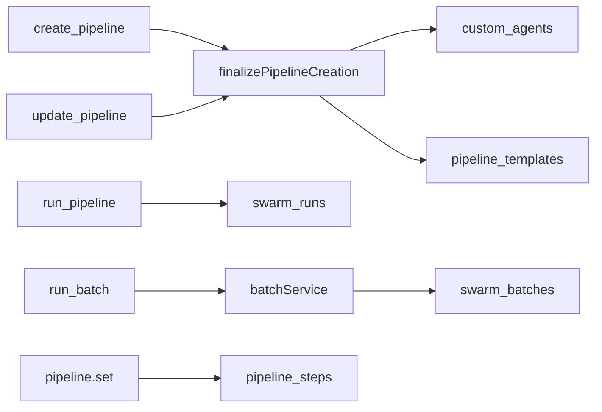

# 流水线生命周期管理

<cite>
**本文引用的文件**
- [api/routers/pipeline.ts](file://api/routers/pipeline.ts)
- [api/services/pipelineCreationService.ts](file://api/services/pipelineCreationService.ts)
- [api/mcp/tools/createPipeline.ts](file://api/mcp/tools/createPipeline.ts)
- [api/mcp/tools/updatePipeline.ts](file://api/mcp/tools/updatePipeline.ts)
- [api/mcp/tools/getPipeline.ts](file://api/mcp/tools/getPipeline.ts)
- [api/mcp/tools/runPipeline.ts](file://api/mcp/tools/runPipeline.ts)
- [api/mcp/tools/exportRun.ts](file://api/mcp/tools/exportRun.ts)
- [api/mcp/tools/portability.ts](file://api/mcp/tools/portability.ts)
- [api/mcp/tools/batchStatus.ts](file://api/mcp/tools/batchStatus.ts)
- [api/mcp/tools/runBatch.ts](file://api/mcp/tools/runBatch.ts)
- [api/services/batchService.ts](file://api/services/batchService.ts)
- [db/schema.ts](file://db/schema.ts)
- [src/pages/ProjectWorkspace.tsx](file://src/pages/ProjectWorkspace.tsx)
</cite>

## 目录
1. [简介](#简介)
2. [项目结构](#项目结构)
3. [核心组件](#核心组件)
4. [架构总览](#架构总览)
5. [详细组件分析](#详细组件分析)
6. [依赖关系分析](#依赖关系分析)
7. [性能考虑](#性能考虑)
8. [故障排查指南](#故障排查指南)
9. [结论](#结论)
10. [附录](#附录)

## 简介
本文件面向DeeWaanAI的“流水线生命周期管理”，覆盖从创建、编辑、保存、复制到应用至项目的完整流程；记录版本与状态跟踪、变更历史、验证机制、错误检查与调试工具；并说明导入导出、批量操作、权限控制、执行监控与结果查看方法。文档以代码为依据，提供可视化图示与可操作的排错指引。

## 项目结构
围绕流水线生命周期的关键实现分布在以下位置：
- MCP工具层：create_pipeline、update_pipeline、get_pipeline、run_pipeline、export_run、portability（export_pipeline/export_my_data/sync_to_github）、run_batch、batch_status
- 服务层：pipelineCreationService（完成模板与代理创建）、batchService（批处理生命周期）
- 路由层：pipeline（tRPC路由，用于Web端设置步骤、获取步骤、默认流水线等）
- 数据模型：db/schema.ts（projects、pipeline_steps、custom_agents、pipeline_templates、swarm_runs、swarm_batches等）
- 前端展示：ProjectWorkspace.tsx（流水线步骤可视化与状态指示）

图表来源
- [api/mcp/tools/createPipeline.ts:33-107](file://api/mcp/tools/createPipeline.ts#L33-L107)
- [api/mcp/tools/updatePipeline.ts:34-120](file://api/mcp/tools/updatePipeline.ts#L34-L120)
- [api/mcp/tools/getPipeline.ts:15-59](file://api/mcp/tools/getPipeline.ts#L15-L59)
- [api/mcp/tools/runPipeline.ts:97-155](file://api/mcp/tools/runPipeline.ts#L97-L155)
- [api/mcp/tools/exportRun.ts:34-51](file://api/mcp/tools/exportRun.ts#L34-L51)
- [api/mcp/tools/portability.ts:39-149](file://api/mcp/tools/portability.ts#L39-L149)
- [api/mcp/tools/runBatch.ts:24-64](file://api/mcp/tools/runBatch.ts#L24-L64)
- [api/mcp/tools/batchStatus.ts:13-52](file://api/mcp/tools/batchStatus.ts#L13-L52)
- [api/services/pipelineCreationService.ts:20-115](file://api/services/pipelineCreationService.ts#L20-L115)
- [api/services/batchService.ts:46-321](file://api/services/batchService.ts#L46-L321)
- [api/routers/pipeline.ts:82-326](file://api/routers/pipeline.ts#L82-L326)
- [db/schema.ts:84-200](file://db/schema.ts#L84-L200)

章节来源
- [api/mcp/tools/createPipeline.ts:33-107](file://api/mcp/tools/createPipeline.ts#L33-L107)
- [api/mcp/tools/updatePipeline.ts:34-120](file://api/mcp/tools/updatePipeline.ts#L34-L120)
- [api/mcp/tools/getPipeline.ts:15-59](file://api/mcp/tools/getPipeline.ts#L15-L59)
- [api/mcp/tools/runPipeline.ts:97-155](file://api/mcp/tools/runPipeline.ts#L97-L155)
- [api/mcp/tools/exportRun.ts:34-51](file://api/mcp/tools/exportRun.ts#L34-L51)
- [api/mcp/tools/portability.ts:39-149](file://api/mcp/tools/portability.ts#L39-L149)
- [api/mcp/tools/runBatch.ts:24-64](file://api/mcp/tools/runBatch.ts#L24-L64)
- [api/mcp/tools/batchStatus.ts:13-52](file://api/mcp/tools/batchStatus.ts#L13-L52)
- [api/services/pipelineCreationService.ts:20-115](file://api/services/pipelineCreationService.ts#L20-L115)
- [api/services/batchService.ts:46-321](file://api/services/batchService.ts#L46-L321)
- [api/routers/pipeline.ts:82-326](file://api/routers/pipeline.ts#L82-L326)
- [db/schema.ts:84-200](file://db/schema.ts#L84-L200)

## 核心组件
- 流水线创建与收尾
  - create_pipeline：校验输入、权限与能力门控（IF/WHILE需自定义流水线能力），创建项目与步骤，调用finalizePipelineCreation生成自定义Agent与可复用模板，并将项目关联到模板。
  - finalizePipelineCreation：为每个唯一角色创建或复用custom_agents，回填pipeline_steps.agentId，构建template.steps并写入pipeline_templates，最后将projects.pipelineTemplateId指向该模板。
- 流水线编辑与保存
  - update_pipeline：仅所有者可修改；支持字段补丁与整链替换；若包含IF/WHILE需能力门控；替换步骤后重新生成Agent与模板以保持Web端一致。
  - pipeline.set（tRPC）：原子事务中删除旧步骤并插入新步骤；批量解析/创建Agent；限制每流水线最多3个不同LLM提供者；返回已保存步骤。
- 流水线读取与应用
  - get_pipeline：读取项目配置与有序步骤（含if/while/approval）。
  - run_pipeline：可选应用模板到项目（仅所有者），创建swarm_runs并入队执行，立即返回runId供轮询。
- 版本管理与模板
  - 通过pipeline_templates持久化模板；projects.pipelineTemplateId记录当前项目使用的模板ID；run_pipeline在创建run时标记pipelineVersion（如custom-v2/cascade-v1）。
- 批量执行与监控
  - run_batch：创建swarm_batches与若干swarm_runs，逐个入队执行。
  - batch_status：聚合批次进度、各run状态、累计tokens等。
  - batchService：提供创建、取消、恢复、导出CSV等能力。
- 导入导出与可移植性
  - export_pipeline/export_my_data：导出项目、步骤、Agent、模板等JSON。
  - sync_to_github：将流水线备份提交到已连接的GitHub仓库。
  - export_run：导出单次运行的完整细粒度执行历史（agentRuns/agentResponses）。
- 权限控制
  - 所有写操作均校验用户所有权或团队访问；IF/WHILE受能力门控；Provider ID必须属于当前用户。
- 前端可视化
  - ProjectWorkspace.tsx：渲染流水线步骤条，显示运行/完成/错误状态。

章节来源
- [api/mcp/tools/createPipeline.ts:33-107](file://api/mcp/tools/createPipeline.ts#L33-L107)
- [api/services/pipelineCreationService.ts:20-115](file://api/services/pipelineCreationService.ts#L20-L115)
- [api/mcp/tools/updatePipeline.ts:34-120](file://api/mcp/tools/updatePipeline.ts#L34-L120)
- [api/routers/pipeline.ts:128-219](file://api/routers/pipeline.ts#L128-L219)
- [api/mcp/tools/getPipeline.ts:15-59](file://api/mcp/tools/getPipeline.ts#L15-L59)
- [api/mcp/tools/runPipeline.ts:97-155](file://api/mcp/tools/runPipeline.ts#L97-L155)
- [api/mcp/tools/runBatch.ts:24-64](file://api/mcp/tools/runBatch.ts#L24-L64)
- [api/mcp/tools/batchStatus.ts:13-52](file://api/mcp/tools/batchStatus.ts#L13-L52)
- [api/services/batchService.ts:46-321](file://api/services/batchService.ts#L46-L321)
- [api/mcp/tools/portability.ts:39-149](file://api/mcp/tools/portability.ts#L39-L149)
- [api/mcp/tools/exportRun.ts:34-51](file://api/mcp/tools/exportRun.ts#L34-L51)
- [src/pages/ProjectWorkspace.tsx:58-84](file://src/pages/ProjectWorkspace.tsx#L58-L84)

## 架构总览
下图展示了从MCP工具到服务层再到数据库的关键交互路径，以及Web端对流水线状态的可视化。

图表来源
- [api/mcp/tools/createPipeline.ts:33-107](file://api/mcp/tools/createPipeline.ts#L33-L107)
- [api/mcp/tools/updatePipeline.ts:34-120](file://api/mcp/tools/updatePipeline.ts#L34-L120)
- [api/services/pipelineCreationService.ts:20-115](file://api/services/pipelineCreationService.ts#L20-L115)
- [api/mcp/tools/runPipeline.ts:97-155](file://api/mcp/tools/runPipeline.ts#L97-L155)
- [src/pages/ProjectWorkspace.tsx:58-84](file://src/pages/ProjectWorkspace.tsx#L58-L84)

## 详细组件分析

### 创建流水线（create_pipeline）
- 输入校验：名称、描述、默认模型/提供者、执行配置、步骤链（agent/if/while/approval）。
- 能力门控：若包含IF/WHILE，需要pipeline:custom能力，否则拒绝。
- 提供者校验：defaultProviderId必须属于当前用户。
- 持久化：插入projects；若有步骤则写入pipeline_steps；随后调用finalizePipelineCreation生成Agent与模板并关联。
- 返回：项目id、步骤数、是否使用控制流、下一步建议。

图表来源
- [api/mcp/tools/createPipeline.ts:33-107](file://api/mcp/tools/createPipeline.ts#L33-L107)
- [api/services/pipelineCreationService.ts:20-115](file://api/services/pipelineCreationService.ts#L20-L115)

章节来源
- [api/mcp/tools/createPipeline.ts:33-107](file://api/mcp/tools/createPipeline.ts#L33-L107)
- [api/services/pipelineCreationService.ts:20-115](file://api/services/pipelineCreationService.ts#L20-L115)

### 编辑与保存流水线（update_pipeline 与 pipeline.set）
- update_pipeline（MCP）：仅所有者可改；支持字段补丁与整链替换；替换步骤后重建Agent与模板；IF/WHILE需能力门控。
- pipeline.set（tRPC）：原子事务内删除旧步骤并插入新步骤；批量解析/创建Agent；限制最多3个不同LLM提供者；记录日志并返回已保存步骤。

图表来源
- [api/mcp/tools/updatePipeline.ts:34-120](file://api/mcp/tools/updatePipeline.ts#L34-L120)
- [api/routers/pipeline.ts:128-219](file://api/routers/pipeline.ts#L128-L219)
- [api/services/pipelineCreationService.ts:20-115](file://api/services/pipelineCreationService.ts#L20-L115)

章节来源
- [api/mcp/tools/updatePipeline.ts:34-120](file://api/mcp/tools/updatePipeline.ts#L34-L120)
- [api/routers/pipeline.ts:128-219](file://api/routers/pipeline.ts#L128-L219)

### 读取流水线（get_pipeline）
- 权限：requireProjectAccess确保调用者有访问权。
- 返回：项目基础信息、pipelineConfig、有序步骤（含if/while/approval及提示词与参数）。

章节来源
- [api/mcp/tools/getPipeline.ts:15-59](file://api/mcp/tools/getPipeline.ts#L15-L59)

### 执行流水线（run_pipeline）
- 可选应用模板：仅项目所有者可将模板步骤应用到项目。
- 创建运行：写入swarm_runs（status=pending），记录pipelineVersion与agentsUsed。
- 入队执行：enqueueSwarmRun后立即返回runId，供客户端轮询状态。

图表来源
- [api/mcp/tools/runPipeline.ts:97-155](file://api/mcp/tools/runPipeline.ts#L97-L155)

章节来源
- [api/mcp/tools/runPipeline.ts:97-155](file://api/mcp/tools/runPipeline.ts#L97-L155)

### 版本管理与模板（pipeline_templates）
- 模板由finalizePipelineCreation基于当前步骤构建，写入pipeline_templates.steps（保留stepType/ifConfig/whileConfig等）。
- 项目通过projects.pipelineTemplateId引用模板；run_pipeline创建run时记录pipelineVersion（如custom-v2/cascade-v1）。
- run_pipeline支持按模板应用步骤到项目（仅所有者）。

章节来源
- [api/services/pipelineCreationService.ts:85-115](file://api/services/pipelineCreationService.ts#L85-L115)
- [api/mcp/tools/runPipeline.ts:32-95](file://api/mcp/tools/runPipeline.ts#L32-L95)
- [api/mcp/tools/runPipeline.ts:115-129](file://api/mcp/tools/runPipeline.ts#L115-L129)

### 状态跟踪与变更历史
- 运行状态：swarm_runs.status（pending/running/completed/failed等），current_step、agents_used、total_tokens_used、total_latency_ms等。
- 批次状态：swarm_batches.status（running/completed/completed_with_failures/cancelled/paused_*），completedRuns/failedRuns/totalTokensUsed。
- 变更历史：可通过export_run导出单次运行的完整细粒度执行历史（agentRuns/agentResponses），便于审计与回溯。

章节来源
- [db/schema.ts:173-200](file://db/schema.ts#L173-L200)
- [api/services/batchService.ts:144-186](file://api/services/batchService.ts#L144-L186)
- [api/mcp/tools/exportRun.ts:34-51](file://api/mcp/tools/exportRun.ts#L34-L51)

### 验证机制、错误检查与调试
- 步骤类型与约束：STEP_TYPES、MAX_STEPS、MAX_WHILE_ITERATIONS；if/while必填配置；while.targetStep不得指向未来步骤。
- 能力门控：stepsRequireCustomTier检测IF/WHILE，结合can(ctx.userId, "pipeline:custom")进行权限控制。
- 提供者校验：defaultProviderId必须属于当前用户，否则报错。
- 调试：日志记录（logger.info/error）；export_run导出完整执行细节；前端ProjectWorkspace可视化步骤状态。

章节来源
- [api/mcp/tools/pipelineValidation.ts:1-84](file://api/mcp/tools/pipelineValidation.ts#L1-L84)
- [api/mcp/tools/createPipeline.ts:43-52](file://api/mcp/tools/createPipeline.ts#L43-L52)
- [api/mcp/tools/updatePipeline.ts:53-62](file://api/mcp/tools/updatePipeline.ts#L53-L62)
- [api/mcp/tools/runPipeline.ts:107-117](file://api/mcp/tools/runPipeline.ts#L107-L117)
- [src/pages/ProjectWorkspace.tsx:58-84](file://src/pages/ProjectWorkspace.tsx#L58-L84)

### 导入导出、批量操作与权限控制
- 导入导出
  - export_pipeline：导出单个项目步骤与Agent配置。
  - export_my_data：导出全部用户数据（项目、步骤、Agent、模板、偏好）。
  - sync_to_github：将流水线备份提交到已连接GitHub仓库（临时token，不落盘）。
  - export_run：导出单次运行完整历史。
- 批量操作
  - run_batch：创建批次与成员run，逐个入队执行；支持链式目标项目。
  - batch_status：查询批次整体进度与成员摘要。
  - batchService：cancelBatch、resumeBatch、exportBatchResults（CSV）。
- 权限控制
  - 写操作要求所有者；模板应用仅限所有者；Provider ID归属校验；IF/WHILE能力门控；团队项目读/运行通过requireProjectAccess与共享策略。

章节来源
- [api/mcp/tools/portability.ts:39-149](file://api/mcp/tools/portability.ts#L39-L149)
- [api/mcp/tools/exportRun.ts:34-51](file://api/mcp/tools/exportRun.ts#L34-L51)
- [api/mcp/tools/runBatch.ts:24-64](file://api/mcp/tools/runBatch.ts#L24-L64)
- [api/mcp/tools/batchStatus.ts:13-52](file://api/mcp/tools/batchStatus.ts#L13-L52)
- [api/services/batchService.ts:201-321](file://api/services/batchService.ts#L201-L321)

### 流水线执行监控与结果查看
- 单任务：run_pipeline返回runId，后续通过run_status（或tRPC）轮询；最终响应与步骤明细可在export_run中获取。
- 批量：run_batch返回batchId与runIds；通过batch_status轮询批次进度与成员状态；完成后导出CSV或逐条导出。
- 前端：ProjectWorkspace实时展示步骤状态（pending/running/completed/error）。

章节来源
- [api/mcp/tools/runPipeline.ts:97-155](file://api/mcp/tools/runPipeline.ts#L97-L155)
- [api/mcp/tools/exportRun.ts:34-51](file://api/mcp/tools/exportRun.ts#L34-L51)
- [api/mcp/tools/runBatch.ts:24-64](file://api/mcp/tools/runBatch.ts#L24-L64)
- [api/mcp/tools/batchStatus.ts:13-52](file://api/mcp/tools/batchStatus.ts#L13-L52)
- [src/pages/ProjectWorkspace.tsx:58-84](file://src/pages/ProjectWorkspace.tsx#L58-L84)

## 依赖关系分析
- 模块耦合
  - MCP工具强依赖validation与entitlements；create/update依赖finalizePipelineCreation；run_pipeline依赖applyTemplateToProject与worker入队。
  - 服务层集中封装批处理与模板应用逻辑，降低MCP工具复杂度。
  - tRPC路由提供Web端原子化步骤设置与默认流水线创建。
- 外部依赖
  - Worker队列（enqueueSwarmRun）负责实际执行；Logger用于追踪；Drizzle ORM访问数据库。
- 潜在循环依赖
  - 无直接循环；MCP→服务→数据库；服务不反向依赖MCP。

图表来源
- [api/mcp/tools/createPipeline.ts:33-107](file://api/mcp/tools/createPipeline.ts#L33-L107)
- [api/mcp/tools/updatePipeline.ts:34-120](file://api/mcp/tools/updatePipeline.ts#L34-L120)
- [api/mcp/tools/runPipeline.ts:97-155](file://api/mcp/tools/runPipeline.ts#L97-L155)
- [api/mcp/tools/runBatch.ts:24-64](file://api/mcp/tools/runBatch.ts#L24-L64)
- [api/services/pipelineCreationService.ts:20-115](file://api/services/pipelineCreationService.ts#L20-L115)
- [api/services/batchService.ts:46-321](file://api/services/batchService.ts#L46-L321)
- [api/routers/pipeline.ts:128-219](file://api/routers/pipeline.ts#L128-L219)

章节来源
- [api/mcp/tools/createPipeline.ts:33-107](file://api/mcp/tools/createPipeline.ts#L33-L107)
- [api/mcp/tools/updatePipeline.ts:34-120](file://api/mcp/tools/updatePipeline.ts#L34-L120)
- [api/mcp/tools/runPipeline.ts:97-155](file://api/mcp/tools/runPipeline.ts#L97-L155)
- [api/mcp/tools/runBatch.ts:24-64](file://api/mcp/tools/runBatch.ts#L24-L64)
- [api/services/pipelineCreationService.ts:20-115](file://api/services/pipelineCreationService.ts#L20-L115)
- [api/services/batchService.ts:46-321](file://api/services/batchService.ts#L46-L321)
- [api/routers/pipeline.ts:128-219](file://api/routers/pipeline.ts#L128-L219)

## 性能考虑
- 批量Agent解析：pipeline.set采用batchResolveAgents一次性拉取用户Agent并批量创建缺失项，避免N+1查询。
- 原子事务：步骤写入与默认流水线创建均使用事务保证一致性。
- 限制与节流：每流水线最多3个不同LLM提供者；while最大迭代次数限制；步骤数量上限。
- 批处理优化：批量入队与增量更新批次进度，减少锁竞争。
- 前端渲染防抖：ProjectWorkspace对比新旧步骤列表避免重渲染循环。

章节来源
- [api/routers/pipeline.ts:13-80](file://api/routers/pipeline.ts#L13-L80)
- [api/routers/pipeline.ts:178-219](file://api/routers/pipeline.ts#L178-L219)
- [api/mcp/tools/pipelineValidation.ts:13-24](file://api/mcp/tools/pipelineValidation.ts#L13-L24)
- [api/services/batchService.ts:107-142](file://api/services/batchService.ts#L107-L142)
- [src/pages/ProjectWorkspace.tsx:249-264](file://src/pages/ProjectWorkspace.tsx#L249-L264)

## 故障排查指南
- 常见错误
  - 提供者无效：defaultProviderId不属于当前用户。
  - 能力不足：IF/WHILE步骤未具备pipeline:custom能力。
  - while配置错误：targetStep指向未来步骤。
  - 项目不存在或无权限：访问被拒绝。
- 定位方法
  - 查看MCP日志（logger.info/error）确认入队与错误上下文。
  - 使用export_run导出完整执行历史，检查agentRuns/agentResponses中的错误与Token消耗。
  - 使用batch_status检查批次级失败原因与累计Token。
  - 前端ProjectWorkspace观察步骤状态变化，定位卡点。
- 修复建议
  - 修正步骤配置（补充role/systemPrompt/ifConfig/whileConfig）。
  - 升级计划以获得自定义流水线能力。
  - 调整while.targetStep或maxIterations。
  - 绑定正确的LLM提供者或移除多余提供者。

章节来源
- [api/mcp/tools/createPipeline.ts:43-68](file://api/mcp/tools/createPipeline.ts#L43-L68)
- [api/mcp/tools/updatePipeline.ts:53-83](file://api/mcp/tools/updatePipeline.ts#L53-L83)
- [api/mcp/tools/pipelineValidation.ts:38-83](file://api/mcp/tools/pipelineValidation.ts#L38-L83)
- [api/mcp/tools/exportRun.ts:34-51](file://api/mcp/tools/exportRun.ts#L34-L51)
- [api/mcp/tools/batchStatus.ts:13-52](file://api/mcp/tools/batchStatus.ts#L13-L52)
- [src/pages/ProjectWorkspace.tsx:58-84](file://src/pages/ProjectWorkspace.tsx#L58-L84)

## 结论
DeeWaanAI的流水线生命周期管理通过MCP工具与服务层的清晰分层，实现了从创建、编辑、保存到执行与监控的闭环。借助模板与版本标记，系统支持可复用的流水线资产与可追溯的执行历史；严格的权限与能力门控保障安全与合规；批处理能力满足研究模式的大规模实验需求；完善的导入导出与可视化工具提升了可维护性与可观测性。

## 附录
- 关键数据表参考
  - projects：项目元数据、默认提供者/模型、流水线配置、模板引用、归档与同步时间戳。
  - pipeline_steps：有序步骤定义（agent/if/while/approval）及其参数。
  - custom_agents：用户级Agent库（角色、提示词、默认提供者/模型/温度/令牌上限）。
  - pipeline_templates：可复用模板（步骤快照）。
  - swarm_runs：单次运行记录（状态、步骤、Token、延迟、执行状态）。
  - swarm_batches：批处理记录（总体进度、成员状态汇总）。

章节来源
- [db/schema.ts:84-200](file://db/schema.ts#L84-L200)