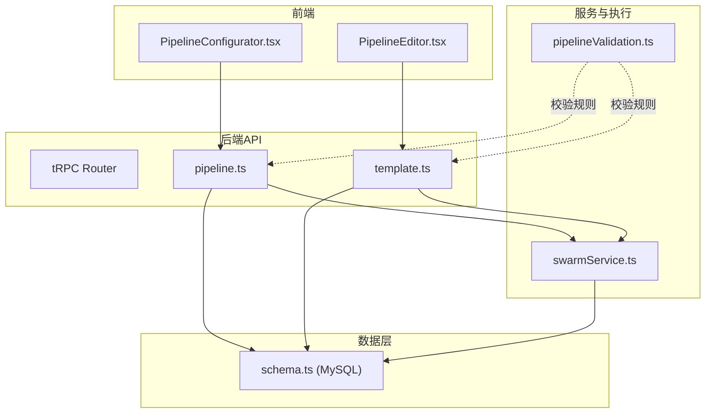
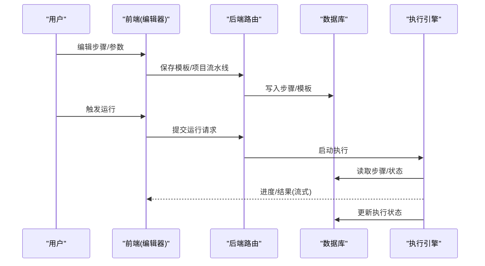
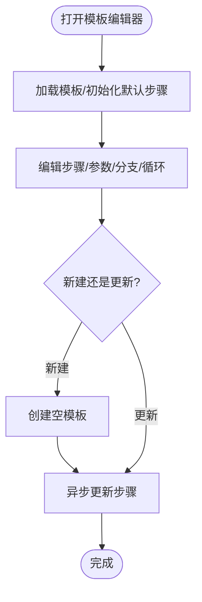
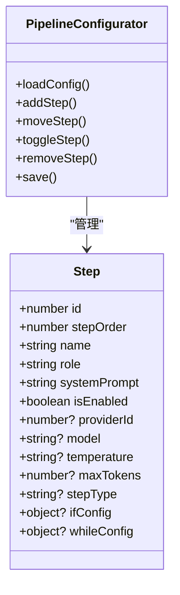
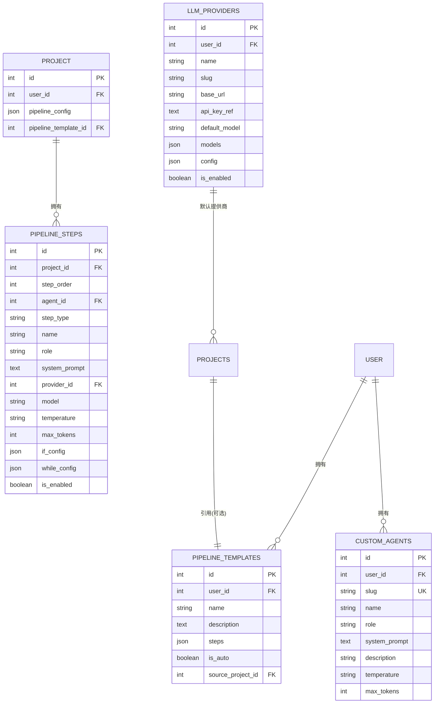
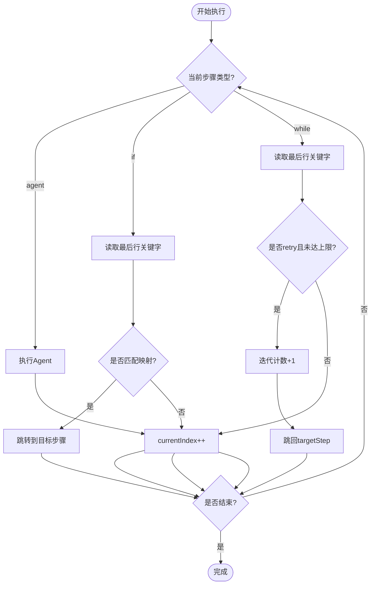
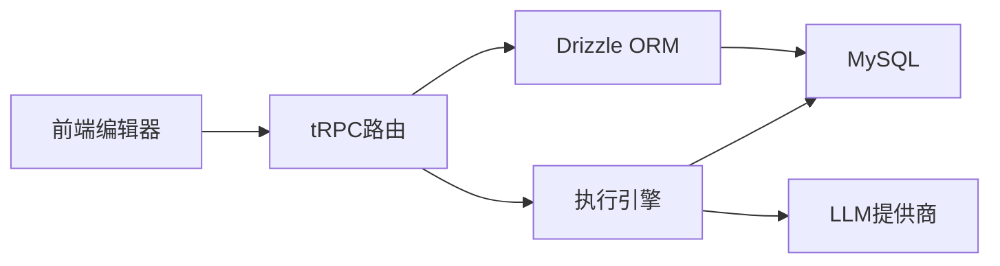

# 流水线编辑器页面

<cite>
**本文引用的文件**
- [PipelineEditor.tsx](file://src/pages/PipelineEditor.tsx)
- [PipelineConfigurator.tsx](file://src/components/pipeline/PipelineConfigurator.tsx)
- [pipeline.ts](file://api/routers/pipeline.ts)
- [template.ts](file://api/routers/template.ts)
- [schema.ts](file://db/schema.ts)
- [swarmService.ts](file://api/services/swarmService.ts)
- [pipelineValidation.ts](file://api/mcp/tools/pipelineValidation.ts)
</cite>

## 目录
1. [简介](#简介)
2. [项目结构](#项目结构)
3. [核心组件](#核心组件)
4. [架构总览](#架构总览)
5. [详细组件分析](#详细组件分析)
6. [依赖关系分析](#依赖关系分析)
7. [性能考量](#性能考量)
8. [故障排查指南](#故障排查指南)
9. [结论](#结论)
10. [附录：API与配置规范](#附录api与配置规范)

## 简介
本页面文档面向DeeWaanAI的“流水线编辑器”能力，覆盖可视化流水线构建界面、步骤拖拽/排序与配置、执行流程设计、模板管理、条件分支（IF）、循环控制（WHILE）、错误处理机制、步骤参数配置、数据流定义与依赖关系管理、以及验证、测试执行与部署发布等。同时提供流水线构建API与配置格式规范，帮助开发者快速理解并扩展该功能。

## 项目结构
前端包含两个关键入口：
- 模板级编辑器：用于创建/编辑可复用的流水线模板（Pipeline Editor）
- 项目级配置器：用于在项目中启用/编排具体步骤（Pipeline Configurator）

后端通过tRPC路由暴露模板与流水线操作接口，数据库使用Drizzle ORM持久化模板与步骤，执行引擎在服务层实现条件分支与循环控制。

图表来源
- [PipelineEditor.tsx:47-179](file://src/pages/PipelineEditor.tsx#L47-L179)
- [PipelineConfigurator.tsx:44-236](file://src/components/pipeline/PipelineConfigurator.tsx#L44-L236)
- [pipeline.ts:82-219](file://api/routers/pipeline.ts#L82-L219)
- [template.ts:7-263](file://api/routers/template.ts#L7-L263)
- [swarmService.ts:802-855](file://api/services/swarmService.ts#L802-L855)
- [pipelineValidation.ts:1-84](file://api/mcp/tools/pipelineValidation.ts#L1-L84)
- [schema.ts:84-200](file://db/schema.ts#L84-L200)

章节来源
- [PipelineEditor.tsx:47-179](file://src/pages/PipelineEditor.tsx#L47-L179)
- [PipelineConfigurator.tsx:44-236](file://src/components/pipeline/PipelineConfigurator.tsx#L44-L236)
- [pipeline.ts:82-219](file://api/routers/pipeline.ts#L82-L219)
- [template.ts:7-263](file://api/routers/template.ts#L7-L263)
- [schema.ts:84-200](file://db/schema.ts#L84-L200)

## 核心组件
- 模板编辑器（PipelineEditor）：支持新建/编辑模板，添加/移动/复制/删除步骤，配置系统提示词、温度、最大Token数，以及IF/WHILE/审批等特殊步骤。
- 项目配置器（PipelineConfigurator）：在项目维度加载/保存步骤，选择LLM提供商与模型，设置内存模式，将当前流水线保存为模板。
- 后端路由（pipeline.ts/template.ts）：提供获取/设置项目流水线、创建默认流水线、模板CRUD、应用模板到项目等能力。
- 执行引擎（swarmService.ts）：解析步骤类型，按IF/WHILE/审批/普通Agent顺序执行，维护迭代计数与状态持久化。
- 校验规则（pipelineValidation.ts）：统一约束步骤类型、必填字段、循环目标合法性、最大步数与迭代次数等。

章节来源
- [PipelineEditor.tsx:47-179](file://src/pages/PipelineEditor.tsx#L47-L179)
- [PipelineConfigurator.tsx:44-236](file://src/components/pipeline/PipelineConfigurator.tsx#L44-L236)
- [pipeline.ts:82-219](file://api/routers/pipeline.ts#L82-L219)
- [template.ts:7-263](file://api/routers/template.ts#L7-L263)
- [swarmService.ts:802-855](file://api/services/swarmService.ts#L802-L855)
- [pipelineValidation.ts:1-84](file://api/mcp/tools/pipelineValidation.ts#L1-L84)

## 架构总览
流水线从“模板/项目配置”到“执行”的关键路径如下：
- 用户在编辑器中编排步骤（含IF/WHILE/审批），保存至模板或项目。
- 后端路由接收请求，校验并持久化步骤；必要时批量创建/复用自定义Agent。
- 运行流水线时，服务层读取步骤并按顺序执行；遇到IF/WHILE根据关键字跳转或循环；审批步骤暂停等待人工确认。
- 执行过程中持续写入执行状态，支持中断恢复与审计追踪。

图表来源
- [PipelineEditor.tsx:98-179](file://src/pages/PipelineEditor.tsx#L98-L179)
- [PipelineConfigurator.tsx:198-236](file://src/components/pipeline/PipelineConfigurator.tsx#L198-L236)
- [pipeline.ts:128-219](file://api/routers/pipeline.ts#L128-L219)
- [template.ts:84-153](file://api/routers/template.ts#L84-L153)
- [swarmService.ts:918-999](file://api/services/swarmService.ts#L918-L999)

## 详细组件分析

### 模板编辑器（PipelineEditor）
- 功能要点
  - 新建/编辑模板名称与描述
  - 左侧面板：内置角色（Builder/Critic/Refiner/Polisher/Expert/Translator）与特殊步骤（IF/WHILE/审批）
  - 右侧步骤列表：支持移动、复制、删除、展开编辑系统提示词、温度、最大Token、步骤类型
  - IF配置：选项与映射（关键词→目标步骤序号）
  - WHILE配置：目标步骤、最大迭代次数
  - 保存逻辑：新建模板后二次更新步骤；已有模板直接更新
- 权限与能力
  - 基于能力开关控制是否允许自定义流水线（pipeline:custom）与自动设计（pipeline:autodesign）

图表来源
- [PipelineEditor.tsx:72-179](file://src/pages/PipelineEditor.tsx#L72-L179)

章节来源
- [PipelineEditor.tsx:47-179](file://src/pages/PipelineEditor.tsx#L47-L179)

### 项目配置器（PipelineConfigurator）
- 功能要点
  - 加载项目流水线配置，支持启用/禁用步骤、调整顺序
  - 选择LLM提供商与模型、设置温度与最大Token
  - 添加步骤：从用户自定义Agent或模板中添加，或插入IF/WHILE/审批
  - 保存策略：Pro用户调用set接口全量替换；标准用户仅允许启用/禁用与提示词微调
  - 记忆模式：保守/均衡/激进，影响上下文压缩策略
  - 导出为模板：将当前项目流水线保存为用户模板库条目

图表来源
- [PipelineConfigurator.tsx:24-236](file://src/components/pipeline/PipelineConfigurator.tsx#L24-L236)

章节来源
- [PipelineConfigurator.tsx:44-236](file://src/components/pipeline/PipelineConfigurator.tsx#L44-L236)

### 后端路由与数据模型
- pipeline.ts
  - get：按项目查询步骤（支持团队共享校验）
  - set：全量替换步骤，批量解析/创建Agent，事务写入，限制最多3个不同LLM提供商
  - createDefault：为标准用户提供默认四步流水线（Builder→Critic→Refiner→Polisher）
  - availableProviders：列出用户可用LLM提供商
- template.ts
  - list/getById/update/delete/duplicate：模板生命周期管理
  - createFromPipeline：将项目流水线保存为模板，并关联项目引用
  - useInProject：将模板应用到项目，缺失Agent自动创建

图表来源
- [schema.ts:84-200](file://db/schema.ts#L84-L200)
- [pipeline.ts:82-219](file://api/routers/pipeline.ts#L82-L219)
- [template.ts:7-263](file://api/routers/template.ts#L7-L263)

章节来源
- [pipeline.ts:82-219](file://api/routers/pipeline.ts#L82-L219)
- [template.ts:7-263](file://api/routers/template.ts#L7-L263)
- [schema.ts:84-200](file://db/schema.ts#L84-L200)

### 执行流程与条件分支/循环控制
- 执行主循环
  - 读取项目流水线步骤，按stepOrder顺序执行
  - 普通Agent：推进到下一步
  - IF：解析最后行为关键字，查找映射的目标步骤，若未命中则继续
  - WHILE：解析最后行关键字，若为retry且未达到最大迭代次数，则跳回targetStep；否则继续
  - 审批：暂停等待人工确认（由上层流程处理）
- 状态持久化
  - 每次决策后更新executionState，包含currentIndex、链式输出、迭代计数等，支持中断恢复
- 安全上限
  - WHILE最大迭代次数受硬限制保护，避免死循环

图表来源
- [swarmService.ts:802-855](file://api/services/swarmService.ts#L802-L855)

章节来源
- [swarmService.ts:802-855](file://api/services/swarmService.ts#L802-L855)

### 校验与约束
- 步骤类型：agent/if/while/approval
- 控制流类型（if/while）需要更高权限（pipeline:custom）
- 最大步数限制、while最大迭代次数限制
- while.targetStep必须指向自身或更早的步骤
- 非approval步骤必须提供role与systemPrompt

章节来源
- [pipelineValidation.ts:1-84](file://api/mcp/tools/pipelineValidation.ts#L1-L84)

## 依赖关系分析
- 前端依赖
  - tRPC客户端调用模板与项目流水线接口
  - 本地状态管理步骤列表与编辑态
- 后端依赖
  - Drizzle ORM访问MySQL表（projects/pipeline_steps/custom_agents/llm_providers/pipeline_templates）
  - 执行引擎依赖服务层对步骤类型的解析与状态持久化
- 外部依赖
  - LLM提供商（OpenAI/Anthropic/Aliyun等）通过providerId/model选择
  - 可选Gitee集成用于最终状态落盘（不在本页面直接体现）

图表来源
- [pipeline.ts:82-219](file://api/routers/pipeline.ts#L82-L219)
- [template.ts:7-263](file://api/routers/template.ts#L7-L263)
- [swarmService.ts:918-999](file://api/services/swarmService.ts#L918-L999)

章节来源
- [pipeline.ts:82-219](file://api/routers/pipeline.ts#L82-L219)
- [template.ts:7-263](file://api/routers/template.ts#L7-L263)
- [swarmService.ts:918-999](file://api/services/swarmService.ts#L918-L999)

## 性能考量
- 批量解析Agent：避免N+1查询，一次性拉取用户Agent并批量创建缺失项
- 事务写入：保存步骤时使用事务保证原子性
- 执行状态持久化：每次分支/循环决策后写回状态，便于恢复与审计
- 资源限制：限制每流水线最多3个不同LLM提供商，防止过度并发
- 循环保护：WHILE最大迭代次数硬限制，避免无限循环

章节来源
- [pipeline.ts:13-80](file://api/routers/pipeline.ts#L13-L80)
- [pipeline.ts:178-219](file://api/routers/pipeline.ts#L178-L219)
- [swarmService.ts:819-843](file://api/services/swarmService.ts#L819-L843)

## 故障排查指南
- 无法保存步骤
  - 检查是否满足最小步骤数与必填字段（name/role/systemPrompt）
  - 若包含IF/WHILE，确保配置完整（options/mappings/targetStep/maxIterations）
- 循环不生效或卡住
  - 确认while.lastLine关键字是否为“retry”或“pass”
  - 检查targetStep是否指向有效步骤且不越界
  - 查看迭代计数是否达到上限
- 权限不足
  - 使用IF/WHILE需具备pipeline:custom能力；否则会被拒绝
- 提供商数量超限
  - Pro Designer限制最多3个不同LLM提供商，超出会报错

章节来源
- [pipelineValidation.ts:26-84](file://api/mcp/tools/pipelineValidation.ts#L26-L84)
- [pipeline.ts:162-170](file://api/routers/pipeline.ts#L162-L170)
- [swarmService.ts:819-843](file://api/services/swarmService.ts#L819-L843)

## 结论
DeeWaanAI流水线编辑器提供了直观的可视化构建能力，结合模板管理与项目级配置，支持条件分支与循环控制，并通过严格的校验与服务端执行保障稳定性与可恢复性。配合统一的API与配置规范，便于自动化集成与扩展。

## 附录：API与配置规范

### 步骤类型与配置
- 步骤类型
  - agent：普通智能体步骤
  - if：条件分支，依据最后行关键字跳转
  - while：循环控制，依据最后行关键字决定是否返回目标步骤
  - approval：人工审批节点
- 通用字段
  - name：步骤名称
  - role：角色标识（如builder/critic/refiner/polisher/expert/translator/custom）
  - systemPrompt：系统提示词
  - providerId：LLM提供商ID（可选）
  - model：模型名（可选）
  - temperature：采样温度（字符串，如"0.7"）
  - maxTokens：最大Token数（整数）
  - isEnabled：是否启用（布尔）
- IF配置
  - options：关键字数组（如["pass","revise"]）
  - mappings：关键字到目标步骤序号的映射
- WHILE配置
  - targetStep：循环目标步骤序号（1-based）
  - maxIterations：最大迭代次数（上限受服务端硬限制）

章节来源
- [pipelineValidation.ts:16-59](file://api/mcp/tools/pipelineValidation.ts#L16-L59)
- [pipeline.ts:131-152](file://api/routers/pipeline.ts#L131-L152)
- [template.ts:45-68](file://api/routers/template.ts#L45-L68)

### 主要API（tRPC路由）
- 项目流水线
  - get(projectId)：获取项目步骤
  - set(projectId, steps[])：全量替换步骤（Pro）
  - createDefault(projectId)：创建默认四步流水线
  - availableProviders()：获取可用LLM提供商
- 模板
  - list()：列出用户模板
  - getById(id)：获取单个模板
  - update(id, name?, description?, steps[])：更新模板
  - createEmpty(name)：创建空模板
  - createFromPipeline(name?, description?, projectId, isAuto?)：从项目流水线创建模板
  - delete(id)：删除模板
  - duplicate(id)：复制模板
  - useInProject(templateId, projectId)：应用模板到项目

章节来源
- [pipeline.ts:82-327](file://api/routers/pipeline.ts#L82-L327)
- [template.ts:7-265](file://api/routers/template.ts#L7-L265)

### 数据流与依赖关系
- 步骤顺序由stepOrder决定
- Agent通过slug/role/name进行去重与复用
- 模板与项目通过pipelineTemplateId关联
- 执行引擎维护currentIndex与iterationCounts以支持分支与循环

章节来源
- [schema.ts:84-200](file://db/schema.ts#L84-L200)
- [pipeline.ts:13-80](file://api/routers/pipeline.ts#L13-L80)
- [swarmService.ts:802-855](file://api/services/swarmService.ts#L802-L855)