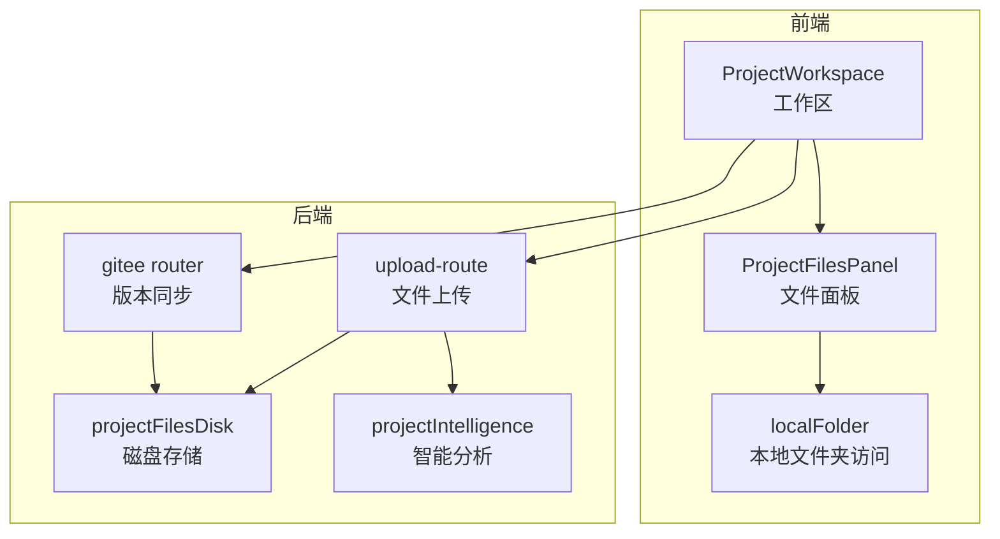
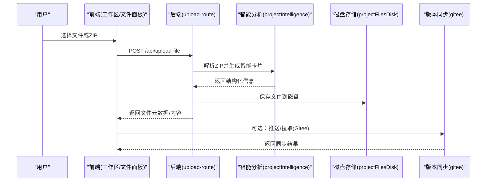
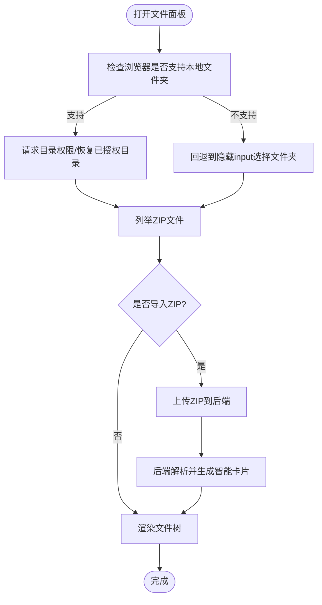
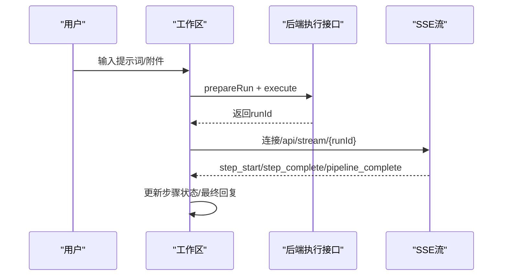
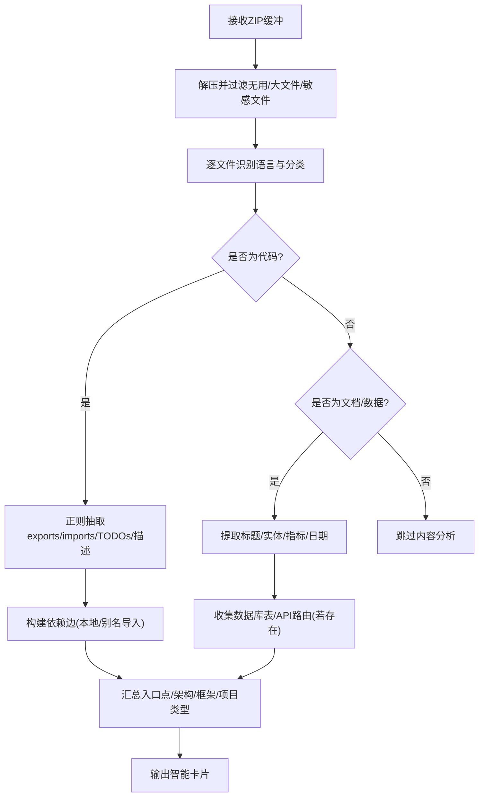
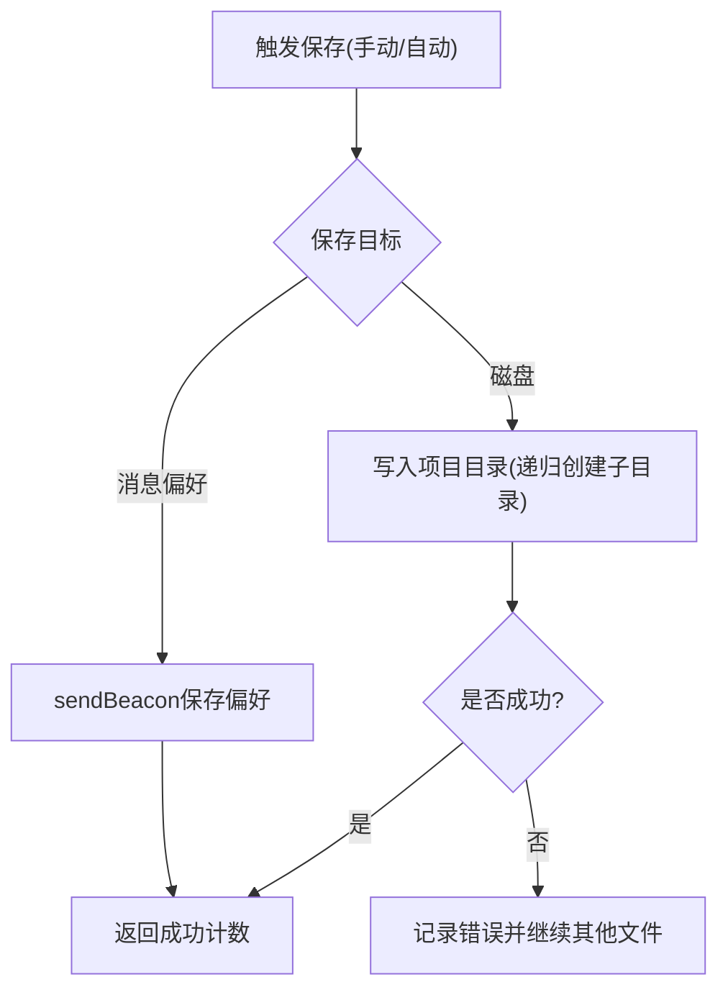
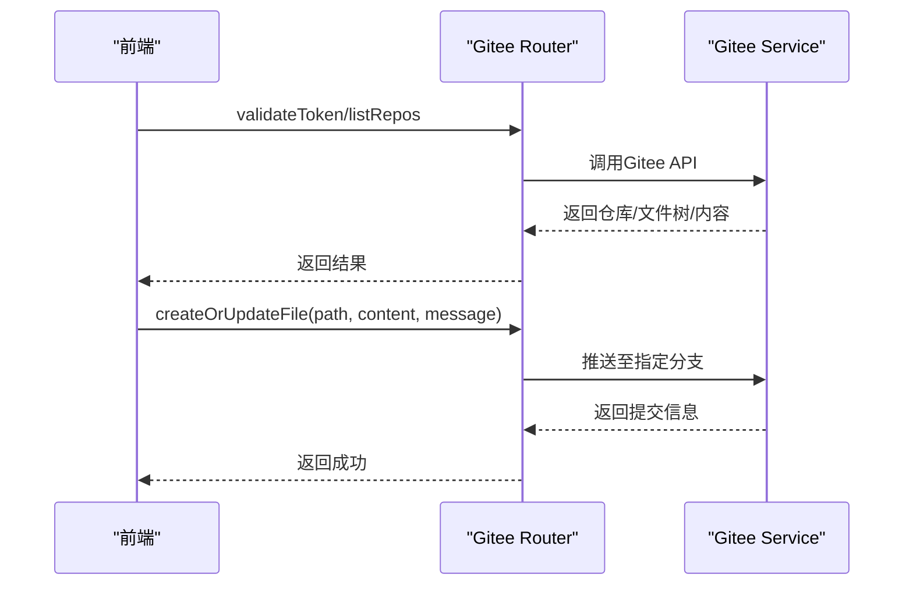
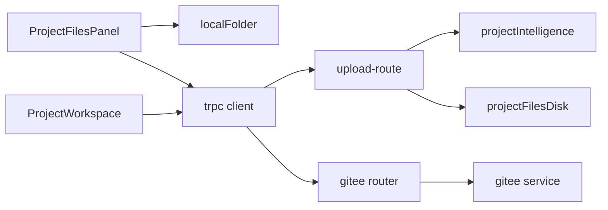

# 代码编辑器集成

<cite>
**本文引用的文件**
- [ProjectFilesPanel.tsx](file://src/components/project/ProjectFilesPanel.tsx)
- [ProjectWorkspace.tsx](file://src/pages/ProjectWorkspace.tsx)
- [localFolder.ts](file://src/lib/localFolder.ts)
- [projectIntelligence.ts](file://api/services/projectIntelligence.ts)
- [projectFilesDisk.ts](file://api/services/projectFilesDisk.ts)
- [gitee.ts](file://api/routers/gitee.ts)
- [projectImport.ts](file://api/routers/projectImport.ts)
- [upload-route.ts](file://api/upload-route.ts)
</cite>

## 目录
1. [简介](#简介)
2. [项目结构](#项目结构)
3. [核心组件](#核心组件)
4. [架构总览](#架构总览)
5. [详细组件分析](#详细组件分析)
6. [依赖关系分析](#依赖关系分析)
7. [性能考虑](#性能考虑)
8. [故障排查指南](#故障排查指南)
9. [结论](#结论)
10. [附录](#附录)

## 简介
本文件面向DeeWaanAI的“代码编辑器集成”能力，聚焦于多文件编辑、标签页与文件切换、保存机制（含自动保存与冲突处理）、编辑器API（文本操作、光标控制、事件监听）以及与版本控制的集成（Git/Gitee提交、分支切换、合并冲突解决）。文档基于仓库中实际实现进行说明，并给出可视化架构图与流程图，帮助读者快速理解系统设计与使用方式。

## 项目结构
本项目采用前后端分离：前端以React页面与组件组织，后端提供TRPC路由与服务，负责文件存储、智能分析与版本同步。与“编辑器集成”直接相关的模块包括：
- 前端：项目工作区、文件面板、本地文件夹访问、消息与运行状态管理
- 后端：项目文件磁盘存储、项目智能分析、上传接口、Gitee同步

图表来源
- [ProjectWorkspace.tsx:1-800](file://src/pages/ProjectWorkspace.tsx#L1-L800)
- [ProjectFilesPanel.tsx:1-563](file://src/components/project/ProjectFilesPanel.tsx#L1-L563)
- [localFolder.ts:1-255](file://src/lib/localFolder.ts#L1-L255)
- [upload-route.ts:30-58](file://api/upload-route.ts#L30-L58)
- [projectFilesDisk.ts:1-142](file://api/services/projectFilesDisk.ts#L1-L142)
- [projectIntelligence.ts:1-800](file://api/services/projectIntelligence.ts#L1-L800)
- [gitee.ts:1-289](file://api/routers/gitee.ts#L1-L289)

章节来源
- [ProjectWorkspace.tsx:1-800](file://src/pages/ProjectWorkspace.tsx#L1-L800)
- [ProjectFilesPanel.tsx:1-563](file://src/components/project/ProjectFilesPanel.tsx#L1-L563)
- [localFolder.ts:1-255](file://src/lib/localFolder.ts#L1-L255)
- [upload-route.ts:30-58](file://api/upload-route.ts#L30-L58)
- [projectFilesDisk.ts:1-142](file://api/services/projectFilesDisk.ts#L1-L142)
- [projectIntelligence.ts:1-800](file://api/services/projectIntelligence.ts#L1-L800)
- [gitee.ts:1-289](file://api/routers/gitee.ts#L1-L289)

## 核心组件
- 项目工作区（ProjectWorkspace）：承载聊天输入、附件上传、流水线执行、SSE进度流、审批交互等，是编辑器集成的主入口之一。
- 项目文件面板（ProjectFilesPanel）：展示导入项目的文件树、支持搜索、展开/折叠、本地文件夹链接与ZIP导入。
- 本地文件夹访问（localFolder）：封装File System Access API，持久化目录句柄，支持创建/链接/列举ZIP/读取文件。
- 项目智能分析（projectIntelligence）：对ZIP内容进行解析，生成“智能卡片”，包含语言识别、分类、导出项、依赖图、架构检测、TODO提取等。
- 磁盘存储（projectFilesDisk）：将项目文件内容落盘到服务器本地目录，提供读写、批量保存、删除与遍历能力。
- 版本同步（gitee router + gitee service）：提供验证Token、列出仓库、获取文件树、创建/更新文件、拉取文件等能力，用于与Gitee集成。

章节来源
- [ProjectWorkspace.tsx:1-800](file://src/pages/ProjectWorkspace.tsx#L1-L800)
- [ProjectFilesPanel.tsx:1-563](file://src/components/project/ProjectFilesPanel.tsx#L1-L563)
- [localFolder.ts:1-255](file://src/lib/localFolder.ts#L1-L255)
- [projectIntelligence.ts:1-800](file://api/services/projectIntelligence.ts#L1-L800)
- [projectFilesDisk.ts:1-142](file://api/services/projectFilesDisk.ts#L1-L142)
- [gitee.ts:1-289](file://api/routers/gitee.ts#L1-L289)

## 架构总览
下图展示了从用户操作到后端处理的端到端流程，涵盖文件上传、智能分析、磁盘存储与版本同步。

图表来源
- [ProjectWorkspace.tsx:185-227](file://src/pages/ProjectWorkspace.tsx#L185-L227)
- [upload-route.ts:30-58](file://api/upload-route.ts#L30-L58)
- [projectIntelligence.ts:625-777](file://api/services/projectIntelligence.ts#L625-L777)
- [projectFilesDisk.ts:42-81](file://api/services/projectFilesDisk.ts#L42-L81)
- [gitee.ts:139-171](file://api/routers/gitee.ts#L139-L171)

## 详细组件分析

### 文件面板与多文件编辑
- 功能要点
  - 文件树构建与渲染：根据智能卡片的fileTree构建层级节点，支持展开/折叠、搜索过滤。
  - 本地文件夹链接：通过File System Access API授权后，持久化目录句柄，支持列举ZIP与读取文件。
  - ZIP导入：支持上传ZIP包，后端解析为智能卡片并展示。
  - 上下文开关：可切换是否将项目文件纳入聊天上下文。
- 关键路径
  - 文件树构建与渲染：[ProjectFilesPanel.tsx:54-183](file://src/components/project/ProjectFilesPanel.tsx#L54-L183)
  - 本地文件夹授权与恢复：[localFolder.ts:95-149](file://src/lib/localFolder.ts#L95-L149)
  - ZIP导入与上传：[ProjectFilesPanel.tsx:429-451](file://src/components/project/ProjectFilesPanel.tsx#L429-L451), [ProjectWorkspace.tsx:185-227](file://src/pages/ProjectWorkspace.tsx#L185-L227)

图表来源
- [ProjectFilesPanel.tsx:185-563](file://src/components/project/ProjectFilesPanel.tsx#L185-L563)
- [localFolder.ts:95-188](file://src/lib/localFolder.ts#L95-L188)

章节来源
- [ProjectFilesPanel.tsx:1-563](file://src/components/project/ProjectFilesPanel.tsx#L1-L563)
- [localFolder.ts:1-255](file://src/lib/localFolder.ts#L1-L255)

### 工作区与流水线执行（含SSE）
- 功能要点
  - 发送消息与附件：支持纯文本或附带文件，进入“代理模式”或“流水线模式”。
  - 流水线执行：准备运行、启动SSE流、步骤状态更新、人工审批（HITL）。
  - 状态恢复：页面导航后恢复运行状态与审批提示。
- 关键路径
  - 发送与流水线执行：[ProjectWorkspace.tsx:540-652](file://src/pages/ProjectWorkspace.tsx#L540-L652)
  - SSE连接与事件处理：[ProjectWorkspace.tsx:409-477](file://src/pages/ProjectWorkspace.tsx#L409-L477)
  - 审批交互：[ProjectWorkspace.tsx:493-538](file://src/pages/ProjectWorkspace.tsx#L493-L538)

图表来源
- [ProjectWorkspace.tsx:409-477](file://src/pages/ProjectWorkspace.tsx#L409-L477)
- [ProjectWorkspace.tsx:540-652](file://src/pages/ProjectWorkspace.tsx#L540-L652)

章节来源
- [ProjectWorkspace.tsx:1-800](file://src/pages/ProjectWorkspace.tsx#L1-L800)

### 智能分析与语言/类型识别
- 功能要点
  - 语言识别：基于扩展名映射语言。
  - 分类：按code/document/data/config/binary分类。
  - 代码解析：正则抽取exports/imports/TODOs/描述。
  - 文档解析：标题、实体、指标、日期提取。
  - 架构/框架检测：基于目录结构与配置文件推断。
  - 入口点检测：常见main/index/app/server等命名约定。
- 关键路径
  - 语言映射与分类：[projectIntelligence.ts:126-171](file://api/services/projectIntelligence.ts#L126-L171), [projectIntelligence.ts:212-227](file://api/services/projectIntelligence.ts#L212-L227)
  - 代码解析：[projectIntelligence.ts:238-319](file://api/services/projectIntelligence.ts#L238-L319)
  - 文档解析：[projectIntelligence.ts:337-391](file://api/services/projectIntelligence.ts#L337-L391)
  - 架构/框架/入口点：[projectIntelligence.ts:541-604](file://api/services/projectIntelligence.ts#L541-L604)
  - 生成智能卡片：[projectIntelligence.ts:625-777](file://api/services/projectIntelligence.ts#L625-L777)

图表来源
- [projectIntelligence.ts:173-227](file://api/services/projectIntelligence.ts#L173-L227)
- [projectIntelligence.ts:238-319](file://api/services/projectIntelligence.ts#L238-L319)
- [projectIntelligence.ts:337-391](file://api/services/projectIntelligence.ts#L337-L391)
- [projectIntelligence.ts:541-604](file://api/services/projectIntelligence.ts#L541-L604)
- [projectIntelligence.ts:625-777](file://api/services/projectIntelligence.ts#L625-L777)

章节来源
- [projectIntelligence.ts:1-800](file://api/services/projectIntelligence.ts#L1-L800)

### 文件保存机制（自动保存、手动保存、冲突处理）
- 当前实现要点
  - 手动保存：通过上传接口将文件写入服务器本地目录；支持批量保存。
  - 自动保存：工作区在beforeunload时通过sendBeacon将消息偏好保存到服务端，避免刷新丢失。
  - 冲突处理：磁盘层未实现并发写锁；建议上层在写入前做差异校验或引入乐观锁/版本号。
- 关键路径
  - 单文件/批量保存：[projectFilesDisk.ts:42-81](file://api/services/projectFilesDisk.ts#L42-L81)
  - 读取/列举/删除：[projectFilesDisk.ts:87-142](file://api/services/projectFilesDisk.ts#L87-L142)
  - 卸载时持久化消息：[ProjectWorkspace.tsx:308-332](file://src/pages/ProjectWorkspace.tsx#L308-L332)

图表来源
- [projectFilesDisk.ts:42-81](file://api/services/projectFilesDisk.ts#L42-L81)
- [ProjectWorkspace.tsx:308-332](file://src/pages/ProjectWorkspace.tsx#L308-L332)

章节来源
- [projectFilesDisk.ts:1-142](file://api/services/projectFilesDisk.ts#L1-L142)
- [ProjectWorkspace.tsx:308-332](file://src/pages/ProjectWorkspace.tsx#L308-L332)

### 编辑器API（文本操作、光标控制、事件监听）
- 现状说明
  - 当前仓库未提供通用“编辑器实例”对象（如CodeMirror/monaco-editor封装），因此不存在统一的文本操作/光标控制/事件监听API。
  - 与编辑器相关的能力主要通过“工作区+文件面板”组合实现：上传/下载文件、查看文件树、流水线执行与SSE事件。
- 替代方案
  - 文本操作：通过上传/下载接口读写文件内容。
  - 事件监听：通过SSE订阅流水线事件（step_start/step_complete/pipeline_complete等）。
  - 光标控制：需在前端集成具体编辑器组件后自行实现，当前仓库未暴露统一API。

章节来源
- [ProjectWorkspace.tsx:409-477](file://src/pages/ProjectWorkspace.tsx#L409-L477)
- [ProjectWorkspace.tsx:185-227](file://src/pages/ProjectWorkspace.tsx#L185-L227)

### 与版本控制的集成（Git/Gitee）
- 功能要点
  - Token验证与仓库列表：验证令牌有效性并列出仓库。
  - 文件树/内容读取：按路径获取远程文件树与内容，支持分支回退尝试（master/main）。
  - 创建/更新文件：以提交消息形式推送变更到指定分支。
  - 项目删除清理：删除远端对应目录与本地磁盘文件。
- 关键路径
  - 验证Token/列仓库：[gitee.ts:33-50](file://api/routers/gitee.ts#L33-L50)
  - 获取文件树/内容：[gitee.ts:105-137](file://api/routers/gitee.ts#L105-L137), [gitee.ts:200-225](file://api/routers/gitee.ts#L200-L225)
  - 创建/更新文件：[gitee.ts:139-171](file://api/routers/gitee.ts#L139-L171)
  - 项目删除清理：[project.ts:268-311](file://api/routers/project.ts#L268-L311)

图表来源
- [gitee.ts:33-50](file://api/routers/gitee.ts#L33-L50)
- [gitee.ts:105-171](file://api/routers/gitee.ts#L105-L171)

章节来源
- [gitee.ts:1-289](file://api/routers/gitee.ts#L1-L289)
- [project.ts:268-311](file://api/routers/project.ts#L268-L311)

## 依赖关系分析
- 前端依赖
  - ProjectWorkspace依赖trpc客户端调用后端执行与SSE流。
  - ProjectFilesPanel依赖localFolder进行本地文件夹访问，依赖trpc获取智能卡片。
- 后端依赖
  - upload-route依赖projectIntelligence进行ZIP解析，依赖projectFilesDisk进行落盘。
  - gitee router依赖gitee service与数据库查询，提供版本控制能力。

图表来源
- [ProjectFilesPanel.tsx:1-563](file://src/components/project/ProjectFilesPanel.tsx#L1-L563)
- [ProjectWorkspace.tsx:1-800](file://src/pages/ProjectWorkspace.tsx#L1-L800)
- [upload-route.ts:30-58](file://api/upload-route.ts#L30-L58)
- [projectIntelligence.ts:1-800](file://api/services/projectIntelligence.ts#L1-L800)
- [projectFilesDisk.ts:1-142](file://api/services/projectFilesDisk.ts#L1-L142)
- [gitee.ts:1-289](file://api/routers/gitee.ts#L1-L289)

章节来源
- [ProjectFilesPanel.tsx:1-563](file://src/components/project/ProjectFilesPanel.tsx#L1-L563)
- [ProjectWorkspace.tsx:1-800](file://src/pages/ProjectWorkspace.tsx#L1-L800)
- [upload-route.ts:30-58](file://api/upload-route.ts#L30-L58)
- [projectIntelligence.ts:1-800](file://api/services/projectIntelligence.ts#L1-L800)
- [projectFilesDisk.ts:1-142](file://api/services/projectFilesDisk.ts#L1-L142)
- [gitee.ts:1-289](file://api/routers/gitee.ts#L1-L289)

## 性能考虑
- 智能分析限制
  - 单文件大小限制：超过5MB的文件会被跳过，避免内存压力。
  - 导出/实体/路由数量上限：防止响应过大（例如最多30个导出、50个实体、30条路由）。
- 磁盘I/O
  - 批量保存时逐个写入，失败不影响其他文件；建议在高频场景下增加批处理与重试策略。
- SSE与UI
  - 流水线步骤状态更新通过SSE推送，注意避免频繁重渲染；当前已对步骤数组比较以避免循环更新。

章节来源
- [projectIntelligence.ts:173-227](file://api/services/projectIntelligence.ts#L173-L227)
- [projectIntelligence.ts:677-777](file://api/services/projectIntelligence.ts#L677-L777)
- [projectFilesDisk.ts:59-81](file://api/services/projectFilesDisk.ts#L59-L81)
- [ProjectWorkspace.tsx:249-264](file://src/pages/ProjectWorkspace.tsx#L249-L264)

## 故障排查指南
- 无法访问本地文件夹
  - 现象：提示浏览器不支持本地文件夹访问。
  - 原因：当前环境不支持File System Access API。
  - 处理：使用Chrome/Edge或回退到隐藏input选择文件夹。
  - 参考：[localFolder.ts:95-104](file://src/lib/localFolder.ts#L95-L104), [localFolder.ts:203-230](file://src/lib/localFolder.ts#L203-L230)
- ZIP解析失败
  - 现象：提示ZIP中没有有效文件。
  - 原因：ZIP为空或仅包含被排除的文件（node_modules/.git等）。
  - 处理：检查ZIP内容，确保包含可分析文件。
  - 参考：[projectIntelligence.ts:625-630](file://api/services/projectIntelligence.ts#L625-L630)
- 磁盘保存失败
  - 现象：批量保存返回failed计数。
  - 原因：路径非法或权限不足。
  - 处理：检查路径规范化与目录权限。
  - 参考：[projectFilesDisk.ts:67-81](file://api/services/projectFilesDisk.ts#L67-L81)
- 版本同步失败
  - 现象：获取文件树/内容时报错或未配置Token。
  - 原因：项目未连接Gitee或Token未配置。
  - 处理：在项目设置中配置Gitee Token并连接仓库。
  - 参考：[gitee.ts:76-103](file://api/routers/gitee.ts#L76-L103), [gitee.ts:105-137](file://api/routers/gitee.ts#L105-L137)

章节来源
- [localFolder.ts:95-104](file://src/lib/localFolder.ts#L95-L104)
- [localFolder.ts:203-230](file://src/lib/localFolder.ts#L203-L230)
- [projectIntelligence.ts:625-630](file://api/services/projectIntelligence.ts#L625-L630)
- [projectFilesDisk.ts:67-81](file://api/services/projectFilesDisk.ts#L67-L81)
- [gitee.ts:76-137](file://api/routers/gitee.ts#L76-L137)

## 结论
本仓库实现了围绕“项目工作区+文件面板”的代码编辑集成能力，具备：
- 多文件浏览与导入（ZIP/本地文件夹）
- 智能分析（语言识别、分类、依赖图、架构检测、TODO提取）
- 文件保存（磁盘落盘与消息偏好持久化）
- 流水线执行与SSE事件驱动
- 与Gitee的版本控制集成（Token验证、仓库列表、文件树/内容读取、创建/更新文件）

尚未提供通用编辑器API（文本操作/光标控制/事件监听），如需深度定制，可在前端接入具体编辑器组件并复用现有上传/下载与SSE能力。

## 附录
- 支持的文本/代码扩展名（上传阶段判定）：参见上传路由中的TEXT_EXTENSIONS集合。
- 智能卡片字段：version、generatedAt、projectType、primaryLanguage、framework、totalFiles、totalSize、fileTree、dependencyGraph、entities、databaseTables、apiEndpoints、entryPoints、architecture、todos、crossReferences。

章节来源
- [upload-route.ts:30-58](file://api/upload-route.ts#L30-L58)
- [projectIntelligence.ts:59-78](file://api/services/projectIntelligence.ts#L59-L78)