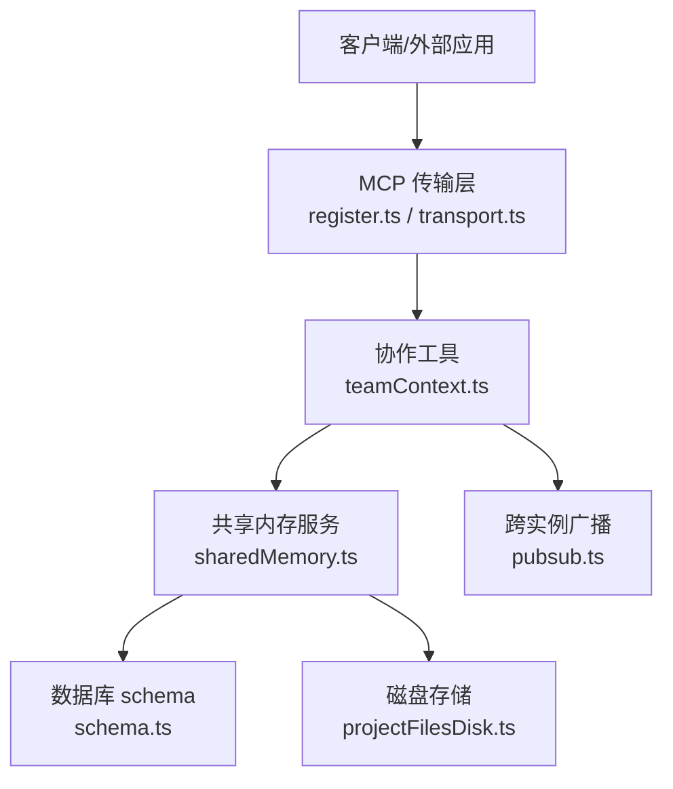
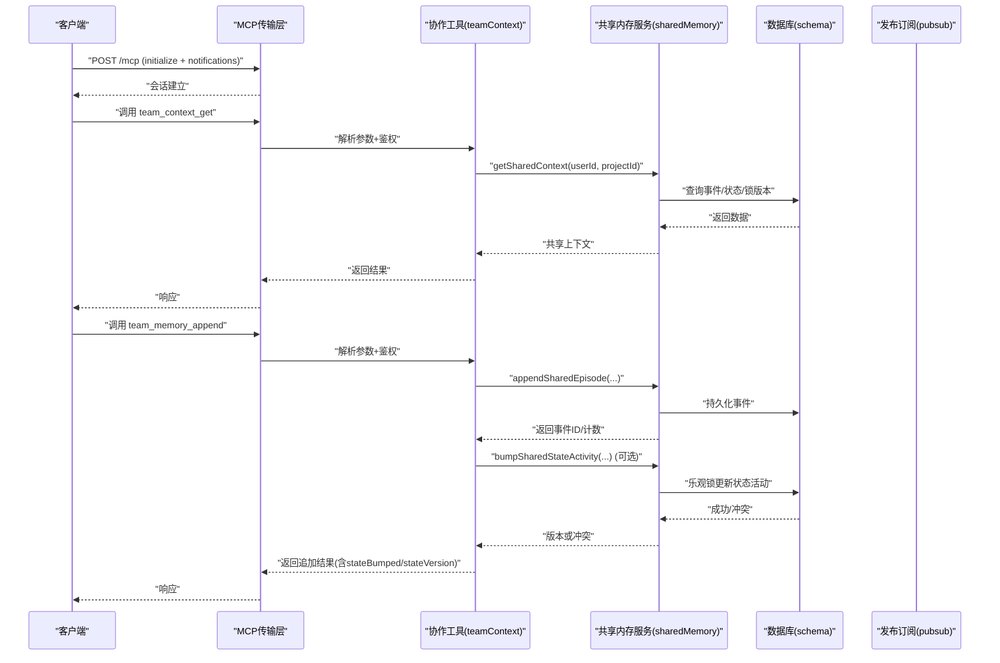
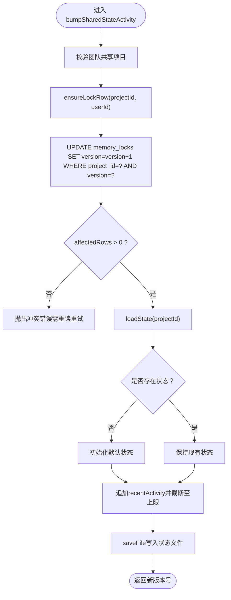
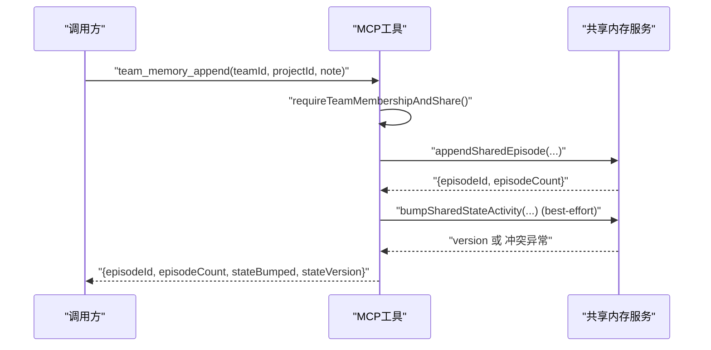
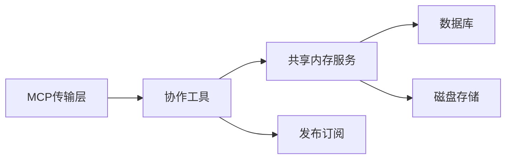

# 实时协作功能

<cite>
**本文引用的文件**
- [api/services/sharedMemory.ts](file://api/services/sharedMemory.ts)
- [api/mcp/tools/team/teamContext.ts](file://api/mcp/tools/team/teamContext.ts)
- [api/routers/team.ts](file://api/routers/team.ts)
- [db/schema.ts](file://db/schema.ts)
- [api/infra/pubsub.ts](file://api/infra/pubsub.ts)
- [api/mcp/register.ts](file://api/mcp/register.ts)
- [api/mcp/transport.ts](file://api/mcp/transport.ts)
- [scripts/smoke-teamsync.mjs](file://scripts/smoke-teamsync.mjs)
</cite>

## 目录
1. [简介](#简介)
2. [项目结构](#项目结构)
3. [核心组件](#核心组件)
4. [架构总览](#架构总览)
5. [详细组件分析](#详细组件分析)
6. [依赖关系分析](#依赖关系分析)
7. [性能考虑](#性能考虑)
8. [故障排查指南](#故障排查指南)
9. [结论](#结论)
10. [附录](#附录)

## 简介
本文件面向DeeWaanAI的“实时协作”能力，聚焦多人协作编辑与状态同步、会话与权限管理、共享内存机制、以及协作API接口。当前代码库实现了Phase 2的TeamSync：以团队为边界的共享项目上下文、追加式事件日志（episodes）、基于乐观锁的状态版本控制，并通过MCP工具对外暴露协作能力。文档同时给出离线支持与数据一致性策略建议，帮助读者理解现有实现并指导后续扩展。

## 项目结构
围绕协作能力的核心路径如下：
- 协作入口与协议：MCP注册与传输层提供HTTP流式与SSE通道，承载协作工具调用与会话生命周期。
- 协作工具：team_context_get、team_memory_append等工具封装访问校验与业务逻辑。
- 共享内存服务：sharedMemory.ts提供团队级共享上下文读取、追加事件、以及带乐观锁的状态活动更新。
- 团队与权限：team路由负责团队创建、邀请加入、成员角色管理、项目共享/取消共享等。
- 数据模型：schema定义用户、项目、团队、成员、共享关系、以及memory_locks等协作相关表。
- 跨实例广播：pubsub抽象Redis或内存发布订阅，用于多实例场景下的消息分发。

**图表来源**
- [api/mcp/register.ts:154-164](file://api/mcp/register.ts#L154-L164)
- [api/mcp/transport.ts:164-233](file://api/mcp/transport.ts#L164-L233)
- [api/mcp/tools/team/teamContext.ts:1-157](file://api/mcp/tools/team/teamContext.ts#L1-L157)
- [api/services/sharedMemory.ts:1-207](file://api/services/sharedMemory.ts#L1-L207)
- [db/schema.ts:84-150](file://db/schema.ts#L84-L150)
- [api/infra/pubsub.ts:36-69](file://api/infra/pubsub.ts#L36-L69)

**章节来源**
- [api/mcp/register.ts:154-164](file://api/mcp/register.ts#L154-L164)
- [api/mcp/transport.ts:164-233](file://api/mcp/transport.ts#L164-L233)
- [api/mcp/tools/team/teamContext.ts:1-157](file://api/mcp/tools/team/teamContext.ts#L1-L157)
- [api/services/sharedMemory.ts:1-207](file://api/services/sharedMemory.ts#L1-L207)
- [db/schema.ts:84-150](file://db/schema.ts#L84-L150)
- [api/infra/pubsub.ts:36-69](file://api/infra/pubsub.ts#L36-L69)

## 核心组件
- 共享内存服务（sharedMemory.ts）
  - getSharedContext：读取团队共享项目的最近事件、结构化状态与当前锁版本。
  - appendSharedEpisode：追加不可变事件（episode），无需锁。
  - bumpSharedStateActivity：通过乐观锁更新状态的活动记录，冲突时抛出错误提示重试。
- 协作工具（teamContext.ts）
  - team_context_get：读取共享上下文，返回事件、状态摘要与锁版本。
  - team_memory_append：追加事件并尝试更新状态活动；状态更新失败不影响事件追加。
- 团队路由（team.ts）
  - 团队创建、邀请加入、成员列表与详情、角色变更、移除成员。
  - 项目共享/取消共享、导入共享流水线/智能体。
- 数据模型（schema.ts）
  - 用户、项目、团队、成员、共享关系、memory_locks等表结构。
- 传输与注册（register.ts / transport.ts）
  - 支持流式HTTP与SSE两种MCP传输；维护会话、处理消息。
- 跨实例广播（pubsub.ts）
  - Redis或内存发布订阅，用于多实例间消息分发。

**章节来源**
- [api/services/sharedMemory.ts:82-207](file://api/services/sharedMemory.ts#L82-L207)
- [api/mcp/tools/team/teamContext.ts:56-157](file://api/mcp/tools/team/teamContext.ts#L56-L157)
- [api/routers/team.ts:25-721](file://api/routers/team.ts#L25-L721)
- [db/schema.ts:84-150](file://db/schema.ts#L84-L150)
- [api/mcp/register.ts:154-164](file://api/mcp/register.ts#L154-L164)
- [api/mcp/transport.ts:164-233](file://api/mcp/transport.ts#L164-L233)
- [api/infra/pubsub.ts:36-69](file://api/infra/pubsub.ts#L36-L69)

## 架构总览
协作系统以MCP为统一接入点，将团队协作能力封装为工具函数。工具在执行业务前进行严格的团队与项目共享权限校验，随后调用共享内存服务完成事件追加或状态更新。状态更新采用乐观锁避免并发写冲突。跨实例通信通过pubsub抽象实现，便于水平扩展。

**图表来源**
- [api/mcp/register.ts:154-164](file://api/mcp/register.ts#L154-L164)
- [api/mcp/transport.ts:164-233](file://api/mcp/transport.ts#L164-L233)
- [api/mcp/tools/team/teamContext.ts:56-157](file://api/mcp/tools/team/teamContext.ts#L56-L157)
- [api/services/sharedMemory.ts:82-207](file://api/services/sharedMemory.ts#L82-L207)
- [db/schema.ts:84-150](file://db/schema.ts#L84-L150)

## 详细组件分析

### 共享内存服务（sharedMemory.ts）
- 设计要点
  - 团队边界：仅允许被团队共享的项目访问，拒绝个人项目。
  - 事件追加：appendSharedEpisode为追加型写入，无锁，保证幂等与可见性。
  - 状态更新：bumpSharedStateActivity使用乐观锁（memory_locks.version），冲突时抛出明确错误提示重读重试。
  - 首次写入：ensureLockRow确保lock行存在，并发插入竞争由DB唯一键保护。
- 复杂度与性能
  - 读取上下文：并行加载事件、状态、锁版本，减少RTT。
  - 事件追加：O(n)旋转保留最近N条（MAX_EPISODES=50）。
  - 状态更新：单次UPDATE原子递增version，失败即冲突。
- 错误处理
  - 非共享项目：统一拒绝错误。
  - 乐观锁冲突：提示调用方重新获取上下文后重试。

**图表来源**
- [api/services/sharedMemory.ts:131-207](file://api/services/sharedMemory.ts#L131-L207)

**章节来源**
- [api/services/sharedMemory.ts:44-207](file://api/services/sharedMemory.ts#L44-L207)

### 协作工具（teamContext.ts）
- 权限门控
  - requireTeamMembershipAndShare：先检查团队成员身份，再检查项目是否已共享给该团队。
- 工具方法
  - team_context_get：返回事件、状态摘要与锁版本，并对内容做截断控制。
  - team_memory_append：追加事件为主操作；状态活动更新为尽力而为（失败不阻塞主流程）。
- 特性开关
  - 通过featureFlag:"teamsync"控制工具可见性与可用性。

**图表来源**
- [api/mcp/tools/team/teamContext.ts:30-157](file://api/mcp/tools/team/teamContext.ts#L30-L157)
- [api/services/sharedMemory.ts:106-207](file://api/services/sharedMemory.ts#L106-L207)

**章节来源**
- [api/mcp/tools/team/teamContext.ts:1-157](file://api/mcp/tools/team/teamContext.ts#L1-L157)

### 团队与权限（team.ts）
- 团队生命周期
  - create：创建团队并自动加入owner，分配初始座位数。
  - joinByCode：按邀请码加入，去重与并发安全处理。
  - listMyTeams/getTeam：列出用户所在团队及详情（成员、共享项目）。
  - updateMemberRole/removeMember：管理员/拥有者权限控制。
  - delete：拥有者删除团队，清理订阅。
- 资源共享
  - shareProject/unshareProject：限制为拥有者/管理员操作，重复共享容忍。
  - importPipeline/importAgent：从团队共享资源导入到自有项目，默认禁用新步骤。

**章节来源**
- [api/routers/team.ts:25-721](file://api/routers/team.ts#L25-L721)

### 数据模型（schema.ts）
- 关键实体
  - users：用户信息、偏好、最近项目等。
  - projects：项目元数据、流水线配置、智能卡片等。
  - teams/teamMembers/teamProjects：团队、成员、项目共享关系。
  - memory_locks：协作状态乐观锁（version、lastWriterId）。
- 索引与约束
  - 常用查询字段建立索引以提升性能。
  - 唯一约束防止重复共享/成员关系。

**章节来源**
- [db/schema.ts:84-150](file://db/schema.ts#L84-L150)

### 传输与注册（register.ts / transport.ts）
- 路由注册
  - 支持流式HTTP与SSE两种MCP传输方式。
- 会话管理
  - 维护session映射，处理连接、消息、关闭事件。
  - 对SSE与流式请求分别处理，统一错误与日志。

**章节来源**
- [api/mcp/register.ts:154-164](file://api/mcp/register.ts#L154-L164)
- [api/mcp/transport.ts:164-233](file://api/mcp/transport.ts#L164-L233)

### 跨实例广播（pubsub.ts）
- 后端选择
  - 优先使用Redis作为发布订阅后端；若不可用则回退到内存模式。
- 订阅者管理
  - 延迟订阅、错误处理、预注册处理器在连接就绪后恢复订阅。

**章节来源**
- [api/infra/pubsub.ts:36-69](file://api/infra/pubsub.ts#L36-L69)

## 依赖关系分析
- 组件耦合
  - 工具层依赖共享内存服务；服务依赖数据库与磁盘存储。
  - 传输层与工具解耦，通过MCP协议统一调用。
- 外部依赖
  - Drizzle ORM用于数据库访问。
  - Redis（可选）用于跨实例消息广播。
- 潜在循环依赖
  - 当前分层清晰，未见循环引用。

**图表来源**
- [api/mcp/transport.ts:164-233](file://api/mcp/transport.ts#L164-L233)
- [api/mcp/tools/team/teamContext.ts:1-157](file://api/mcp/tools/team/teamContext.ts#L1-L157)
- [api/services/sharedMemory.ts:1-207](file://api/services/sharedMemory.ts#L1-L207)
- [api/infra/pubsub.ts:36-69](file://api/infra/pubsub.ts#L36-L69)

**章节来源**
- [api/mcp/transport.ts:164-233](file://api/mcp/transport.ts#L164-L233)
- [api/mcp/tools/team/teamContext.ts:1-157](file://api/mcp/tools/team/teamContext.ts#L1-L157)
- [api/services/sharedMemory.ts:1-207](file://api/services/sharedMemory.ts#L1-L207)
- [api/infra/pubsub.ts:36-69](file://api/infra/pubsub.ts#L36-L69)

## 性能考虑
- 并发写保护
  - 乐观锁避免写冲突，失败即提示重试，避免静默丢失。
- I/O优化
  - 读取上下文并行加载事件、状态、锁版本。
  - 事件与状态文件读写有容量限制（如最近活动数量、事件数量上限）。
- 可扩展性
  - pubsub支持Redis，便于多实例部署时的消息广播。
- 建议
  - 在高并发场景下，结合缓存层减少热点读取。
  - 对大对象状态可考虑分片或增量同步。

[本节为通用性能讨论，不直接分析具体文件]

## 故障排查指南
- 常见错误
  - 非共享项目访问：确认项目已共享给调用者所属团队。
  - 乐观锁冲突：收到“状态已变更”错误时，先重新读取上下文再重试写入。
  - 邀请码无效/重复加入：检查邀请码有效性或成员关系是否已存在。
- 定位步骤
  - 查看MCP传输日志，确认会话建立与工具调用链路。
  - 检查数据库memory_locks版本变化与affectedRows。
  - 核对团队与项目共享关系是否正确。
- 参考实现
  - 共享内存服务的冲突处理与日志输出。
  - 工具层的最佳努力状态更新，失败不影响主流程。

**章节来源**
- [api/services/sharedMemory.ts:166-180](file://api/services/sharedMemory.ts#L166-L180)
- [api/mcp/tools/team/teamContext.ts:121-140](file://api/mcp/tools/team/teamContext.ts#L121-L140)

## 结论
当前协作能力以团队为边界，通过MCP工具暴露共享上下文读取与事件追加能力，并使用乐观锁保障状态一致性。团队路由提供完整的成员与资源共享管理。未来可在以下方面增强：
- 光标同步与文本变更同步：引入CRDT或OT算法，结合WebSocket推送。
- 在线状态显示：基于会话心跳与pubsub广播成员在线情况。
- 实时聊天：在MCP之上构建聊天频道与消息队列。
- 离线支持：本地缓存与合并策略，网络恢复后增量同步。

[本节为总结性内容，不直接分析具体文件]

## 附录

### 协作API接口清单（基于现有实现）
- MCP工具
  - team_context_get：读取团队共享项目上下文（事件、状态、锁版本）。
  - team_memory_append：追加事件并尝试更新状态活动。
- 团队管理（tRPC路由）
  - create/joinByCode/listMyTeams/getTeam/updateMemberRole/removeMember/shareProject/unshareProject/delete/importPipeline/importAgent

**章节来源**
- [api/mcp/tools/team/teamContext.ts:56-157](file://api/mcp/tools/team/teamContext.ts#L56-L157)
- [api/routers/team.ts:25-721](file://api/routers/team.ts#L25-L721)

### 测试与验证
- smoke脚本演示了MCP会话建立、工具调用与结果读取流程，可用于端到端验证协作能力。

**章节来源**
- [scripts/smoke-teamsync.mjs:21-89](file://scripts/smoke-teamsync.mjs#L21-L89)