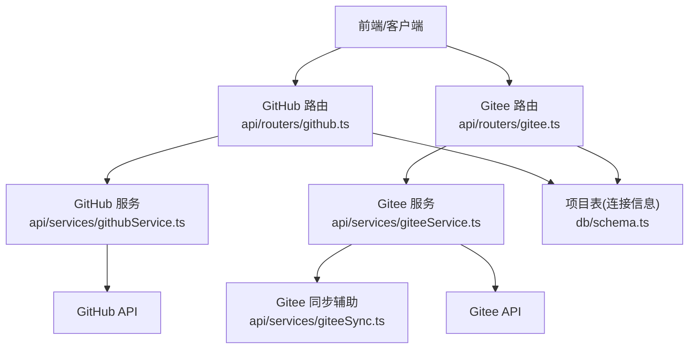
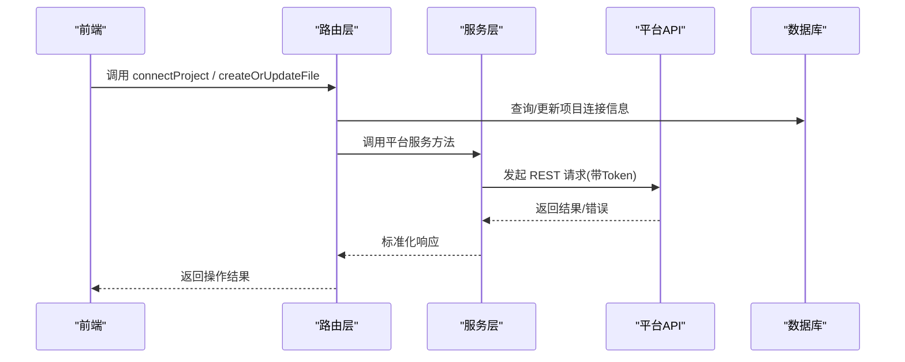
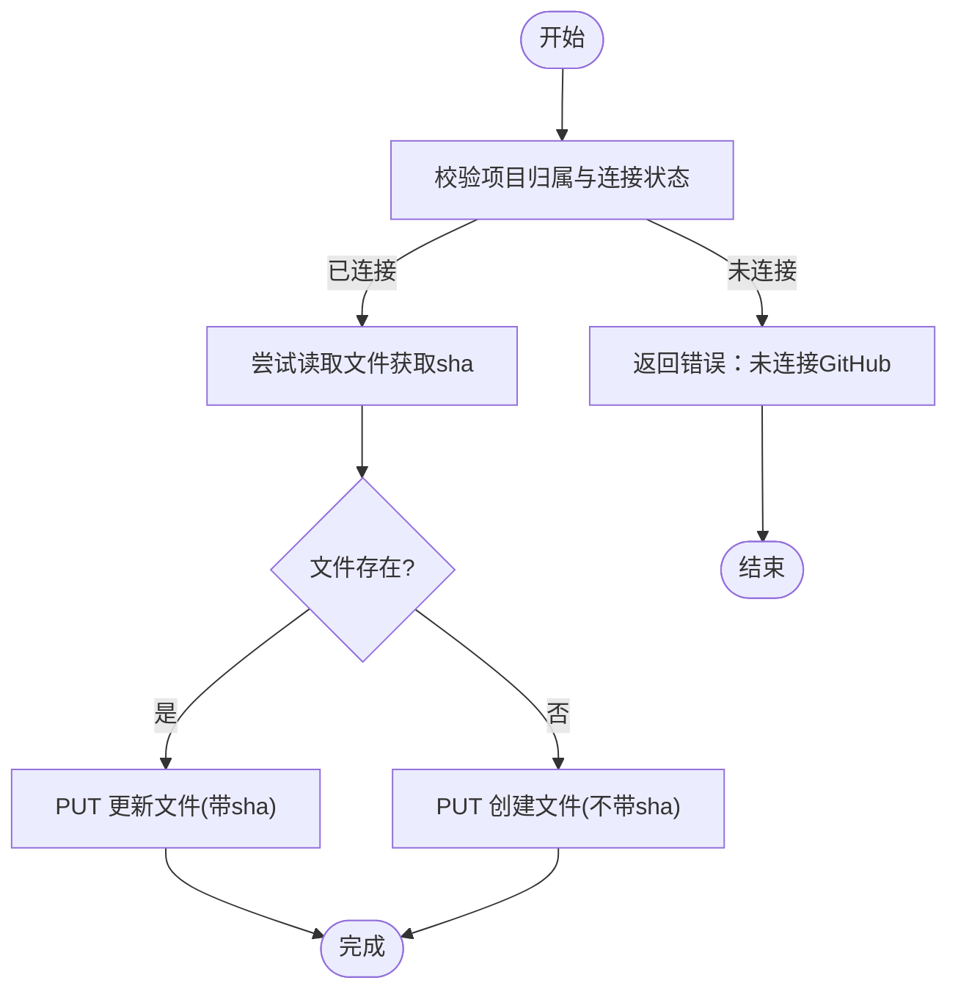
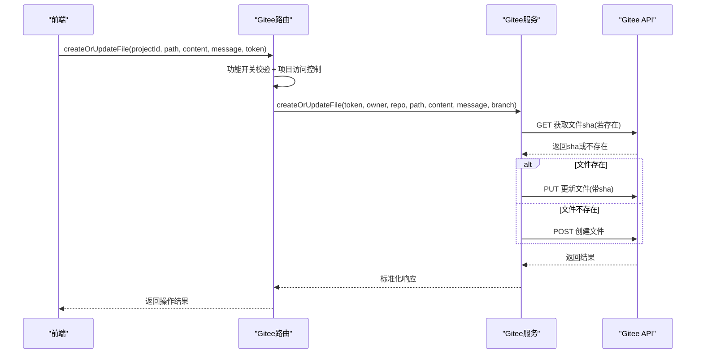
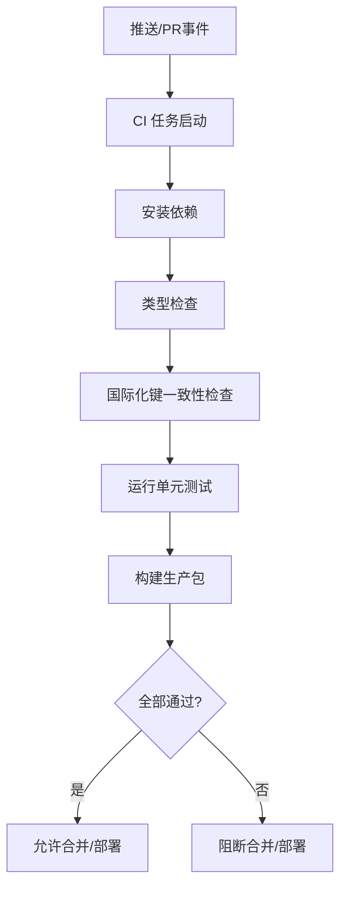
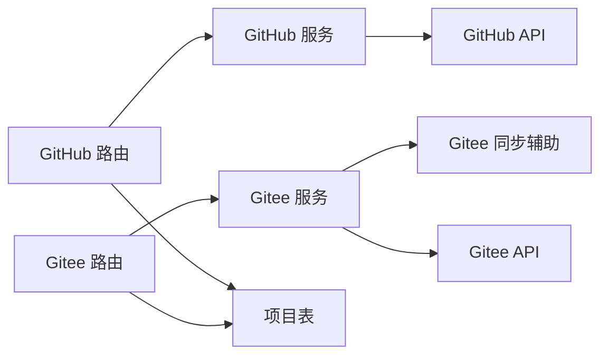

# 版本控制集成

<cite>
**本文引用的文件**
- [api/routers/github.ts](file://api/routers/github.ts)
- [api/services/githubService.ts](file://api/services/githubService.ts)
- [api/routers/gitee.ts](file://api/routers/gitee.ts)
- [api/services/giteeService.ts](file://api/services/giteeService.ts)
- [api/services/giteeSync.ts](file://api/services/giteeSync.ts)
- [db/schema.ts](file://db/schema.ts)
- [.github/workflows/ci.yml](file://.github/workflows/ci.yml)
- [.github/workflows/backup.yml](file://.github/workflows/backup.yml)
- [contracts/index.ts](file://contracts/index.ts)
</cite>

## 目录
1. [简介](#简介)
2. [项目结构](#项目结构)
3. [核心组件](#核心组件)
4. [架构总览](#架构总览)
5. [详细组件分析](#详细组件分析)
6. [依赖关系分析](#依赖关系分析)
7. [性能考虑](#性能考虑)
8. [故障排查指南](#故障排查指南)
9. [结论](#结论)
10. [附录：API 参考](#附录api-参考)

## 简介
本章节为 DeeWaanAI 的版本控制集成功能提供完整文档，覆盖 GitHub 与 Gitee 双平台集成、仓库连接与认证配置、权限校验、分支管理（创建/切换/合并/删除）、提交历史查看、差异对比与回滚、协作开发（Pull Request 管理与代码审查/评论）以及冲突解决策略与自动化工作流。同时给出版本控制 API 接口说明，便于前后端或第三方系统集成。

## 项目结构
版本控制相关能力主要分布在以下模块：
- 路由层：对外暴露 tRPC 接口，负责鉴权、参数校验与访问控制
  - GitHub 路由：[api/routers/github.ts](file://api/routers/github.ts)
  - Gitee 路由：[api/routers/gitee.ts](file://api/routers/gitee.ts)
- 服务层：封装各平台的 REST API 调用，统一错误处理与数据转换
  - GitHub 服务：[api/services/githubService.ts](file://api/services/githubService.ts)
  - Gitee 服务：[api/services/giteeService.ts](file://api/services/giteeService.ts)
  - Gitee 同步辅助：[api/services/giteeSync.ts](file://api/services/giteeSync.ts)
- 数据模型：项目表存储仓库连接信息（owner/repo/branch）与同步时间戳
  - 数据库 Schema：[db/schema.ts](file://db/schema.ts)
- 自动化工作流：GitHub Actions CI 与定时备份
  - CI：[.github/workflows/ci.yml](file://.github/workflows/ci.yml)
  - 备份：[.github/workflows/backup.yml](file://.github/workflows/backup.yml)
- 类型契约：Gitee 文件等数据结构定义
  - 类型定义：[contracts/index.ts](file://contracts/index.ts)

**图表来源**
- [api/routers/github.ts:1-136](file://api/routers/github.ts#L1-L136)
- [api/routers/gitee.ts:1-289](file://api/routers/gitee.ts#L1-L289)
- [api/services/githubService.ts:1-124](file://api/services/githubService.ts#L1-L124)
- [api/services/giteeService.ts:1-185](file://api/services/giteeService.ts#L1-L185)
- [api/services/giteeSync.ts:74-129](file://api/services/giteeSync.ts#L74-L129)
- [db/schema.ts:84-150](file://db/schema.ts#L84-L150)

**章节来源**
- [api/routers/github.ts:1-136](file://api/routers/github.ts#L1-L136)
- [api/routers/gitee.ts:1-289](file://api/routers/gitee.ts#L1-L289)
- [api/services/githubService.ts:1-124](file://api/services/githubService.ts#L1-L124)
- [api/services/giteeService.ts:1-185](file://api/services/giteeService.ts#L1-L185)
- [api/services/giteeSync.ts:74-129](file://api/services/giteeSync.ts#L74-L129)
- [db/schema.ts:84-150](file://db/schema.ts#L84-L150)

## 核心组件
- 认证与授权
  - GitHub/Gitee Token 校验：通过各自用户接口验证 token 有效性
  - 项目级访问控制：仅允许项目所有者或团队成员访问对应仓库操作
- 仓库连接与断开
  - 连接：将项目的 owner/repo/branch 持久化到项目表
  - 断开：清空项目表的仓库字段
- 文件树与内容读写
  - 读取：获取文件或目录树、文件内容（base64 解码）
  - 写入：创建或更新文件（自动判断是否存在并附带 sha）
- 同步与增量
  - 记录 lastSyncedAt，支持后续双向同步扩展
- 自动化工作流
  - CI：在 push/PR 时执行类型检查、测试与构建
  - 备份：定时触发应用内备份接口，落盘至对象存储

**章节来源**
- [api/routers/github.ts:10-82](file://api/routers/github.ts#L10-L82)
- [api/routers/gitee.ts:33-74](file://api/routers/gitee.ts#L33-L74)
- [api/services/githubService.ts:17-124](file://api/services/githubService.ts#L17-L124)
- [api/services/giteeService.ts:10-185](file://api/services/giteeService.ts#L10-L185)
- [db/schema.ts:84-150](file://db/schema.ts#L84-L150)
- [.github/workflows/ci.yml:1-96](file://.github/workflows/ci.yml#L1-L96)
- [.github/workflows/backup.yml:1-46](file://.github/workflows/backup.yml#L1-L46)

## 架构总览
版本控制集成采用“路由-服务-平台API”的分层架构：
- 路由层负责鉴权、参数校验、权限检查与业务编排
- 服务层封装平台差异，屏蔽 GitHub/Gitee API 细节
- 数据层使用项目表存储连接信息与同步时间戳
- 工作流层通过 GitHub Actions 实现持续集成与备份

**图表来源**
- [api/routers/github.ts:21-46](file://api/routers/github.ts#L21-L46)
- [api/routers/gitee.ts:139-171](file://api/routers/gitee.ts#L139-L171)
- [api/services/githubService.ts:60-101](file://api/services/githubService.ts#L60-L101)
- [api/services/giteeService.ts:55-98](file://api/services/giteeService.ts#L55-L98)
- [db/schema.ts:84-150](file://db/schema.ts#L84-L150)

## 详细组件分析

### GitHub 集成
- 功能范围
  - Token 校验、仓库列表、项目连接/断开、文件树读取、文件创建/更新
- 关键流程
  - 连接项目：校验仓库存在且当前用户有访问权限，写入项目表中的 owner/repo/branch
  - 文件写入：先尝试读取文件以获取 sha，再决定 PUT 更新或创建；失败时抛出明确错误
- 权限与安全
  - 所有接口均要求有效 token 与项目归属校验
- 分支策略
  - 默认分支 main，可通过连接参数指定

**图表来源**
- [api/routers/github.ts:21-46](file://api/routers/github.ts#L21-L46)
- [api/services/githubService.ts:60-101](file://api/services/githubService.ts#L60-L101)

**章节来源**
- [api/routers/github.ts:1-136](file://api/routers/github.ts#L1-L136)
- [api/services/githubService.ts:1-124](file://api/services/githubService.ts#L1-L124)

### Gitee 集成
- 功能范围
  - Token 校验、仓库列表、项目同步标记、文件树读取、文件创建/更新、文件夹批量删除、调试接口
- 关键流程
  - 连接与同步：更新 lastSyncedAt，预留双向同步扩展点
  - 文件写入：先读后写，自动选择 POST/PUT，失败返回详细错误
  - 多分支兼容：部分接口对 master/main 进行回退尝试
- 权限与安全
  - 通过 isFeatureEnabled("gitee_sync", userId) 控制功能开关
  - 项目访问控制：仅项目所有者或团队成员可访问
- 分支策略
  - 默认分支 master，部分逻辑兼容 main

**图表来源**
- [api/routers/gitee.ts:139-171](file://api/routers/gitee.ts#L139-L171)
- [api/services/giteeService.ts:55-98](file://api/services/giteeService.ts#L55-L98)

**章节来源**
- [api/routers/gitee.ts:1-289](file://api/routers/gitee.ts#L1-L289)
- [api/services/giteeService.ts:1-185](file://api/services/giteeService.ts#L1-L185)

### 分支管理
- 创建分支
  - 当前服务层未直接暴露“创建分支”的 API；可通过平台 API 扩展（例如基于现有分支创建新分支并提交初始文件）
- 切换分支
  - 连接项目时可指定分支（GitHub 默认 main，Gitee 默认 master），后续文件操作使用该分支
- 合并分支
  - 当前未实现服务端合并；可在平台侧通过 PR/MR 流程合并
- 删除分支
  - 当前未实现服务端删除；可在平台侧删除

建议扩展点：在服务层增加 createBranch/deleteBranch/mergeBranch 方法，并在路由中暴露相应接口。

**章节来源**
- [api/routers/github.ts:21-46](file://api/routers/github.ts#L21-L46)
- [api/routers/gitee.ts:139-171](file://api/routers/gitee.ts#L139-L171)
- [api/services/githubService.ts:60-101](file://api/services/githubService.ts#L60-L101)
- [api/services/giteeService.ts:55-98](file://api/services/giteeService.ts#L55-L98)

### 提交历史查看、差异对比与回滚
- 提交历史查看
  - 当前未直接暴露“提交历史”接口；可通过平台 API 获取最近提交列表
- 差异对比
  - 当前未直接暴露“diff”接口；可通过平台 API 比较两个分支/提交的差异
- 回滚
  - 当前未直接暴露“回滚”接口；可通过平台 API 创建新提交回滚变更

建议扩展点：在服务层增加 getCommits/getDiff/rollback 等方法，并在路由中暴露相应接口。

**章节来源**
- [api/services/githubService.ts:17-124](file://api/services/githubService.ts#L17-L124)
- [api/services/giteeService.ts:10-185](file://api/services/giteeService.ts#L10-L185)

### 协作开发支持（Pull Request、代码审查、评论）
- Pull Request 管理
  - 当前未直接暴露 PR 创建/列表/合并接口；可在服务层扩展
- 代码审查与评论
  - 当前未直接暴露审查与评论接口；可在服务层扩展

建议扩展点：在服务层增加 createPullRequest/listPullRequests/mergePullRequest/addReview/addComment 等方法，并在路由中暴露相应接口。

**章节来源**
- [api/services/githubService.ts:17-124](file://api/services/githubService.ts#L17-L124)
- [api/services/giteeService.ts:10-185](file://api/services/giteeService.ts#L10-L185)

### 冲突解决策略与自动化工作流程
- 冲突解决策略
  - 文件写入采用“先读后写”模式，利用 sha 保证并发安全；若出现冲突，平台 API 会返回错误，客户端应提示用户重试或手动解决
- 自动化工作流
  - CI：push/PR 时执行类型检查、国际化键一致性检查、单元测试与生产构建
  - 备份：每日定时触发应用内备份接口，生成数据库备份并上传至对象存储

**图表来源**
- [.github/workflows/ci.yml:1-96](file://.github/workflows/ci.yml#L1-L96)

**章节来源**
- [.github/workflows/ci.yml:1-96](file://.github/workflows/ci.yml#L1-L96)
- [.github/workflows/backup.yml:1-46](file://.github/workflows/backup.yml#L1-L46)

## 依赖关系分析
- 路由与服务耦合度低，职责清晰
- 服务层对平台 API 的依赖通过独立模块封装，便于替换与测试
- 项目表作为连接信息的单一事实源，避免重复配置
- 工作流与代码库解耦，通过 GitHub Actions 触发

**图表来源**
- [api/routers/github.ts:1-136](file://api/routers/github.ts#L1-L136)
- [api/routers/gitee.ts:1-289](file://api/routers/gitee.ts#L1-L289)
- [api/services/githubService.ts:1-124](file://api/services/githubService.ts#L1-L124)
- [api/services/giteeService.ts:1-185](file://api/services/giteeService.ts#L1-L185)
- [api/services/giteeSync.ts:74-129](file://api/services/giteeSync.ts#L74-L129)
- [db/schema.ts:84-150](file://db/schema.ts#L84-L150)

**章节来源**
- [api/routers/github.ts:1-136](file://api/routers/github.ts#L1-L136)
- [api/routers/gitee.ts:1-289](file://api/routers/gitee.ts#L1-L289)
- [api/services/githubService.ts:1-124](file://api/services/githubService.ts#L1-L124)
- [api/services/giteeService.ts:1-185](file://api/services/giteeService.ts#L1-L185)
- [api/services/giteeSync.ts:74-129](file://api/services/giteeSync.ts#L74-L129)
- [db/schema.ts:84-150](file://db/schema.ts#L84-L150)

## 性能考虑
- 并发安全：通过 sha 校验避免覆盖写入，减少冲突概率
- 网络开销：文件读取与写入按需进行，避免全量拉取
- 缓存策略：可在服务层引入本地缓存（如 Redis）缓存文件树与内容，降低平台 API 调用频率
- 批处理：对于大目录删除，采用递归遍历与批量删除，注意速率限制与重试机制
- 超时与重试：对平台 API 调用设置合理超时与指数退避重试

[本节为通用指导，不直接分析具体文件]

## 故障排查指南
- Token 无效
  - 现象：校验接口返回 valid=false
  - 处理：检查 token 是否过期或权限不足
- 项目未连接
  - 现象：调用文件操作时报“未连接”
  - 处理：先执行连接项目接口，确保 owner/repo/branch 正确
- 文件路径错误
  - 现象：读取目录或空内容报错
  - 处理：确认路径存在且为文件；大文件或符号链接需特殊处理
- 权限不足
  - 现象：平台 API 返回 403/404
  - 处理：检查 token 权限与仓库可见性
- 同步失败
  - 现象：lastSyncedAt 未更新
  - 处理：检查网络连接与平台 API 可用性

**章节来源**
- [api/services/githubService.ts:17-124](file://api/services/githubService.ts#L17-L124)
- [api/services/giteeService.ts:10-185](file://api/services/giteeService.ts#L10-L185)
- [api/routers/github.ts:21-82](file://api/routers/github.ts#L21-L82)
- [api/routers/gitee.ts:33-74](file://api/routers/gitee.ts#L33-L74)

## 结论
DeeWaanAI 的版本控制集成已具备 GitHub/Gitee 的基础能力：Token 校验、仓库连接、文件树读取与文件创建/更新、同步时间戳记录与 CI/备份工作流。未来可扩展分支管理、提交历史、差异对比、回滚、Pull Request 管理与代码审查等功能，进一步提升团队协作效率与自动化水平。

[本节为总结，不直接分析具体文件]

## 附录：API 参考
以下为版本控制相关的主要接口（tRPC 风格），用于前后端或第三方系统集成：

- GitHub
  - validateToken(token): 校验 GitHub Token 有效性
  - listRepos(token): 列出用户拥有的仓库
  - connectProject(projectId, token, owner, repo, branch): 连接项目到 GitHub 仓库
  - disconnectProject(projectId): 断开项目与 GitHub 仓库的连接
  - syncProject(projectId): 标记项目同步时间
  - getFileTree(projectId, path, token): 获取仓库文件树
  - createOrUpdateFile(projectId, path, content, message, token): 创建或更新文件

- Gitee
  - validateToken(token): 校验 Gitee Token 有效性（受功能开关控制）
  - listRepos(token): 列出个人仓库
  - syncProject(projectId): 标记项目同步时间（受功能开关控制）
  - getFile(projectId, path, ref): 获取文件内容（待完善 token 配置）
  - getFileTree(projectId, path, token): 获取仓库文件树（受功能开关控制）
  - createOrUpdateFile(projectId, path, content, message, token): 创建或更新文件（受功能开关控制）
  - getMyDataTree(token, path): 获取 swarm-studio 仓库的文件树（受功能开关控制）
  - getMyDataFile(token, path): 获取 swarm-studio 仓库的文件内容（受功能开关控制）
  - loadFolder(token, path): 加载文件夹内容（受功能开关控制）
  - debugGitee(token, path): 调试原始 Gitee API 调用（受功能开关控制）

- 数据类型
  - GiteeFile: { path, content?, sha? }

**章节来源**
- [api/routers/github.ts:10-134](file://api/routers/github.ts#L10-L134)
- [api/routers/gitee.ts:33-287](file://api/routers/gitee.ts#L33-L287)
- [contracts/index.ts:176-183](file://contracts/index.ts#L176-L183)