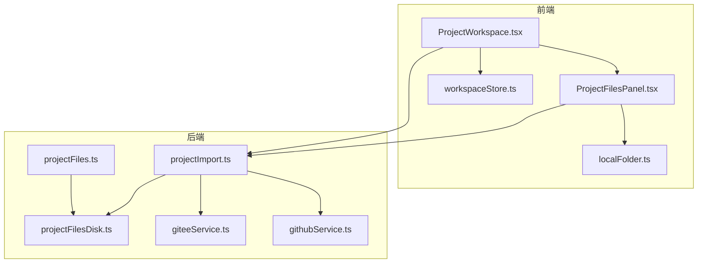
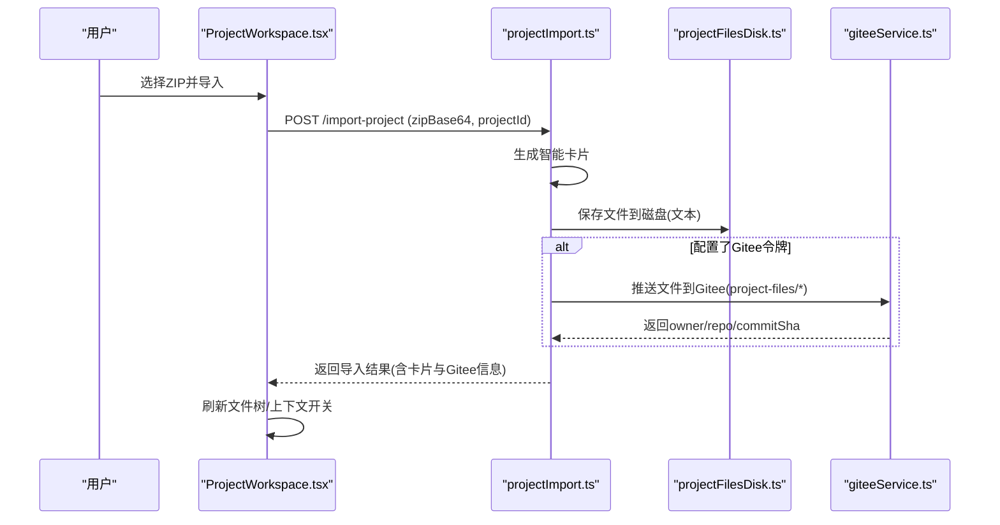
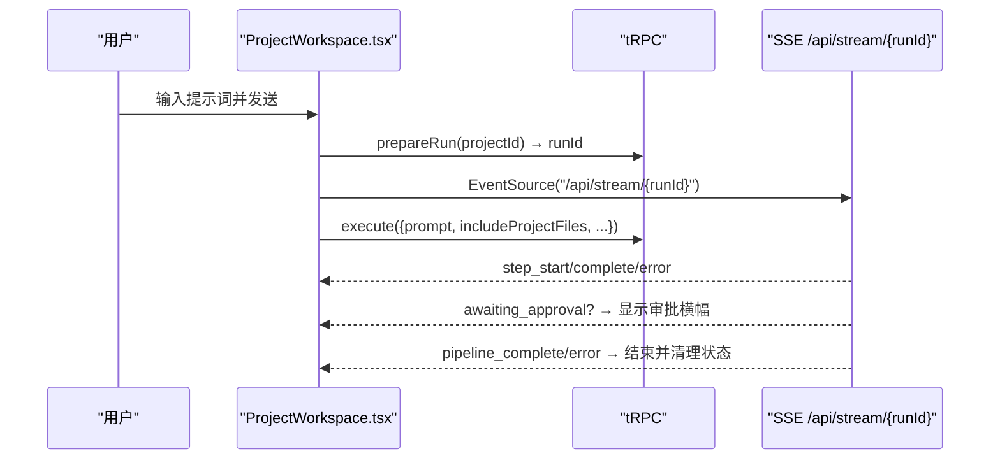
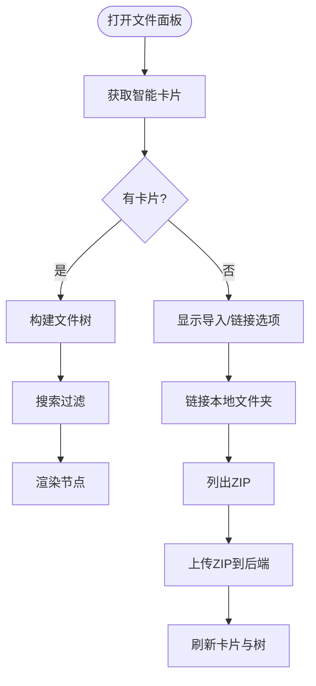
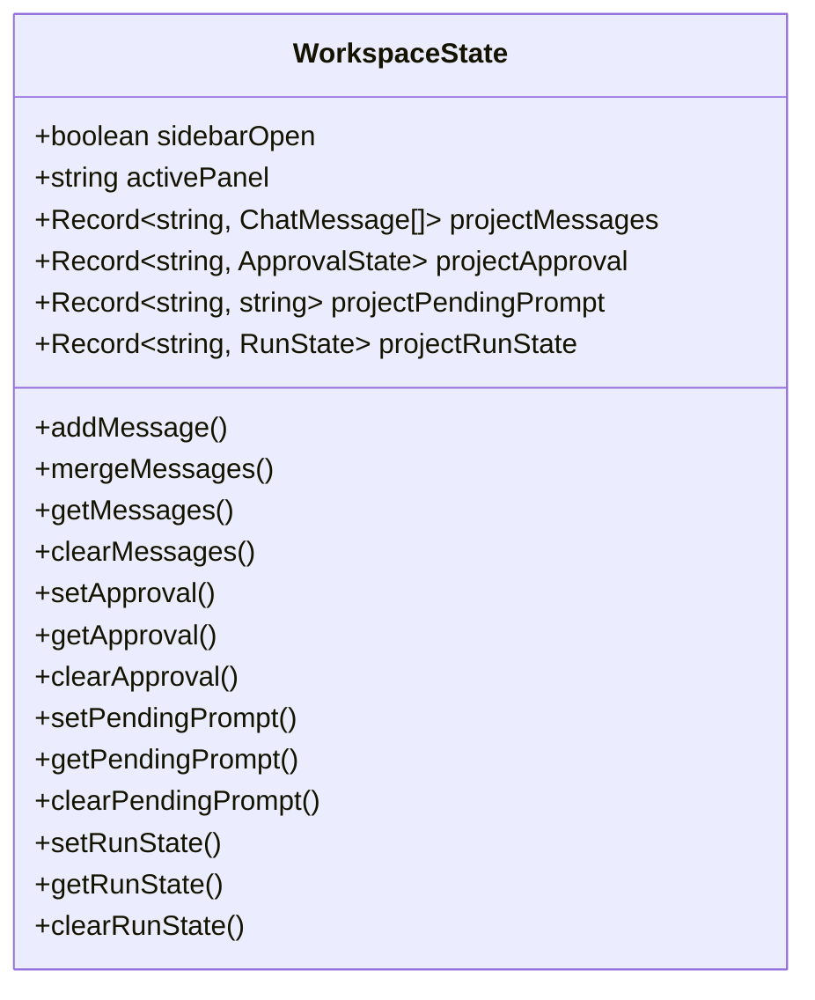
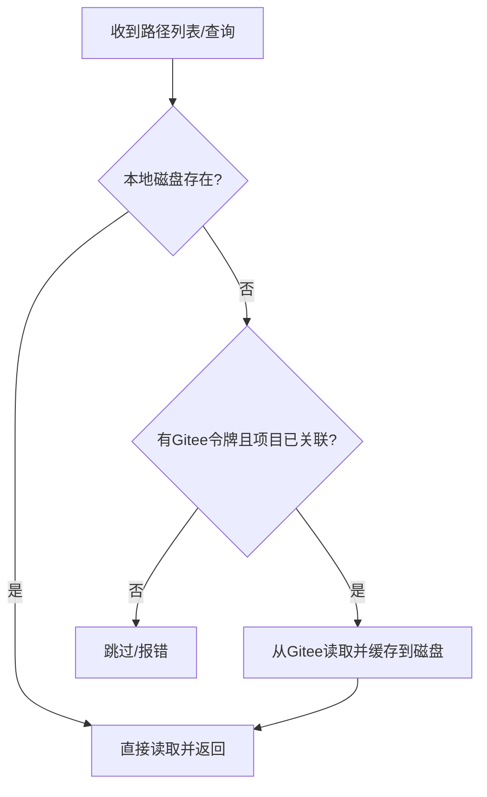
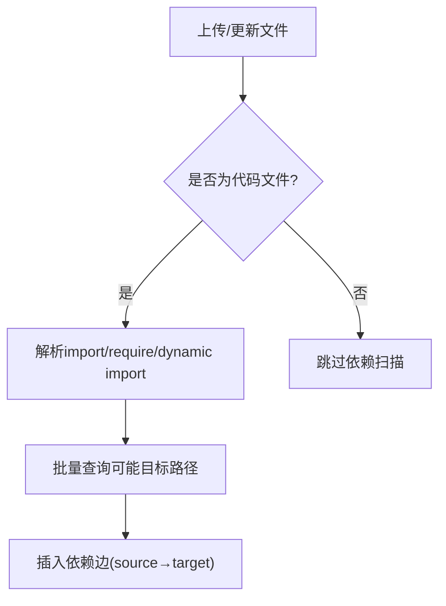
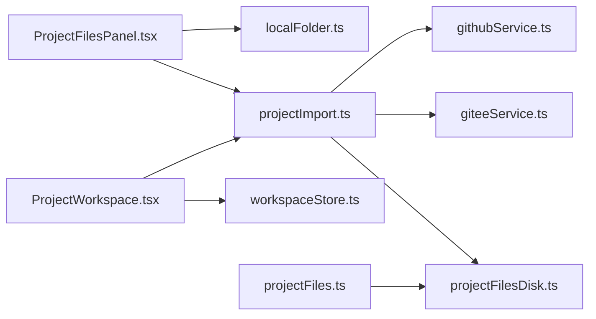

# 项目工作区页面

<cite>
**本文引用的文件**
- [ProjectWorkspace.tsx](file://src/pages/ProjectWorkspace.tsx)
- [ProjectFilesPanel.tsx](file://src/components/project/ProjectFilesPanel.tsx)
- [workspaceStore.ts](file://src/stores/workspaceStore.ts)
- [projectImport.ts](file://api/routers/projectImport.ts)
- [projectFiles.ts](file://api/routers/projectFiles.ts)
- [projectFilesDisk.ts](file://api/services/projectFilesDisk.ts)
- [giteeService.ts](file://api/services/giteeService.ts)
- [githubService.ts](file://api/services/githubService.ts)
- [localFolder.ts](file://src/lib/localFolder.ts)
</cite>

## 目录
1. [简介](#简介)
2. [项目结构](#项目结构)
3. [核心组件](#核心组件)
4. [架构总览](#架构总览)
5. [详细组件分析](#详细组件分析)
6. [依赖关系分析](#依赖关系分析)
7. [性能考虑](#性能考虑)
8. [故障排查指南](#故障排查指南)
9. [结论](#结论)
10. [附录：API与事件示例](#附录api与事件示例)

## 简介
本页面为DeeWaanAI的项目工作区，提供项目文件管理、代码编辑器集成（通过智能卡片与上下文注入）、版本控制（GitHub/Gitee）与协作能力。支持文件树展示、导入/同步、实时运行状态、审批流、以及基于智能卡片的“相关文件”检索与内容拉取。

## 项目结构
- 前端页面与面板
  - 工作区主页面：负责消息输入、流水线执行、SSE实时状态、审批交互等
  - 项目文件面板：展示导入后的文件树、搜索、本地文件夹链接、ZIP导入、清理等
  - 工作区状态存储：持久化聊天消息、审批状态、待处理提示、运行状态等
- 后端路由与服务
  - 项目导入路由：ZIP导入、智能卡片生成、Gitee同步、磁盘缓存、智能文件检索
  - 项目文件路由：上传/读取/删除文件、依赖扫描、影响分析
  - 磁盘服务：按项目隔离的本地文件读写
  - 版本控制服务：Gitee/GitHub API封装（分支、文件树、内容读写）
  - 本地文件夹访问：浏览器端文件系统访问与权限管理

图表来源
- [ProjectWorkspace.tsx:1-120](file://src/pages/ProjectWorkspace.tsx#L1-L120)
- [ProjectFilesPanel.tsx:1-60](file://src/components/project/ProjectFilesPanel.tsx#L1-L60)
- [workspaceStore.ts:1-70](file://src/stores/workspaceStore.ts#L1-L70)
- [projectImport.ts:1-80](file://api/routers/projectImport.ts#L1-L80)
- [projectFiles.ts:1-70](file://api/routers/projectFiles.ts#L1-L70)
- [projectFilesDisk.ts:1-30](file://api/services/projectFilesDisk.ts#L1-L30)
- [giteeService.ts:1-30](file://api/services/giteeService.ts#L1-L30)
- [githubService.ts:1-30](file://api/services/githubService.ts#L1-L30)
- [localFolder.ts:1-30](file://src/lib/localFolder.ts#L1-L30)

章节来源
- [ProjectWorkspace.tsx:1-120](file://src/pages/ProjectWorkspace.tsx#L1-L120)
- [ProjectFilesPanel.tsx:1-60](file://src/components/project/ProjectFilesPanel.tsx#L1-L60)
- [workspaceStore.ts:1-70](file://src/stores/workspaceStore.ts#L1-L70)

## 核心组件
- 工作区主页面
  - 负责用户输入、流水线/单Agent执行、SSE实时进度、审批流程、附件上传、模板应用、自动设计等
  - 维护运行状态、恢复断点、合并服务器消息、本地存储持久化
- 项目文件面板
  - 展示智能卡片中的文件树、搜索、展开/收起、本地文件夹链接、ZIP导入、清理
  - 控制是否将项目文件纳入聊天上下文
- 工作区状态存储
  - 按项目维度持久化消息、审批、待处理提示、运行状态
  - 对大附件进行裁剪以避免localStorage配额溢出
- 项目导入与智能卡片
  - ZIP导入、语言/框架识别、文件树构建、入口点识别、实体/表/接口提取
  - 可选同步到Gitee；本地磁盘缓存用于快速LLM上下文加载
  - 智能检索：根据查询返回相关路径与内容（优先本地磁盘，缺失时回退Gitee）
- 项目文件操作
  - 上传/读取/删除文件、依赖扫描、影响分析（BFS批量查询）
- 版本控制集成
  - Gitee/GitHub API封装：仓库列表、文件树、文件内容读写、分支默认值
  - 导入时推送文本文件到Gitee；新设备或团队成员首次打开时可从Gitee同步到本地磁盘

章节来源
- [ProjectWorkspace.tsx:120-250](file://src/pages/ProjectWorkspace.tsx#L120-L250)
- [ProjectFilesPanel.tsx:185-335](file://src/components/project/ProjectFilesPanel.tsx#L185-L335)
- [workspaceStore.ts:67-207](file://src/stores/workspaceStore.ts#L67-L207)
- [projectImport.ts:75-238](file://api/routers/projectImport.ts#L75-L238)
- [projectFiles.ts:67-147](file://api/routers/projectFiles.ts#L67-L147)
- [projectFilesDisk.ts:83-142](file://api/services/projectFilesDisk.ts#L83-L142)
- [giteeService.ts:18-48](file://api/services/giteeService.ts#L18-L48)
- [githubService.ts:25-53](file://api/services/githubService.ts#L25-L53)

## 架构总览
工作区采用“前端UI + tRPC路由 + 磁盘/云端混合存储”的架构：
- 前端通过tRPC调用后端路由，完成导入、读取、同步等操作
- 文件内容优先从本地磁盘读取（高性能），缺失时回退到Gitee/GitHub
- 智能卡片作为索引，指导“相关文件”检索与上下文组装
- 运行态通过SSE实时推送步骤状态与结果，支持审批中断与恢复

图表来源
- [ProjectWorkspace.tsx:185-227](file://src/pages/ProjectWorkspace.tsx#L185-L227)
- [ProjectFilesPanel.tsx:247-312](file://src/components/project/ProjectFilesPanel.tsx#L247-L312)
- [projectImport.ts:83-238](file://api/routers/projectImport.ts#L83-L238)
- [projectFilesDisk.ts:17-30](file://api/services/projectFilesDisk.ts#L17-L30)
- [giteeService.ts:55-98](file://api/services/giteeService.ts#L55-L98)

## 详细组件分析

### 工作区主页面（ProjectWorkspace.tsx）
- 功能要点
  - 消息输入与附件上传（/api/upload-file）
  - 流水线模式与单Agent模式切换
  - SSE连接建立与事件处理（step_start/complete/error、awaiting_approval、pipeline_complete/error）
  - 审批流：approve/reject/modify，支持跨导航恢复
  - 自动设计与模板应用
  - 项目文件上下文开关（includeProjectInContext）
- 关键流程
  - 发送消息：准备运行→创建runId→建立SSE→异步执行→接收事件更新UI→最终完成或错误
  - 挂载恢复：若后端仍有活跃运行，自动重连SSE并恢复审批状态
  - 消息持久化：beforeunload使用sendBeacon保存服务器侧消息，避免升级/重启丢失

图表来源
- [ProjectWorkspace.tsx:235-277](file://src/pages/ProjectWorkspace.tsx#L235-L277)
- [ProjectWorkspace.tsx:409-477](file://src/pages/ProjectWorkspace.tsx#L409-L477)
- [ProjectWorkspace.tsx:540-652](file://src/pages/ProjectWorkspace.tsx#L540-L652)

章节来源
- [ProjectWorkspace.tsx:87-170](file://src/pages/ProjectWorkspace.tsx#L87-L170)
- [ProjectWorkspace.tsx:293-377](file://src/pages/ProjectWorkspace.tsx#L293-L377)
- [ProjectWorkspace.tsx:488-652](file://src/pages/ProjectWorkspace.tsx#L488-L652)

### 项目文件面板（ProjectFilesPanel.tsx）
- 功能要点
  - 智能卡片文件树渲染（按层级构建、排序、搜索高亮）
  - 本地文件夹链接（File System Access API）与ZIP导入
  - 上下文开关（包含/排除项目文件）
  - 清理智能卡片与本地磁盘数据
- 关键流程
  - 链接本地文件夹：请求权限→持久化handle→列出ZIP→一键导入
  - 导入ZIP：FormData上传→后端生成卡片→刷新视图
  - 搜索：按文件名与描述过滤节点

图表来源
- [ProjectFilesPanel.tsx:54-98](file://src/components/project/ProjectFilesPanel.tsx#L54-L98)
- [ProjectFilesPanel.tsx:200-216](file://src/components/project/ProjectFilesPanel.tsx#L200-L216)
- [ProjectFilesPanel.tsx:225-312](file://src/components/project/ProjectFilesPanel.tsx#L225-L312)
- [ProjectFilesPanel.tsx:509-547](file://src/components/project/ProjectFilesPanel.tsx#L509-L547)

章节来源
- [ProjectFilesPanel.tsx:185-335](file://src/components/project/ProjectFilesPanel.tsx#L185-L335)
- [ProjectFilesPanel.tsx:456-564](file://src/components/project/ProjectFilesPanel.tsx#L456-L564)

### 工作区状态存储（workspaceStore.ts）
- 数据结构
  - 按项目维度存储消息、审批、待处理提示、运行状态
- 持久化策略
  - 使用Zustand persist中间件，剔除大附件dataUrl以避免超出localStorage限制
  - 运行状态不持久化，确保始终从服务端获取最新状态

图表来源
- [workspaceStore.ts:35-65](file://src/stores/workspaceStore.ts#L35-L65)
- [workspaceStore.ts:67-207](file://src/stores/workspaceStore.ts#L67-L207)

章节来源
- [workspaceStore.ts:1-207](file://src/stores/workspaceStore.ts#L1-L207)

### 项目导入与智能卡片（projectImport.ts）
- 功能要点
  - ZIP导入：解码ZIP→生成智能卡片→筛选文本文件→可选推送到Gitee→写入磁盘缓存→更新项目记录
  - 智能文件检索：基于卡片匹配相关路径→优先本地磁盘读取→缺失则回退Gitee→缓存回本地
  - 同步：从Gitee拉取文件树并批量保存到本地磁盘
- 关键流程
  - fetchFileContents/fetchRelevantFileContents：磁盘优先，Gitee回退
  - syncFromGitee：按批次下载并保存，提升吞吐

图表来源
- [projectImport.ts:247-309](file://api/routers/projectImport.ts#L247-L309)
- [projectImport.ts:314-412](file://api/routers/projectImport.ts#L314-L412)
- [projectImport.ts:421-483](file://api/routers/projectImport.ts#L421-L483)

章节来源
- [projectImport.ts:75-238](file://api/routers/projectImport.ts#L75-L238)
- [projectImport.ts:247-412](file://api/routers/projectImport.ts#L247-L412)
- [projectImport.ts:421-483](file://api/routers/projectImport.ts#L421-L483)

### 项目文件操作（projectFiles.ts）
- 功能要点
  - 上传/读取/删除文件，校验项目归属
  - 依赖扫描：解析ES6/CommonJS/Dynamic import，批量匹配目标文件并建边
  - 影响分析：BFS批量查询受影响文件集合
- 关键流程
  - 上传后对TS/JS/TSX/JSX文件触发依赖扫描
  - 删除前清理依赖关系

图表来源
- [projectFiles.ts:8-65](file://api/routers/projectFiles.ts#L8-L65)
- [projectFiles.ts:83-147](file://api/routers/projectFiles.ts#L83-L147)
- [projectFiles.ts:304-381](file://api/routers/projectFiles.ts#L304-L381)

章节来源
- [projectFiles.ts:67-147](file://api/routers/projectFiles.ts#L67-L147)
- [projectFiles.ts:218-301](file://api/routers/projectFiles.ts#L218-L301)
- [projectFiles.ts:304-381](file://api/routers/projectFiles.ts#L304-L381)

### 磁盘服务（projectFilesDisk.ts）
- 功能要点
  - 按项目隔离目录存储，防止Vite热重载干扰
  - 安全路径规范化，防止目录穿越
  - 递归遍历列出所有文件，删除整个项目目录
- 关键函数
  - readProjectFile/listProjectFiles/deleteProjectFiles/saveProjectFiles

章节来源
- [projectFilesDisk.ts:17-30](file://api/services/projectFilesDisk.ts#L17-L30)
- [projectFilesDisk.ts:83-142](file://api/services/projectFilesDisk.ts#L83-L142)

### 版本控制集成（Gitee/GitHub）
- Gitee服务
  - 文件树、文件内容、创建/更新文件、仓库列表、令牌验证
- GitHub服务
  - 镜像Gitee能力，适配GitHub API v3
- 工作区集成
  - 导入时推送文本文件到Gitee（project-files/*）
  - 新设备/成员首次打开可从Gitee同步到本地磁盘
  - 文件读取失败时回退到远程仓库

章节来源
- [giteeService.ts:18-98](file://api/services/giteeService.ts#L18-L98)
- [githubService.ts:25-100](file://api/services/githubService.ts#L25-L100)
- [projectImport.ts:153-185](file://api/routers/projectImport.ts#L153-L185)
- [projectImport.ts:421-483](file://api/routers/projectImport.ts#L421-L483)

### 本地文件夹访问（localFolder.ts）
- 功能要点
  - 使用File System Access API请求目录权限，IndexedDB持久化handle
  - 支持列出ZIP、读取文件、恢复/撤销权限
  - 兼容Firefox/Safari的fallback方案
- 工作区集成
  - 在文件面板中链接本地文件夹，直接选择ZIP导入，减少重复上传

章节来源
- [localFolder.ts:95-156](file://src/lib/localFolder.ts#L95-L156)
- [localFolder.ts:161-188](file://src/lib/localFolder.ts#L161-L188)
- [ProjectFilesPanel.tsx:205-216](file://src/components/project/ProjectFilesPanel.tsx#L205-L216)

## 依赖关系分析
- 前端依赖
  - ProjectWorkspace.tsx 依赖 tRPC 客户端、workspaceStore、本地文件夹工具
  - ProjectFilesPanel.tsx 依赖 tRPC 客户端、本地文件夹工具
- 后端依赖
  - projectImport.ts 依赖 projectFilesDisk、giteeService、projectIntelligence
  - projectFiles.ts 依赖数据库schema、依赖扫描逻辑
  - giteeService/githubService 为纯HTTP客户端封装
- 耦合与内聚
  - 导入与磁盘/云端解耦：通过统一接口读取，优先本地磁盘，缺失再远端
  - 依赖扫描与文件操作分离：上传后触发扫描，不影响主流程
  - 版本控制可插拔：Gitee/GitHub服务独立，便于扩展

图表来源
- [ProjectWorkspace.tsx:1-120](file://src/pages/ProjectWorkspace.tsx#L1-L120)
- [ProjectFilesPanel.tsx:1-60](file://src/components/project/ProjectFilesPanel.tsx#L1-L60)
- [projectImport.ts:1-80](file://api/routers/projectImport.ts#L1-L80)
- [projectFiles.ts:1-70](file://api/routers/projectFiles.ts#L1-L70)
- [projectFilesDisk.ts:1-30](file://api/services/projectFilesDisk.ts#L1-L30)
- [giteeService.ts:1-30](file://api/services/giteeService.ts#L1-L30)
- [githubService.ts:1-30](file://api/services/githubService.ts#L1-L30)
- [localFolder.ts:1-30](file://src/lib/localFolder.ts#L1-L30)

章节来源
- [ProjectWorkspace.tsx:1-120](file://src/pages/ProjectWorkspace.tsx#L1-L120)
- [ProjectFilesPanel.tsx:1-60](file://src/components/project/ProjectFilesPanel.tsx#L1-L60)
- [projectImport.ts:1-80](file://api/routers/projectImport.ts#L1-L80)
- [projectFiles.ts:1-70](file://api/routers/projectFiles.ts#L1-L70)

## 性能考虑
- 文件读取优先级：本地磁盘→Gitee，减少网络开销
- 依赖扫描批量化：一次性查询所有可能路径，降低数据库往返
- 影响分析BFS批量：按层批量查询，避免逐条查询
- 附件持久化裁剪：剔除大dataUrl，避免localStorage超限
- SSE事件节流：仅当步骤变化时更新UI，避免频繁重渲染

[本节为通用性能建议，无需特定文件引用]

## 故障排查指南
- 导入失败
  - 检查ZIP大小限制与二进制文件过滤
  - 确认Gitee令牌有效与仓库存在
  - 查看磁盘写入权限与路径安全校验
- 文件无法读取
  - 确认本地磁盘是否存在该文件
  - 若无本地文件，检查Gitee是否已同步且令牌有效
- 依赖扫描异常
  - 检查import/require语法与路径别名
  - 确认目标文件存在于项目中
- 运行中断/审批卡住
  - 检查SSE连接是否建立成功
  - 确认审批状态是否被正确清除与恢复
- 本地文件夹权限丢失
  - 重新请求目录权限或unlink后重新链接
  - 检查浏览器兼容性（Chrome/Edge优先）

章节来源
- [projectImport.ts:104-185](file://api/routers/projectImport.ts#L104-L185)
- [projectFilesDisk.ts:24-30](file://api/services/projectFilesDisk.ts#L24-L30)
- [projectFiles.ts:304-381](file://api/routers/projectFiles.ts#L304-L381)
- [ProjectWorkspace.tsx:334-377](file://src/pages/ProjectWorkspace.tsx#L334-L377)
- [localFolder.ts:137-156](file://src/lib/localFolder.ts#L137-L156)

## 结论
项目工作区以智能卡片为核心，结合本地磁盘与云端版本控制，实现了高效、可靠的项目文件管理与上下文注入。通过SSE与审批机制，支持复杂流水线与多人协作场景。依赖扫描与影响分析增强了代码理解与维护效率。未来可扩展更多版本控制平台与冲突解决策略。

[本节为总结性内容，无需特定文件引用]

## 附录：API与事件示例

### 文件操作API（tRPC路由）
- 项目导入
  - 方法：mutation
  - 输入：projectId, zipBase64, projectName
  - 输出：success, filesImported, intelligenceCard, giteeSynced, giteeUrl
  - 参考路径：[projectImport.ts:83-238](file://api/routers/projectImport.ts#L83-L238)
- 获取智能卡片
  - 方法：query
  - 输入：projectId
  - 输出：intelligenceCard or null
  - 参考路径：[projectImport.ts:488-502](file://api/routers/projectImport.ts#L488-L502)
- 读取文件内容
  - 方法：mutation
  - 输入：projectId, paths[]
  - 输出：[{path, content, sizeBytes, language}]
  - 参考路径：[projectImport.ts:247-309](file://api/routers/projectImport.ts#L247-L309)
- 智能检索相关文件
  - 方法：mutation
  - 输入：projectId, query
  - 输出：{files, paths, note}
  - 参考路径：[projectImport.ts:314-412](file://api/routers/projectImport.ts#L314-L412)
- 从Gitee同步
  - 方法：mutation
  - 输入：projectId
  - 输出：{synced, failed, message}
  - 参考路径：[projectImport.ts:421-483](file://api/routers/projectImport.ts#L421-L483)
- 文件上传/读取/删除
  - 方法：mutation/query
  - 输入：projectId, path/name/mimeType/content/base64/size/isDirectory/parentPath
  - 输出：id/message/file
  - 参考路径：[projectFiles.ts:67-147](file://api/routers/projectFiles.ts#L67-L147), [projectFiles.ts:170-216](file://api/routers/projectFiles.ts#L170-L216)

### 事件处理（SSE）
- 事件类型
  - step_start：步骤开始，更新运行状态与当前步骤名
  - step_complete：步骤完成
  - step_error：步骤错误
  - awaiting_approval：需要人工审批，显示审批横幅
  - pipeline_complete/pipeline_error：流水线完成或错误，清理状态
- 处理流程
  - 建立EventSource连接到/api/stream/{runId}
  - 根据事件类型更新UI与状态存储
  - 审批动作后继续执行并重新连接SSE
- 参考路径：[ProjectWorkspace.tsx:409-477](file://src/pages/ProjectWorkspace.tsx#L409-L477)

### 本地文件夹访问API
- 请求目录权限
  - requestFolderAccess(projectId?) → {handle, path}
  - 参考路径：[localFolder.ts:95-104](file://src/lib/localFolder.ts#L95-L104)
- 恢复权限
  - restoreFolderAccess(projectId?) → LocalFolderState | null
  - 参考路径：[localFolder.ts:137-149](file://src/lib/localFolder.ts#L137-L149)
- 列出ZIP
  - listZipFiles(handle) → [{name, handle, size}]
  - 参考路径：[localFolder.ts:161-179](file://src/lib/localFolder.ts#L161-L179)
- 读取文件
  - readFileHandle(fileHandle) → File
  - 参考路径：[localFolder.ts:184-188](file://src/lib/localFolder.ts#L184-L188)

章节来源
- [projectImport.ts:83-483](file://api/routers/projectImport.ts#L83-L483)
- [projectFiles.ts:67-216](file://api/routers/projectFiles.ts#L67-L216)
- [ProjectWorkspace.tsx:409-477](file://src/pages/ProjectWorkspace.tsx#L409-L477)
- [localFolder.ts:95-188](file://src/lib/localFolder.ts#L95-L188)