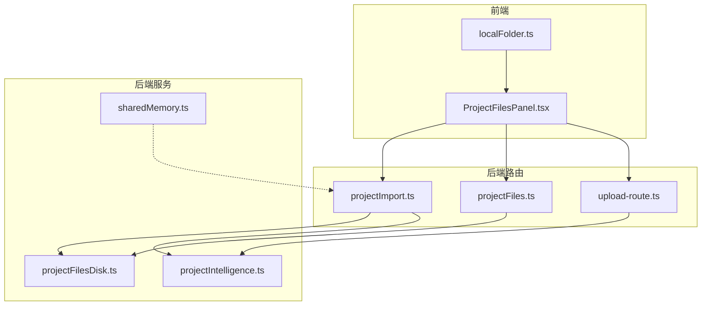
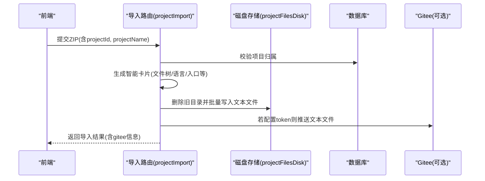
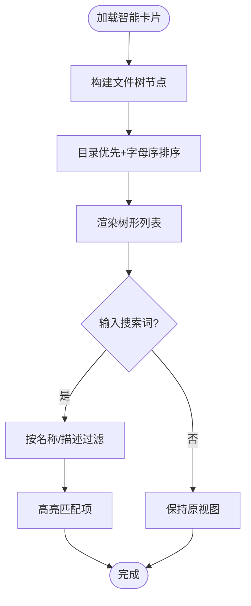
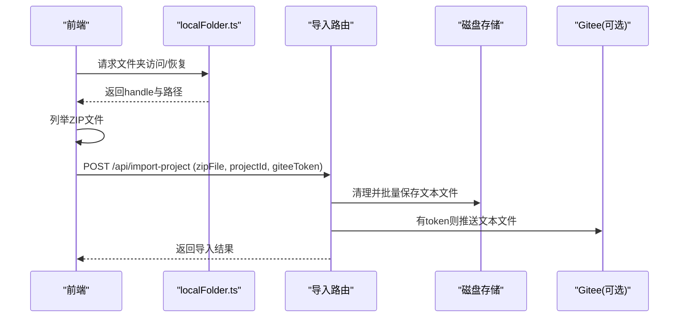
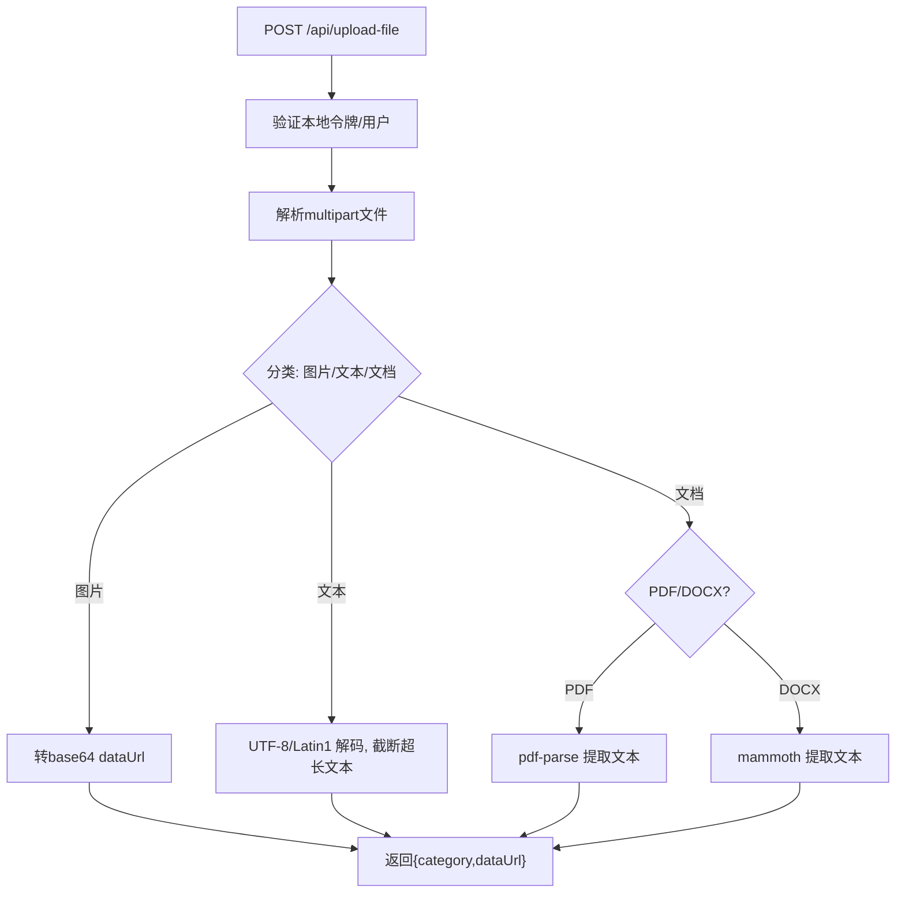
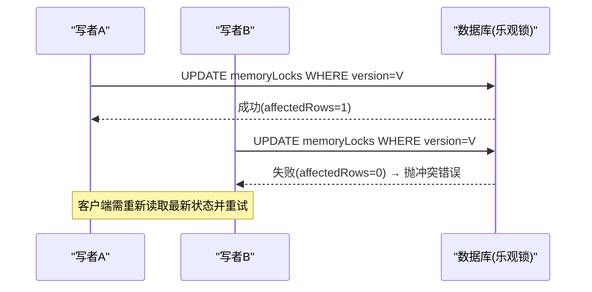
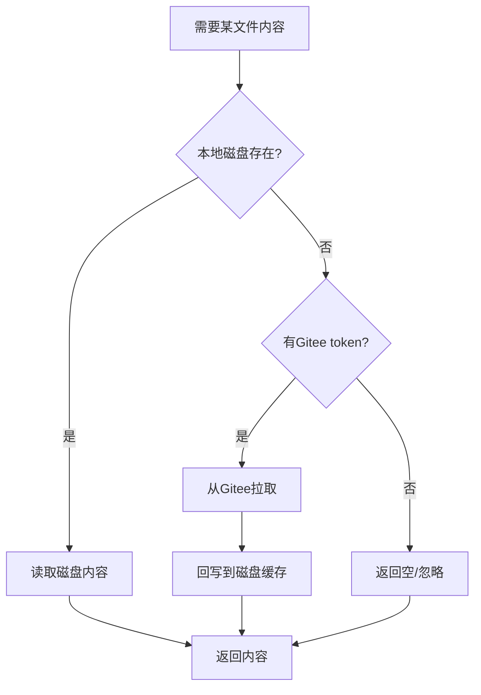
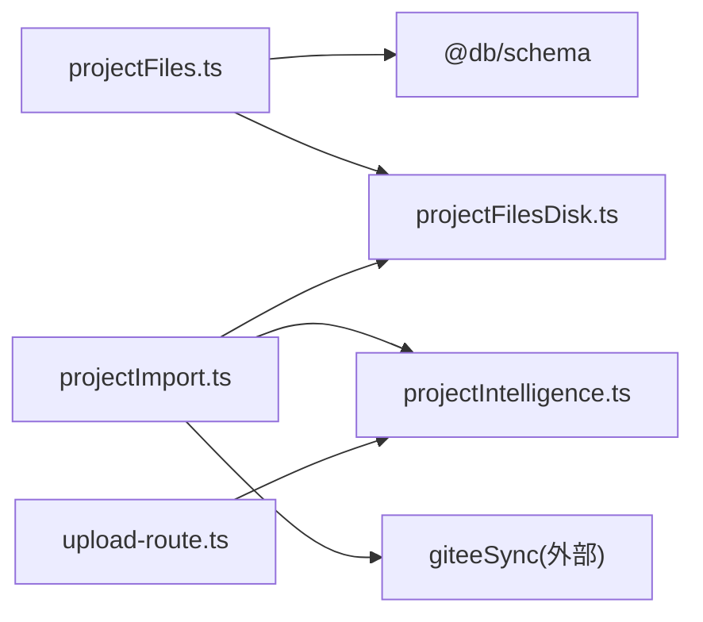

# 项目文件管理

<cite>
**本文引用的文件**
- [api/routers/projectFiles.ts](file://api/routers/projectFiles.ts)
- [api/services/projectFilesDisk.ts](file://api/services/projectFilesDisk.ts)
- [api/routers/projectImport.ts](file://api/routers/projectImport.ts)
- [api/upload-route.ts](file://api/upload-route.ts)
- [src/components/project/ProjectFilesPanel.tsx](file://src/components/project/ProjectFilesPanel.tsx)
- [src/lib/localFolder.ts](file://src/lib/localFolder.ts)
- [api/services/sharedMemory.ts](file://api/services/sharedMemory.ts)
- [api/services/projectIntelligence.ts](file://api/services/projectIntelligence.ts)
</cite>

## 目录
1. [简介](#简介)
2. [项目结构](#项目结构)
3. [核心组件](#核心组件)
4. [架构总览](#架构总览)
5. [详细组件分析](#详细组件分析)
6. [依赖关系分析](#依赖关系分析)
7. [性能考虑](#性能考虑)
8. [故障排查指南](#故障排查指南)
9. [结论](#结论)
10. [附录：API 接口说明](#附录api-接口说明)

## 简介
本文件面向 DeeWaanAI 项目的“文件管理”能力，覆盖以下方面：
- 文件树展示、搜索与批量操作（导入 ZIP、链接本地文件夹）
- 文件上传/下载机制、支持的文件类型与大小限制
- 权限控制、版本历史与冲突解决策略
- 文件 API 接口（CRUD、目录浏览、搜索）
- 同步机制（本地缓存、实时同步、离线支持）
- 文件预览（代码高亮、图片预览、PDF 查看）

## 项目结构
后端以路由与服务分层组织：
- 路由层：projectFiles.ts、projectImport.ts、upload-route.ts
- 服务层：projectFilesDisk.ts（磁盘存储）、sharedMemory.ts（共享状态与并发锁）、projectIntelligence.ts（智能卡片与相关性检索）
- 前端：ProjectFilesPanel.tsx（文件树 UI、导入/链接本地文件夹）、localFolder.ts（浏览器文件系统访问）

图表来源
- [src/components/project/ProjectFilesPanel.tsx:185-563](file://src/components/project/ProjectFilesPanel.tsx#L185-L563)
- [api/routers/projectImport.ts:75-229](file://api/routers/projectImport.ts#L75-L229)
- [api/routers/projectFiles.ts:67-302](file://api/routers/projectFiles.ts#L67-L302)
- [api/upload-route.ts:196-309](file://api/upload-route.ts#L196-L309)
- [api/services/projectFilesDisk.ts:30-142](file://api/services/projectFilesDisk.ts#L30-L142)
- [api/services/sharedMemory.ts:131-206](file://api/services/sharedMemory.ts#L131-L206)
- [api/services/projectIntelligence.ts:212-227](file://api/services/projectIntelligence.ts#L212-L227)

章节来源
- [src/components/project/ProjectFilesPanel.tsx:185-563](file://src/components/project/ProjectFilesPanel.tsx#L185-L563)
- [api/routers/projectImport.ts:75-229](file://api/routers/projectImport.ts#L75-L229)
- [api/routers/projectFiles.ts:67-302](file://api/routers/projectFiles.ts#L67-L302)
- [api/upload-route.ts:196-309](file://api/upload-route.ts#L196-L309)
- [api/services/projectFilesDisk.ts:30-142](file://api/services/projectFilesDisk.ts#L30-L142)
- [api/services/sharedMemory.ts:131-206](file://api/services/sharedMemory.ts#L131-L206)
- [api/services/projectIntelligence.ts:212-227](file://api/services/projectIntelligence.ts#L212-L227)

## 核心组件
- 文件树与导入面板：ProjectFilesPanel.tsx 提供文件树渲染、搜索、展开/折叠、导入 ZIP、链接本地文件夹等交互。
- 项目导入与智能卡片：projectImport.ts 接收 ZIP，生成智能卡片并持久化；同时可选同步到 Gitee。
- 磁盘存储：projectFilesDisk.ts 将文本类文件内容落盘为按项目分目录的纯文本，用于快速读取与 LLM 上下文注入。
- 上传处理：upload-route.ts 对图片、文本、文档进行解析与返回（dataUrl 或提取文本）。
- 共享状态与并发：sharedMemory.ts 使用乐观锁保证多人协作写一致性。
- 智能检索：projectIntelligence.ts 基于文件元数据与实体匹配，定位相关文件路径。

章节来源
- [src/components/project/ProjectFilesPanel.tsx:185-563](file://src/components/project/ProjectFilesPanel.tsx#L185-L563)
- [api/routers/projectImport.ts:75-229](file://api/routers/projectImport.ts#L75-L229)
- [api/services/projectFilesDisk.ts:30-142](file://api/services/projectFilesDisk.ts#L30-L142)
- [api/upload-route.ts:196-309](file://api/upload-route.ts#L196-L309)
- [api/services/sharedMemory.ts:131-206](file://api/services/sharedMemory.ts#L131-L206)
- [api/services/projectIntelligence.ts:212-227](file://api/services/projectIntelligence.ts#L212-L227)

## 架构总览
文件管理采用“混合架构”：
- 元数据与索引：数据库记录文件清单、依赖关系、智能卡片。
- 内容存储：文本内容优先落盘（PROJECT_FILES_DIR/{projectId}/），二进制文件通过上传接口返回 dataUrl 或提示标记。
- 同步与备份：可选同步至 Gitee，作为跨设备与团队共享的后备源。
- 前端本地直读：浏览器侧通过 FileSystem Access API 直接读取本地文件夹中的 ZIP 并上传，减少中间拷贝。

图表来源
- [api/routers/projectImport.ts:75-229](file://api/routers/projectImport.ts#L75-L229)
- [api/services/projectFilesDisk.ts:30-142](file://api/services/projectFilesDisk.ts#L30-L142)

章节来源
- [api/routers/projectImport.ts:75-229](file://api/routers/projectImport.ts#L75-L229)
- [api/services/projectFilesDisk.ts:30-142](file://api/services/projectFilesDisk.ts#L30-L142)

## 详细组件分析

### 文件树展示与搜索
- 文件树构建：前端根据智能卡片的 fileTree 构建层级节点，目录优先并按名称排序。
- 搜索高亮：支持按文件名与描述过滤，命中项高亮显示。
- 展开/折叠：维护已展开路径集合，支持一键全部展开。
- 包含在对话上下文：可切换是否将项目文件纳入 AI 对话上下文。

图表来源
- [src/components/project/ProjectFilesPanel.tsx:54-98](file://src/components/project/ProjectFilesPanel.tsx#L54-L98)
- [src/components/project/ProjectFilesPanel.tsx:100-183](file://src/components/project/ProjectFilesPanel.tsx#L100-L183)
- [src/components/project/ProjectFilesPanel.tsx:456-563](file://src/components/project/ProjectFilesPanel.tsx#L456-L563)

章节来源
- [src/components/project/ProjectFilesPanel.tsx:54-98](file://src/components/project/ProjectFilesPanel.tsx#L54-L98)
- [src/components/project/ProjectFilesPanel.tsx:100-183](file://src/components/project/ProjectFilesPanel.tsx#L100-L183)
- [src/components/project/ProjectFilesPanel.tsx:456-563](file://src/components/project/ProjectFilesPanel.tsx#L456-L563)

### 文件导入与本地文件夹链接
- ZIP 导入：前端选择 ZIP 后调用导入接口，服务端生成智能卡片、落盘文本文件，并可选同步到 Gitee。
- 本地文件夹链接：浏览器端请求文件夹访问权限，列出 ZIP 并直接上传，提升效率。
- 排除规则：导入时跳过 node_modules、dist、日志、锁定文件等。

图表来源
- [src/components/project/ProjectFilesPanel.tsx:225-312](file://src/components/project/ProjectFilesPanel.tsx#L225-L312)
- [src/lib/localFolder.ts:128-164](file://src/lib/localFolder.ts#L128-L164)
- [api/routers/projectImport.ts:75-229](file://api/routers/projectImport.ts#L75-L229)
- [api/services/projectFilesDisk.ts:30-142](file://api/services/projectFilesDisk.ts#L30-L142)

章节来源
- [src/components/project/ProjectFilesPanel.tsx:225-312](file://src/components/project/ProjectFilesPanel.tsx#L225-L312)
- [src/lib/localFolder.ts:128-164](file://src/lib/localFolder.ts#L128-L164)
- [api/routers/projectImport.ts:75-229](file://api/routers/projectImport.ts#L75-L229)
- [api/services/projectFilesDisk.ts:30-142](file://api/services/projectFilesDisk.ts#L30-L142)

### 文件上传与预览
- 支持类型：图片（png/jpg/gif/webp/bmp/ico）、文本/代码（广泛 MIME 与扩展名）、文档（PDF、DOCX）。
- 大小限制：图片≤20MB，文本/代码≤10MB，文档≤50MB；提取文本上限约3万字符。
- 预览方式：
  - 图片：返回 dataUrl 供前端直接预览。
  - 文本/代码：返回文本内容，前端可使用代码高亮库渲染。
  - PDF/DOCX：服务端提取文本返回，便于嵌入对话上下文。
- 安全策略：拒绝 SVG 上传，避免脚本注入风险。

图表来源
- [api/upload-route.ts:196-309](file://api/upload-route.ts#L196-L309)
- [api/upload-route.ts:91-101](file://api/upload-route.ts#L91-L101)
- [api/upload-route.ts:103-193](file://api/upload-route.ts#L103-L193)

章节来源
- [api/upload-route.ts:91-101](file://api/upload-route.ts#L91-L101)
- [api/upload-route.ts:103-193](file://api/upload-route.ts#L103-L193)
- [api/upload-route.ts:196-309](file://api/upload-route.ts#L196-L309)

### 文件权限控制
- 项目级鉴权：所有文件相关路由均校验项目归属（所有者或团队成员）。
- 团队共享：通过团队表关联判断是否有权访问项目。
- 本地令牌：上传路由支持 x-local-auth-token 进行轻量认证。

章节来源
- [api/routers/projectFiles.ts:83-91](file://api/routers/projectFiles.ts#L83-L91)
- [api/routers/projectFiles.ts:150-168](file://api/routers/projectFiles.ts#L150-L168)
- [api/routers/projectImport.ts:52-73](file://api/routers/projectImport.ts#L52-L73)
- [api/upload-route.ts:66-83](file://api/upload-route.ts#L66-L83)

### 版本历史与冲突解决
- 版本历史：当前实现未内置多版本历史表；文件更新会覆盖现有记录。如需版本历史，可在 projectFiles 表增加 version 字段与历史快照。
- 冲突解决：共享状态更新使用乐观锁（version 自增），冲突时抛出错误并要求客户端重读重试，避免静默丢失写。

图表来源
- [api/services/sharedMemory.ts:131-206](file://api/services/sharedMemory.ts#L131-L206)

章节来源
- [api/services/sharedMemory.ts:131-206](file://api/services/sharedMemory.ts#L131-L206)

### 文件同步机制（本地缓存、实时同步、离线支持）
- 本地缓存：文本文件内容优先落盘于 PROJECT_FILES_DIR/{projectId}/，后续读取直接从磁盘获取，提升速度。
- 远程后备：当本地缺失文件且配置了 Gitee token 时，从 Gitee 拉取并回填磁盘缓存。
- 离线支持：前端可通过 localFolder.ts 直接读取本地 ZIP 并上传，无需服务器先存文件；导入成功后即具备离线可用的本地副本。

图表来源
- [api/routers/projectImport.ts:370-405](file://api/routers/projectImport.ts#L370-L405)
- [api/services/projectFilesDisk.ts:83-113](file://api/services/projectFilesDisk.ts#L83-L113)

章节来源
- [api/routers/projectImport.ts:370-405](file://api/routers/projectImport.ts#L370-L405)
- [api/services/projectFilesDisk.ts:83-113](file://api/services/projectFilesDisk.ts#L83-L113)

### 文件预览（代码高亮、图片预览、PDF查看）
- 图片预览：上传接口返回 dataUrl，前端可直接  展示。
- 代码高亮：文本/代码文件返回原始文本，前端可用 Shiki 等库进行语法高亮。
- PDF 查看：服务端提取 PDF 文本，适合嵌入对话；如需可视化 PDF 页面，可结合前端 PDF 阅读器组件。

章节来源
- [api/upload-route.ts:103-193](file://api/upload-route.ts#L103-L193)
- [api/upload-route.ts:239-283](file://api/upload-route.ts#L239-L283)

## 依赖关系分析
- 路由依赖：
  - projectFiles.ts 依赖数据库 schema 与磁盘服务。
  - projectImport.ts 依赖智能卡片服务、磁盘服务与 Gitee 同步。
  - upload-route.ts 依赖文件分类与解析工具。
- 服务依赖：
  - projectFilesDisk.ts 提供统一的磁盘读写封装。
  - sharedMemory.ts 提供并发安全的共享状态更新。
  - projectIntelligence.ts 提供语言检测、分类与相关性检索。

图表来源
- [api/routers/projectFiles.ts:1-6](file://api/routers/projectFiles.ts#L1-L6)
- [api/routers/projectImport.ts:10-20](file://api/routers/projectImport.ts#L10-L20)
- [api/upload-route.ts:1-8](file://api/upload-route.ts#L1-L8)

章节来源
- [api/routers/projectFiles.ts:1-6](file://api/routers/projectFiles.ts#L1-L6)
- [api/routers/projectImport.ts:10-20](file://api/routers/projectImport.ts#L10-L20)
- [api/upload-route.ts:1-8](file://api/upload-route.ts#L1-L8)

## 性能考虑
- 批量落盘：导入时一次性删除并批量写入磁盘，减少 I/O 次数。
- 依赖扫描优化：对 TS/JS 文件进行依赖扫描时使用批量查询，降低数据库往返。
- 文本截断：对超大文本/PDF/DOCX 提取内容进行长度限制，避免上下文溢出。
- 本地直读：前端直接读取本地 ZIP，减少网络与内存压力。

章节来源
- [api/routers/projectImport.ts:177-185](file://api/routers/projectImport.ts#L177-L185)
- [api/routers/projectFiles.ts:304-380](file://api/routers/projectFiles.ts#L304-L380)
- [api/upload-route.ts:116-193](file://api/upload-route.ts#L116-L193)

## 故障排查指南
- 导入失败：检查 ZIP 大小是否超过限制（50MB），确认排除规则是否误删必要文件。
- 上传失败：确认 MIME/扩展名是否在支持列表；SVG 被明确拒绝；文本/文档大小是否超限。
- 权限错误：确认用户是否为项目所有者或团队成员；本地令牌是否正确传递。
- 并发冲突：共享状态更新冲突时，客户端应重新读取最新版本并重试。
- 磁盘异常：磁盘写入失败会记录日志并计数失败数，检查磁盘空间与权限。

章节来源
- [api/routers/projectImport.ts:104-108](file://api/routers/projectImport.ts#L104-L108)
- [api/upload-route.ts:227-231](file://api/upload-route.ts#L227-L231)
- [api/upload-route.ts:116-193](file://api/upload-route.ts#L116-L193)
- [api/routers/projectFiles.ts:83-91](file://api/routers/projectFiles.ts#L83-L91)
- [api/services/sharedMemory.ts:176-180](file://api/services/sharedMemory.ts#L176-L180)
- [api/services/projectFilesDisk.ts:67-81](file://api/services/projectFilesDisk.ts#L67-L81)

## 结论
DeeWaanAI 的文件管理以“智能卡片 + 磁盘缓存 + 可选 Gitee 同步”为核心，兼顾性能与可用性。前端提供直观的文件树与导入体验，后端提供健壮的权限校验、并发控制与文件处理能力。建议后续增强：
- 引入文件版本历史表，支持回滚与对比。
- 完善冲突提示与合并策略。
- 扩展更多文档类型的解析与预览能力。

## 附录：API 接口说明

### 项目文件 CRUD（trpc 风格）
- 上传文件
  - 方法：mutation
  - 输入：projectId, path, name, mimeType?, content?, base64?, size, isDirectory?, parentPath?
  - 行为：创建或更新文件；对 TS/JS 文件重建依赖图
  - 返回：id, message
  - 参考：[api/routers/projectFiles.ts:67-147](file://api/routers/projectFiles.ts#L67-L147)

- 列出项目文件
  - 方法：query
  - 输入：projectId
  - 返回：文件列表（含路径、名称、大小、MIME、是否目录等）
  - 参考：[api/routers/projectFiles.ts:149-168](file://api/routers/projectFiles.ts#L149-L168)

- 读取文件内容
  - 方法：query
  - 输入：projectId, fileId
  - 返回：文件记录（含 content）
  - 参考：[api/routers/projectFiles.ts:170-190](file://api/routers/projectFiles.ts#L170-L190)

- 删除文件
  - 方法：mutation
  - 输入：projectId, fileId
  - 行为：删除依赖关系与文件记录
  - 返回：message
  - 参考：[api/routers/projectFiles.ts:192-216](file://api/routers/projectFiles.ts#L192-L216)

- 获取依赖关系
  - 方法：query
  - 输入：projectId, fileId
  - 返回：outgoing/incoming 依赖列表
  - 参考：[api/routers/projectFiles.ts:218-255](file://api/routers/projectFiles.ts#L218-L255)

- 影响分析（受影响文件）
  - 方法：query
  - 输入：projectId, fileId
  - 返回：受影响的文件列表（广度优先批量查询）
  - 参考：[api/routers/projectFiles.ts:257-301](file://api/routers/projectFiles.ts#L257-L301)

### 项目导入（trpc 风格）
- 从 ZIP 导入
  - 方法：mutation
  - 输入：projectId, zipBase64, projectName
  - 行为：生成智能卡片、落盘文本文件、可选同步到 Gitee
  - 返回：导入结果（含 gitee 信息）
  - 参考：[api/routers/projectImport.ts:75-229](file://api/routers/projectImport.ts#L75-L229)

- 加载文件内容（用于本地直读场景）
  - 方法：mutation
  - 输入：projectId, files[{path, content}]
  - 行为：格式化内容并返回统计
  - 返回：files, formatted, totalSize, fileCount
  - 参考：[api/routers/projectImport.ts:584-622](file://api/routers/projectImport.ts#L584-L622)

### 文件上传（HTTP）
- 上传文件
  - 方法：POST /api/upload-file
  - 认证：x-local-auth-token
  - 支持：图片、文本/代码、PDF/DOCX
  - 限制：图片≤20MB，文本≤10MB，文档≤50MB；文本提取上限约3万字符；拒绝 SVG
  - 返回：按类别返回 dataUrl 或 textContent
  - 参考：[api/upload-route.ts:196-309](file://api/upload-route.ts#L196-L309)

### 目录浏览与搜索
- 目录浏览（磁盘）
  - 能力：列出项目目录下所有相对路径
  - 参考：[api/services/projectFilesDisk.ts:101-113](file://api/services/projectFilesDisk.ts#L101-L113)

- 搜索（智能卡片）
  - 能力：基于文件名、导出名、描述与实体匹配定位相关文件
  - 参考：[api/services/projectIntelligence.ts:935-962](file://api/services/projectIntelligence.ts#L935-L962)