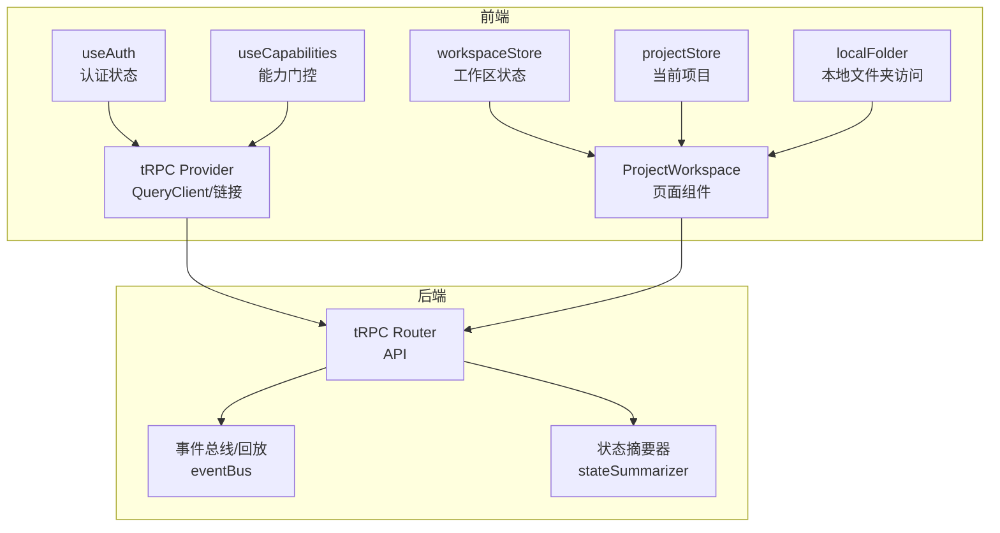
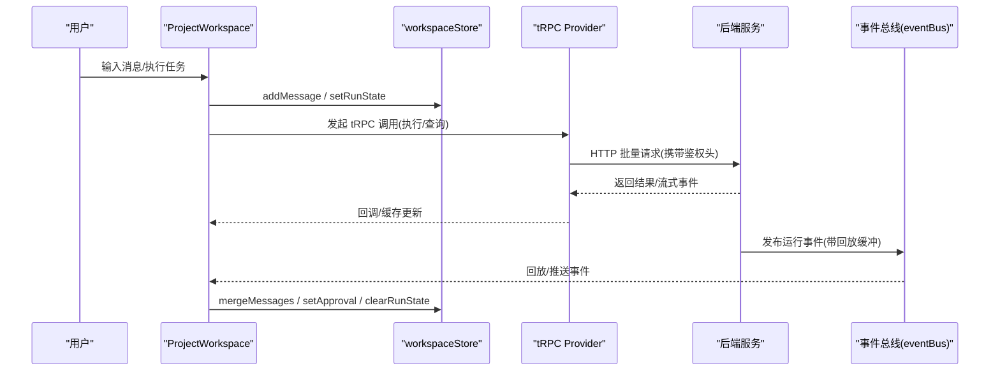
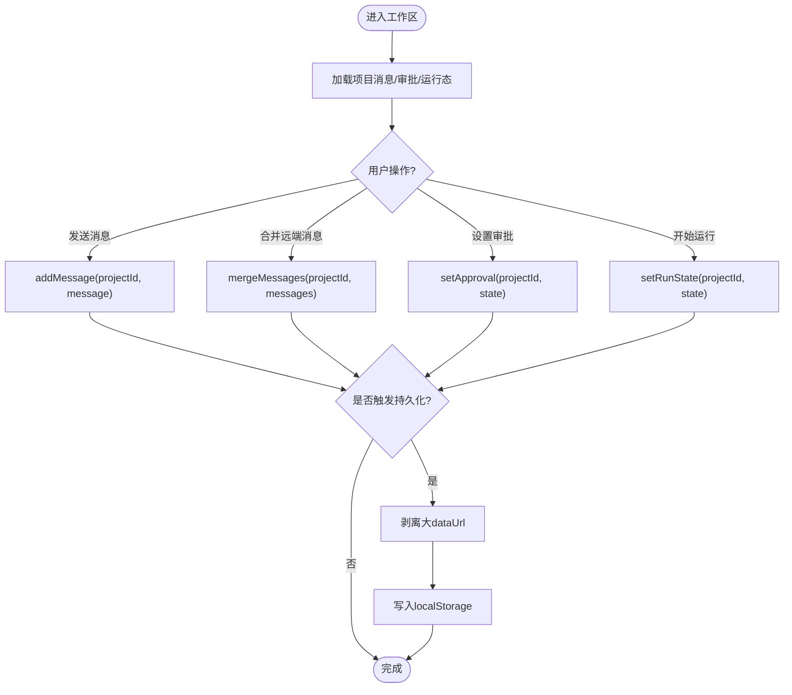
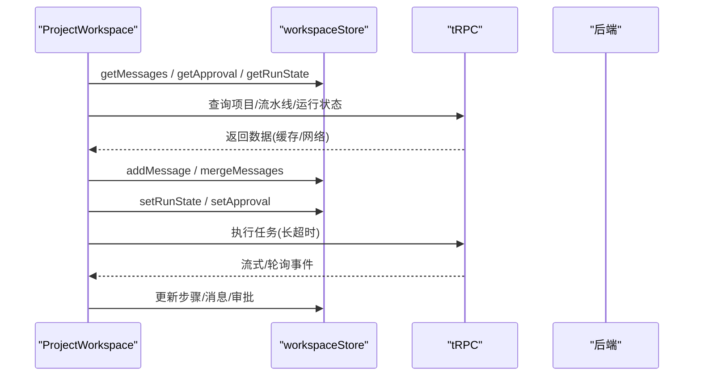
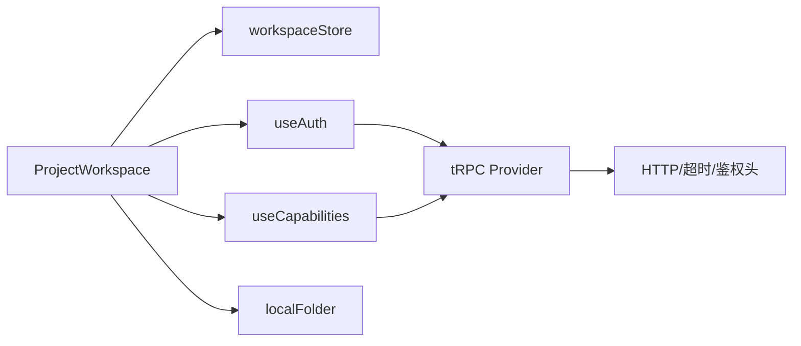

# 状态管理

<cite>
**本文引用的文件**
- [src/stores/workspaceStore.ts](file://src/stores/workspaceStore.ts)
- [src/stores/projectStore.ts](file://src/stores/projectStore.ts)
- [src/hooks/useAuth.ts](file://src/hooks/useAuth.ts)
- [src/hooks/useCapabilities.ts](file://src/hooks/useCapabilities.ts)
- [src/hooks/use-toast.ts](file://src/hooks/use-toast.ts)
- [src/providers/trpc.tsx](file://src/providers/trpc.tsx)
- [src/lib/localFolder.ts](file://src/lib/localFolder.ts)
- [src/pages/ProjectWorkspace.tsx](file://src/pages/ProjectWorkspace.tsx)
- [api/services/stateSummarizer.ts](file://api/services/stateSummarizer.ts)
- [api/services/eventBus.ts](file://api/services/eventBus.ts)
</cite>

## 目录
1. [简介](#简介)
2. [项目结构](#项目结构)
3. [核心组件](#核心组件)
4. [架构总览](#架构总览)
5. [详细组件分析](#详细组件分析)
6. [依赖关系分析](#依赖关系分析)
7. [性能考虑](#性能考虑)
8. [故障排查指南](#故障排查指南)
9. [结论](#结论)
10. [附录](#附录)

## 简介
本文件为 DeeWaanAI 前端状态管理系统提供系统化文档，覆盖存储与工作区存储的设计模式、数据结构、自定义 Hooks（认证、能力检测、通知）、状态同步机制、数据持久化与缓存策略，以及状态更新最佳实践、性能优化与调试技巧。同时给出状态流图与组件间通信模式，帮助读者快速理解并高效使用。

## 项目结构
- 状态存储层
  - 工作区存储：基于 Zustand + persist 中间件，按项目维度维护聊天消息、审批态、待处理提示、运行态等，支持本地持久化与体积裁剪。
  - 项目存储：轻量级全局当前项目上下文。
- 能力与认证
  - useAuth：封装 trpc 查询与登出逻辑，结合本地 token 与 tRPC 客户端自动注入。
  - useCapabilities：统一能力门控，避免直接比较用户层级，保证 UI 权限一致性。
- 网络与缓存
  - tRPC Provider：集中配置 QueryClient、请求超时、批量链接、鉴权头注入。
- 本地文件系统访问
  - localFolder：封装 File System Access API，IndexedDB 持久化目录句柄，并提供降级方案。
- 页面集成
  - ProjectWorkspace：典型的状态消费与更新场景，展示消息、审批、运行态与能力门控的协同。

图表来源
- [src/providers/trpc.tsx:10-39](file://src/providers/trpc.tsx#L10-L39)
- [src/pages/ProjectWorkspace.tsx:95-131](file://src/pages/ProjectWorkspace.tsx#L95-L131)
- [src/stores/workspaceStore.ts:67-206](file://src/stores/workspaceStore.ts#L67-L206)
- [src/lib/localFolder.ts:95-156](file://src/lib/localFolder.ts#L95-L156)
- [api/services/eventBus.ts:35-61](file://api/services/eventBus.ts#L35-L61)
- [api/services/stateSummarizer.ts:1-156](file://api/services/stateSummarizer.ts#L1-L156)

章节来源
- [src/stores/workspaceStore.ts:1-207](file://src/stores/workspaceStore.ts#L1-L207)
- [src/stores/projectStore.ts:1-16](file://src/stores/projectStore.ts#L1-L16)
- [src/hooks/useAuth.ts:1-35](file://src/hooks/useAuth.ts#L1-L35)
- [src/hooks/useCapabilities.ts:1-31](file://src/hooks/useCapabilities.ts#L1-L31)
- [src/hooks/use-toast.ts:1-27](file://src/hooks/use-toast.ts#L1-L27)
- [src/providers/trpc.tsx:1-50](file://src/providers/trpc.tsx#L1-L50)
- [src/lib/localFolder.ts:1-255](file://src/lib/localFolder.ts#L1-L255)
- [src/pages/ProjectWorkspace.tsx:87-200](file://src/pages/ProjectWorkspace.tsx#L87-L200)
- [api/services/stateSummarizer.ts:1-156](file://api/services/stateSummarizer.ts#L1-L156)
- [api/services/eventBus.ts:35-61](file://api/services/eventBus.ts#L35-L61)

## 核心组件
- 工作区存储（workspaceStore）
  - 设计模式：Zustand + persist 中间件；按项目键（字符串化 projectId）组织多租户式状态。
  - 关键数据结构：
    - 侧边栏开关与活动面板
    - 项目消息列表（ChatMessage[]），支持追加、合并去重、读取、清空
    - 审批状态（awaiting/output/runId）
    - 待处理提示（pending prompt）
    - 运行状态（runId/isRunning/currentStepName）
  - 持久化策略：仅持久化必要字段，剥离大附件 dataUrl，避免 localStorage 配额超限；运行态不持久化，确保从服务端恢复。
- 项目存储（projectStore）
  - 简单单例状态：当前项目对象，用于跨组件共享。
- 认证 Hook（useAuth）
  - 通过 tRPC 查询当前用户，设置较长 staleTime 减少刷新频率；登出时清理本地 token 并刷新页面。
- 能力检测 Hook（useCapabilities）
  - 统一能力门控，返回 has(capability) 方法，UI 据此控制功能可见性与行为。
- 通知 Hook（use-toast）
  - 对 sonner 的薄封装，区分成功/错误类型与默认时长。
- 本地文件夹访问（localFolder）
  - 使用 File System Access API 获取目录句柄，IndexedDB 持久化；提供降级方案（隐藏 file input）与元信息持久化。

章节来源
- [src/stores/workspaceStore.ts:35-206](file://src/stores/workspaceStore.ts#L35-L206)
- [src/stores/projectStore.ts:7-15](file://src/stores/projectStore.ts#L7-L15)
- [src/hooks/useAuth.ts:4-34](file://src/hooks/useAuth.ts#L4-L34)
- [src/hooks/useCapabilities.ts:12-30](file://src/hooks/useCapabilities.ts#L12-L30)
- [src/hooks/use-toast.ts:10-26](file://src/hooks/use-toast.ts#L10-L26)
- [src/lib/localFolder.ts:95-156](file://src/lib/localFolder.ts#L95-L156)

## 架构总览
- 状态源
  - 服务端：tRPC 查询/变更，具备缓存、重试策略与超时控制。
  - 客户端：Zustand 工作区存储（内存+持久化），项目存储（内存）。
- 数据流
  - 组件订阅 store 片段，触发 actions 更新状态。
  - 组件发起 tRPC 调用，结果回填到 store 或驱动 UI。
  - 运行期事件通过事件总线回放缓冲，保障断线重连后的状态一致性。
- 权限与能力
  - 认证与能力由 tRPC 提供，UI 通过 useAuth 与 useCapabilities 消费。

图表来源
- [src/pages/ProjectWorkspace.tsx:113-131](file://src/pages/ProjectWorkspace.tsx#L113-L131)
- [src/providers/trpc.tsx:18-39](file://src/providers/trpc.tsx#L18-L39)
- [api/services/eventBus.ts:35-61](file://api/services/eventBus.ts#L35-L61)

## 详细组件分析

### 工作区存储（workspaceStore）
- 职责
  - 管理项目维度的聊天消息、审批、待处理提示与运行态。
  - 提供增删改查操作，并在持久化时进行体积裁剪。
- 数据结构与复杂度
  - projectMessages：按项目键索引的消息数组；追加 O(1)，合并去重用 Set 构建 ID 集合 O(n)。
  - projectApproval/pendingPrompt/runState：按项目键映射，读写 O(1)。
- 持久化策略
  - 剥离大附件 dataUrl（阈值约 1KB），防止超出 localStorage 配额。
  - 运行态不持久化，避免陈旧 SSE/run 状态在刷新后残留。
- 使用建议
  - 通过 selector 订阅最小状态切片，减少重渲染。
  - 批量更新时使用 mergeMessages 而非多次 addMessage。

图表来源
- [src/stores/workspaceStore.ts:80-118](file://src/stores/workspaceStore.ts#L80-L118)
- [src/stores/workspaceStore.ts:180-204](file://src/stores/workspaceStore.ts#L180-L204)

章节来源
- [src/stores/workspaceStore.ts:35-206](file://src/stores/workspaceStore.ts#L35-L206)

### 项目存储（projectStore）
- 职责
  - 保存当前项目上下文，供多个页面/组件共享。
- 使用方式
  - 通过 setCurrentProject 更新；组件以 selector 订阅 currentProject。

章节来源
- [src/stores/projectStore.ts:7-15](file://src/stores/projectStore.ts#L7-L15)

### 认证 Hook（useAuth）
- 实现要点
  - 使用 trpc.localAuth.me 查询用户信息，设置较长 staleTime 降低刷新频率。
  - 登出时移除本地 token，并触发全局无效化与页面重载。
- 使用建议
  - 将 isAuthenticated 作为路由守卫或条件渲染依据。
  - 在需要强一致性的场景调用 refresh。

章节来源
- [src/hooks/useAuth.ts:4-34](file://src/hooks/useAuth.ts#L4-L34)
- [src/providers/trpc.tsx:23-26](file://src/providers/trpc.tsx#L23-L26)

### 能力检测 Hook（useCapabilities）
- 实现要点
  - 通过 trpc.billing.myCapabilities 获取能力列表与层级。
  - 暴露 has(capability) 方法，UI 据此控制功能可见性。
- 使用建议
  - 所有功能门控优先使用 has(...)，避免直接比较 tier。

章节来源
- [src/hooks/useCapabilities.ts:12-30](file://src/hooks/useCapabilities.ts#L12-L30)

### 通知 Hook（use-toast）
- 实现要点
  - 对 sonner 的封装，根据 variant 选择 success/error 与默认时长。
- 使用建议
  - 在异步操作成功后调用 toast.success，失败时调用 toast.error。

章节来源
- [src/hooks/use-toast.ts:10-26](file://src/hooks/use-toast.ts#L10-L26)

### 本地文件夹访问（localFolder）
- 实现要点
  - 使用 File System Access API 获取目录句柄，IndexedDB 持久化句柄键。
  - 提供降级方案（隐藏 file input）与元信息持久化。
- 使用建议
  - 在浏览器不支持时回退到降级方案，并提示用户。
  - 每次恢复访问前检查权限是否仍被允许。

章节来源
- [src/lib/localFolder.ts:95-156](file://src/lib/localFolder.ts#L95-L156)
- [src/lib/localFolder.ts:203-255](file://src/lib/localFolder.ts#L203-L255)

### 页面集成（ProjectWorkspace）
- 状态消费
  - 通过 workspaceStore 订阅消息、审批、运行态，并结合 tRPC 查询恢复服务器状态。
- 状态更新
  - 发送消息、合并远端消息、设置审批与运行态，配合能力门控控制流程。
- 交互流程
  - 启动运行 -> 轮询/流式事件 -> 更新步骤与消息 -> 等待审批 -> 提交反馈 -> 结束运行。

图表来源
- [src/pages/ProjectWorkspace.tsx:95-131](file://src/pages/ProjectWorkspace.tsx#L95-L131)
- [src/providers/trpc.tsx:27-36](file://src/providers/trpc.tsx#L27-L36)

章节来源
- [src/pages/ProjectWorkspace.tsx:87-200](file://src/pages/ProjectWorkspace.tsx#L87-L200)

## 依赖关系分析
- 组件依赖
  - ProjectWorkspace 依赖 workspaceStore、useCapabilities、tRPC Provider。
  - useAuth/useCapabilities 依赖 tRPC Provider。
  - localFolder 独立于 tRPC，提供本地文件系统能力。
- 外部依赖
  - tRPC 客户端：httpBatchLink、superjson、AbortController 超时。
  - Zustand：create 与 persist 中间件。
  - sonner：通知库。
  - IndexedDB：持久化目录句柄。

图表来源
- [src/pages/ProjectWorkspace.tsx:95-131](file://src/pages/ProjectWorkspace.tsx#L95-L131)
- [src/providers/trpc.tsx:18-39](file://src/providers/trpc.tsx#L18-L39)
- [src/stores/workspaceStore.ts:67-206](file://src/stores/workspaceStore.ts#L67-L206)
- [src/lib/localFolder.ts:95-156](file://src/lib/localFolder.ts#L95-L156)

章节来源
- [src/providers/trpc.tsx:1-50](file://src/providers/trpc.tsx#L1-L50)
- [src/stores/workspaceStore.ts:1-207](file://src/stores/workspaceStore.ts#L1-L207)
- [src/lib/localFolder.ts:1-255](file://src/lib/localFolder.ts#L1-L255)

## 性能考虑
- 状态订阅粒度
  - 使用 selector 订阅最小状态切片，避免整树重渲染。
- 持久化体积控制
  - 剥离大附件 dataUrl，防止 localStorage 配额超限导致写入失败。
- 网络请求优化
  - 合理设置 staleTime 与 refetchOnWindowFocus，减少不必要请求。
  - 长耗时任务设置超时 AbortController，避免悬挂请求。
- 运行态恢复
  - 运行态不持久化，避免陈旧状态；通过轮询/流式事件恢复。
- 事件回放
  - 事件总线提供短期回放缓冲，提升断线重连体验。

[本节为通用指导，不直接分析具体文件]

## 故障排查指南
- 认证问题
  - 检查本地 token 是否存在；登出后确认已清理并刷新页面。
- 能力门控失效
  - 确认 useCapabilities 已正确获取 capabilities；避免直接比较 tier。
- 工作区状态异常
  - 检查消息合并是否去重；确认持久化未保留过大 dataUrl。
  - 运行态刷新后应重新从服务端恢复，若显示陈旧状态需排查事件回放与轮询。
- 本地文件夹访问失败
  - 检查浏览器是否支持 File System Access API；如不支持则回退到降级方案。
  - 恢复访问前检查权限是否仍被允许，必要时清除存储句柄。

章节来源
- [src/hooks/useAuth.ts:17-21](file://src/hooks/useAuth.ts#L17-L21)
- [src/hooks/useCapabilities.ts:21-24](file://src/hooks/useCapabilities.ts#L21-L24)
- [src/stores/workspaceStore.ts:90-105](file://src/stores/workspaceStore.ts#L90-L105)
- [src/stores/workspaceStore.ts:180-204](file://src/stores/workspaceStore.ts#L180-L204)
- [src/lib/localFolder.ts:137-156](file://src/lib/localFolder.ts#L137-L156)

## 结论
DeeWaanAI 的前端状态管理采用“服务端缓存 + 客户端轻量存储”的分层设计：tRPC Provider 负责网络与缓存，Zustand 工作区存储负责项目维度的 UI 状态与持久化，认证与能力门控通过 Hooks 统一抽象。通过合理的持久化裁剪、事件回放与长耗时任务超时控制，系统在复杂交互下保持良好性能与稳定性。遵循本文的最佳实践与排查指南，可进一步提升开发效率与用户体验。

## 附录
- 状态更新最佳实践
  - 使用 selector 订阅最小状态切片。
  - 批量更新优先使用 mergeMessages。
  - 运行态不持久化，始终从服务端恢复。
- 调试技巧
  - 在浏览器开发者工具中查看 IndexedDB 与 localStorage 内容。
  - 观察 tRPC 请求与响应，确认缓存命中与超时情况。
  - 通过事件回放缓冲验证断线重连效果。

[本节为通用指导，不直接分析具体文件]