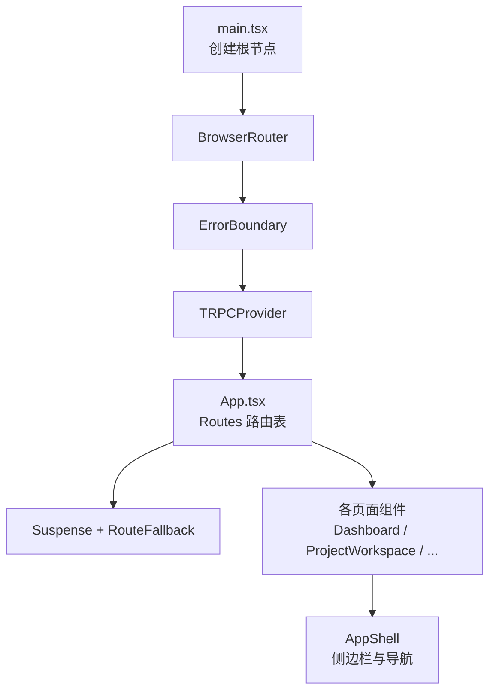
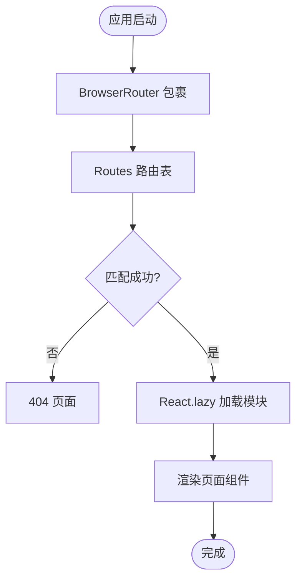
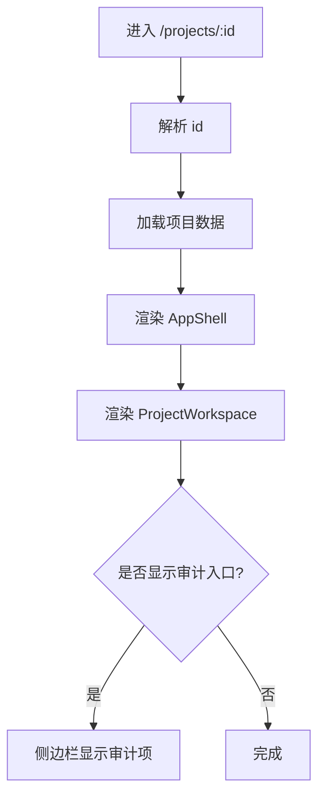
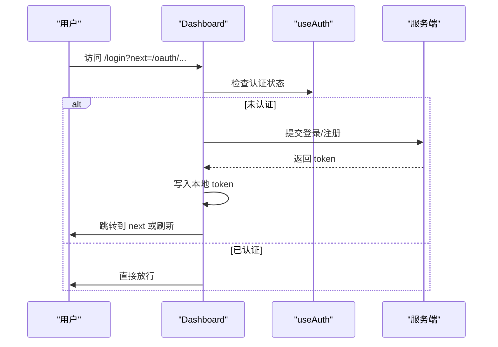
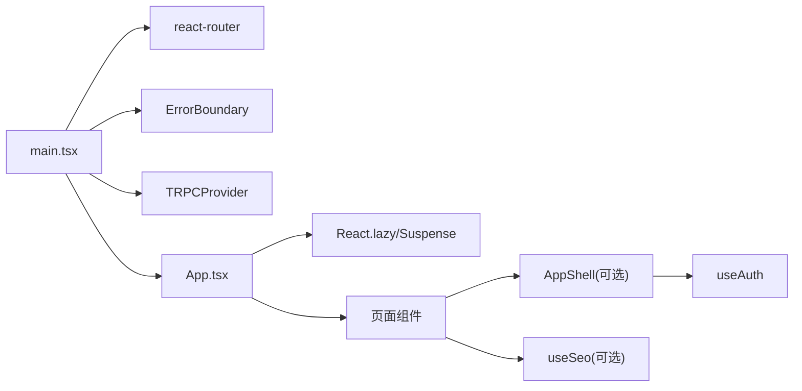

# 路由导航

<cite>
**本文引用的文件**
- [main.tsx](file://src/main.tsx)
- [App.tsx](file://src/App.tsx)
- [RouteFallback.tsx](file://src/components/RouteFallback.tsx)
- [NotFound.tsx](file://src/pages/NotFound.tsx)
- [Dashboard.tsx](file://src/pages/Dashboard.tsx)
- [ProjectWorkspace.tsx](file://src/pages/ProjectWorkspace.tsx)
- [OAuthConsent.tsx](file://src/pages/OAuthConsent.tsx)
- [useAuth.ts](file://src/hooks/useAuth.ts)
- [useSeo.ts](file://src/hooks/useSeo.ts)
- [AppShell.tsx](file://src/components/layout/AppShell.tsx)
</cite>

## 目录
1. [简介](#简介)
2. [项目结构](#项目结构)
3. [核心组件](#核心组件)
4. [架构总览](#架构总览)
5. [详细组件分析](#详细组件分析)
6. [依赖关系分析](#依赖关系分析)
7. [性能考虑](#性能考虑)
8. [故障排查指南](#故障排查指南)
9. [结论](#结论)
10. [附录](#附录)

## 简介
本文件为 DeeWaanAI 前端应用的路由导航系统文档，聚焦于基于 react-router 的配置、页面级路由定义、动态参数与嵌套路由组织方式；并说明 404 处理、路由懒加载、SEO 优化、历史记录与跳转策略、以及权限控制思路。文档同时提供流程图与时序图，帮助读者快速理解从浏览器导航到页面渲染的完整链路。

## 项目结构
- 应用入口在 main.tsx 中创建根节点，包裹 BrowserRouter、全局错误边界与 TRPC 上下文，再挂载 App。
- 路由表集中在 App.tsx，使用 React.lazy + Suspense 实现路由级代码分割与按需加载。
- 通用布局壳 AppShell 提供侧边栏导航、用户信息、语言切换等，并在内部通过 Link 进行 SPA 内导航。
- 404 页面 NotFound 作为兜底路由，配合 catch-all 路由返回。
- SEO 能力通过 useSeo 钩子在页面级设置标题、描述、hreflang 与 JSON-LD。



图表来源
- [main.tsx:1-21](file://src/main.tsx#L1-L21)
- [App.tsx:1-70](file://src/App.tsx#L1-L70)
- [RouteFallback.tsx:1-17](file://src/components/RouteFallback.tsx#L1-L17)
- [AppShell.tsx:1-214](file://src/components/layout/AppShell.tsx#L1-L214)

章节来源
- [main.tsx:1-21](file://src/main.tsx#L1-L21)
- [App.tsx:1-70](file://src/App.tsx#L1-L70)

## 核心组件
- 路由容器：App.tsx 集中声明所有页面路由，包含静态路径与动态参数（如 :id），并通过 lazy 导入页面组件。
- 懒加载与占位：React.lazy + Suspense + RouteFallback 提供加载态体验。
- 404 兜底：catch-all 路由指向 NotFound 页面，支持国际化文案与返回首页链接。
- 导航外壳：AppShell 提供侧边栏与上下文感知的项目列表、审计入口等。
- SEO：useSeo 统一设置 title、meta、hreflang 与 JSON-LD。

章节来源
- [App.tsx:1-70](file://src/App.tsx#L1-L70)
- [RouteFallback.tsx:1-17](file://src/components/RouteFallback.tsx#L1-L17)
- [NotFound.tsx:1-25](file://src/pages/NotFound.tsx#L1-L25)
- [AppShell.tsx:1-214](file://src/components/layout/AppShell.tsx#L1-L214)
- [useSeo.ts:1-69](file://src/hooks/useSeo.ts#L1-L69)

## 架构总览
下图展示从浏览器导航到页面渲染的关键流程，包括懒加载、路由匹配、权限判断与 SEO 更新。

```mermaid
sequenceDiagram
participant U as "用户"
participant RR as "react-router"
participant APP as "App.tsx"
participant LAZY as "React.lazy/Suspense"
let P as "目标页面组件"
participant SHELL as "AppShell(可选)"
participant SEO as "useSeo(可选)"
U->>RR : 访问或点击链接
RR->>APP : 匹配 Routes
APP->>LAZY : 按需加载页面模块
LAZY-->>APP : 模块就绪
APP->>P : 渲染页面
alt 页面需要布局
P->>SHELL : 包裹内容
end
alt 页面需要SEO
P->>SEO : 设置title/description/hreflang/jsonld
end
```

图表来源
- [App.tsx:1-70](file://src/App.tsx#L1-L70)
- [RouteFallback.tsx:1-17](file://src/components/RouteFallback.tsx#L1-L17)
- [useSeo.ts:1-69](file://src/hooks/useSeo.ts#L1-L69)
- [AppShell.tsx:1-214](file://src/components/layout/AppShell.tsx#L1-L214)

## 详细组件分析

### 路由配置与页面级路由
- 入口：main.tsx 使用 BrowserRouter 包裹整个应用，确保 SPA 路由生效。
- 路由表：App.tsx 集中管理所有页面路由，采用扁平化结构，便于维护与扩展。
- 懒加载：所有页面均通过 React.lazy 异步导入，减少首屏体积。
- 兜底：* 路由指向 NotFound，保证未知路径友好提示。



图表来源
- [main.tsx:1-21](file://src/main.tsx#L1-L21)
- [App.tsx:1-70](file://src/App.tsx#L1-L70)
- [NotFound.tsx:1-25](file://src/pages/NotFound.tsx#L1-L25)

章节来源
- [main.tsx:1-21](file://src/main.tsx#L1-L21)
- [App.tsx:1-70](file://src/App.tsx#L1-L70)

### 动态路由参数与嵌套路由结构
- 动态参数：例如 /projects/:id、/pipelines/:id/edit、/marketplace/:id、/certification/:id 等，通过 useParams 获取参数。
- 嵌套路由：当前采用扁平路由表，但通过 AppShell 的侧边栏与上下文感知（如当前项目）模拟“子区域”体验；审计入口根据当前项目动态显示。
- 示例：ProjectWorkspace 读取 :id 并加载项目数据，结合工作区状态管理运行与消息。



图表来源
- [App.tsx:1-70](file://src/App.tsx#L1-L70)
- [ProjectWorkspace.tsx:1-200](file://src/pages/ProjectWorkspace.tsx#L1-L200)
- [AppShell.tsx:1-214](file://src/components/layout/AppShell.tsx#L1-L214)

章节来源
- [App.tsx:1-70](file://src/App.tsx#L1-L70)
- [ProjectWorkspace.tsx:1-200](file://src/pages/ProjectWorkspace.tsx#L1-L200)
- [AppShell.tsx:1-214](file://src/components/layout/AppShell.tsx#L1-L214)

### 路由守卫机制与权限控制
- 认证状态：useAuth 提供 isAuthenticated、user、logout 等能力，用于页面内条件渲染与操作拦截。
- 登录与重定向：Dashboard 支持 ?next 安全校验（仅允许 /oauth/*），登录后按 next 跳转或刷新。
- 管理员可见：AppShell 根据 user.role === "admin" 决定是否显示管理入口。
- OAuth 同意页：OAuthConsent 页面读取查询参数并引导授权确认，服务端负责最终鉴权与回调。



图表来源
- [Dashboard.tsx:1-200](file://src/pages/Dashboard.tsx#L1-L200)
- [useAuth.ts:1-34](file://src/hooks/useAuth.ts#L1-L34)
- [AppShell.tsx:1-214](file://src/components/layout/AppShell.tsx#L1-L214)
- [OAuthConsent.tsx:1-36](file://src/pages/OAuthConsent.tsx#L1-L36)

章节来源
- [Dashboard.tsx:1-200](file://src/pages/Dashboard.tsx#L1-L200)
- [useAuth.ts:1-34](file://src/hooks/useAuth.ts#L1-L34)
- [AppShell.tsx:1-214](file://src/components/layout/AppShell.tsx#L1-L214)
- [OAuthConsent.tsx:1-36](file://src/pages/OAuthConsent.tsx#L1-L36)

### 404 页面处理
- 路由层：catch-all 路由 * 指向 NotFound。
- 页面层：NotFound 提供国际化文案与返回首页按钮，提升用户体验。

章节来源
- [App.tsx:1-70](file://src/App.tsx#L1-L70)
- [NotFound.tsx:1-25](file://src/pages/NotFound.tsx#L1-L25)

### 路由懒加载与性能优化
- 代码分割：所有页面通过 React.lazy 异步加载，降低首屏包体。
- 加载反馈：Suspense fallback 使用 RouteFallback 提供全屏加载指示器。
- 建议：对超大页面可进一步拆分至子模块；对频繁切换的页面可预取关键资源。

章节来源
- [App.tsx:1-70](file://src/App.tsx#L1-L70)
- [RouteFallback.tsx:1-17](file://src/components/RouteFallback.tsx#L1-L17)

### 面包屑导航与历史记录管理
- 面包屑：当前未实现全局面包屑组件；可在 AppShell 中基于 location.pathname 派生层级标题。
- 历史记录：SPA 内导航通过 react-router 自动管理历史栈；Dashboard 支持安全校验后的 next 跳转，避免开放重定向风险。

章节来源
- [AppShell.tsx:1-214](file://src/components/layout/AppShell.tsx#L1-L214)
- [Dashboard.tsx:1-200](file://src/pages/Dashboard.tsx#L1-L200)

### SEO 优化
- 页面级 SEO：useSeo 统一设置 document.title、description、og 标签、hreflang 多语言链接与 JSON-LD 结构化数据。
- 多语言：为 en/zh 生成 alternate 链接，利于搜索引擎索引。

章节来源
- [useSeo.ts:1-69](file://src/hooks/useSeo.ts#L1-L69)

## 依赖关系分析
- 入口依赖：main.tsx 依赖 BrowserRouter、ErrorBoundary、TRPCProvider 与 App。
- 路由依赖：App.tsx 依赖 React.lazy、Suspense 与各页面组件。
- 布局依赖：AppShell 依赖 react-router 的 Link、useLocation，以及 useAuth、i18n 等。
- 页面依赖：各页面组件按需引入 trpc、ui 组件与业务逻辑。



图表来源
- [main.tsx:1-21](file://src/main.tsx#L1-L21)
- [App.tsx:1-70](file://src/App.tsx#L1-L70)
- [AppShell.tsx:1-214](file://src/components/layout/AppShell.tsx#L1-L214)
- [useAuth.ts:1-34](file://src/hooks/useAuth.ts#L1-L34)
- [useSeo.ts:1-69](file://src/hooks/useSeo.ts#L1-L69)

章节来源
- [main.tsx:1-21](file://src/main.tsx#L1-L21)
- [App.tsx:1-70](file://src/App.tsx#L1-L70)
- [AppShell.tsx:1-214](file://src/components/layout/AppShell.tsx#L1-L214)

## 性能考虑
- 首屏优化：路由级懒加载显著减少初始 JS 体积；Suspense 提供加载态，避免白屏。
- 网络优化：trpc 查询具备缓存与增量更新；页面可按需启用 refetchInterval 轮询（如运行状态）。
- 渲染优化：将大组件拆分为子模块；对高频交互区域使用稳定引用与局部状态。
- 可访问性：懒加载占位使用 role="status" 与 aria-label，提升无障碍体验。

[本节为通用指导，不直接分析具体文件]

## 故障排查指南
- 路由不生效：确认 main.tsx 已使用 BrowserRouter 包裹应用；检查 App.tsx 中 Routes 是否正确挂载。
- 404 异常：确认 catch-all 路由位于最后；检查动态参数是否与页面解析一致。
- 懒加载卡住：检查 Suspense fallback 是否显示；确认模块路径正确且无循环依赖。
- 权限问题：检查 useAuth 的 isAuthenticated 与 user 状态；确认登录成功后 token 已写入本地存储。
- SEO 未生效：确认页面调用 useSeo 并传入必要参数；检查 head 中 meta 与 link 标签是否被注入。

章节来源
- [App.tsx:1-70](file://src/App.tsx#L1-L70)
- [RouteFallback.tsx:1-17](file://src/components/RouteFallback.tsx#L1-L17)
- [useAuth.ts:1-34](file://src/hooks/useAuth.ts#L1-L34)
- [useSeo.ts:1-69](file://src/hooks/useSeo.ts#L1-L69)

## 结论
DeeWaanAI 的前端路由体系以 react-router 为核心，采用集中式路由表与懒加载策略，兼顾可维护性与性能。通过 AppShell 提供一致的导航体验，结合 useAuth 与 useSeo 实现权限控制与 SEO 优化。未来可在 AppShell 中增加面包屑导航，并根据业务复杂度逐步引入更细粒度的路由守卫与嵌套路由。

[本节为总结性内容，不直接分析具体文件]

## 附录
- 常用路由参考：
  - 首页与仪表盘：/
  - 项目管理：/projects/:id、/projects/:id/settings、/projects/:id/audit
  - 流水线：/pipelines、/pipelines/new、/pipelines/:id/edit
  - 市场与评测：/marketplace、/marketplace/:id、/reviewer/portal、/reviewer/review/:listingId
  - 团队与管理：/team、/team/connect、/admin
  - 连接与认证：/connect、/oauth/consent、/login
  - 定价与报告：/pricing、/certification/:id
  - 测试与工具：/test-fixtures
- 推荐实践：
  - 新增页面时，优先使用 React.lazy 与 Suspense，并在 App.tsx 中注册路由。
  - 对需要布局的页面，使用 AppShell 包裹以保持导航一致性。
  - 对需要 SEO 的页面，调用 useSeo 设置标题、描述与结构化数据。
  - 对敏感页面，结合 useAuth 进行权限判断与跳转拦截。

[本节为补充信息，不直接分析具体文件]