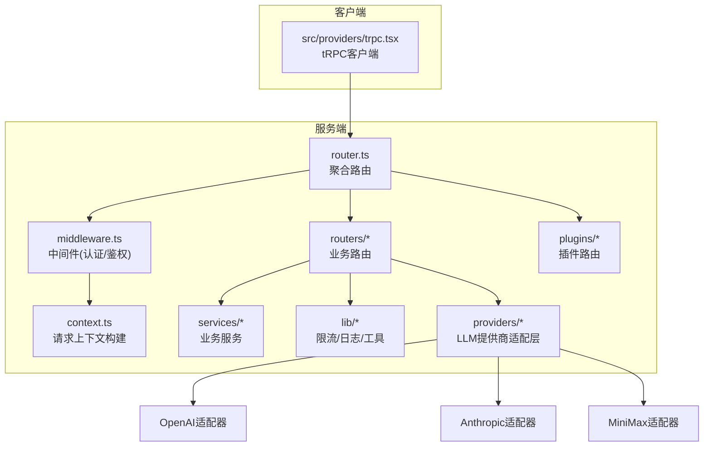
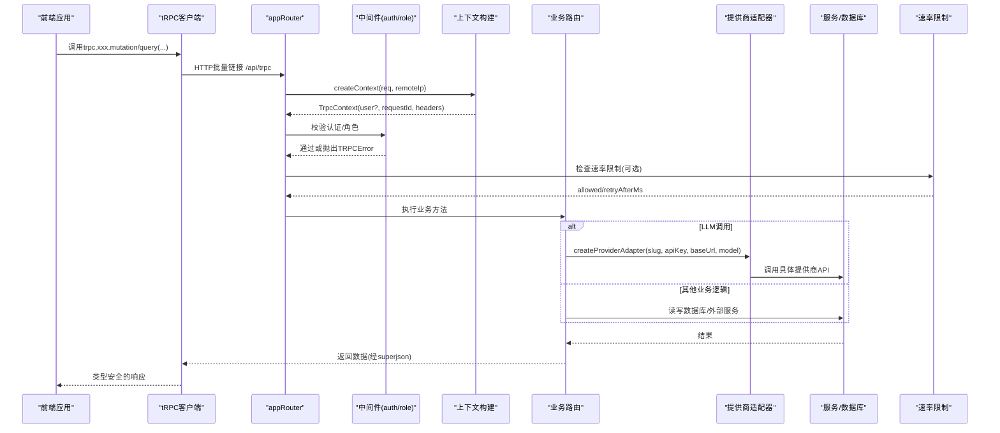
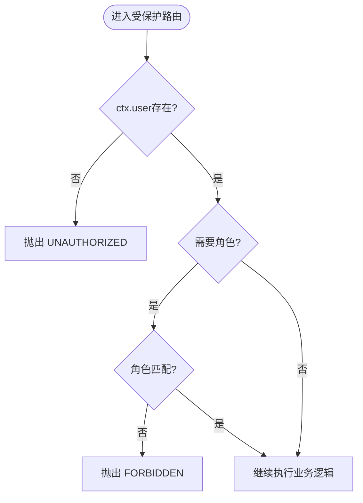
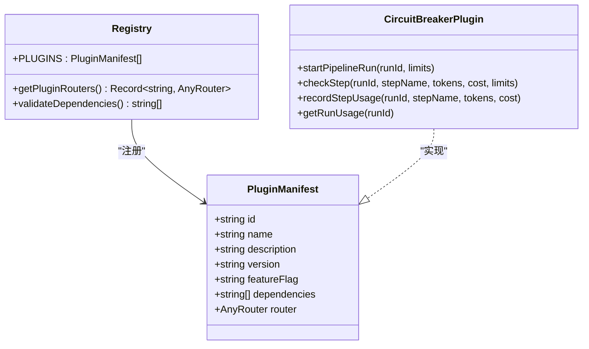
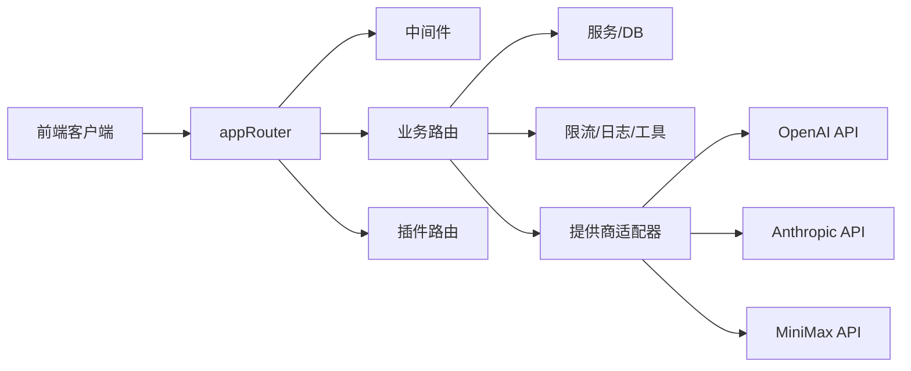
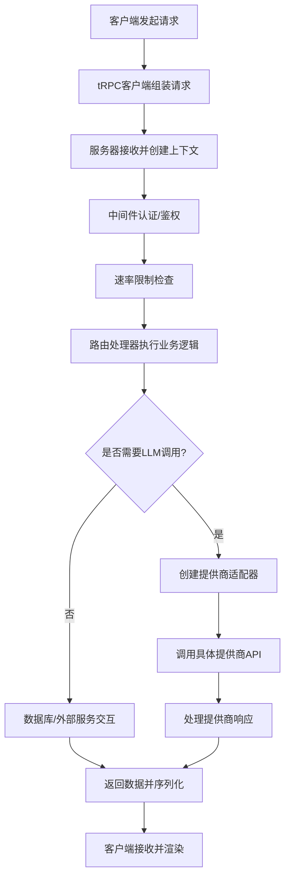

# API架构概览

<cite>
**本文引用的文件**
- [api/router.ts](file://api/router.ts)
- [api/middleware.ts](file://api/middleware.ts)
- [api/context.ts](file://api/context.ts)
- [api/routers/localAuth.ts](file://api/routers/localAuth.ts)
- [api/routers/project.ts](file://api/routers/project.ts)
- [api/plugins/registry.ts](file://api/plugins/registry.ts)
- [api/plugins/circuit-breaker/index.ts](file://api/plugins/circuit-breaker/index.ts)
- [api/lib/rateLimiter.ts](file://api/lib/rateLimiter.ts)
- [src/providers/trpc.tsx](file://src/providers/trpc.tsx)
- [api/lib/providers/index.ts](file://api/lib/providers/index.ts)
- [api/lib/providers/openai.ts](file://api/lib/providers/openai.ts)
- [api/lib/providers/base.ts](file://api/lib/providers/base.ts)
- [api/routers/llm.ts](file://api/routers/llm.ts)
</cite>

## 更新摘要
**所做更改**
- 新增MiniMax提供商集成章节，详细说明提供商配置和错误处理
- 更新提供商系统架构图，包含MiniMax支持
- 增强错误处理策略部分，涵盖MiniMax特定的认证失败、速率限制和余额不足场景
- 添加提供商管理API的详细说明

## 目录
1. [简介](#简介)
2. [项目结构](#项目结构)
3. [核心组件](#核心组件)
4. [架构总览](#架构总览)
5. [详细组件分析](#详细组件分析)
6. [依赖关系分析](#依赖关系分析)
7. [性能考量](#性能考量)
8. [故障排查指南](#故障排查指南)
9. [结论](#结论)
10. [附录](#附录)

## 简介
本文件为DeeWaanAI后端API的tRPC架构提供全面概览，覆盖以下主题：
- tRPC框架选择与类型安全API设计模式
- 中间件机制、上下文管理与认证流程
- 路由组织方式、插件系统架构
- 错误处理策略、速率限制与安全考虑
- **新增**：多提供商集成系统（OpenAI、Anthropic、MiniMax等）
- API版本管理、向后兼容性与迁移建议
- 客户端与服务端使用示例（以代码路径引用形式）
- 请求生命周期、数据验证与响应格式化

## 项目结构
后端采用模块化路由组织，所有业务路由通过统一的createRouter聚合到appRouter；公共能力（认证、鉴权、限流、日志等）通过中间件和工具模块复用。前端通过tRPC React客户端调用后端接口，自动获得类型推导。**新增**：提供商抽象层支持多种LLM服务提供商的统一接入。



**图表来源**
- [api/router.ts:39-70](file://api/router.ts#L39-L70)
- [api/middleware.ts:10-51](file://api/middleware.ts#L10-L51)
- [api/context.ts:20-54](file://api/context.ts#L20-L54)
- [src/providers/trpc.tsx:18-39](file://src/providers/trpc.tsx#L18-L39)
- [api/lib/providers/index.ts:5-22](file://api/lib/providers/index.ts#L5-L22)

**章节来源**
- [api/router.ts:1-73](file://api/router.ts#L1-L73)
- [api/middleware.ts:1-51](file://api/middleware.ts#L1-L51)
- [api/context.ts:1-55](file://api/context.ts#L1-L55)
- [src/providers/trpc.tsx:1-50](file://src/providers/trpc.tsx#L1-L50)

## 核心组件
- 路由聚合器：集中注册各业务路由与插件路由，导出AppRouter类型供前后端共享。
- 中间件层：提供publicQuery、authedQuery、adminQuery等过程级权限控制，统一抛出TRPCError。
- 上下文构建：在每次请求时解析本地认证令牌、生成请求ID、记录远端IP等。
- 插件系统：可插拔扩展点，支持自带router与特性开关。
- 速率限制：基于Redis或内存的固定窗口/令牌桶实现，支持按客户分层的配额。
- 电路断路器插件：对流水线执行进行预算、超时、迭代次数保护。
- **新增**：提供商抽象层：统一的LLM提供商接口，支持OpenAI、Anthropic、MiniMax等多种服务商。

**章节来源**
- [api/router.ts:31-70](file://api/router.ts#L31-L70)
- [api/middleware.ts:17-51](file://api/middleware.ts#L17-L51)
- [api/context.ts:9-54](file://api/context.ts#L9-L54)
- [api/plugins/registry.ts:19-70](file://api/plugins/registry.ts#L19-L70)
- [api/lib/rateLimiter.ts:31-103](file://api/lib/rateLimiter.ts#L31-L103)
- [api/plugins/circuit-breaker/index.ts:44-143](file://api/plugins/circuit-breaker/index.ts#L44-L143)
- [api/lib/providers/base.ts:35-43](file://api/lib/providers/base.ts#L35-L43)

## 架构总览
下图展示了从客户端发起请求到服务端处理的完整链路，包括认证、鉴权、限流、业务逻辑与响应序列化。**新增**：提供商适配层支持动态路由到不同的LLM服务提供商。



**图表来源**
- [src/providers/trpc.tsx:18-39](file://src/providers/trpc.tsx#L18-L39)
- [api/router.ts:39-70](file://api/router.ts#L39-L70)
- [api/middleware.ts:17-51](file://api/middleware.ts#L17-L51)
- [api/context.ts:20-54](file://api/context.ts#L20-L54)
- [api/lib/rateLimiter.ts:64-93](file://api/lib/rateLimiter.ts#L64-L93)
- [api/lib/providers/index.ts:5-22](file://api/lib/providers/index.ts#L5-L22)

## 详细组件分析

### 认证与鉴权
- 认证方式：通过HTTP头x-local-auth-token携带JWT令牌，由上下文在请求开始时解析并填充ctx.user。
- 鉴权中间件：
  - requireAuth：未登录则抛出UNAUTHORIZED。
  - requireRole：非管理员访问管理接口则抛出FORBIDDEN。
- 本地认证路由：提供signup/login/me及管理员tier管理接口，包含密码策略、速率限制与审计日志。



**图表来源**
- [api/middleware.ts:17-51](file://api/middleware.ts#L17-L51)
- [api/routers/localAuth.ts:60-170](file://api/routers/localAuth.ts#L60-L170)

**章节来源**
- [api/context.ts:20-54](file://api/context.ts#L20-L54)
- [api/middleware.ts:17-51](file://api/middleware.ts#L17-L51)
- [api/routers/localAuth.ts:1-216](file://api/routers/localAuth.ts#L1-L216)

### 多提供商集成系统
**新增**：系统支持多种LLM服务提供商的统一接入，通过适配器模式实现解耦。

#### 提供商配置
- **OpenAI**：默认基础URL `https://api.openai.com/v1`，支持gpt-4o、gpt-4o-mini、o1-preview、o1-mini等模型
- **Anthropic**：基础URL `https://api.anthropic.com/v1`，支持claude系列模型
- **MiniMax**：基础URL `https://api.minimax.io/v1`，支持MiniMax-M3、MiniMax-M2.7、MiniMax-Text-01模型
- **其他提供商**：DeepSeek、Kimi、Together.ai、Aliyun、Google Gemini、Mistral AI

#### 提供商适配器接口
所有提供商都实现统一的`LLMProviderAdapter`接口：
- `chat()`：发送聊天消息并获取响应
- `validateKey()`：验证API密钥有效性
- `listModels()`：列出可用模型

#### MiniMax提供商详情
- **基础URL**：`https://api.minimax.io/v1`
- **支持模型**：MiniMax-M3、MiniMax-M2.7、MiniMax-Text-01
- **错误处理**：
  - 401认证失败：提示用户前往平台获取API密钥
  - 429速率限制：建议稍后重试
  - 余额不足：提示用户充值账户

```mermaid
classDiagram
class LLMProviderAdapter {
+string name
+string slug
+string defaultBaseUrl
+string[] supportedModels
+chat(messages, options) Promise~ChatResponse~
+validateKey() Promise~{valid : boolean, error? : string}~
+listModels() Promise~string[]~
}
class OpenAIAdapter {
+chat(messages, options)
+validateKey()
+listModels()
}
class AnthropicAdapter {
+chat(messages, options)
+validateKey()
+listModels()
}
class MiniMaxAdapter {
+chat(messages, options)
+validateKey()
+listModels()
}
LLMProviderAdapter <|-- OpenAIAdapter
LLMProviderAdapter <|-- AnthropicAdapter
LLMProviderAdapter <|-- MiniMaxAdapter
```

**图表来源**
- [api/lib/providers/base.ts:35-43](file://api/lib/providers/base.ts#L35-L43)
- [api/lib/providers/index.ts:5-22](file://api/lib/providers/index.ts#L5-L22)
- [api/lib/providers/openai.ts:89-213](file://api/lib/providers/openai.ts#L89-L213)

**章节来源**
- [api/lib/providers/index.ts:24-99](file://api/lib/providers/index.ts#L24-L99)
- [api/lib/providers/base.ts:1-44](file://api/lib/providers/base.ts#L1-L44)
- [api/lib/providers/openai.ts:70-75](file://api/lib/providers/openai.ts#L70-L75)

### 数据验证与响应格式化
- 输入验证：所有路由参数使用Zod schema进行强类型校验，确保前后端契约一致。
- 响应序列化：使用superjson作为tRPC transformer，支持复杂数据结构（如Date、Map、Set）的跨端传输。
- 错误模型：通过TRPCError统一错误码与消息，便于前端统一处理。

**章节来源**
- [api/routers/localAuth.ts:60-170](file://api/routers/localAuth.ts#L60-L170)
- [api/routers/project.ts:11-105](file://api/routers/project.ts#L11-L105)
- [api/middleware.ts:10-15](file://api/middleware.ts#L10-L15)

### 路由组织与插件系统
- 路由聚合：appRouter集中挂载所有业务路由与插件路由，便于统一导出类型AppRouter。
- 插件机制：
  - 插件清单：每个插件声明id、name、version、featureFlag、dependencies与可选router。
  - 动态挂载：启动时遍历PLUGINS，将带有router的插件挂载到对应命名空间下。
  - 依赖校验：启动时可验证插件依赖是否满足。
- 示例插件：电路断路器插件提供运行时保护（token预算、花费上限、步骤超时、循环次数限制），并暴露查询与配置接口。



**图表来源**
- [api/plugins/registry.ts:19-70](file://api/plugins/registry.ts#L19-L70)
- [api/plugins/circuit-breaker/index.ts:147-186](file://api/plugins/circuit-breaker/index.ts#L147-L186)

**章节来源**
- [api/router.ts:31-70](file://api/router.ts#L31-L70)
- [api/plugins/registry.ts:1-70](file://api/plugins/registry.ts#L1-L70)
- [api/plugins/circuit-breaker/index.ts:1-186](file://api/plugins/circuit-breaker/index.ts#L1-L186)

### 速率限制与安全
- 通用限流：checkRateLimitAsync基于Redis固定窗口计数，失败回退至内存令牌桶；提供预置profile（auth、execute、batch、read等）。
- 客户分层限流：checkCustomerRateLimit根据用户层级（solo/team/admin）分配不同配额，同样具备Redis优先与内存回退。
- 安全要点：
  - 认证令牌仅通过HTTP头传递，避免URL污染。
  - 登录/注册接口实施严格的速率限制，防止暴力破解。
  - 密码哈希存储，敏感信息不直接落库。
  - 管理员操作需显式角色校验。

**章节来源**
- [api/lib/rateLimiter.ts:31-103](file://api/lib/rateLimiter.ts#L31-L103)
- [api/lib/rateLimiter.ts:198-216](file://api/lib/rateLimiter.ts#L198-L216)
- [api/routers/localAuth.ts:60-170](file://api/routers/localAuth.ts#L60-L170)

### 客户端集成与使用示例
- 客户端初始化：创建tRPC React客户端，配置httpBatchLink、superjson转换器、自动注入认证头、长超时用于流水线执行。
- 典型用法（以路径引用代替具体代码）：
  - 登录获取令牌并持久化：[localAuth.login:124-158](file://api/routers/localAuth.ts#L124-L158)
  - 读取当前用户信息：[localAuth.me:160-169](file://api/routers/localAuth.ts#L160-L169)
  - 列出项目：[project.list:12-54](file://api/routers/project.ts#L12-L54)
  - 创建项目（含默认流水线步骤）：[project.create:103-250](file://api/routers/project.ts#L103-L250)
  - 更新项目配置：[project.updatePipelineConfig:356-403](file://api/routers/project.ts#L356-L403)
  - 查询电路断路器状态：[circuitBreaker.getStatus:147-157](file://api/plugins/circuit-breaker/index.ts#L147-L157)
  - **新增**：测试提供商连接：[llm.testConnection:143-168](file://api/routers/llm.ts#L143-L168)
  - **新增**：获取提供商默认模型：[llm.getDefaults:205-209](file://api/routers/llm.ts#L205-L209)

**章节来源**
- [src/providers/trpc.tsx:18-39](file://src/providers/trpc.tsx#L18-39)
- [api/routers/localAuth.ts:60-170](file://api/routers/localAuth.ts#L60-L170)
- [api/routers/project.ts:12-403](file://api/routers/project.ts#L12-L403)
- [api/plugins/circuit-breaker/index.ts:147-173](file://api/plugins/circuit-breaker/index.ts#L147-L173)
- [api/routers/llm.ts:143-209](file://api/routers/llm.ts#L143-L209)

## 依赖关系分析
- 路由层依赖中间件提供的authedQuery/adminQuery，以及上下文中的用户信息。
- 业务路由依赖数据库连接、服务层与工具模块（日志、限流、存储等）。
- 插件系统通过PLUGINS数组解耦扩展点，路由聚合器在启动时扫描并挂载。
- 客户端依赖AppRouter类型，保证前后端类型同步。
- **新增**：提供商适配器通过工厂函数动态创建，支持运行时切换不同LLM服务提供商。



**图表来源**
- [api/router.ts:39-70](file://api/router.ts#L39-L70)
- [api/middleware.ts:17-51](file://api/middleware.ts#L17-L51)
- [api/plugins/registry.ts:44-53](file://api/plugins/registry.ts#L44-L53)
- [api/lib/providers/index.ts:5-22](file://api/lib/providers/index.ts#L5-L22)

**章节来源**
- [api/router.ts:1-73](file://api/router.ts#L1-L73)
- [api/plugins/registry.ts:1-70](file://api/plugins/registry.ts#L1-L70)

## 性能考量
- 批量请求：客户端使用httpBatchLink减少网络往返。
- 序列化优化：superjson提升复杂对象传输效率。
- 限流策略：Redis优先的固定窗口计数，失败回退内存，保障高可用。
- 流水线保护：电路断路器限制token与花费，防止资源耗尽。
- 缓存与索引：建议在热点查询上增加数据库索引与缓存层（如Redis）以提升吞吐。
- **新增**：提供商适配器缓存：避免重复创建适配器实例，提高响应速度。

## 故障排查指南
- 认证失败：检查x-local-auth-token是否正确设置与有效；确认上下文解析逻辑。
- 鉴权拒绝：确认用户角色与所需角色匹配；查看admin相关接口是否被正确保护。
- 速率限制：关注rate limiter日志与重试时间；必要时调整RATE_LIMITS或CUSTOMER_RATE_LIMITS。
- 数据库异常：登录/注册中捕获特定错误并提示修复命令；检查schema同步与连接状态。
- 插件问题：验证插件依赖是否满足；检查插件router是否正确挂载。
- **新增**：提供商连接问题：
  - MiniMax认证失败：检查API密钥格式和有效期
  - 速率限制：等待retry-after时间后重试
  - 余额不足：前往MiniMax平台充值账户
  - 模型不可用：检查模型名称拼写和可用性

**章节来源**
- [api/routers/localAuth.ts:23-36](file://api/routers/localAuth.ts#L23-L36)
- [api/lib/rateLimiter.ts:86-93](file://api/lib/rateLimiter.ts#L86-L93)
- [api/plugins/registry.ts:55-69](file://api/plugins/registry.ts#L55-L69)
- [api/lib/providers/openai.ts:70-75](file://api/lib/providers/openai.ts#L70-L75)

## 结论
该tRPC架构通过类型安全的中间件、清晰的上下文构建、灵活的插件系统与健壮的速率限制，提供了可扩展、可维护且安全的API服务。**新增的多提供商集成系统**进一步增强了系统的灵活性和扩展性，支持多种LLM服务提供商的统一接入和管理。结合前端tRPC客户端，实现了端到端的类型一致性与开发体验提升。建议在生产环境中持续完善监控、告警与容量规划，并遵循版本管理与兼容性策略以确保平滑演进。

## 附录

### 请求生命周期与数据流


**图表来源**
- [api/context.ts:20-54](file://api/context.ts#L20-L54)
- [api/middleware.ts:17-51](file://api/middleware.ts#L17-L51)
- [api/lib/rateLimiter.ts:64-93](file://api/lib/rateLimiter.ts#L64-L93)
- [src/providers/trpc.tsx:18-39](file://src/providers/trpc.tsx#L18-L39)
- [api/lib/providers/index.ts:5-22](file://api/lib/providers/index.ts#L5-L22)

### API版本管理与向后兼容策略
- 版本化建议：
  - URL前缀版本化：例如/api/v1/trpc，逐步迁移旧版本。
  - 字段弃用：保留旧字段但标记废弃，提供新字段映射。
  - 行为变更：通过特性开关渐进启用新功能。
- 兼容性策略：
  - 新增必填字段时提供默认值或可选过渡期。
  - 删除字段前先重命名为deprecated_前缀，再在下一主版本移除。
  - 对外部依赖升级时保持接口稳定，内部重构不影响契约。
- 迁移指南：
  - 发布说明明确破坏性变更与替代方案。
  - 提供脚本或工具辅助客户端升级。
  - 灰度发布与A/B测试降低风险。

### 安全注意事项
- 最小权限原则：仅授予必要权限，管理员接口严格保护。
- 输入校验：所有入口使用Zod严格校验，避免注入与越权。
- 令牌安全：JWT签名算法与密钥管理，合理设置过期时间。
- 速率限制：针对敏感操作（登录、注册、批量执行）加强限制。
- 日志脱敏：避免记录敏感信息（密码、令牌）。
- **新增**：提供商密钥管理：
  - API密钥加密存储，使用主密钥加密
  - 密钥轮换机制，支持无缝切换
  - 访问日志记录，追踪密钥使用情况

### 提供商管理API
**新增**：系统提供完整的提供商管理功能：

- **创建提供商**：`llm.createProvider` - 添加新的LLM服务提供商配置
- **更新提供商**：`llm.updateProvider` - 修改现有提供商配置
- **删除提供商**：`llm.deleteProvider` - 移除不再使用的提供商
- **测试连接**：`llm.testConnection` - 验证提供商连接和API密钥有效性
- **获取默认配置**：`llm.getDefaults` - 获取提供商的默认模型和配置
- **列出模型**：`llm.fetchModels` - 获取提供商可用的模型列表
- **预览模型**：`llm.fetchModelsPreview` - 保存前预览可用模型

**章节来源**
- [api/routers/llm.ts:60-249](file://api/routers/llm.ts#L60-L249)