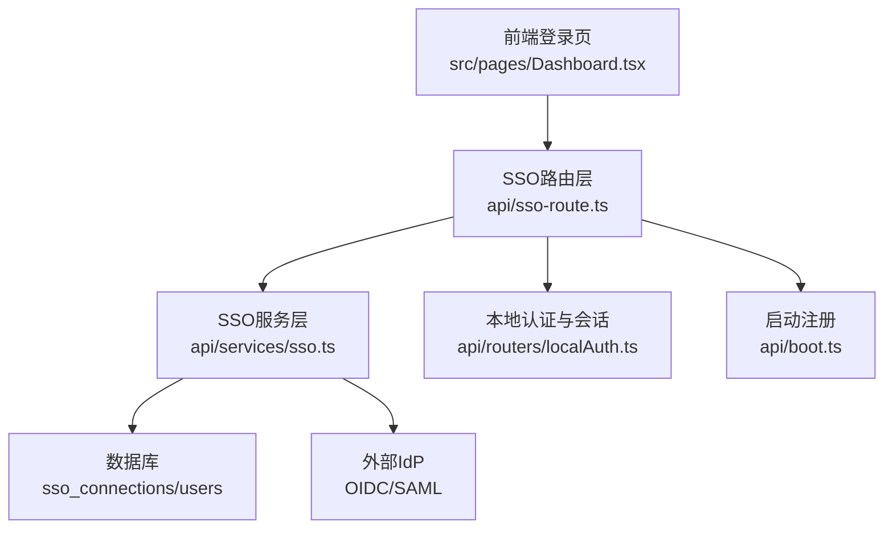
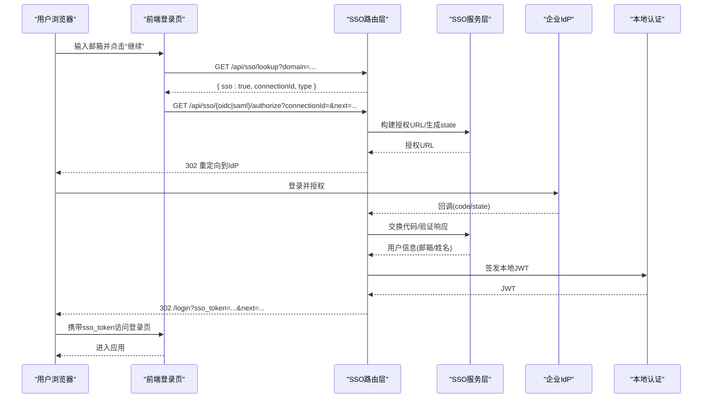
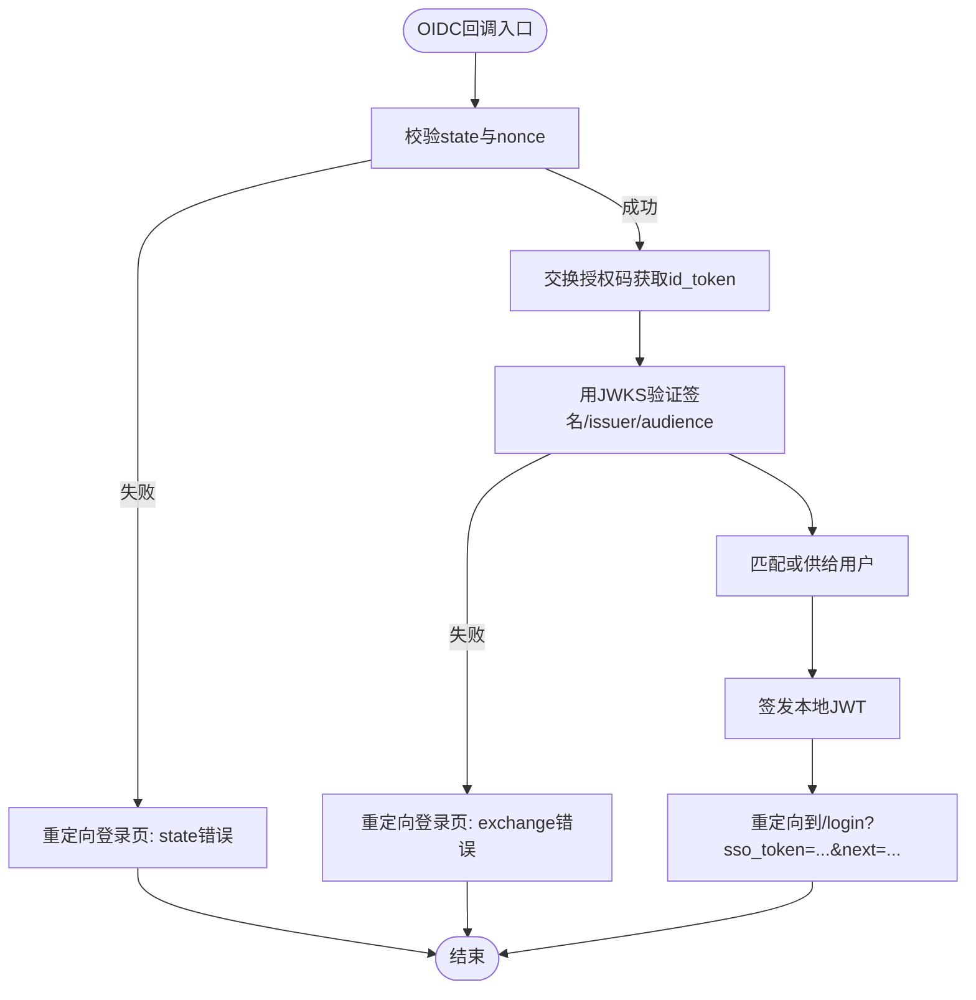
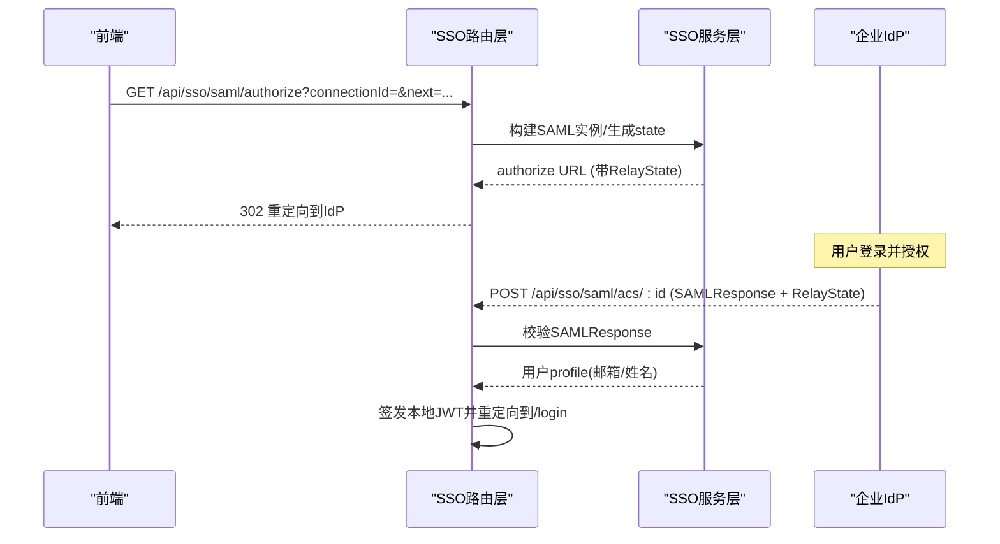
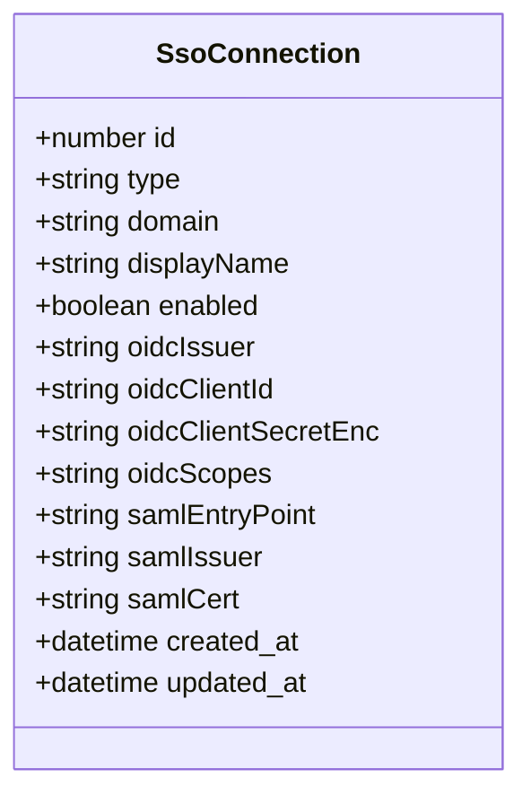
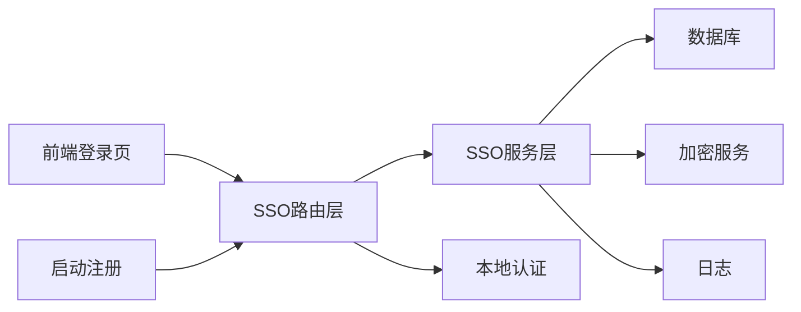

# SSO集成

<cite>
**本文引用的文件**
- [api/services/sso.ts](file://api/services/sso.ts)
- [api/sso-route.ts](file://api/sso-route.ts)
- [api/routers/localAuth.ts](file://api/routers/localAuth.ts)
- [api/auth-router.ts](file://api/auth-router.ts)
- [db/migrations/013_enterprise.sql](file://db/migrations/013_enterprise.sql)
- [DeeWaanAI-Next/PHASE3-SPEC.md](file://DeeWaanAI-Next/PHASE3-SPEC.md)
- [src/pages/Dashboard.tsx](file://src/pages/Dashboard.tsx)
- [api/boot.ts](file://api/boot.ts)
- [api/lib/env.ts](file://api/lib/env.ts)
- [api/services/cryptoService.ts](file://api/services/cryptoService.ts)
</cite>

## 目录
1. [简介](#简介)
2. [项目结构](#项目结构)
3. [核心组件](#核心组件)
4. [架构总览](#架构总览)
5. [详细组件分析](#详细组件分析)
6. [依赖关系分析](#依赖关系分析)
7. [性能考量](#性能考量)
8. [故障排查指南](#故障排查指南)
9. [结论](#结论)
10. [附录](#附录)

## 简介
本技术文档聚焦企业级单点登录（SSO）集成功能，覆盖OIDC与SAML协议支持、企业身份提供商集成、连接配置、域名绑定、证书管理、OAuth 2.1流程、JWT令牌处理与会话管理、企业LDAP/Active Directory对接思路、安全配置与密钥管理等。该功能通过Hono路由暴露公共端点，结合服务层完成发现、授权、回调、用户自动供给与本地会话签发，并通过特性开关控制启用。

## 项目结构
SSO相关代码主要分布在以下位置：
- 路由层：定义对外HTTP接口，负责入口校验、重定向、回调处理与错误归一化
- 服务层：封装OIDC/SAML协议细节、JWKS缓存、状态签名、用户供给、加密存储等
- 认证与会话：统一签发应用本地JWT，供前端后续请求使用
- 数据库迁移：新增SSO连接表及企业能力相关表
- 前端集成：登录页按邮箱域名分支到对应SSO流程

图表来源
- [api/sso-route.ts:108-290](file://api/sso-route.ts#L108-L290)
- [api/services/sso.ts:30-369](file://api/services/sso.ts#L30-L369)
- [api/routers/localAuth.ts:38-54](file://api/routers/localAuth.ts#L38-L54)
- [api/boot.ts:177-182](file://api/boot.ts#L177-L182)
- [src/pages/Dashboard.tsx:93-133](file://src/pages/Dashboard.tsx#L93-L133)

章节来源
- [api/sso-route.ts:1-290](file://api/sso-route.ts#L1-L290)
- [api/services/sso.ts:1-369](file://api/services/sso.ts#L1-L369)
- [api/routers/localAuth.ts:1-216](file://api/routers/localAuth.ts#L1-L216)
- [db/migrations/013_enterprise.sql:1-54](file://db/migrations/013_enterprise.sql#L1-L54)
- [DeeWaanAI-Next/PHASE3-SPEC.md:29-50](file://DeeWaanAI-Next/PHASE3-SPEC.md#L29-L50)
- [src/pages/Dashboard.tsx:93-133](file://src/pages/Dashboard.tsx#L93-L133)

## 核心组件
- SSO路由层：提供域名查询、OIDC授权与回调、SAML元数据与ACS处理，统一错误返回与跳转
- SSO服务层：实现OIDC发现与JWKS缓存、授权URL构建、代码交换与ID Token验证；SAML实例构建、响应校验与属性映射；无状态CSRF/nonce状态JWT；用户匹配与自动供给；客户端密钥加解密
- 本地认证与会话：统一签发短期本地JWT，作为应用内会话凭证
- 数据库模型：sso_connections记录每个企业IdP的连接信息（类型、域名、显示名、OIDC/SAML字段），users记录用户基本信息
- 前端集成：根据邮箱域名查询可用SSO连接并发起相应流程

章节来源
- [api/sso-route.ts:108-290](file://api/sso-route.ts#L108-L290)
- [api/services/sso.ts:30-369](file://api/services/sso.ts#L30-L369)
- [api/routers/localAuth.ts:38-54](file://api/routers/localAuth.ts#L38-L54)
- [db/migrations/013_enterprise.sql:6-23](file://db/migrations/013_enterprise.sql#L6-L23)
- [src/pages/Dashboard.tsx:93-133](file://src/pages/Dashboard.tsx#L93-L133)

## 架构总览
SSO整体采用“路由层+服务层”的分层设计，所有SSO端点受特性开关控制，失败路径统一重定向至登录页并携带错误键，避免对外暴露内部异常。OIDC流程基于标准授权码模式，SAML流程支持SP发起与IdP发起两种路径。用户首次登录时自动供给为系统用户，后续登录更新最近登录时间。

图表来源
- [api/sso-route.ts:108-290](file://api/sso-route.ts#L108-L290)
- [api/services/sso.ts:103-181](file://api/services/sso.ts#L103-L181)
- [api/routers/localAuth.ts:38-54](file://api/routers/localAuth.ts#L38-L54)
- [src/pages/Dashboard.tsx:93-133](file://src/pages/Dashboard.tsx#L93-L133)

## 详细组件分析

### OIDC流程（授权码模式 + PKCE友好）
- 域名查询：根据邮箱域名查找启用的SSO连接，限制频率防止枚举
- 授权跳转：构造state JWT（含connectionId、nonce、next），生成OIDC授权URL并302跳转
- 回调处理：校验state与nonce，调用服务层交换code换取id_token，使用远程JWKS验证签名，校验issuer与audience
- 用户供给：按email匹配或创建新用户（role=user，username去冲突），更新lastSignInAt
- 会话签发：签发本地JWT并重定向回登录页

图表来源
- [api/sso-route.ts:160-203](file://api/sso-route.ts#L160-L203)
- [api/services/sso.ts:103-181](file://api/services/sso.ts#L103-L181)
- [api/routers/localAuth.ts:38-54](file://api/routers/localAuth.ts#L38-L54)

章节来源
- [api/sso-route.ts:137-203](file://api/sso-route.ts#L137-L203)
- [api/services/sso.ts:61-181](file://api/services/sso.ts#L61-L181)
- [api/routers/localAuth.ts:38-54](file://api/routers/localAuth.ts#L38-L54)

### SAML流程（SP发起与IdP发起）
- SP元数据：按连接生成SP元数据XML，便于在企业IdP中配置
- SP发起登录：构造state JWT作为RelayState，跳转到IdP的entryPoint
- IdP发起登录：IdP直接POST SAMLResponse到ACS端点
- ACS处理：校验SAMLResponse，提取NameID或邮件属性，匹配或供给用户，签发本地JWT并返回

图表来源
- [api/sso-route.ts:205-287](file://api/sso-route.ts#L205-L287)
- [api/services/sso.ts:226-299](file://api/services/sso.ts#L226-L299)

章节来源
- [api/sso-route.ts:205-287](file://api/sso-route.ts#L205-L287)
- [api/services/sso.ts:226-299](file://api/services/sso.ts#L226-L299)

### 域名绑定与连接配置
- 域名归一化：将邮箱或域名标准化（小写、去除前后点与空白、截取@后部分）
- 连接查找：按domain精确匹配且仅返回enabled的连接
- 管理员配置：通过管理端维护sso_connections表（type、domain、displayName、enabled、OIDC/SAML字段），敏感字段加密存储

图表来源
- [db/migrations/013_enterprise.sql:6-23](file://db/migrations/013_enterprise.sql#L6-L23)

章节来源
- [api/services/sso.ts:30-59](file://api/services/sso.ts#L30-L59)
- [db/migrations/013_enterprise.sql:6-23](file://db/migrations/013_enterprise.sql#L6-L23)

### 证书管理（SAML）
- 证书格式兼容：支持PEM与裸Base64，自动补齐PEM头尾
- 校验策略：不强制要求AuthnResponse或Assertion均签名，接受至少一方有效签名，提升跨IdP兼容性
- 元数据生成：按连接动态生成SP元数据XML，用于在IdP侧配置

章节来源
- [api/services/sso.ts:226-263](file://api/services/sso.ts#L226-L263)

### 会话管理与JWT令牌
- 本地JWT：统一由本地认证模块签发，包含userId与username，HS256签名，有效期7天
- 传输方式：通过x-local-auth-token头部传递，前端登录后将token存入内存/cookie并按需发送
- 验证机制：各路由通过verifyLocalToken解析并校验令牌，确保会话有效性

章节来源
- [api/routers/localAuth.ts:38-54](file://api/routers/localAuth.ts#L38-L54)
- [api/auth-router.ts:1-13](file://api/auth-router.ts#L1-L13)

### OAuth 2.1流程（MCP场景参考）
- 授权码模式：遵循PKCE（S256）与最小权限范围
- 令牌颁发：access_token与refresh_token分离，设置no-store/no-cache
- 鉴权上下文：从令牌解析scopes与clientId，注入请求上下文

章节来源
- [api/mcp/auth.ts:251-356](file://api/mcp/auth.ts#L251-L356)
- [api/services/tokenService.ts:28-70](file://api/services/tokenService.ts#L28-L70)

### 企业LDAP/Active Directory对接
- OIDC路径：若企业LDAP/AD已接入企业身份平台（如Okta、Azure AD、Keycloak），可通过OIDC连接配置对接
- SAML路径：若企业IdP以SAML输出，可配置entryPoint、issuer与证书，完成SP集成
- 注意：当前代码未直接实现LDAP/AD协议，建议通过企业IdP桥接

章节来源
- [DeeWaanAI-Next/PHASE3-SPEC.md:34-47](file://DeeWaanAI-Next/PHASE3-SPEC.md#L34-L47)
- [api/services/sso.ts:103-181](file://api/services/sso.ts#L103-L181)
- [api/services/sso.ts:226-299](file://api/services/sso.ts#L226-L299)

## 依赖关系分析
- 路由层依赖服务层进行协议处理与数据操作
- 服务层依赖数据库连接、加密服务、日志与外部网络（IdP）
- 前端依赖路由层的域名查询与授权跳转
- 启动时注册SSO路由，受特性开关控制

图表来源
- [api/sso-route.ts:21-41](file://api/sso-route.ts#L21-L41)
- [api/services/sso.ts:16-24](file://api/services/sso.ts#L16-L24)
- [api/boot.ts:177-182](file://api/boot.ts#L177-L182)

章节来源
- [api/sso-route.ts:21-41](file://api/sso-route.ts#L21-L41)
- [api/services/sso.ts:16-24](file://api/services/sso.ts#L16-L24)
- [api/boot.ts:177-182](file://api/boot.ts#L177-L182)

## 性能考量
- OIDC发现缓存：进程内缓存1小时，减少重复网络请求
- JWKS缓存：按jwks_uri复用远程JWKSet实例，避免每次交换重复拉取
- 速率限制：域名查询接口按IP限流，防止枚举攻击
- 超时控制：外部网络请求设置超时，避免阻塞
- 元数据生成：按需生成SP元数据，避免全局缓存导致过期问题

章节来源
- [api/services/sso.ts:61-101](file://api/services/sso.ts#L61-L101)
- [api/sso-route.ts:48-49](file://api/sso-route.ts#L48-L49)
- [api/services/sso.ts:76-92](file://api/services/sso.ts#L76-L92)

## 故障排查指南
- 特性开关关闭：所有SSO端点返回404，确认enterprise_sso开关已启用
- 域名查询失败：检查sso_connections表中domain是否匹配且enabled为真
- OIDC授权失败：检查issuer、client_id、client_secret_enc是否正确；查看回调state与nonce是否一致
- SAML ACS失败：检查entryPoint、issuer、证书格式与callbackUrl；确认SAMLResponse存在
- 用户供给失败：检查users表是否存在email冲突；关注并发竞争导致的重试逻辑
- 会话无效：检查本地JWT是否过期或被篡改；确认x-local-auth-token正确传递

章节来源
- [api/sso-route.ts:75-101](file://api/sso-route.ts#L75-L101)
- [api/services/sso.ts:135-181](file://api/services/sso.ts#L135-L181)
- [api/services/sso.ts:270-299](file://api/services/sso.ts#L270-L299)
- [api/routers/localAuth.ts:46-54](file://api/routers/localAuth.ts#L46-L54)

## 结论
该SSO集成方案以模块化分层实现，支持OIDC与SAML双协议，具备域名分支、自动用户供给、无状态CSRF保护、加密存储与速率限制等企业级特性。通过特性开关与统一错误处理，保证在生产环境的安全性与可运维性。对于LDAP/AD对接，建议通过企业IdP桥接，简化协议复杂度。

## 附录

### 安全配置与密钥管理最佳实践
- 主密钥：通过环境变量配置主密钥，生产环境必须设置，开发环境有降级提示
- 加密算法：使用AES-256-GCM，支持新旧格式兼容
- 客户端密钥：以密文形式存储于数据库，仅在代码交换时解密并在内存中使用
- 令牌安全：本地JWT使用HS256签名，设置合理过期时间；禁止缓存敏感响应

章节来源
- [api/lib/env.ts:34-34](file://api/lib/env.ts#L34-L34)
- [api/services/cryptoService.ts:1-80](file://api/services/cryptoService.ts#L1-L80)
- [api/routers/localAuth.ts:38-54](file://api/routers/localAuth.ts#L38-L54)