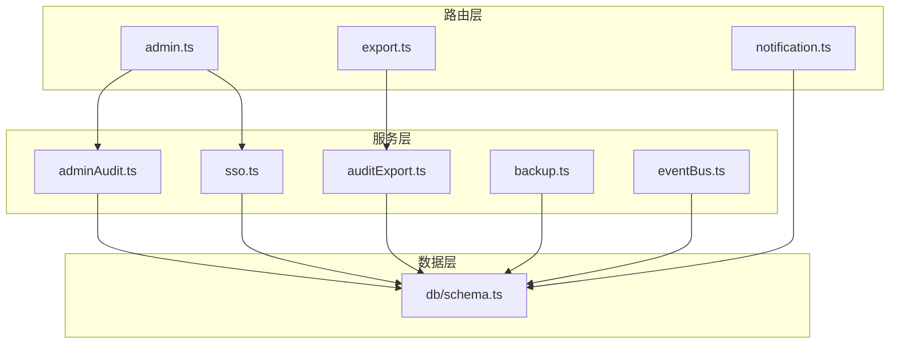
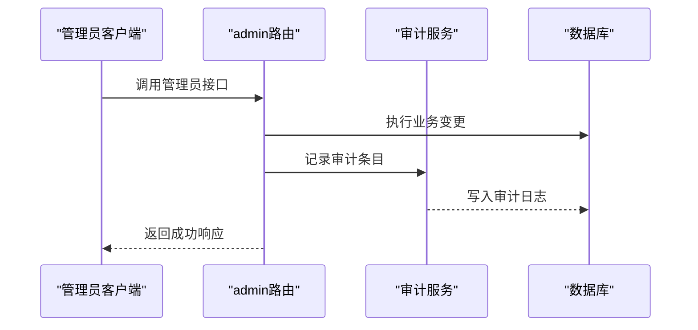
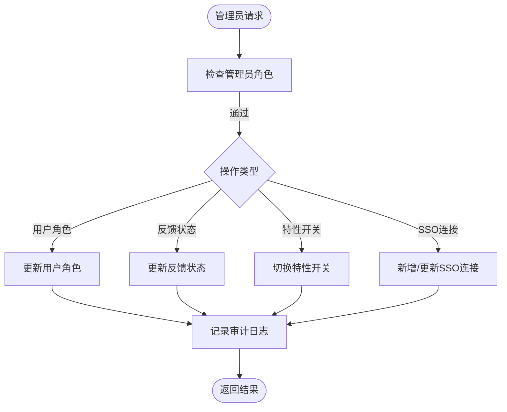
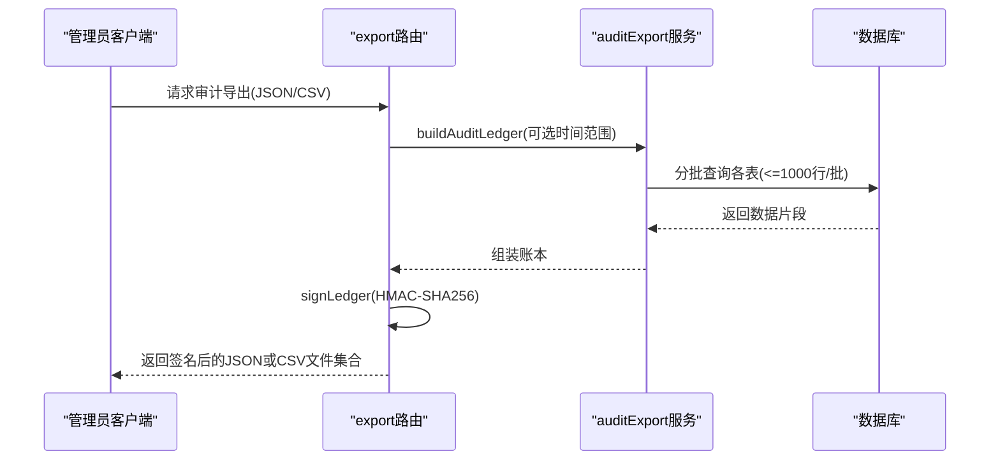
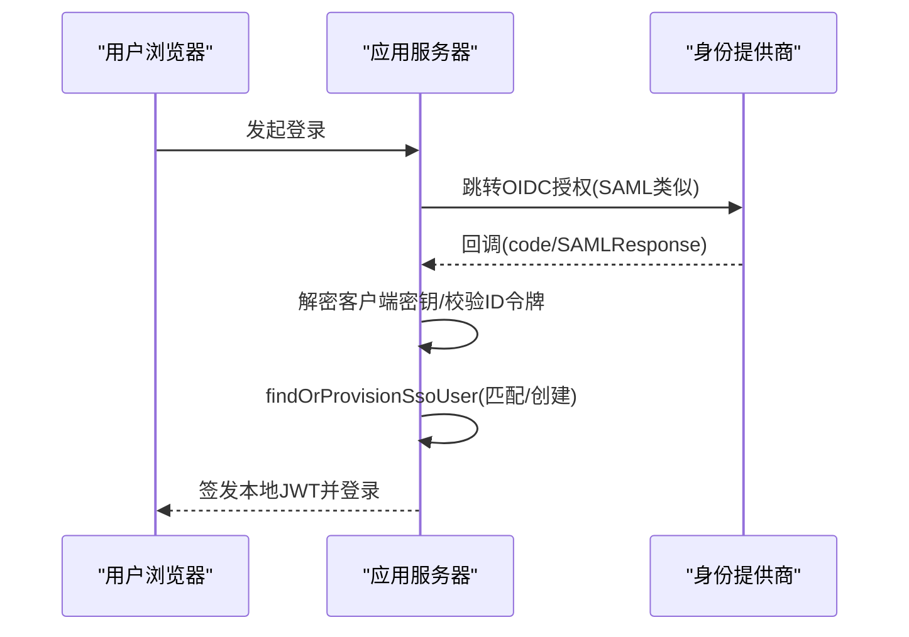
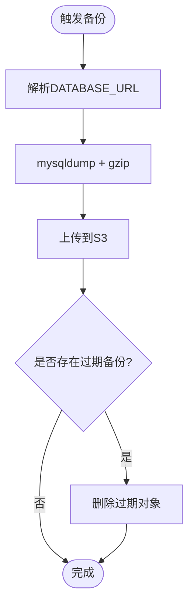
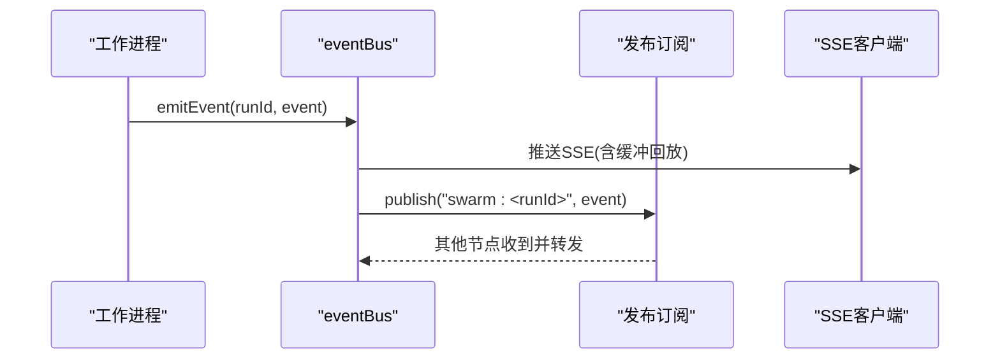
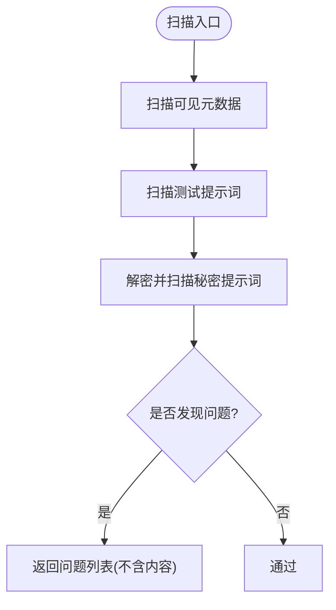
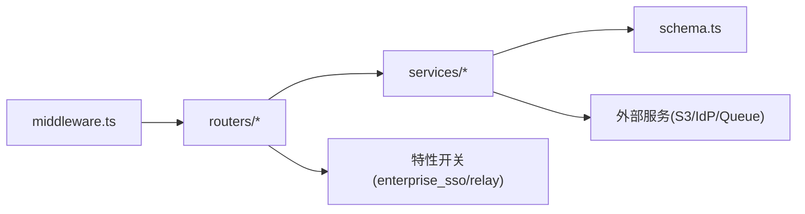

# 企业管理API

<cite>
**本文引用的文件**
- [api/routers/admin.ts](file://api/routers/admin.ts)
- [api/services/adminAudit.ts](file://api/services/adminAudit.ts)
- [api/services/auditExport.ts](file://api/services/auditExport.ts)
- [api/routers/export.ts](file://api/routers/export.ts)
- [api/services/sso.ts](file://api/services/sso.ts)
- [api/services/backup.ts](file://api/services/backup.ts)
- [api/middleware.ts](file://api/middleware.ts)
- [api/lib/adminGuards.ts](file://api/lib/adminGuards.ts)
- [db/schema.ts](file://db/schema.ts)
- [api/services/eventBus.ts](file://api/services/eventBus.ts)
- [api/routers/notification.ts](file://api/routers/notification.ts)
- [api/boot.ts](file://api/boot.ts)
- [scripts/smoke-enterprise.mjs](file://scripts/smoke-enterprise.mjs)
</cite>

## 目录
1. [简介](#简介)
2. [项目结构](#项目结构)
3. [核心组件](#核心组件)
4. [架构总览](#架构总览)
5. [详细组件分析](#详细组件分析)
6. [依赖关系分析](#依赖关系分析)
7. [性能与容量](#性能与容量)
8. [故障排查指南](#故障排查指南)
9. [结论](#结论)
10. [附录：企业能力清单](#附录企业能力清单)

## 简介
本技术文档面向企业管理API，覆盖管理员功能、系统监控、审计日志与合规导出、通知与事件、安全扫描与风险评估、SSO/LDAP集成、备份恢复与高可用配置，以及企业定制与多租户能力。文档以代码为依据，提供架构图、数据流图、时序图与流程图，帮助读者快速理解并落地企业级部署与运维。

## 项目结构
- 路由层：按功能域划分（admin、export、notification等），统一通过tRPC中间件进行鉴权与权限控制。
- 服务层：封装领域逻辑（审计导出、SSO、备份、事件总线、安全扫描等）。
- 数据层：基于Drizzle ORM的MySQL schema，包含用户、项目、运行、订阅、授权、SSO连接、审计日志等表。
- 基础设施：Redis/队列/发布订阅用于跨节点事件分发；S3兼容存储用于备份归档。

图表来源
- [api/routers/admin.ts:16-558](file://api/routers/admin.ts#L16-L558)
- [api/routers/export.ts:19-404](file://api/routers/export.ts#L19-L404)
- [api/routers/notification.ts:7-67](file://api/routers/notification.ts#L7-L67)
- [api/services/adminAudit.ts:1-41](file://api/services/adminAudit.ts#L1-L41)
- [api/services/auditExport.ts:1-658](file://api/services/auditExport.ts#L1-L658)
- [api/services/sso.ts:1-369](file://api/services/sso.ts#L1-L369)
- [api/services/backup.ts:1-224](file://api/services/backup.ts#L1-L224)
- [api/services/eventBus.ts:1-193](file://api/services/eventBus.ts#L1-L193)
- [db/schema.ts:17-200](file://db/schema.ts#L17-L200)

章节来源
- [api/routers/admin.ts:16-558](file://api/routers/admin.ts#L16-L558)
- [api/routers/export.ts:19-404](file://api/routers/export.ts#L19-L404)
- [api/routers/notification.ts:7-67](file://api/routers/notification.ts#L7-L67)
- [api/services/adminAudit.ts:1-41](file://api/services/adminAudit.ts#L1-L41)
- [api/services/auditExport.ts:1-658](file://api/services/auditExport.ts#L1-L658)
- [api/services/sso.ts:1-369](file://api/services/sso.ts#L1-L369)
- [api/services/backup.ts:1-224](file://api/services/backup.ts#L1-L224)
- [api/services/eventBus.ts:1-193](file://api/services/eventBus.ts#L1-L193)
- [db/schema.ts:17-200](file://db/schema.ts#L17-L200)

## 核心组件
- 管理员控制台：用户管理、反馈处理、系统统计、特性开关、认证队列、等待名单、SSO连接管理。
- 审计与合规：全量审计账本构建、HMAC签名、CSV导出、速率限制。
- SSO与企业集成：OIDC/SAML发现、授权、令牌交换、SP元数据、用户自动供应。
- 备份与恢复：mysqldump压缩上传至S3、保留策略、失败隔离。
- 事件与通知：SSE事件缓冲与回放、跨节点广播、终端事件持久化、通知查询与标记已读。
- 安全扫描：市场商品可见前静态扫描（注入、泄露、敏感信息、Unicode异常）。

章节来源
- [api/routers/admin.ts:16-558](file://api/routers/admin.ts#L16-L558)
- [api/services/auditExport.ts:1-658](file://api/services/auditExport.ts#L1-L658)
- [api/services/sso.ts:1-369](file://api/services/sso.ts#L1-L369)
- [api/services/backup.ts:1-224](file://api/services/backup.ts#L1-L224)
- [api/services/eventBus.ts:1-193](file://api/services/eventBus.ts#L1-L193)
- [api/routers/notification.ts:7-67](file://api/routers/notification.ts#L7-L67)
- [api/services/promptSecurityScan.ts:1-301](file://api/services/promptSecurityScan.ts#L1-L301)

## 架构总览
系统采用“路由-服务-数据”分层，结合tRPC中间件实现统一的鉴权与权限控制。企业功能通过特性开关（enterprise_sso、enterprise_relay）动态启用。关键流程包括：
- 管理员操作 → 写入审计日志 → 返回结果
- 合规导出 → 分批拉取 → 生成JSON/CSV → HMAC签名
- SSO登录 → 域名匹配 → OIDC/SAML流程 → 用户自动供应
- 备份任务 → mysqldump → gzip → S3上传 → 过期清理
- 事件总线 → SSE缓冲回放 → 跨节点广播

图表来源
- [api/routers/admin.ts:57-98](file://api/routers/admin.ts#L57-L98)
- [api/services/adminAudit.ts:24-41](file://api/services/adminAudit.ts#L24-L41)
- [db/schema.ts:17-51](file://db/schema.ts#L17-L51)

章节来源
- [api/routers/admin.ts:16-558](file://api/routers/admin.ts#L16-L558)
- [api/services/adminAudit.ts:1-41](file://api/services/adminAudit.ts#L1-L41)
- [db/schema.ts:17-51](file://db/schema.ts#L17-L51)

## 详细组件分析

### 管理员控制台（用户、反馈、统计、特性开关、认证队列、等待名单、SSO）
- 用户管理：分页查询、角色/层级调整、防自贬与末位管理员保护。
- 反馈管理：多维筛选、状态流转、截图URL签名访问。
- 系统统计：用户活跃、运行指标、反馈统计、内存与运行时长。
- 特性开关：列表与切换，并记录审计。
- 认证队列：市场商品审核阶段可视化、卡死检测与重入队。
- 等待名单：分页、搜索、邀请标记。
- SSO连接：增删改查、密钥掩码显示、加密存储、唯一性校验。

图表来源
- [api/routers/admin.ts:57-98](file://api/routers/admin.ts#L57-L98)
- [api/routers/admin.ts:100-177](file://api/routers/admin.ts#L100-L177)
- [api/routers/admin.ts:221-239](file://api/routers/admin.ts#L221-L239)
- [api/routers/admin.ts:273-372](file://api/routers/admin.ts#L273-L372)
- [api/lib/adminGuards.ts:1-29](file://api/lib/adminGuards.ts#L1-L29)
- [api/services/adminAudit.ts:24-41](file://api/services/adminAudit.ts#L24-L41)

章节来源
- [api/routers/admin.ts:16-558](file://api/routers/admin.ts#L16-L558)
- [api/lib/adminGuards.ts:1-29](file://api/lib/adminGuards.ts#L1-L29)
- [api/services/adminAudit.ts:1-41](file://api/services/adminAudit.ts#L1-L41)

### 审计与合规导出（批量拉取、签名、CSV）
- 构建审计账本：按批次拉取运行、审批、授权、订阅、MCP审计、OAuth客户端与刷新令牌、用户信息，过滤敏感字段。
- 签名机制：对规范化的JSON载荷使用HMAC-SHA256签名，支持密钥轮换与历史验证。
- CSV渲染：每节独立CSV，固定列顺序，RFC4180转义。
- 速率限制：按管理员维度限流，防止滥用。

图表来源
- [api/routers/export.ts:360-404](file://api/routers/export.ts#L360-L404)
- [api/services/auditExport.ts:214-485](file://api/services/auditExport.ts#L214-L485)
- [api/services/auditExport.ts:487-569](file://api/services/auditExport.ts#L487-L569)
- [api/services/auditExport.ts:571-658](file://api/services/auditExport.ts#L571-L658)

章节来源
- [api/routers/export.ts:19-404](file://api/routers/export.ts#L19-L404)
- [api/services/auditExport.ts:1-658](file://api/services/auditExport.ts#L1-L658)

### SSO与企业集成（OIDC/SAML、用户供应、密钥管理）
- 域名匹配：根据邮箱域名查找启用的SSO连接。
- OIDC流程：发现端点缓存、授权URL构建、令牌交换、ID令牌校验（issuer/audience）、提取email/name。
- SAML流程：SP元数据生成、ACS响应校验、NameID/email属性解析。
- 用户供应：按邮箱匹配或创建新用户（无密码，仅SSO），并发安全。
- 密钥管理：客户端密钥加密存储，仅在交换时解密；列表响应中掩码显示。

图表来源
- [api/services/sso.ts:43-59](file://api/services/sso.ts#L43-L59)
- [api/services/sso.ts:76-122](file://api/services/sso.ts#L76-L122)
- [api/services/sso.ts:135-181](file://api/services/sso.ts#L135-L181)
- [api/services/sso.ts:246-299](file://api/services/sso.ts#L246-L299)
- [api/services/sso.ts:309-357](file://api/services/sso.ts#L309-L357)
- [api/routers/admin.ts:273-372](file://api/routers/admin.ts#L273-L372)

章节来源
- [api/services/sso.ts:1-369](file://api/services/sso.ts#L1-L369)
- [api/routers/admin.ts:273-372](file://api/routers/admin.ts#L273-L372)
- [db/schema.ts:1252-1268](file://db/schema.ts#L1252-L1268)

### 备份与恢复（mysqldump + S3 + 保留策略）
- 执行dump：通过临时配置文件传递凭据，避免命令行暴露；单事务+触发器+存储过程导出。
- 压缩与上传：gzip压缩后上传至S3兼容存储，命名带时间戳。
- 保留策略：列出对象并按保留天数删除过期备份。
- 可用性：失败不阻断主流程；仅记录警告。

图表来源
- [api/services/backup.ts:45-67](file://api/services/backup.ts#L45-L67)
- [api/services/backup.ts:120-171](file://api/services/backup.ts#L120-L171)
- [api/services/backup.ts:173-224](file://api/services/backup.ts#L173-L224)

章节来源
- [api/services/backup.ts:1-224](file://api/services/backup.ts#L1-L224)

### 事件与通知（SSE缓冲、跨节点广播、通知管理）
- 事件总线：本地SSE缓冲回放（5分钟窗口）、终端事件持久化、跨节点发布订阅广播（最佳努力）。
- 通知：用户维度的通知列表、未读数、批量标记已读。

图表来源
- [api/services/eventBus.ts:94-167](file://api/services/eventBus.ts#L94-L167)
- [api/routers/notification.ts:7-67](file://api/routers/notification.ts#L7-L67)

章节来源
- [api/services/eventBus.ts:1-193](file://api/services/eventBus.ts#L1-L193)
- [api/routers/notification.ts:7-67](file://api/routers/notification.ts#L7-L67)

### 安全扫描与风险评估（市场商品可见前）
- 扫描项：Unicode异常、注入短语、数据外泄模式、敏感信息与支付卡号。
- 规则：纯字符串检查，可单元测试；失败关闭（无法扫描即视为问题）。
- 输出：仅返回问题代码与字段标签，不暴露内容。

图表来源
- [api/services/promptSecurityScan.ts:226-301](file://api/services/promptSecurityScan.ts#L226-L301)
- [api/services/promptSecurityScan.ts:23-210](file://api/services/promptSecurityScan.ts#L23-L210)

章节来源
- [api/services/promptSecurityScan.ts:1-301](file://api/services/promptSecurityScan.ts#L1-L301)

## 依赖关系分析
- 鉴权与权限：tRPC中间件提供authedQuery与adminQuery，强制角色为admin才能访问管理接口。
- 数据模型：users、projects、swarmRuns、entitlements、subscriptions、ssoConnections、adminAuditLog等表支撑业务。
- 外部集成：S3用于备份；Redis/队列用于发布订阅；OIDC/SAML IdP用于SSO。
- 特性开关：enterprise_sso、enterprise_relay控制企业功能可见性。

图表来源
- [api/middleware.ts:17-51](file://api/middleware.ts#L17-L51)
- [api/boot.ts:177-195](file://api/boot.ts#L177-L195)
- [scripts/smoke-enterprise.mjs:21-33](file://scripts/smoke-enterprise.mjs#L21-L33)
- [db/schema.ts:1081-1104](file://db/schema.ts#L1081-L1104)

章节来源
- [api/middleware.ts:17-51](file://api/middleware.ts#L17-L51)
- [api/boot.ts:177-195](file://api/boot.ts#L177-L195)
- [scripts/smoke-enterprise.mjs:21-33](file://scripts/smoke-enterprise.mjs#L21-L33)
- [db/schema.ts:1081-1104](file://db/schema.ts#L1081-L1104)

## 性能与容量
- 审计导出：分批拉取（<=1000行/批），避免大表全量扫描；按管理员维度限流（30次/小时）。
- 事件缓冲：5分钟SSE回放窗口，减少重复传输；跨节点广播失败不影响本地交付。
- 备份：mysqldump单事务导出，压缩后上传；S3保留7天，过期对象清理失败不阻断。
- 内存与CPU：导出与备份均为I/O密集型，注意峰值内存（gzip缓冲）与网络带宽。

[本节为通用指导，无需特定文件引用]

## 故障排查指南
- 管理员降级保护：禁止自贬与末位管理员降级，避免锁死。
- 审计写入失败：审计写入失败不会阻断主操作，仅记录错误日志。
- SSO配置缺失：缺少必要字段（如OIDC issuer/client_id或SAML entry point/issuer/cert）将报错。
- 备份失败：mysqldump非零退出会抛出错误；S3清理失败仅记录警告。
- 事件广播失败：跨节点发布失败不影响本地SSE推送。

章节来源
- [api/lib/adminGuards.ts:17-29](file://api/lib/adminGuards.ts#L17-L29)
- [api/services/adminAudit.ts:24-41](file://api/services/adminAudit.ts#L24-L41)
- [api/services/sso.ts:103-122](file://api/services/sso.ts#L103-L122)
- [api/services/sso.ts:246-299](file://api/services/sso.ts#L246-L299)
- [api/services/backup.ts:173-224](file://api/services/backup.ts#L173-L224)
- [api/services/eventBus.ts:156-167](file://api/services/eventBus.ts#L156-L167)

## 结论
该企业管理API提供了完善的管理员功能、审计与合规导出、SSO与企业集成、备份恢复、事件与通知、安全扫描等能力。通过严格的鉴权、审计追踪、速率限制与失败隔离，满足企业级安全与合规要求。建议在生产环境启用特性开关、配置SSO与备份策略，并结合监控告警保障高可用。

[本节为总结，无需特定文件引用]

## 附录：企业能力清单
- 管理员功能：用户管理、反馈管理、系统统计、特性开关、认证队列、等待名单、SSO连接管理。
- 审计与合规：全量审计账本、HMAC签名、CSV导出、速率限制。
- SSO与企业集成：OIDC/SAML、域名匹配、用户自动供应、密钥加密存储。
- 备份与恢复：mysqldump、gzip、S3归档、保留策略。
- 事件与通知：SSE缓冲回放、跨节点广播、通知查询与标记。
- 安全扫描：注入、外泄、敏感信息、Unicode异常检测。
- 企业定制与多租户：基于能力集（capabilities）与特性开关控制功能；订阅与授权表驱动权限。

章节来源
- [api/routers/admin.ts:16-558](file://api/routers/admin.ts#L16-L558)
- [api/routers/export.ts:360-404](file://api/routers/export.ts#L360-L404)
- [api/services/sso.ts:1-369](file://api/services/sso.ts#L1-L369)
- [api/services/backup.ts:1-224](file://api/services/backup.ts#L1-L224)
- [api/services/eventBus.ts:1-193](file://api/services/eventBus.ts#L1-L193)
- [api/services/promptSecurityScan.ts:1-301](file://api/services/promptSecurityScan.ts#L1-L301)
- [db/schema.ts:1081-1104](file://db/schema.ts#L1081-L1104)