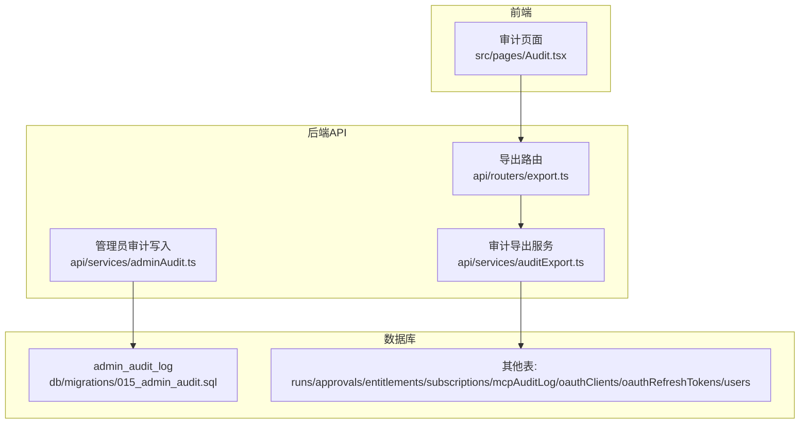
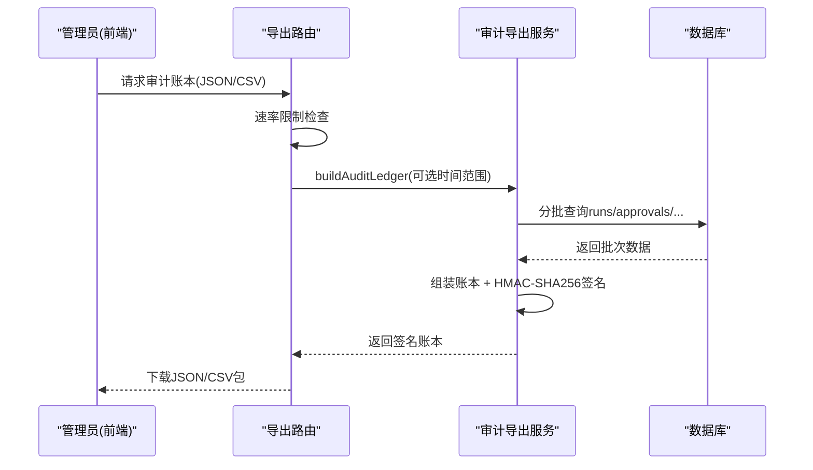
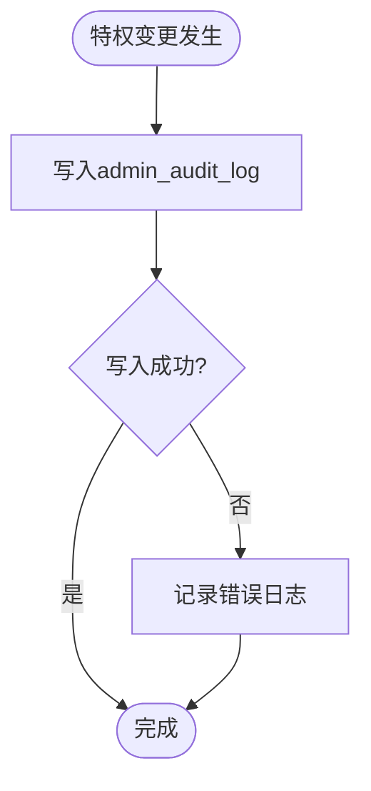
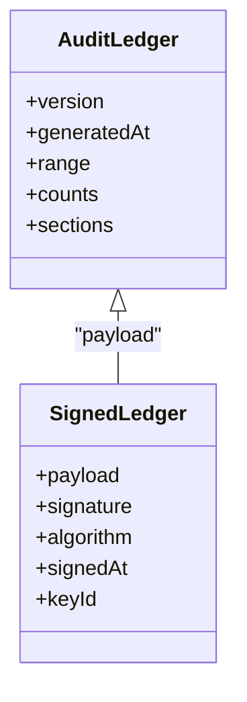
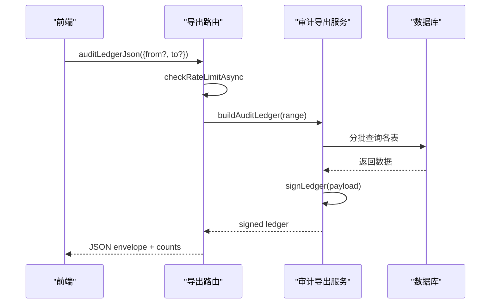
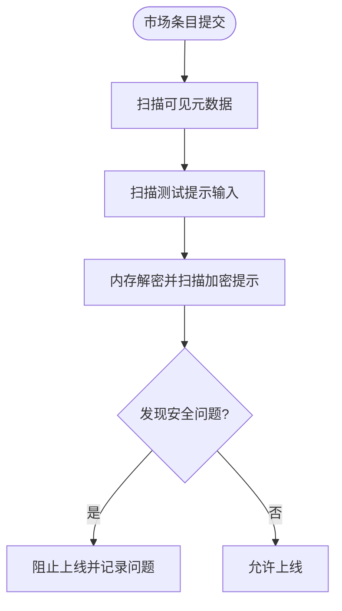
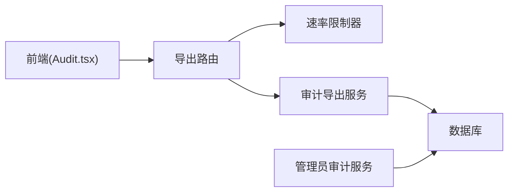

# 审计合规

<cite>
**本文引用的文件**
- [api/services/auditExport.ts](file://api/services/auditExport.ts)
- [api/routers/export.ts](file://api/routers/export.ts)
- [api/services/adminAudit.ts](file://api/services/adminAudit.ts)
- [db/migrations/015_admin_audit.sql](file://db/migrations/015_admin_audit.sql)
- [src/pages/Audit.tsx](file://src/pages/Audit.tsx)
- [src/locales/en/audit.json](file://src/locales/en/audit.json)
- [src/locales/zh/audit.json](file://src/locales/zh/audit.json)
- [api/services/promptSecurityScan.ts](file://api/services/promptSecurityScan.ts)
- [DeeWaanAI-Next/PHASE3-SPEC.md](file://DeeWaanAI-Next/PHASE3-SPEC.md)
</cite>

## 目录
1. [简介](#简介)
2. [项目结构](#项目结构)
3. [核心组件](#核心组件)
4. [架构总览](#架构总览)
5. [详细组件分析](#详细组件分析)
6. [依赖关系分析](#依赖关系分析)
7. [性能考量](#性能考量)
8. [故障排查指南](#故障排查指南)
9. [结论](#结论)
10. [附录](#附录)

## 简介
本技术文档聚焦“审计合规”能力，覆盖管理员操作审计日志、合规数据导出与安全扫描三大模块。目标是为系统提供可追溯、可验证、可审计的数据与流程，满足企业级合规审查（含GDPR相关的数据最小化、访问控制审计）要求，并提供异常检测与合规检查工具支撑。

## 项目结构
审计合规功能由以下关键部分组成：
- 管理员操作审计日志：持久化记录特权变更，支持按时间与管理员维度查询。
- 合规数据导出：生成带数字签名的审计账本（JSON/CSV），涵盖运行记录、审批决策、授权/订阅、MCP审计日志、OAuth元数据等。
- 安全扫描：对公开市场条目进行确定性文本安全检查，防止注入、泄露、敏感信息外泄等风险。

**图表来源**
- [src/pages/Audit.tsx:322-423](file://src/pages/Audit.tsx#L322-L423)
- [api/routers/export.ts:360-404](file://api/routers/export.ts#L360-L404)
- [api/services/auditExport.ts:214-485](file://api/services/auditExport.ts#L214-L485)
- [api/services/adminAudit.ts:24-40](file://api/services/adminAudit.ts#L24-L40)
- [db/migrations/015_admin_audit.sql:1-15](file://db/migrations/015_admin_audit.sql#L1-L15)

**章节来源**
- [src/pages/Audit.tsx:322-423](file://src/pages/Audit.tsx#L322-L423)
- [api/routers/export.ts:360-404](file://api/routers/export.ts#L360-L404)
- [api/services/auditExport.ts:214-485](file://api/services/auditExport.ts#L214-L485)
- [api/services/adminAudit.ts:24-40](file://api/services/adminAudit.ts#L24-L40)
- [db/migrations/015_admin_audit.sql:1-15](file://db/migrations/015_admin_audit.sql#L1-L15)

## 核心组件
- 管理员操作审计日志
  - 职责：记录所有特权变更（角色、层级、开关、SSO、反馈、认证相关操作），包含操作人、动作、目标类型/ID、上下文、IP、时间戳。
  - 设计要点：写失败不阻断主流程（fail-open），仅记录错误日志；字段不包含密钥或提示内容。
- 合规数据导出
  - 职责：构建跨多表的审计账本，限制批量大小，输出签名化的JSON与CSV包，供合规审查使用。
  - 设计要点：严格数据最小化（不导出提示/输出内容、token哈希、密钥）；分页分批读取；HMAC-SHA256签名与校验；速率限制。
- 安全扫描
  - 职责：对公开市场条目进行纯文本安全检查（Unicode清洗、注入短语、数据外泄、密钥/PII/支付卡等）。
  - 设计要点：内存中解密并扫描，明文不出域；失败关闭（无法扫描视为问题）；仅记录代码与字段标签，不记录内容。

**章节来源**
- [api/services/adminAudit.ts:1-41](file://api/services/adminAudit.ts#L1-L41)
- [api/services/auditExport.ts:1-658](file://api/services/auditExport.ts#L1-L658)
- [api/services/promptSecurityScan.ts:1-301](file://api/services/promptSecurityScan.ts#L1-L301)

## 架构总览
审计合规的整体调用链如下：
- 管理员在审计页面触发“合规导出”，前端调用tRPC导出接口。
- 后端路由进行速率限制与鉴权，调用审计导出服务构建账本并签名。
- 导出服务以批处理方式从多个表中收集元数据，生成JSON或CSV。
- 管理员操作通过管理员审计服务写入持久化日志表。

**图表来源**
- [src/pages/Audit.tsx:342-380](file://src/pages/Audit.tsx#L342-L380)
- [api/routers/export.ts:360-404](file://api/routers/export.ts#L360-L404)
- [api/services/auditExport.ts:214-485](file://api/services/auditExport.ts#L214-L485)

## 详细组件分析

### 管理员操作审计日志
- 数据结构
  - 表名：admin_audit_log
  - 关键字段：管理员用户ID、动作、目标类型、目标ID、详情(JSON)、IP、创建时间
  - 索引：按时间与管理员ID建立索引，便于查询与分析
- 写入策略
  - 每次特权变更调用写入函数，失败时记录错误但不影响主流程
  - 详情字段遵循数据最小化原则，避免存储敏感内容
- 查询与分析
  - 可按时间范围、管理员ID筛选，结合业务指标做异常检测（如频繁权限提升）

**图表来源**
- [api/services/adminAudit.ts:24-40](file://api/services/adminAudit.ts#L24-L40)
- [db/migrations/015_admin_audit.sql:1-15](file://db/migrations/015_admin_audit.sql#L1-L15)

**章节来源**
- [api/services/adminAudit.ts:1-41](file://api/services/adminAudit.ts#L1-L41)
- [db/migrations/015_admin_audit.sql:1-15](file://db/migrations/015_admin_audit.sql#L1-L15)

### 合规数据导出（签名审计账本）
- 数据范围
  - 运行记录（不含提示/输出内容）、审批决策、授权授予/过期、订阅信息、MCP审计日志、OAuth客户端注册、刷新令牌元数据、用户基本信息
- 数据最小化
  - 明确不导出提示/输出内容、token哈希、密钥；错误仅保留是否存在标志
  - 订阅信息仅保留是否关联Stripe的布尔标记，不导出原始Stripe ID
- 分批与性能
  - 统一使用固定批次大小（<=1000行）+ LIMIT/OFFSET分页，避免全表扫描
  - 支持可选的时间范围过滤，减少不必要数据
- 签名与校验
  - 使用HMAC-SHA256对规范化的JSON载荷签名，支持历史密钥兼容
  - 提供签名校验函数，确保账本完整性与不可篡改
- CSV渲染
  - 每节独立CSV，头部列顺序稳定，支持RFC-4180风格转义
- 速率限制
  - 导出接口受速率限制保护，防止滥用

**图表来源**
- [api/services/auditExport.ts:148-171](file://api/services/auditExport.ts#L148-L171)

**图表来源**
- [api/routers/export.ts:360-377](file://api/routers/export.ts#L360-L377)
- [api/services/auditExport.ts:214-485](file://api/services/auditExport.ts#L214-L485)

**章节来源**
- [api/services/auditExport.ts:1-658](file://api/services/auditExport.ts#L1-L658)
- [api/routers/export.ts:360-404](file://api/routers/export.ts#L360-L404)
- [src/pages/Audit.tsx:322-423](file://src/pages/Audit.tsx#L322-L423)

### 安全扫描（市场条目）
- 检查项
  - Unicode清洗：零宽字符、BIDI覆盖、控制字符、混合脚本（同形异义字）
  - 注入短语：忽略先前指令、角色覆盖、系统提示提取等
  - 数据外泄：发送/上传到URL、邮件外发、命令式动词+URL组合
  - 敏感信息：API密钥、Base64大Blob、邮箱集合、支付卡号（Luhn校验）
- 处理流程
  - 可见元数据、测试提示输入、加密提示（内存解密后扫描）均被检查
  - 失败关闭：任何无法扫描的情况视为问题
  - 日志仅记录代码与字段标签，不记录内容
- 集成点
  - 在市场条目上线前执行扫描，结果由调用方决定状态变更与持久化

**图表来源**
- [api/services/promptSecurityScan.ts:226-300](file://api/services/promptSecurityScan.ts#L226-L300)

**章节来源**
- [api/services/promptSecurityScan.ts:1-301](file://api/services/promptSecurityScan.ts#L1-L301)

## 依赖关系分析
- 前端依赖
  - 审计页面通过tRPC调用导出接口，展示运行列表、响应链、质量指标，并提供合规导出按钮（仅管理员可见）
- 后端依赖
  - 导出路由依赖速率限制器、日志器、审计导出服务
  - 审计导出服务依赖数据库连接与各表定义（运行、审批、授权、订阅、MCP审计、OAuth、用户）
  - 管理员审计服务依赖数据库连接与日志器
- 外部依赖
  - 加密库用于HMAC-SHA256签名与校验
  - 数据库驱动用于批查询与索引优化

**图表来源**
- [src/pages/Audit.tsx:322-423](file://src/pages/Audit.tsx#L322-L423)
- [api/routers/export.ts:360-404](file://api/routers/export.ts#L360-L404)
- [api/services/auditExport.ts:214-485](file://api/services/auditExport.ts#L214-L485)
- [api/services/adminAudit.ts:24-40](file://api/services/adminAudit.ts#L24-L40)

**章节来源**
- [src/pages/Audit.tsx:322-423](file://src/pages/Audit.tsx#L322-L423)
- [api/routers/export.ts:360-404](file://api/routers/export.ts#L360-L404)
- [api/services/auditExport.ts:214-485](file://api/services/auditExport.ts#L214-L485)
- [api/services/adminAudit.ts:24-40](file://api/services/adminAudit.ts#L24-L40)

## 性能考量
- 分批查询
  - 所有导出查询采用固定批次大小（<=1000行）+ LIMIT/OFFSET，避免一次性加载全表
- 时间范围过滤
  - 支持可选的from/to参数，减少不必要的数据扫描
- 速率限制
  - 导出接口受速率限制保护，防止高频导出导致资源耗尽
- 索引优化
  - admin_audit_log按created_at与admin_user_id建索引，提升查询效率
- 内存管理
  - 安全扫描中对解密后的明文及时释放引用，避免长时间驻留内存

[本节为通用指导，无需特定文件来源]

## 故障排查指南
- 导出失败
  - 检查速率限制是否超限（TOO_MANY_REQUESTS）
  - 确认数据库连接正常，分批查询未超时
  - 查看日志中的审计导出记录（JSON/CSV）
- 签名校验失败
  - 确认使用的密钥与导出时的keyId匹配（app-secret或audit-export-key）
  - 使用提供的校验函数进行一致性验证
- 管理员审计写入失败
  - 检查数据库写入权限与连接
  - 关注错误日志，确认不影响主流程
- 安全扫描问题
  - 查看扫描结果中的问题代码与字段标签
  - 确认加密提示解密成功，若失败则视为问题

**章节来源**
- [api/routers/export.ts:360-404](file://api/routers/export.ts#L360-L404)
- [api/services/auditExport.ts:543-569](file://api/services/auditExport.ts#L543-L569)
- [api/services/adminAudit.ts:24-40](file://api/services/adminAudit.ts#L24-L40)
- [api/services/promptSecurityScan.ts:226-300](file://api/services/promptSecurityScan.ts#L226-L300)

## 结论
本审计合规方案通过持久化管理员操作日志、签名化合规数据导出与确定性安全扫描，构建了完整的企业级审计闭环。其设计强调数据最小化、防篡改、可验证与高性能，满足GDPR与企业合规审查需求。建议在生产环境中启用专用审计导出密钥以实现密钥轮换而不影响历史账本校验，并结合监控与告警机制持续优化。

[本节为总结性内容，无需特定文件来源]

## 附录
- 国际化文案
  - 英文与中文文案已提供，涵盖审计标题、标签页、合规导出说明与按钮文案
- 规格参考
  - Phase 3 规格明确了签名导出、CSV渲染、速率限制与前端交互契约

**章节来源**
- [src/locales/en/audit.json:1-47](file://src/locales/en/audit.json#L1-L47)
- [src/locales/zh/audit.json:1-47](file://src/locales/zh/audit.json#L1-L47)
- [DeeWaanAI-Next/PHASE3-SPEC.md:52-66](file://DeeWaanAI-Next/PHASE3-SPEC.md#L52-L66)