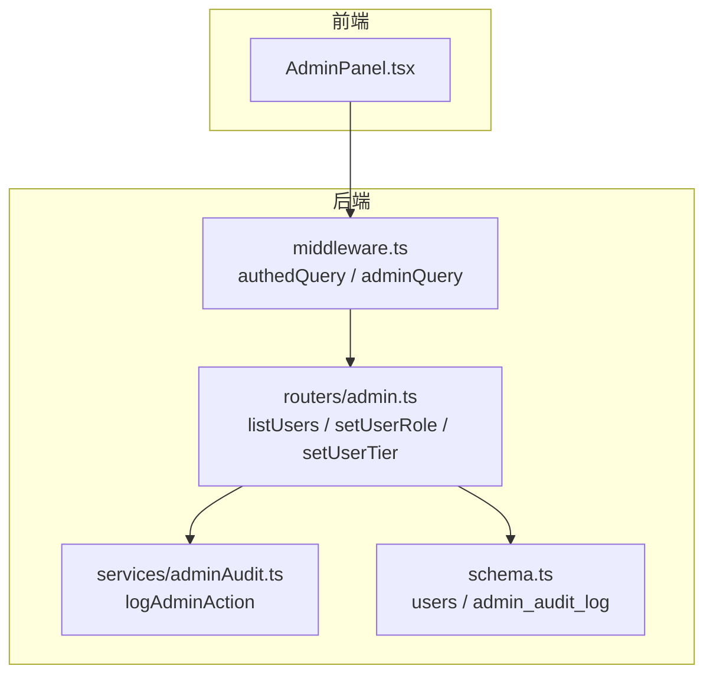
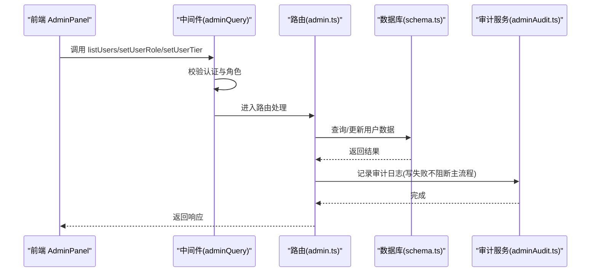
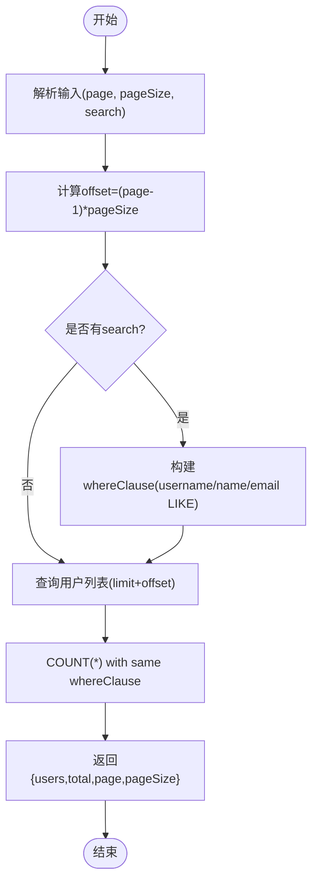
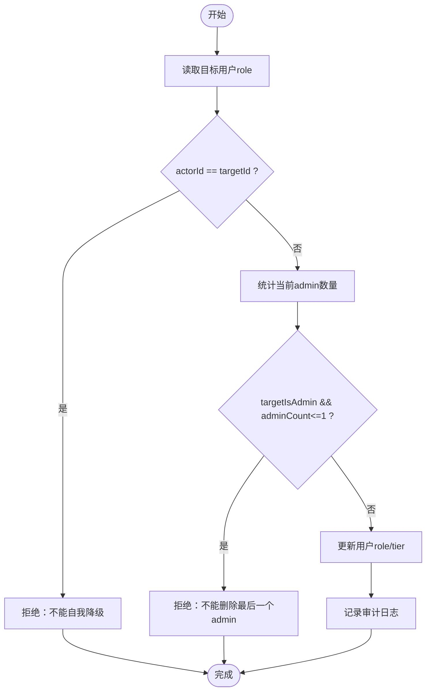
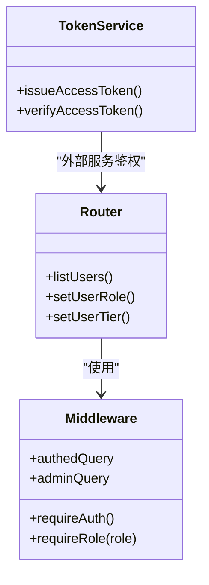
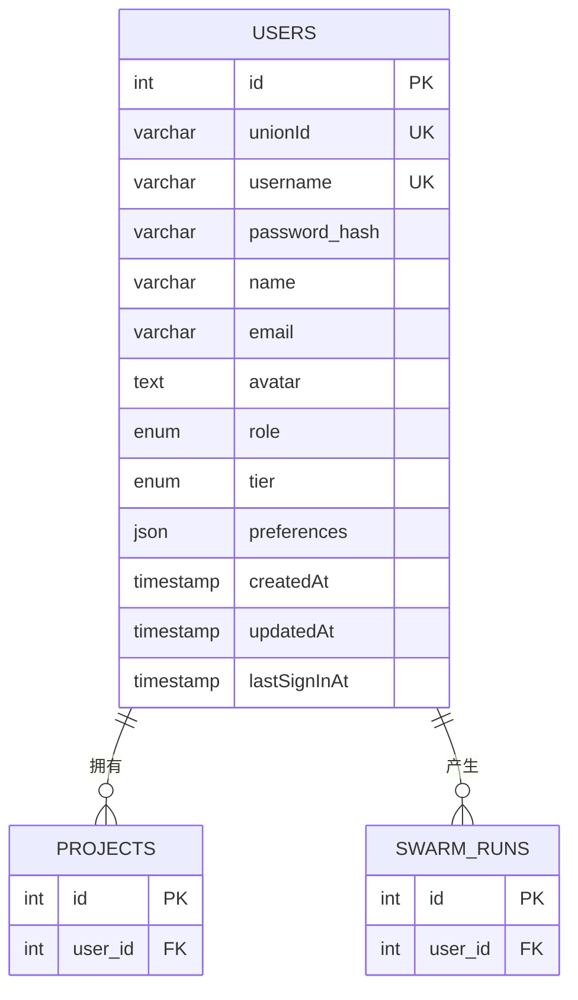
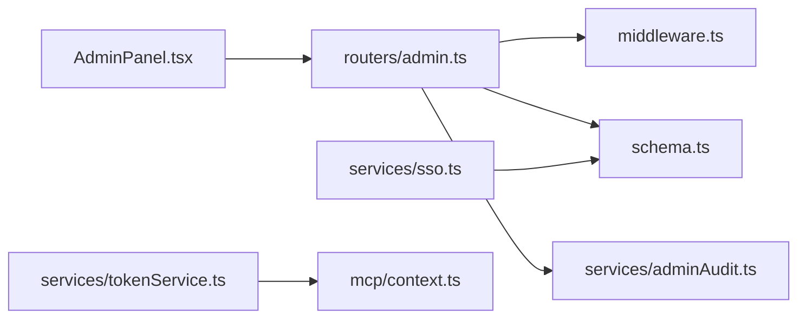

# 用户管理

<cite>
**本文引用的文件**
- [api/routers/admin.ts](file://api/routers/admin.ts)
- [api/middleware.ts](file://api/middleware.ts)
- [api/lib/adminGuards.ts](file://api/lib/adminGuards.ts)
- [db/schema.ts](file://db/schema.ts)
- [src/pages/AdminPanel.tsx](file://src/pages/AdminPanel.tsx)
- [api/services/adminAudit.ts](file://api/services/adminAudit.ts)
- [db/migrations/015_admin_audit.sql](file://db/migrations/015_admin_audit.sql)
- [api/services/sso.ts](file://api/services/sso.ts)
- [api/services/tokenService.ts](file://api/services/tokenService.ts)
- [api/mcp/context.ts](file://api/mcp/context.ts)
- [scripts/smoke-admin-batch.mjs](file://scripts/smoke-admin-batch.mjs)
</cite>

## 目录
1. [简介](#简介)
2. [项目结构](#项目结构)
3. [核心组件](#核心组件)
4. [架构总览](#架构总览)
5. [详细组件分析](#详细组件分析)
6. [依赖关系分析](#依赖关系分析)
7. [性能考虑](#性能考虑)
8. [故障排查指南](#故障排查指南)
9. [结论](#结论)
10. [附录](#附录)

## 简介
本技术文档聚焦“用户管理”功能，覆盖用户列表查询、角色与层级（tier）管理、搜索过滤、分页、批量操作、状态管理、权限控制、管理员鉴权、数据模型与字段定义、API调用示例、错误处理与安全考量，以及用户生命周期管理与数据导出能力。该功能由后端 tRPC 路由提供，前端 AdminPanel 提供可视化操作界面，数据库通过 Drizzle ORM 建模，并通过审计日志记录所有敏感变更。

## 项目结构
用户管理相关代码主要分布在以下位置：
- 后端 API：admin 路由负责用户列表、角色/层级设置、反馈管理、系统统计、特性开关、SSO 连接、认证队列、等待名单等；中间件负责认证与角色校验。
- 数据模型：users 表定义用户基础信息与权限、层级、登录时间等。
- 前端界面：AdminPanel 提供用户管理 UI，支持搜索、分页、角色/层级切换。
- 安全与审计：管理员操作均写入持久化审计表，并提供审计日志查询接口。
- SSO 与令牌：SSO 自动创建或匹配用户并更新最后登录时间；访问令牌用于 MCP 等外部服务鉴权。

图表来源
- [api/routers/admin.ts:16-98](file://api/routers/admin.ts#L16-L98)
- [api/middleware.ts:17-51](file://api/middleware.ts#L17-L51)
- [db/schema.ts:17-53](file://db/schema.ts#L17-L53)
- [api/services/adminAudit.ts:24-40](file://api/services/adminAudit.ts#L24-L40)

章节来源
- [api/routers/admin.ts:16-98](file://api/routers/admin.ts#L16-L98)
- [api/middleware.ts:17-51](file://api/middleware.ts#L17-L51)
- [db/schema.ts:17-53](file://db/schema.ts#L17-L53)
- [api/services/adminAudit.ts:24-40](file://api/services/adminAudit.ts#L24-L40)

## 核心组件
- 用户列表查询：支持分页、搜索（用户名/姓名/邮箱），返回用户基本信息、角色、层级、创建时间、最后登录时间，以及关联的项目数与运行次数。
- 角色与层级管理：管理员可修改用户角色（user/admin）与层级（standard/pro_designer/pro_auto），包含防自贬与防删最后一个管理员的保护逻辑。
- 权限控制：所有用户管理接口受 adminQuery 保护，仅角色为 admin 的用户可调用。
- 审计追踪：每次敏感操作都会写入审计日志，支持分页查询。
- SSO 集成：通过邮箱匹配或自动创建用户，更新最后登录时间，确保统一身份接入。
- 数据导出：提供合规审计导出能力（JSON 签名信封），便于企业审计与合规。

章节来源
- [api/routers/admin.ts:18-98](file://api/routers/admin.ts#L18-L98)
- [api/middleware.ts:45-51](file://api/middleware.ts#L45-L51)
- [api/lib/adminGuards.ts:17-28](file://api/lib/adminGuards.ts#L17-L28)
- [api/services/adminAudit.ts:24-40](file://api/services/adminAudit.ts#L24-L40)
- [api/services/sso.ts:303-325](file://api/services/sso.ts#L303-L325)
- [api/routers/export.ts:360-377](file://api/routers/export.ts#L360-L377)

## 架构总览
用户管理的请求流程如下：
- 前端 AdminPanel 发起 tRPC 调用（如 listUsers、setUserRole、setUserTier）。
- 中间件验证用户是否已认证且具备 admin 角色。
- 路由执行具体业务逻辑（查询/更新），必要时调用审计服务记录操作。
- 数据库通过 Drizzle ORM 读写 users 及相关表。
- 返回结果给前端进行展示或交互。

图表来源
- [api/middleware.ts:17-51](file://api/middleware.ts#L17-L51)
- [api/routers/admin.ts:18-98](file://api/routers/admin.ts#L18-L98)
- [api/services/adminAudit.ts:24-40](file://api/services/adminAudit.ts#L24-L40)
- [db/schema.ts:17-53](file://db/schema.ts#L17-L53)

## 详细组件分析

### 用户列表查询（分页与搜索）
- 输入参数：page（默认1）、pageSize（默认20，最大100）、search（可选，模糊匹配用户名/姓名/邮箱）。
- 行为：计算 offset，构建 whereClause，查询用户信息并附带 projectCount 与 runCount 子查询；同时计算 total。
- 输出：users 数组、total、page、pageSize。
- 前端：AdminPanel 渲染表格，支持分页控件与搜索框。

图表来源
- [api/routers/admin.ts:18-55](file://api/routers/admin.ts#L18-L55)
- [src/pages/AdminPanel.tsx:662-721](file://src/pages/AdminPanel.tsx#L662-L721)

章节来源
- [api/routers/admin.ts:18-55](file://api/routers/admin.ts#L18-L55)
- [src/pages/AdminPanel.tsx:662-721](file://src/pages/AdminPanel.tsx#L662-L721)

### 角色与层级管理（含防自贬与防删最后一个管理员）
- 角色设置：setUserRole 接收 userId 与 role（user/admin）。
- 防护逻辑：禁止自我降级；若目标当前为 admin，且系统中仅剩一个 admin，则拒绝降级。
- 层级设置：setUserTier 接收 userId 与 tier（standard/pro_designer/pro_auto）。
- 审计：每次角色/层级变更都记录审计日志。

图表来源
- [api/routers/admin.ts:57-98](file://api/routers/admin.ts#L57-L98)
- [api/lib/adminGuards.ts:17-28](file://api/lib/adminGuards.ts#L17-L28)

章节来源
- [api/routers/admin.ts:57-98](file://api/routers/admin.ts#L57-L98)
- [api/lib/adminGuards.ts:17-28](file://api/lib/adminGuards.ts#L17-L28)

### 权限控制机制与管理员鉴权
- 中间件：requireAuth 确保 ctx.user 存在且 id 有效；requireRole("admin") 限制仅 admin 可访问。
- 使用方式：adminQuery = authedQuery.use(requireRole("admin"))，所有用户管理接口均使用该过程。
- 外部服务鉴权：MCP 通过 Bearer token 校验，tokenService 签发与验证 JWT。

图表来源
- [api/middleware.ts:17-51](file://api/middleware.ts#L17-L51)
- [api/services/tokenService.ts:28-70](file://api/services/tokenService.ts#L28-L70)
- [api/mcp/context.ts:17-41](file://api/mcp/context.ts#L17-L41)

章节来源
- [api/middleware.ts:17-51](file://api/middleware.ts#L17-L51)
- [api/services/tokenService.ts:28-70](file://api/services/tokenService.ts#L28-L70)
- [api/mcp/context.ts:17-41](file://api/mcp/context.ts#L17-L41)

### 用户数据模型与字段定义
- 用户表（users）关键字段：id、unionId、username、passwordHash、name、email、avatar、role、tier、defaultProviderId、defaultModel、preferences、createdAt、updatedAt、lastSignInAt。
- 索引与约束：unionId、username 唯一；role 与 tier 为枚举类型。
- 关联：projects、swarmRuns 通过 user_id 关联，用于统计项目数与运行次数。

图表来源
- [db/schema.ts:17-53](file://db/schema.ts#L17-L53)
- [db/schema.ts:84-150](file://db/schema.ts#L84-L150)
- [db/schema.ts:173-237](file://db/schema.ts#L173-L237)

章节来源
- [db/schema.ts:17-53](file://db/schema.ts#L17-L53)
- [db/schema.ts:84-150](file://db/schema.ts#L84-L150)
- [db/schema.ts:173-237](file://db/schema.ts#L173-L237)

### 用户生命周期管理（SSO 激活/最后登录）
- SSO 登录时，根据邮箱匹配现有用户或自动创建新用户（角色为 user，用户名安全生成，密码哈希为空，避免本地密码登录）。
- 每次 SSO 登录会更新 lastSignInAt，反映最近活跃时间。
- 前端 AdminPanel 显示 lastSignInAt，便于管理员观察活跃度。

章节来源
- [api/services/sso.ts:303-325](file://api/services/sso.ts#L303-L325)
- [src/pages/AdminPanel.tsx:662-721](file://src/pages/AdminPanel.tsx#L662-L721)

### 数据导出与审计
- 审计日志：admin_audit_log 表记录管理员的敏感操作（角色/层级/特性开关/SSO/反馈/认证队列等），包含操作者、动作、目标类型/ID、详情、IP、时间戳。
- 导出接口：auditLedgerJson 提供带 HMAC-SHA256 签名的 JSON 审计账本，支持按时间范围筛选，适用于企业合规。
- 前端：AdminPanel 提供审计日志分页查看。

章节来源
- [db/migrations/015_admin_audit.sql:1-14](file://db/migrations/015_admin_audit.sql#L1-L14)
- [api/routers/admin.ts:241-267](file://api/routers/admin.ts#L241-L267)
- [api/routers/export.ts:360-377](file://api/routers/export.ts#L360-L377)
- [api/services/adminAudit.ts:24-40](file://api/services/adminAudit.ts#L24-L40)

### API 调用示例与错误处理
- 列出用户：调用 admin.listUsers，传入 page、pageSize、search；返回 users、total、page、pageSize。
- 设置角色：调用 admin.setUserRole，传入 userId、role；若触发防护逻辑将返回错误消息（如“不能自我降级”、“不能删除最后一个管理员”）。
- 设置层级：调用 admin.setUserTier，传入 userId、tier。
- 错误处理：未认证返回 UNAUTHORIZED；无权限返回 FORBIDDEN；业务规则违反返回具体错误消息；审计写入失败不阻断主流程但记录错误日志。

章节来源
- [api/routers/admin.ts:18-98](file://api/routers/admin.ts#L18-L98)
- [api/middleware.ts:17-51](file://api/middleware.ts#L17-L51)
- [api/lib/adminGuards.ts:17-28](file://api/lib/adminGuards.ts#L17-L28)
- [api/services/adminAudit.ts:24-40](file://api/services/adminAudit.ts#L24-L40)

### 安全考虑
- 鉴权：所有用户管理接口需 admin 角色；中间件严格校验。
- 防锁死：禁止自我降级与删除最后一个管理员，防止部署后无法访问后台。
- 审计：所有敏感操作持久化记录，便于追溯与合规。
- 令牌：外部服务（如 MCP）使用 JWT 访问令牌，支持签发与验证。
- 隐私：审计详情不包含密钥、提示词等敏感内容；SSO 客户端密钥在列表响应中掩码。

章节来源
- [api/middleware.ts:17-51](file://api/middleware.ts#L17-L51)
- [api/lib/adminGuards.ts:17-28](file://api/lib/adminGuards.ts#L17-L28)
- [api/services/adminAudit.ts:24-40](file://api/services/adminAudit.ts#L24-L40)
- [api/services/tokenService.ts:28-70](file://api/services/tokenService.ts#L28-L70)
- [api/routers/admin.ts:273-358](file://api/routers/admin.ts#L273-L358)

## 依赖关系分析
- 路由依赖中间件进行认证与角色校验。
- 路由依赖数据库 schema 进行数据读写。
- 路由依赖审计服务记录操作。
- 前端依赖 tRPC 客户端调用后端接口。
- SSO 服务与用户表联动，更新最后登录时间。
- 令牌服务为外部服务提供鉴权能力。

图表来源
- [src/pages/AdminPanel.tsx:1-200](file://src/pages/AdminPanel.tsx#L1-L200)
- [api/routers/admin.ts:16-98](file://api/routers/admin.ts#L16-L98)
- [api/middleware.ts:17-51](file://api/middleware.ts#L17-L51)
- [db/schema.ts:17-53](file://db/schema.ts#L17-L53)
- [api/services/adminAudit.ts:24-40](file://api/services/adminAudit.ts#L24-L40)
- [api/services/sso.ts:303-325](file://api/services/sso.ts#L303-L325)
- [api/services/tokenService.ts:28-70](file://api/services/tokenService.ts#L28-L70)
- [api/mcp/context.ts:17-41](file://api/mcp/context.ts#L17-L41)

章节来源
- [api/routers/admin.ts:16-98](file://api/routers/admin.ts#L16-L98)
- [api/middleware.ts:17-51](file://api/middleware.ts#L17-L51)
- [db/schema.ts:17-53](file://db/schema.ts#L17-L53)
- [api/services/adminAudit.ts:24-40](file://api/services/adminAudit.ts#L24-L40)
- [api/services/sso.ts:303-325](file://api/services/sso.ts#L303-L325)
- [api/services/tokenService.ts:28-70](file://api/services/tokenService.ts#L28-L70)
- [api/mcp/context.ts:17-41](file://api/mcp/context.ts#L17-L41)

## 性能考虑
- 分页查询：通过 limit/offset 控制单次返回量，避免大结果集拖慢响应。
- 搜索优化：使用 LIKE 模糊匹配，建议在大数据量场景下对 username/name/email 建立合适索引。
- 子查询统计：projectCount 与 runCount 使用子查询，注意在高并发下的性能影响，可考虑物化视图或异步统计。
- 审计写入：采用 fail-open 设计，审计写入失败不影响主流程，但应监控错误日志。
- 导出限流：审计导出接口实施速率限制，防止滥用。

[本节为通用性能建议，不直接分析具体文件]

## 故障排查指南
- 未认证/无权限：检查中间件是否正确注入 ctx.user，确认用户角色是否为 admin。
- 搜索无结果：确认 search 参数是否正确，检查数据库中是否存在匹配的用户名/姓名/邮箱。
- 角色设置失败：检查是否触发防自贬或防删最后一个管理员的逻辑，查看错误消息。
- 审计日志缺失：检查审计写入是否成功，关注错误日志；审计写入失败不会阻断主流程。
- SSO 登录异常：确认邮箱匹配逻辑与 lastSignInAt 更新是否正常。

章节来源
- [api/middleware.ts:17-51](file://api/middleware.ts#L17-L51)
- [api/routers/admin.ts:18-98](file://api/routers/admin.ts#L18-L98)
- [api/lib/adminGuards.ts:17-28](file://api/lib/adminGuards.ts#L17-L28)
- [api/services/adminAudit.ts:24-40](file://api/services/adminAudit.ts#L24-L40)
- [api/services/sso.ts:303-325](file://api/services/sso.ts#L303-L325)

## 结论
用户管理功能通过清晰的中间件鉴权、健壮的路由逻辑、完善的数据模型与审计机制，提供了安全的用户列表查询、角色与层级管理、搜索过滤、分页、批量操作、状态管理、数据导出等能力。防自贬与防删最后一个管理员的保护逻辑确保了系统的可维护性。SSO 集成简化了用户生命周期管理，审计导出满足企业合规需求。整体架构模块化、职责清晰，便于扩展与维护。

[本节为总结性内容，不直接分析具体文件]

## 附录
- 端到端测试用例参考：smoke 脚本验证用户搜索、角色设置与防护逻辑。
- 前端界面：AdminPanel 提供用户管理 UI，支持搜索、分页、角色/层级切换。

章节来源
- [scripts/smoke-admin-batch.mjs:63-85](file://scripts/smoke-admin-batch.mjs#L63-L85)
- [src/pages/AdminPanel.tsx:662-721](file://src/pages/AdminPanel.tsx#L662-L721)