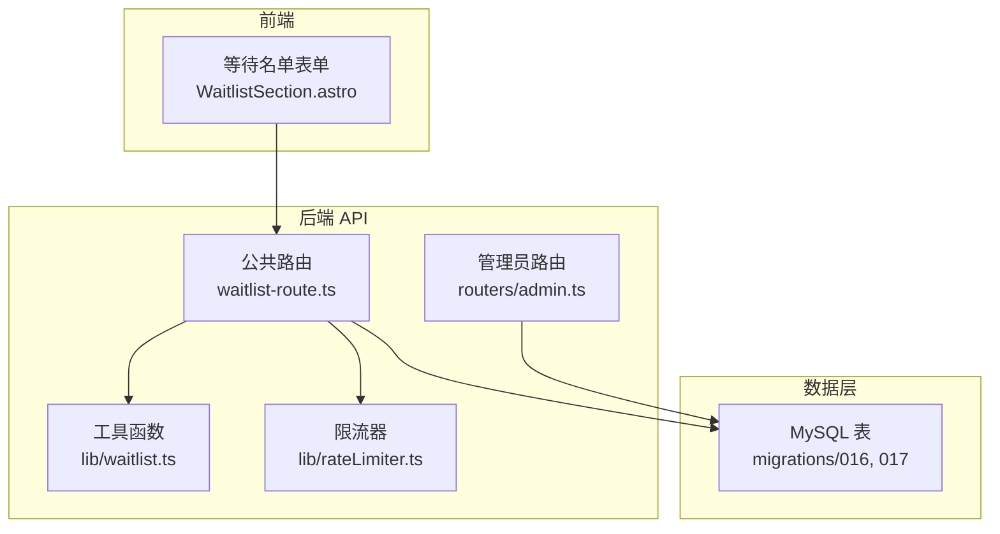
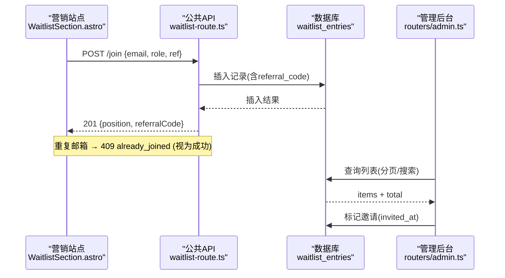
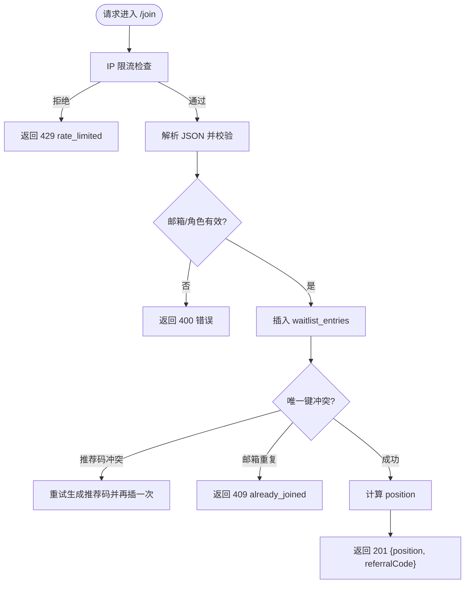
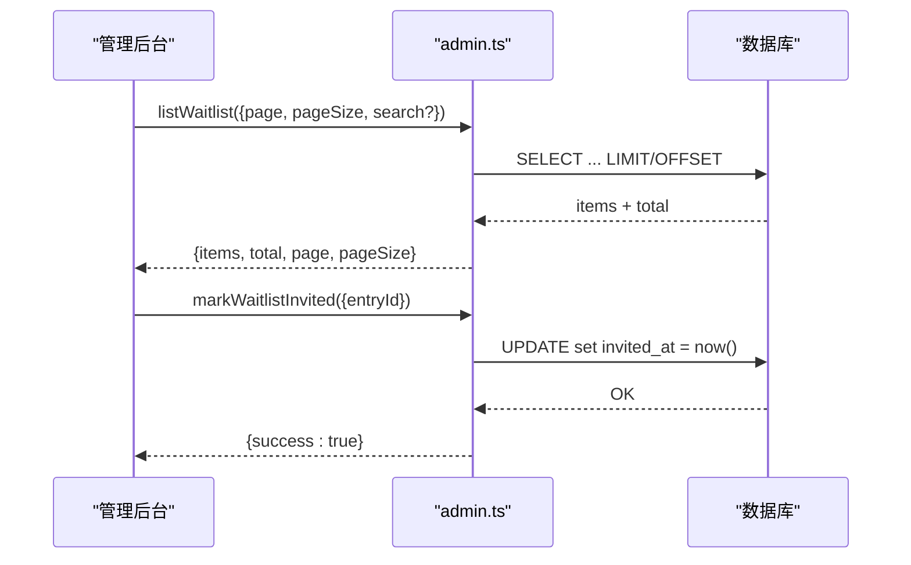
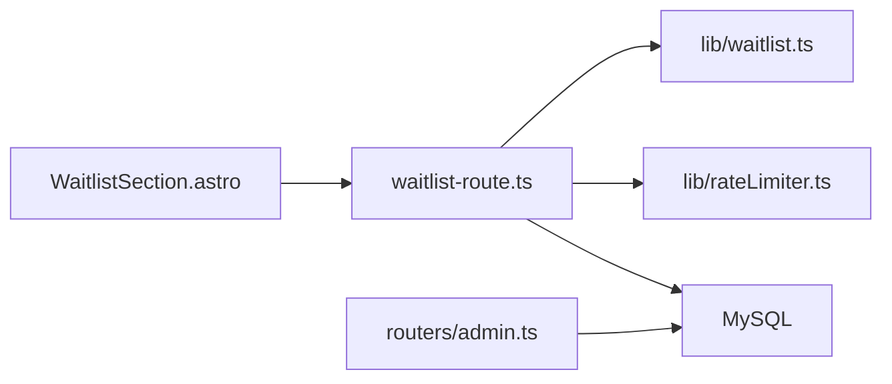

# 等待名单管理

<cite>
**本文引用的文件**
- [api/waitlist-route.ts](file://api/waitlist-route.ts)
- [api/lib/waitlist.ts](file://api/lib/waitlist.ts)
- [api/routers/admin.ts](file://api/routers/admin.ts)
- [db/migrations/016_waitlist.sql](file://db/migrations/016_waitlist.sql)
- [db/migrations/017_waitlist_invited_at.sql](file://db/migrations/017_waitlist_invited_at.sql)
- [site/src/components/landing/WaitlistSection.astro](file://site/src/components/landing/WaitlistSection.astro)
- [scripts/smoke-waitlist.mjs](file://scripts/smoke-waitlist.mjs)
- [site/scripts/smoke-waitlist-client.mjs](file://site/scripts/smoke-waitlist-client.mjs)
- [api/lib/rateLimiter.ts](file://api/lib/rateLimiter.ts)
- [DeeWaanAI-Next/WEBSITE-SPEC.md](file://DeeWaanAI-Next/WEBSITE-SPEC.md)
</cite>

## 目录
1. [简介](#简介)
2. [项目结构](#项目结构)
3. [核心组件](#核心组件)
4. [架构总览](#架构总览)
5. [详细组件分析](#详细组件分析)
6. [依赖关系分析](#依赖关系分析)
7. [性能考量](#性能考量)
8. [故障排查指南](#故障排查指南)
9. [结论](#结论)
10. [附录](#附录)

## 简介
本技术文档围绕“等待名单管理”功能，覆盖 Beta 测试用户管理、邀请流程与推荐系统；详细说明等待名单查询、搜索过滤、分页显示；记录邀请状态管理、推荐码追踪、邀请计数统计；并说明前端注册交互、邮箱校验与后续账户激活的衔接点。同时提供等待名单分析、转化率追踪与营销效果评估建议，以及大规模数据处理、性能优化与数据安全注意事项。

## 项目结构
等待名单能力由以下部分构成：
- 公开 API（站点侧调用）：加入等待名单、获取总数
- 管理后台接口：列表查询、搜索过滤、分页、标记已邀请
- 数据模型与迁移：等待名单表结构与索引
- 前端页面：表单收集、推荐码捕获、成功态展示
- 限流与安全：按 IP 限流、CORS、输入校验
- 端到端冒烟测试：验证前后端契约与行为

图表来源
- [api/waitlist-route.ts:1-129](file://api/waitlist-route.ts#L1-L129)
- [api/routers/admin.ts:480-558](file://api/routers/admin.ts#L480-L558)
- [api/lib/waitlist.ts:1-32](file://api/lib/waitlist.ts#L1-L32)
- [api/lib/rateLimiter.ts:1-216](file://api/lib/rateLimiter.ts#L1-L216)
- [db/migrations/016_waitlist.sql:1-12](file://db/migrations/016_waitlist.sql#L1-L12)
- [db/migrations/017_waitlist_invited_at.sql:1-5](file://db/migrations/017_waitlist_invited_at.sql#L1-L5)

章节来源
- [api/waitlist-route.ts:1-129](file://api/waitlist-route.ts#L1-L129)
- [api/routers/admin.ts:480-558](file://api/routers/admin.ts#L480-L558)
- [db/migrations/016_waitlist.sql:1-12](file://db/migrations/016_waitlist.sql#L1-L12)
- [db/migrations/017_waitlist_invited_at.sql:1-5](file://db/migrations/017_waitlist_invited_at.sql#L1-L5)
- [site/src/components/landing/WaitlistSection.astro:29-135](file://site/src/components/landing/WaitlistSection.astro#L29-L135)

## 核心组件
- 公共等待名单 API
  - POST /api/waitlist/join：接收 email、role、ref，返回 position 与 referralCode；重复邮箱返回 409 already_joined
  - GET /api/waitlist/count：返回 claimed 数量，带缓存头
- 管理后台接口
  - listWaitlist：分页、可选搜索（邮箱模糊匹配）、返回 position 与 referralCount，支持 referredBy 解析
  - markWaitlistInvited：将 entry 标记为已邀请（写入 invited_at），并记录审计日志
- 数据模型
  - waitlist_entries：email、role、ref、referral_code、created_at、invited_at；唯一约束保障去重与推荐码唯一性
- 工具与校验
  - 邮箱归一化与有效性检查、角色白名单、推荐码生成
- 限流与 CORS
  - 按 IP 限流（Redis 优先，内存回退），跨域允许站点访问

章节来源
- [api/waitlist-route.ts:16-129](file://api/waitlist-route.ts#L16-L129)
- [api/routers/admin.ts:480-558](file://api/routers/admin.ts#L480-L558)
- [api/lib/waitlist.ts:1-32](file://api/lib/waitlist.ts#L1-L32)
- [api/lib/rateLimiter.ts:1-216](file://api/lib/rateLimiter.ts#L1-L216)
- [db/migrations/016_waitlist.sql:1-12](file://db/migrations/016_waitlist.sql#L1-L12)
- [db/migrations/017_waitlist_invited_at.sql:1-5](file://db/migrations/017_waitlist_invited_at.sql#L1-L5)

## 架构总览
等待名单从站点表单发起，经公共 API 落库，管理后台进行运营操作；推荐码贯穿链路用于归因与统计。

图表来源
- [site/src/components/landing/WaitlistSection.astro:29-135](file://site/src/components/landing/WaitlistSection.astro#L29-L135)
- [api/waitlist-route.ts:56-129](file://api/waitlist-route.ts#L56-L129)
- [api/routers/admin.ts:480-558](file://api/routers/admin.ts#L480-L558)
- [db/migrations/016_waitlist.sql:1-12](file://db/migrations/016_waitlist.sql#L1-L12)

## 详细组件分析

### 公共等待名单 API（join/count）
- 加入等待名单
  - 输入校验：邮箱归一化与合法性、角色白名单、ref 长度限制
  - 防刷：按 IP 限流（固定窗口或令牌桶，Redis 优先）
  - 并发安全：推荐码唯一冲突时重试一次；重复邮箱返回 409
  - 位置计算：基于 id 的累计计数，保证 1-based 顺序
- 计数接口
  - 简单 COUNT(*)，设置短缓存以减轻热点读压力
- CORS
  - 允许营销站点跨域访问，可配置白名单

图表来源
- [api/waitlist-route.ts:56-129](file://api/waitlist-route.ts#L56-L129)
- [api/lib/waitlist.ts:1-32](file://api/lib/waitlist.ts#L1-L32)
- [api/lib/rateLimiter.ts:1-216](file://api/lib/rateLimiter.ts#L1-L216)

章节来源
- [api/waitlist-route.ts:56-129](file://api/waitlist-route.ts#L56-L129)
- [api/lib/waitlist.ts:1-32](file://api/lib/waitlist.ts#L1-L32)
- [api/lib/rateLimiter.ts:1-216](file://api/lib/rateLimiter.ts#L1-L216)

### 管理后台接口（列表与邀请标记）
- 列表查询
  - 分页：page/pageSize
  - 搜索：邮箱模糊匹配
  - 字段增强：position（插入序位）、referralCount（被推荐人数）、referredBy（推荐人邮箱解析）
- 邀请标记
  - 将 invitedAt 设置为当前时间，记录审计日志

图表来源
- [api/routers/admin.ts:480-558](file://api/routers/admin.ts#L480-L558)

章节来源
- [api/routers/admin.ts:480-558](file://api/routers/admin.ts#L480-L558)

### 数据模型与迁移
- 表结构
  - waitlist_entries：id、email、role、ref、referral_code、created_at、invited_at
  - 唯一约束：email、referral_code
  - 索引：invited_at 便于筛选已邀请
- 设计要点
  - 推荐码唯一且随机，避免枚举攻击
  - 邀请时间戳用于运营统计与漏斗分析

章节来源
- [db/migrations/016_waitlist.sql:1-12](file://db/migrations/016_waitlist.sql#L1-L12)
- [db/migrations/017_waitlist_invited_at.sql:1-5](file://db/migrations/017_waitlist_invited_at.sql#L1-L5)

### 前端交互与推荐链路
- 表单提交
  - 收集 email、role、ref（来自 URL ?ref= 与 localStorage）
  - 提交到 /api/waitlist/join，201 与 409 均视为成功
- 成功态
  - 展示 position、推荐链接、社交分享链接
- 容错
  - 计数接口失败不崩溃，降级显示

章节来源
- [site/src/components/landing/WaitlistSection.astro:29-135](file://site/src/components/landing/WaitlistSection.astro#L29-L135)
- [DeeWaanAI-Next/WEBSITE-SPEC.md:155-173](file://DeeWaanAI-Next/WEBSITE-SPEC.md#L155-L173)

### 端到端冒烟测试
- 服务端冒烟脚本
  - 验证 join 契约、重复处理、推荐归因、count 缓存、CORS
- 客户端冒烟脚本
  - 验证真实构建脚本在 mock 服务下的行为：计数缓存、推荐码持久化、成功/失败态、复制分享链接等

章节来源
- [scripts/smoke-waitlist.mjs:1-96](file://scripts/smoke-waitlist.mjs#L1-L96)
- [site/scripts/smoke-waitlist-client.mjs:1-217](file://site/scripts/smoke-waitlist-client.mjs#L1-L217)

## 依赖关系分析
- 模块耦合
  - waitlist-route 依赖 lib/waitlist（校验/生成）、rateLimiter（限流）、数据库连接与 schema
  - admin router 直接操作 waitlist_entries，并在邀请标记时记录审计日志
- 外部依赖
  - Redis（可选）：限流共享状态；缺失时回退到进程内内存实现
  - MySQL：持久化等待名单数据
- 潜在循环依赖
  - 无直接循环；各模块职责清晰

图表来源
- [api/waitlist-route.ts:16-129](file://api/waitlist-route.ts#L16-L129)
- [api/routers/admin.ts:480-558](file://api/routers/admin.ts#L480-L558)
- [api/lib/waitlist.ts:1-32](file://api/lib/waitlist.ts#L1-L32)
- [api/lib/rateLimiter.ts:1-216](file://api/lib/rateLimiter.ts#L1-L216)

章节来源
- [api/waitlist-route.ts:16-129](file://api/waitlist-route.ts#L16-L129)
- [api/routers/admin.ts:480-558](file://api/routers/admin.ts#L480-L558)
- [api/lib/waitlist.ts:1-32](file://api/lib/waitlist.ts#L1-L32)
- [api/lib/rateLimiter.ts:1-216](file://api/lib/rateLimiter.ts#L1-L216)

## 性能考量
- 写入路径
  - 推荐码唯一冲突重试一次，降低极端碰撞影响
  - 位置计算使用 COUNT 子查询，适合中小规模；超大规模时可考虑物化序位或自增序号
- 读取路径
  - count 接口设置短缓存（max-age=60），减少热点读
  - 列表查询使用 limit/offset 分页，配合邮箱索引提升搜索性能
- 限流
  - 优先 Redis 固定窗口计数，多实例共享；不可用时回退内存实现，确保可用性
- 扩展建议
  - 对高频查询增加二级缓存（如应用层缓存）
  - 对大表查询引入分区或归档策略
  - 对 position 计算采用增量维护或序列号表

[本节为通用性能建议，无需特定文件引用]

## 故障排查指南
- 常见问题
  - 429 rate_limited：同一 IP 短时间内多次尝试，稍后重试
  - 400 invalid_email/invalid_role：检查输入格式与角色白名单
  - 409 already_joined：邮箱已存在，视为成功，前端应展示原 position
  - 500 try_again：插入异常或推荐码冲突未恢复，需重试
- 定位方法
  - 查看服务端日志中的 Waitlist joined 与 Admin: waitlist entry marked invited
  - 使用冒烟脚本验证端到端契约
  - 检查数据库唯一约束是否触发（email/referral_code）

章节来源
- [api/waitlist-route.ts:56-129](file://api/waitlist-route.ts#L56-L129)
- [api/routers/admin.ts:535-558](file://api/routers/admin.ts#L535-L558)
- [scripts/smoke-waitlist.mjs:33-70](file://scripts/smoke-waitlist.mjs#L33-L70)

## 结论
等待名单功能提供了稳定的公开 API、完善的管理后台能力与健壮的前端交互。通过推荐码追踪、邀请状态管理与限流保护，满足 Beta 测试阶段的拉新与运营需求。建议在数据量增长时关注 position 计算与列表查询的性能优化，并持续完善埋点与分析以支撑转化与营销评估。

[本节为总结性内容，无需特定文件引用]

## 附录

### API 契约速览
- POST /api/waitlist/join
  - 入参：email、role（creator/user/both）、ref（可选）
  - 出参：201 {position, referralCode}；409 {error:"already_joined", position, referralCode}
- GET /api/waitlist/count
  - 出参：{claimed}，带缓存头

章节来源
- [DeeWaanAI-Next/WEBSITE-SPEC.md:155-173](file://DeeWaanAI-Next/WEBSITE-SPEC.md#L155-L173)
- [api/waitlist-route.ts:119-129](file://api/waitlist-route.ts#L119-L129)

### 数据模型概览
- 表：waitlist_entries
  - 字段：id、email、role、ref、referral_code、created_at、invited_at
  - 约束：email 唯一、referral_code 唯一
  - 索引：invited_at

章节来源
- [db/migrations/016_waitlist.sql:1-12](file://db/migrations/016_waitlist.sql#L1-L12)
- [db/migrations/017_waitlist_invited_at.sql:1-5](file://db/migrations/017_waitlist_invited_at.sql#L1-L5)

### 推荐系统与邀请状态
- 推荐码
  - 生成：随机、URL-safe、唯一
  - 追踪：ref 字段记录来源；referralCount 统计被推荐人数
- 邀请状态
  - invited_at 为空表示未邀请，非空表示已邀请；可用于运营筛选与统计

章节来源
- [api/lib/waitlist.ts:15-19](file://api/lib/waitlist.ts#L15-L19)
- [api/routers/admin.ts:494-503](file://api/routers/admin.ts#L494-L503)
- [db/migrations/017_waitlist_invited_at.sql:1-5](file://db/migrations/017_waitlist_invited_at.sql#L1-L5)

### 用户注册流程与邮箱验证、账户激活
- 邮箱验证
  - 服务端进行基础格式校验与归一化；不包含发送验证邮件逻辑
- 账户激活
  - 等待名单阶段仅记录意向与推荐归因；正式注册与激活流程不在本模块范围
- 建议
  - 可在后续阶段接入邮箱验证与激活链路，结合邀请状态进行转化漏斗分析

章节来源
- [api/lib/waitlist.ts:4-13](file://api/lib/waitlist.ts#L4-L13)
- [api/waitlist-route.ts:74-83](file://api/waitlist-route.ts#L74-L83)

### 等待名单分析与营销效果评估
- 指标建议
  - 新增人数、邀请转化率（邀请→注册）、推荐链深度、渠道来源占比
- 数据来源
  - 列表接口返回的 position、referralCount、referredBy
  - invited_at 用于区分已邀请人群
- 分析方法
  - 按 ref 聚合统计推荐效果
  - 对比不同渠道/活动期间的转化率与成本

章节来源
- [api/routers/admin.ts:494-532](file://api/routers/admin.ts#L494-L532)

### 大规模数据处理与数据安全
- 大规模数据
  - 列表分页+搜索；必要时对 email 建立索引
  - position 计算在高并发下可能成为瓶颈，可考虑序位表或物化视图
- 数据安全
  - 推荐码随机且唯一，防止枚举
  - 严格输入校验与限流，防止滥用
  - 敏感信息最小化暴露（仅必要字段）

章节来源
- [api/lib/rateLimiter.ts:1-216](file://api/lib/rateLimiter.ts#L1-L216)
- [api/waitlist-route.ts:56-129](file://api/waitlist-route.ts#L56-L129)
- [db/migrations/016_waitlist.sql:1-12](file://db/migrations/016_waitlist.sql#L1-L12)