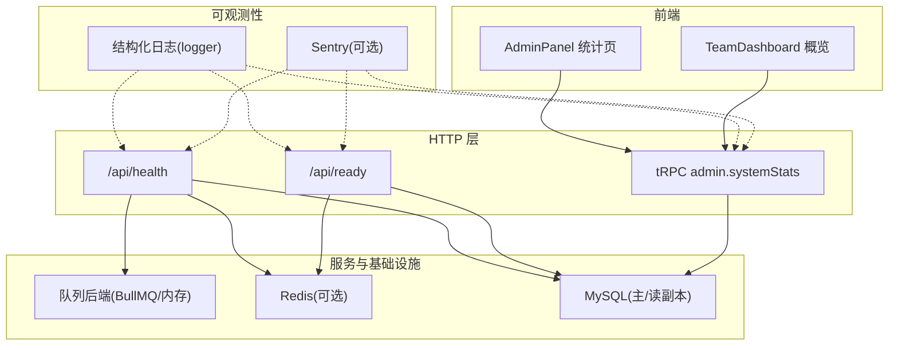
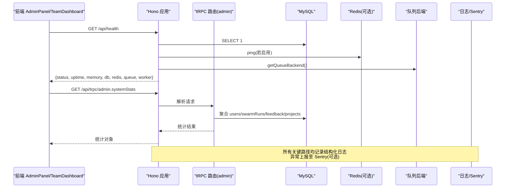
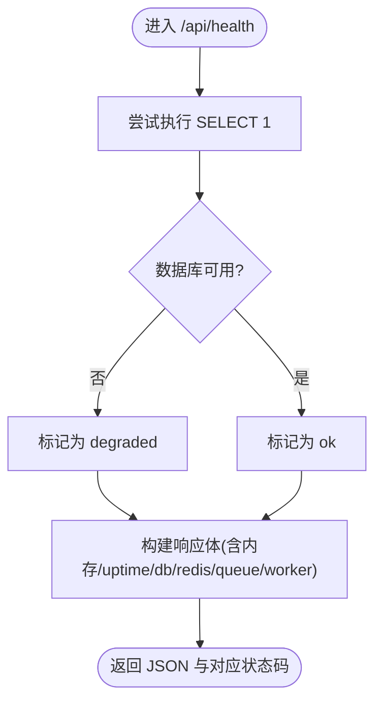
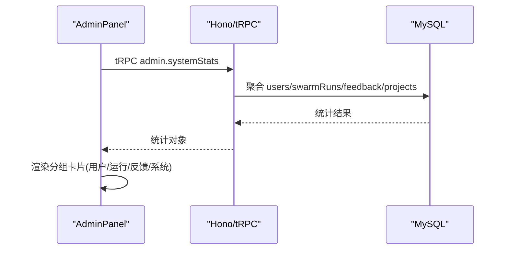
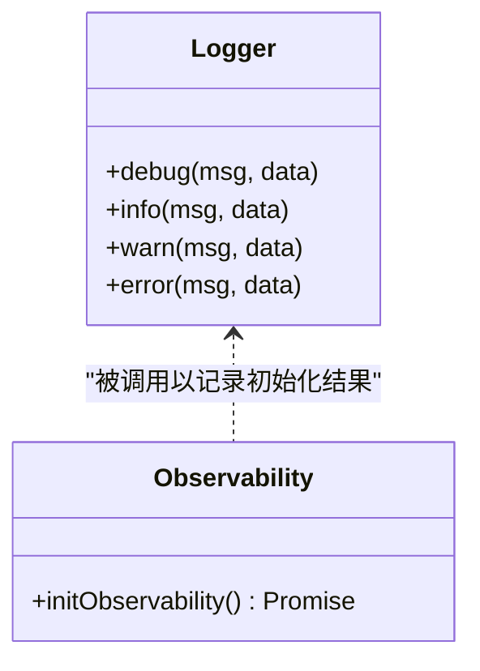
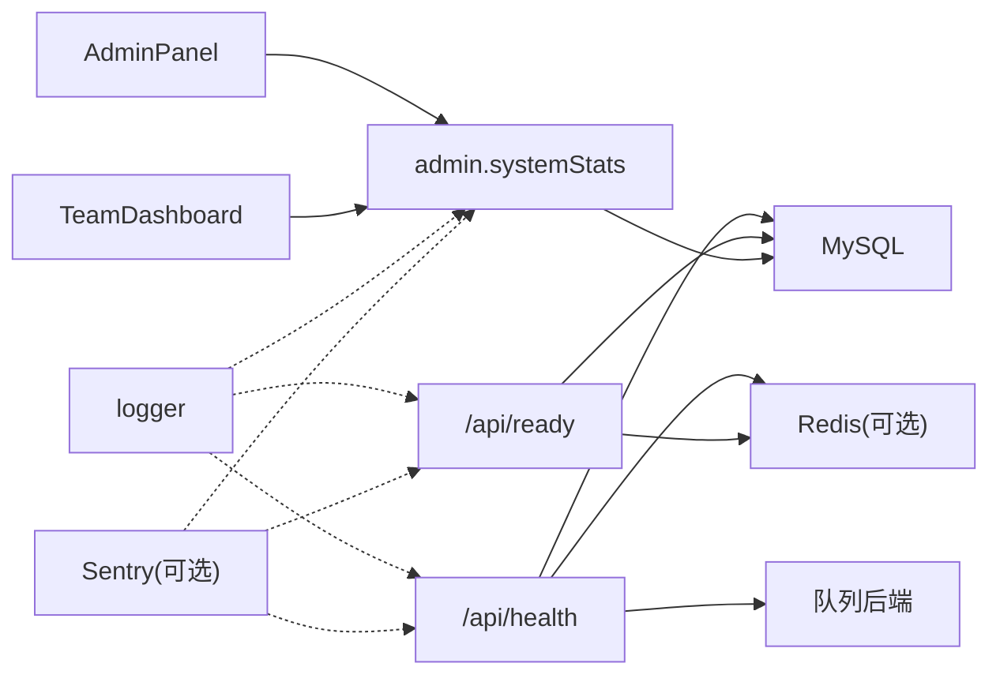

# 系统监控

<cite>
**本文引用的文件**
- [api/boot.ts](file://api/boot.ts)
- [api/lib/observability.ts](file://api/lib/observability.ts)
- [api/lib/logger.ts](file://api/lib/logger.ts)
- [api/routers/admin.ts](file://api/routers/admin.ts)
- [src/pages/AdminPanel.tsx](file://src/pages/AdminPanel.tsx)
- [src/pages/TeamDashboard.tsx](file://src/pages/TeamDashboard.tsx)
- [api/queries/connection.ts](file://api/queries/connection.ts)
- [api/infra/queue.ts](file://api/infra/queue.ts)
- [api/lib/providerThrottle.ts](file://api/lib/providerThrottle.ts)
</cite>

## 目录
1. [简介](#简介)
2. [项目结构](#项目结构)
3. [核心组件](#核心组件)
4. [架构总览](#架构总览)
5. [详细组件分析](#详细组件分析)
6. [依赖关系分析](#依赖关系分析)
7. [性能考量](#性能考量)
8. [故障诊断指南](#故障诊断指南)
9. [结论](#结论)
10. [附录](#附录)

## 简介
本技术文档聚焦于系统的监控能力，覆盖系统统计信息、性能指标与资源使用监控。重点包括：
- 用户活跃度统计、运行任务统计、反馈数据统计
- 内存使用监控、进程状态监控、系统健康检查
- 监控数据的收集方式、存储格式、查询接口
- 监控仪表板集成、告警配置建议、性能优化建议
- 容量规划、扩展性考虑与故障诊断方法

## 项目结构
后端通过 HTTP 暴露健康与就绪探针，提供系统级统计；前端在管理面板与团队面板中展示关键指标；日志与错误上报作为可观测性基础；队列与限流模块提供运行时指标。

图表来源
- [api/boot.ts:76-135](file://api/boot.ts#L76-L135)
- [api/routers/admin.ts:180-219](file://api/routers/admin.ts#L180-L219)
- [src/pages/AdminPanel.tsx:769-810](file://src/pages/AdminPanel.tsx#L769-L810)
- [src/pages/TeamDashboard.tsx:291-333](file://src/pages/TeamDashboard.tsx#L291-L333)
- [api/lib/logger.ts:1-32](file://api/lib/logger.ts#L1-L32)
- [api/lib/observability.ts:17-33](file://api/lib/observability.ts#L17-L33)

章节来源
- [api/boot.ts:76-135](file://api/boot.ts#L76-L135)
- [api/routers/admin.ts:180-219](file://api/routers/admin.ts#L180-L219)
- [src/pages/AdminPanel.tsx:769-810](file://src/pages/AdminPanel.tsx#L769-L810)
- [src/pages/TeamDashboard.tsx:291-333](file://src/pages/TeamDashboard.tsx#L291-L333)
- [api/lib/logger.ts:1-32](file://api/lib/logger.ts#L1-L32)
- [api/lib/observability.ts:17-33](file://api/lib/observability.ts#L17-L33)

## 核心组件
- 健康与就绪探针
  - /api/health：返回进程存活、数据库连通、Redis 状态、队列后端、Worker 状态、内存与运行时长。
  - /api/ready：仅当数据库可达且 Redis（如启用）可达时返回就绪。
- 系统统计接口
  - tRPC admin.systemStats：聚合用户、运行任务、反馈、项目数量以及进程内存与运行时长。
- 可观测性
  - 结构化日志：JSON 行输出，支持级别过滤。
  - Sentry 初始化：按环境变量动态加载，失败不阻塞启动。
- 运行时指标
  - 队列后端名称与健康（用于健康/就绪响应）。
  - 提供者限流指标（当前 RPM、窗口计数、慢启动标志），可用于外部监控或仪表盘。

章节来源
- [api/boot.ts:76-135](file://api/boot.ts#L76-L135)
- [api/routers/admin.ts:180-219](file://api/routers/admin.ts#L180-L219)
- [api/lib/logger.ts:1-32](file://api/lib/logger.ts#L1-L32)
- [api/lib/observability.ts:17-33](file://api/lib/observability.ts#L17-L33)
- [api/infra/queue.ts:267-270](file://api/infra/queue.ts#L267-L270)
- [api/lib/providerThrottle.ts:234-274](file://api/lib/providerThrottle.ts#L234-L274)

## 架构总览
下图展示了从前端到后端的监控数据流：前端调用 tRPC 获取统计，健康/就绪探针直接探测依赖；日志与错误上报贯穿各层。

图表来源
- [api/boot.ts:76-135](file://api/boot.ts#L76-L135)
- [api/routers/admin.ts:180-219](file://api/routers/admin.ts#L180-L219)
- [api/lib/logger.ts:1-32](file://api/lib/logger.ts#L1-L32)
- [api/lib/observability.ts:17-33](file://api/lib/observability.ts#L17-L33)

## 详细组件分析

### 健康与就绪探针
- 功能要点
  - /api/health：检测数据库连通、Redis 状态、队列后端、Worker 是否运行，并返回内存与运行时长。
  - /api/ready：要求数据库与 Redis（如启用）均可用，否则返回非 200。
- 监控用途
  - 负载均衡器/编排系统用作存活与就绪探针。
  - 结合日志与错误上报进行自动化告警。

图表来源
- [api/boot.ts:76-99](file://api/boot.ts#L76-L99)

章节来源
- [api/boot.ts:76-99](file://api/boot.ts#L76-L99)

### 系统统计接口（admin.systemStats）
- 数据维度
  - 用户：总数、近 7 天活跃数、按层级分布。
  - 运行任务：总数、完成数、失败数、累计 token 用量。
  - 反馈：总数、开放中数量、严重且未关闭数量。
  - 项目：总数。
  - 进程：运行时长、RSS/Heap 内存。
- 前端展示
  - AdminPanel 将统计分组展示（用户/运行/反馈/系统）。
  - TeamDashboard 展示反馈概览与类型分布。

图表来源
- [api/routers/admin.ts:180-219](file://api/routers/admin.ts#L180-L219)
- [src/pages/AdminPanel.tsx:769-810](file://src/pages/AdminPanel.tsx#L769-L810)
- [src/pages/TeamDashboard.tsx:291-333](file://src/pages/TeamDashboard.tsx#L291-L333)

章节来源
- [api/routers/admin.ts:180-219](file://api/routers/admin.ts#L180-L219)
- [src/pages/AdminPanel.tsx:769-810](file://src/pages/AdminPanel.tsx#L769-L810)
- [src/pages/TeamDashboard.tsx:291-333](file://src/pages/TeamDashboard.tsx#L291-L333)

### 日志与错误上报
- 结构化日志
  - 统一 JSON 行输出，包含时间戳、级别、消息与附加字段。
  - 可通过环境变量控制日志级别。
- 错误上报
  - Sentry 按需动态导入并初始化；未配置或初始化失败不影响服务启动。

图表来源
- [api/lib/logger.ts:1-32](file://api/lib/logger.ts#L1-L32)
- [api/lib/observability.ts:17-33](file://api/lib/observability.ts#L17-L33)

章节来源
- [api/lib/logger.ts:1-32](file://api/lib/logger.ts#L1-L32)
- [api/lib/observability.ts:17-33](file://api/lib/observability.ts#L17-L33)

### 队列与 Worker 状态
- 健康/就绪响应中包含队列后端名称与 Worker 状态，便于快速判断后台处理能力。
- 队列实现支持内存与 BullMQ 两种后端，并在失败时记录日志。

章节来源
- [api/boot.ts:76-135](file://api/boot.ts#L76-L135)
- [api/infra/queue.ts:235-270](file://api/infra/queue.ts#L235-L270)

### 提供者限流指标
- 提供当前 RPM、窗口计数、慢启动标志等指标，可用于外部监控系统采集与告警。
- 优先从 Redis 读取，回退到内存状态。

章节来源
- [api/lib/providerThrottle.ts:234-274](file://api/lib/providerThrottle.ts#L234-L274)

## 依赖关系分析
- 健康/就绪探针依赖 MySQL、Redis（可选）、队列后端与 Worker。
- 统计接口依赖 MySQL 多表聚合。
- 前端 AdminPanel/TeamDashboard 依赖 tRPC 接口渲染。
- 可观测性（日志/Sentry）贯穿各层，不阻塞主流程。

图表来源
- [api/boot.ts:76-135](file://api/boot.ts#L76-L135)
- [api/routers/admin.ts:180-219](file://api/routers/admin.ts#L180-L219)
- [api/lib/logger.ts:1-32](file://api/lib/logger.ts#L1-L32)
- [api/lib/observability.ts:17-33](file://api/lib/observability.ts#L17-L33)

章节来源
- [api/boot.ts:76-135](file://api/boot.ts#L76-L135)
- [api/routers/admin.ts:180-219](file://api/routers/admin.ts#L180-L219)
- [api/lib/logger.ts:1-32](file://api/lib/logger.ts#L1-L32)
- [api/lib/observability.ts:17-33](file://api/lib/observability.ts#L17-L33)

## 性能考量
- 读多写少场景
  - 可使用只读副本提升统计与浏览类查询吞吐（需确保复制延迟可接受）。
- 队列并发
  - 根据部署规模调整 Worker 并发度，避免背压导致延迟上升。
- 限流与降级
  - 提供者限流具备慢启动与自适应机制；限流器异常时采用“放行”的优雅降级策略，保障可用性。
- 健康检查粒度
  - /api/ready 严格校验依赖，适合编排系统流量接入前判定；/api/health 更宽松，适合存活探测。

[本节为通用指导，无需特定文件引用]

## 故障诊断指南
- 常见问题定位
  - 数据库不可达：/api/health 返回 degraded，/api/ready 返回 not-ready；查看日志中的连接错误。
  - Redis 不可用：/api/ready 中 redis 状态为 disconnected；检查连接与网络。
  - 队列/Worker 异常：健康响应中 queue/worker 状态异常；查看队列失败日志。
  - 统计接口缓慢：关注 MySQL 负载与索引；必要时启用读副本。
- 日志与错误
  - 通过结构化日志检索相关 requestId 与上下文。
  - 开启 Sentry 后，可在平台侧集中查看异常堆栈与发生频率。
- 恢复步骤
  - 修复依赖后，/api/ready 应恢复 200；必要时重启 Worker 或队列消费者。

章节来源
- [api/boot.ts:76-135](file://api/boot.ts#L76-L135)
- [api/lib/logger.ts:1-32](file://api/lib/logger.ts#L1-L32)
- [api/lib/observability.ts:17-33](file://api/lib/observability.ts#L17-L33)

## 结论
本项目提供了完善的系统监控能力：健康与就绪探针用于编排与运维；tRPC 统计接口支撑管理面板与团队面板；结构化日志与可选的错误上报构成可观测性基础；队列与限流指标为性能调优提供依据。结合读副本、合理并发与告警策略，可满足生产环境的稳定性与可维护性需求。

[本节为总结，无需特定文件引用]

## 附录

### 监控数据采集与存储
- 采集点
  - 进程：运行时长、RSS/Heap 内存（健康端点）。
  - 依赖：数据库、Redis、队列后端、Worker 状态（健康/就绪端点）。
  - 业务：用户、运行任务、反馈、项目数量（统计接口）。
  - 运行时：提供者限流指标（RPM、窗口计数、慢启动）。
- 存储与查询
  - 统计数据来源于数据库聚合查询，前端通过 tRPC 拉取。
  - 日志为 JSON 行输出，可接入日志平台进行检索与分析。
  - 错误事件上报至 Sentry（可选）。

章节来源
- [api/boot.ts:76-135](file://api/boot.ts#L76-L135)
- [api/routers/admin.ts:180-219](file://api/routers/admin.ts#L180-L219)
- [api/lib/providerThrottle.ts:234-274](file://api/lib/providerThrottle.ts#L234-L274)
- [api/lib/logger.ts:1-32](file://api/lib/logger.ts#L1-L32)
- [api/lib/observability.ts:17-33](file://api/lib/observability.ts#L17-L33)

### 仪表板集成建议
- 指标源
  - 定时抓取 /api/health 与 /api/ready 的状态与内存、运行时长。
  - 定时调用 admin.systemStats 获取业务统计。
  - 采集提供者限流指标用于容量与限流可视化。
- 展示建议
  - 健康/就绪趋势、错误率、延迟与吞吐。
  - 用户活跃度、运行成功率、反馈积压与严重问题占比。
  - 队列堆积与 Worker 利用率。

[本节为通用实践，无需特定文件引用]

### 告警配置建议
- 阈值示例
  - /api/ready 连续 N 次非 200 触发高优先级告警。
  - /api/health 中 memory.rss 或 memory.heap 超过阈值。
  - 统计接口返回 runs.failed 突增或 feedback.open 持续升高。
- 通知渠道
  - 结合日志平台与 Sentry 设置规则，推送至即时通讯或工单系统。

[本节为通用实践，无需特定文件引用]

### 容量规划与扩展性
- 数据库
  - 读多写少场景启用只读副本，降低主库压力。
- 队列与 Worker
  - 根据任务量与 SLA 调整并发度与实例数，避免长尾延迟。
- 缓存与限流
  - 合理使用 Redis 与限流器，保护上游与下游服务。

章节来源
- [api/queries/connection.ts:22-42](file://api/queries/connection.ts#L22-L42)
- [api/infra/queue.ts:235-270](file://api/infra/queue.ts#L235-L270)
- [api/lib/providerThrottle.ts:234-274](file://api/lib/providerThrottle.ts#L234-L274)