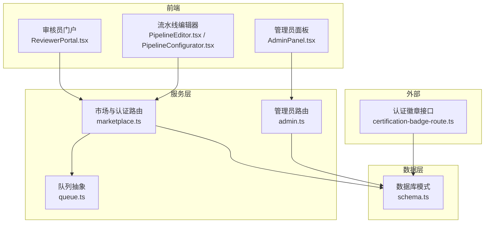
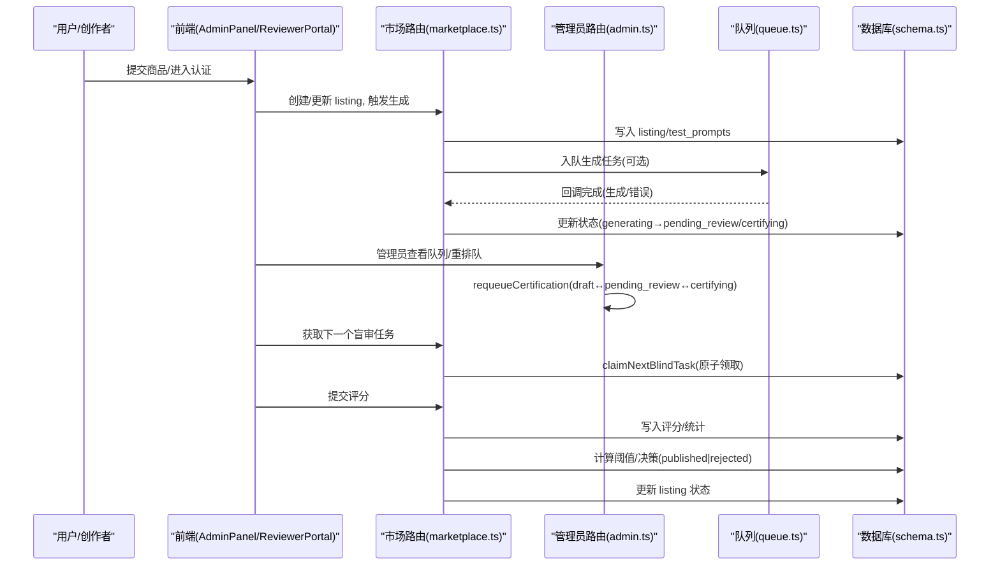
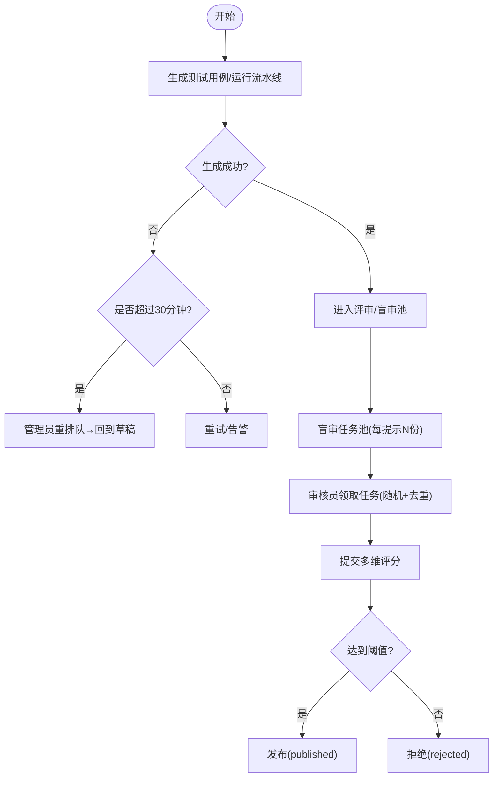
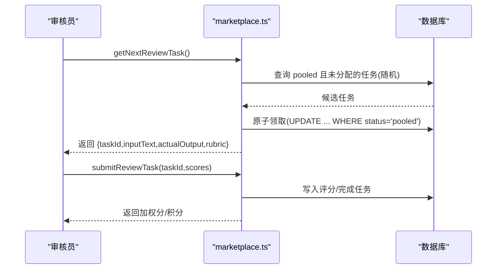
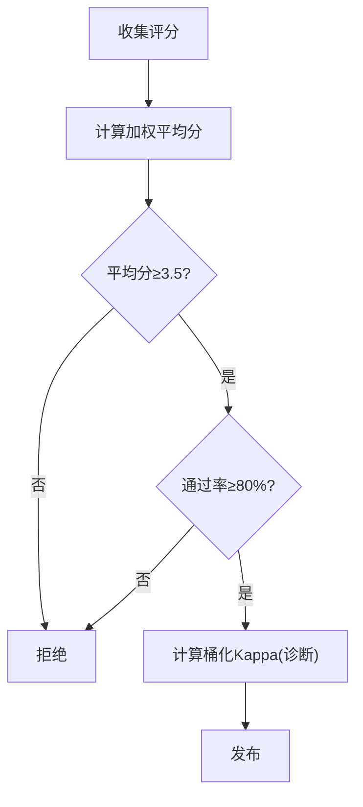
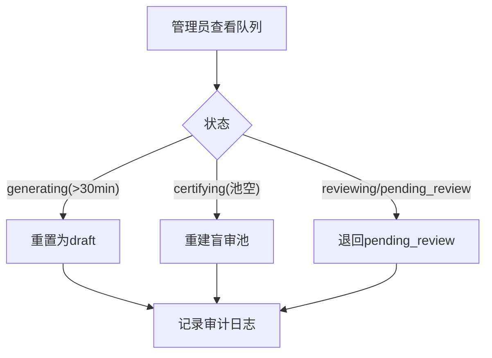
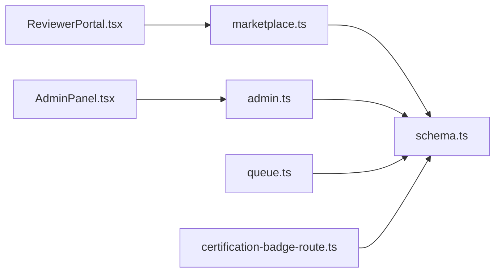

# 认证队列管理

<cite>
**本文引用的文件**
- [api/routers/marketplace.ts](file://api/routers/marketplace.ts)
- [api/routers/admin.ts](file://api/routers/admin.ts)
- [api/infra/queue.ts](file://api/infra/queue.ts)
- [db/schema.ts](file://db/schema.ts)
- [src/pages/AdminPanel.tsx](file://src/pages/AdminPanel.tsx)
- [src/pages/ReviewerPortal.tsx](file://src/pages/ReviewerPortal.tsx)
- [src/components/pipeline/PipelineConfigurator.tsx](file://src/components/pipeline/PipelineConfigurator.tsx)
- [src/pages/PipelineEditor.tsx](file://src/pages/PipelineEditor.tsx)
- [api/certification-badge-route.ts](file://api/certification-badge-route.ts)
- [scripts/smoke-marketplace-trust.mjs](file://scripts/smoke-marketplace-trust.mjs)
- [DeeWaanAI-Next/MARKETPLACE-TRUST-SPEC.md](file://DeeWaanAI-Next/MARKETPLACE-TRUST-SPEC.md)
</cite>

## 目录
1. [简介](#简介)
2. [项目结构](#项目结构)
3. [核心组件](#核心组件)
4. [架构总览](#架构总览)
5. [详细组件分析](#详细组件分析)
6. [依赖关系分析](#依赖关系分析)
7. [性能与容量](#性能与容量)
8. [故障恢复与排障](#故障恢复与排障)
9. [结论](#结论)
10. [附录](#附录)

## 简介
本技术文档围绕“市场商品认证流程、盲审任务管理、质量评估系统”展开，覆盖认证状态跟踪、队列调度、任务重排队机制；并说明 AI 评分、人工审核、Kappa 一致性检验在认证流水线中的作用。同时给出质量门控、发布审批流程、队列监控、故障恢复、性能调优建议，以及质量保证标准、审核员管理与争议处理机制。

## 项目结构
认证相关能力由以下层次组成：
- 路由层：市场交易与认证流程（marketplace.ts）、管理员操作（admin.ts）
- 数据层：数据库模式（schema.ts），包含 listing、test_prompts、blind_review_tasks、listing_reviews、reviewer_profiles 等
- 队列层：统一队列抽象（queue.ts），支持 BullMQ/内存两种后端
- 前端：管理员面板（AdminPanel.tsx）、审核员门户（ReviewerPortal.tsx）、流水线编辑器（PipelineEditor.tsx / PipelineConfigurator.tsx）
- 辅助：认证徽章接口（certification-badge-route.ts）、端到端冒烟脚本（smoke-marketplace-trust.mjs）、规范文档（MARKETPLACE-TRUST-SPEC.md）

图表来源
- [api/routers/marketplace.ts:512-575](file://api/routers/marketplace.ts#L512-L575)
- [api/routers/admin.ts:374-479](file://api/routers/admin.ts#L374-L479)
- [api/infra/queue.ts:1-237](file://api/infra/queue.ts#L1-L237)
- [db/schema.ts:1200-1332](file://db/schema.ts#L1200-L1332)
- [api/certification-badge-route.ts:48-70](file://api/certification-badge-route.ts#L48-L70)

章节来源
- [api/routers/marketplace.ts:512-575](file://api/routers/marketplace.ts#L512-L575)
- [api/routers/admin.ts:374-479](file://api/routers/admin.ts#L374-L479)
- [api/infra/queue.ts:1-237](file://api/infra/queue.ts#L1-L237)
- [db/schema.ts:1200-1332](file://db/schema.ts#L1200-L1332)
- [api/certification-badge-route.ts:48-70](file://api/certification-badge-route.ts#L48-L70)

## 核心组件
- 认证状态机与阶段：draft → generating → pending_review → reviewing → certifying → published/rejected
- 盲审任务池：每个测试提示按所需评审人数复制为 pooled 任务，随机分配给活跃审核员
- 质量评估：多维度加权得分 + 通过率门控；Kappa 用于一致性度量（已退化为诊断指标）
- 队列与重排队：后台生成失败或孤儿任务时，管理员可重置到草稿或重建盲审池
- 徽章与可见性：仅 published 可购买；certifying 可见但不可购买

章节来源
- [api/routers/marketplace.ts:512-575](file://api/routers/marketplace.ts#L512-L575)
- [api/routers/marketplace.ts:589-735](file://api/routers/marketplace.ts#L589-L735)
- [api/routers/admin.ts:374-479](file://api/routers/admin.ts#L374-L479)
- [api/certification-badge-route.ts:48-70](file://api/certification-badge-route.ts#L48-L70)

## 架构总览
认证流水线从提交到发布的完整调用链如下：

图表来源
- [api/routers/marketplace.ts:589-735](file://api/routers/marketplace.ts#L589-L735)
- [api/routers/admin.ts:374-479](file://api/routers/admin.ts#L374-L479)
- [api/infra/queue.ts:1-237](file://api/infra/queue.ts#L1-L237)
- [db/schema.ts:1200-1332](file://db/schema.ts#L1200-L1332)

## 详细组件分析

### 认证状态机与队列调度
- 状态定义与可见性：
  - generating：后台生成中，超过约30分钟视为卡住，需重排队
  - pending_review/reviewing：等待/进行中的评审
  - certifying：盲审进行中，公开可见但不可购买
  - published：通过认证，可购买；rejected：未通过
- 队列调度要点：
  - 生成阶段使用带超时与重试的 LLM 调用，避免长尾阻塞
  - 盲审任务池按 MIN_UNIQUE_REVIEWERS 复制，随机抽取，防止同一 reviewer 重复消费同一提示
  - 领取任务采用原子 UPDATE … WHERE status='pooled' 并发安全

图表来源
- [api/routers/admin.ts:374-415](file://api/routers/admin.ts#L374-L415)
- [api/routers/marketplace.ts:589-735](file://api/routers/marketplace.ts#L589-L735)
- [api/routers/marketplace.ts:512-543](file://api/routers/marketplace.ts#L512-L543)

章节来源
- [api/routers/admin.ts:374-479](file://api/routers/admin.ts#L374-L479)
- [api/routers/marketplace.ts:512-575](file://api/routers/marketplace.ts#L512-L575)
- [api/routers/marketplace.ts:589-735](file://api/routers/marketplace.ts#L589-L735)

### 盲审任务管理
- 入池：enqueueBlindReviewTasks 清空旧池并按 prompt×MIN_UNIQUE_REVIEWERS 复制插入 pooled 任务
- 领取：claimNextBlindTask 强制规则：
  - 仅 active 审核员
  - 禁止自审
  - 同一 listing 内不重复领取同一 prompt
  - 限制同一 listing 已完成数量不超过每人配额
  - 随机顺序防饥饿
- 提交：submitBlindTaskReview 写入评分、标记任务完成、累计积分

图表来源
- [api/routers/marketplace.ts:589-735](file://api/routers/marketplace.ts#L589-L735)
- [api/routers/marketplace.ts:742-800](file://api/routers/marketplace.ts#L742-L800)

章节来源
- [api/routers/marketplace.ts:589-735](file://api/routers/marketplace.ts#L589-L735)
- [api/routers/marketplace.ts:742-800](file://api/routers/marketplace.ts#L742-L800)

### 质量评估与 Kappa 一致性检验
- 加权分数：accuracy/completeness/clarity/tokenEfficiency/speed/consistency 权重固定
- 认证阈值：
  - 平均加权分 ≥ CERTIFY_MIN_AVG_SCORE（默认 3.5）
  - 通过率 ≥ CERTIFY_MIN_PASS_RATIO（默认 0.8）
- Kappa：Fleiss’ Kappa 用于一致性度量；为避免高通过率下的“流行度悖论”，对加权分桶化后再计算，当前作为诊断指标保留

图表来源
- [api/routers/marketplace.ts:485-543](file://api/routers/marketplace.ts#L485-L543)
- [api/routers/marketplace.ts:412-483](file://api/routers/marketplace.ts#L412-L483)

章节来源
- [api/routers/marketplace.ts:412-543](file://api/routers/marketplace.ts#L412-L543)

### 队列与重排队机制
- 队列抽象：支持 BullMQ（生产）与内存（开发）两种后端，提供 idempotencyKey 去重
- 重排队策略：
  - generating 超时而卡住 → 重置为 draft，允许重新提交
  - certifying 但盲审池为空 → 重建池
  - reviewing/pending_review 长时间无进展 → 退回 pending_review 以重新开放池

图表来源
- [api/routers/admin.ts:374-479](file://api/routers/admin.ts#L374-L479)
- [api/infra/queue.ts:1-237](file://api/infra/queue.ts#L1-L237)

章节来源
- [api/routers/admin.ts:374-479](file://api/routers/admin.ts#L374-L479)
- [api/infra/queue.ts:1-237](file://api/infra/queue.ts#L1-L237)

### 流水线与质量门控
- 流水线步骤支持 IF Gate、WHILE Loop、Human Approval，便于在生成阶段做质量门控与迭代优化
- 测试执行时对 LLM 调用设置超时与重试，避免单步阻塞导致 listing 长期处于 generating

章节来源
- [src/components/pipeline/PipelineConfigurator.tsx:163-196](file://src/components/pipeline/PipelineConfigurator.tsx#L163-L196)
- [src/pages/PipelineEditor.tsx:114-136](file://src/pages/PipelineEditor.tsx#L114-L136)
- [api/routers/marketplace.ts:162-199](file://api/routers/marketplace.ts#L162-L199)
- [api/routers/marketplace.ts:201-328](file://api/routers/marketplace.ts#L201-L328)

### 发布审批与徽章
- 仅 published 状态的 listing 可被购买；certifying 可见但不可购买
- 徽章接口仅对 approved/published 且 grade 存在的 listing 返回 SVG 徽章

章节来源
- [api/certification-badge-route.ts:48-70](file://api/certification-badge-route.ts#L48-L70)
- [scripts/smoke-marketplace-trust.mjs:197-221](file://scripts/smoke-marketplace-trust.mjs#L197-L221)

## 依赖关系分析
- marketplace.ts 依赖 schema.ts 的 listing、test_prompts、blind_review_tasks、listing_reviews、reviewer_profiles
- admin.ts 提供认证队列查询与重排队，依赖 schema.ts 与审计日志表
- queue.ts 抽象出统一队列接口，屏蔽 BullMQ/内存实现差异
- 前端 AdminPanel.tsx/ReviewerPortal.tsx 通过 tRPC 调用上述路由
- certification-badge-route.ts 读取 listing 状态与 grade 输出徽章

图表来源
- [api/routers/marketplace.ts:1-36](file://api/routers/marketplace.ts#L1-L36)
- [api/routers/admin.ts:1-15](file://api/routers/admin.ts#L1-L15)
- [api/infra/queue.ts:1-28](file://api/infra/queue.ts#L1-L28)
- [api/certification-badge-route.ts:1-15](file://api/certification-badge-route.ts#L1-L15)

章节来源
- [api/routers/marketplace.ts:1-36](file://api/routers/marketplace.ts#L1-L36)
- [api/routers/admin.ts:1-15](file://api/routers/admin.ts#L1-L15)
- [api/infra/queue.ts:1-28](file://api/infra/queue.ts#L1-L28)
- [api/certification-badge-route.ts:1-15](file://api/certification-badge-route.ts#L1-L15)

## 性能与容量
- 生成阶段：
  - 单步 LLM 调用设置超时（如 180s），失败指数退避重试，避免长尾阻塞
  - 中间结果落库失败不影响主流程（best-effort）
- 盲审池：
  - 随机抽取任务，避免热点 listing 垄断
  - 单人同 listing 已完成数上限，防止过度集中
- 队列：
  - 生产环境推荐 BullMQ + Redis，具备持久化与多节点扩展能力
  - 开发环境内存队列保证本地调试效率
- 缓存与徽章：
  - 徽章接口启用 CDN/浏览器缓存头，降低重复请求压力

章节来源
- [api/routers/marketplace.ts:157-199](file://api/routers/marketplace.ts#L157-L199)
- [api/routers/marketplace.ts:201-328](file://api/routers/marketplace.ts#L201-L328)
- [api/routers/marketplace.ts:643-735](file://api/routers/marketplace.ts#L643-L735)
- [api/infra/queue.ts:1-237](file://api/infra/queue.ts#L1-L237)
- [api/certification-badge-route.ts:48-70](file://api/certification-badge-route.ts#L48-L70)

## 故障恢复与排障
- 常见问题与对策：
  - 生成卡死（generating > 30 分钟）：管理员使用 requeue 重置为 draft，重新提交
  - 盲审池未创建（certifying 但 pool 为空）：管理员触发重建池
  - 评审停滞（reviewing/pending_review 长时间无进展）：退回 pending_review 重新开放
  - 信用额度耗尽：立即失败且不重试，提示补充额度后重试
- 监控与审计：
  - 管理员队列视图显示 ageMinutes、stuck 标志、poolTotal/poolCompleted
  - 所有管理员操作记录审计日志，便于追溯
- 端到端验证：
  - 冒烟脚本验证 certifying 可见性、购买拦截、盲审任务载荷不含 listing/creator 信息

章节来源
- [api/routers/admin.ts:374-479](file://api/routers/admin.ts#L374-L479)
- [src/pages/AdminPanel.tsx:956-993](file://src/pages/AdminPanel.tsx#L956-L993)
- [scripts/smoke-marketplace-trust.mjs:197-221](file://scripts/smoke-marketplace-trust.mjs#L197-L221)

## 结论
该认证队列管理方案通过“AI 快速筛选 + 盲审共识决策”的双层质量门控，结合稳健的状态机与队列重排队机制，确保市场商品的可信发布。关键设计包括：
- 严格的盲审隔离与公平调度
- 基于加权分与通过率的认证门槛，辅以 Kappa 一致性诊断
- 面向运维的重排队与监控能力
- 可扩展的队列抽象与流水线质量门控

## 附录

### 数据模型概览（与认证相关）
- marketplaceListings：商品/模板关联，含状态、等级、AI 评分、Kappa、评审计数等
- testPrompts：测试输入与输出，供盲审使用
- blindReviewTasks：盲审任务池，含状态、领取时间、完成时间
- listingReviews：按提示维度的评分记录
- reviewerProfiles：审核员资格与积分

章节来源
- [db/schema.ts:1200-1332](file://db/schema.ts#L1200-L1332)

### 审核员管理与争议处理
- 审核员管理：
  - 仅 active 审核员可领取任务
  - 自审禁止、同 listing 同提示不重复领取、单人同 listing 完成数上限
- 争议处理：
  - 若出现异常评分分布或疑似刷评，可通过审核员权限与审计日志定位
  - 对低一致性或极端情况，可回退至 pending_review 重新开放评审

章节来源
- [api/routers/marketplace.ts:630-735](file://api/routers/marketplace.ts#L630-L735)
- [DeeWaanAI-Next/MARKETPLACE-TRUST-SPEC.md:137-156](file://DeeWaanAI-Next/MARKETPLACE-TRUST-SPEC.md#L137-L156)