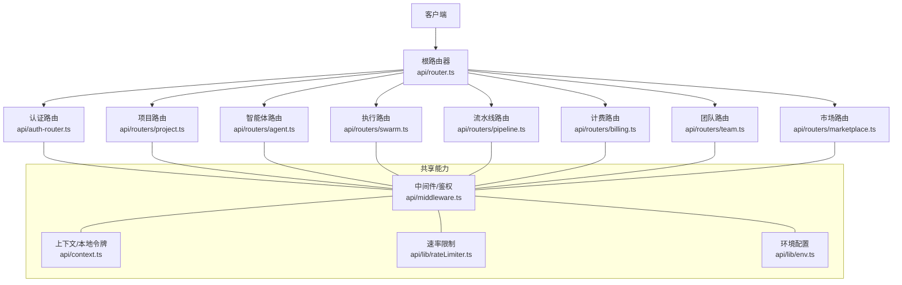
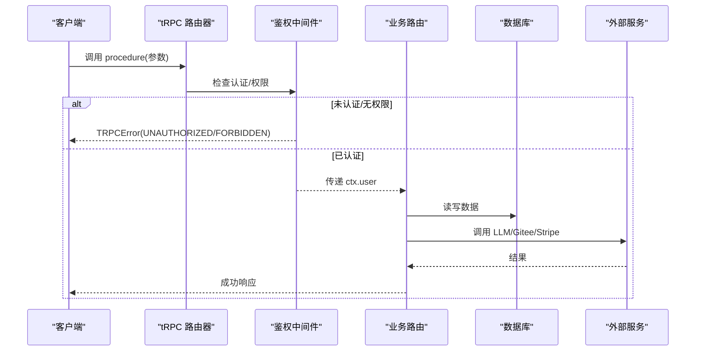
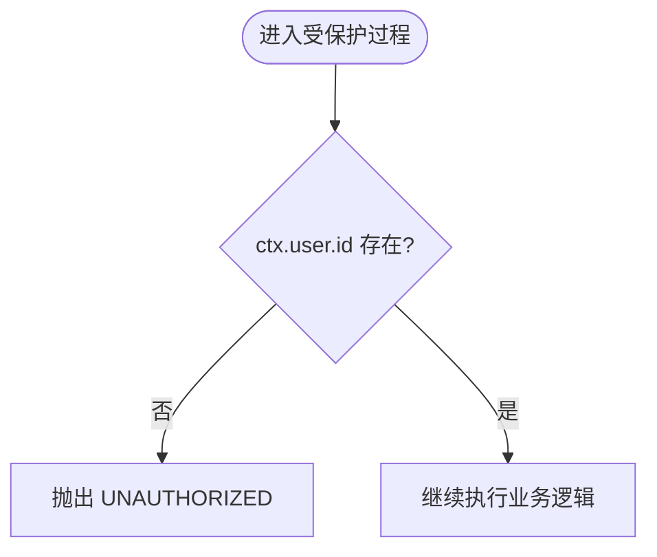
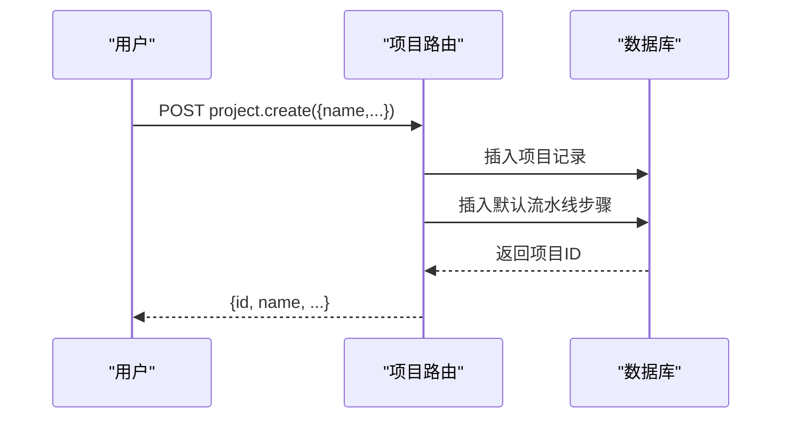
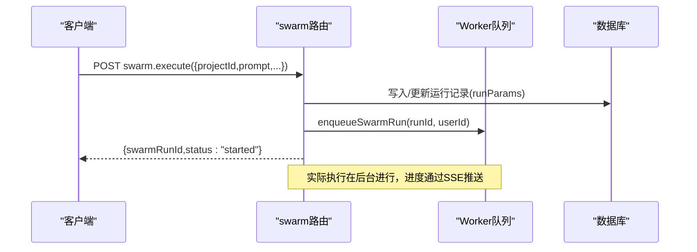
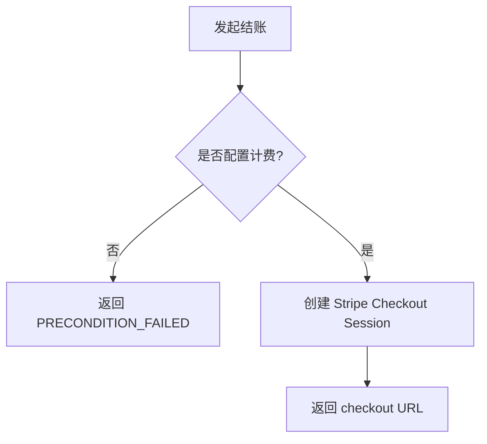
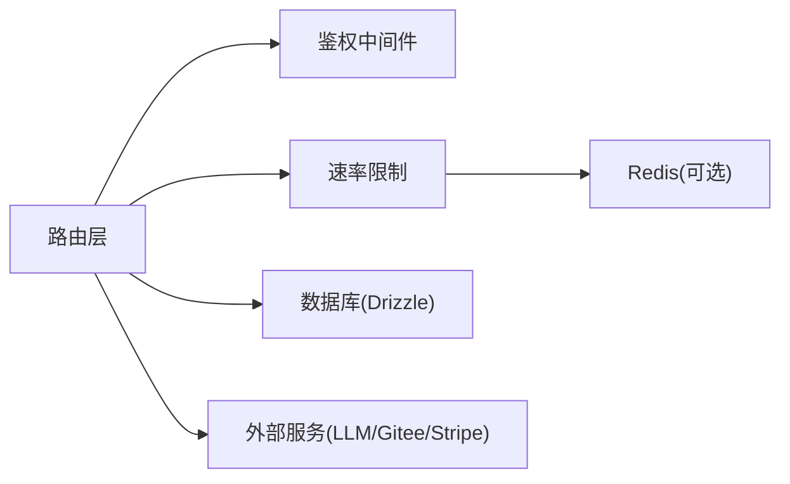

# 后端API文档

<cite>
**本文引用的文件**
- [router.ts](file://api/router.ts)
- [auth-router.ts](file://api/auth-router.ts)
- [middleware.ts](file://api/middleware.ts)
- [context.ts](file://api/context.ts)
- [rateLimiter.ts](file://api/lib/rateLimiter.ts)
- [env.ts](file://api/lib/env.ts)
- [errors.ts](file://contracts/errors.ts)
- [index.ts](file://contracts/index.ts)
- [project.ts](file://api/routers/project.ts)
- [agent.ts](file://api/routers/agent.ts)
- [swarm.ts](file://api/routers/swarm.ts)
- [pipeline.ts](file://api/routers/pipeline.ts)
- [billing.ts](file://api/routers/billing.ts)
- [team.ts](file://api/routers/team.ts)
- [marketplace.ts](file://api/routers/marketplace.ts)
</cite>

## 目录
1. [简介](#简介)
2. [项目结构](#项目结构)
3. [核心组件](#核心组件)
4. [架构总览](#架构总览)
5. [详细组件分析](#详细组件分析)
6. [依赖关系分析](#依赖关系分析)
7. [性能与限流](#性能与限流)
8. [故障排查指南](#故障排查指南)
9. [结论](#结论)
10. [附录：公共接口清单](#附录公共接口清单)

## 简介
本文件为 DeeWaanAI 后端 API 的权威文档，覆盖 tRPC 架构、认证机制、错误处理策略、公共接口（方法、URL模式、请求/响应）、速率限制、安全考虑、版本信息、常见用例、客户端实现指南、调试与监控方法，以及向后兼容与弃用迁移建议。

## 项目结构
后端采用 tRPC 路由模块化组织，按业务域拆分 router（如 project、agent、swarm、pipeline、billing、team、marketplace 等），统一通过根路由器聚合；鉴权与权限控制集中在中间件；输入校验使用 Zod；运行时上下文在 context 中注入用户与会话信息；限流在 lib/rateLimiter 提供 Redis 优先、内存回退的实现；环境变量集中管理于 env。

**图示来源**
- [router.ts:39-70](file://api/router.ts#L39-L70)
- [auth-router.ts:3-12](file://api/auth-router.ts#L3-L12)
- [middleware.ts:10-50](file://api/middleware.ts#L10-L50)
- [context.ts:20-54](file://api/context.ts#L20-L54)
- [rateLimiter.ts:64-103](file://api/lib/rateLimiter.ts#L64-L103)
- [env.ts:24-95](file://api/lib/env.ts#L24-L95)

**章节来源**
- [router.ts:39-70](file://api/router.ts#L39-L70)
- [middleware.ts:10-50](file://api/middleware.ts#L10-L50)
- [context.ts:20-54](file://api/context.ts#L20-L54)
- [rateLimiter.ts:64-103](file://api/lib/rateLimiter.ts#L64-L103)
- [env.ts:24-95](file://api/lib/env.ts#L24-L95)

## 核心组件
- tRPC 路由器与过程
  - 根路由器聚合所有子路由，暴露命名空间化的 procedure（如 project.list、swarm.execute）。
  - 支持 publicQuery（无需鉴权）与 authedQuery/adminQuery（需要登录或管理员角色）。
- 鉴权与上下文
  - 通过 context 解析本地认证头 x-local-auth-token，并加载用户到 ctx.user。
  - 中间件对未认证请求抛出 UNAUTHORIZED，对无权限请求抛出 FORBIDDEN。
- 输入校验与类型契约
  - 所有入参与出参使用 Zod 定义，确保前后端类型一致。
- 速率限制
  - 基于 Redis 固定窗口计数，失败时回退到进程内令牌桶；提供 per-endpoint 与 per-customer 两种限流。
- 环境与配置
  - 集中读取必要的环境变量，生产环境拒绝默认弱密钥；可选基础设施（Redis、S3、Stripe）缺失时优雅降级。

**章节来源**
- [router.ts:39-70](file://api/router.ts#L39-L70)
- [middleware.ts:17-50](file://api/middleware.ts#L17-L50)
- [context.ts:20-54](file://api/context.ts#L20-L54)
- [rateLimiter.ts:64-103](file://api/lib/rateLimiter.ts#L64-L103)
- [env.ts:24-95](file://api/lib/env.ts#L24-L95)

## 架构总览
tRPC 作为类型安全的 API 层，路由按领域划分；每个 procedure 先经过鉴权中间件，再执行业务逻辑；数据库访问通过 Drizzle ORM；外部服务（LLM、Gitee、Stripe、Redis）通过服务层封装；错误以 tRPC 标准错误码返回。

**图示来源**
- [middleware.ts:17-50](file://api/middleware.ts#L17-L50)
- [router.ts:39-70](file://api/router.ts#L39-L70)

## 详细组件分析

### 认证与授权
- 本地认证
  - 客户端通过请求头 x-local-auth-token 携带本地令牌；context 验证后注入 ctx.user。
- 中间件保护
  - authedQuery：要求 ctx.user.id 存在，否则返回 UNAUTHORIZED。
  - adminQuery：在 authedQuery 基础上要求角色为 admin，否则返回 FORBIDDEN。
- 登出
  - 当前实现为客户端管理的 token 清理；服务端可后续扩展黑名单。

**图示来源**
- [middleware.ts:17-28](file://api/middleware.ts#L17-L28)
- [context.ts:32-48](file://api/context.ts#L32-L48)

**章节来源**
- [middleware.ts:17-50](file://api/middleware.ts#L17-L50)
- [context.ts:20-54](file://api/context.ts#L20-L54)
- [auth-router.ts:3-12](file://api/auth-router.ts#L3-L12)

### 项目与智能体
- 项目 CRUD
  - list：列出当前用户的项目及团队共享项目。
  - getById：按 id 获取项目（需拥有或团队共享）。
  - create：创建项目，可选自动创建 Gitee 仓库与初始 README，并初始化默认流水线步骤。
  - update/delete：更新或删除项目（删除时清理 Gitee 与本地文件）。
- 智能体
  - list/create/update/delete：管理项目内的智能体。
  - createDefaults：一键生成默认智能体（Builder/Critic/Refiner/Polisher）。

**图示来源**
- [project.ts:103-250](file://api/routers/project.ts#L103-L250)

**章节来源**
- [project.ts:11-405](file://api/routers/project.ts#L11-L405)
- [agent.ts:8-99](file://api/routers/agent.ts#L8-L99)

### 流水线与执行
- 流水线配置
  - get/set/createDefault：查询、设置、创建默认流水线；支持 if/while 条件步骤与多提供者。
- 执行引擎
  - prepareRun：预创建运行记录。
  - execute：校验权限与配额，持久化 runParams，入队 worker 异步执行，立即返回状态。
  - resumePipeline/approveStep：恢复暂停的执行或审批步骤。
  - executeAgent：单智能体直调 LLM，支持附件与项目上下文注入。
  - 批处理：runBatch/getBatchStatus/listBatches/cancelBatch/resumeBatch/exportBatchResults。

**图示来源**
- [swarm.ts:109-199](file://api/routers/swarm.ts#L109-L199)

**章节来源**
- [pipeline.ts:82-327](file://api/routers/pipeline.ts#L82-L327)
- [swarm.ts:56-655](file://api/routers/swarm.ts#L56-L655)

### 计费与订阅
- 公开计划列表：listPlans（无需鉴权）。
- 创建结账会话：createCheckout（个人）、createTeamCheckout（团队席位，仅团队所有者）。
- 席位状态：teamSeatStatus（团队成员可查）。
- 当前订阅与能力：mySubscription、myCapabilities。

**图示来源**
- [billing.ts:32-61](file://api/routers/billing.ts#L32-L61)

**章节来源**
- [billing.ts:32-163](file://api/routers/billing.ts#L32-L163)

### 团队与协作
- 团队管理：创建、加入、成员角色变更、移除成员、删除团队。
- 项目共享：shareProject/unshareProject。
- 共享资源：getSharedPipelines/getSharedAgents/importPipeline/importAgent。

**章节来源**
- [team.ts:25-721](file://api/routers/team.ts#L25-L721)

### 市场与审核
- 浏览与购买：公开浏览 listing，付费后可获得能力。
- 测试数据生成：根据描述自动生成测试提示词并执行流水线，保存结果到 Gitee。
- 盲审与认证：任务池分配、评分、加权分数与通过率阈值决定发布。

**章节来源**
- [marketplace.ts:1-800](file://api/routers/marketplace.ts#L1-L800)

## 依赖关系分析
- 模块耦合
  - router.ts 仅负责聚合，低耦合高内聚。
  - middleware.ts 提供统一的鉴权与权限控制，被各路由复用。
  - rateLimiter.ts 被具体路由按需调用，避免全局侵入。
- 外部依赖
  - 数据库：Drizzle ORM。
  - 缓存/限流：Redis（可选，失败回退内存）。
  - 对象存储：S3/R2/MinIO（可选）。
  - 支付：Stripe（可选）。
  - 代码托管：Gitee（可选）。
  - LLM 提供商：通过适配器抽象。

**图示来源**
- [router.ts:39-70](file://api/router.ts#L39-L70)
- [middleware.ts:17-50](file://api/middleware.ts#L17-L50)
- [rateLimiter.ts:64-103](file://api/lib/rateLimiter.ts#L64-L103)

**章节来源**
- [router.ts:39-70](file://api/router.ts#L39-L70)
- [middleware.ts:17-50](file://api/middleware.ts#L17-L50)
- [rateLimiter.ts:64-103](file://api/lib/rateLimiter.ts#L64-L103)

## 性能与限流
- 速率限制策略
  - 固定窗口计数器（Redis INCR + PEXPIRE），跨节点共享；不可用时回退到进程内令牌桶。
  - 预置限额：认证、执行、批处理、读取、截图上传/服务等。
  - 客户分层限额：solo/team/admin 不同配额。
- 并发与重试
  - 执行入队 Worker 异步处理，避免阻塞请求。
  - LLM 调用具备指数退避重试与超时保护。
- 数据库优化
  - 批量解析智能体、事务包裹关键写路径、减少 N+1 查询。

**章节来源**
- [rateLimiter.ts:64-103](file://api/lib/rateLimiter.ts#L64-L103)
- [swarm.ts:109-199](file://api/routers/swarm.ts#L109-L199)
- [pipeline.ts:13-80](file://api/routers/pipeline.ts#L13-L80)

## 故障排查指南
- 认证失败
  - 检查 x-local-auth-token 是否正确；确认中间件是否放行；查看 UNAUTHORIZED/FORBIDDEN 错误。
- 限流触发
  - 关注 retryAfterMs；调整客户端重试间隔；必要时提升配额或优化调用频率。
- 外部服务异常
  - LLM 配额不足/429：识别 CreditExhaustedError 并提示充值；其他错误走重试。
  - Gitee/Stripe/Redis 不可用：遵循优雅降级策略，不阻断主流程。
- 日志与追踪
  - 使用 requestId 贯穿请求链路；关键操作有结构化日志输出。

**章节来源**
- [middleware.ts:17-50](file://api/middleware.ts#L17-L50)
- [rateLimiter.ts:64-103](file://api/lib/rateLimiter.ts#L64-L103)
- [marketplace.ts:166-199](file://api/routers/marketplace.ts#L166-L199)

## 结论
DeeWaanAI 后端以 tRPC 为核心，结合强类型契约、细粒度鉴权、灵活限流与异步执行，提供了稳定可扩展的 API 能力。通过模块化路由与服务层解耦，便于持续演进与团队协作。建议在客户端严格遵循输入校验、正确处理限流与错误码，并利用 SSE/批处理能力优化用户体验。

## 附录：公共接口清单
说明：以下为按路由划分的公共 tRPC 接口概览。实际调用方式为 tRPC 客户端调用对应命名空间下的 procedure（例如 project.list、swarm.execute）。

- 通用
  - ping：健康检查（public）
- 认证
  - auth.me：获取当前用户
  - auth.logout：登出
  - localAuth.*：本地认证相关（由路由导出）
- 项目
  - project.list：列出项目
  - project.getById：按 ID 获取项目
  - project.create：创建项目
  - project.update：更新项目
  - project.delete：删除项目
  - project.getPipelineConfig：获取流水线配置
  - project.updatePipelineConfig：更新流水线配置
- 智能体
  - agent.list：列出项目智能体
  - agent.create：创建智能体
  - agent.update：更新智能体
  - agent.delete：删除智能体
  - agent.createDefaults：创建默认智能体
- 流水线
  - pipeline.get：获取流水线步骤
  - pipeline.set：设置流水线步骤
  - pipeline.createDefault：创建默认流水线
  - pipeline.availableProviders：可用提供者
- 执行（Swarm）
  - swarm.prepareRun：准备运行
  - swarm.getPipeline：获取流水线
  - swarm.execute：执行流水线
  - swarm.resumePipeline：恢复执行
  - swarm.approveStep：审批步骤
  - swarm.autoDesign：自动设计
  - swarm.cancelRun：取消运行
  - swarm.getRun：获取运行详情
  - swarm.listRuns：列出运行
  - swarm.getRunStatus：获取最新运行状态
  - swarm.executeAgent：单智能体执行
  - 批处理：runBatch、getBatchStatus、listBatches、cancelBatch、resumeBatch、exportBatchResults
- 计费
  - billing.listPlans：公开计划列表
  - billing.createCheckout：创建结账会话
  - billing.createTeamCheckout：团队席位结账
  - billing.teamSeatStatus：席位状态
  - billing.mySubscription：当前订阅
  - billing.myCapabilities：能力集合
- 团队
  - team.create：创建团队
  - team.joinByCode：邀请码加入
  - team.listMyTeams：我的团队
  - team.getTeam：团队详情与成员
  - team.updateMemberRole：修改成员角色
  - team.removeMember：移除成员
  - team.shareProject：共享项目
  - team.unshareProject：取消共享
  - team.delete：删除团队
  - team.getSharedPipelines：共享流水线
  - team.getSharedAgents：共享智能体
  - team.importPipeline：导入流水线步骤
  - team.importAgent：导入智能体
- 市场
  - marketplace.*：浏览、购买、测试数据生成、盲审与认证（详见 market 路由）

注意：
- 所有受保护接口均需通过 x-local-auth-token 完成本地认证。
- 部分接口受速率限制与功能开关约束（如批处理）。
- 错误码遵循 tRPC 标准（如 UNAUTHORIZED、FORBIDDEN、PRECONDITION_FAILED 等）。

**章节来源**
- [router.ts:39-70](file://api/router.ts#L39-L70)
- [auth-router.ts:3-12](file://api/auth-router.ts#L3-L12)
- [project.ts:11-405](file://api/routers/project.ts#L11-L405)
- [agent.ts:8-99](file://api/routers/agent.ts#L8-L99)
- [pipeline.ts:82-327](file://api/routers/pipeline.ts#L82-L327)
- [swarm.ts:56-655](file://api/routers/swarm.ts#L56-L655)
- [billing.ts:32-163](file://api/routers/billing.ts#L32-L163)
- [team.ts:25-721](file://api/routers/team.ts#L25-L721)
- [marketplace.ts:1-800](file://api/routers/marketplace.ts#L1-L800)