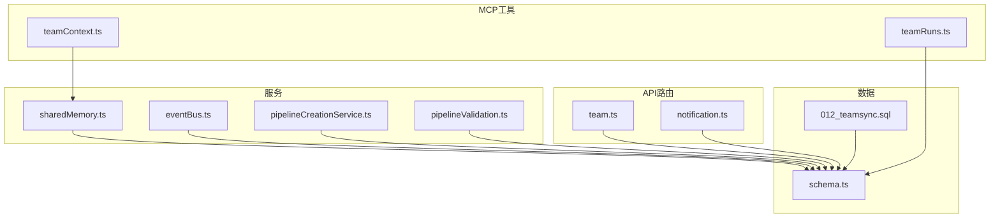
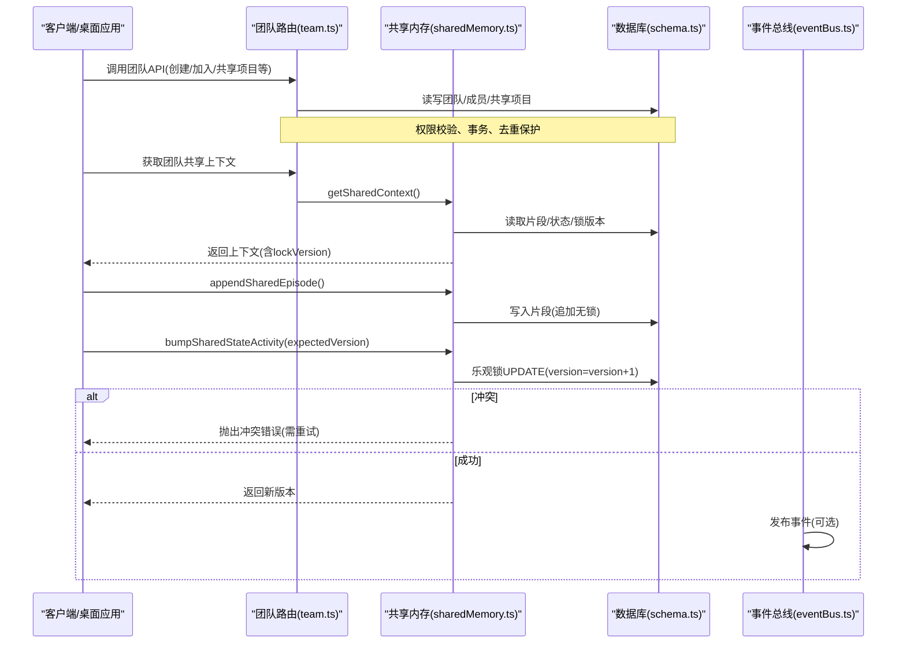
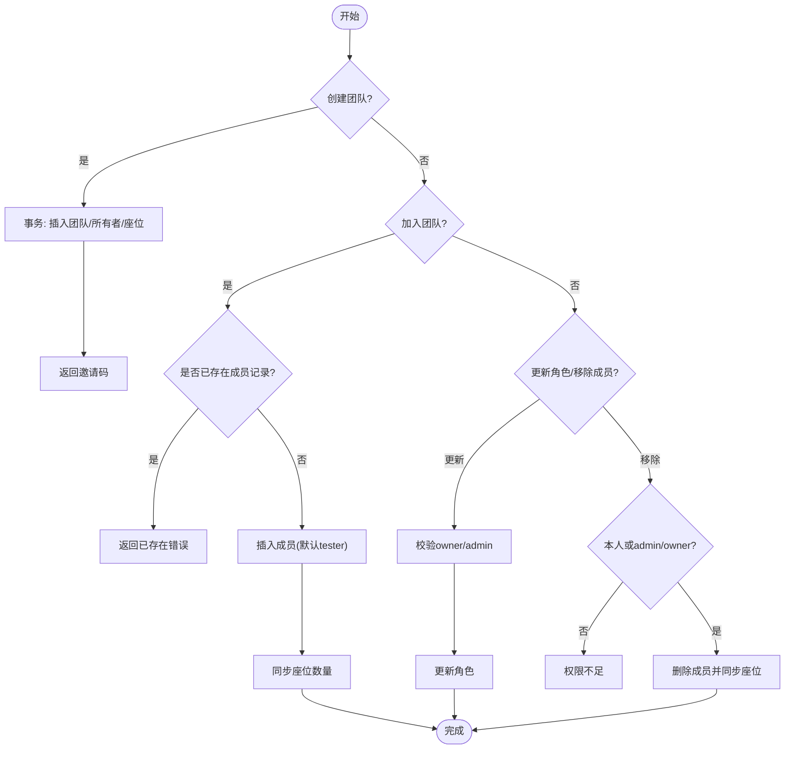
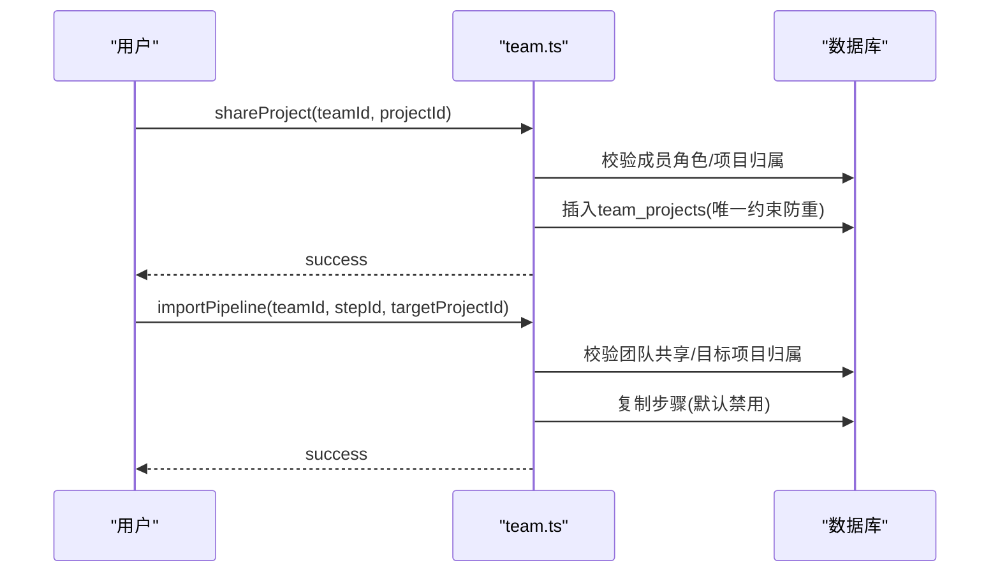
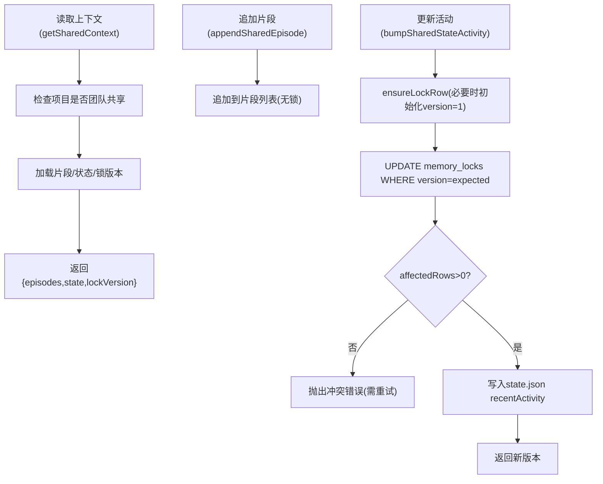
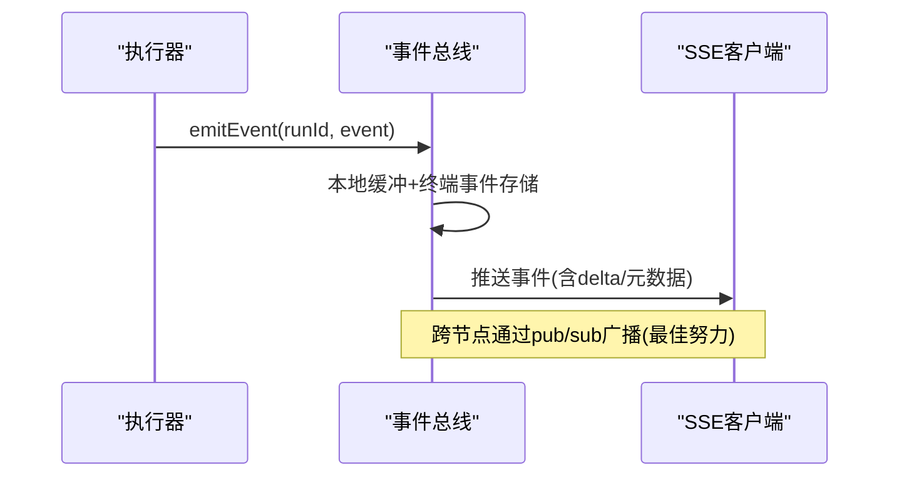
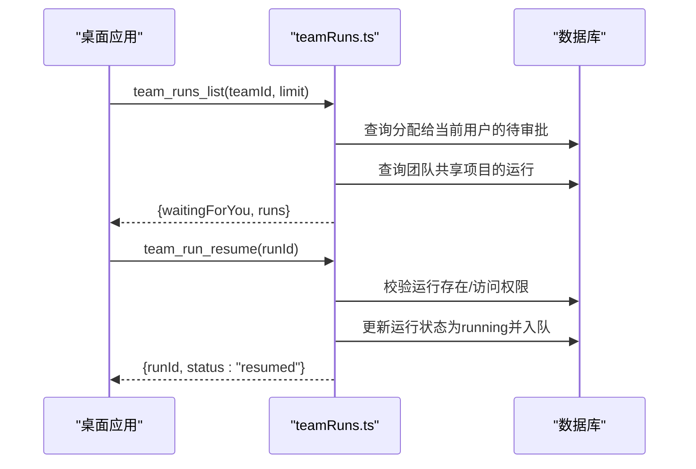
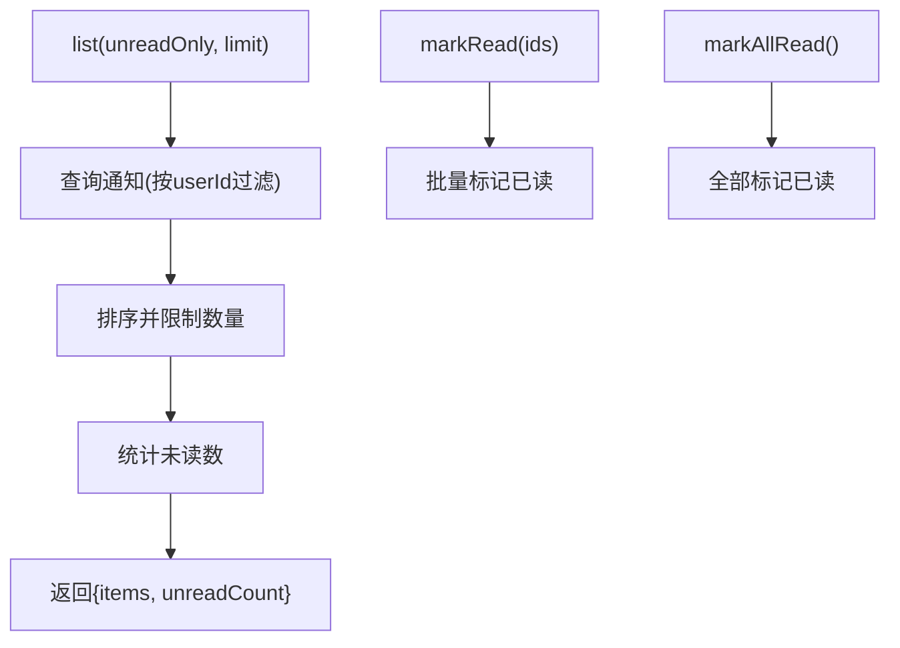
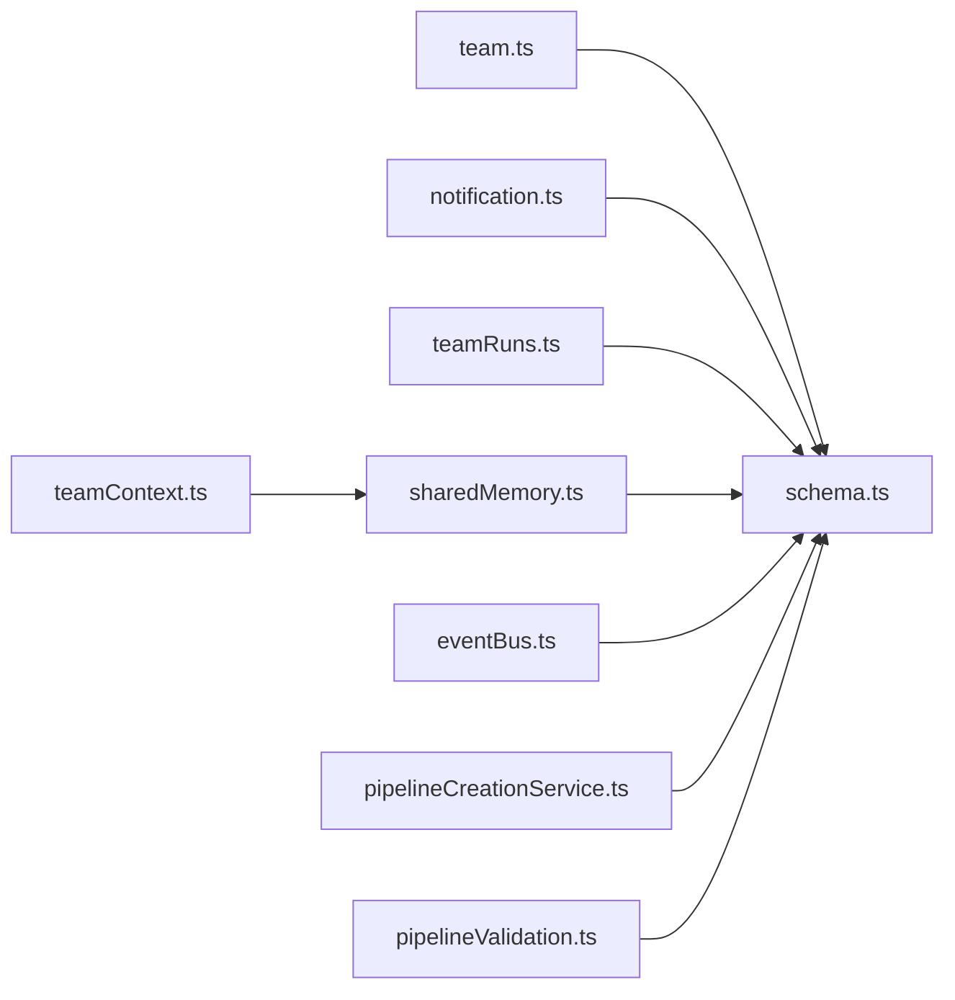

# 团队协作API

<cite>
**本文引用的文件**
- [api/routers/team.ts](file://api/routers/team.ts)
- [api/services/sharedMemory.ts](file://api/services/sharedMemory.ts)
- [db/schema.ts](file://db/schema.ts)
- [db/migrations/012_teamsync.sql](file://db/migrations/012_teamsync.sql)
- [api/mcp/tools/team/teamContext.ts](file://api/mcp/tools/team/teamContext.ts)
- [api/mcp/tools/team/teamRuns.ts](file://api/mcp/tools/team/teamRuns.ts)
- [api/routers/notification.ts](file://api/routers/notification.ts)
- [api/services/eventBus.ts](file://api/services/eventBus.ts)
- [api/services/pipelineCreationService.ts](file://api/services/pipelineCreationService.ts)
- [api/mcp/tools/pipelineValidation.ts](file://api/mcp/tools/pipelineValidation.ts)
- [site/src/content/docs/en/teams.md](file://site/src/content/docs/en/teams.md)
</cite>

## 目录
1. [简介](#简介)
2. [项目结构](#项目结构)
3. [核心组件](#核心组件)
4. [架构总览](#架构总览)
5. [详细组件分析](#详细组件分析)
6. [依赖关系分析](#依赖关系分析)
7. [性能与并发](#性能与并发)
8. [故障排查指南](#故障排查指南)
9. [结论](#结论)
10. [附录：协作场景示例](#附录协作场景示例)

## 简介
本技术文档面向团队协作API，覆盖团队空间管理、成员邀请与角色权限、资源共享（项目、流水线步骤、自定义智能体）、实时协作机制（事件流、乐观锁冲突解决、数据同步策略）、共享内存与状态管理、并发控制、通知系统、消息反馈与协作历史追踪、以及团队设置与自动化工作流。文档同时提供具体协作场景示例、性能优化建议与扩展性考虑。

## 项目结构
围绕团队协作能力，代码主要分布在以下位置：
- 路由层：团队管理、通知等HTTP接口
- MCP工具层：跨桌面客户端的团队协作工具（上下文读取、记忆追加、运行列表与恢复）
- 服务层：共享内存、事件总线、流水线创建与校验
- 数据层：数据库Schema与迁移（团队、成员、共享项目、座位计费、乐观锁、通知等）

图表来源
- [api/routers/team.ts:1-721](file://api/routers/team.ts#L1-L721)
- [api/routers/notification.ts:1-67](file://api/routers/notification.ts#L1-L67)
- [api/mcp/tools/team/teamContext.ts:1-157](file://api/mcp/tools/team/teamContext.ts#L1-L157)
- [api/mcp/tools/team/teamRuns.ts:1-187](file://api/mcp/tools/team/teamRuns.ts#L1-L187)
- [api/services/sharedMemory.ts:1-207](file://api/services/sharedMemory.ts#L1-L207)
- [api/services/eventBus.ts:1-193](file://api/services/eventBus.ts#L1-L193)
- [api/services/pipelineCreationService.ts:1-36](file://api/services/pipelineCreationService.ts#L1-L36)
- [api/mcp/tools/pipelineValidation.ts:54-83](file://api/mcp/tools/pipelineValidation.ts#L54-L83)
- [db/schema.ts:785-1332](file://db/schema.ts#L785-L1332)
- [db/migrations/012_teamsync.sql:1-27](file://db/migrations/012_teamsync.sql#L1-L27)

章节来源
- [api/routers/team.ts:1-721](file://api/routers/team.ts#L1-L721)
- [api/routers/notification.ts:1-67](file://api/routers/notification.ts#L1-L67)
- [api/mcp/tools/team/teamContext.ts:1-157](file://api/mcp/tools/team/teamContext.ts#L1-L157)
- [api/mcp/tools/team/teamRuns.ts:1-187](file://api/mcp/tools/team/teamRuns.ts#L1-L187)
- [api/services/sharedMemory.ts:1-207](file://api/services/sharedMemory.ts#L1-L207)
- [api/services/eventBus.ts:1-193](file://api/services/eventBus.ts#L1-L193)
- [api/services/pipelineCreationService.ts:1-36](file://api/services/pipelineCreationService.ts#L1-L36)
- [api/mcp/tools/pipelineValidation.ts:54-83](file://api/mcp/tools/pipelineValidation.ts#L54-L83)
- [db/schema.ts:785-1332](file://db/schema.ts#L785-L1332)
- [db/migrations/012_teamsync.sql:1-27](file://db/migrations/012_teamsync.sql#L1-L27)

## 核心组件
- 团队与成员管理：创建团队、加入团队、查看团队详情、更新成员角色、移除成员、删除团队
- 资源共享：将项目共享给团队、从团队导入流水线步骤或自定义智能体到个人项目
- 共享内存与状态：基于磁盘文件的“片段式记忆”与结构化状态，使用乐观锁避免写冲突
- 运行可见性与交接：列出团队共享项目的流水线运行、查看待审批任务、恢复暂停运行
- 通知系统：查询未读通知、标记已读、全部已读
- 实时事件：SSE事件流、本地缓冲与跨节点广播
- 流水线配置与自动化：步骤类型校验、模板化创建、条件/循环步骤支持

章节来源
- [api/routers/team.ts:25-721](file://api/routers/team.ts#L25-L721)
- [api/services/sharedMemory.ts:35-207](file://api/services/sharedMemory.ts#L35-L207)
- [api/mcp/tools/team/teamRuns.ts:34-187](file://api/mcp/tools/team/teamRuns.ts#L34-L187)
- [api/routers/notification.ts:7-67](file://api/routers/notification.ts#L7-L67)
- [api/services/eventBus.ts:1-193](file://api/services/eventBus.ts#L1-L193)
- [api/services/pipelineCreationService.ts:1-36](file://api/services/pipelineCreationService.ts#L1-L36)
- [api/mcp/tools/pipelineValidation.ts:54-83](file://api/mcp/tools/pipelineValidation.ts#L54-L83)

## 架构总览
团队协作以“团队-项目-资源”为核心模型，通过路由暴露HTTP API，通过MCP工具暴露跨应用协作能力；共享状态采用“片段式记忆+结构化状态”，并通过数据库乐观锁保证一致性；运行过程通过事件总线进行实时推送。

图表来源
- [api/routers/team.ts:25-721](file://api/routers/team.ts#L25-L721)
- [api/services/sharedMemory.ts:86-207](file://api/services/sharedMemory.ts#L86-L207)
- [db/schema.ts:785-1332](file://db/schema.ts#L785-L1332)
- [api/services/eventBus.ts:156-167](file://api/services/eventBus.ts#L156-L167)

## 详细组件分析

### 团队空间与成员管理
- 创建团队：生成邀请码，原子事务插入团队、所有者成员、初始座位数
- 加入团队：按邀请码加入，处理重复键异常，同步座位数量
- 成员列表与详情：聚合成员信息、用户信息、共享项目列表
- 角色更新：仅owner/admin可改，禁止修改owner自身角色
- 移除成员：允许自删或admin/owner删他人，禁止删除owner；变更后同步座位
- 删除团队：仅owner可删，尝试取消座位订阅后删除

图表来源
- [api/routers/team.ts:29-117](file://api/routers/team.ts#L29-L117)
- [api/routers/team.ts:223-342](file://api/routers/team.ts#L223-L342)

章节来源
- [api/routers/team.ts:29-117](file://api/routers/team.ts#L29-L117)
- [api/routers/team.ts:164-221](file://api/routers/team.ts#L164-L221)
- [api/routers/team.ts:223-342](file://api/routers/team.ts#L223-L342)
- [api/routers/team.ts:443-463](file://api/routers/team.ts#L443-L463)

### 资源共享与导入
- 共享项目：仅owner/admin可将项目共享给团队，防止重复共享
- 取消共享：仅owner/admin可取消
- 导入流水线步骤：从团队共享项目中复制步骤到目标个人项目，默认禁用，需手动启用
- 导入自定义智能体：从团队成员的智能体复制到个人项目，处理slug冲突

图表来源
- [api/routers/team.ts:347-438](file://api/routers/team.ts#L347-L438)
- [api/routers/team.ts:576-646](file://api/routers/team.ts#L576-L646)

章节来源
- [api/routers/team.ts:347-438](file://api/routers/team.ts#L347-L438)
- [api/routers/team.ts:576-646](file://api/routers/team.ts#L576-L646)
- [api/routers/team.ts:651-719](file://api/routers/team.ts#L651-L719)

### 共享内存与状态管理（乐观锁）
- 访问控制：仅对“团队共享项目”开放，个人项目拒绝
- 片段记忆：追加写入，无锁，限制最近片段数量
- 结构化状态：维护goal、keyDecisions、recentActivity等，通过memory_locks表实现乐观锁
- 冲突处理：当expectedVersion不匹配时抛出冲突错误，客户端需重新读取并重试

图表来源
- [api/services/sharedMemory.ts:49-104](file://api/services/sharedMemory.ts#L49-L104)
- [api/services/sharedMemory.ts:111-129](file://api/services/sharedMemory.ts#L111-L129)
- [api/services/sharedMemory.ts:137-207](file://api/services/sharedMemory.ts#L137-L207)
- [db/migrations/012_teamsync.sql:17-27](file://db/migrations/012_teamsync.sql#L17-L27)

章节来源
- [api/services/sharedMemory.ts:35-207](file://api/services/sharedMemory.ts#L35-L207)
- [db/migrations/012_teamsync.sql:1-27](file://db/migrations/012_teamsync.sql#L1-L27)

### 实时协作与事件流
- SSE事件流：为每个运行维护本地连接与5分钟回放缓冲
- 终端事件持久化：运行完成/错误事件永久保存，新连接可立即收到
- 跨节点广播：通过pub/sub将事件广播到其他实例，本地去重
- 事件类型：步骤开始/完成/错误、流式增量、管道完成/错误、等待审批等

图表来源
- [api/services/eventBus.ts:1-193](file://api/services/eventBus.ts#L1-L193)

章节来源
- [api/services/eventBus.ts:1-193](file://api/services/eventBus.ts#L1-L193)

### 运行可见性与交接
- 列出团队运行：展示团队共享项目的运行列表及当前步骤、是否等待审批
- 待我审批：查询分配给当前用户的待审批任务，包含运行基本信息
- 恢复运行：从任意客户端恢复暂停的运行，保持审批状态不变，交由审批步骤完成

图表来源
- [api/mcp/tools/team/teamRuns.ts:34-127](file://api/mcp/tools/team/teamRuns.ts#L34-L127)
- [api/mcp/tools/team/teamRuns.ts:129-187](file://api/mcp/tools/team/teamRuns.ts#L129-L187)

章节来源
- [api/mcp/tools/team/teamRuns.ts:34-187](file://api/mcp/tools/team/teamRuns.ts#L34-L187)

### 通知系统与消息反馈
- 通知列表：支持按未读过滤、分页、统计未读数
- 标记已读：单条或全部标记
- 反馈与反应：支持向消息添加点赞/点踩、标签与评论，自动关联团队上下文

图表来源
- [api/routers/notification.ts:7-67](file://api/routers/notification.ts#L7-L67)

章节来源
- [api/routers/notification.ts:7-67](file://api/routers/notification.ts#L7-L67)
- [api/routers/feedback.ts:49-119](file://api/routers/feedback.ts#L49-L119)

### 团队设置、自定义规则与自动化工作流
- 流水线步骤类型：支持agent、if、while、approval等，具备条件分支与循环能力
- 步骤校验：whileConfig.targetStep必须指向自身或更早步骤，防止死循环
- 模板化创建：根据步骤自动生成customAgents与pipelineTemplate，便于复用
- 能力门控：某些高级步骤需要特定能力（如pipeline:custom）

章节来源
- [api/mcp/tools/pipelineValidation.ts:54-83](file://api/mcp/tools/pipelineValidation.ts#L54-L83)
- [api/services/pipelineCreationService.ts:1-36](file://api/services/pipelineCreationService.ts#L1-L36)

## 依赖关系分析
- 路由层依赖数据库Schema定义，确保实体一致
- MCP工具依赖共享内存服务与数据库，进行访问控制与数据操作
- 共享内存服务依赖磁盘文件与乐观锁表，保证状态一致性
- 事件总线依赖pub/sub基础设施，实现跨节点事件分发
- 通知与反馈模块独立于团队逻辑，但可与团队上下文联动

图表来源
- [api/routers/team.ts:1-721](file://api/routers/team.ts#L1-L721)
- [api/routers/notification.ts:1-67](file://api/routers/notification.ts#L1-L67)
- [api/mcp/tools/team/teamContext.ts:1-157](file://api/mcp/tools/team/teamContext.ts#L1-L157)
- [api/mcp/tools/team/teamRuns.ts:1-187](file://api/mcp/tools/team/teamRuns.ts#L1-L187)
- [api/services/sharedMemory.ts:1-207](file://api/services/sharedMemory.ts#L1-L207)
- [api/services/eventBus.ts:1-193](file://api/services/eventBus.ts#L1-L193)
- [api/services/pipelineCreationService.ts:1-36](file://api/services/pipelineCreationService.ts#L1-L36)
- [api/mcp/tools/pipelineValidation.ts:54-83](file://api/mcp/tools/pipelineValidation.ts#L54-L83)
- [db/schema.ts:785-1332](file://db/schema.ts#L785-L1332)

章节来源
- [api/routers/team.ts:1-721](file://api/routers/team.ts#L1-L721)
- [api/routers/notification.ts:1-67](file://api/routers/notification.ts#L1-L67)
- [api/mcp/tools/team/teamContext.ts:1-157](file://api/mcp/tools/team/teamContext.ts#L1-L157)
- [api/mcp/tools/team/teamRuns.ts:1-187](file://api/mcp/tools/team/teamRuns.ts#L1-L187)
- [api/services/sharedMemory.ts:1-207](file://api/services/sharedMemory.ts#L1-L207)
- [api/services/eventBus.ts:1-193](file://api/services/eventBus.ts#L1-L193)
- [api/services/pipelineCreationService.ts:1-36](file://api/services/pipelineCreationService.ts#L1-L36)
- [api/mcp/tools/pipelineValidation.ts:54-83](file://api/mcp/tools/pipelineValidation.ts#L54-L83)
- [db/schema.ts:785-1332](file://db/schema.ts#L785-L1332)

## 性能与并发
- 乐观锁：通过memory_locks.version实现写冲突检测，避免静默丢失写；冲突时客户端需重新读取并重试
- 片段追加：无锁追加，适合高频协作笔记，限制最大片段数避免膨胀
- 事件回放：5分钟缓冲减少断连重连的数据丢失风险；终端事件持久化保障最终一致性
- 幂等与去重：团队加入与共享项目插入均容忍重复键，避免重复副作用
- 索引优化：团队、成员、共享项目、通知等关键查询字段建立索引，提升查询性能

章节来源
- [api/services/sharedMemory.ts:137-207](file://api/services/sharedMemory.ts#L137-L207)
- [api/services/eventBus.ts:23-52](file://api/services/eventBus.ts#L23-L52)
- [api/routers/team.ts:99-117](file://api/routers/team.ts#L99-L117)
- [api/routers/team.ts:383-395](file://api/routers/team.ts#L383-L395)
- [db/schema.ts:813-836](file://db/schema.ts#L813-L836)
- [db/schema.ts:1040-1055](file://db/schema.ts#L1040-L1055)

## 故障排查指南
- 无法访问共享上下文：确认项目是否已共享至当前团队；非共享项目将被拒绝
- 状态更新冲突：当bumpSharedStateActivity返回冲突错误时，重新调用getSharedContext获取最新lockVersion后重试
- 运行恢复失败：检查运行是否存在、是否有执行状态、是否具备访问权限；队列入队失败需重试
- 通知未显示：确认userId过滤与未读过滤参数；检查数据库索引与查询条件
- 事件丢失：检查SSE连接是否稳定；关注终端事件是否已持久化；跨节点广播为最佳努力，可能延迟

章节来源
- [api/services/sharedMemory.ts:64-69](file://api/services/sharedMemory.ts#L64-L69)
- [api/services/sharedMemory.ts:176-180](file://api/services/sharedMemory.ts#L176-L180)
- [api/mcp/tools/team/teamRuns.ts:140-177](file://api/mcp/tools/team/teamRuns.ts#L140-L177)
- [api/routers/notification.ts:13-37](file://api/routers/notification.ts#L13-L37)
- [api/services/eventBus.ts:108-112](file://api/services/eventBus.ts#L108-L112)

## 结论
该团队协作API以清晰的团队-项目-资源模型为基础，结合乐观锁与片段记忆实现高并发下的状态一致性；通过MCP工具打通跨桌面应用的协作体验；事件总线提供实时协作与运行可见性；通知与反馈完善协作闭环。整体设计兼顾可扩展性与容错性，适合多端协同与复杂流水线工作流。

## 附录：协作场景示例
- 创建团队并邀请成员：生成邀请码，成员通过邀请码加入，获得tester角色
- 共享项目并导入步骤：管理员将项目共享给团队，成员从团队导入步骤到个人项目并启用
- 协作编辑共享上下文：成员追加片段笔记，更新结构化状态，遇到冲突时重新读取并重试
- 查看与恢复运行：列出团队共享项目的运行，恢复暂停运行，继续人工审批流程
- 接收通知与反馈：查看未读通知，对消息进行点赞/点踩并附加评论，形成协作历史

章节来源
- [site/src/content/docs/en/teams.md:17-47](file://site/src/content/docs/en/teams.md#L17-L47)
- [api/routers/team.ts:29-117](file://api/routers/team.ts#L29-L117)
- [api/routers/team.ts:347-438](file://api/routers/team.ts#L347-L438)
- [api/mcp/tools/team/teamContext.ts:56-157](file://api/mcp/tools/team/teamContext.ts#L56-L157)
- [api/mcp/tools/team/teamRuns.ts:34-187](file://api/mcp/tools/team/teamRuns.ts#L34-L187)
- [api/routers/notification.ts:7-67](file://api/routers/notification.ts#L7-L67)