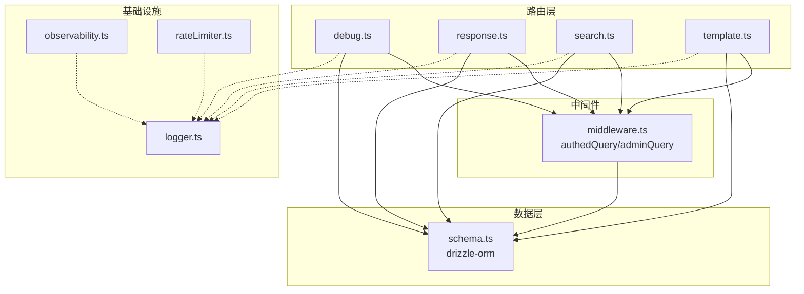
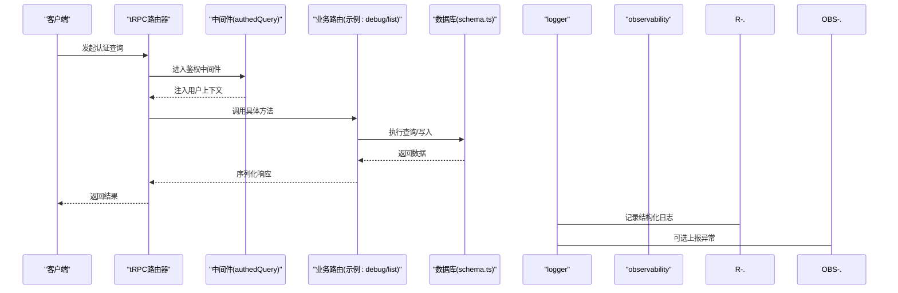
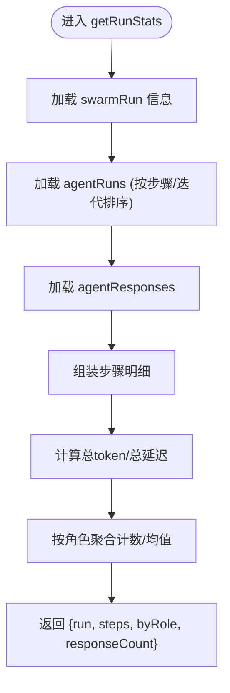
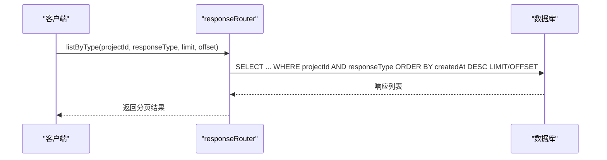
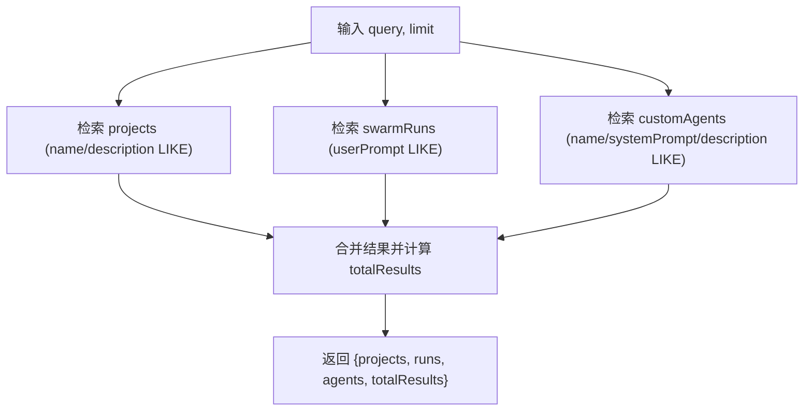
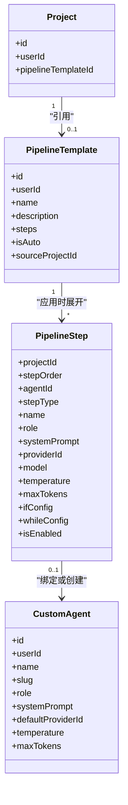
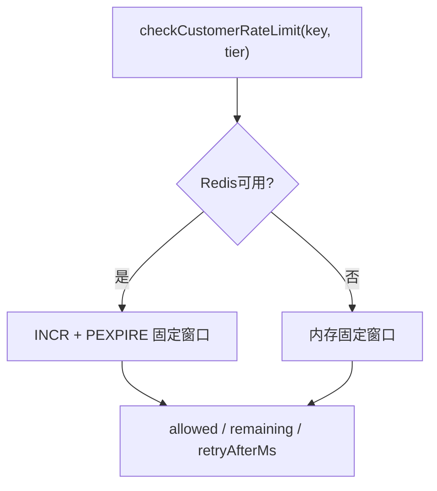
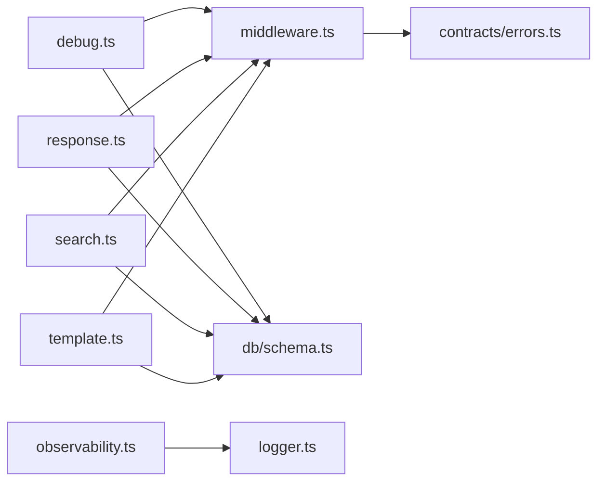

# 工具类API

<cite>
**本文引用的文件**
- [api/routers/debug.ts](file://api/routers/debug.ts)
- [api/routers/response.ts](file://api/routers/response.ts)
- [api/routers/search.ts](file://api/routers/search.ts)
- [api/routers/template.ts](file://api/routers/template.ts)
- [api/middleware.ts](file://api/middleware.ts)
- [api/lib/logger.ts](file://api/lib/logger.ts)
- [api/lib/observability.ts](file://api/lib/observability.ts)
- [api/lib/rateLimiter.ts](file://api/lib/rateLimiter.ts)
- [db/schema.ts](file://db/schema.ts)
- [contracts/constants.ts](file://contracts/constants.ts)
- [contracts/errors.ts](file://contracts/errors.ts)
- [api/mcp/tools/pipelineValidation.ts](file://api/mcp/tools/pipelineValidation.ts)
</cite>

## 目录
1. [简介](#简介)
2. [项目结构](#项目结构)
3. [核心组件](#核心组件)
4. [架构总览](#架构总览)
5. [详细组件分析](#详细组件分析)
6. [依赖关系分析](#依赖关系分析)
7. [性能与缓存](#性能与缓存)
8. [故障排查指南](#故障排查指南)
9. [结论](#结论)
10. [附录：接口速查与最佳实践](#附录接口速查与最佳实践)

## 简介
本技术文档聚焦于“工具类API”，覆盖以下能力：
- 调试工具：运行期事件日志、聚合统计、按任务维度检索。
- 响应处理：统一查询链、结果分页、人工标注与标记。
- 全文搜索：跨项目、运行记录与自定义智能体的模糊检索。
- 模板系统：流水线模板的创建、更新、复用与应用，含条件与循环步骤配置。
- 开发调试与可观测性：结构化日志、错误上报、限流与降级策略。
- 数据验证与错误码：输入校验、权限控制、标准化错误返回。
- 搜索引擎实现：基于数据库LIKE的索引策略、查询语法与排序。
- 模板引擎：变量替换、条件渲染、动态内容生成（以流水线步骤为载体）。
- 缓存策略与扩展性：内存令牌桶、Redis固定窗口、优雅降级。

## 项目结构
工具类API采用tRPC路由分层组织，每个功能域一个router，配合中间件完成鉴权与上下文注入；数据访问通过Drizzle ORM映射到MySQL；可观测性与限流作为横切能力提供。

图表来源
- [api/routers/debug.ts:1-174](file://api/routers/debug.ts#L1-L174)
- [api/routers/response.ts:1-146](file://api/routers/response.ts#L1-L146)
- [api/routers/search.ts:1-66](file://api/routers/search.ts#L1-L66)
- [api/routers/template.ts:1-265](file://api/routers/template.ts#L1-L265)
- [api/middleware.ts:1-51](file://api/middleware.ts#L1-L51)
- [api/lib/logger.ts:1-32](file://api/lib/logger.ts#L1-L32)
- [api/lib/observability.ts:1-34](file://api/lib/observability.ts#L1-L34)
- [api/lib/rateLimiter.ts:1-215](file://api/lib/rateLimiter.ts#L1-L215)
- [db/schema.ts:1-200](file://db/schema.ts#L1-L200)

章节来源
- [api/routers/debug.ts:1-174](file://api/routers/debug.ts#L1-L174)
- [api/routers/response.ts:1-146](file://api/routers/response.ts#L1-L146)
- [api/routers/search.ts:1-66](file://api/routers/search.ts#L1-L66)
- [api/routers/template.ts:1-265](file://api/routers/template.ts#L1-L265)
- [api/middleware.ts:1-51](file://api/middleware.ts#L1-L51)
- [api/lib/logger.ts:1-32](file://api/lib/logger.ts#L1-L32)
- [api/lib/observability.ts:1-34](file://api/lib/observability.ts#L1-L34)
- [api/lib/rateLimiter.ts:1-215](file://api/lib/rateLimiter.ts#L1-L215)
- [db/schema.ts:1-200](file://db/schema.ts#L1-L200)

## 核心组件
- 调试器（debug）：提供事件日志列表、按swarmRunId获取时序日志、单轮运行统计与项目级聚合统计。
- 响应处理器（response）：按swarmRunId拉取响应链、按类型分页列出、标记与人工备注、项目/全局运行列表。
- 全文搜索（search）：跨项目、运行记录与自定义智能体的模糊检索，支持限制条数。
- 模板系统（template）：模板CRUD、从当前流水线导出模板、将模板应用到项目（自动创建或复用智能体）、复制与删除。
- 中间件（middleware）：统一鉴权、角色校验、tRPC上下文注入。
- 可观测性（observability + logger）：Sentry可选初始化、结构化JSON日志、请求ID生成。
- 限流（rateLimiter）：内存令牌桶与Redis固定窗口双路径，失败时回退到内存模式。

章节来源
- [api/routers/debug.ts:1-174](file://api/routers/debug.ts#L1-L174)
- [api/routers/response.ts:1-146](file://api/routers/response.ts#L1-L146)
- [api/routers/search.ts:1-66](file://api/routers/search.ts#L1-L66)
- [api/routers/template.ts:1-265](file://api/routers/template.ts#L1-L265)
- [api/middleware.ts:1-51](file://api/middleware.ts#L1-L51)
- [api/lib/logger.ts:1-32](file://api/lib/logger.ts#L1-L32)
- [api/lib/observability.ts:1-34](file://api/lib/observability.ts#L1-L34)
- [api/lib/rateLimiter.ts:1-215](file://api/lib/rateLimiter.ts#L1-L215)

## 架构总览
下图展示一次受保护的查询从客户端到数据库的完整调用链，以及中间件、日志与可观测性的协作方式。

图表来源
- [api/middleware.ts:17-51](file://api/middleware.ts#L17-L51)
- [api/routers/debug.ts:7-32](file://api/routers/debug.ts#L7-L32)
- [api/lib/logger.ts:12-31](file://api/lib/logger.ts#L12-L31)
- [api/lib/observability.ts:16-33](file://api/lib/observability.ts#L16-L33)
- [db/schema.ts:174-200](file://db/schema.ts#L174-L200)

## 详细组件分析

### 调试工具（debug）
- 能力概览
  - 事件日志列表：支持按swarmRunId过滤、按事件类型过滤、分页。
  - 按运行获取时序日志：按时间顺序返回某次运行的全部事件。
  - 单轮运行统计：汇总该运行下各步骤的token消耗、延迟、模型使用、状态等，并给出按角色维度的平均指标。
  - 项目级聚合统计：累计运行次数、响应数量、总token、总延迟、按角色分布与被标记响应数。
- 数据模型
  - 调试日志表包含运行关联、项目关联、提示词标识、代理名称、事件类型、负载（消息、详情、耗时、token用量）与时间戳。
- 关键流程
  - 列表查询：构建WHERE条件，按时间倒序分页。
  - 运行统计：先取运行信息，再取该运行下的所有agentRuns与responses，计算总计与分组均值。
  - 项目统计：使用SQL聚合函数计算count/sum/avg，并按角色分组。

图表来源
- [api/routers/debug.ts:44-114](file://api/routers/debug.ts#L44-L114)
- [db/schema.ts:337-361](file://db/schema.ts#L337-L361)

章节来源
- [api/routers/debug.ts:1-174](file://api/routers/debug.ts#L1-L174)
- [db/schema.ts:337-361](file://db/schema.ts#L337-L361)

### 响应处理（response）
- 能力概览
  - 获取响应链：按swarmRunId顺序返回所有响应。
  - 按类型分页：支持raw/feedback/corrected/synthesized/final五种类型。
  - 人工标注：标记响应为需关注、添加人类备注与评分。
  - 运行列表：按项目或全局（跨项目）列出swarmRuns，附带元信息与项目名。
- 安全与权限
  - 所有查询均通过鉴权中间件，确保userId匹配。
- 数据模型
  - 响应表包含项目、运行、类型、内容、是否被标记、人类审核标记与备注等。

图表来源
- [api/routers/response.ts:35-57](file://api/routers/response.ts#L35-L57)
- [db/schema.ts:323-336](file://db/schema.ts#L323-L336)

章节来源
- [api/routers/response.ts:1-146](file://api/routers/response.ts#L1-L146)
- [db/schema.ts:323-336](file://db/schema.ts#L323-L336)

### 全文搜索（search）
- 能力概览
  - 全局搜索：同时检索项目、运行记录与自定义智能体，返回三类结果及总数。
  - 查询语法：基于LIKE的模糊匹配，支持项目名称/描述、运行提示词、智能体名称/系统提示/描述。
  - 排序与限制：运行结果按开始时间倒序，其他结果默认插入顺序；可通过limit限制返回条数。
- 索引策略
  - 使用数据库LIKE进行模糊匹配；建议在name/description/userPrompt等高频字段建立索引以提升性能。
- 权限控制
  - 仅返回当前用户拥有的资源。

图表来源
- [api/routers/search.ts:7-65](file://api/routers/search.ts#L7-L65)

章节来源
- [api/routers/search.ts:1-66](file://api/routers/search.ts#L1-L66)

### 模板系统（template）
- 能力概览
  - 列表与详情：按用户隔离，附带使用次数统计。
  - 更新步骤：支持if/while控制流、提供者/模型/温度/最大token等参数。
  - 创建模板：空模板或从当前项目流水线导出。
  - 应用模板：将模板步骤写入项目，必要时自动创建或复用智能体，并更新项目引用。
  - 复制与删除：快速克隆模板或删除。
- 控制流与约束
  - 步骤类型：agent/if/while/approval。
  - whileConfig.targetStep必须指向自身或更早的步骤；maxIterations上限受控。
  - 若包含if/while步骤，需要更高权限能力（由MCP校验模块定义）。
- 数据模型
  - 模板表存储steps JSON；步骤表保存项目级步骤序列；智能体表用于步骤中Agent绑定。

图表来源
- [api/routers/template.ts:7-265](file://api/routers/template.ts#L7-L265)
- [api/mcp/tools/pipelineValidation.ts:1-83](file://api/mcp/tools/pipelineValidation.ts#L1-L83)
- [db/schema.ts:84-150](file://db/schema.ts#L84-L150)

章节来源
- [api/routers/template.ts:1-265](file://api/routers/template.ts#L1-L265)
- [api/mcp/tools/pipelineValidation.ts:1-83](file://api/mcp/tools/pipelineValidation.ts#L1-L83)
- [db/schema.ts:84-150](file://db/schema.ts#L84-L150)

### 中间件与鉴权
- 统一鉴权：未登录返回未授权错误；已登录注入用户上下文。
- 角色校验：管理员操作需具备admin角色。
- 错误消息：集中管理，便于统一文案与国际化。

章节来源
- [api/middleware.ts:17-51](file://api/middleware.ts#L17-L51)
- [contracts/constants.ts:6-9](file://contracts/constants.ts#L6-L9)

### 可观测性与日志
- 结构化日志：输出包含时间戳、级别、消息与附加数据的JSON行，便于日志平台采集。
- 请求ID：为每次请求生成唯一ID，便于链路追踪。
- Sentry集成：可选初始化，生产/开发环境区分；初始化失败不影响服务启动。

章节来源
- [api/lib/logger.ts:1-32](file://api/lib/logger.ts#L1-L32)
- [api/lib/observability.ts:1-34](file://api/lib/observability.ts#L1-L34)

### 限流与降级
- 内存令牌桶：适用于进程内突发流量控制，支持清理过期桶。
- Redis固定窗口：跨节点共享配额，失败时回退到内存模式，保证可用性。
- 客户级限流：按用户维度配置不同额度，返回剩余与重试等待时间。

图表来源
- [api/lib/rateLimiter.ts:168-215](file://api/lib/rateLimiter.ts#L168-L215)

章节来源
- [api/lib/rateLimiter.ts:1-215](file://api/lib/rateLimiter.ts#L1-L215)

## 依赖关系分析
- 路由对中间件的依赖：所有受保护查询均通过authedQuery，确保上下文一致。
- 路由对数据库的依赖：通过Drizzle schema直接访问表；调试与响应模块强依赖swarmRuns、agentRuns、agentResponses、debugLogs等。
- 模板系统与智能体/项目的耦合：应用模板时会读取/写入项目与智能体，确保步骤与Agent绑定正确。
- 可观测性与限流为横切能力，不改变业务逻辑但影响稳定性与可维护性。

图表来源
- [api/routers/debug.ts:1-174](file://api/routers/debug.ts#L1-L174)
- [api/routers/response.ts:1-146](file://api/routers/response.ts#L1-L146)
- [api/routers/search.ts:1-66](file://api/routers/search.ts#L1-L66)
- [api/routers/template.ts:1-265](file://api/routers/template.ts#L1-L265)
- [api/middleware.ts:1-51](file://api/middleware.ts#L1-L51)
- [db/schema.ts:1-200](file://db/schema.ts#L1-L200)
- [contracts/errors.ts:1-16](file://contracts/errors.ts#L1-L16)
- [api/lib/observability.ts:1-34](file://api/lib/observability.ts#L1-L34)
- [api/lib/logger.ts:1-32](file://api/lib/logger.ts#L1-L32)

章节来源
- [api/routers/debug.ts:1-174](file://api/routers/debug.ts#L1-L174)
- [api/routers/response.ts:1-146](file://api/routers/response.ts#L1-L146)
- [api/routers/search.ts:1-66](file://api/routers/search.ts#L1-L66)
- [api/routers/template.ts:1-265](file://api/routers/template.ts#L1-L265)
- [api/middleware.ts:1-51](file://api/middleware.ts#L1-L51)
- [db/schema.ts:1-200](file://db/schema.ts#L1-L200)
- [contracts/errors.ts:1-16](file://contracts/errors.ts#L1-L16)
- [api/lib/observability.ts:1-34](file://api/lib/observability.ts#L1-L34)
- [api/lib/logger.ts:1-32](file://api/lib/logger.ts#L1-L32)

## 性能与缓存
- 搜索性能
  - 使用LIKE模糊匹配，建议对name/description/userPrompt等字段建立索引以降低全表扫描成本。
  - 合理设置limit避免大结果集传输。
- 调试统计
  - 单轮统计在内存中聚合，注意大数据量时的CPU与内存占用；可按需增加分页或采样。
- 模板应用
  - 批量插入步骤时注意事务边界与索引命中；当步骤较多时可分批写入。
- 限流与降级
  - Redis不可用时自动回退到内存模式，保障服务可用；监控回退频率以评估Redis健康度。
- 日志与可观测性
  - 结构化日志便于外部采集与分析；Sentry仅在配置时启用，避免额外开销。

[本节为通用指导，不直接分析具体文件]

## 故障排查指南
- 鉴权失败
  - 现象：返回未授权错误。
  - 排查：确认会话有效、中间件是否正确注入用户上下文。
- 搜索无结果
  - 现象：query为空或匹配不到数据。
  - 排查：检查query长度与大小写；确认目标字段是否存在值；考虑建立索引。
- 模板应用失败
  - 现象：步骤校验错误或找不到项目/模板。
  - 排查：检查whileConfig.targetStep是否合法；确认项目与模板归属当前用户。
- 限流触发
  - 现象：请求被拒绝并返回retryAfterMs。
  - 排查：查看当前窗口剩余；确认Redis是否可用；必要时调整限流配置。
- 日志缺失
  - 现象：无法定位问题。
  - 排查：确认LOG_LEVEL设置；检查Sentry DSN是否配置；核对请求ID。

章节来源
- [api/middleware.ts:17-51](file://api/middleware.ts#L17-L51)
- [api/routers/search.ts:7-65](file://api/routers/search.ts#L7-L65)
- [api/routers/template.ts:44-82](file://api/routers/template.ts#L44-L82)
- [api/lib/rateLimiter.ts:168-215](file://api/lib/rateLimiter.ts#L168-L215)
- [api/lib/logger.ts:12-31](file://api/lib/logger.ts#L12-L31)
- [api/lib/observability.ts:16-33](file://api/lib/observability.ts#L16-L33)

## 结论
本工具类API围绕调试、响应、搜索与模板四大能力，提供了统一的鉴权、数据验证、可观测性与限流机制。通过清晰的职责划分与可扩展的数据模型，既满足日常开发与运维需求，也为后续扩展（如更复杂的控制流、多租户与审计）奠定基础。建议在生产环境中结合索引优化、限流调优与日志/错误上报，以获得稳定高效的体验。

[本节为总结，不直接分析具体文件]

## 附录：接口速查与最佳实践

### 调试接口（debug）
- 列表：支持swarmRunId、eventType、limit、offset。
- 按运行获取：swarmRunId，按时间顺序返回。
- 单轮统计：swarmRunId，返回run/steps/byRole/responseCount。
- 项目统计：projectId，返回totalRuns/totalResponses/totalTokens/totalLatencyMs/byRole/flaggedCount。

最佳实践
- 使用eventType过滤缩小范围；合理设置limit/offset避免大结果集。
- 单轮统计适合小规模分析；大规模场景建议采样或离线处理。

章节来源
- [api/routers/debug.ts:7-174](file://api/routers/debug.ts#L7-L174)

### 响应接口（response）
- 获取链：swarmRunId，按id升序返回。
- 按类型分页：projectId、responseType、limit、offset。
- 标记与备注：responseId、notes、rating。
- 运行列表：按项目或全局，附带元信息。

最佳实践
- 分页查询时优先使用createdAt倒序；人工标注后便于后续筛选与审计。

章节来源
- [api/routers/response.ts:7-146](file://api/routers/response.ts#L7-L146)

### 搜索接口（search）
- 全局搜索：query、limit，返回projects/runs/agents与totalResults。

最佳实践
- 控制query长度；为常用字段建立索引；根据业务优先级调整排序。

章节来源
- [api/routers/search.ts:7-65](file://api/routers/search.ts#L7-L65)

### 模板接口（template）
- 列表/详情：按用户隔离，附带usageCount。
- 更新：name、description、steps（含if/while配置）。
- 创建：空模板或从项目流水线导出。
- 应用：templateId、projectId，自动创建/复用Agent并写入步骤。
- 复制/删除：快速克隆或删除。

最佳实践
- 使用whileConfig.targetStep指向自身或更早步骤；maxIterations控制在合理范围。
- 应用模板前备份项目步骤；批量写入时注意事务与索引。

章节来源
- [api/routers/template.ts:7-265](file://api/routers/template.ts#L7-L265)
- [api/mcp/tools/pipelineValidation.ts:1-83](file://api/mcp/tools/pipelineValidation.ts#L1-L83)

### 鉴权与错误
- 鉴权：未登录返回未授权；管理员操作需admin角色。
- 错误消息：集中管理，便于统一文案。

最佳实践
- 前端统一处理UNAUTHORIZED/FORBIDDEN；引导用户重新登录或申请权限。

章节来源
- [api/middleware.ts:17-51](file://api/middleware.ts#L17-L51)
- [contracts/constants.ts:6-9](file://contracts/constants.ts#L6-L9)

### 可观测性与限流
- 日志：结构化JSON，包含ts/level/msg/data。
- Sentry：可选初始化，失败不影响服务。
- 限流：Redis优先，失败回退内存；返回remaining与retryAfterMs。

最佳实践
- 生产环境开启Sentry；监控限流回退比例；根据业务峰值调整限流参数。

章节来源
- [api/lib/logger.ts:12-31](file://api/lib/logger.ts#L12-L31)
- [api/lib/observability.ts:16-33](file://api/lib/observability.ts#L16-L33)
- [api/lib/rateLimiter.ts:168-215](file://api/lib/rateLimiter.ts#L168-L215)