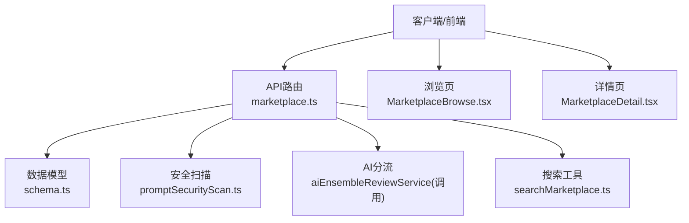
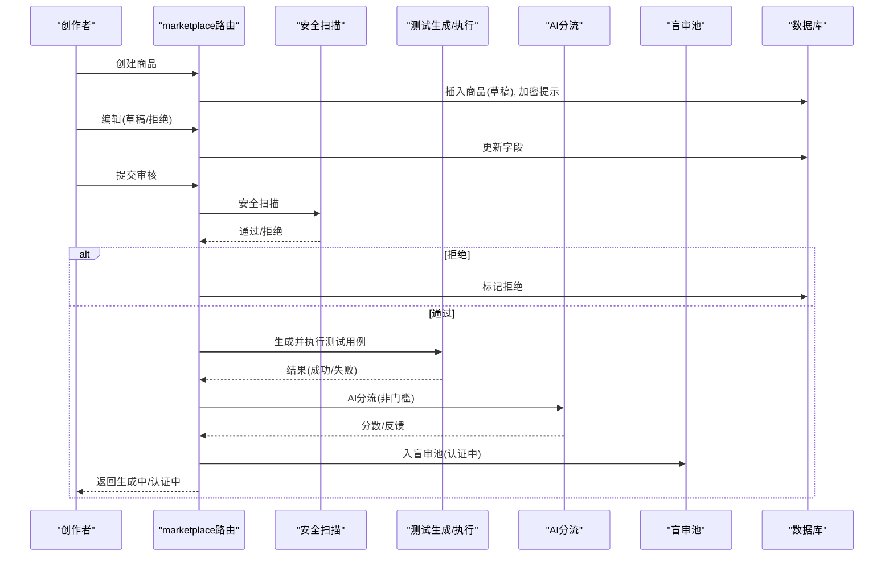
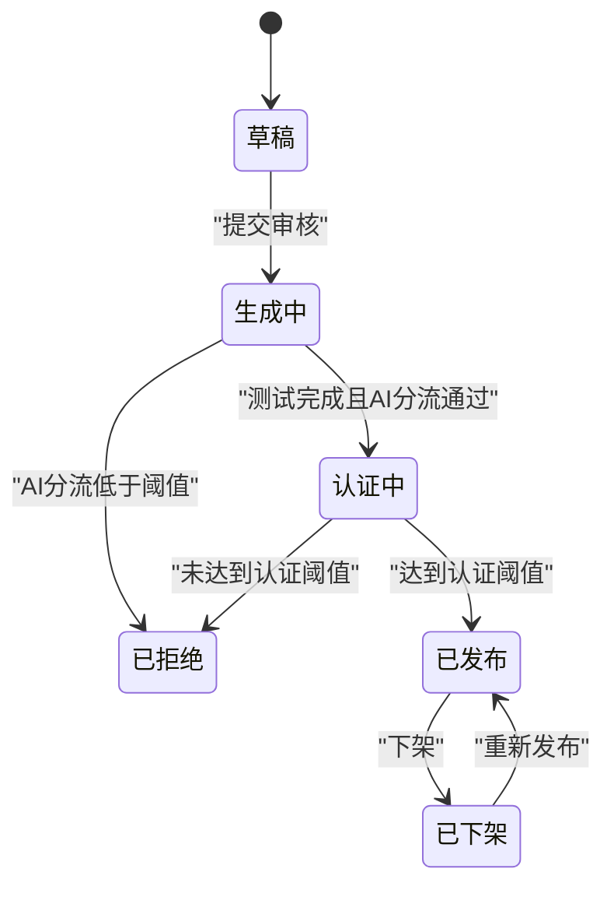
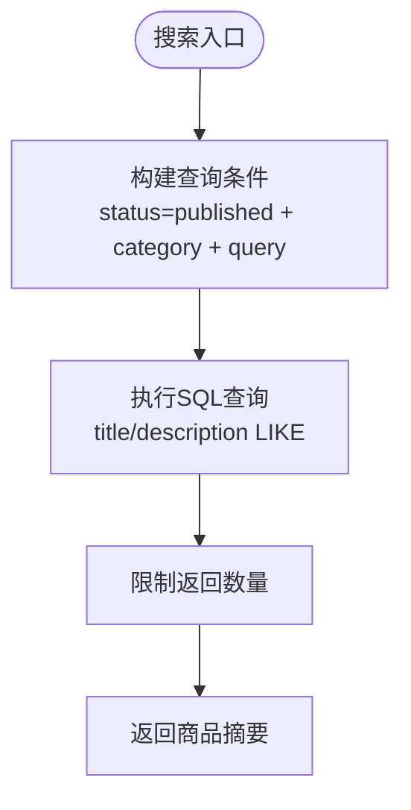
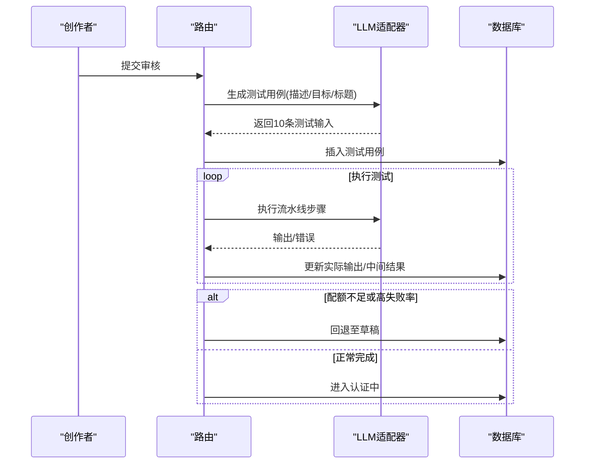
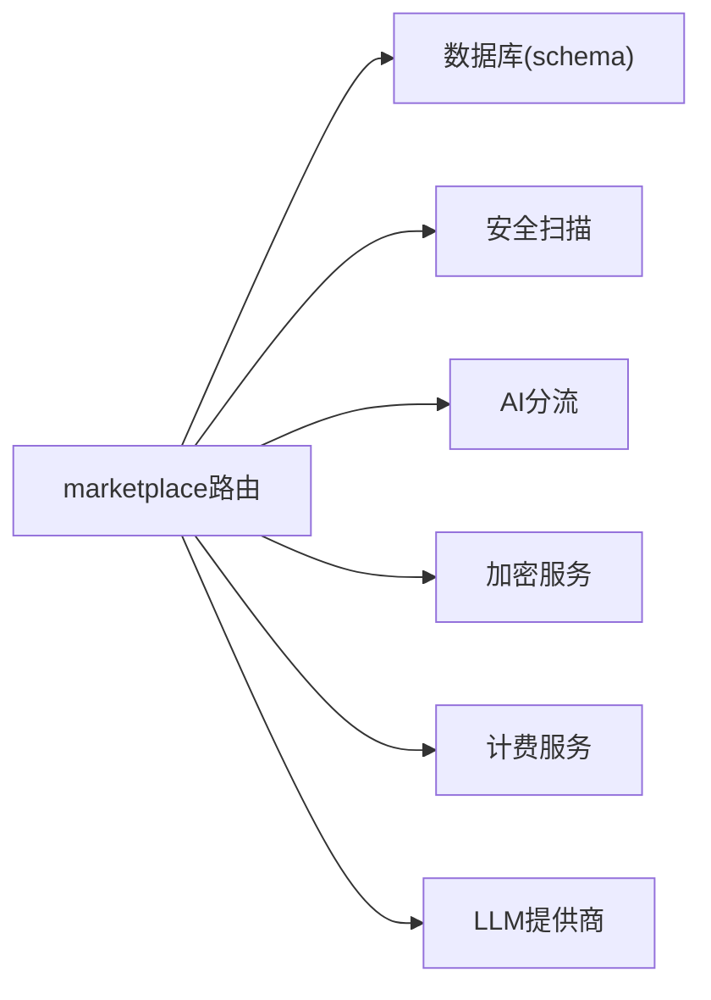

# 商品管理API

<cite>
**本文引用的文件**
- [api/routers/marketplace.ts](file://api/routers/marketplace.ts)
- [db/schema.ts](file://db/schema.ts)
- [api/services/promptSecurityScan.ts](file://api/services/promptSecurityScan.ts)
- [api/mcp/tools/searchMarketplace.ts](file://api/mcp/tools/searchMarketplace.ts)
- [src/pages/MarketplaceBrowse.tsx](file://src/pages/MarketplaceBrowse.tsx)
- [src/pages/MarketplaceDetail.tsx](file://src/pages/MarketplaceDetail.tsx)
- [api/router.ts](file://api/router.ts)
- [DeeWaanAI-Next/MARKETPLACE-TRUST-SPEC.md](file://DeeWaanAI-Next/MARKETPLACE-TRUST-SPEC.md)
</cite>

## 目录
1. [简介](#简介)
2. [项目结构](#项目结构)
3. [核心组件](#核心组件)
4. [架构总览](#架构总览)
5. [详细组件分析](#详细组件分析)
6. [依赖关系分析](#依赖关系分析)
7. [性能考虑](#性能考虑)
8. [故障排查指南](#故障排查指南)
9. [结论](#结论)
10. [附录](#附录)

## 简介
本技术文档围绕市场商品（Listing）的完整生命周期管理，覆盖创建、编辑、提交审核、发布、下架与删除相关能力；详细说明商品元数据定义、分类标签系统、搜索索引机制；记录商品状态机（草稿、生成中、待审、审核中、认证中、已拒绝、已批准、已发布、已下架）及其转换规则；并集成商品描述驱动测试用例自动生成、安全扫描、批量操作接口、版本管理与回滚机制、权限控制、访问限制与版权保护等。

## 项目结构
- API路由层：市场商品相关端点集中在 marketplace router，负责创建、更新、提交审核、发布/下架、浏览与详情查询等。
- 数据模型：数据库 schema 定义了 market_listings、test_prompts、listing_reviews、blind_review_tasks 等表，承载商品主数据、测试用例、人工评审与盲审任务。
- 服务层：安全扫描、AI 分流（triage）、证书化聚合、加密解密、支付与计费等服务。
- 前端页面：浏览与详情页展示商品列表、筛选、购买入口与认证提示。
- MCP工具：提供面向MCP的搜索与查询能力。

图表来源
- [api/routers/marketplace.ts:920-1086](file://api/routers/marketplace.ts#L920-L1086)
- [db/schema.ts:512-564](file://db/schema.ts#L512-L564)
- [api/services/promptSecurityScan.ts:226-260](file://api/services/promptSecurityScan.ts#L226-L260)
- [api/mcp/tools/searchMarketplace.ts:33-74](file://api/mcp/tools/searchMarketplace.ts#L33-L74)
- [src/pages/MarketplaceBrowse.tsx:32-52](file://src/pages/MarketplaceBrowse.tsx#L32-L52)
- [src/pages/MarketplaceDetail.tsx:227-271](file://src/pages/MarketplaceDetail.tsx#L227-L271)

章节来源
- [api/router.ts:1-29](file://api/router.ts#L1-L29)
- [api/routers/marketplace.ts:920-1086](file://api/routers/marketplace.ts#L920-L1086)
- [db/schema.ts:512-564](file://db/schema.ts#L512-L564)

## 核心组件
- 商品主实体（marketplaceListings）：包含标题、描述、结构化字段（目标、输入/输出格式、备注）、分类、价格、订阅价、状态、评分、审核计数、Kappa、AI评分、销售计数、时间戳等。
- 测试用例（testPrompts）：为每个商品自动生成的10条测试输入，用于评测与盲审。
- 人工评审（listingReviews）：记录评审维度与加权得分，支撑认证决策。
- 盲审任务（blind_review_tasks）：匿名化的评审池，支持按提示词复制多份，避免重复评审与冲突。
- 安全扫描（promptSecurityScan）：对可见元数据与测试输入进行确定性安全检查，拦截注入、泄露、敏感信息等风险。
- 搜索与浏览：支持按分类、关键词、排序与状态过滤，仅暴露“已发布”和“认证中”的商品给公众浏览。

章节来源
- [db/schema.ts:512-699](file://db/schema.ts#L512-L699)
- [api/routers/marketplace.ts:920-1022](file://api/routers/marketplace.ts#L920-L1022)
- [api/services/promptSecurityScan.ts:226-260](file://api/services/promptSecurityScan.ts#L226-L260)

## 架构总览
商品生命周期从创建到上架的关键路径如下：
- 创建：校验模板归属，写入商品主数据，加密存储步骤中的系统提示。
- 编辑：仅允许草稿或已拒绝状态修改。
- 提交审核：执行安全扫描 → 生成测试用例 → 运行测试 → AI分流（非门槛）→ 进入认证中 → 入盲审池。
- 认证通过：达到阈值后转为已发布，可购买。
- 发布/下架：创作者在“已批准”或“已发布”状态下可发布/下架。
- 删除：代码未直接暴露删除端点，通常由管理员流程处理（不在本文范围）。

图表来源
- [api/routers/marketplace.ts:1024-1421](file://api/routers/marketplace.ts#L1024-L1421)
- [api/services/promptSecurityScan.ts:226-260](file://api/services/promptSecurityScan.ts#L226-L260)
- [DeeWaanAI-Next/MARKETPLACE-TRUST-SPEC.md:25-45](file://DeeWaanAI-Next/MARKETPLACE-TRUST-SPEC.md#L25-L45)

## 详细组件分析

### 商品状态机与转换规则
- 状态集合：draft（草稿）、generating（生成中）、pending_review/reviewing（历史流程）、certifying（认证中）、rejected（已拒绝）、approved（已批准）、published（已发布）、unpublished（已下架）。
- 关键转换：
  - 提交审核：draft/rejected → generating → certifying（若AI分流低于阈值则 rejected）。
  - 认证通过：certifying → published（达到平均权重分与通过率阈值）。
  - 发布/下架：approved/published → published/unpublished（需创作者权限）。
  - 安全拒绝：任何阶段的安全扫描失败 → rejected。

图表来源
- [db/schema.ts:538-548](file://db/schema.ts#L538-L548)
- [api/routers/marketplace.ts:1135-1421](file://api/routers/marketplace.ts#L1135-L1421)
- [api/routers/marketplace.ts:1603-1638](file://api/routers/marketplace.ts#L1603-L1638)

章节来源
- [db/schema.ts:538-548](file://db/schema.ts#L538-L548)
- [api/routers/marketplace.ts:1135-1421](file://api/routers/marketplace.ts#L1135-L1421)
- [api/routers/marketplace.ts:1603-1638](file://api/routers/marketplace.ts#L1603-L1638)

### 商品元数据与分类标签
- 元数据字段：标题、描述、目标、输入格式、输出格式、备注、分类、价格、是否订阅、订阅价、评分、审核计数、Kappa、AI评分、销售计数、时间戳。
- 分类枚举：translation、writing、code、analysis、creative、other。
- 公开浏览：仅显示“已发布”和“认证中”的商品，支持按分类、排序（最新、价格升/降、评分、热门）过滤。

章节来源
- [db/schema.ts:512-564](file://db/schema.ts#L512-L564)
- [api/routers/marketplace.ts:920-978](file://api/routers/marketplace.ts#L920-L978)
- [src/pages/MarketplaceBrowse.tsx:32-52](file://src/pages/MarketplaceBrowse.tsx#L32-L52)

### 搜索索引机制
- 搜索实现：基于数据库LIKE匹配标题与描述，结合分类过滤与排序。
- 公开搜索：仅检索“已发布”商品，返回摘要信息（截断描述）。
- 前端交互：支持关键词过滤与分类筛选。

图表来源
- [api/mcp/tools/searchMarketplace.ts:33-74](file://api/mcp/tools/searchMarketplace.ts#L33-L74)
- [src/pages/MarketplaceBrowse.tsx:32-52](file://src/pages/MarketplaceBrowse.tsx#L32-L52)

章节来源
- [api/mcp/tools/searchMarketplace.ts:33-74](file://api/mcp/tools/searchMarketplace.ts#L33-L74)
- [src/pages/MarketplaceBrowse.tsx:32-52](file://src/pages/MarketplaceBrowse.tsx#L32-L52)

### 商品描述生成与测试用例自动生成
- 描述驱动生成：根据商品描述/目标/标题，调用LLM生成10条多样化测试输入（简单/中等/复杂/边缘），并保存到测试用例表。
- 测试执行：按流水线步骤顺序执行，记录中间响应与耗时，保存最终输出。
- 失败处理：遇到配额不足立即停止并回退至草稿；超过50%失败也回退至草稿。
- 可选备份：支持将测试数据与报告保存到外部仓库（如Gitee）。

图表来源
- [api/routers/marketplace.ts:55-122](file://api/routers/marketplace.ts#L55-L122)
- [api/routers/marketplace.ts:201-328](file://api/routers/marketplace.ts#L201-L328)
- [api/routers/marketplace.ts:1204-1421](file://api/routers/marketplace.ts#L1204-L1421)

章节来源
- [api/routers/marketplace.ts:55-122](file://api/routers/marketplace.ts#L55-L122)
- [api/routers/marketplace.ts:201-328](file://api/routers/marketplace.ts#L201-L328)
- [api/routers/marketplace.ts:1204-1421](file://api/routers/marketplace.ts#L1204-L1421)

### 安全扫描集成
- 扫描范围：可见元数据（标题、描述、目标、输入/输出格式、备注）、测试输入、以及解密后的系统提示（内存中处理，不持久化明文）。
- 检查项：Unicode清洗、注入短语、数据外泄、密钥滥用等。
- 策略：发现风险即拒绝，并将发现写入AI反馈字段；语义级攻击可由平台模型二次判定并转人工安全审查。

章节来源
- [api/services/promptSecurityScan.ts:226-260](file://api/services/promptSecurityScan.ts#L226-L260)
- [api/routers/marketplace.ts:1164-1185](file://api/routers/marketplace.ts#L1164-L1185)
- [DeeWaanAI-Next/MARKETPLACE-TRUST-SPEC.md:209-213](file://DeeWaanAI-Next/MARKETPLACE-TRUST-SPEC.md#L209-L213)

### 批量操作接口
- 批量运行：支持批量执行流水线任务（研究模式），包括创建批次、查询状态、列出批次、取消/恢复、导出结果。
- 限流与权限：启用功能标志与速率限制，确保资源可控。
- 注意：批量接口当前绑定在swarm路由，非市场商品直接操作，但可作为商品测试与评估的辅助能力。

章节来源
- [api/routers/swarm.ts:610-654](file://api/routers/swarm.ts#L610-L654)
- [scripts/phase1-patch.py:57-127](file://scripts/phase1-patch.py#L57-L127)

### 版本管理与回滚机制
- 版本快照：提交审核时清理历史评审与测试数据，重新生成，保证一致性。
- 回滚策略：
  - 安全扫描失败：直接拒绝。
  - AI分流低于阈值：拒绝并记录反馈。
  - 测试执行失败率高或配额不足：回退至草稿。
  - 认证未达标：拒绝并给出聚合反馈。
- 发布/下架：创作者可在“已批准/已发布”状态切换，便于快速回滚可见性。

章节来源
- [api/routers/marketplace.ts:1154-1163](file://api/routers/marketplace.ts#L1154-L1163)
- [api/routers/marketplace.ts:1285-1351](file://api/routers/marketplace.ts#L1285-L1351)
- [api/routers/marketplace.ts:1370-1397](file://api/routers/marketplace.ts#L1370-L1397)
- [api/routers/marketplace.ts:1603-1638](file://api/routers/marketplace.ts#L1603-L1638)

### 权限控制、访问限制与版权保护
- 权限控制：
  - 创建/编辑/提交审核/发布/下架均要求认证用户，并校验模板或商品归属。
  - 公开浏览仅展示“已发布”和“认证中”商品，隐藏敏感信息。
- 访问限制：
  - 速率限制与功能开关控制批量与高级能力。
  - 购买流程在前端根据状态禁用（如认证中不可购买）。
- 版权保护：
  - 系统提示加密存储，运行时按需解密，避免明文泄露。
  - 法律声明明确创作者保留知识产权，平台仅获必要运营权。

章节来源
- [api/routers/marketplace.ts:1024-1133](file://api/routers/marketplace.ts#L1024-L1133)
- [api/routers/marketplace.ts:920-1022](file://api/routers/marketplace.ts#L920-L1022)
- [src/pages/MarketplaceDetail.tsx:227-271](file://src/pages/MarketplaceDetail.tsx#L227-L271)
- [DeeWaanAI-Next/site/src/content/ui/en.json:398-404](file://site/src/content/ui/en.json#L398-L404)

## 依赖关系分析
- 路由依赖：marketplace路由依赖数据库连接、加密服务、安全扫描、AI分流、计费服务等。
- 数据依赖：商品主数据关联模板、测试用例、评审记录、盲审任务。
- 外部依赖：LLM提供商（用于测试生成与执行）、支付网关（购买流程）、对象存储/Gitee（测试数据备份）。

图表来源
- [api/routers/marketplace.ts:1-36](file://api/routers/marketplace.ts#L1-L36)
- [db/schema.ts:512-699](file://db/schema.ts#L512-L699)

章节来源
- [api/routers/marketplace.ts:1-36](file://api/routers/marketplace.ts#L1-L36)
- [db/schema.ts:512-699](file://db/schema.ts#L512-L699)

## 性能考虑
- 缓存策略：公开浏览与详情设置短TTL缓存头，减少数据库压力。
- 异步执行：提交审核后后台生成测试用例，避免阻塞请求。
- 重试与超时：LLM调用具备指数退避重试与单步超时，防止长尾阻塞。
- 批量与限流：批量接口启用功能开关与速率限制，保障稳定性。

章节来源
- [api/routers/marketplace.ts:37-53](file://api/routers/marketplace.ts#L37-L53)
- [api/routers/marketplace.ts:162-199](file://api/routers/marketplace.ts#L162-L199)
- [api/routers/marketplace.ts:1231-1421](file://api/routers/marketplace.ts#L1231-L1421)

## 故障排查指南
- 安全扫描拒绝：检查aiFeedback中的[SECURITY]发现，定位注入/泄露/敏感内容。
- AI分流拒绝：查看aiGrade与aiFeedback，调整商品描述/目标以提升质量。
- 测试执行失败：关注错误信息与配额不足提示，补充提供商额度或优化步骤。
- 认证未通过：查看加权平均分与通过率，改进流水线输出质量。
- 购买受限：确认商品状态是否为“已发布”，认证中不可购买。

章节来源
- [api/routers/marketplace.ts:1164-1185](file://api/routers/marketplace.ts#L1164-L1185)
- [api/routers/marketplace.ts:1370-1397](file://api/routers/marketplace.ts#L1370-L1397)
- [api/routers/marketplace.ts:1285-1351](file://api/routers/marketplace.ts#L1285-L1351)
- [src/pages/MarketplaceDetail.tsx:227-271](file://src/pages/MarketplaceDetail.tsx#L227-L271)

## 结论
该商品管理API实现了从创建到上架的全链路闭环，涵盖元数据管理、分类标签、搜索、安全扫描、AI分流、测试用例自动生成、盲审认证、发布/下架与权限控制。通过严格的回滚策略与缓存/异步优化，保障了系统的可靠性、安全性与性能。建议在生产环境持续监控安全扫描与AI分流指标，完善批量与版本管理能力，以支撑更大规模的商品生态。

## 附录
- 术语说明：
  - 商品（Listing）：市场中的可售卖或可预览的流水线产品。
  - 认证中（Certifying）：可见但不可购买的过渡状态，等待盲审。
  - 已发布（Published）：通过认证后可购买的状态。
  - 已下架（Unpublished）：暂时不可见或不可购买的状态。
- 参考规范：市场信任与安全规范（Trust Spec）定义了生命周期、安全扫描、认证等级与模型托管策略。

章节来源
- [DeeWaanAI-Next/MARKETPLACE-TRUST-SPEC.md:25-45](file://DeeWaanAI-Next/MARKETPLACE-TRUST-SPEC.md#L25-L45)
- [DeeWaanAI-Next/MARKETPLACE-TRUST-SPEC.md:209-218](file://DeeWaanAI-Next/MARKETPLACE-TRUST-SPEC.md#L209-L218)