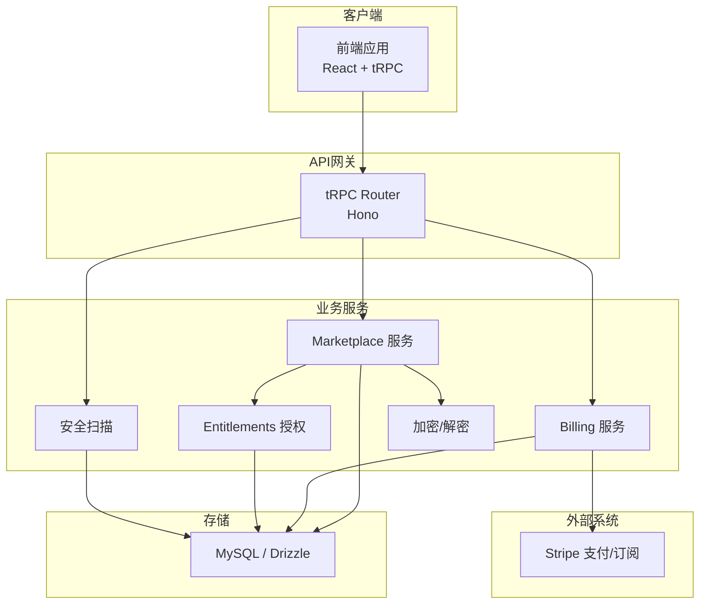
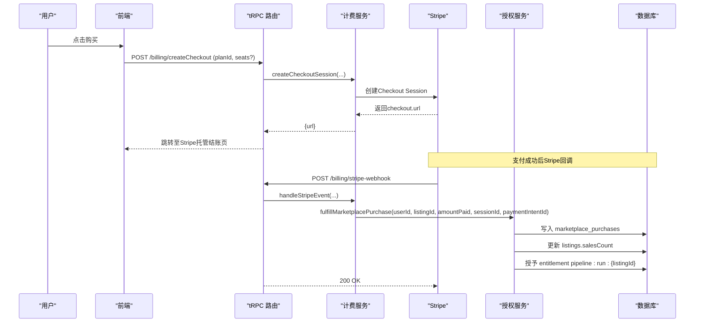
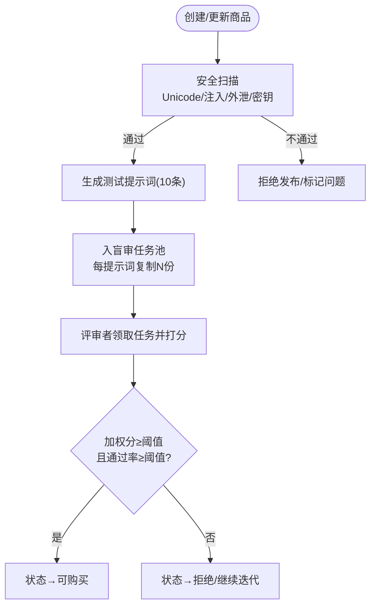
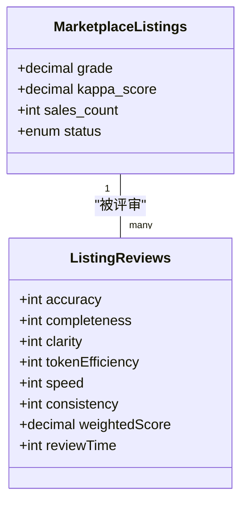
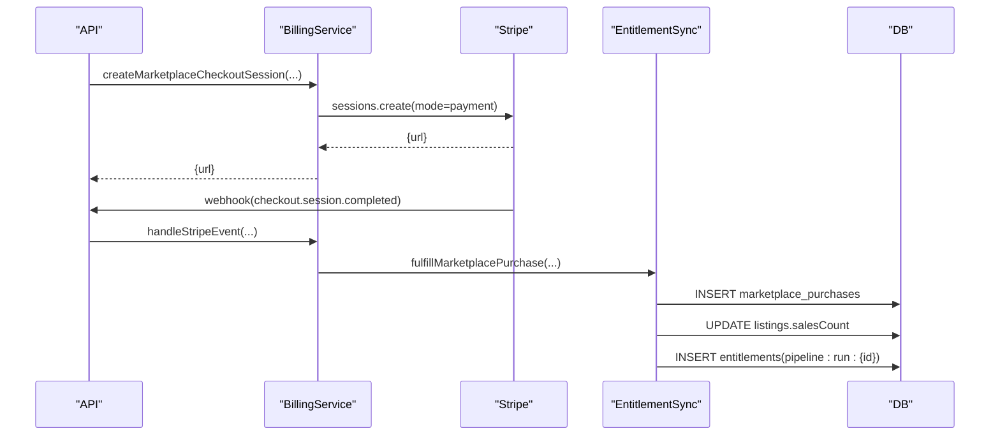
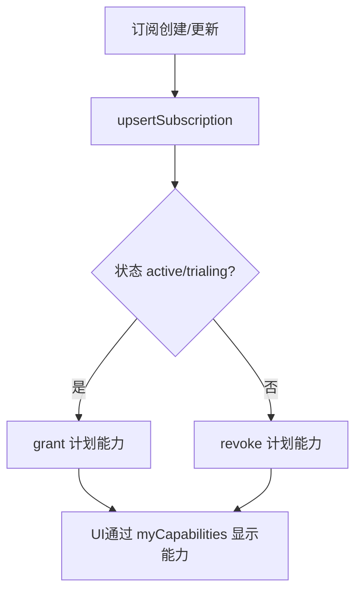
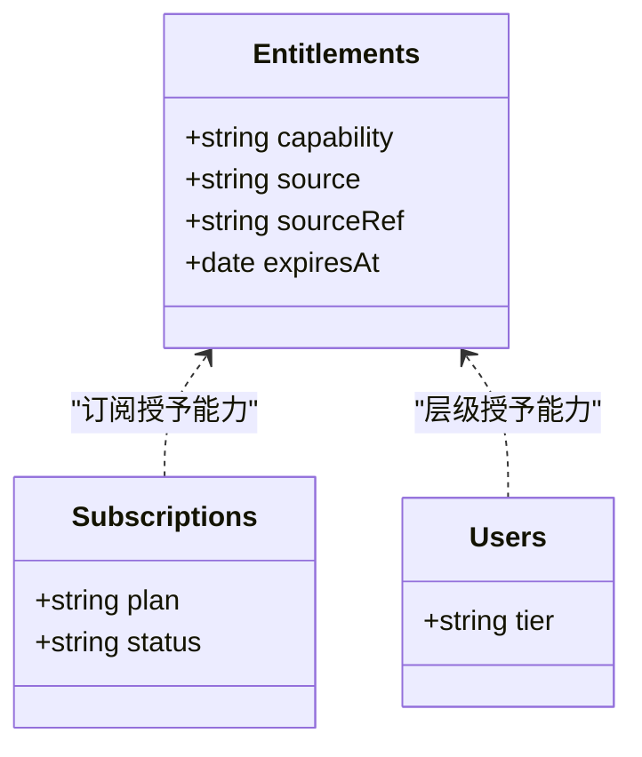
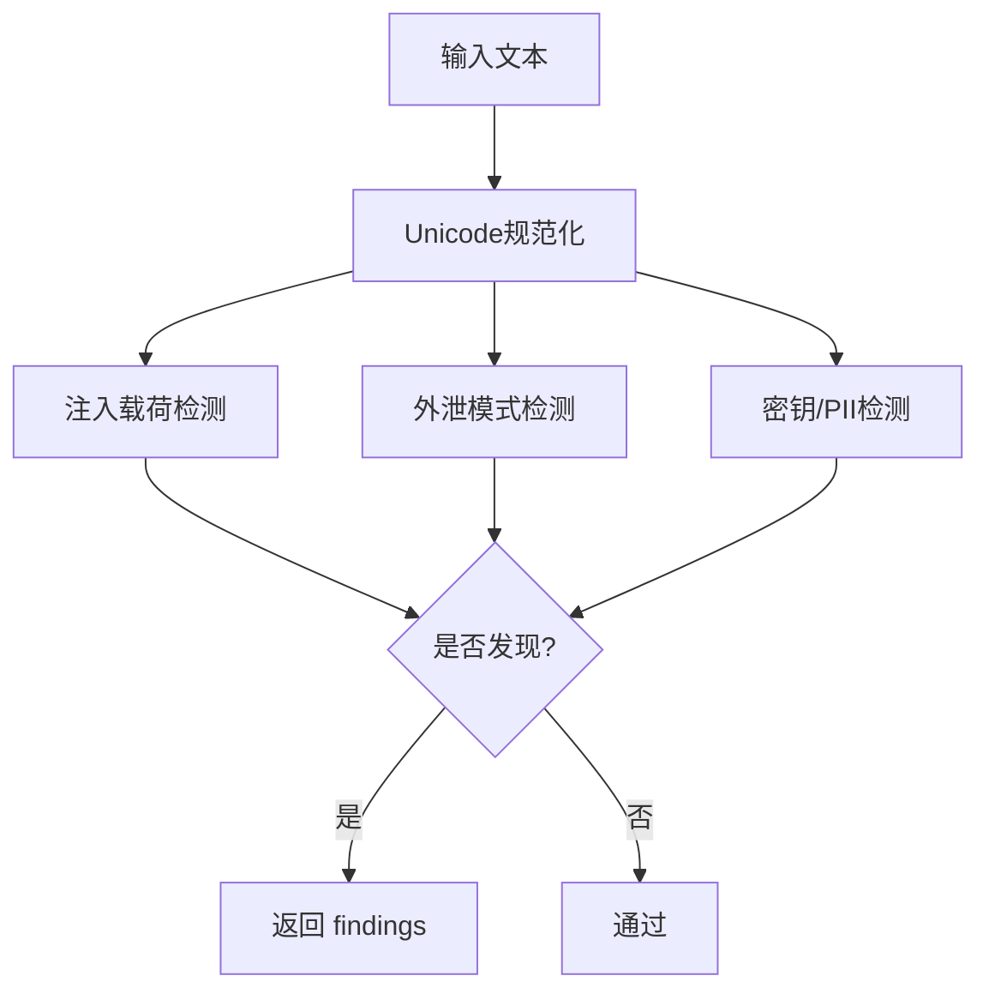
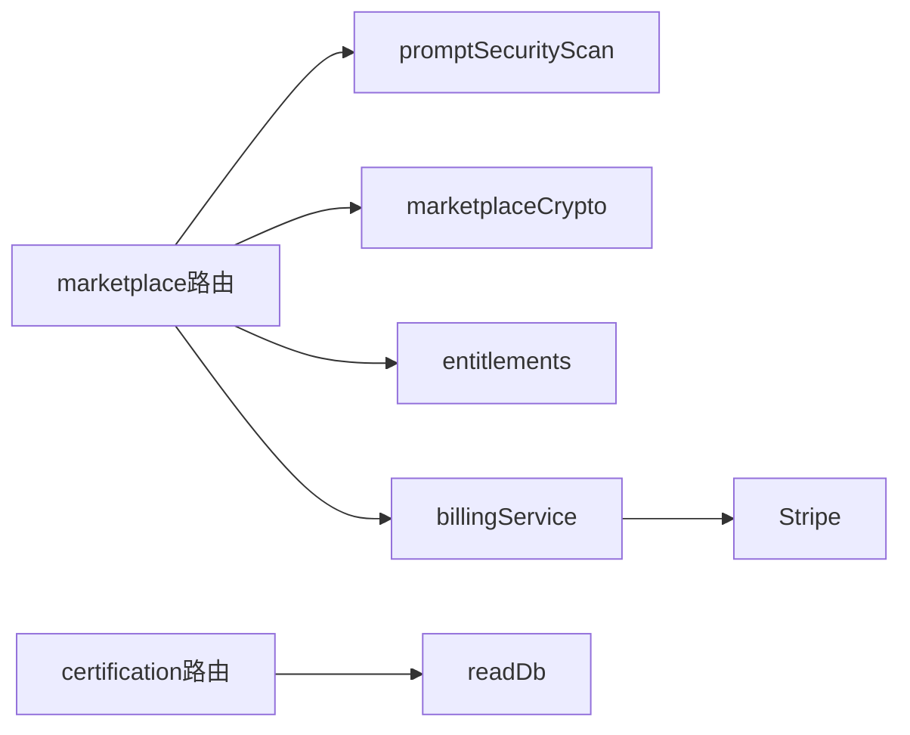

# 市场生态系统API

<cite>
**本文引用的文件**
- [README.md](file://README.md)
- [api/routers/marketplace.ts](file://api/routers/marketplace.ts)
- [api/routers/billing.ts](file://api/routers/billing.ts)
- [api/routers/certification.ts](file://api/routers/certification.ts)
- [api/routers/search.ts](file://api/routers/search.ts)
- [api/services/billingService.ts](file://api/services/billingService.ts)
- [api/services/entitlements.ts](file://api/services/entitlements.ts)
- [api/lib/marketplaceCrypto.ts](file://api/lib/marketplaceCrypto.ts)
- [api/services/promptSecurityScan.ts](file://api/services/promptSecurityScan.ts)
- [db/schema.ts](file://db/schema.ts)
- [contracts/index.ts](file://contracts/index.ts)
- [src/pages/CreatorDashboard.tsx](file://src/pages/CreatorDashboard.tsx)
- [src/pages/CertificationReport.tsx](file://src/pages/CertificationReport.tsx)
- [scripts/smoke-stripe-webhook.mjs](file://scripts/smoke-stripe-webhook.mjs)
</cite>

## 目录
1. [简介](#简介)
2. [项目结构](#项目结构)
3. [核心组件](#核心组件)
4. [架构总览](#架构总览)
5. [详细组件分析](#详细组件分析)
6. [依赖关系分析](#依赖关系分析)
7. [性能与可靠性](#性能与可靠性)
8. [故障排查指南](#故障排查指南)
9. [结论](#结论)
10. [附录：关键API清单](#附录：关键api清单)

## 简介
本技术文档面向“市场生态系统API”，覆盖AI工具（流水线模板）的发布、发现、购买与使用全流程，包括商品管理、评价系统、交易处理与订阅管理；认证流程、质量评估、安全扫描与合规检查；Stripe支付集成、计费模型、账单生成与发票管理；创作者仪表板、销售分析与收入统计；许可证管理与使用许可验证、版权保护机制；搜索推荐、分类标签与用户行为分析。

该系统采用Hono + tRPC + MySQL/drizzle后端，React前端，可选Redis队列/消息，Stripe负责计费。同一Node进程同时提供API、MCP表面与SPA静态资源。

**章节来源**
- [README.md:1-127](file://README.md#L1-L127)

## 项目结构
- API路由层：按领域划分（marketplace、billing、certification、search等），通过tRPC暴露查询与变更接口。
- 服务层：计费、授权能力、加密、安全扫描、事件同步等。
- 数据层：drizzle schema定义数据库表结构与索引。
- 前端页面：创作者仪表板、认证报告、市场浏览与详情等。
- 脚本与测试：Smoke测试、迁移、模拟脚本。

**图表来源**
- [api/routers/marketplace.ts:1-40](file://api/routers/marketplace.ts#L1-L40)
- [api/routers/billing.ts:1-36](file://api/routers/billing.ts#L1-L36)
- [api/services/billingService.ts:1-30](file://api/services/billingService.ts#L1-L30)
- [api/services/entitlements.ts:1-30](file://api/services/entitlements.ts#L1-L30)
- [api/services/promptSecurityScan.ts:1-20](file://api/services/promptSecurityScan.ts#L1-L20)
- [api/lib/marketplaceCrypto.ts:1-20](file://api/lib/marketplaceCrypto.ts#L1-L20)
- [db/schema.ts:507-780](file://db/schema.ts#L507-L780)

**章节来源**
- [api/routers/marketplace.ts:1-40](file://api/routers/marketplace.ts#L1-L40)
- [api/routers/billing.ts:1-36](file://api/routers/billing.ts#L1-L36)
- [db/schema.ts:507-780](file://db/schema.ts#L507-L780)

## 核心组件
- 市场商品（Listing）：包含标题、描述、类别、价格、是否订阅、状态、评分、销量等。
- 评测与认证：盲审任务池、人类评审打分、AI集成分数、Fleiss Kappa与通过率阈值决定“可购买”状态。
- 购买与授权：Stripe Checkout创建会话，Webhook回调完成购买后写入购买记录并授予“运行该流水线”的能力。
- 订阅与团队席位：个人订阅与团队席位订阅，统一通过Stripe事件同步到本地订阅表与能力集合。
- 安全扫描：对可见元数据、测试提示词、内存中解密的系统提示词进行注入、外泄、敏感信息检测。
- 搜索与发现：全局搜索项目、运行、自定义Agent；市场侧支持分类与筛选。
- 创作者仪表板：展示平均评分、总销量等指标。

**章节来源**
- [db/schema.ts:511-780](file://db/schema.ts#L511-L780)
- [api/routers/marketplace.ts:403-543](file://api/routers/marketplace.ts#L403-L543)
- [api/services/billingService.ts:80-129](file://api/services/billingService.ts#L80-L129)
- [api/services/entitlements.ts:22-30](file://api/services/entitlements.ts#L22-L30)
- [api/services/promptSecurityScan.ts:198-301](file://api/services/promptSecurityScan.ts#L198-L301)
- [api/routers/search.ts:7-66](file://api/routers/search.ts#L7-L66)
- [src/pages/CreatorDashboard.tsx:684-702](file://src/pages/CreatorDashboard.tsx#L684-L702)

## 架构总览
市场生态系统的请求流分为三类：
- 浏览与发现：公开或受限的商品列表、详情、认证报告。
- 购买与授权：创建Checkout会话 → Stripe支付 → Webhook回调 → 写入购买记录 → 授予能力。
- 使用与执行：基于能力校验决定是否允许运行某流水线。

**图表来源**
- [api/routers/billing.ts:38-61](file://api/routers/billing.ts#L38-L61)
- [api/services/billingService.ts:80-129](file://api/services/billingService.ts#L80-L129)
- [api/services/billingService.ts:444-488](file://api/services/billingService.ts#L444-L488)
- [api/services/entitlements.ts:106-131](file://api/services/entitlements.ts#L106-L131)
- [db/schema.ts:730-749](file://db/schema.ts#L730-L749)

**章节来源**
- [api/routers/billing.ts:38-61](file://api/routers/billing.ts#L38-L61)
- [api/services/billingService.ts:444-488](file://api/services/billingService.ts#L444-L488)
- [api/services/entitlements.ts:106-131](file://api/services/entitlements.ts#L106-L131)

## 详细组件分析

### 商品管理与发布流程
- 商品字段：标题、描述、目标、输入/输出格式、备注、类别、价格、是否订阅、状态、评分、Kappa、AI分数、销量等。
- 发布前安全扫描：对可见字段、测试提示词、内存中解密的系统提示词进行注入、外泄、敏感信息检测，失败则阻止上线。
- 自动生成测试提示词：根据流水线描述调用LLM生成10条测试用例，用于评测与演示。
- 盲审任务池：进入“认证中”时，为每个测试提示词复制N份（N=最小评审人数）进入池，评审者匿名领取任务并提交打分。
- 认证决策：加权平均分≥阈值且通过率≥阈值即“可购买”。

**图表来源**
- [api/services/promptSecurityScan.ts:198-301](file://api/services/promptSecurityScan.ts#L198-L301)
- [api/routers/marketplace.ts:55-122](file://api/routers/marketplace.ts#L55-L122)
- [api/routers/marketplace.ts:589-614](file://api/routers/marketplace.ts#L589-L614)
- [api/routers/marketplace.ts:630-735](file://api/routers/marketplace.ts#L630-L735)
- [api/routers/marketplace.ts:512-543](file://api/routers/marketplace.ts#L512-L543)

**章节来源**
- [db/schema.ts:511-564](file://db/schema.ts#L511-L564)
- [api/services/promptSecurityScan.ts:198-301](file://api/services/promptSecurityScan.ts#L198-L301)
- [api/routers/marketplace.ts:55-122](file://api/routers/marketplace.ts#L55-L122)
- [api/routers/marketplace.ts:589-735](file://api/routers/marketplace.ts#L589-L735)
- [api/routers/marketplace.ts:512-543](file://api/routers/marketplace.ts#L512-L543)

### 评价系统与质量评估
- 维度权重：准确性、完整性、清晰度、Token效率、速度、一致性。
- 加权得分：按权重计算每条评审的加权分。
- 认证阈值：平均分≥阈值且通过率≥阈值方可“可购买”。
- 公开认证报告：仅对已批准/发布的商品暴露，聚合各维度平均分、评审人数、评分等级等。

**图表来源**
- [db/schema.ts:579-599](file://db/schema.ts#L579-L599)
- [db/schema.ts:511-564](file://db/schema.ts#L511-L564)
- [api/routers/marketplace.ts:485-543](file://api/routers/marketplace.ts#L485-L543)
- [api/routers/certification.ts:32-90](file://api/routers/certification.ts#L32-L90)

**章节来源**
- [api/routers/marketplace.ts:485-543](file://api/routers/marketplace.ts#L485-L543)
- [api/routers/certification.ts:32-90](file://api/routers/certification.ts#L32-L90)
- [db/schema.ts:579-599](file://db/schema.ts#L579-L599)

### 交易处理与Stripe集成
- 创建Checkout：支持个人计划与团队席位计划，返回Stripe托管结账URL。
- Webhook处理：去重（idempotency key）、签名校验、事件分发（checkout.session.completed、subscription.*、charge.refunded）。
- 购买履约：写入购买记录、更新销量、授予“运行该流水线”的能力。
- 退款处理：匹配payment intent撤销购买与能力。

**图表来源**
- [api/services/billingService.ts:80-129](file://api/services/billingService.ts#L80-L129)
- [api/services/billingService.ts:444-488](file://api/services/billingService.ts#L444-L488)
- [api/services/entitlements.ts:106-131](file://api/services/entitlements.ts#L106-L131)
- [db/schema.ts:730-749](file://db/schema.ts#L730-L749)

**章节来源**
- [api/routers/billing.ts:38-61](file://api/routers/billing.ts#L38-L61)
- [api/services/billingService.ts:80-129](file://api/services/billingService.ts#L80-L129)
- [api/services/billingService.ts:444-488](file://api/services/billingService.ts#L444-L488)
- [scripts/smoke-stripe-webhook.mjs:156-178](file://scripts/smoke-stripe-webhook.mjs#L156-L178)

### 订阅管理与计费模型
- 计划能力：不同计划（如Solo、Team Seat）对应不同能力集合。
- 订阅生命周期：创建、更新、删除事件均同步到本地subscriptions表，并增减能力。
- 团队席位：按成员数量调整Stripe订阅项数量，保持计费与实际一致。

**图表来源**
- [api/services/billingService.ts:213-252](file://api/services/billingService.ts#L213-L252)
- [api/services/entitlements.ts:22-30](file://api/services/entitlements.ts#L22-L30)
- [api/routers/billing.ts:141-161](file://api/routers/billing.ts#L141-L161)

**章节来源**
- [api/services/billingService.ts:213-252](file://api/services/billingService.ts#L213-L252)
- [api/routers/billing.ts:141-161](file://api/routers/billing.ts#L141-L161)

### 许可证管理与使用许可验证
- 能力模型：以“capability”为核心，来源包括显式授权、活跃订阅、用户层级、未过期券兑换。
- 购买能力：购买成功后授予“pipeline:run:{listingId}”，用于控制流水线运行权限。
- 能力解析：resolveCapabilities汇总所有来源能力，供UI与中间件判定。

**图表来源**
- [api/services/entitlements.ts:22-30](file://api/services/entitlements.ts#L22-L30)
- [api/services/entitlements.ts:165-207](file://api/services/entitlements.ts#L165-L207)
- [api/services/entitlements.ts:106-131](file://api/services/entitlements.ts#L106-L131)

**章节来源**
- [api/services/entitlements.ts:22-30](file://api/services/entitlements.ts#L22-L30)
- [api/services/entitlements.ts:165-207](file://api/services/entitlements.ts#L165-L207)
- [api/services/entitlements.ts:106-131](file://api/services/entitlements.ts#L106-L131)

### 安全扫描与合规检查
- 扫描范围：可见元数据、测试提示词、内存中解密的系统提示词。
- 规则类型：Unicode清洗、注入载荷、外泄模式、密钥/PII检测。
- 失败策略：fail-closed，任何无法扫描的情况视为发现问题。

**图表来源**
- [api/services/promptSecurityScan.ts:23-63](file://api/services/promptSecurityScan.ts#L23-L63)
- [api/services/promptSecurityScan.ts:65-131](file://api/services/promptSecurityScan.ts#L65-L131)
- [api/services/promptSecurityScan.ts:133-196](file://api/services/promptSecurityScan.ts#L133-L196)
- [api/services/promptSecurityScan.ts:198-301](file://api/services/promptSecurityScan.ts#L198-L301)

**章节来源**
- [api/services/promptSecurityScan.ts:23-63](file://api/services/promptSecurityScan.ts#L23-L63)
- [api/services/promptSecurityScan.ts:65-131](file://api/services/promptSecurityScan.ts#L65-L131)
- [api/services/promptSecurityScan.ts:133-196](file://api/services/promptSecurityScan.ts#L133-L196)
- [api/services/promptSecurityScan.ts:198-301](file://api/services/promptSecurityScan.ts#L198-L301)

### 创作者仪表板、销售分析与收入统计
- 指标：平均评分、总销量、各商品销量等。
- 数据来源：listings.grade、sales_count等字段聚合。
- 展示：前端仪表板渲染统计卡片。

**章节来源**
- [src/pages/CreatorDashboard.tsx:684-702](file://src/pages/CreatorDashboard.tsx#L684-L702)
- [db/schema.ts:511-564](file://db/schema.ts#L511-L564)

### 搜索推荐、分类标签与用户行为分析
- 全局搜索：跨项目、运行、自定义Agent的模糊搜索。
- 市场分类：商品类别枚举（翻译、写作、代码、分析、创意、其他）。
- 行为分析：可通过runs、agent_runs、agent_responses等表追踪使用轨迹与耗时。

**章节来源**
- [api/routers/search.ts:7-66](file://api/routers/search.ts#L7-L66)
- [db/schema.ts:527-534](file://db/schema.ts#L527-L534)
- [db/schema.ts:173-237](file://db/schema.ts#L173-L237)
- [db/schema.ts:262-335](file://db/schema.ts#L262-L335)

## 依赖关系分析
- 路由与服务耦合：
  - marketplace路由依赖安全扫描、加密、授权、Stripe计费。
  - billing路由依赖Stripe服务与授权能力。
  - certification路由只读，暴露认证报告与徽章数据。
- 数据依赖：
  - marketplace_listings、test_prompts、listing_reviews、blind_review_tasks、encrypted_prompts、marketplace_purchases等表紧密关联。
- 外部依赖：
  - Stripe用于支付与订阅；可选Redis用于队列/消息（当前有内存降级）。

**图表来源**
- [api/routers/marketplace.ts:1-35](file://api/routers/marketplace.ts#L1-L35)
- [api/routers/billing.ts:1-36](file://api/routers/billing.ts#L1-L36)
- [api/routers/certification.ts:1-22](file://api/routers/certification.ts#L1-L22)
- [api/services/billingService.ts:1-30](file://api/services/billingService.ts#L1-L30)

**章节来源**
- [api/routers/marketplace.ts:1-35](file://api/routers/marketplace.ts#L1-L35)
- [api/routers/billing.ts:1-36](file://api/routers/billing.ts#L1-L36)
- [api/routers/certification.ts:1-22](file://api/routers/certification.ts#L1-L22)

## 性能与可靠性
- 缓存策略：公开浏览与认证报告设置短浏览器TTL与较长边缘TTL，减少重复计算。
- 重试与超时：LLM调用带指数退避重试与硬超时，避免长尾阻塞。
- 幂等性：Stripe Webhook通过idempotency key去重，防止重复处理。
- 降级策略：未配置Stripe时计费接口返回503；Redis缺失时使用内存队列。

**章节来源**
- [api/routers/marketplace.ts:37-39](file://api/routers/marketplace.ts#L37-L39)
- [api/routers/marketplace.ts:162-199](file://api/routers/marketplace.ts#L162-L199)
- [api/services/billingService.ts:182-211](file://api/services/billingService.ts#L182-L211)
- [api/routers/billing.ts:11-16](file://api/routers/billing.ts#L11-L16)

## 故障排查指南
- 支付未配置：当缺少Stripe密钥时，计费相关接口返回“billing not configured”。
- Webhook签名失败：检查STRIPE_WEBHOOK_SECRET与环境变量配置。
- 购买未生效：确认Stripe checkout.session.completed事件已到达并被处理；核对marketplace_purchases与entitlements表。
- 评审卡住：检查blind_review_tasks池状态与评审者配额限制；确保MIN_UNIQUE_REVIEWERS与MIN_REVIEWS_PER_REVIEWER满足要求。
- 安全扫描失败：查看findings中的code与field label，定位注入、外泄或敏感信息问题。

**章节来源**
- [api/routers/billing.ts:11-16](file://api/routers/billing.ts#L11-L16)
- [api/services/billingService.ts:444-461](file://api/services/billingService.ts#L444-L461)
- [scripts/smoke-stripe-webhook.mjs:156-178](file://scripts/smoke-stripe-webhook.mjs#L156-L178)
- [api/routers/marketplace.ts:630-735](file://api/routers/marketplace.ts#L630-L735)
- [api/services/promptSecurityScan.ts:288-299](file://api/services/promptSecurityScan.ts#L288-L299)

## 结论
本系统围绕“可信市场”构建，从发布前的安全扫描、评测与认证，到购买后的授权与使用控制，形成闭环。Stripe计费与订阅管理支撑商业化运营；能力模型统一了权限语义；公开认证报告提升透明度。建议在后续阶段完善搜索排序与推荐算法、扩展行为分析埋点、优化大规模评审并发与缓存策略。

[无章节来源]

## 附录：关键API清单
- 市场
  - 创建购买会话：POST /api/marketplace/purchase（返回Stripe托管结账URL）
  - 获取认证报告：GET /api/certification/report?listingId=...
  - 获取徽章：GET /api/certification/badge?listingId=...
- 计费
  - 列出计划：GET /api/billing/listPlans
  - 创建个人结账：POST /api/billing/createCheckout
  - 创建团队席位结账：POST /api/billing/createTeamCheckout
  - 团队席位状态：GET /api/billing/teamSeatStatus
  - 我的订阅：GET /api/billing/mySubscription
  - 我的能力：GET /api/billing/myCapabilities
- 搜索
  - 全局搜索：GET /api/search/global?query=...&limit=...

**章节来源**
- [api/routers/marketplace.ts:2036-2054](file://api/routers/marketplace.ts#L2036-L2054)
- [api/routers/certification.ts:32-111](file://api/routers/certification.ts#L32-L111)
- [api/routers/billing.ts:32-161](file://api/routers/billing.ts#L32-L161)
- [api/routers/search.ts:7-66](file://api/routers/search.ts#L7-L66)