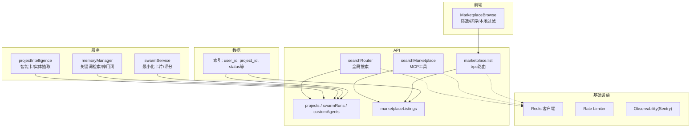
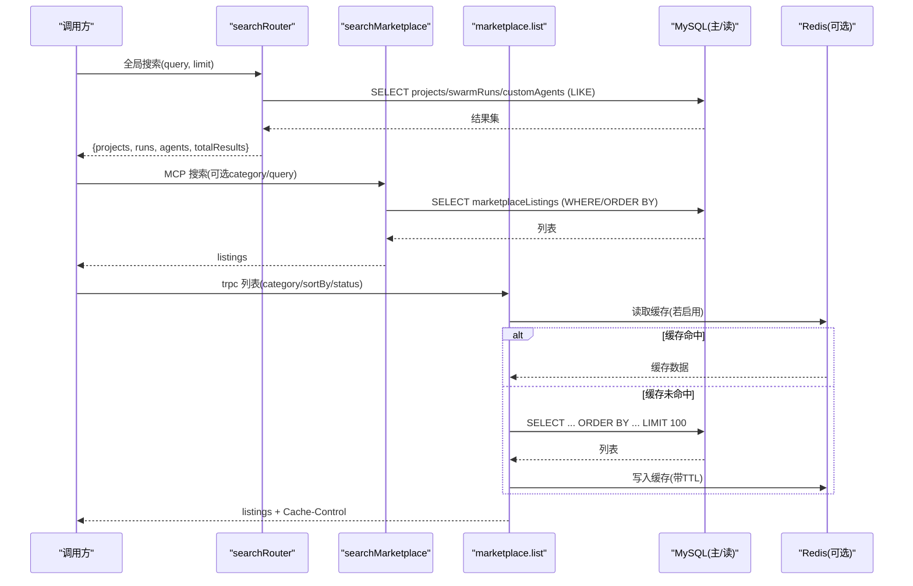
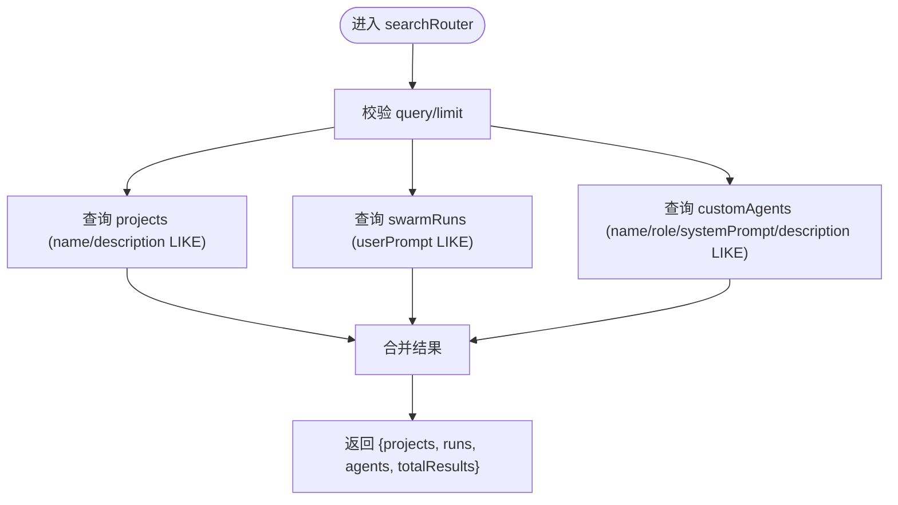
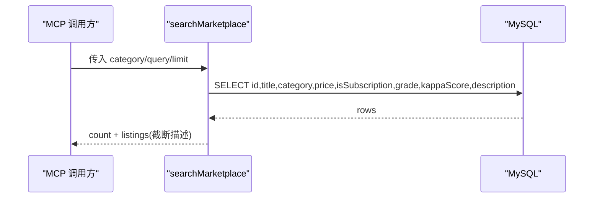
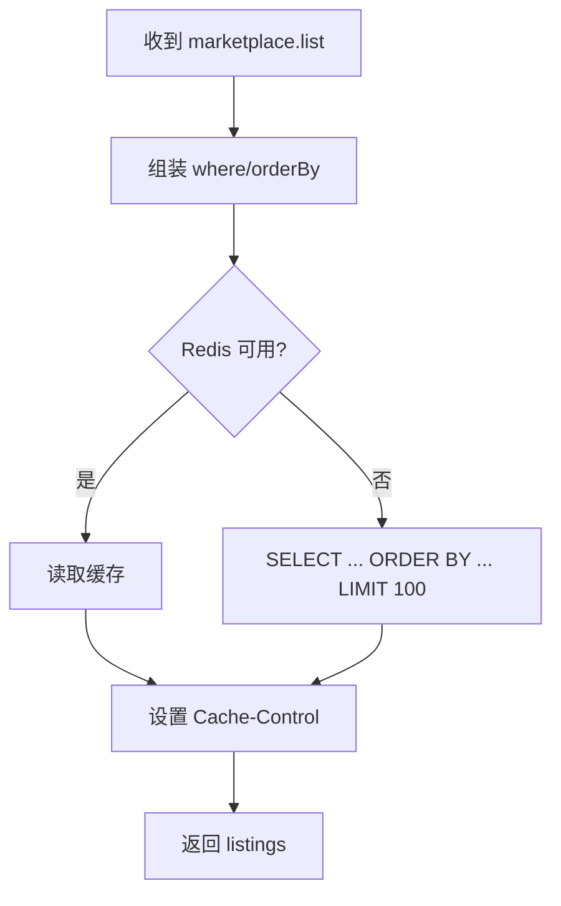
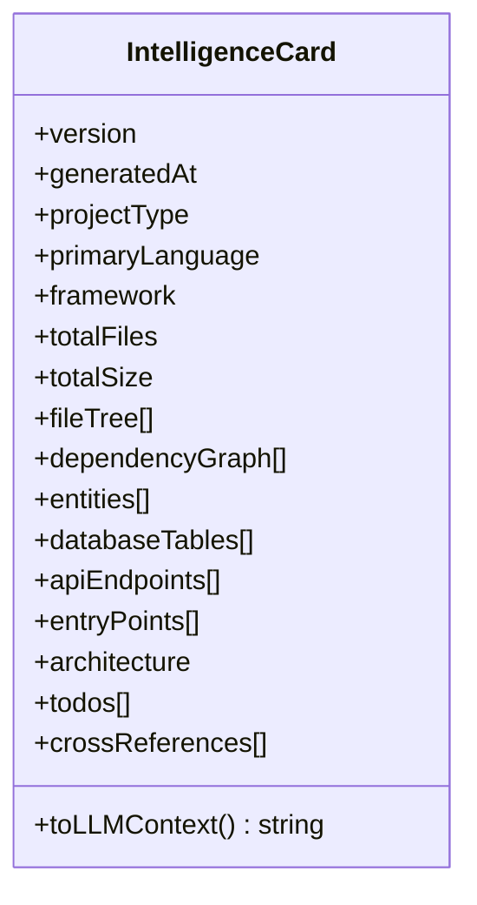
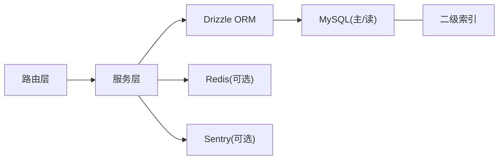

# 搜索发现系统

<cite>
**本文引用的文件**
- [api/routers/search.ts](file://api/routers/search.ts)
- [api/mcp/tools/searchMarketplace.ts](file://api/mcp/tools/searchMarketplace.ts)
- [api/routers/marketplace.ts](file://api/routers/marketplace.ts)
- [src/pages/MarketplaceBrowse.tsx](file://src/pages/MarketplaceBrowse.tsx)
- [db/schema.ts](file://db/schema.ts)
- [db/migrate-indexes.sql](file://db/migrate-indexes.sql)
- [api/queries/connection.ts](file://api/queries/connection.ts)
- [api/infra/redis.ts](file://api/infra/redis.ts)
- [api/lib/rateLimiter.ts](file://api/lib/rateLimiter.ts)
- [api/lib/observability.ts](file://api/lib/observability.ts)
- [api/services/memoryManager.ts](file://api/services/memoryManager.ts)
- [api/services/projectIntelligence.ts](file://api/services/projectIntelligence.ts)
- [api/services/swarmService.ts](file://api/services/swarmService.ts)
</cite>

## 目录
1. [简介](#简介)
2. [项目结构](#项目结构)
3. [核心组件](#核心组件)
4. [架构总览](#架构总览)
5. [详细组件分析](#详细组件分析)
6. [依赖关系分析](#依赖关系分析)
7. [性能与优化](#性能与优化)
8. [故障排查指南](#故障排查指南)
9. [结论](#结论)
10. [附录](#附录)

## 简介
本技术文档面向“搜索发现系统”，覆盖以下目标：
- 全文搜索引擎实现：索引构建、分词处理、查询优化
- 分类标签系统：标签层级、自动分类、标签推荐
- 搜索算法：相关性评分、语义搜索、模糊匹配
- 个性化推荐引擎：基于用户行为分析与协同过滤
- 高级搜索功能：多条件筛选、结果排序、搜索结果高亮
- 性能优化：缓存策略、搜索引擎监控

当前代码库实现了以数据库 LIKE 为主的轻量级搜索，结合市场列表的类别筛选与排序；同时具备项目智能卡（Intelligence Card）用于内容理解与实体抽取，以及内存式关键词检索作为短期记忆。

## 项目结构
搜索相关能力分布在以下位置：
- API 路由层：统一搜索入口与市场搜索工具
- 数据层：数据库 Schema 与索引迁移
- 服务层：项目智能解析、记忆管理、运行记录
- 前端：市场浏览页的筛选与排序 UI
- 基础设施：Redis 连接、限流、可观测性

图表来源
- [api/routers/search.ts:1-66](file://api/routers/search.ts#L1-L66)
- [api/mcp/tools/searchMarketplace.ts:33-74](file://api/mcp/tools/searchMarketplace.ts#L33-L74)
- [api/routers/marketplace.ts:942-978](file://api/routers/marketplace.ts#L942-L978)
- [db/migrate-indexes.sql:1-111](file://db/migrate-indexes.sql#L1-L111)
- [src/pages/MarketplaceBrowse.tsx:32-52](file://src/pages/MarketplaceBrowse.tsx#L32-L52)

章节来源
- [api/routers/search.ts:1-66](file://api/routers/search.ts#L1-L66)
- [api/mcp/tools/searchMarketplace.ts:33-74](file://api/mcp/tools/searchMarketplace.ts#L33-L74)
- [api/routers/marketplace.ts:942-978](file://api/routers/marketplace.ts#L942-L978)
- [db/migrate-indexes.sql:1-111](file://db/migrate-indexes.sql#L1-L111)
- [src/pages/MarketplaceBrowse.tsx:32-52](file://src/pages/MarketplaceBrowse.tsx#L32-L52)

## 核心组件
- 全局搜索路由：对 projects、swarmRuns、customAgents 进行跨表 LIKE 搜索，返回聚合结果与总数
- 市场搜索工具：按类别、标题/描述模糊匹配，按 grade 排序并限制数量
- 市场列表接口：支持 category、sortBy、status 等多条件筛选与排序，设置 Cache-Control
- 项目智能卡：从文件树、依赖图、实体、API 端点等生成结构化摘要，用于后续检索与评分
- 记忆管理器：基于停用词与关键词的轻量检索，适合离线与快速场景
- 前端市场浏览：提供类别筛选、排序选择与本地搜索过滤

章节来源
- [api/routers/search.ts:1-66](file://api/routers/search.ts#L1-L66)
- [api/mcp/tools/searchMarketplace.ts:33-74](file://api/mcp/tools/searchMarketplace.ts#L33-L74)
- [api/routers/marketplace.ts:942-978](file://api/routers/marketplace.ts#L942-L978)
- [api/services/projectIntelligence.ts:52-777](file://api/services/projectIntelligence.ts#L52-L777)
- [api/services/memoryManager.ts:1-34](file://api/services/memoryManager.ts#L1-L34)
- [src/pages/MarketplaceBrowse.tsx:32-52](file://src/pages/MarketplaceBrowse.tsx#L32-L52)

## 架构总览
搜索发现系统采用“数据库为主 + 服务增强”的架构：
- 查询入口：REST/MCP/trpc 路由接收请求，构造 WHERE 条件与 ORDER BY
- 数据访问：Drizzle ORM 访问 MySQL，读路径可选只读副本
- 索引优化：通过迁移脚本为常用字段建立二级索引
- 服务增强：项目智能卡提取实体与结构信息，辅助相关性评分与推荐
- 缓存与限流：Redis 可用时启用，否则回退到内存固定窗口
- 可观测性：Sentry 初始化失败不影响主流程

图表来源
- [api/routers/search.ts:1-66](file://api/routers/search.ts#L1-L66)
- [api/mcp/tools/searchMarketplace.ts:33-74](file://api/mcp/tools/searchMarketplace.ts#L33-L74)
- [api/routers/marketplace.ts:942-978](file://api/routers/marketplace.ts#L942-L978)
- [api/infra/redis.ts:40-87](file://api/infra/redis.ts#L40-L87)

## 详细组件分析

### 全局搜索路由（跨资源模糊搜索）
- 输入校验：query 长度限制、limit 上限
- 搜索范围：项目名称/描述、运行提示词、自定义代理名称/角色/描述
- 权限控制：仅返回当前用户的数据
- 输出：聚合结果与总数

图表来源
- [api/routers/search.ts:1-66](file://api/routers/search.ts#L1-L66)

章节来源
- [api/routers/search.ts:1-66](file://api/routers/search.ts#L1-L66)

### 市场搜索工具（MCP）
- 条件：默认仅 published，可按 category 过滤，支持 title/description 模糊匹配
- 排序：按 grade 降序
- 截断：description 截断至固定长度，减少传输体积

图表来源
- [api/mcp/tools/searchMarketplace.ts:33-74](file://api/mcp/tools/searchMarketplace.ts#L33-L74)

章节来源
- [api/mcp/tools/searchMarketplace.ts:33-74](file://api/mcp/tools/searchMarketplace.ts#L33-L74)

### 市场列表接口（trpc）
- 筛选：category、status
- 排序：newest、popular、grade、price_asc、price_desc
- 缓存：设置 Cache-Control 响应头，便于浏览器/CDN 缓存
- 扩展：可叠加 read replica 提升读性能

图表来源
- [api/routers/marketplace.ts:942-978](file://api/routers/marketplace.ts#L942-L978)
- [api/infra/redis.ts:40-87](file://api/infra/redis.ts#L40-L87)

章节来源
- [api/routers/marketplace.ts:942-978](file://api/routers/marketplace.ts#L942-L978)

### 项目智能卡（Intelligence Card）
- 作用：将项目文件树、依赖图、实体、API 端点、架构等信息压缩为 JSON，供检索与评分使用
- 关键能力：
  - 文件类型统计与主要语言推断
  - 实体抽取（人名、公司、产品、指标、日期等）
  - 交叉引用检测
  - 最大条目裁剪（entities/apiEndpoints/todos）
- 用途：在 swarm 评分或推荐中重建最小化卡片，提高相关性判断效率

图表来源
- [api/services/projectIntelligence.ts:52-777](file://api/services/projectIntelligence.ts#L52-L777)

章节来源
- [api/services/projectIntelligence.ts:52-777](file://api/services/projectIntelligence.ts#L52-L777)
- [api/services/swarmService.ts:1537-1569](file://api/services/swarmService.ts#L1537-L1569)

### 记忆管理器（关键词检索）
- 特点：无向量/嵌入，纯关键词匹配，离线可用，延迟低
- 停用词：包含英文与中文常见停用词集合
- 适用场景：80% 常规检索需求，Pro Designer 可升级至句子级嵌入

章节来源
- [api/services/memoryManager.ts:1-34](file://api/services/memoryManager.ts#L1-L34)

### 前端市场浏览（筛选与排序）
- 类别筛选：translation/writing/code/analysis/creative/other
- 排序：newest/popular/grade/price_asc/price_desc
- 本地搜索：title/description 大小写不敏感包含匹配
- 数据来源：trpc.marketplace.list

章节来源
- [src/pages/MarketplaceBrowse.tsx:32-52](file://src/pages/MarketplaceBrowse.tsx#L32-L52)

## 依赖关系分析
- 路由与服务耦合度低：路由负责参数校验与组装，服务专注业务逻辑
- 数据访问抽象：通过 Drizzle ORM 与连接池，读路径可切换只读副本
- 外部依赖：
  - Redis：缓存与限流状态存储，不可用时优雅降级
  - Sentry：错误上报，失败不影响主流程
- 数据库索引：针对高频查询字段建立二级索引，提升 LIKE 与等值查询性能

图表来源
- [api/queries/connection.ts:1-42](file://api/queries/connection.ts#L1-L42)
- [db/migrate-indexes.sql:1-111](file://db/migrate-indexes.sql#L1-L111)
- [api/lib/observability.ts:1-33](file://api/lib/observability.ts#L1-L33)
- [api/infra/redis.ts:40-87](file://api/infra/redis.ts#L40-L87)

章节来源
- [api/queries/connection.ts:1-42](file://api/queries/connection.ts#L1-L42)
- [db/migrate-indexes.sql:1-111](file://db/migrate-indexes.sql#L1-L111)
- [api/lib/observability.ts:1-33](file://api/lib/observability.ts#L1-L33)
- [api/infra/redis.ts:40-87](file://api/infra/redis.ts#L40-L87)

## 性能与优化
- 数据库层面
  - 二级索引：为 user_id、project_id、status 等高频字段建索引，加速过滤与排序
  - 只读副本：读路径可使用只读实例，降低主库压力
- 查询层面
  - 限制返回条数：limit 控制结果集规模
  - 字段投影：仅选择必要字段，减少网络与序列化开销
- 缓存层面
  - Redis 缓存：市场列表接口设置 Cache-Control，配合 CDN/浏览器缓存
  - 优雅降级：Redis 不可用时回退内存固定窗口限流，保证可用性
- 可观测性
  - Sentry 初始化失败不影响服务启动，确保稳定性

章节来源
- [db/migrate-indexes.sql:1-111](file://db/migrate-indexes.sql#L1-L111)
- [api/queries/connection.ts:20-42](file://api/queries/connection.ts#L20-L42)
- [api/routers/marketplace.ts:942-978](file://api/routers/marketplace.ts#L942-L978)
- [api/lib/rateLimiter.ts:126-166](file://api/lib/rateLimiter.ts#L126-L166)
- [api/lib/observability.ts:1-33](file://api/lib/observability.ts#L1-L33)

## 故障排查指南
- 搜索无结果
  - 检查 query 是否过短或为空
  - 确认用户权限隔离导致结果为空
  - 验证数据库索引是否存在且生效
- 市场列表加载慢
  - 检查 Redis 是否可用，必要时清理缓存键
  - 确认 sortBy 与 where 条件是否命中索引
  - 查看是否使用了只读副本
- 限流触发
  - 观察 rate limiter 的剩余配额与重试间隔
  - 检查 Redis 状态与内存占用
- 可观测性
  - 确认 Sentry DSN 配置是否正确
  - 关注错误上报中的堆栈与上下文

章节来源
- [api/routers/search.ts:1-66](file://api/routers/search.ts#L1-L66)
- [api/routers/marketplace.ts:942-978](file://api/routers/marketplace.ts#L942-L978)
- [api/lib/rateLimiter.ts:126-166](file://api/lib/rateLimiter.ts#L126-L166)
- [api/lib/observability.ts:1-33](file://api/lib/observability.ts#L1-L33)

## 结论
当前搜索发现系统以数据库 LIKE 为核心，结合类别筛选与排序，满足大多数场景下的检索需求。通过项目智能卡与记忆管理器，系统在内容理解与轻量语义检索方面具备扩展基础。未来可在以下方向持续演进：
- 引入全文索引或专用搜索引擎以提升模糊匹配与相关性评分
- 增加语义搜索（向量检索）与更丰富的分词策略
- 完善标签体系与自动分类/推荐机制
- 强化缓存策略与监控告警，提升大规模查询下的稳定性

[本节为总结性内容，不直接分析具体文件]

## 附录

### 数据模型概览（与搜索相关）
- users：用户信息与偏好
- projects：项目元数据与智能卡
- swarm_runs：运行记录与提示词
- custom_agents：自定义代理定义
- marketplace_listings：市场商品（标题、描述、类别、价格、等级等）

章节来源
- [db/schema.ts:17-200](file://db/schema.ts#L17-L200)

### 索引清单（节选）
- projects.user_id
- swarm_runs.project_id / user_id / status
- custom_agents.user_id / slug
- notifications.user_id / is_read

章节来源
- [db/migrate-indexes.sql:1-111](file://db/migrate-indexes.sql#L1-L111)