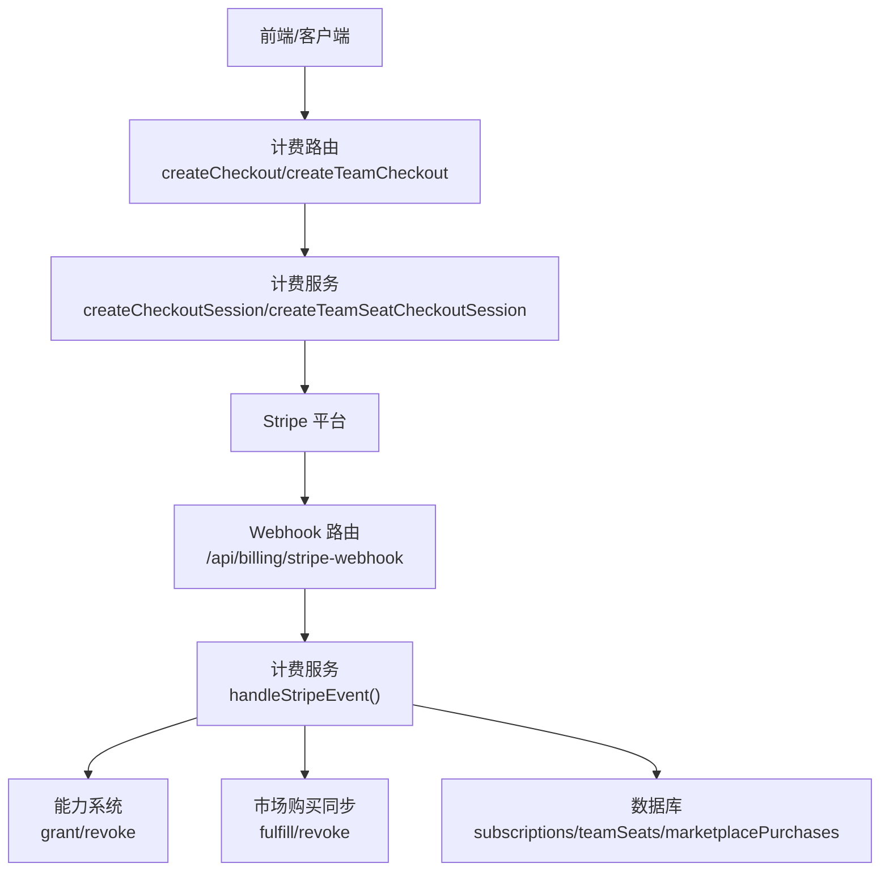
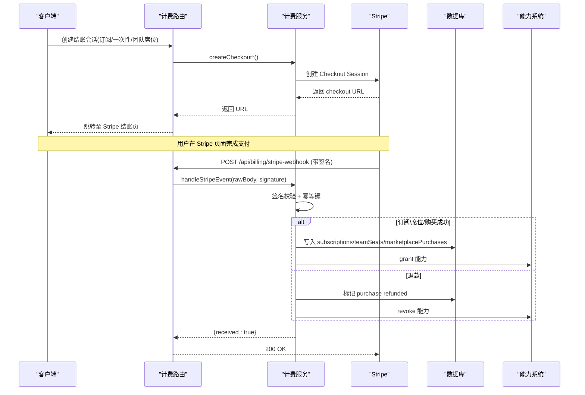
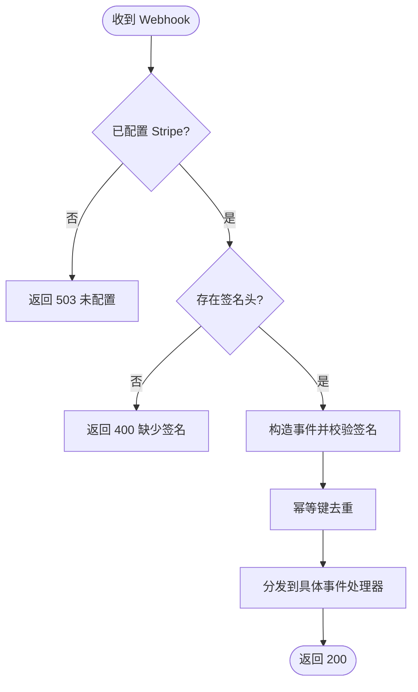
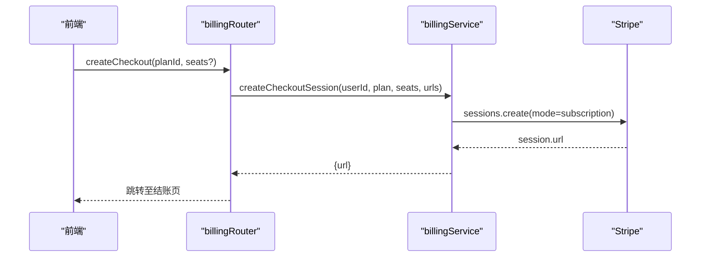
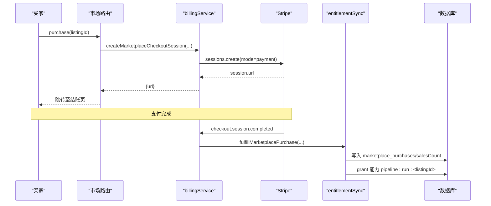
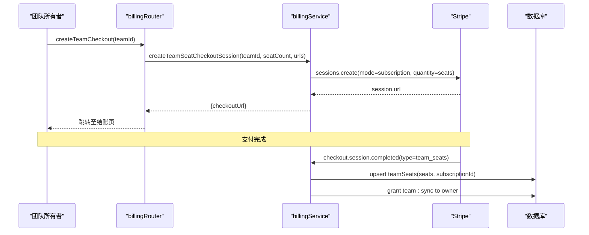
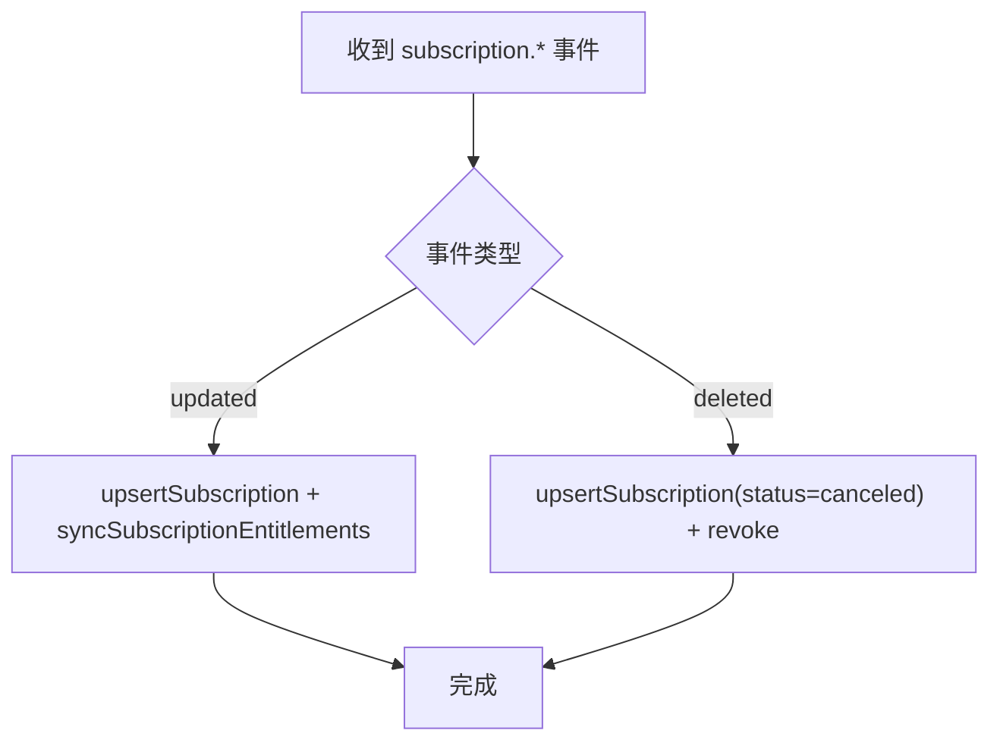
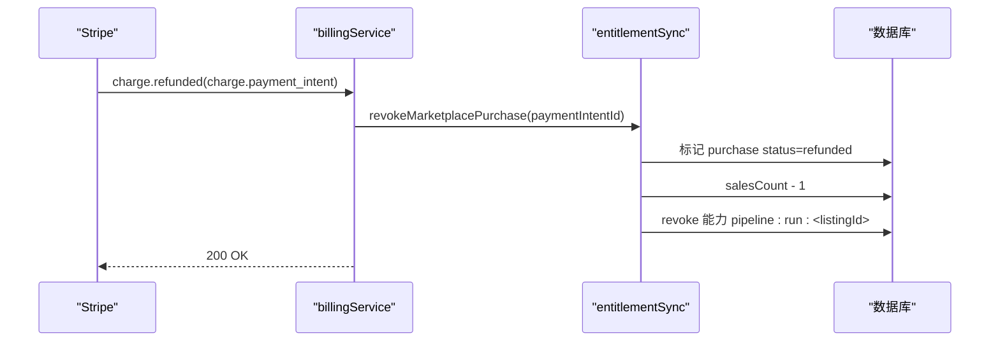
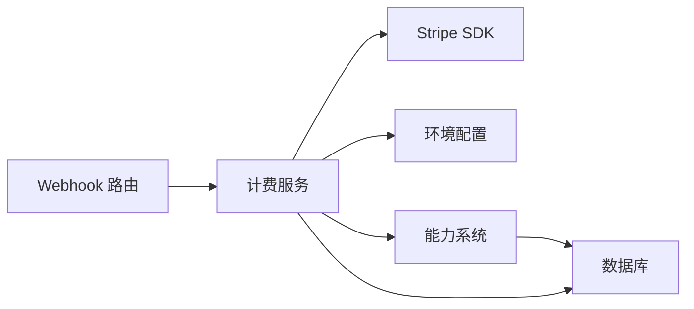

# 支付计费系统

<cite>
**本文引用的文件**
- [api/services/billingService.ts](file://api/services/billingService.ts)
- [api/routers/billing.ts](file://api/routers/billing.ts)
- [api/config/plans.ts](file://api/config/plans.ts)
- [api/billing-webhook-route.ts](file://api/billing-webhook-route.ts)
- [api/services/entitlements.ts](file://api/services/entitlements.ts)
- [api/services/entitlementSync.ts](file://api/services/entitlementSync.ts)
- [db/schema.ts](file://db/schema.ts)
- [api/lib/env.ts](file://api/lib/env.ts)
- [scripts/smoke-stripe-webhook.mjs](file://scripts/smoke-stripe-webhook.mjs)
</cite>

## 目录
1. [简介](#简介)
2. [项目结构](#项目结构)
3. [核心组件](#核心组件)
4. [架构总览](#架构总览)
5. [详细组件分析](#详细组件分析)
6. [依赖关系分析](#依赖关系分析)
7. [性能与可靠性](#性能与可靠性)
8. [故障排查指南](#故障排查指南)
9. [结论](#结论)
10. [附录](#附录)

## 简介
本技术文档围绕支付计费子系统，系统化梳理 Stripe 集成、订阅创建与续费、一次性购买（市场商品）、退款与争议处理、许可证（能力）发放与回收、团队席位计费、数据模型与对账字段、以及安全与合规要点。文档以代码为依据，提供流程图与时序图，帮助开发者快速理解并扩展计费能力。

## 项目结构
计费相关代码主要分布在以下模块：
- Webhook 入口：接收 Stripe 事件，签名校验与幂等处理
- 计费服务：创建 Checkout Session（订阅/一次性/团队席位），处理事件并更新本地状态
- 能力（许可证）系统：基于订阅、购买、层级、券的“能力”判定与授予/撤销
- 配置与环境：计划目录、Stripe 密钥、价格 ID、Webhook 密钥
- 数据库模式：订阅、席位、购买记录、退款台账等表结构
- 测试脚本：离线模拟 Stripe Webhook 端到端验证



图表来源
- [api/billing-webhook-route.ts:18-49](file://api/billing-webhook-route.ts#L18-L49)
- [api/services/billingService.ts:444-671](file://api/services/billingService.ts#L444-L671)
- [api/routers/billing.ts:32-104](file://api/routers/billing.ts#L32-L104)
- [db/schema.ts:730-749](file://db/schema.ts#L730-L749)

章节来源
- [api/billing-webhook-route.ts:18-49](file://api/billing-webhook-route.ts#L18-L49)
- [api/services/billingService.ts:444-671](file://api/services/billingService.ts#L444-L671)
- [api/routers/billing.ts:32-104](file://api/routers/billing.ts#L32-L104)
- [db/schema.ts:730-749](file://db/schema.ts#L730-L749)

## 核心组件
- Webhook 路由：负责原始请求体读取、Stripe 签名校验、错误码返回与日志记录
- 计费服务：封装 Stripe SDK 调用、Checkout 会话创建、事件分发、幂等键、订阅与席位同步、退款处理
- 能力系统：统一的能力判定与授予/撤销，支撑按订阅、购买、层级、券的多源授权
- 环境配置：Stripe 密钥、价格 ID、Webhook 密钥；未配置时优雅降级（返回 503）
- 数据模型：订阅、团队席位、市场购买、退款台账等持久化结构

章节来源
- [api/billing-webhook-route.ts:18-49](file://api/billing-webhook-route.ts#L18-L49)
- [api/services/billingService.ts:17-29](file://api/services/billingService.ts#L17-L29)
- [api/services/entitlements.ts:1-20](file://api/services/entitlements.ts#L1-L20)
- [api/lib/env.ts:38-42](file://api/lib/env.ts#L38-L42)

## 架构总览
计费系统采用“服务端托管结账 + Webhook 驱动状态同步”的模式：
- 客户端通过 tRPC 路由发起创建结账会话请求，服务端生成 Stripe Checkout URL
- 用户完成支付后，Stripe 回调 Webhook，服务端进行签名校验与幂等处理
- 根据事件类型更新本地订阅/席位/购买记录，并触发能力授予或撤销
- 退款事件将回滚购买与能力，保持财务与权限一致



图表来源
- [api/routers/billing.ts:32-104](file://api/routers/billing.ts#L32-L104)
- [api/services/billingService.ts:39-180](file://api/services/billingService.ts#L39-L180)
- [api/services/billingService.ts:444-671](file://api/services/billingService.ts#L444-L671)
- [api/services/entitlements.ts:106-154](file://api/services/entitlements.ts#L106-L154)
- [api/services/entitlementSync.ts:32-123](file://api/services/entitlementSync.ts#L32-L123)

## 详细组件分析

### Webhook 路由与签名校验
- 仅接受携带 stripe-signature 的请求，未配置时返回 503
- 使用原始请求体进行签名校验，失败返回 400
- 内部异常不泄露细节，统一返回通用错误并记录日志



图表来源
- [api/billing-webhook-route.ts:18-49](file://api/billing-webhook-route.ts#L18-L49)
- [api/services/billingService.ts:444-461](file://api/services/billingService.ts#L444-L461)

章节来源
- [api/billing-webhook-route.ts:18-49](file://api/billing-webhook-route.ts#L18-L49)
- [api/services/billingService.ts:444-461](file://api/services/billingService.ts#L444-L461)

### 订阅创建与会话管理
- 支持个人订阅与团队席位订阅两种模式
- 会话元数据携带 userId/plan/seats/teamId 等信息，便于后续事件匹配
- 成功后通过 Webhook 更新本地订阅与能力



图表来源
- [api/routers/billing.ts:38-61](file://api/routers/billing.ts#L38-L61)
- [api/services/billingService.ts:39-78](file://api/services/billingService.ts#L39-L78)

章节来源
- [api/routers/billing.ts:38-61](file://api/routers/billing.ts#L38-L61)
- [api/services/billingService.ts:39-78](file://api/services/billingService.ts#L39-L78)

### 一次性购买（市场商品）
- 使用 mode=payment 的一次性结账会话
- 成功后在 Webhook 中写入购买记录、销售计数，并授予“可运行该流水线”的能力
- 退款事件通过 payment_intent 匹配并撤销购买与能力



图表来源
- [api/services/billingService.ts:80-129](file://api/services/billingService.ts#L80-L129)
- [api/services/billingService.ts:466-488](file://api/services/billingService.ts#L466-L488)
- [api/services/entitlementSync.ts:32-123](file://api/services/entitlementSync.ts#L32-L123)

章节来源
- [api/services/billingService.ts:80-129](file://api/services/billingService.ts#L80-L129)
- [api/services/entitlementSync.ts:32-123](file://api/services/entitlementSync.ts#L32-L123)

### 团队席位计费（按成员数）
- 每个团队一个 Stripe 订阅，数量等于成员数
- 成员增减时同步 Stripe 订阅项数量（按比例计费）
- 订阅活跃期间授予团队所有者 team:sync 能力



图表来源
- [api/routers/billing.ts:63-104](file://api/routers/billing.ts#L63-L104)
- [api/services/billingService.ts:131-180](file://api/services/billingService.ts#L131-L180)
- [api/services/billingService.ts:491-520](file://api/services/billingService.ts#L491-L520)

章节来源
- [api/routers/billing.ts:63-104](file://api/routers/billing.ts#L63-L104)
- [api/services/billingService.ts:131-180](file://api/services/billingService.ts#L131-L180)
- [api/services/billingService.ts:491-520](file://api/services/billingService.ts#L491-L520)

### 订阅生命周期与能力同步
- subscription.updated：更新订阅状态、周期结束时间、席位数量，并同步能力
- subscription.deleted：取消订阅并撤销对应能力
- 幂等键确保重复事件不会重复写入



图表来源
- [api/services/billingService.ts:546-647](file://api/services/billingService.ts#L546-L647)
- [api/services/billingService.ts:220-252](file://api/services/billingService.ts#L220-L252)

章节来源
- [api/services/billingService.ts:546-647](file://api/services/billingService.ts#L546-L647)
- [api/services/billingService.ts:220-252](file://api/services/billingService.ts#L220-L252)

### 退款与争议处理
- charge.refunded：根据 payment_intent 定位购买记录，标记为 refunded，递减销售计数，撤销能力
- 幂等键避免重复退款导致的状态不一致
- 若无法匹配，记录告警日志以便人工介入



图表来源
- [api/services/billingService.ts:650-663](file://api/services/billingService.ts#L650-L663)
- [api/services/entitlementSync.ts:129-174](file://api/services/entitlementSync.ts#L129-L174)

章节来源
- [api/services/billingService.ts:650-663](file://api/services/billingService.ts#L650-L663)
- [api/services/entitlementSync.ts:129-174](file://api/services/entitlementSync.ts#L129-L174)

### 能力（许可证）机制
- 能力来源优先级：显式授予 > 活跃订阅计划 > 用户层级 > 有效券
- 订阅/购买/团队席位均通过能力系统授予或撤销
- 能力字符串约定：如 pipeline:run:<listingId> 表示一次购买的可运行能力

```mermaid
classDiagram
class 能力系统 {
+can(userId, capability) bool
+grant(subjectType, subjectId, capability, source, sourceRef, expiresAt) void
+revoke(subjectType, subjectId, capability?, source?, sourceRef?) number
+resolveCapabilities(userId) {capabilities[], tier}
}
class 订阅 {
+status : active|trialing|canceled
+plan : solo|team_seat
+seats : number
}
class 购买 {
+status : active|refunded|cancelled
+stripePaymentIntentId : string
}
能力系统 --> 订阅 : "读取活跃计划能力集"
能力系统 --> 购买 : "授予/撤销 pipeline : run : <listingId>"
```

图表来源
- [api/services/entitlements.ts:1-20](file://api/services/entitlements.ts#L1-L20)
- [api/services/entitlements.ts:42-104](file://api/services/entitlements.ts#L42-L104)
- [api/services/entitlements.ts:106-154](file://api/services/entitlements.ts#L106-L154)
- [api/services/entitlements.ts:165-207](file://api/services/entitlements.ts#L165-L207)
- [api/services/entitlementSync.ts:23-26](file://api/services/entitlementSync.ts#L23-L26)

章节来源
- [api/services/entitlements.ts:42-104](file://api/services/entitlements.ts#L42-L104)
- [api/services/entitlements.ts:106-154](file://api/services/entitlements.ts#L106-L154)
- [api/services/entitlements.ts:165-207](file://api/services/entitlements.ts#L165-L207)
- [api/services/entitlementSync.ts:23-26](file://api/services/entitlementSync.ts#L23-L26)

### 计费模型设计
- 订阅制：按月订阅（solo/team_seat），按席位计费
- 按次付费：市场商品一次性购买，授予单次运行能力
- 混合模式：订阅+购买并存，能力叠加解析

章节来源
- [api/config/plans.ts:19-40](file://api/config/plans.ts#L19-L40)
- [api/services/billingService.ts:39-180](file://api/services/billingService.ts#L39-L180)
- [api/services/entitlementSync.ts:32-123](file://api/services/entitlementSync.ts#L32-L123)

### 收入统计、销售报告与税务接口
- 销售计数：marketplaceListings.salesCount 在购买时递增，退款时递减
- 购买记录：marketplacePurchases 包含金额、平台费、创作者收益、状态、Stripe 引用
- 退款台账：refund_ledger 用于记录退款明细与是否全额退款
- 当前实现侧重“购买/退款”的财务记账字段；报表与税务接口可在现有表上扩展查询

章节来源
- [db/schema.ts:711-749](file://db/schema.ts#L711-L749)
- [api/services/entitlementSync.ts:81-100](file://api/services/entitlementSync.ts#L81-L100)
- [api/services/entitlementSync.ts:149-157](file://api/services/entitlementSync.ts#L149-L157)

### 数据安全与合规要点
- Webhook 必须携带 stripe-signature，服务端使用原始请求体验证签名
- 未配置 Stripe 时返回 503，避免暴露内部错误
- 幂等键防止重复处理
- 环境变量严格校验，生产环境拒绝已知不安全默认值
- 建议：启用 HTTPS、最小权限 API Key、审计日志、定期轮换密钥

章节来源
- [api/billing-webhook-route.ts:18-49](file://api/billing-webhook-route.ts#L18-L49)
- [api/lib/env.ts:11-19](file://api/lib/env.ts#L11-L19)
- [api/services/billingService.ts:182-211](file://api/services/billingService.ts#L182-L211)

## 依赖关系分析
- Webhook 路由依赖计费服务的事件处理与环境配置
- 计费服务依赖 Stripe SDK、数据库连接、能力系统与计划配置
- 能力系统依赖订阅、用户层级、券与购买记录
- 数据层通过 Drizzle ORM 访问 MySQL



图表来源
- [api/billing-webhook-route.ts:18-49](file://api/billing-webhook-route.ts#L18-L49)
- [api/services/billingService.ts:7-15](file://api/services/billingService.ts#L7-L15)
- [api/services/entitlements.ts:13-17](file://api/services/entitlements.ts#L13-L17)
- [api/lib/env.ts:24-42](file://api/lib/env.ts#L24-L42)

章节来源
- [api/billing-webhook-route.ts:18-49](file://api/billing-webhook-route.ts#L18-L49)
- [api/services/billingService.ts:7-15](file://api/services/billingService.ts#L7-L15)
- [api/services/entitlements.ts:13-17](file://api/services/entitlements.ts#L13-L17)
- [api/lib/env.ts:24-42](file://api/lib/env.ts#L24-L42)

## 性能与可靠性
- 幂等键：通过 idempotencyKeys 表保证 Webhook 重复投递不重复处理
- 健壮降级：未配置 Stripe 时返回 503，不影响主流程可用性
- 原子更新：订阅/席位/购买记录的写入尽量合并事务，减少竞态
- 重试策略：Stripe 会重试失败的 Webhook，幂等键确保最终一致性
- 容量规划：关注数据库索引与查询路径，避免高并发下热点行竞争

章节来源
- [api/services/billingService.ts:182-211](file://api/services/billingService.ts#L182-L211)
- [api/billing-webhook-route.ts:18-49](file://api/billing-webhook-route.ts#L18-L49)

## 故障排查指南
- 签名校验失败：检查 stripe-signature 头与 webhook secret 是否匹配
- 重复处理：确认 idempotencyKeys 是否生效，避免重复写入
- 退款未撤销：核对 charge.refunded 中的 payment_intent 是否能匹配到购买记录
- 团队席位不同步：检查成员变更后的数量同步逻辑与 Stripe 订阅项更新
- 未配置计费：确认环境变量是否设置，路由将返回 503

章节来源
- [api/billing-webhook-route.ts:18-49](file://api/billing-webhook-route.ts#L18-L49)
- [api/services/billingService.ts:182-211](file://api/services/billingService.ts#L182-L211)
- [api/services/entitlementSync.ts:129-174](file://api/services/entitlementSync.ts#L129-L174)

## 结论
本计费系统以 Stripe Checkout 为核心，结合 Webhook 事件驱动与能力系统，实现了订阅制、按次付费与团队席位的混合计费模式。通过幂等键、签名校验与稳健的错误处理，保证了支付与权限的一致性。未来可扩展报表与税务接口，完善财务对账与合规能力。

## 附录

### 关键数据模型（节选）
- marketplace_purchases：购买记录（金额、平台费、创作者收益、状态、Stripe 引用）
- refund_ledger：退款台账（退款金额、是否全额退款）
- subscriptions：订阅信息（计划、状态、席位、周期结束时间）
- teamSeats：团队席位（成员数、Stripe 订阅关联）

章节来源
- [db/schema.ts:711-749](file://db/schema.ts#L711-L749)

### 端到端测试脚本说明
- 离线模拟 Stripe Webhook，验证购买与退款的完整链路
- 断言购买记录、销售计数、能力授予/撤销的正确性与幂等性

章节来源
- [scripts/smoke-stripe-webhook.mjs:57-87](file://scripts/smoke-stripe-webhook.mjs#L57-L87)
- [scripts/smoke-stripe-webhook.mjs:197-228](file://scripts/smoke-stripe-webhook.mjs#L197-L228)