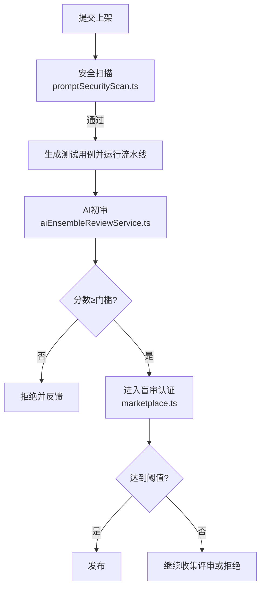
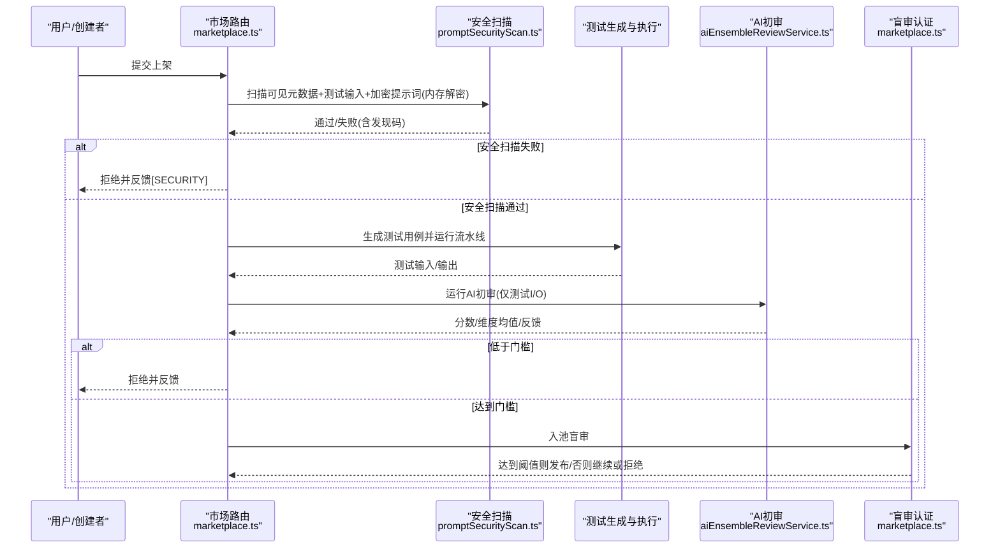
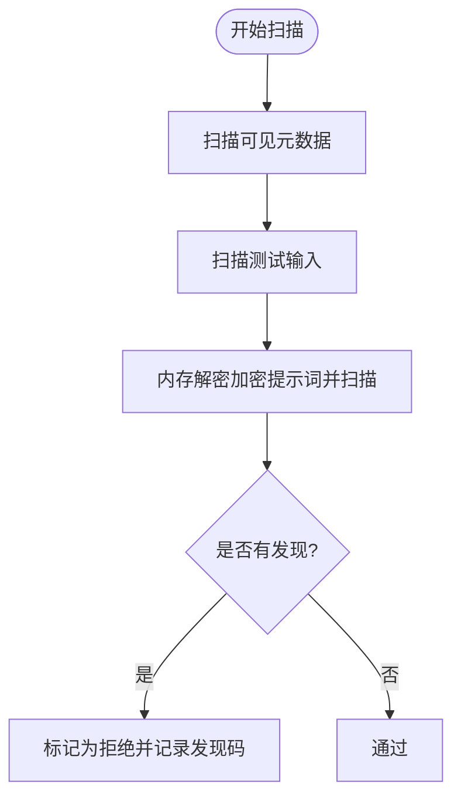
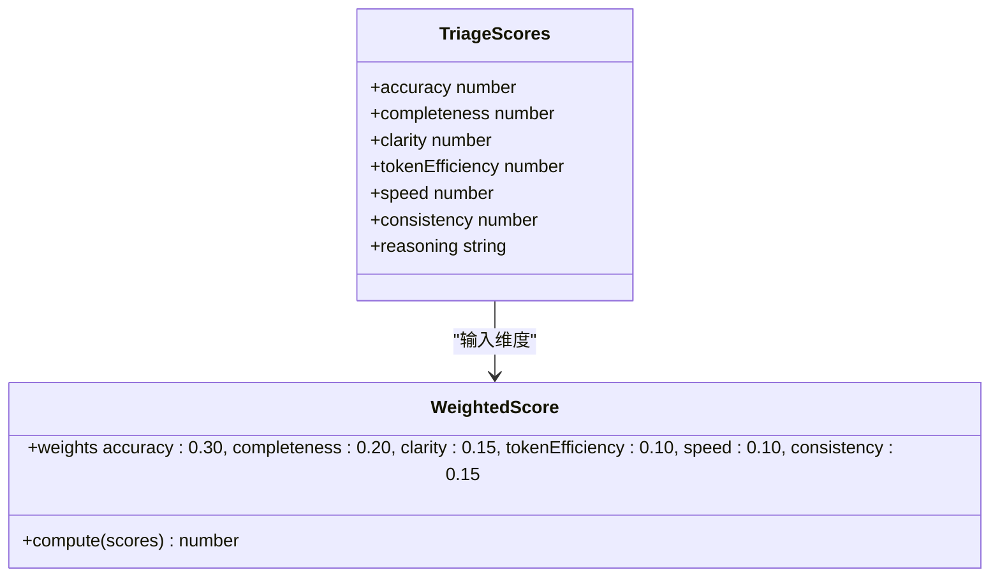
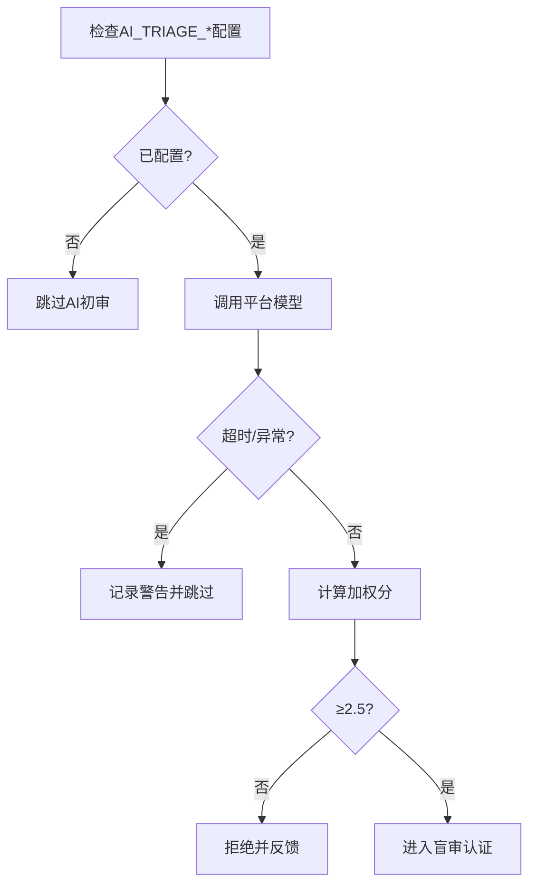
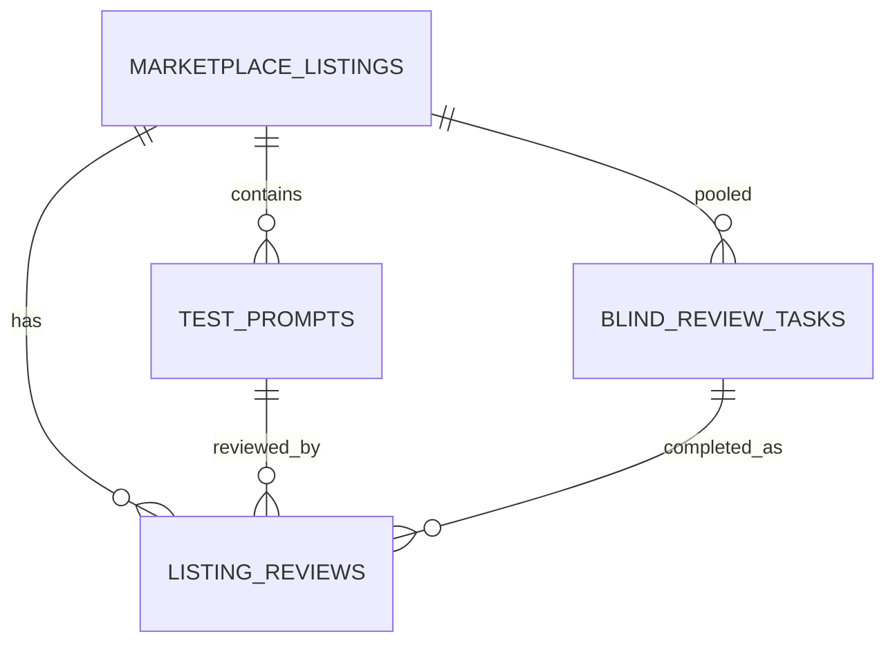
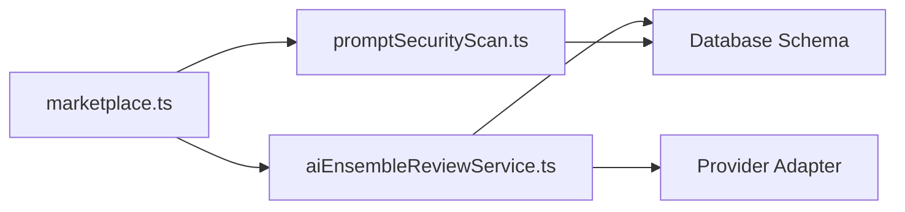

# AI辅助初审流程

<cite>
**本文引用的文件**
- [api/services/promptSecurityScan.ts](file://api/services/promptSecurityScan.ts)
- [api/services/aiEnsembleReviewService.ts](file://api/services/aiEnsembleReviewService.ts)
- [api/routers/marketplace.ts](file://api/routers/marketplace.ts)
- [db/schema.ts](file://db/schema.ts)
- [DeeWaanAI-Next/MARKETPLACE-TRUST-SPEC.md](file://DeeWaanAI-Next/MARKETPLACE-TRUST-SPEC.md)
- [src/components/pipeline/PipelineConfigurator.tsx](file://src/components/pipeline/PipelineConfigurator.tsx)
</cite>

## 目录
1. [简介](#简介)
2. [项目结构](#项目结构)
3. [核心组件](#核心组件)
4. [架构总览](#架构总览)
5. [详细组件分析](#详细组件分析)
6. [依赖关系分析](#依赖关系分析)
7. [性能考量](#性能考量)
8. [故障排查指南](#故障排查指南)
9. [结论](#结论)
10. [附录](#附录)

## 简介
本技术文档面向“AI辅助初审流程”，覆盖以下目标：
- 内容安全扫描机制：恶意内容检测、敏感信息过滤与合规性检查。
- 质量评估算法：准确性、完整性、清晰度、token效率、速度、一致性等维度的自动评分标准与归一化方法。
- AI模型配置选项、阈值设置与误报处理机制。
- 初审结果的数据结构、评分归一化方法与置信度计算。
- 初审失败的常见原因分析与改进建议。
- 与人工复审的衔接流程与争议处理机制。

该流程在提交上架前执行，先进行确定性安全扫描（不可绕过），再运行平台控制的AI初审（非阻断），最后进入盲审认证阶段由多人评审决定最终是否发布。

## 项目结构
与AI辅助初审相关的代码主要分布在：
- 安全扫描：api/services/promptSecurityScan.ts
- AI初审与评测：api/services/aiEnsembleReviewService.ts
- 市场准入工作流与阈值：api/routers/marketplace.ts
- 数据库模式与字段：db/schema.ts
- 规范与环境变量说明：DeeWaanAI-Next/MARKETPLACE-TRUST-SPEC.md
- 流水线中的人工审核步骤：src/components/pipeline/PipelineConfigurator.tsx



**图表来源**
- [api/services/promptSecurityScan.ts:202-300](file://api/services/promptSecurityScan.ts#L202-L300)
- [api/services/aiEnsembleReviewService.ts:523-618](file://api/services/aiEnsembleReviewService.ts#L523-L618)
- [api/routers/marketplace.ts:1135-1185](file://api/routers/marketplace.ts#L1135-L1185)
- [api/routers/marketplace.ts:825-917](file://api/routers/marketplace.ts#L825-L917)

**章节来源**
- [api/services/promptSecurityScan.ts:202-300](file://api/services/promptSecurityScan.ts#L202-L300)
- [api/services/aiEnsembleReviewService.ts:523-618](file://api/services/aiEnsembleReviewService.ts#L523-L618)
- [api/routers/marketplace.ts:1135-1185](file://api/routers/marketplace.ts#L1135-L1185)
- [api/routers/marketplace.ts:825-917](file://api/routers/marketplace.ts#L825-L917)

## 核心组件
- 安全扫描器：对可见元数据、测试输入、加密提示词（内存解密后扫描）进行确定性检查，输出发现项；不直接修改状态，交由调用方决策。
- AI初审服务：使用平台配置的模型对测试输入/输出进行六维度评分，按固定权重计算加权分，返回结构化结果与反馈。
- 市场准入路由：编排提交流程，串联安全扫描、测试生成、AI初审与盲审认证，维护阈值与决策逻辑。
- 数据库模式：定义市场列表、测试提示、评审记录、审查任务等表结构，支撑评分、聚合与审计。

**章节来源**
- [api/services/promptSecurityScan.ts:1-300](file://api/services/promptSecurityScan.ts#L1-L300)
- [api/services/aiEnsembleReviewService.ts:1-620](file://api/services/aiEnsembleReviewService.ts#L1-L620)
- [api/routers/marketplace.ts:1-1200](file://api/routers/marketplace.ts#L1-L1200)
- [db/schema.ts:1-200](file://db/schema.ts#L1-L200)

## 架构总览


**图表来源**
- [api/routers/marketplace.ts:1135-1185](file://api/routers/marketplace.ts#L1135-L1185)
- [api/services/promptSecurityScan.ts:202-300](file://api/services/promptSecurityScan.ts#L202-L300)
- [api/services/aiEnsembleReviewService.ts:523-618](file://api/services/aiEnsembleReviewService.ts#L523-L618)
- [api/routers/marketplace.ts:825-917](file://api/routers/marketplace.ts#L825-L917)

## 详细组件分析

### 安全扫描机制（恶意内容检测、敏感信息过滤、合规性检查）
- 扫描范围：
  - 可见元数据：标题、描述、目标、输入格式、输出格式、备注。
  - 测试提示输入：每个测试用例的inputText。
  - 加密提示词：在内存中解密后扫描，明文绝不落盘或返回。
- 检测类别：
  - Unicode卫生：零宽字符、BIDI/RTL覆盖、禁止的控制字符、混合脚本（同形异义）。
  - 注入短语：忽略先前指令、角色覆盖、系统提示提取等。
  - 数据外泄：发送/上传到URL、邮件外发、命令式动词与URL邻近。
  - 机密与滥用：API密钥形状字符串、Base64大段、邮箱批量、银行卡号（含Luhn校验）、PII泄露。
- 行为原则：
  - 确定性、无网络、可单元测试。
  - 失败关闭：任何无法扫描的情况视为问题。
  - 日志只记录发现码与字段标签，不记录内容。
- 集成点：
  - 提交上架时最先执行，失败即拒绝并写入aiFeedback。



**图表来源**
- [api/services/promptSecurityScan.ts:202-300](file://api/services/promptSecurityScan.ts#L202-L300)

**章节来源**
- [api/services/promptSecurityScan.ts:28-196](file://api/services/promptSecurityScan.ts#L28-L196)
- [api/services/promptSecurityScan.ts:202-300](file://api/services/promptSecurityScan.ts#L202-L300)
- [api/routers/marketplace.ts:1164-1185](file://api/routers/marketplace.ts#L1164-L1185)

### 质量评估算法（六维度自动评分与归一化）
- 维度定义：
  - 准确性、完整性、清晰度、token效率、速度、一致性。
- 评分来源：
  - AI初审：平台控制模型对测试输入/输出进行六维度打分（1–5）。
  - 解析与钳制：将模型返回的JSON解析为维度值，并钳制到1–5范围。
- 加权计算：
  - 权重：准确性0.30、完整性0.20、清晰度0.15、token效率0.10、速度0.10、一致性0.15。
  - 加权分=各维度×对应权重之和，保留两位小数。
- 归一化与聚合：
  - 单条测试用例得到加权分；多用例取平均作为最终分数。
  - 维度均值用于反馈与诊断。
- 置信度与一致性：
  - 多人评审阶段使用Fleiss' Kappa衡量一致性与决策一致性（基于通过率桶化）。
  - 认证阈值：平均分≥3.5且通过率≥80%。



**图表来源**
- [api/services/aiEnsembleReviewService.ts:383-393](file://api/services/aiEnsembleReviewService.ts#L383-L393)
- [api/services/aiEnsembleReviewService.ts:449-479](file://api/services/aiEnsembleReviewService.ts#L449-L479)
- [api/routers/marketplace.ts:485-510](file://api/routers/marketplace.ts#L485-L510)

**章节来源**
- [api/services/aiEnsembleReviewService.ts:105-170](file://api/services/aiEnsembleReviewService.ts#L105-L170)
- [api/services/aiEnsembleReviewService.ts:383-393](file://api/services/aiEnsembleReviewService.ts#L383-L393)
- [api/services/aiEnsembleReviewService.ts:449-479](file://api/services/aiEnsembleReviewService.ts#L449-L479)
- [api/routers/marketplace.ts:485-510](file://api/routers/marketplace.ts#L485-L510)

### AI模型配置选项、阈值设置与误报处理
- 配置来源：
  - 平台环境变量：AI_TRIAGE_SLUG、AI_TRIAGE_MODEL、AI_TRIAGE_API_KEY、AI_TRIAGE_BASE_URL。
  - 仅在环境存在slug+model时启用AI初审；否则跳过（非阻断）。
- 超时与重试：
  - 单次调用默认超时60秒；异常或超时返回null（非阻断）。
  - 单个测试用例失败不影响整体初审。
- 阈值：
  - AI初审门槛：2.5（低于则拒绝并反馈）。
  - 盲审认证门槛：平均分≥3.5且通过率≥80%。
- 误报处理：
  - 安全扫描失败关闭策略：无法解密或扫描即视为问题。
  - AI初审失败：记录警告并跳过该用例，不影响流程。
  - 信用耗尽：特殊错误立即停止重试并提示充值。



**图表来源**
- [api/services/aiEnsembleReviewService.ts:523-618](file://api/services/aiEnsembleReviewService.ts#L523-L618)
- [api/routers/marketplace.ts:512-527](file://api/routers/marketplace.ts#L512-L527)
- [DeeWaanAI-Next/MARKETPLACE-TRUST-SPEC.md:232-248](file://DeeWaanAI-Next/MARKETPLACE-TRUST-SPEC.md#L232-L248)

**章节来源**
- [api/services/aiEnsembleReviewService.ts:523-618](file://api/services/aiEnsembleReviewService.ts#L523-L618)
- [api/routers/marketplace.ts:512-527](file://api/routers/marketplace.ts#L512-L527)
- [DeeWaanAI-Next/MARKETPLACE-TRUST-SPEC.md:232-248](file://DeeWaanAI-Next/MARKETPLACE-TRUST-SPEC.md#L232-L248)

### 初审结果数据结构、评分归一化与置信度计算
- 数据结构：
  - 安全扫描结果：ok布尔与findings数组（发现码+字段标签）。
  - AI初审结果：score（1–5）、feedback（文本）、dimensionAverages（维度均值）。
  - 评审记录：listingReviews包含六维度分、加权分、reviewTime等。
  - 审查任务：blindReviewTasks用于盲审任务分配与状态流转。
- 评分归一化：
  - 维度值钳制到1–5；加权分按固定权重计算；多用例取平均。
- 置信度计算：
  - 盲审阶段使用Fleiss' Kappa（基于通过率桶化）衡量评审一致性；同时统计通过率。
  - 认证决策：平均分≥3.5且通过率≥80%则发布。



**图表来源**
- [db/schema.ts:1-200](file://db/schema.ts#L1-L200)
- [api/routers/marketplace.ts:825-917](file://api/routers/marketplace.ts#L825-L917)

**章节来源**
- [api/services/promptSecurityScan.ts:18-21](file://api/services/promptSecurityScan.ts#L18-L21)
- [api/services/aiEnsembleReviewService.ts:357-370](file://api/services/aiEnsembleReviewService.ts#L357-L370)
- [api/routers/marketplace.ts:555-575](file://api/routers/marketplace.ts#L555-L575)
- [api/routers/marketplace.ts:825-917](file://api/routers/marketplace.ts#L825-L917)

### 初审失败的常见原因与改进建议
- 安全扫描失败：
  - 原因：检测到注入短语、外泄模式、敏感信息（API密钥、卡号、邮箱批量）、Unicode异常。
  - 建议：清理提示词中的敏感内容；避免指令覆盖与系统提示提取；规范化文本编码。
- AI初审低于门槛：
  - 原因：输出不准确、不完整、不清晰、冗长、响应慢或不一致。
  - 建议：优化提示词与步骤；减少冗余；提升事实准确性与结构清晰度；调整模型参数。
- 信用耗尽：
  - 原因：提供商账户余额不足或配额限制。
  - 建议：及时充值或切换提供商；监控配额与速率限制。

**章节来源**
- [api/services/promptSecurityScan.ts:28-196](file://api/services/promptSecurityScan.ts#L28-L196)
- [api/services/aiEnsembleReviewService.ts:105-170](file://api/services/aiEnsembleReviewService.ts#L105-L170)
- [api/routers/marketplace.ts:129-155](file://api/routers/marketplace.ts#L129-L155)

### 与人工复审的衔接流程与争议处理机制
- 衔接流程：
  - AI初审通过后，进入盲审认证池；每个测试用例复制MIN_UNIQUE_REVIEWERS份，确保足够评审量。
  - 评审员匿名领取任务，提交六维度评分；系统计算加权分与通过率。
  - 达到阈值则发布；否则继续收集评审或拒绝。
- 争议处理：
  - 通过Kappa与通过率双重指标降低“高通过率下的虚假一致”问题。
  - 若出现分歧，可通过增加评审数量与随机抽取任务缓解偏差。
- 流水线内人工审核：
  - 可在流水线中添加“人工审核”步骤，暂停流程等待审批。

```mermaid
sequenceDiagram
participant P as "平台"
participant Q as "盲审池"
participant R as "评审员"
participant D as "决策引擎"
P->>Q : 入池(每用例N份)
Q-->>R : 随机派发任务
R->>D : 提交评分
D->>D : 计算加权分/通过率/Kappa
D-->>P : 达到阈值→发布; 否则继续/拒绝
```

**图表来源**
- [api/routers/marketplace.ts:577-614](file://api/routers/marketplace.ts#L577-L614)
- [api/routers/marketplace.ts:630-735](file://api/routers/marketplace.ts#L630-L735)
- [api/routers/marketplace.ts:825-917](file://api/routers/marketplace.ts#L825-L917)
- [src/components/pipeline/PipelineConfigurator.tsx:163-196](file://src/components/pipeline/PipelineConfigurator.tsx#L163-L196)

**章节来源**
- [api/routers/marketplace.ts:577-614](file://api/routers/marketplace.ts#L577-L614)
- [api/routers/marketplace.ts:630-735](file://api/routers/marketplace.ts#L630-L735)
- [api/routers/marketplace.ts:825-917](file://api/routers/marketplace.ts#L825-L917)
- [src/components/pipeline/PipelineConfigurator.tsx:163-196](file://src/components/pipeline/PipelineConfigurator.tsx#L163-L196)

## 依赖关系分析
- 模块耦合：
  - marketplace.ts依赖promptSecurityScan.ts与aiEnsembleReviewService.ts，协调提交流程。
  - aiEnsembleReviewService.ts依赖provider适配器、数据库与工具函数（JSON解析、超时）。
  - promptSecurityScan.ts依赖数据库模式与加密服务，但保持纯函数检查。
- 外部依赖：
  - LLM提供商适配器（平台控制AI_TRIAGE_*）。
  - 数据库（Drizzle ORM）。
  - 日志与特性开关。



**图表来源**
- [api/routers/marketplace.ts:1-1200](file://api/routers/marketplace.ts#L1-L1200)
- [api/services/promptSecurityScan.ts:1-300](file://api/services/promptSecurityScan.ts#L1-L300)
- [api/services/aiEnsembleReviewService.ts:1-620](file://api/services/aiEnsembleReviewService.ts#L1-L620)
- [db/schema.ts:1-200](file://db/schema.ts#L1-L200)

**章节来源**
- [api/routers/marketplace.ts:1-1200](file://api/routers/marketplace.ts#L1-L1200)
- [api/services/promptSecurityScan.ts:1-300](file://api/services/promptSecurityScan.ts#L1-L300)
- [api/services/aiEnsembleReviewService.ts:1-620](file://api/services/aiEnsembleReviewService.ts#L1-L620)
- [db/schema.ts:1-200](file://db/schema.ts#L1-L200)

## 性能考量
- 安全扫描为确定性、无网络操作，开销低。
- AI初审使用平台模型，默认超时60秒；禁用思考过程以降低token成本。
- 测试生成与执行有硬超时与重试机制，防止长时间阻塞。
- 盲审池随机派发任务，避免热点集中。

[本节提供通用指导，无需特定文件引用]

## 故障排查指南
- 安全扫描失败：
  - 查看aiFeedback中的[SECURITY]发现码，定位具体字段与问题类型。
  - 清理敏感信息与注入短语，修正文本编码。
- AI初审失败或超时：
  - 检查AI_TRIAGE_*配置是否正确；确认模型可用。
  - 查看日志中的警告与错误信息；必要时调整超时或重试策略。
- 信用耗尽：
  - 立即停止重试，提示用户充值；检查提供商配额与速率限制。
- 盲审未达阈值：
  - 增加评审数量；检查评分分布与通过率；必要时优化流水线。

**章节来源**
- [api/routers/marketplace.ts:1164-1185](file://api/routers/marketplace.ts#L1164-L1185)
- [api/services/aiEnsembleReviewService.ts:523-618](file://api/services/aiEnsembleReviewService.ts#L523-L618)
- [api/routers/marketplace.ts:129-155](file://api/routers/marketplace.ts#L129-L155)

## 结论
AI辅助初审流程通过“安全扫描→AI初审→盲审认证”的分层机制，确保内容安全与质量可控。安全扫描采用确定性规则，AI初审提供多维度自动评分与反馈，盲审认证以通过率与一致性保障发布质量。通过合理的阈值、超时与误报处理，系统在可靠性与用户体验之间取得平衡。

[本节总结性内容，无需特定文件引用]

## 附录
- 环境变量摘要：AI_TRIAGE_SLUG、AI_TRIAGE_MODEL、AI_TRIAGE_API_KEY、AI_TRIAGE_BASE_URL。
- 认证阈值：平均分≥3.5，通过率≥80%。
- 流水线人工审核：可在步骤中添加“人工审核”节点，暂停流程等待审批。

**章节来源**
- [DeeWaanAI-Next/MARKETPLACE-TRUST-SPEC.md:232-248](file://DeeWaanAI-Next/MARKETPLACE-TRUST-SPEC.md#L232-L248)
- [api/routers/marketplace.ts:512-527](file://api/routers/marketplace.ts#L512-L527)
- [src/components/pipeline/PipelineConfigurator.tsx:163-196](file://src/components/pipeline/PipelineConfigurator.tsx#L163-L196)