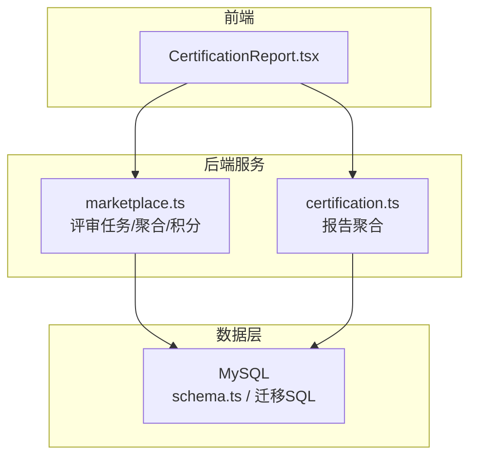
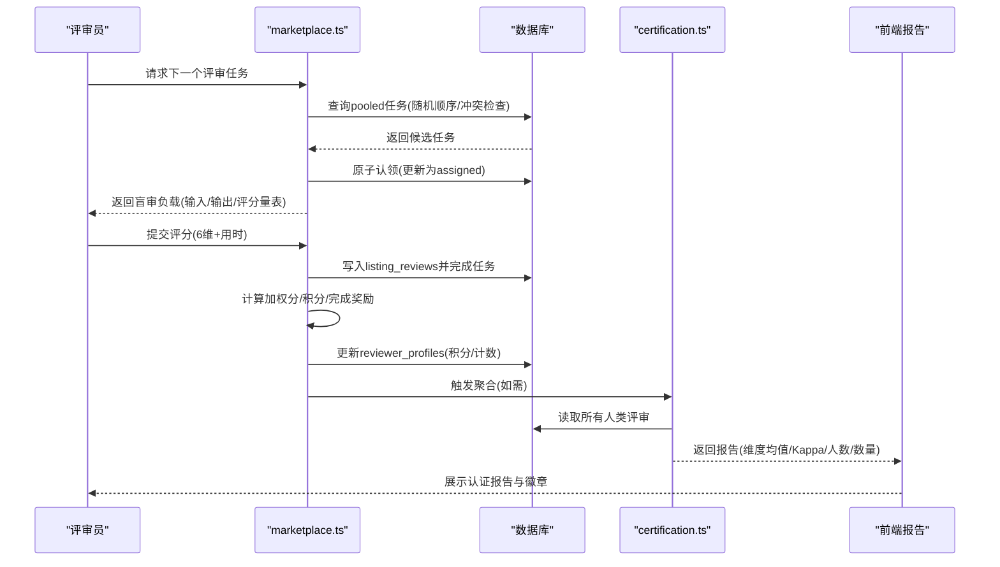
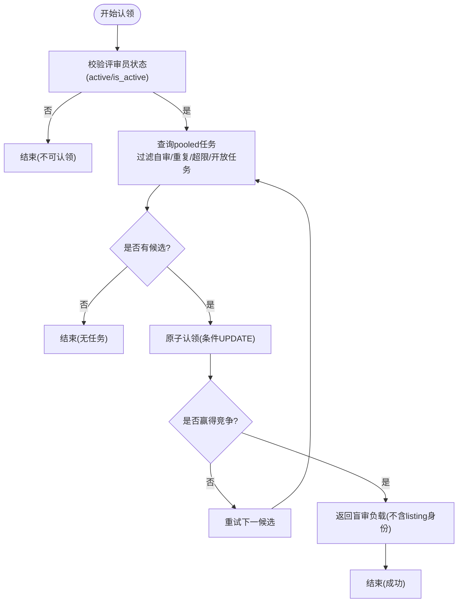
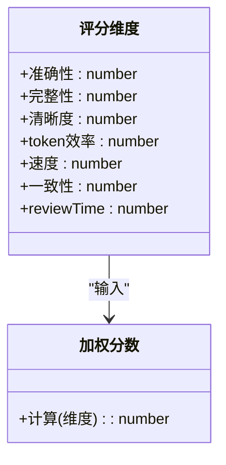
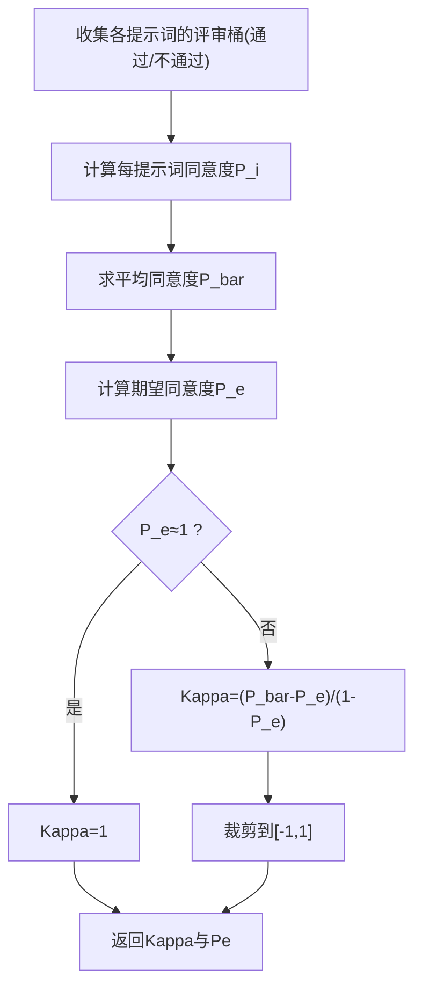
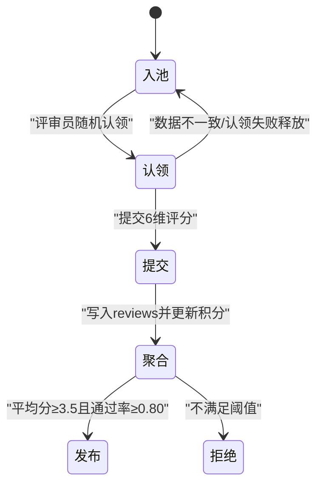
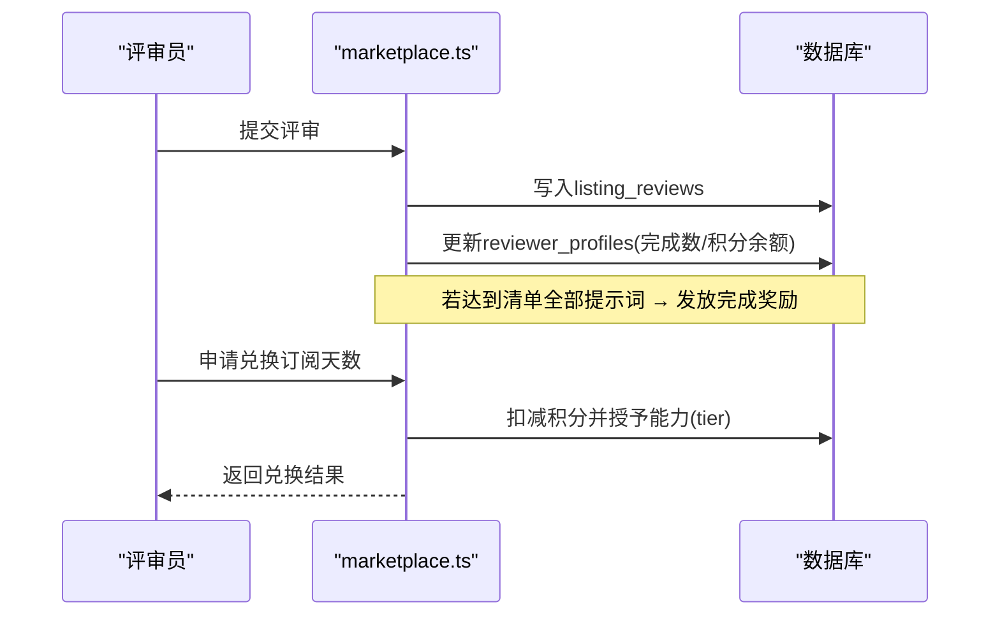
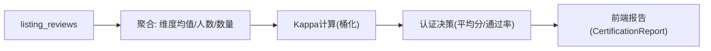
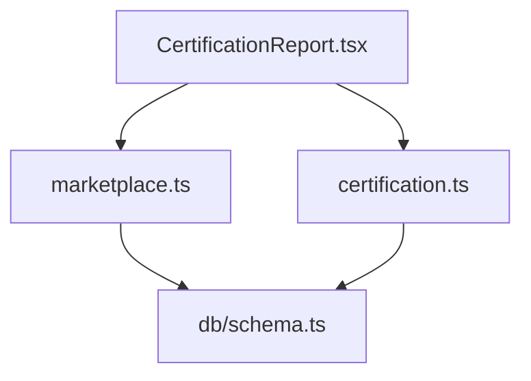

# 盲审评审系统

<cite>
**本文引用的文件**
- [api/routers/marketplace.ts](file://api/routers/marketplace.ts)
- [db/schema.ts](file://db/schema.ts)
- [db/migrate-008-create-marketplace.sql](file://db/migrate-008-create-marketplace.sql)
- [api/routers/certification.ts](file://api/routers/certification.ts)
- [src/pages/CertificationReport.tsx](file://src/pages/CertificationReport.tsx)
- [scripts/beta-simulation.mjs](file://scripts/beta-simulation.mjs)
</cite>

## 目录
1. [简介](#简介)
2. [项目结构](#项目结构)
3. [核心组件](#核心组件)
4. [架构总览](#架构总览)
5. [详细组件分析](#详细组件分析)
6. [依赖关系分析](#依赖关系分析)
7. [性能考量](#性能考量)
8. [故障排查指南](#故障排查指南)
9. [结论](#结论)
10. [附录](#附录)

## 简介
本技术文档面向“盲审评审系统”，聚焦以下目标：
- 评审员分配算法：负载均衡、冲突避免与任务池调度机制。
- 评分标准与维度：准确性、完整性、清晰度、token效率、速度、一致性等6项指标及加权计算。
- Fleiss' Kappa一致性检验：实现原理、阈值设置与决策门限。
- 评审任务生命周期：从入池、认领、提交到结果聚合的完整流程。
- 评审员信誉积分体系：积分获取、兑换与黑名单管理（状态控制）。
- 评审报告生成、质量指标统计与趋势展示能力。

## 项目结构
本系统后端以 tRPC 路由为核心，数据库使用 MySQL（Drizzle ORM），前端通过 React 页面渲染认证报告与评审门户。关键路径如下：
- 市场/评审路由：api/routers/marketplace.ts
- 认证报告聚合：api/routers/certification.ts
- 数据模型与迁移：db/schema.ts, db/migrate-008-create-marketplace.sql
- 前端报告页：src/pages/CertificationReport.tsx
- 模拟脚本（演示评审流程）：scripts/beta-simulation.mjs

图表来源
- [api/routers/marketplace.ts:589-735](file://api/routers/marketplace.ts#L589-L735)
- [api/routers/certification.ts:47-73](file://api/routers/certification.ts#L47-L73)
- [db/schema.ts:622-692](file://db/schema.ts#L622-L692)

章节来源
- [api/routers/marketplace.ts:589-735](file://api/routers/marketplace.ts#L589-L735)
- [db/schema.ts:622-692](file://db/schema.ts#L622-L692)

## 核心组件
- 评审任务池与认领：将待审提示词复制为多份进入“pooled”池，评审员按规则随机认领，避免自审与重复。
- 评分与加权：基于6维评分计算加权分数，用于质量度量与一致性检验。
- 一致性检验与认证决策：Fleiss' Kappa 在“通过/不通过”桶上计算；结合平均分与通过率决定发布或拒绝。
- 信誉积分与激励：完成评审获得积分，达到清单全部提示词后发放完成奖励；积分可兑换订阅天数。
- 报告与可视化：聚合各维度均值、Kappa、评审人数与数量，前端渲染指标与徽章。

章节来源
- [api/routers/marketplace.ts:486-510](file://api/routers/marketplace.ts#L486-L510)
- [api/routers/marketplace.ts:413-466](file://api/routers/marketplace.ts#L413-L466)
- [api/routers/marketplace.ts:517-543](file://api/routers/marketplace.ts#L517-L543)
- [api/routers/marketplace.ts:791-816](file://api/routers/marketplace.ts#L791-L816)
- [api/routers/marketplace.ts:2299-2331](file://api/routers/marketplace.ts#L2299-L2331)
- [api/routers/marketplace.ts:2608-2665](file://api/routers/marketplace.ts#L2608-L2665)
- [src/pages/CertificationReport.tsx:20-27](file://src/pages/CertificationReport.tsx#L20-L27)

## 架构总览
评审系统围绕“任务池—认领—评分—聚合—认证”的主干流程构建，配合信誉积分与报告展示形成闭环。

图表来源
- [api/routers/marketplace.ts:630-735](file://api/routers/marketplace.ts#L630-L735)
- [api/routers/marketplace.ts:742-816](file://api/routers/marketplace.ts#L742-L816)
- [api/routers/marketplace.ts:2299-2331](file://api/routers/marketplace.ts#L2299-L2331)
- [api/routers/certification.ts:47-73](file://api/routers/certification.ts#L47-L73)
- [src/pages/CertificationReport.tsx:42-68](file://src/pages/CertificationReport.tsx#L42-L68)

## 详细组件分析

### 评审员分配算法（负载均衡与冲突避免）
- 任务入池：每个测试提示词复制为 N 份（N=MIN_UNIQUE_REVIEWERS）进入 pooled 池，确保多评审员覆盖。
- 认领策略：
  - 仅 active 且 is_active 的评审员可认领。
  - 禁止自审（listing.creatorId != reviewerId）。
  - 防止同一 listing 下重复认领同一 prompt（已完成的同 listing+prompt 不再重复）。
  - 防止同一 listing 下同时持有多个 assigned 任务（避免聚簇）。
  - 每 listing 对单评审员有完成数上限（等于 MIN_REVIEWS_PER_REVIEWER），避免过度集中。
  - 随机顺序（RAND()）提升跨 listing 的负载均衡。
- 原子认领：条件 UPDATE 保证并发安全，失败则重试下一候选。

图表来源
- [api/routers/marketplace.ts:630-735](file://api/routers/marketplace.ts#L630-L735)

章节来源
- [api/routers/marketplace.ts:589-614](file://api/routers/marketplace.ts#L589-L614)
- [api/routers/marketplace.ts:630-735](file://api/routers/marketplace.ts#L630-L735)

说明
- 专业领域匹配：当前代码未实现基于领域的自动匹配，采用随机分配与配额限制实现均衡与去偏。若需引入领域匹配，可在查询池中增加领域标签过滤与权重排序。

### 评分标准与维度定义
- 六维评分量表（每项1-5）：
  - 准确性：输出是否正确且忠实于输入。
  - 完整性：输出是否覆盖输入要求的全部要点。
  - 清晰度：输出是否结构清晰、易于理解。
  - token效率：输出是否简洁、无冗余。
  - 速度：流水线响应是否可接受。
  - 一致性：输出是否内部一致、风格统一。
- 加权分数：
  - 维度权重：准确性 0.30、完整性 0.20、清晰度 0.15、token效率 0.10、速度 0.10、一致性 0.15。
  - 加权总分 = Σ(维度得分 × 对应权重)。

图表来源
- [api/routers/marketplace.ts:486-510](file://api/routers/marketplace.ts#L486-L510)
- [api/routers/marketplace.ts:545-563](file://api/routers/marketplace.ts#L545-L563)

章节来源
- [api/routers/marketplace.ts:486-510](file://api/routers/marketplace.ts#L486-L510)
- [api/routers/marketplace.ts:545-563](file://api/routers/marketplace.ts#L545-L563)

### Fleiss' Kappa 一致性检验与阈值
- 实现要点：
  - 针对每个提示词，统计评审员对各分类的计数，计算 P_i（该提示词的同意程度）。
  - 计算平均同意度 P_bar 与期望同意度 P_e。
  - Kappa = (P_bar - P_e) / (1 - P_e)，并将结果裁剪至 [-1, 1]。
  - 为避免高通过率下的“流行病悖论”，先将加权分映射为“通过/不通过”两桶，再计算 Kappa。
- 阈值与决策：
  - 认证门槛：平均分 ≥ 3.5 且通过率 ≥ 0.80 时发布，否则拒绝。
  - Kappa 作为诊断指标记录，不再作为硬性门限。

图表来源
- [api/routers/marketplace.ts:413-466](file://api/routers/marketplace.ts#L413-L466)
- [api/routers/marketplace.ts:468-483](file://api/routers/marketplace.ts#L468-L483)
- [api/routers/marketplace.ts:517-543](file://api/routers/marketplace.ts#L517-L543)

章节来源
- [api/routers/marketplace.ts:413-466](file://api/routers/marketplace.ts#L413-L466)
- [api/routers/marketplace.ts:468-483](file://api/routers/marketplace.ts#L468-L483)
- [api/routers/marketplace.ts:517-543](file://api/routers/marketplace.ts#L517-L543)

### 评审任务生命周期管理
- 入池：listing 进入 certifying 状态时，为每个测试提示词创建 N 个 pooled 任务。
- 认领：评审员按规则随机认领一个 pooled 任务，状态改为 assigned。
- 提交：评审员提交6维评分，系统写入 listing_reviews，任务标记 completed。
- 聚合与认证：
  - 当满足最小评审人数与每人最少评审数时，计算加权平均分与通过率。
  - 根据阈值决定是否发布或拒绝，并记录 Kappa 等指标。
- 异常处理：若认领后找不到对应提示，释放任务回 pooled，避免悬挂。

图表来源
- [api/routers/marketplace.ts:589-614](file://api/routers/marketplace.ts#L589-L614)
- [api/routers/marketplace.ts:630-735](file://api/routers/marketplace.ts#L630-L735)
- [api/routers/marketplace.ts:742-816](file://api/routers/marketplace.ts#L742-L816)
- [api/routers/marketplace.ts:825-909](file://api/routers/marketplace.ts#L825-L909)

章节来源
- [api/routers/marketplace.ts:589-614](file://api/routers/marketplace.ts#L589-L614)
- [api/routers/marketplace.ts:630-735](file://api/routers/marketplace.ts#L630-L735)
- [api/routers/marketplace.ts:742-816](file://api/routers/marketplace.ts#L742-L816)
- [api/routers/marketplace.ts:825-909](file://api/routers/marketplace.ts#L825-L909)

### 评审员信誉积分体系、激励机制与黑名单管理
- 积分获取：
  - 每完成一次评审获得基础积分。
  - 完成某 listing 全部提示词后发放完成奖励。
- 积分兑换：
  - 可用积分兑换不同等级的订阅天数（Master/Sage），成本按等级设定。
  - 兑换后授予能力（tier:<tier>）并记录过期时间。
- 黑名单/状态管理：
  - 评审员档案包含 status（active/suspended/banned）与 isActive 标志。
  - 非 active 或非 isActive 的评审员无法认领任务。
  - 支持通过状态字段进行封禁/暂停管理。

图表来源
- [api/routers/marketplace.ts:791-816](file://api/routers/marketplace.ts#L791-L816)
- [api/routers/marketplace.ts:2299-2331](file://api/routers/marketplace.ts#L2299-L2331)
- [api/routers/marketplace.ts:2608-2665](file://api/routers/marketplace.ts#L2608-L2665)
- [db/schema.ts:622-642](file://db/schema.ts#L622-L642)

章节来源
- [api/routers/marketplace.ts:791-816](file://api/routers/marketplace.ts#L791-L816)
- [api/routers/marketplace.ts:2299-2331](file://api/routers/marketplace.ts#L2299-L2331)
- [api/routers/marketplace.ts:2608-2665](file://api/routers/marketplace.ts#L2608-L2665)
- [db/schema.ts:622-642](file://db/schema.ts#L622-L642)

### 评审报告生成、质量指标统计与趋势分析
- 报告聚合：
  - 排除设计者自身评审，计算各维度平均值、唯一评审员数、评审总数。
  - 计算 Kappa 与认证状态。
- 前端展示：
  - 显示等级、Kappa、评审员数、评审数与各维度进度条。
  - 提供认证徽章与嵌入代码。
- 趋势分析：
  - 当前实现提供快照式报告；趋势分析可通过历史报告与指标导出扩展。

图表来源
- [api/routers/certification.ts:47-73](file://api/routers/certification.ts#L47-L73)
- [src/pages/CertificationReport.tsx:158-210](file://src/pages/CertificationReport.tsx#L158-L210)

章节来源
- [api/routers/certification.ts:47-73](file://api/routers/certification.ts#L47-L73)
- [src/pages/CertificationReport.tsx:158-210](file://src/pages/CertificationReport.tsx#L158-L210)

## 依赖关系分析
- marketplace.ts 依赖数据库 schema 中的 listingReviews、blindReviewTasks、reviewerProfiles 等表。
- certification.ts 依赖 listingReviews 与 marketplaceListings 进行报告聚合。
- 前端 CertificationReport.tsx 调用 tRPC 接口获取报告数据并渲染。

图表来源
- [api/routers/marketplace.ts:1-35](file://api/routers/marketplace.ts#L1-L35)
- [api/routers/certification.ts:47-73](file://api/routers/certification.ts#L47-L73)
- [db/schema.ts:600-799](file://db/schema.ts#L600-L799)

章节来源
- [api/routers/marketplace.ts:1-35](file://api/routers/marketplace.ts#L1-L35)
- [api/routers/certification.ts:47-73](file://api/routers/certification.ts#L47-L73)
- [db/schema.ts:600-799](file://db/schema.ts#L600-L799)

## 性能考量
- 任务池查询使用随机顺序与索引优化，减少热点 listing 导致的拥堵。
- 原子认领避免并发争用导致的数据不一致。
- 加权分数与 Kappa 计算在内存中进行，复杂度与评审规模线性相关。
- 建议：
  - 在高并发场景下，考虑对 pool 查询增加分页与缓存。
  - 对高频聚合接口增加短期缓存以降低数据库压力。
  - 对 Kappa 计算结果做增量更新，避免全量重算。

[本节为通用指导，无需特定文件引用]

## 故障排查指南
- 认领失败或悬挂：
  - 若认领后找不到对应提示，系统会释放任务回 pooled，检查日志中“claim”相关条目。
- 认证未达成：
  - 检查是否满足最小评审人数与每人最少评审数；查看平均分与通过率是否达标。
- 积分兑换失败：
  - 确认评审员积分余额足够，检查 tier 成本配置与能力授予逻辑。
- 报告为空：
  - 确认 listing 已进入 certifying 且有足够人类评审；检查是否排除了设计者自身评审。

章节来源
- [api/routers/marketplace.ts:721-735](file://api/routers/marketplace.ts#L721-L735)
- [api/routers/marketplace.ts:825-909](file://api/routers/marketplace.ts#L825-L909)
- [api/routers/marketplace.ts:2608-2665](file://api/routers/marketplace.ts#L2608-L2665)
- [api/routers/certification.ts:47-73](file://api/routers/certification.ts#L47-L73)

## 结论
本盲审评审系统通过“任务池—认领—评分—聚合—认证”的闭环流程，实现了公平、可控且可扩展的评审机制。其核心优势包括：
- 负载均衡与冲突避免：随机认领、配额限制与并发安全。
- 明确的评分与加权：六维指标与权重透明。
- 稳健的一致性检验：桶化 Kappa 与通过率双门限，避免流行病悖论。
- 信誉积分与激励：完成奖励与积分兑换，促进高质量参与。
- 报告与可视化：多维度指标与认证徽章，便于传播与信任建立。

[本节为总结性内容，无需特定文件引用]

## 附录
- 模拟评审流程（脚本）：
  - 注册评审员、加入评审池、领取任务并提交评分，可用于端到端验证。

章节来源
- [scripts/beta-simulation.mjs:202-228](file://scripts/beta-simulation.mjs#L202-L228)