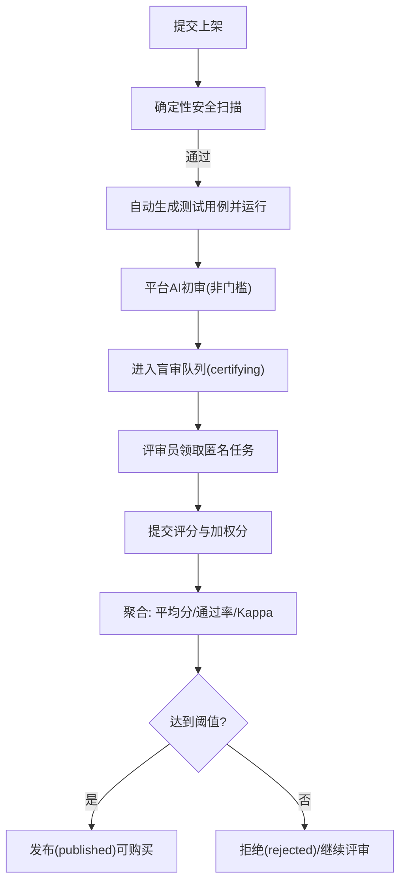
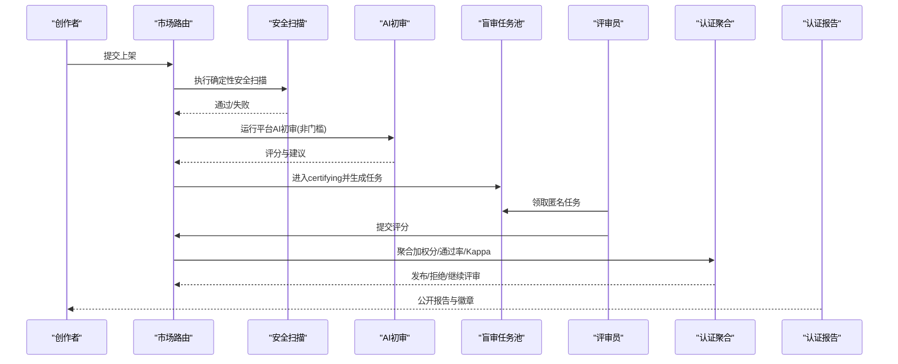
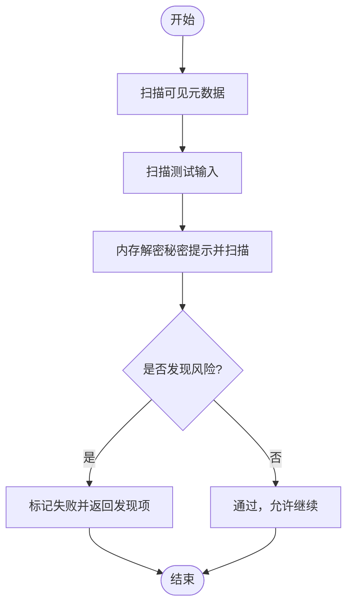
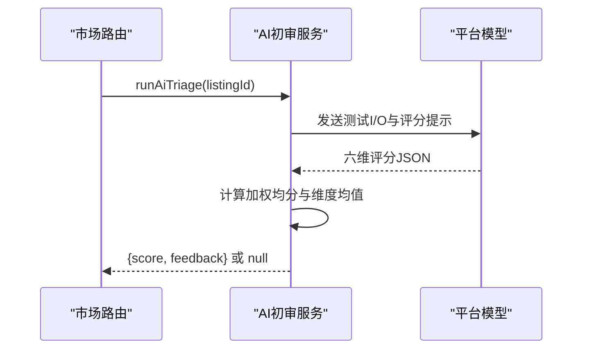
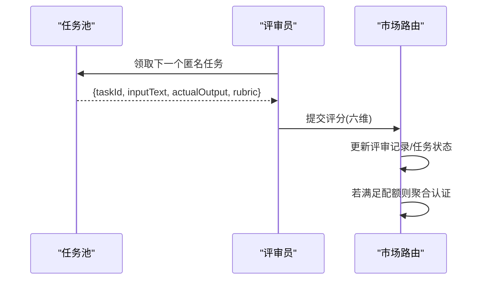
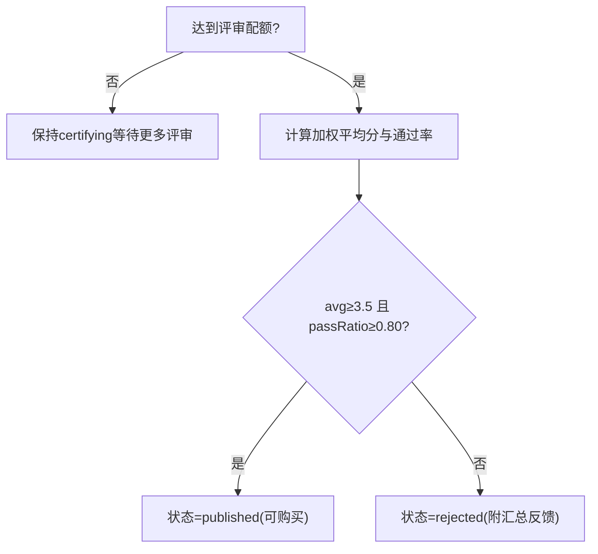
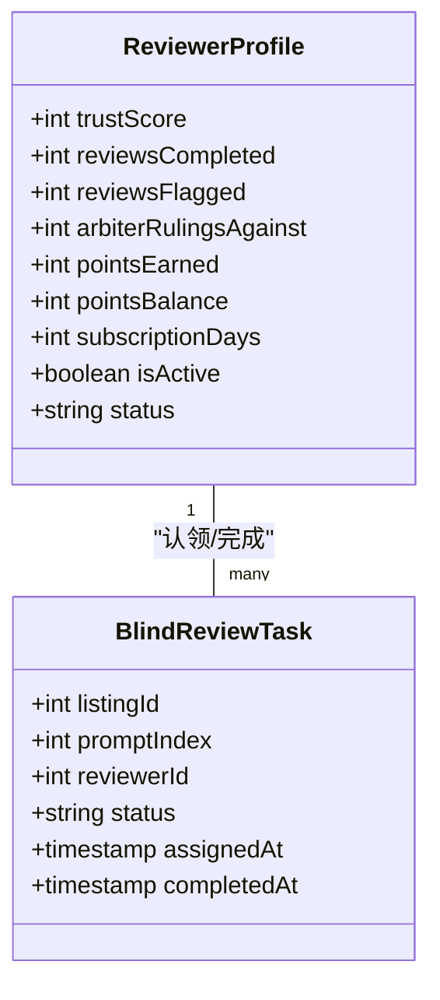
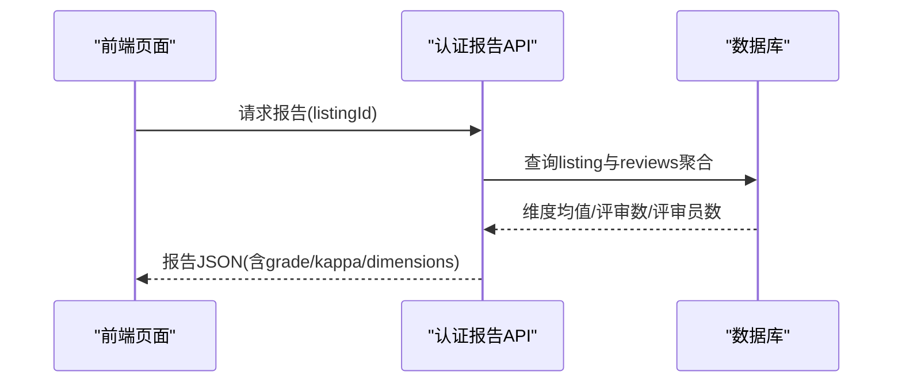
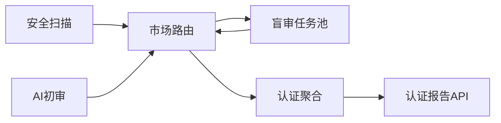

# 认证评估系统

<cite>
**本文引用的文件**
- [MARKETPLACE-TRUST-SPEC.md](file://DeeWaanAI-Next/MARKETPLACE-TRUST-SPEC.md)
- [promptSecurityScan.ts](file://api/services/promptSecurityScan.ts)
- [aiEnsembleReviewService.ts](file://api/services/aiEnsembleReviewService.ts)
- [marketplace.ts](file://api/routers/marketplace.ts)
- [certification.ts](file://api/routers/certification.ts)
- [schema.ts](file://db/schema.ts)
- [CertificationReport.tsx](file://src/pages/CertificationReport.tsx)
- [selling.md](file://site/src/content/docs/en/selling.md)
</cite>

## 目录
1. [简介](#简介)
2. [项目结构](#项目结构)
3. [核心组件](#核心组件)
4. [架构总览](#架构总览)
5. [详细组件分析](#详细组件分析)
6. [依赖关系分析](#依赖关系分析)
7. [性能与可靠性](#性能与可靠性)
8. [故障排查指南](#故障排查指南)
9. [结论](#结论)
10. [附录](#附录)

## 简介
本技术文档面向“认证评估系统”，覆盖从内容安全扫描、AI辅助初审到盲审评审、阈值判定、报告生成与统计的全链路流程。系统采用三层治理：确定性安全扫描（不可绕过）、平台AI初审（非门槛，仅用于质量反馈与队列排序）、盲审人类评审（决定可购买性）。同时记录评审员管理、信誉积分与激励机制，以及认证报告、质量指标与趋势分析能力。

## 项目结构
围绕认证评估的核心代码分布在以下模块：
- 规范与策略：市场信任与认证规范（生命周期、阈值、盲审规则）
- 安全扫描：纯代码的确定性扫描服务
- AI初审：多模型集成与评分聚合、Fleiss' Kappa一致性计算
- 评审路由：任务池、盲审任务领取与提交、认证聚合决策
- 数据模型：评审员档案、任务分配、测试提示、加密提示等表结构
- 前端报告：公开认证报告页面与徽章展示

图表来源
- [MARKETPLACE-TRUST-SPEC.md:25-45](file://DeeWaanAI-Next/MARKETPLACE-TRUST-SPEC.md#L25-L45)
- [marketplace.ts:616-756](file://api/routers/marketplace.ts#L616-L756)

章节来源
- [MARKETPLACE-TRUST-SPEC.md:25-45](file://DeeWaanAI-Next/MARKETPLACE-TRUST-SPEC.md#L25-L45)
- [marketplace.ts:616-756](file://api/routers/marketplace.ts#L616-L756)

## 核心组件
- 内容安全扫描：对可见元数据、测试输入与内存解密后的秘密提示进行正则与模式检测，输出发现项，失败即关闭（fail-closed）。
- AI辅助初审：使用平台可控模型对测试I/O进行六维打分，计算加权均分与维度均值，提供可操作反馈；不决定可购买性。
- 盲审评审机制：按提示粒度入池，评审员匿名领取，提交评分后触发认证聚合。
- 认证阈值与等级：基于加权平均分、通过率与Kappa一致性综合判定；通过后授予“已认证”等级与徽章。
- 评审员管理与激励：信誉分数、完成计数、争议裁决计数、积分兑换订阅天数。
- 报告与统计：公开认证报告API与前端页面，展示各维度得分、Kappa、评审人数与时间戳。

章节来源
- [promptSecurityScan.ts:1-301](file://api/services/promptSecurityScan.ts#L1-L301)
- [aiEnsembleReviewService.ts:1-620](file://api/services/aiEnsembleReviewService.ts#L1-L620)
- [marketplace.ts:825-917](file://api/routers/marketplace.ts#L825-L917)
- [schema.ts:622-692](file://db/schema.ts#L622-L692)
- [certification.ts:1-113](file://api/routers/certification.ts#L1-L113)
- [CertificationReport.tsx:1-45](file://src/pages/CertificationReport.tsx#L1-L45)

## 架构总览
认证评估系统由“安全扫描—AI初审—盲审评审—认证决策—报告展示”构成闭环。关键特性：
- 安全扫描为唯一不可绕过的可见性门控
- AI初审仅用于质量反馈与队列排序，不决定可购买性
- 盲审评审以匿名方式保证公平性与防串通
- 认证决策采用多维阈值（平均分、通过率、Kappa）
- 报告对外暴露只读数据，支持嵌入徽章

图表来源
- [MARKETPLACE-TRUST-SPEC.md:25-45](file://DeeWaanAI-Next/MARKETPLACE-TRUST-SPEC.md#L25-L45)
- [marketplace.ts:616-756](file://api/routers/marketplace.ts#L616-L756)
- [certification.ts:32-113](file://api/routers/certification.ts#L32-L113)

## 详细组件分析

### 内容安全扫描（确定性扫描）
- 扫描范围：标题、描述、目标、输入/输出格式、备注、测试输入、内存解密后的秘密提示
- 检查类别：Unicode卫生（零宽字符、BIDI覆盖、控制字符、混合脚本）、注入载荷（忽略指令、角色覆盖、系统提示）、外泄（URL+命令动词、邮件外发）、机密与滥用（API密钥形状、Base64大段、PII、卡号）
- 安全原则：明文仅在内存中处理，永不落盘或返回；任何无法扫描的情况视为失败（fail-closed）

图表来源
- [promptSecurityScan.ts:18-210](file://api/services/promptSecurityScan.ts#L18-L210)
- [promptSecurityScan.ts:226-301](file://api/services/promptSecurityScan.ts#L226-L301)

章节来源
- [promptSecurityScan.ts:1-301](file://api/services/promptSecurityScan.ts#L1-L301)

### AI辅助初审（非门槛）
- 输入：流水线描述、测试输入与真实输出
- 评分维度：准确性、完整性、清晰度、Token效率、速度、一致性
- 权重：accuracy×0.30 + completeness×0.20 + clarity×0.15 + tokenEfficiency×0.10 + speed×0.10 + consistency×0.15
- 输出：加权均分、维度均值、评审建议；错误/超时返回null（非门槛）
- 约束：仅使用平台配置的环境变量模型，绝不发送秘密提示

图表来源
- [aiEnsembleReviewService.ts:347-620](file://api/services/aiEnsembleReviewService.ts#L347-L620)

章节来源
- [aiEnsembleReviewService.ts:1-620](file://api/services/aiEnsembleReviewService.ts#L1-L620)

### 盲审评审机制（评审员分配、评分标准、一致性检验）
- 任务池：每个测试提示生成一个池化任务，状态pooled→assigned→completed/expired
- 领取规则：评审员必须活跃；禁止自审；避免同一列表重复聚类；原子领取并校验
- 评分标准：六维1–5分，系统计算加权分；提交后写入评审记录
- 一致性检验：Fleiss' Kappa，采用“通过/失败”二分类桶以减少流行度偏差；阈值参考规范
- 配额：至少N个独立评审员×每人M次评审方可触发认证聚合

图表来源
- [marketplace.ts:616-756](file://api/routers/marketplace.ts#L616-L756)
- [schema.ts:659-692](file://db/schema.ts#L659-L692)

章节来源
- [marketplace.ts:616-756](file://api/routers/marketplace.ts#L616-L756)
- [schema.ts:659-692](file://db/schema.ts#L659-L692)

### 认证阈值设置、通过率计算与质量等级划分
- 阈值策略：加权平均分≥3.5且通过率≥0.80；Kappa作为一致性诊断指标（保留阈值用于日志/校准）
- 通过率定义：加权分≥认证平均分的评审占比
- 质量等级：最终等级由加权平均分四舍五入至两位小数；前端根据等级显示颜色与徽章
- 决策函数：当达到配额时计算avgScore与passRatio，结合Kappa得出published/rejected/certifying

图表来源
- [marketplace.ts:825-917](file://api/routers/marketplace.ts#L825-L917)
- [marketplace.ts:464-492](file://api/routers/marketplace.ts#L464-L492)

章节来源
- [marketplace.ts:825-917](file://api/routers/marketplace.ts#L825-L917)
- [marketplace.ts:464-492](file://api/routers/marketplace.ts#L464-L492)

### 人工复审流程、争议处理机制与认证撤销程序
- 人工复审：在未达到配额或结果异常时，系统保持certifying状态以便继续收集评审；可通过MCP工具或前端入口引导用户成为评审员
- 争议处理：评审员档案包含仲裁裁决计数字段，可用于后续仲裁策略与信誉调整（当前实现以字段记录为主）
- 认证撤销：当前仓库未实现自动撤销逻辑；如需撤销，可在后端扩展状态机与审计日志，并在报告端隐藏或标注历史变更

章节来源
- [schema.ts:622-642](file://db/schema.ts#L622-L642)
- [MARKETPLACE-TRUST-SPEC.md:137-156](file://DeeWaanAI-Next/MARKETPLACE-TRUST-SPEC.md#L137-L156)

### 评审员管理系统、信誉积分体系与激励机制
- 评审员档案：信誉分、完成数、被标记数、仲裁裁决计数、积分累计与余额、订阅天数、活跃状态
- 积分兑换：按不同层级消耗积分兑换订阅天数（例如Sage与Master层级不同成本），扣减余额并增加订阅天数
- 任务分配：基于任务池的匿名领取，避免自审与重复聚类，确保公平与质量

图表来源
- [schema.ts:622-692](file://db/schema.ts#L622-L692)
- [marketplace.ts:616-756](file://api/routers/marketplace.ts#L616-L756)

章节来源
- [schema.ts:622-692](file://db/schema.ts#L622-L692)
- [marketplace.ts:616-756](file://api/routers/marketplace.ts#L616-L756)

### 认证报告生成、质量指标统计与趋势分析
- 报告API：公开查询已认证列表的报告，包含标题、描述、类别、等级、Kappa、评审数量、独立评审员数量、各维度平均分、价格与认证时间
- 前端展示：渲染等级颜色、维度得分、方法说明、徽章复制
- 趋势分析：可基于报告数据与数据库中的历史评审记录进行离线分析（如随时间变化的维度均值、通过率分布、Kappa稳定性）

图表来源
- [certification.ts:32-113](file://api/routers/certification.ts#L32-L113)
- [CertificationReport.tsx:1-45](file://src/pages/CertificationReport.tsx#L1-L45)

章节来源
- [certification.ts:1-113](file://api/routers/certification.ts#L1-L113)
- [CertificationReport.tsx:1-45](file://src/pages/CertificationReport.tsx#L1-L45)

## 依赖关系分析
- 安全扫描依赖加密提示解密与测试提示读取，但不依赖外部LLM
- AI初审依赖平台环境变量配置的模型适配器，仅接收测试I/O
- 盲审任务池依赖数据库表结构与原子更新，确保并发安全
- 认证聚合依赖评审记录与测试提示，计算加权分、通过率与Kappa
- 报告API依赖只读数据库视图与缓存头，保障SEO与CDN友好

图表来源
- [marketplace.ts:616-756](file://api/routers/marketplace.ts#L616-L756)
- [certification.ts:32-113](file://api/routers/certification.ts#L32-L113)

章节来源
- [marketplace.ts:616-756](file://api/routers/marketplace.ts#L616-L756)
- [certification.ts:32-113](file://api/routers/certification.ts#L32-L113)

## 性能与可靠性
- 重试与超时：AI调用具备指数退避重试与硬超时保护，防止长时间阻塞
- 非门槛设计：AI初审失败或不可用时跳过，不影响进入盲审队列
- 并发安全：盲审任务领取采用原子更新与竞态重取，避免重复分配
- 缓存策略：报告接口设置公共缓存头，利于边缘缓存与SEO

章节来源
- [aiEnsembleReviewService.ts:523-620](file://api/services/aiEnsembleReviewService.ts#L523-L620)
- [marketplace.ts:162-199](file://api/routers/marketplace.ts#L162-L199)
- [certification.ts:19-22](file://api/routers/certification.ts#L19-L22)

## 故障排查指南
- 安全扫描失败：查看返回的发现项代码与字段标签，定位注入、外泄、机密或Unicode问题；修正后重新提交
- AI初审无评分：检查平台模型配置与环境变量；确认测试I/O存在且有效；关注超时与网络错误日志
- 盲审任务无法领取：确认评审员状态为活跃；检查是否存在同列表开放任务导致聚类限制；重试领取
- 认证未发布：核对是否达到评审配额；检查加权平均分与通过率；查看Kappa诊断值
- 报告不可见：确认列表状态为approved/published；检查缓存头与CDN刷新

章节来源
- [promptSecurityScan.ts:226-301](file://api/services/promptSecurityScan.ts#L226-L301)
- [aiEnsembleReviewService.ts:523-620](file://api/services/aiEnsembleReviewService.ts#L523-L620)
- [marketplace.ts:616-756](file://api/routers/marketplace.ts#L616-L756)
- [certification.ts:32-113](file://api/routers/certification.ts#L32-L113)

## 结论
本系统通过“安全扫描—AI初审—盲审评审—认证决策—报告展示”的分层治理，实现了高可信、低成本、可扩展的认证评估流程。其关键优势在于：
- 安全扫描不可绕过，确保可见性门控
- AI初审提供即时反馈，降低人力成本
- 盲审评审保证公平与防串通，Kappa一致性提升质量
- 多维度阈值兼顾平均分与通过率，减少流行度偏差
- 报告与徽章增强透明度与品牌信任

未来可考虑引入仲裁与撤销机制、更细粒度的趋势分析与A/B阈值校准，进一步提升系统的鲁棒性与业务价值。

## 附录
- 术语
  - 加权平均分：六维评分按权重计算的总分
  - 通过率：加权分达到认证平均分的评审比例
  - Fleiss' Kappa：衡量多评审员间一致性的统计量
  - certifying：可见但不可购买的认证中状态
  - published：已通过认证的可购买状态

章节来源
- [MARKETPLACE-TRUST-SPEC.md:25-45](file://DeeWaanAI-Next/MARKETPLACE-TRUST-SPEC.md#L25-L45)
- [selling.md:17-25](file://site/src/content/docs/en/selling.md#L17-L25)