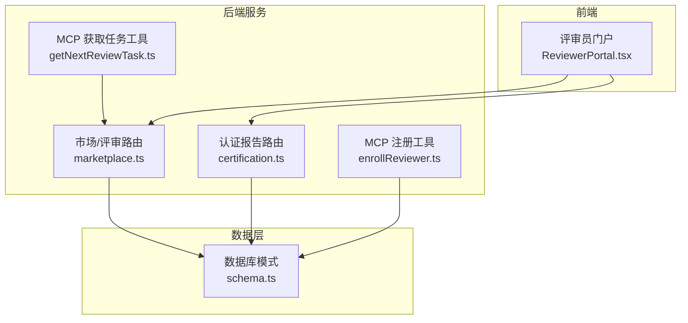
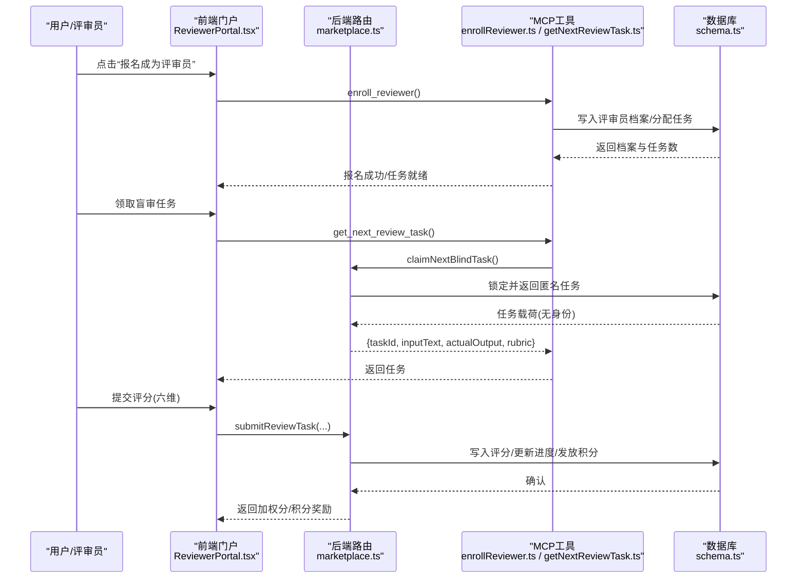
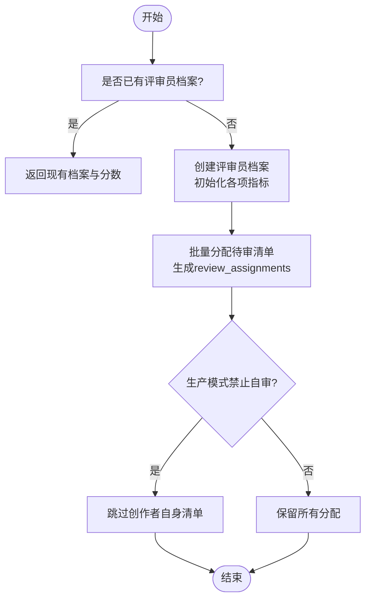
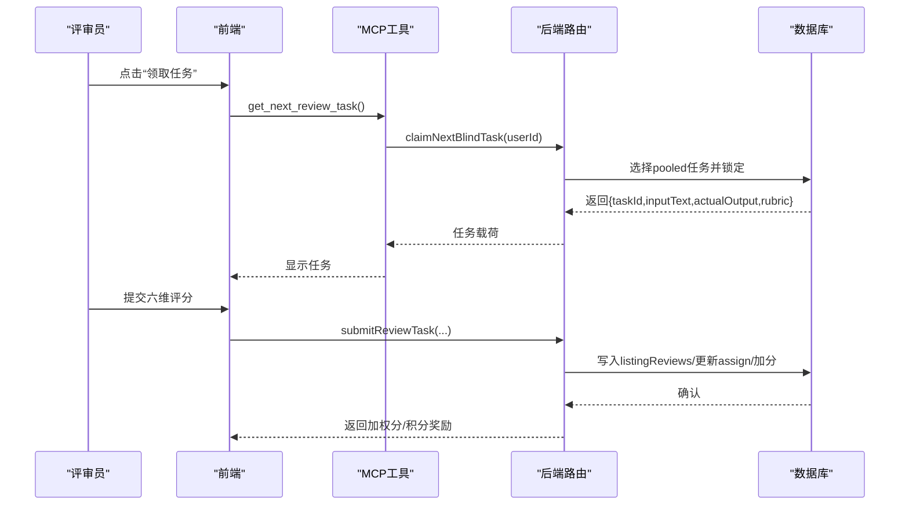
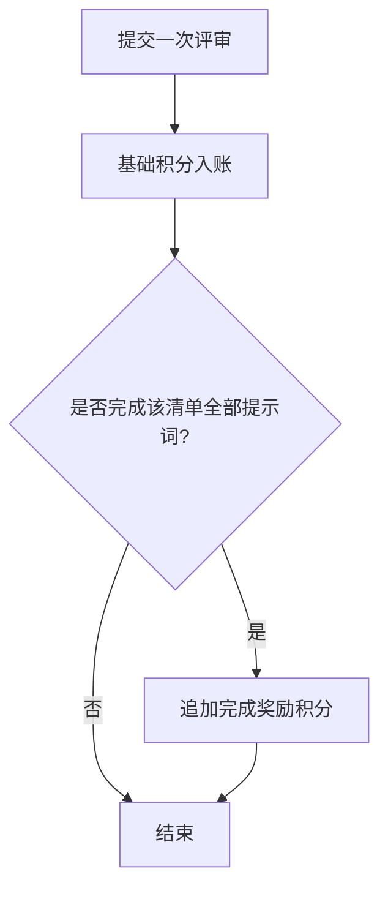
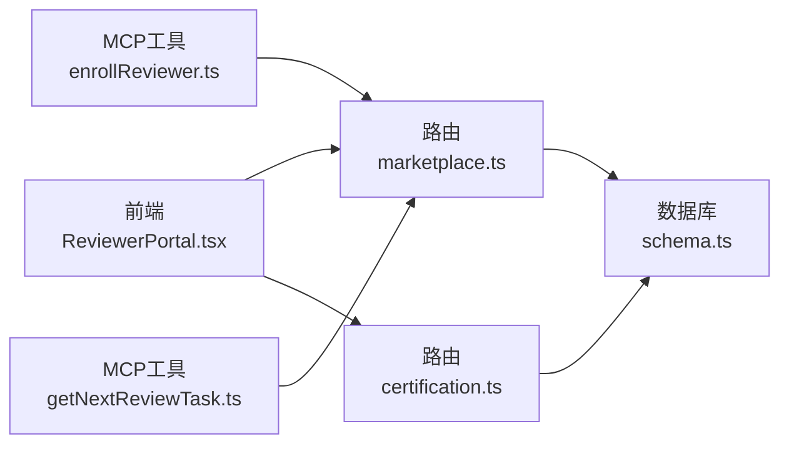

# 评审员管理系统

<cite>
**本文引用的文件**
- [ReviewerPortal.tsx](file://src/pages/ReviewerPortal.tsx)
- [marketplace.ts](file://api/routers/marketplace.ts)
- [enrollReviewer.ts](file://api/mcp/tools/enrollReviewer.ts)
- [getNextReviewTask.ts](file://api/mcp/tools/getNextReviewTask.ts)
- [certification.ts](file://api/routers/certification.ts)
- [schema.ts](file://db/schema.ts)
</cite>

## 目录
1. [简介](#简介)
2. [项目结构](#项目结构)
3. [核心组件](#核心组件)
4. [架构总览](#架构总览)
5. [详细组件分析](#详细组件分析)
6. [依赖关系分析](#依赖关系分析)
7. [性能与可靠性](#性能与可靠性)
8. [故障排查指南](#故障排查指南)
9. [结论](#结论)
10. [附录](#附录)

## 简介
本技术文档面向评审员管理系统的研发、运维与产品团队，系统性说明评审员注册与资质验证流程、能力画像构建、任务分配策略、信誉积分体系、激励机制、绩效评估与能力提升方案，以及社区管理与知识共享平台。系统以“盲审+评分量表”为核心机制，结合权重评分、一致性度量（Fleiss Kappa）与自动认证决策，确保评审质量与公平性；同时提供积分兑换订阅天数的激励闭环，并通过排行榜与状态看板提升参与感与可观测性。

## 项目结构
围绕评审员管理的代码主要分布在以下位置：
- 前端门户与交互：src/pages/ReviewerPortal.tsx
- 后端路由与服务逻辑：api/routers/marketplace.ts、api/routers/certification.ts
- MCP工具（评审员入口与任务拉取）：api/mcp/tools/enrollReviewer.ts、api/mcp/tools/getNextReviewTask.ts
- 数据模型与迁移：db/schema.ts

**图表来源**
- [ReviewerPortal.tsx:338-605](file://src/pages/ReviewerPortal.tsx#L338-L605)
- [marketplace.ts:2132-2400](file://api/routers/marketplace.ts#L2132-L2400)
- [certification.ts:32-112](file://api/routers/certification.ts#L32-L112)
- [enrollReviewer.ts:13-95](file://api/mcp/tools/enrollReviewer.ts#L13-L95)
- [getNextReviewTask.ts:11-32](file://api/mcp/tools/getNextReviewTask.ts#L11-L32)
- [schema.ts:622-692](file://db/schema.ts#L622-L692)

**章节来源**
- [ReviewerPortal.tsx:338-605](file://src/pages/ReviewerPortal.tsx#L338-L605)
- [marketplace.ts:2132-2400](file://api/routers/marketplace.ts#L2132-L2400)
- [certification.ts:32-112](file://api/routers/certification.ts#L32-L112)
- [enrollReviewer.ts:13-95](file://api/mcp/tools/enrollReviewer.ts#L13-L95)
- [getNextReviewTask.ts:11-32](file://api/mcp/tools/getNextReviewTask.ts#L11-L32)
- [schema.ts:622-692](file://db/schema.ts#L622-L692)

## 核心组件
- 评审员门户（前端）：展示收益、信誉分、积分余额、待办任务、盲审任务与排行榜，支持报名成为评审员、领取并完成盲审任务、积分兑换订阅天数。
- 评审路由（后端）：实现评审员档案查询、任务分配、提交评审、加权分数计算、Kappa一致性度量、自动认证决策、积分发放与兑换、排行榜等。
- MCP工具：提供“加入评审池”和“获取下一个盲审任务”的编程式入口，便于自动化或集成场景使用。
- 认证报告路由：对外暴露已认证的列表项及其维度平均分、等级、Kappa等指标，用于SEO与公开可信度展示。
- 数据模型：定义评审员档案、评审任务、盲审任务、测试提示词、中间结果等表结构及索引。

**章节来源**
- [ReviewerPortal.tsx:46-227](file://src/pages/ReviewerPortal.tsx#L46-L227)
- [marketplace.ts:485-575](file://api/routers/marketplace.ts#L485-L575)
- [marketplace.ts:2191-2400](file://api/routers/marketplace.ts#L2191-L2400)
- [certification.ts:32-112](file://api/routers/certification.ts#L32-L112)
- [schema.ts:622-692](file://db/schema.ts#L622-L692)

## 架构总览
评审员管理系统采用前后端分离架构，前端通过tRPC调用后端路由，MCP工具作为扩展入口接入同一套服务与数据层。关键流程包括：
- 注册与自动分配：评审员报名后，系统为其创建档案并自动分配待审清单。
- 盲审任务流：评审员从任务池中领取匿名任务，按统一量规打分并提交，系统记录并更新进度。
- 认证决策：当所有任务完成且满足最低评审人数与数量阈值时，系统计算加权平均分、通过率与Kappa一致性，决定批准或拒绝，并自动发布。
- 积分与激励：每次评审获得基础积分，完成全部提示词有额外奖励；积分可兑换订阅天数。
- 公开认证报告：仅对已通过/已发布的列表项开放认证报告与徽章信息。

**图表来源**
- [enrollReviewer.ts:20-95](file://api/mcp/tools/enrollReviewer.ts#L20-L95)
- [getNextReviewTask.ts:11-32](file://api/mcp/tools/getNextReviewTask.ts#L11-L32)
- [marketplace.ts:2191-2400](file://api/routers/marketplace.ts#L2191-L2400)
- [schema.ts:622-692](file://db/schema.ts#L622-L692)

## 详细组件分析

### 评审员注册与资质验证流程
- 注册入口：通过MCP工具 enroll_reviewer 或前端报名按钮触发。
- 档案创建：为首次报名的用户创建评审员档案，初始化信任分、完成数、标记数、仲裁裁决计数、积分与订阅天数等。
- 自动分配：将当前所有处于“待评审”状态的清单条目分配给新评审员，生成待办任务并设置截止时间。
- 防自审：在最小评审人数大于1的生产模式下，创作者不能评审自己的清单。

**图表来源**
- [enrollReviewer.ts:20-95](file://api/mcp/tools/enrollReviewer.ts#L20-L95)
- [schema.ts:622-692](file://db/schema.ts#L622-L692)

**章节来源**
- [enrollReviewer.ts:20-95](file://api/mcp/tools/enrollReviewer.ts#L20-L95)
- [schema.ts:622-692](file://db/schema.ts#L622-L692)

### 盲审任务与评分流程
- 任务拉取：通过 get_next_review_task 调用 claimNextBlindTask，从任务池中标记并返回匿名任务载荷（不含清单身份）。
- 评分量规：统一六维评分（准确性、完整性、清晰度、令牌效率、速度、一致性），前端强制全维度打分。
- 提交与计分：后端校验权限（必须已分配）、写入评分、计算加权分、更新任务与分配状态、发放积分与完成奖励。
- 认证推进：当某清单的所有分配均完成后，系统汇总评分，计算平均分、通过率与Kappa一致性，做出批准/拒绝决策并自动发布。

**图表来源**
- [getNextReviewTask.ts:11-32](file://api/mcp/tools/getNextReviewTask.ts#L11-L32)
- [marketplace.ts:2191-2400](file://api/routers/marketplace.ts#L2191-L2400)
- [schema.ts:659-692](file://db/schema.ts#L659-L692)

**章节来源**
- [getNextReviewTask.ts:11-32](file://api/mcp/tools/getNextReviewTask.ts#L11-L32)
- [marketplace.ts:2191-2400](file://api/routers/marketplace.ts#L2191-L2400)
- [schema.ts:659-692](file://db/schema.ts#L659-L692)

### 评审员能力画像构建
- 专业领域：由所评审清单的类别与历史任务分布体现（前端展示分类标签，后端聚合统计）。
- 历史表现：基于完成数、加权分、标记数、仲裁裁决计数等指标综合反映。
- 偏好设置：可通过用户偏好字段存储UI状态、最近访问等（通用用户表），不影响评审工作流。
- 可视化：门户展示信任分、完成数、积分、订阅天数、标记数与状态，并提供排行榜。

**章节来源**
- [ReviewerPortal.tsx:449-486](file://src/pages/ReviewerPortal.tsx#L449-L486)
- [schema.ts:622-642](file://db/schema.ts#L622-L642)

### 评审任务分配策略
- 智能匹配：当前实现为“报名即全量分配待审清单”，后续可扩展至基于领域/历史表现的匹配。
- 负载均衡：通过任务池与“认领”机制避免重复领取；每个评审员对同一清单的同一提示词唯一分配。
- 质量保证：强制六维评分、加权分与Kappa一致性度量；创作者不可自审；仅在达到最低评审人数与数量阈值时进行认证决策。

**章节来源**
- [enrollReviewer.ts:52-95](file://api/mcp/tools/enrollReviewer.ts#L52-L95)
- [schema.ts:659-692](file://db/schema.ts#L659-L692)
- [marketplace.ts:2333-2400](file://api/routers/marketplace.ts#L2333-L2400)

### 信誉积分体系
- 积分获取：每完成一个提示词评审获得基础积分；完成某清单全部提示词获得完成奖励。
- 等级晋升：当前未实现显式等级，但信任分与排行榜可作为隐性等级依据。
- 惩罚机制：存在标记数与仲裁裁决计数字段，可用于后续限制或降级策略。
- 积分消耗：支持将积分兑换为订阅天数（不同档位对应不同单价）。

**图表来源**
- [marketplace.ts:2295-2331](file://api/routers/marketplace.ts#L2295-L2331)
- [schema.ts:622-642](file://db/schema.ts#L622-L642)

**章节来源**
- [marketplace.ts:2295-2331](file://api/routers/marketplace.ts#L2295-L2331)
- [schema.ts:622-642](file://db/schema.ts#L622-L642)

### 激励机制设计
- 物质奖励：积分可兑换订阅天数，降低使用成本。
- 荣誉体系：排行榜展示排名、完成数与积分，增强荣誉感。
- 职业发展路径：通过信任分、完成数与标记数形成成长曲线，未来可对接更高级别权益。

**章节来源**
- [ReviewerPortal.tsx:449-486](file://src/pages/ReviewerPortal.tsx#L449-L486)
- [marketplace.ts:2608-2643](file://api/routers/marketplace.ts#L2608-L2643)

### 绩效评估、培训与能力提升
- 绩效评估：基于加权分、Kappa一致性、完成率与标记率等指标评估评审质量与稳定性。
- 培训计划：可在门户中增加量规说明与示例，帮助评审员理解评分标准。
- 能力提升：通过排行榜与反馈提示（如低信任分警示）引导改进。

**章节来源**
- [marketplace.ts:464-483](file://api/routers/marketplace.ts#L464-L483)
- [ReviewerPortal.tsx:449-486](file://src/pages/ReviewerPortal.tsx#L449-L486)

### 社区管理与知识共享平台
- 社区管理：通过状态（活跃/暂停/封禁）与标记数控制参与资格。
- 知识共享：认证报告与徽章公开已通过的清单与维度得分，促进经验沉淀与参考。

**章节来源**
- [schema.ts:622-642](file://db/schema.ts#L622-L642)
- [certification.ts:32-112](file://api/routers/certification.ts#L32-L112)

## 依赖关系分析
- 前端依赖 tRPC 调用 marketplace 与 certification 路由，渲染评审员门户与认证报告。
- MCP工具复用同一数据库与业务逻辑，提供可编程接口。
- 数据层通过Drizzle ORM与MySQL交互，包含评审员档案、任务、评分、中间结果等表。

**图表来源**
- [ReviewerPortal.tsx:338-605](file://src/pages/ReviewerPortal.tsx#L338-L605)
- [marketplace.ts:2132-2400](file://api/routers/marketplace.ts#L2132-L2400)
- [certification.ts:32-112](file://api/routers/certification.ts#L32-L112)
- [enrollReviewer.ts:20-95](file://api/mcp/tools/enrollReviewer.ts#L20-L95)
- [getNextReviewTask.ts:11-32](file://api/mcp/tools/getNextReviewTask.ts#L11-L32)
- [schema.ts:622-692](file://db/schema.ts#L622-L692)

**章节来源**
- [ReviewerPortal.tsx:338-605](file://src/pages/ReviewerPortal.tsx#L338-L605)
- [marketplace.ts:2132-2400](file://api/routers/marketplace.ts#L2132-L2400)
- [certification.ts:32-112](file://api/routers/certification.ts#L32-L112)
- [schema.ts:622-692](file://db/schema.ts#L622-L692)

## 性能与可靠性
- 缓存策略：认证报告与榜单等公共数据采用边缘缓存与浏览器缓存，减少重复计算。
- 重试与超时：外部LLM调用具备指数退避重试与硬超时保护，异常快速失败。
- 幂等与去重：盲审任务通过唯一索引防止重复认领；报名与分配逻辑保证幂等。
- 读写分离：读操作使用只读库连接，写操作使用主库，降低负载。

**章节来源**
- [certification.ts:19-22](file://api/routers/certification.ts#L19-L22)
- [marketplace.ts:37-39](file://api/routers/marketplace.ts#L37-L39)
- [marketplace.ts:162-199](file://api/routers/marketplace.ts#L162-L199)
- [schema.ts:688-692](file://db/schema.ts#L688-L692)

## 故障排查指南
- 无法领取任务：检查任务池是否为空、是否存在并发冲突；查看claimNextBlindTask返回值与数据库状态。
- 提交被拒：确认已拥有对应清单的分配；创作者不可自审；评分维度必须在1-5范围内。
- 积分不足：核对当前积分余额与兑换单价（不同档位），确认账户状态为活跃。
- 认证不通过：检查是否达到最低评审人数与数量阈值；关注加权平均分、通过率与Kappa一致性。

**章节来源**
- [marketplace.ts:2207-2228](file://api/routers/marketplace.ts#L2207-L2228)
- [marketplace.ts:2333-2400](file://api/routers/marketplace.ts#L2333-L2400)
- [marketplace.ts:2608-2643](file://api/routers/marketplace.ts#L2608-L2643)

## 结论
本系统以“盲审+量化评分+一致性度量”为核心，构建了可追溯、可审计、可扩展的评审员管理体系。通过自动分配、任务池认领、积分激励与公开认证报告，实现了质量保障与参与激励的平衡。未来可在智能匹配、等级体系、培训与社区功能上持续演进，进一步提升评审效率与生态活力。

## 附录
- 评分量规与权重：六维评分与权重用于加权分计算，确保多维质量评估。
- 认证阈值：平均分、通过率与Kappa一致性共同决定批准/拒绝。
- 数据模型要点：评审员档案、任务、评分、中间结果与购买记录等表结构清晰，索引完善。

**章节来源**
- [marketplace.ts:485-575](file://api/routers/marketplace.ts#L485-L575)
- [marketplace.ts:2333-2400](file://api/routers/marketplace.ts#L2333-L2400)
- [schema.ts:622-749](file://db/schema.ts#L622-L749)