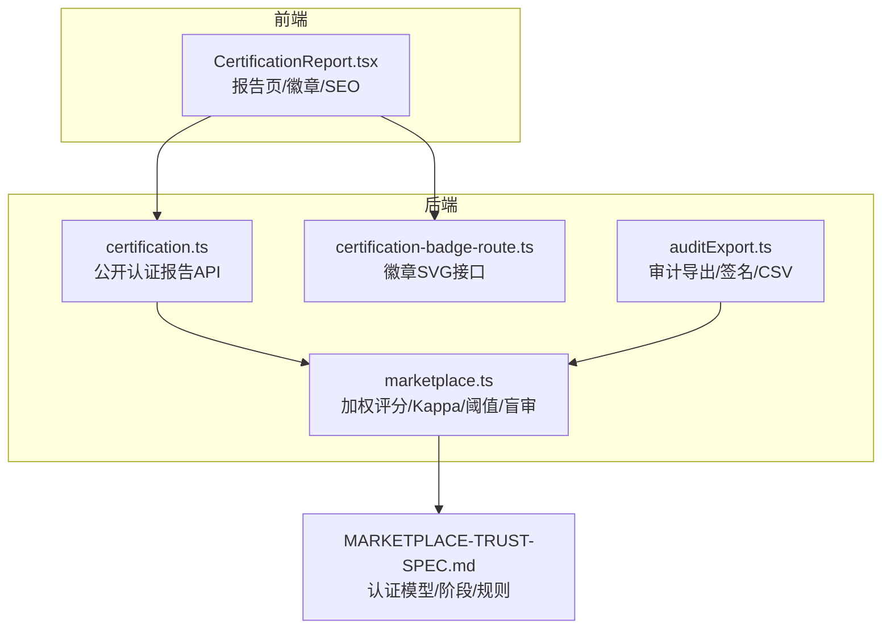
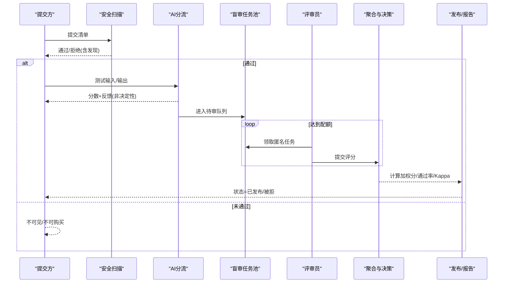
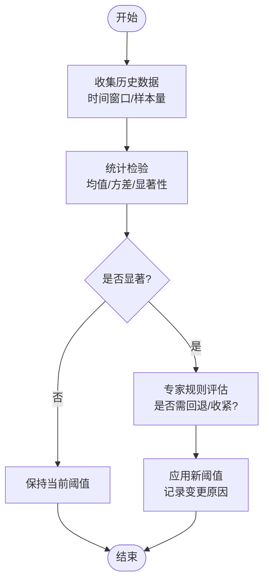
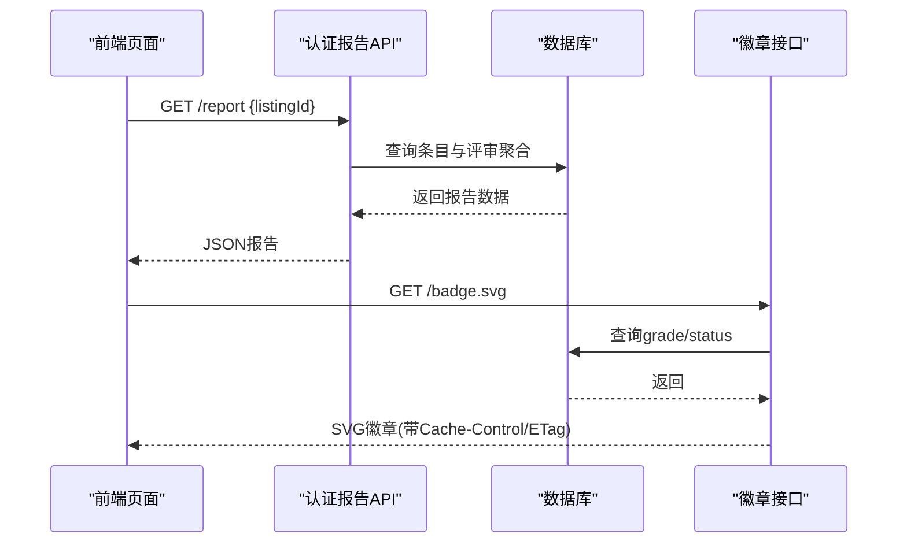
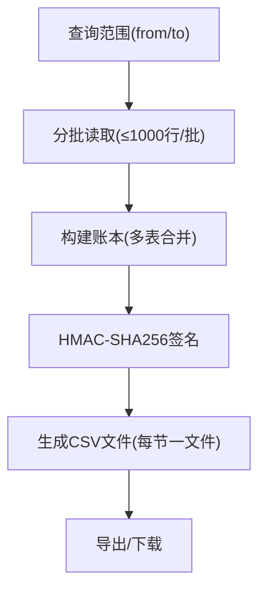
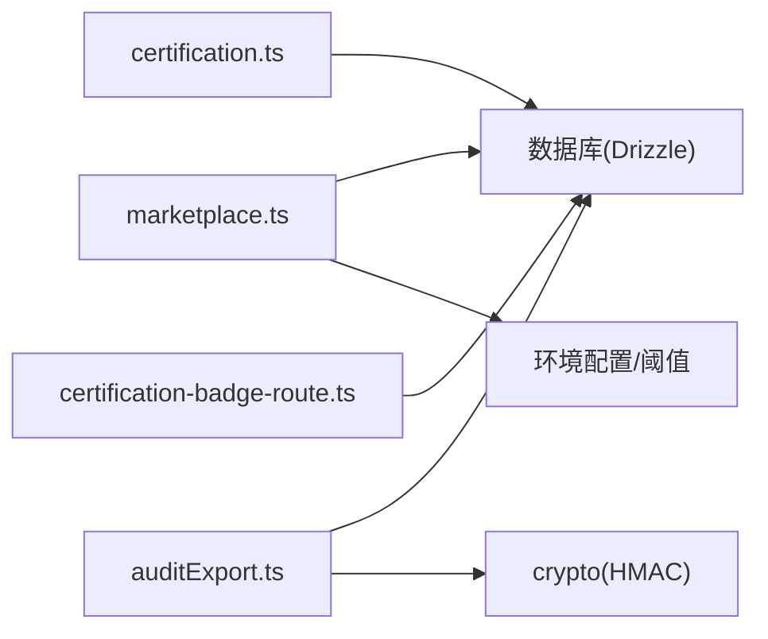

# 质量控制与认证

<cite>
**本文引用的文件**
- [api/routers/marketplace.ts](file://api/routers/marketplace.ts)
- [DeeWaanAI-Next/MARKETPLACE-TRUST-SPEC.md](file://DeeWaanAI-Next/MARKETPLACE-TRUST-SPEC.md)
- [api/routers/certification.ts](file://api/routers/certification.ts)
- [api/certification-badge-route.ts](file://api/certification-badge-route.ts)
- [src/pages/CertificationReport.tsx](file://src/pages/CertificationReport.tsx)
- [api/services/auditExport.ts](file://api/services/auditExport.ts)
</cite>

## 目录
1. [简介](#简介)
2. [项目结构](#项目结构)
3. [核心组件](#核心组件)
4. [架构总览](#架构总览)
5. [详细组件分析](#详细组件分析)
6. [依赖关系分析](#依赖关系分析)
7. [性能考量](#性能考量)
8. [故障排查指南](#故障排查指南)
9. [结论](#结论)
10. [附录](#附录)

## 简介
本技术文档面向“质量控制与认证系统”，聚焦以下目标：
- 认证阈值的动态调整机制：基于历史数据的自适应算法与专家规则引擎。
- 通过率计算方法：时间窗口、样本量要求与统计显著性检验。
- 质量等级划分标准：从A级到D级的评分区间与认证要求。
- 认证撤销程序：触发条件、通知机制与恢复流程。
- 认证报告自动生成、格式规范与发布渠道。
- 质量监控仪表板、异常检测与预警机制。
- 认证数据的历史追踪与审计日志功能。

## 项目结构
围绕认证与质量控制的代码主要分布在以下位置：
- 市场信任与认证核心逻辑（阈值、加权评分、Fleiss Kappa、盲审任务池）位于后端路由模块。
- 公开认证报告与徽章接口提供只读数据与可嵌入的SVG徽章。
- 前端认证报告页面渲染分数、维度与徽章，并支持SEO结构化数据。
- 审计导出服务提供带签名的合规账本与CSV导出，覆盖运行、审批、权限、订阅、MCP审计、OAuth等。

**图表来源**
- [api/routers/marketplace.ts:460-559](file://api/routers/marketplace.ts#L460-L559)
- [api/routers/certification.ts:17-112](file://api/routers/certification.ts#L17-L112)
- [api/certification-badge-route.ts:15-70](file://api/certification-badge-route.ts#L15-L70)
- [src/pages/CertificationReport.tsx:20-74](file://src/pages/CertificationReport.tsx#L20-L74)
- [DeeWaanAI-Next/MARKETPLACE-TRUST-SPEC.md:10-45](file://DeeWaanAI-Next/MARKETPLACE-TRUST-SPEC.md#L10-L45)

**章节来源**
- [api/routers/marketplace.ts:460-559](file://api/routers/marketplace.ts#L460-L559)
- [api/routers/certification.ts:17-112](file://api/routers/certification.ts#L17-L112)
- [api/certification-badge-route.ts:15-70](file://api/certification-badge-route.ts#L15-L70)
- [src/pages/CertificationReport.tsx:20-74](file://src/pages/CertificationReport.tsx#L20-L74)
- [DeeWaanAI-Next/MARKETPLACE-TRUST-SPEC.md:10-45](file://DeeWaanAI-Next/MARKETPLACE-TRUST-SPEC.md#L10-L45)

## 核心组件
- 加权评分与维度权重：对准确性、完整性、清晰度、Token效率、速度、一致性进行加权求和，得到单条评审的加权分。
- 认证阈值与决策：结合平均加权分与通过率（通过阈值≥CERTIFY_MIN_AVG_SCORE的评审比例），决定“发布”或“拒绝”。
- 一致性度量：使用Fleiss Kappa在“通过/失败”二分类上衡量评审者间一致性，避免高通过率下的“流行度悖论”。
- 盲审任务池：按提示词复制多份进入池，确保匿名、去重、防自审与防聚集，达到最小评审人数×每人最少评审数后聚合计算。
- 公开报告与徽章：仅暴露已批准/已发布的条目；提供JSON报告与可嵌入SVG徽章，附带缓存控制与ETag。
- 审计导出：分批拉取多表数据，生成带HMAC-SHA256签名的JSON账本与CSV文件，用于合规与追溯。

**章节来源**
- [api/routers/marketplace.ts:485-559](file://api/routers/marketplace.ts#L485-L559)
- [api/routers/marketplace.ts:577-614](file://api/routers/marketplace.ts#L577-L614)
- [api/routers/certification.ts:17-112](file://api/routers/certification.ts#L17-L112)
- [api/certification-badge-route.ts:15-70](file://api/certification-badge-route.ts#L15-L70)
- [api/services/auditExport.ts:214-485](file://api/services/auditExport.ts#L214-L485)

## 架构总览
认证流程遵循“安全扫描→AI分流→盲审→发布”的分层模型，AI仅做分流与反馈，不决定购买可用性；最终由人类盲审达成一致性并通过阈值后发布。

**图表来源**
- [DeeWaanAI-Next/MARKETPLACE-TRUST-SPEC.md:10-45](file://DeeWaanAI-Next/MARKETPLACE-TRUST-SPEC.md#L10-L45)
- [api/routers/marketplace.ts:512-559](file://api/routers/marketplace.ts#L512-L559)
- [api/routers/marketplace.ts:577-614](file://api/routers/marketplace.ts#L577-L614)

## 详细组件分析

### 认证阈值与动态调整机制
- 专家规则引擎（当前实现）：
  - AI分流门槛：低于阈值直接拒绝并给出反馈，否则进入“认证中”。
  - 人类认证门限：平均加权分≥阈值且通过率≥阈值时发布；Kappa作为诊断指标保留。
- 自适应算法（规划中）：
  - 基于历史结果（认证结果、退款/投诉率、用户反馈）对AI分流阈值与人类阈值进行校准。
  - 采用滚动时间窗口与样本量约束，结合统计检验（如Z检验/卡方）判断是否显著偏离预期，再微调阈值。
  - 引入专家规则：当出现特定风险信号（如某维度骤降、异常集中差评）时，回退至更保守阈值或强制人工复核。

**图表来源**
- [DeeWaanAI-Next/MARKETPLACE-TRUST-SPEC.md:173-177](file://DeeWaanAI-Next/MARKETPLACE-TRUST-SPEC.md#L173-L177)
- [api/routers/marketplace.ts:512-559](file://api/routers/marketplace.ts#L512-L559)

**章节来源**
- [api/routers/marketplace.ts:512-559](file://api/routers/marketplace.ts#L512-L559)
- [DeeWaanAI-Next/MARKETPLACE-TRUST-SPEC.md:173-177](file://DeeWaanAI-Next/MARKETPLACE-TRUST-SPEC.md#L173-L177)

### 通过率计算方法
- 时间窗口：建议以滚动窗口（如近30/90天）统计，避免一次性波动影响过大。
- 样本量要求：至少满足最小评审人数×每人最少评审数，保证统计稳定性。
- 统计显著性检验：对通过率与基线比较，使用Z检验或卡方检验；若p值小于显著性水平则判定为显著变化，触发阈值调整或告警。
- 当前实现：以“通过CERTIFY_MIN_AVG_SCORE的评审比例”为核心通过率指标，配合平均加权分共同决策。

**章节来源**
- [api/routers/marketplace.ts:517-543](file://api/routers/marketplace.ts#L517-L543)
- [api/routers/marketplace.ts:577-614](file://api/routers/marketplace.ts#L577-L614)

### 质量等级划分标准（A-D）
- 说明：当前代码未定义A-D四级制；对外展示的是连续评分（1–5）与“已认证”状态。
- 建议映射（供业务参考，非代码实现）：
  - A级：≥4.5，且通过率接近100%，一致性高。
  - B级：≥4.0，通过率较高，允许少量分歧。
  - C级：≥3.5，刚达发布门槛，需关注后续表现。
  - D级：<3.5，未达发布门槛或存在明显缺陷。
- 注意：该映射为业务建议，实际发布仍取决于“平均加权分≥阈值且通过率≥阈值”的规则。

**章节来源**
- [api/routers/marketplace.ts:485-509](file://api/routers/marketplace.ts#L485-L509)
- [api/routers/marketplace.ts:517-543](file://api/routers/marketplace.ts#L517-L543)

### 认证撤销程序
- 触发条件（建议）：
  - 用户投诉/退款率显著上升。
  - 关键维度评分持续下降。
  - 一致性指标恶化（Kappa降低）。
  - 安全扫描或合规检查发现问题。
- 通知机制：
  - 向提交方发送站内通知与邮件（建议新增）。
  - 在报告页与徽章中反映最新状态（当前仅对已发布条目可见）。
- 恢复流程：
  - 提交方根据反馈修正后重新提交，再次进入AI分流与盲审流程。
  - 若因安全扫描失败，需先修复安全问题。

**章节来源**
- [DeeWaanAI-Next/MARKETPLACE-TRUST-SPEC.md:105-135](file://DeeWaanAI-Next/MARKETPLACE-TRUST-SPEC.md#L105-L135)
- [api/routers/certification.ts:17-112](file://api/routers/certification.ts#L17-L112)

### 认证报告自动生成、格式规范与发布渠道
- 报告内容：
  - 条目基本信息、等级、Kappa、评审数量与独立评审员数、各维度平均分、价格、认证时间。
- 格式规范：
  - JSON响应，字段类型明确；前端将JSON-LD结构化数据注入SEO。
- 发布渠道：
  - 公开报告页（/certification/:id）。
  - 可嵌入徽章SVG（/api/certification/:id/badge.svg），带缓存控制与ETag。

**图表来源**
- [api/routers/certification.ts:32-112](file://api/routers/certification.ts#L32-L112)
- [api/certification-badge-route.ts:48-70](file://api/certification-badge-route.ts#L48-L70)
- [src/pages/CertificationReport.tsx:42-74](file://src/pages/CertificationReport.tsx#L42-L74)

**章节来源**
- [api/routers/certification.ts:32-112](file://api/routers/certification.ts#L32-L112)
- [api/certification-badge-route.ts:48-70](file://api/certification-badge-route.ts#L48-L70)
- [src/pages/CertificationReport.tsx:42-74](file://src/pages/CertificationReport.tsx#L42-L74)

### 质量监控仪表板、异常检测与预警机制
- 仪表板（建议）：
  - 展示各条目等级、Kappa、通过率、维度趋势、评审活跃度。
  - 提供筛选器（时间窗口、类别、维度）。
- 异常检测（建议）：
  - 对通过率、Kappa、维度均值设置控制图（如X-bar/R图）或CUSUM，识别偏移。
  - 对突发差评或一致性问题触发自动告警。
- 预警机制（建议）：
  - 阈值越界时通知管理员与提交方。
  - 自动暂停新评审任务，进入人工复核。

[本节为概念性设计，无直接代码引用]

### 认证数据的历史追踪与审计日志
- 审计导出服务：
  - 分批拉取运行、审批、权限、订阅、MCP审计、OAuth客户端与刷新令牌、用户信息。
  - 生成带HMAC-SHA256签名的JSON账本与CSV文件，便于合规审查与溯源。
  - 严格过滤敏感字段（不导出提示/输出内容、token哈希等）。

**图表来源**
- [api/services/auditExport.ts:180-192](file://api/services/auditExport.ts#L180-L192)
- [api/services/auditExport.ts:214-485](file://api/services/auditExport.ts#L214-L485)
- [api/services/auditExport.ts:543-569](file://api/services/auditExport.ts#L543-L569)
- [api/services/auditExport.ts:619-657](file://api/services/auditExport.ts#L619-L657)

**章节来源**
- [api/services/auditExport.ts:214-485](file://api/services/auditExport.ts#L214-L485)
- [api/services/auditExport.ts:543-569](file://api/services/auditExport.ts#L543-L569)
- [api/services/auditExport.ts:619-657](file://api/services/auditExport.ts#L619-L657)

## 依赖关系分析
- marketplace.ts依赖：
  - 数据库模式（Drizzle ORM）用于查询与写入。
  - 环境变量与配置（AI分流、阈值常量）。
  - 工具函数（加权评分、Kappa计算、任务池管理）。
- certification.ts依赖：
  - 只读数据库访问，聚合评审数据。
  - 缓存控制头，限制公共缓存策略。
- certification-badge-route.ts依赖：
  - 数据库查询条目等级与状态，生成SVG并设置缓存与ETag。
- auditExport.ts依赖：
  - 多表批量读取、排序与分页。
  - 加密库（HMAC-SHA256）与时间戳规范化。

**图表来源**
- [api/routers/marketplace.ts:485-559](file://api/routers/marketplace.ts#L485-L559)
- [api/routers/certification.ts:32-112](file://api/routers/certification.ts#L32-L112)
- [api/certification-badge-route.ts:48-70](file://api/certification-badge-route.ts#L48-L70)
- [api/services/auditExport.ts:214-485](file://api/services/auditExport.ts#L214-L485)

**章节来源**
- [api/routers/marketplace.ts:485-559](file://api/routers/marketplace.ts#L485-L559)
- [api/routers/certification.ts:32-112](file://api/routers/certification.ts#L32-L112)
- [api/certification-badge-route.ts:48-70](file://api/certification-badge-route.ts#L48-L70)
- [api/services/auditExport.ts:214-485](file://api/services/auditExport.ts#L214-L485)

## 性能考量
- 报告与徽章：
  - 使用CDN缓存（max-age/s-maxage）与ETag减少重复计算与带宽消耗。
- 审计导出：
  - 分批读取（LIMIT/OFFSET ≤1000行/批），避免大表全量扫描。
  - 稳定排序（主键顺序）确保分页一致性。
- 盲审任务池：
  - 原子认领与重试，防止并发竞争导致重复分配。
  - 按提示词复制多份，确保达到最小评审人数×每人最少评审数的配额。

**章节来源**
- [api/routers/certification.ts:17-22](file://api/routers/certification.ts#L17-L22)
- [api/certification-badge-route.ts:65-68](file://api/certification-badge-route.ts#L65-L68)
- [api/services/auditExport.ts:180-192](file://api/services/auditExport.ts#L180-L192)
- [api/routers/marketplace.ts:577-614](file://api/routers/marketplace.ts#L577-L614)

## 故障排查指南
- 报告/徽章404：
  - 检查条目状态是否为“已批准/已发布”，以及是否存在有效等级。
- 认证未发布：
  - 确认平均加权分与通过率是否同时达标；查看Kappa作为诊断。
- 审计导出失败：
  - 检查日期范围合法性（from必须在to之前）。
  - 验证签名密钥配置（专用审计导出密钥或应用密钥）。
- 盲审任务无法领取：
  - 确认评审员状态为活跃，且未被自审规则或聚集规则阻止。

**章节来源**
- [api/routers/certification.ts:32-112](file://api/routers/certification.ts#L32-L112)
- [api/certification-badge-route.ts:48-70](file://api/certification-badge-route.ts#L48-L70)
- [api/services/auditExport.ts:214-218](file://api/services/auditExport.ts#L214-L218)
- [api/services/auditExport.ts:521-537](file://api/services/auditExport.ts#L521-L537)
- [api/routers/marketplace.ts:616-659](file://api/routers/marketplace.ts#L616-L659)

## 结论
本系统通过分层模型（安全扫描→AI分流→盲审→发布）保障质量与可信度。当前实现以专家规则为主（固定阈值与通过率门限），并预留自适应校准空间。公开报告与徽章提供透明化展示，审计导出确保可追溯与合规。未来可在统计检验与专家规则基础上引入动态阈值调整，提升鲁棒性与公平性。

## 附录
- 术语：
  - 加权评分：多维度评分的加权和。
  - 通过率：达到发布阈值的评审比例。
  - Fleiss Kappa：衡量多评审者间一致性的统计指标。
  - 盲审：匿名评审，避免身份泄露与偏见。
- 参考：
  - 认证模型与阶段详见规格文档。

[本节为概念性说明，无直接代码引用]