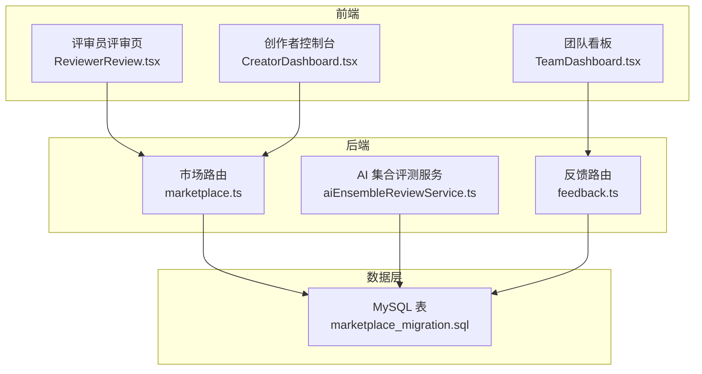
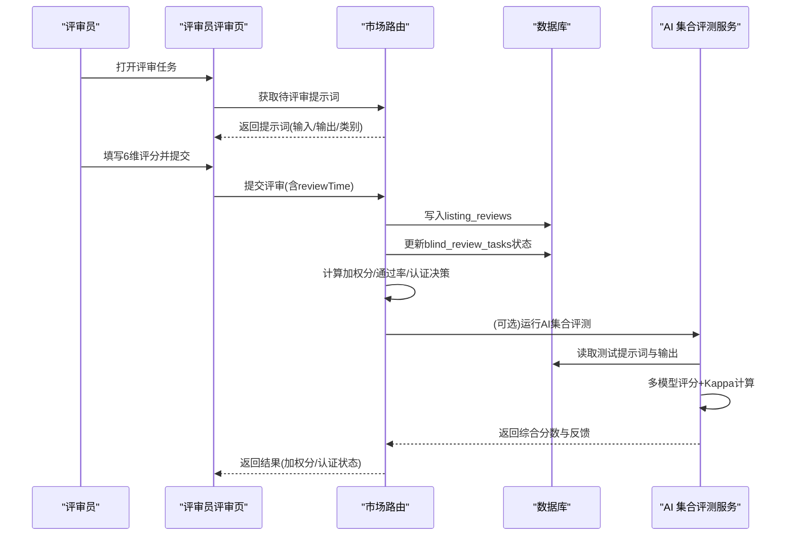
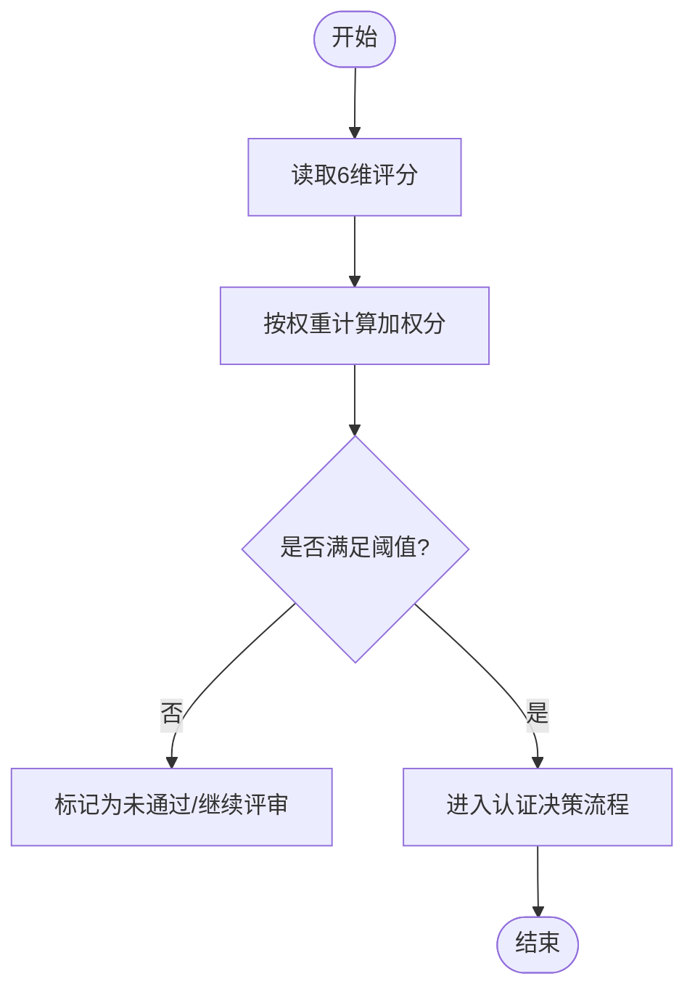
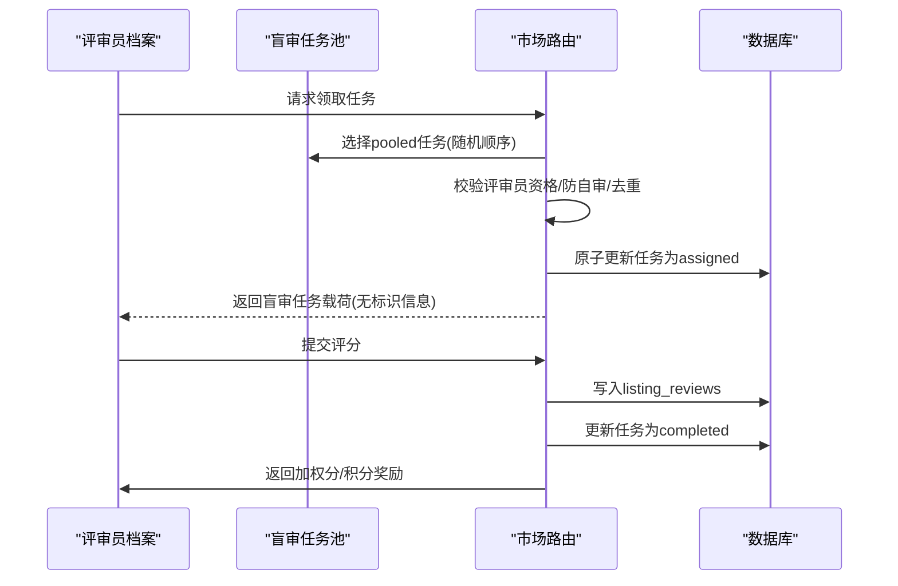
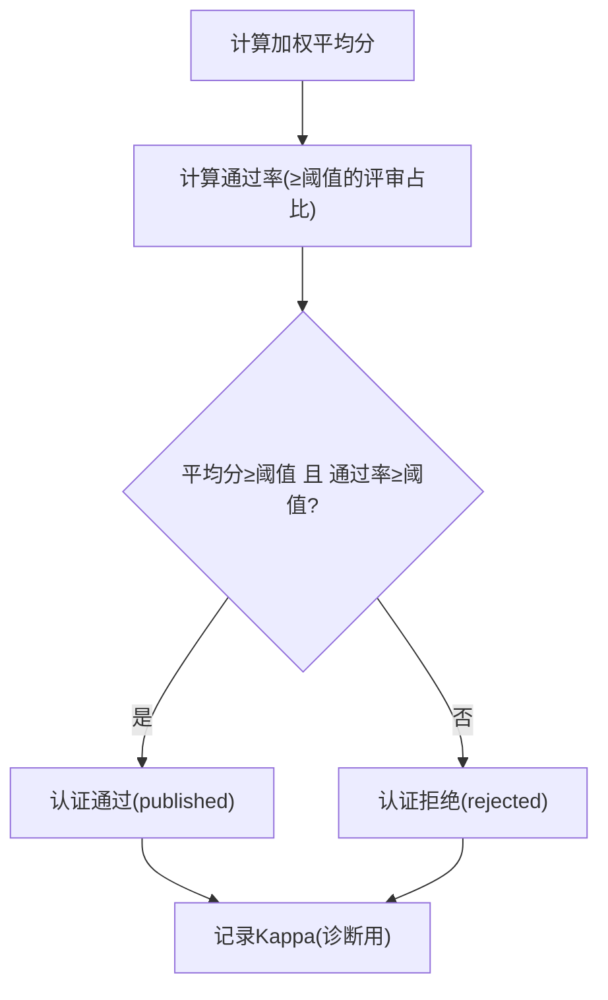
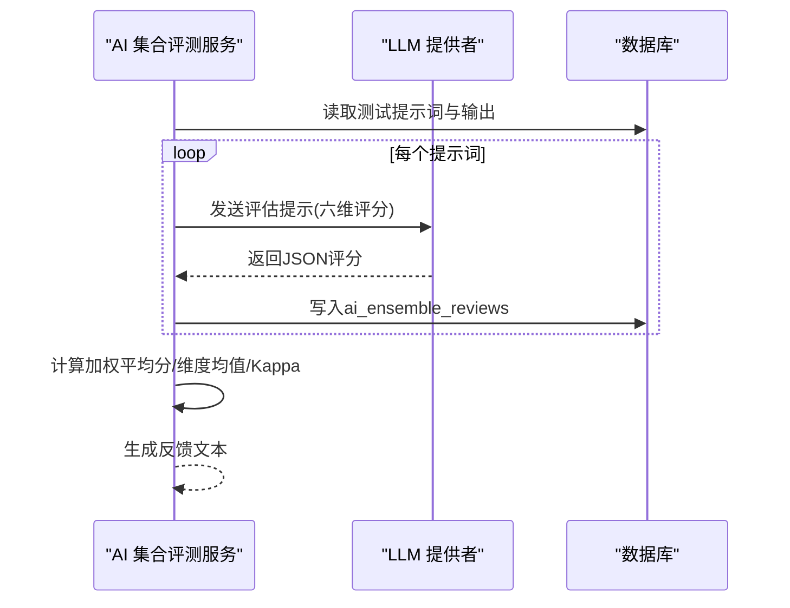
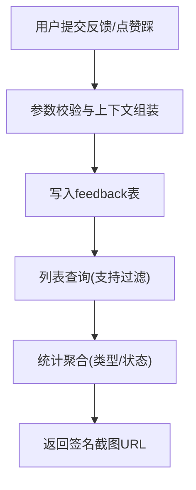
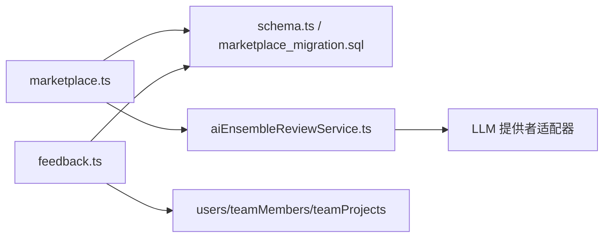

# 评价评分系统

<cite>
**本文引用的文件**
- [api/routers/marketplace.ts](file://api/routers/marketplace.ts)
- [api/services/aiEnsembleReviewService.ts](file://api/services/aiEnsembleReviewService.ts)
- [api/routers/feedback.ts](file://api/routers/feedback.ts)
- [db/marketplace_migration.sql](file://db/marketplace_migration.sql)
- [src/pages/ReviewerReview.tsx](file://src/pages/ReviewerReview.tsx)
- [src/pages/CreatorDashboard.tsx](file://src/pages/CreatorDashboard.tsx)
- [src/pages/TeamDashboard.tsx](file://src/pages/TeamDashboard.tsx)
</cite>

## 目录
1. [简介](#简介)
2. [项目结构](#项目结构)
3. [核心组件](#核心组件)
4. [架构总览](#架构总览)
5. [详细组件分析](#详细组件分析)
6. [依赖关系分析](#依赖关系分析)
7. [性能考量](#性能考量)
8. [故障排查指南](#故障排查指南)
9. [结论](#结论)
10. [附录](#附录)

## 简介
本技术文档围绕“评价评分系统”展开，覆盖用户评价、评分维度定义、评论撰写与点赞踩机制；评价聚合算法（加权平均、可信度评估、虚假评价检测）；评价展示逻辑（排序、筛选、个性化推荐）；评价回复、商家回应与纠纷处理；评价数据分析、趋势监控与质量指标统计；以及评价导出、第三方集成与API接口规范。内容基于仓库中市场信任与评审模块的实现进行梳理与说明。

## 项目结构
- 后端路由与服务：
  - marketplace 路由：实现盲审任务分配、提交、认证决策、Kappa 计算、加权分数计算等。
  - AI 评测服务：多模型集合评测、AI 分流（triage）、指标聚合与反馈生成。
  - feedback 路由：通用反馈收集、消息点赞踩、状态流转与统计。
- 数据库迁移：
  - marketplace 相关表：商品列表、测试提示词、人类评审记录、AI 集合评审、评审员档案、评审分配、购买记录等。
- 前端页面：
  - 评审员评审页：按维度打分、计时、提交并查看中间步骤追踪。
  - 创作者控制台：触发评测、计算等级、发布等操作入口。
  - 团队看板：反馈列表、状态管理、统计概览。

**图表来源**
- [api/routers/marketplace.ts:412-543](file://api/routers/marketplace.ts#L412-L543)
- [api/services/aiEnsembleReviewService.ts:216-345](file://api/services/aiEnsembleReviewService.ts#L216-L345)
- [api/routers/feedback.ts:17-119](file://api/routers/feedback.ts#L17-L119)
- [db/marketplace_migration.sql:8-169](file://db/marketplace_migration.sql#L8-L169)

**章节来源**
- [api/routers/marketplace.ts:412-543](file://api/routers/marketplace.ts#L412-L543)
- [api/services/aiEnsembleReviewService.ts:216-345](file://api/services/aiEnsembleReviewService.ts#L216-L345)
- [api/routers/feedback.ts:17-119](file://api/routers/feedback.ts#L17-L119)
- [db/marketplace_migration.sql:8-169](file://db/marketplace_migration.sql#L8-L169)

## 核心组件
- 评分维度与权重
  - 维度：准确性、完整性、清晰度、Token 效率、速度、一致性。
  - 权重：准确性 0.30、完整性 0.20、清晰度 0.15、Token 效率 0.10、速度 0.10、一致性 0.15。
  - 加权分计算：各维度得分乘以对应权重后求和。
- 人类评审流程
  - 盲审任务池：每个测试提示词复制为 N 份（N=最小独立评审人数），随机分配给活跃评审员。
  - 防自审与去重：禁止作者自评；同一评审员对同一提示词不可重复完成。
  - 提交评审：写入 listing_reviews，更新任务状态，累计评审员积分与信任值。
- AI 集合评测
  - 使用多个 LLM 提供者对同一输出进行多维度评分，计算加权平均分与各维度均值。
  - 计算 Fleiss Kappa 衡量评审者间一致性。
  - 通过阈值判定是否通过（如最低平均分与一致性要求）。
- 认证决策
  - 以加权平均分与通过率作为主要门槛；Kappa 用于诊断与日志。
  - 当达到阈值时，商品可进入“已发布”状态。
- 反馈与点赞踩
  - 支持 bug/suggestion/praise/confusion 类型反馈，带严重级别、截图、标签与上下文。
  - 消息点赞踩：up/down 映射为 praise/bug，附带可选标签与评论。
  - 列表查询支持按团队/项目/状态/类型过滤，返回签名后的截图链接。
  - 统计：按类型与状态聚合计数，提供开放/已解决数量。

**章节来源**
- [api/routers/marketplace.ts:485-543](file://api/routers/marketplace.ts#L485-L543)
- [api/routers/marketplace.ts:577-735](file://api/routers/marketplace.ts#L577-L735)
- [api/routers/marketplace.ts:737-800](file://api/routers/marketplace.ts#L737-L800)
- [api/services/aiEnsembleReviewService.ts:28-35](file://api/services/aiEnsembleReviewService.ts#L28-L35)
- [api/services/aiEnsembleReviewService.ts:216-345](file://api/services/aiEnsembleReviewService.ts#L216-L345)
- [api/routers/feedback.ts:17-119](file://api/routers/feedback.ts#L17-L119)
- [api/routers/feedback.ts:121-211](file://api/routers/feedback.ts#L121-L211)
- [api/routers/feedback.ts:241-320](file://api/routers/feedback.ts#L241-L320)

## 架构总览
系统由前端评审界面、后端路由与服务、数据库三部分组成。评审员在 UI 上对输入/输出进行多维度打分，后端将评审结果持久化并触发认证决策；同时，AI 集合评测对同一输出进行多模型评估，计算一致性与综合得分；反馈模块提供通用的问题上报与点赞踩能力，便于运营与产品洞察。

**图表来源**
- [src/pages/ReviewerReview.tsx:44-93](file://src/pages/ReviewerReview.tsx#L44-L93)
- [api/routers/marketplace.ts:737-800](file://api/routers/marketplace.ts#L737-L800)
- [api/services/aiEnsembleReviewService.ts:216-345](file://api/services/aiEnsembleReviewService.ts#L216-L345)

## 详细组件分析

### 评分维度与加权算法
- 维度定义与权重见常量配置，前端评审页以滑块形式呈现，提交时校验所有维度均已评分。
- 加权分计算公式在各处保持一致，确保人类评审与AI评测的一致性。

**图表来源**
- [api/routers/marketplace.ts:485-510](file://api/routers/marketplace.ts#L485-L510)
- [src/pages/ReviewerReview.tsx:23-30](file://src/pages/ReviewerReview.tsx#L23-L30)
- [src/pages/ReviewerReview.tsx:65-93](file://src/pages/ReviewerReview.tsx#L65-L93)

**章节来源**
- [api/routers/marketplace.ts:485-510](file://api/routers/marketplace.ts#L485-L510)
- [src/pages/ReviewerReview.tsx:23-30](file://src/pages/ReviewerReview.tsx#L23-L30)
- [src/pages/ReviewerReview.tsx:65-93](file://src/pages/ReviewerReview.tsx#L65-L93)

### 盲审任务分配与提交流程
- 入池：每个提示词复制为 N 份（N=最小独立评审人数），状态为 pooled。
- 领取：评审员领取一个 pooled 任务，服务端校验评审员状态、禁止自评、避免重复评审与单清单聚。
- 提交：写入 listing_reviews，更新任务状态为 completed，累计评审员积分与信任值。

**图表来源**
- [api/routers/marketplace.ts:577-735](file://api/routers/marketplace.ts#L577-L735)
- [api/routers/marketplace.ts:737-800](file://api/routers/marketplace.ts#L737-L800)

**章节来源**
- [api/routers/marketplace.ts:577-735](file://api/routers/marketplace.ts#L577-L735)
- [api/routers/marketplace.ts:737-800](file://api/routers/marketplace.ts#L737-L800)

### 认证决策与可信度评估
- 认证门槛：加权平均分≥阈值且通过率≥阈值则通过；Kappa 用于一致性诊断。
- 可信度：Fleiss Kappa 衡量评审者间一致性；当通过率极高时，Kappa 可能偏低（流行度悖论），因此采用通过率作为主门控。

**图表来源**
- [api/routers/marketplace.ts:512-543](file://api/routers/marketplace.ts#L512-L543)
- [api/routers/marketplace.ts:412-466](file://api/routers/marketplace.ts#L412-L466)

**章节来源**
- [api/routers/marketplace.ts:512-543](file://api/routers/marketplace.ts#L512-L543)
- [api/routers/marketplace.ts:412-466](file://api/routers/marketplace.ts#L412-L466)

### AI 集合评测与分流
- 集合评测：对每个测试提示词的输出，调用多个 LLM 提供者进行六维评分，计算加权平均分与各维度均值，构建评分矩阵计算 Kappa。
- 分流（triage）：平台控制的非门控质量分流，仅发送测试输入与输出，不接触加密提示词；失败时静默跳过。

**图表来源**
- [api/services/aiEnsembleReviewService.ts:216-345](file://api/services/aiEnsembleReviewService.ts#L216-L345)
- [api/services/aiEnsembleReviewService.ts:523-619](file://api/services/aiEnsembleReviewService.ts#L523-L619)

**章节来源**
- [api/services/aiEnsembleReviewService.ts:216-345](file://api/services/aiEnsembleReviewService.ts#L216-L345)
- [api/services/aiEnsembleReviewService.ts:523-619](file://api/services/aiEnsembleReviewService.ts#L523-L619)

### 反馈与点赞踩机制
- 反馈提交：支持多种类型与严重级别，携带截图、标签与上下文；自动识别团队归属。
- 消息点赞踩：up/down 映射为 praise/bug，存储为反馈记录。
- 列表与统计：支持按团队/项目/状态/类型过滤；按类型与状态聚合计数，提供开放/已解决数量。
- 截图安全：返回短时效签名链接，避免会话令牌泄露。

**图表来源**
- [api/routers/feedback.ts:17-119](file://api/routers/feedback.ts#L17-L119)
- [api/routers/feedback.ts:121-211](file://api/routers/feedback.ts#L121-L211)
- [api/routers/feedback.ts:241-320](file://api/routers/feedback.ts#L241-L320)

**章节来源**
- [api/routers/feedback.ts:17-119](file://api/routers/feedback.ts#L17-L119)
- [api/routers/feedback.ts:121-211](file://api/routers/feedback.ts#L121-L211)
- [api/routers/feedback.ts:241-320](file://api/routers/feedback.ts#L241-L320)

### 评价展示逻辑（排序、筛选、个性化推荐）
- 排序：当前实现以创建时间倒序为主（反馈列表）；商品列表与评审结果可通过后端扩展排序字段（如加权分、通过率、Kappa）。
- 筛选：支持按团队、项目、状态、类型过滤；共享项目可回溯匹配。
- 个性化推荐：可在前端根据用户历史行为或偏好扩展推荐策略（例如优先展示高通过率商品或用户关注领域）。

**章节来源**
- [api/routers/feedback.ts:121-211](file://api/routers/feedback.ts#L121-L211)
- [src/pages/TeamDashboard.tsx:435-461](file://src/pages/TeamDashboard.tsx#L435-L461)

### 评价回复、商家回应与纠纷处理
- 回复与回应：当前实现未包含显式“评价回复”与“商家回应”的专用表与接口；可在现有 feedback 基础上扩展（如增加 parent_id 形成树状结构，或新增 merchant_reply 表）。
- 纠纷处理：可将重要反馈转换为 issue，关联到工单系统；通过状态流转（new→triaged→in_progress→resolved→verified→closed）跟踪处理进度。

**章节来源**
- [api/routers/feedback.ts:322-369](file://api/routers/feedback.ts#L322-L369)

### 评价数据分析、趋势监控与质量指标统计
- 指标：
  - 加权平均分、通过率、Kappa（一致性）。
  - 各维度均值（准确性、完整性、清晰度、Token 效率、速度、一致性）。
  - 反馈类型与状态分布、开放/已解决数量。
- 趋势监控：
  - 可按时间窗口聚合加权分与通过率，观察质量趋势。
  - 结合 AI 集合评测反馈，定位薄弱环节（如清晰度或一致性偏低）。
- 质量指标：
  - 最低平均分与通过率阈值保障整体质量。
  - Kappa 用于诊断评审一致性，辅助发现异常波动。

**章节来源**
- [api/routers/marketplace.ts:512-543](file://api/routers/marketplace.ts#L512-L543)
- [api/services/aiEnsembleReviewService.ts:289-345](file://api/services/aiEnsembleReviewService.ts#L289-L345)
- [api/routers/feedback.ts:241-320](file://api/routers/feedback.ts#L241-L320)

### 评价导出、第三方集成与API接口规范
- 导出：
  - 可将 listing_reviews、ai_ensemble_reviews、feedback 等表数据导出为 CSV/JSON，供离线分析。
  - 结合 Gitee 保存测试数据与报告（市场模块已有保存示例）。
- 第三方集成：
  - 通过 tRPC/MCP 工具暴露评审相关能力（如领取任务、提交评审、计算等级）。
  - 外部系统可通过 API 订阅事件（如评审完成、认证通过）进行联动。
- API 接口规范（摘要）：
  - 提交评审：POST /marketplace/submitReview，参数包括 listingId、promptIndex、六维评分、reviewTime。
  - 领取任务：GET /marketplace/getAssignmentPrompts，返回待评审提示词列表。
  - 计算等级：POST /marketplace/calculateGrade，触发认证决策与指标计算。
  - 反馈提交：POST /feedback/submit，参数包括 targetType、feedbackType、severity、content、tags、context。
  - 消息点赞踩：POST /feedback/reactToMessage，参数包括 projectId、messageId、reaction、tags、comment。
  - 反馈列表：GET /feedback/list，支持 teamId/projectId/status/feedbackType/limit/offset。
  - 反馈统计：GET /feedback/stats，返回 byType/byStatus/open/resolved。

**章节来源**
- [src/pages/CreatorDashboard.tsx:163-190](file://src/pages/CreatorDashboard.tsx#L163-L190)
- [src/pages/ReviewerReview.tsx:44-93](file://src/pages/ReviewerReview.tsx#L44-L93)
- [api/routers/feedback.ts:17-119](file://api/routers/feedback.ts#L17-L119)
- [api/routers/feedback.ts:121-211](file://api/routers/feedback.ts#L121-L211)
- [api/routers/feedback.ts:241-320](file://api/routers/feedback.ts#L241-L320)

## 依赖关系分析
- 模块耦合：
  - marketplace 路由依赖数据库 schema 与 AI 评测服务。
  - AI 评测服务依赖 LLM 提供者适配器与超时/重试机制。
  - feedback 路由依赖用户与团队关系表，支持共享项目回溯匹配。
- 外部依赖：
  - LLM 提供者（OpenAI/Anthropic/Aliyun等）通过适配器统一调用。
  - Gitee 用于测试数据与报告存储（市场模块）。
- 潜在循环依赖：
  - schema 中 llmProviders 引用 users，users 默认 providerId 引用 llmProviders.id，但通过应用层约束避免循环引用问题。

**图表来源**
- [api/routers/marketplace.ts:1-36](file://api/routers/marketplace.ts#L1-L36)
- [api/services/aiEnsembleReviewService.ts:9-26](file://api/services/aiEnsembleReviewService.ts#L9-L26)
- [api/routers/feedback.ts:10-16](file://api/routers/feedback.ts#L10-L16)
- [db/schema.ts:17-82](file://db/schema.ts#L17-L82)

**章节来源**
- [api/routers/marketplace.ts:1-36](file://api/routers/marketplace.ts#L1-L36)
- [api/services/aiEnsembleReviewService.ts:9-26](file://api/services/aiEnsembleReviewService.ts#L9-L26)
- [api/routers/feedback.ts:10-16](file://api/routers/feedback.ts#L10-L16)
- [db/schema.ts:17-82](file://db/schema.ts#L17-L82)

## 性能考量
- 并发与竞争：
  - 盲审任务领取采用原子 UPDATE + 重读确认，避免重复领取。
  - 随机顺序分配任务，防止单一商品垄断评审资源。
- 超时与重试：
  - LLM 调用设置硬超时与指数退避重试；信用耗尽错误立即失败，避免无效重试。
- 缓存与分页：
  - 公开浏览负载设置短 TTL 缓存；列表查询支持 limit/offset 分页。
- 存储优化：
  - 中间步骤追踪按需加载；截图链接使用短时效签名，减少鉴权开销。

[本节提供一般性指导，无需特定文件分析]

## 故障排查指南
- 常见问题：
  - 无可用测试输出：AI 集合评测跳过无输出或错误的提示词，需检查测试生成流程。
  - 信用耗尽：LLM 调用抛出信用不足错误，需充值或切换提供者。
  - 评审任务丢失：若任务数据不一致，认领流程会释放任务并尝试下一个候选。
- 诊断方法：
  - 查看 AI 集合评测反馈中的维度均值与 Kappa，定位质量问题。
  - 使用反馈统计快速定位高频率问题类型与状态分布。
  - 通过中间步骤追踪查看各阶段输出与耗时，定位瓶颈。

**章节来源**
- [api/services/aiEnsembleReviewService.ts:279-345](file://api/services/aiEnsembleReviewService.ts#L279-L345)
- [api/routers/marketplace.ts:162-199](file://api/routers/marketplace.ts#L162-L199)
- [api/routers/marketplace.ts:711-735](file://api/routers/marketplace.ts#L711-L735)
- [api/routers/feedback.ts:241-320](file://api/routers/feedback.ts#L241-L320)

## 结论
本评价评分系统通过人类盲审与 AI 集合评测相结合，构建了稳健的质量评估体系。加权平均与通过率作为认证主门控，Kappa 用于一致性诊断；反馈模块提供全面的用户声音采集与分析能力。未来可扩展评价回复、商家回应与更精细的个性化推荐策略，进一步提升用户体验与平台质量。

[本节总结性内容，无需特定文件分析]

## 附录
- 数据模型（关键表）
  - marketplace_listings：商品列表，包含 grade、review_count、kappa_score 等。
  - test_prompts：测试提示词，包含输入与预期输出。
  - listing_reviews：人类评审记录，包含六维评分与加权分。
  - ai_ensemble_reviews：AI 集合评审记录，包含各维度评分与原始响应。
  - reviewer_profiles：评审员档案，包含信任值、完成数、积分等。
  - review_assignments：评审分配记录，包含状态与时间戳。
  - feedback：通用反馈记录，包含类型、严重级别、截图、标签与上下文。

**章节来源**
- [db/marketplace_migration.sql:8-169](file://db/marketplace_migration.sql#L8-L169)