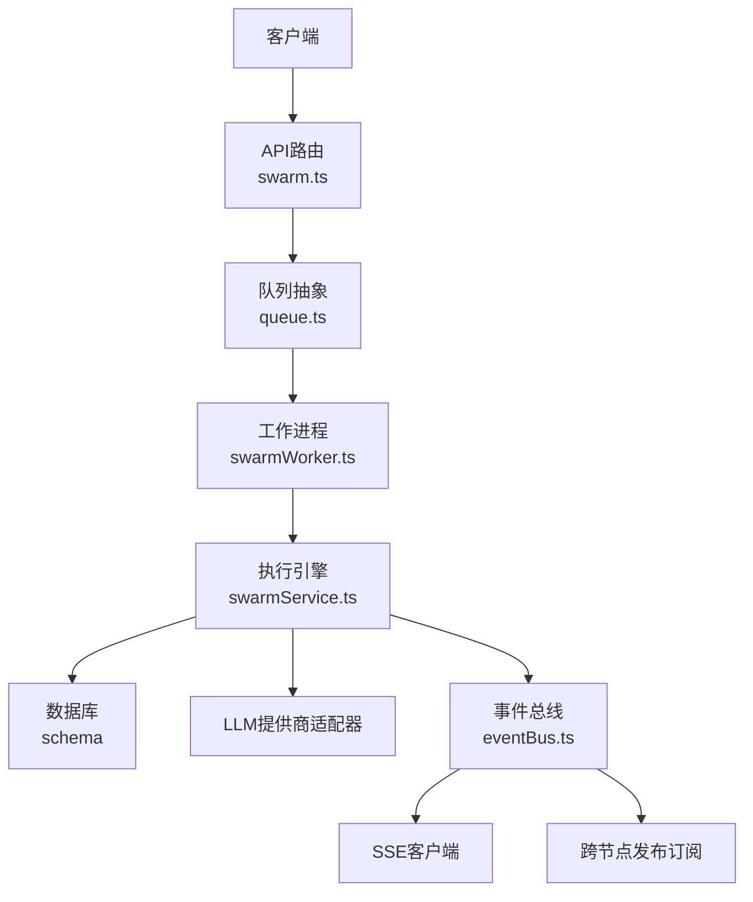
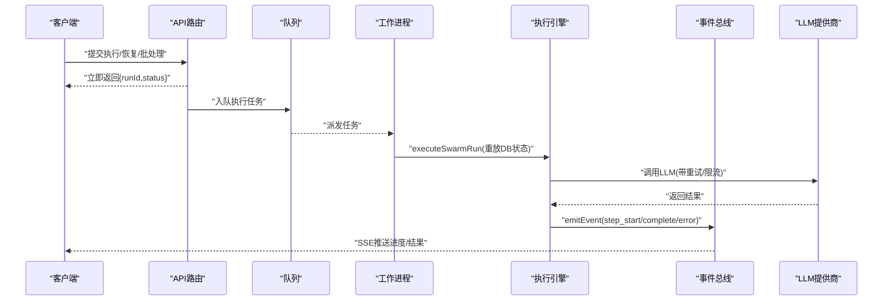
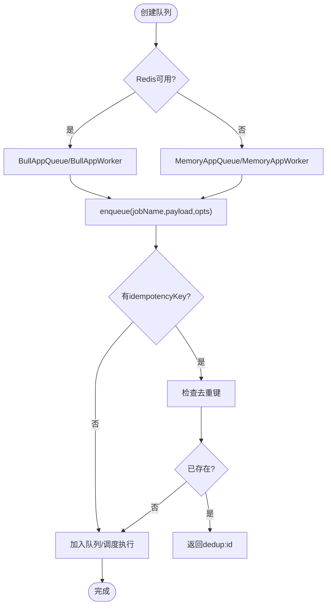
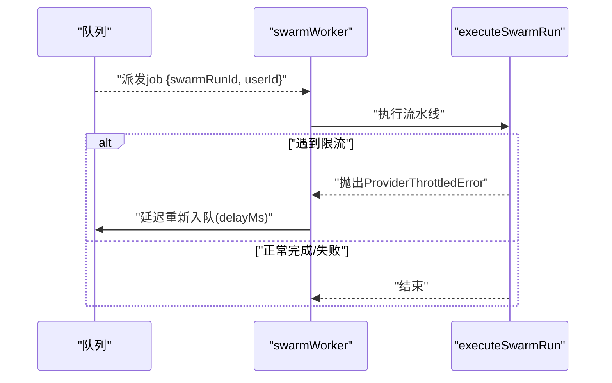
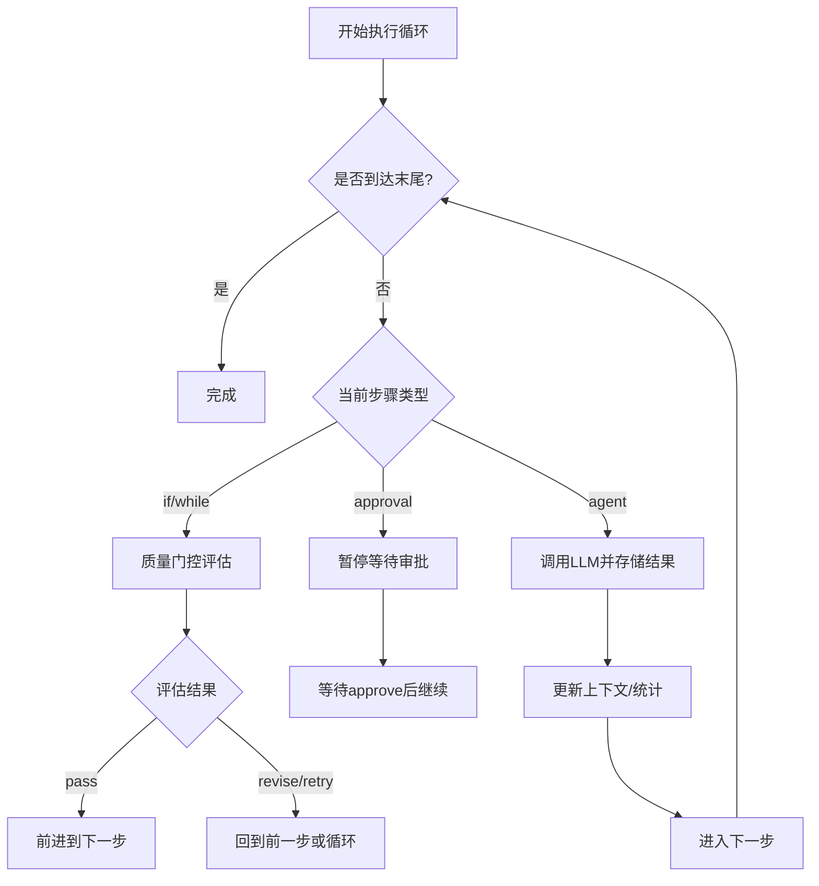
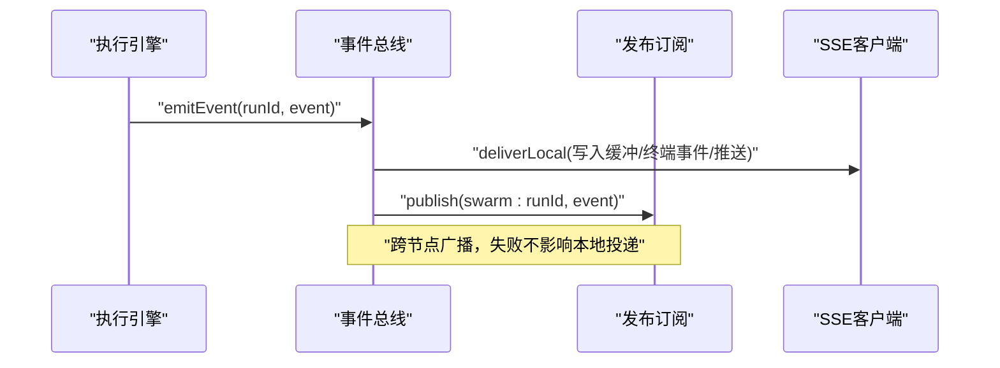
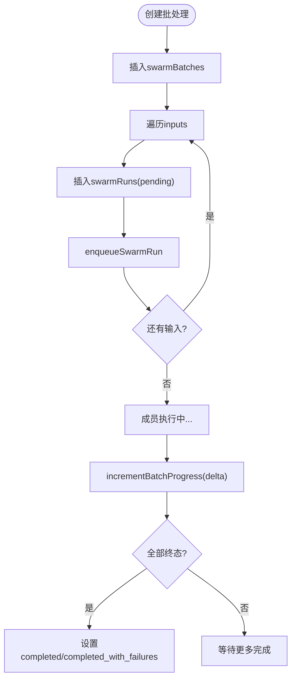
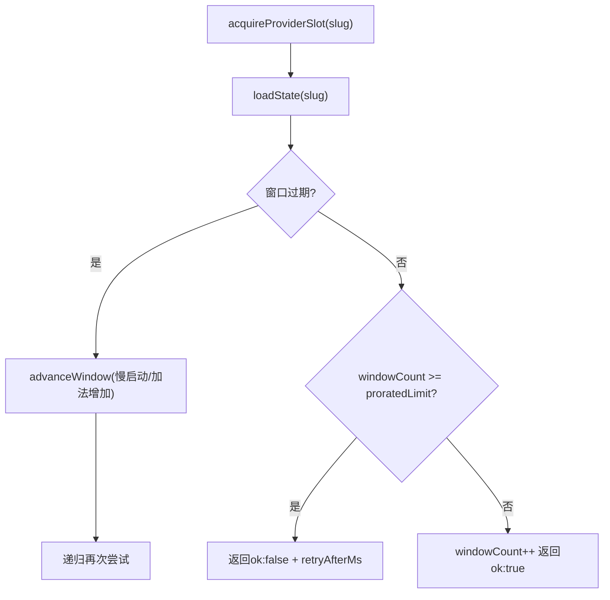
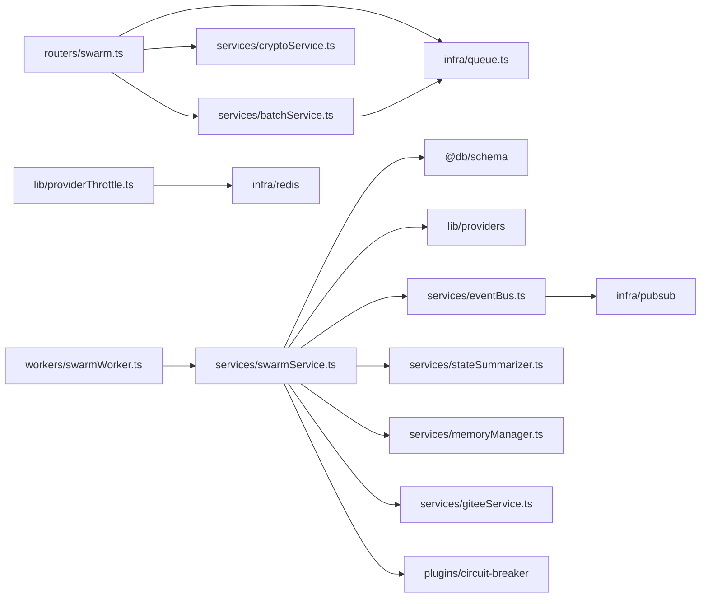
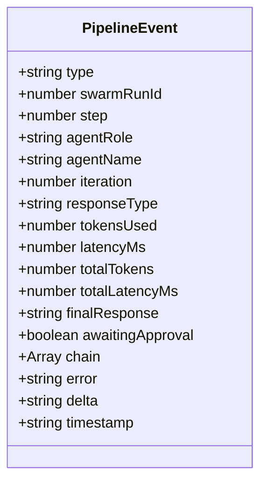

# Swarm分布式执行

<cite>
**本文引用的文件**
- [api/services/swarmService.ts](file://api/services/swarmService.ts)
- [api/workers/swarmWorker.ts](file://api/workers/swarmWorker.ts)
- [api/infra/queue.ts](file://api/infra/queue.ts)
- [api/routers/swarm.ts](file://api/routers/swarm.ts)
- [api/services/eventBus.ts](file://api/services/eventBus.ts)
- [api/services/batchService.ts](file://api/services/batchService.ts)
- [api/lib/providerThrottle.ts](file://api/lib/providerThrottle.ts)
- [api/boot.ts](file://api/boot.ts)
- [api/workerEntry.ts](file://api/workerEntry.ts)
</cite>

## 目录
1. [简介](#简介)
2. [项目结构](#项目结构)
3. [核心组件](#核心组件)
4. [架构总览](#架构总览)
5. [详细组件分析](#详细组件分析)
6. [依赖关系分析](#依赖关系分析)
7. [性能与扩展性](#性能与扩展性)
8. [故障检测与恢复](#故障检测与恢复)
9. [通信协议与消息格式](#通信协议与消息格式)
10. [调试与排障指南](#调试与排障指南)
11. [结论](#结论)

## 简介
本技术文档面向Swarm分布式执行系统，聚焦多节点任务分发与执行、主节点协调、工作进程管理、消息传递机制、任务分解策略、负载均衡算法、通信协议设计、故障检测与处理、性能调优与扩展性考虑，并提供完整的分布式执行示例与调试工具使用指南。该系统将流水线执行从HTTP请求中解耦，通过队列在独立工作进程中执行，支持Redis持久化队列（BullMQ）与内存队列双后端，具备跨节点事件广播、SSE实时流式反馈、批处理与自动重试等能力。

## 项目结构
- API路由层：接收用户请求，进行鉴权与参数校验，创建运行记录并入队，返回即时响应；进度通过SSE推送。
- 服务层：编排流水线执行状态机、调用LLM提供商、保存结果、触发事件、更新批次进度。
- 工作进程：消费队列中的执行任务，重放DB状态并继续执行，支持节流重试与失败标记。
- 基础设施：队列抽象（BullMQ/内存）、事件总线（本地缓冲+跨节点发布订阅）、提供者限流（AIMD）。
- 启动与修复：应用启动时修复“悬挂”运行，重新入队以恢复中断的流水线。

**图表来源**
- [api/routers/swarm.ts:109-199](file://api/routers/swarm.ts#L109-L199)
- [api/infra/queue.ts:272-319](file://api/infra/queue.ts#L272-L319)
- [api/workers/swarmWorker.ts:24-60](file://api/workers/swarmWorker.ts#L24-L60)
- [api/services/swarmService.ts:567-800](file://api/services/swarmService.ts#L567-L800)
- [api/services/eventBus.ts:156-167](file://api/services/eventBus.ts#L156-L167)

**章节来源**
- [api/routers/swarm.ts:109-199](file://api/routers/swarm.ts#L109-L199)
- [api/infra/queue.ts:272-319](file://api/infra/queue.ts#L272-L319)
- [api/workers/swarmWorker.ts:24-60](file://api/workers/swarmWorker.ts#L24-L60)
- [api/services/swarmService.ts:567-800](file://api/services/swarmService.ts#L567-L800)
- [api/services/eventBus.ts:156-167](file://api/services/eventBus.ts#L156-L167)

## 核心组件
- 队列抽象：统一BullMQ与内存实现，提供入队、去重、延迟执行、关闭能力；支持并发度配置。
- 工作进程：注册队列消费者，解析任务载荷，调用执行服务，支持节流重试与失败处理。
- 执行引擎：加载流水线步骤，维护执行上下文，驱动IF/WHILE/审批等控制流，调用LLM并持久化结果。
- 事件总线：本地SSE缓冲与回放，跨节点事件广播，终端事件持久化。
- 批处理服务：批量创建运行、跟踪进度、取消/恢复、导出CSV。
- 提供者限流：基于AIMD的自适应RPM控制，支持慢启动、拥塞避免、冷却期。

**章节来源**
- [api/infra/queue.ts:1-334](file://api/infra/queue.ts#L1-L334)
- [api/workers/swarmWorker.ts:1-75](file://api/workers/swarmWorker.ts#L1-L75)
- [api/services/swarmService.ts:1-800](file://api/services/swarmService.ts#L1-L800)
- [api/services/eventBus.ts:1-193](file://api/services/eventBus.ts#L1-L193)
- [api/services/batchService.ts:1-321](file://api/services/batchService.ts#L1-L321)
- [api/lib/providerThrottle.ts:1-275](file://api/lib/providerThrottle.ts#L1-L275)

## 架构总览
Swarm采用“请求-队列-工作进程”的异步执行模型。API路由负责鉴权、参数校验、持久化运行元数据并立即返回；实际执行由独立工作进程完成，确保长耗时任务不阻塞HTTP线程。执行引擎从数据库重建上下文，按流水线步骤顺序或条件分支推进，并通过事件总线向客户端推送实时进度。批处理模式支持大规模并行执行，结合提供者限流与队列并发度控制整体吞吐。

**图表来源**
- [api/routers/swarm.ts:109-199](file://api/routers/swarm.ts#L109-L199)
- [api/workers/swarmWorker.ts:24-60](file://api/workers/swarmWorker.ts#L24-L60)
- [api/services/swarmService.ts:567-800](file://api/services/swarmService.ts#L567-L800)
- [api/services/eventBus.ts:156-167](file://api/services/eventBus.ts#L156-L167)

## 详细组件分析

### 队列抽象与多后端
- 后端选择：优先尝试BullMQ（Redis），失败回退到内存队列；连接建立后缓存实例。
- 去重：支持idempotencyKey，防止重复入队（Redis SET NX EX或内存Map TTL）。
- 延迟执行：支持delayMs，用于节流重试。
- 并发度：BullMQ worker可配置concurrency；内存队列按定时器串行drain（可通过计划扩展为并发）。
- 优雅关闭：closeAllQueues统一关闭所有队列与工作进程。

**图表来源**
- [api/infra/queue.ts:43-71](file://api/infra/queue.ts#L43-L71)
- [api/infra/queue.ts:149-183](file://api/infra/queue.ts#L149-L183)
- [api/infra/queue.ts:200-261](file://api/infra/queue.ts#L200-L261)
- [api/infra/queue.ts:272-319](file://api/infra/queue.ts#L272-L319)

**章节来源**
- [api/infra/queue.ts:1-334](file://api/infra/queue.ts#L1-L334)

### 工作进程与任务执行
- 任务载荷：包含swarmRunId与userId，最小化传输，其余从DB重建。
- 执行入口：startSwarmWorker注册消费者，收到execute任务后调用executeSwarmRun。
- 节流重试：若执行过程中遇到ProviderThrottledError，通过requeue回调延迟重新入队。
- 健康检查：isSwarmWorkerRunning用于就绪探针。

**图表来源**
- [api/workers/swarmWorker.ts:24-60](file://api/workers/swarmWorker.ts#L24-L60)
- [api/services/swarmService.ts:1272-1300](file://api/services/swarmService.ts#L1272-L1300)

**章节来源**
- [api/workers/swarmWorker.ts:1-75](file://api/workers/swarmWorker.ts#L1-L75)
- [api/services/swarmService.ts:1272-1300](file://api/services/swarmService.ts#L1272-L1300)

### 执行引擎与流水线状态机
- 流水线加载：loadPipelineSteps读取启用步骤，解析agent默认值，构建ResolvedStep数组。
- 执行上下文：ExecCtx维护currentIndex、链式输出、迭代计数、访问计数、待审批状态。
- 控制流：
  - IF/WHILE：质量门控，根据评估结果决定pass/revise或retry/pass。
  - 审批：暂停等待人工决策，支持autoApprove测试模式。
  - 全局循环保护：MAX_STEP_VISITS防止无限循环。
- LLM调用：executeAgentStep封装provider适配、重试、令牌统计、Gitee增量保存。
- 电路断路器：可选限制单步token与成本，超限则中止流水线。

**图表来源**
- [api/services/swarmService.ts:567-800](file://api/services/swarmService.ts#L567-L800)
- [api/services/swarmService.ts:286-353](file://api/services/swarmService.ts#L286-L353)
- [api/services/swarmService.ts:355-530](file://api/services/swarmService.ts#L355-L530)

**章节来源**
- [api/services/swarmService.ts:286-800](file://api/services/swarmService.ts#L286-L800)

### 事件总线与SSE流式反馈
- 本地缓冲：每个run维护最近5分钟的事件缓冲，新客户端连接时回放。
- 终端事件：pipeline_complete/pipeline_error永久存储，断线重连后可立即获取最终状态。
- 跨节点广播：通过pub/sub频道swarm:<runId>将事件广播到其他节点，本地忽略自身回显。
- 订阅管理：按需创建订阅，无客户端时释放。

**图表来源**
- [api/services/eventBus.ts:35-83](file://api/services/eventBus.ts#L35-L83)
- [api/services/eventBus.ts:94-127](file://api/services/eventBus.ts#L94-L127)
- [api/services/eventBus.ts:156-167](file://api/services/eventBus.ts#L156-L167)

**章节来源**
- [api/services/eventBus.ts:1-193](file://api/services/eventBus.ts#L1-L193)

### 批处理与进度追踪
- 批量创建：createBatch插入批次与成员运行，逐个入队（支持chain与stateless）。
- 进度更新：incrementBatchProgress原子累加完成/失败/令牌数，并在全部结束时设置最终状态。
- 查询与导出：getBatchStatus/listBatches/exportBatchResults提供状态查看与CSV导出。
- 取消/恢复：cancelBatch标记批次及成员为cancelled；resumeBatch重新入队非终态成员。

**图表来源**
- [api/services/batchService.ts:45-105](file://api/services/batchService.ts#L45-L105)
- [api/services/batchService.ts:107-142](file://api/services/batchService.ts#L107-L142)
- [api/services/batchService.ts:201-273](file://api/services/batchService.ts#L201-L273)

**章节来源**
- [api/services/batchService.ts:1-321](file://api/services/batchService.ts#L1-L321)

### 提供者限流（AIMD）
- 自适应RPM：基于TCP拥塞控制的AIMD算法，慢启动加倍、拥塞避免加法增加、遇限流乘法减半。
- 窗口管理：60秒窗口，按elapsed比例计算proratedLimit，超过则拒绝并返回retryAfterMs。
- 状态持久化：优先Redis hash，不可用时回退内存Map；支持环境变量覆盖每provider配置。
- 指标暴露：getProviderThrottleMetrics可用于监控各provider当前RPM与状态。

**图表来源**
- [api/lib/providerThrottle.ts:135-199](file://api/lib/providerThrottle.ts#L135-L199)
- [api/lib/providerThrottle.ts:207-235](file://api/lib/providerThrottle.ts#L207-L235)

**章节来源**
- [api/lib/providerThrottle.ts:1-275](file://api/lib/providerThrottle.ts#L1-L275)

## 依赖关系分析
- API路由依赖：队列入队、批处理服务、提供者限流、加密服务、日志。
- 工作进程依赖：队列抽象、执行服务、日志。
- 执行服务依赖：数据库ORM、LLM提供商适配器、事件总线、批处理服务、状态摘要器、记忆管理器、Gitee服务、电路断路器插件。
- 事件总线依赖：发布订阅基础设施、日志。
- 批处理服务依赖：队列入队、数据库ORM、日志。
- 提供者限流依赖：Redis/内存状态、日志、环境变量。

**图表来源**
- [api/routers/swarm.ts:1-655](file://api/routers/swarm.ts#L1-L655)
- [api/workers/swarmWorker.ts:1-75](file://api/workers/swarmWorker.ts#L1-L75)
- [api/services/swarmService.ts:1-800](file://api/services/swarmService.ts#L1-L800)
- [api/services/eventBus.ts:1-193](file://api/services/eventBus.ts#L1-L193)
- [api/services/batchService.ts:1-321](file://api/services/batchService.ts#L1-L321)
- [api/lib/providerThrottle.ts:1-275](file://api/lib/providerThrottle.ts#L1-L275)

**章节来源**
- [api/routers/swarm.ts:1-655](file://api/routers/swarm.ts#L1-L655)
- [api/workers/swarmWorker.ts:1-75](file://api/workers/swarmWorker.ts#L1-L75)
- [api/services/swarmService.ts:1-800](file://api/services/swarmService.ts#L1-L800)
- [api/services/eventBus.ts:1-193](file://api/services/eventBus.ts#L1-L193)
- [api/services/batchService.ts:1-321](file://api/services/batchService.ts#L1-L321)
- [api/lib/providerThrottle.ts:1-275](file://api/lib/providerThrottle.ts#L1-L275)

## 性能与扩展性
- 队列并发度：BullMQ worker的concurrency可通过环境变量配置；研究部署建议提高并发以提升吞吐。
- 提供者限流：AIMD自适应调节RPM，避免过载导致级联限流；支持慢启动与冷却期。
- 重试与退避：callWithRetry对临时错误指数退避，对配额耗尽直接失败提示充值。
- SSE缓冲：5分钟回放缓冲提升客户端重连体验；终端事件持久化保障最终一致性。
- 批处理规模：单次批处理最多100个输入，适合中等规模实验；更大规模可拆分多批。
- 水平扩展：多节点共享Redis队列与发布订阅，事件跨节点广播；工作进程可独立扩缩容。

[本节为通用指导，无需特定文件引用]

## 故障检测与恢复
- 启动修复：boot阶段扫描“running”与“pending”悬挂运行，重置为“pending”并重新入队，保证崩溃恢复。
- 批处理收尾：定期扫描运行中批次，当所有成员达到终态时设置批次最终状态。
- 超时与挂起：getRunStatus对长时间无活动的运行进行老化判断，避免前端假死。
- 节流重试：ProviderThrottledError触发延迟重新入队，避免瞬时限流导致失败。
- 错误分类：CreditExhaustedError与RateLimit错误分别处理，前者暂停批次需用户充值，后者仅重试不暂停。

**章节来源**
- [api/boot.ts:197-359](file://api/boot.ts#L197-L359)
- [api/routers/swarm.ts:343-383](file://api/routers/swarm.ts#L343-L383)
- [api/services/swarmService.ts:176-214](file://api/services/swarmService.ts#L176-L214)

## 通信协议与消息格式
- 任务提交：API路由接收execute/resume/runBatch，验证权限与参数，持久化运行元数据并入队。
- 状态更新：执行引擎在每个步骤前后emitEvent，包含step_start/step_complete/step_error/awaiting_approval等。
- 结果回传：SSE推送delta与完整结果，终端事件持久化便于重连获取。
- 消息字段：PipelineEvent包含type、swarmRunId、step、agentRole、agentName、tokensUsed、latencyMs、finalResponse、error等。

**图表来源**
- [api/services/eventBus.ts:174-193](file://api/services/eventBus.ts#L174-L193)

**章节来源**
- [api/routers/swarm.ts:109-199](file://api/routers/swarm.ts#L109-L199)
- [api/services/eventBus.ts:174-193](file://api/services/eventBus.ts#L174-L193)

## 调试与排障指南
- 观察队列后端：通过getQueueBackend确认当前使用的是BullMQ还是内存队列。
- 检查工作进程：isSwarmWorkerRunning用于健康检查；workerEntry中注册全局异常处理器。
- 查看事件流：SSE客户端连接后可见step_start/complete/error等事件；终端事件可回放。
- 排查限流：reportProviderResult记录rate_limited；getProviderThrottleMetrics查看各provider RPM。
- 批处理问题：listBatches/getBatchStatus查看批次状态；exportBatchResults导出CSV分析失败原因。
- 启动修复日志：boot阶段会记录re-enqueued stale runs与finalized batch信息。

**章节来源**
- [api/infra/queue.ts:267-270](file://api/infra/queue.ts#L267-L270)
- [api/workerEntry.ts:18-47](file://api/workerEntry.ts#L18-L47)
- [api/services/eventBus.ts:129-154](file://api/services/eventBus.ts#L129-L154)
- [api/lib/providerThrottle.ts:237-275](file://api/lib/providerThrottle.ts#L237-L275)
- [api/services/batchService.ts:144-186](file://api/services/batchService.ts#L144-L186)
- [api/boot.ts:197-359](file://api/boot.ts#L197-L359)

## 结论
Swarm分布式执行系统通过队列与工作进程解耦了HTTP请求与长耗时流水线执行，结合事件总线实现跨节点实时反馈，批处理与AIMD限流保障了高吞吐与稳定性。启动修复与错误分类增强了鲁棒性，SSE缓冲与终端事件提升了用户体验。未来可进一步扩展内存队列并发度、优化批处理分片策略，并引入更细粒度的资源隔离与监控告警。

[本节为总结，无需特定文件引用]