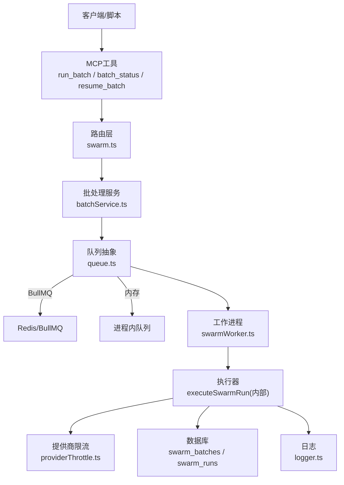
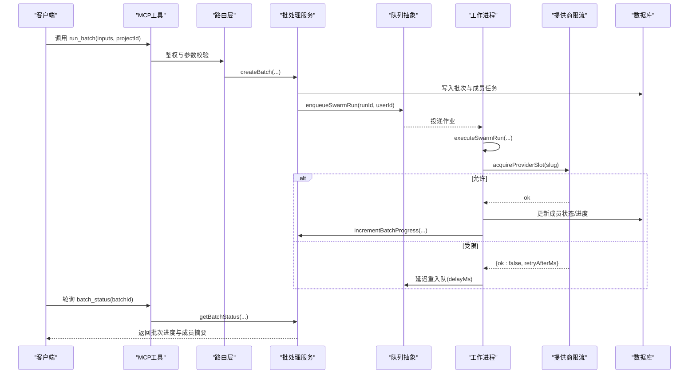
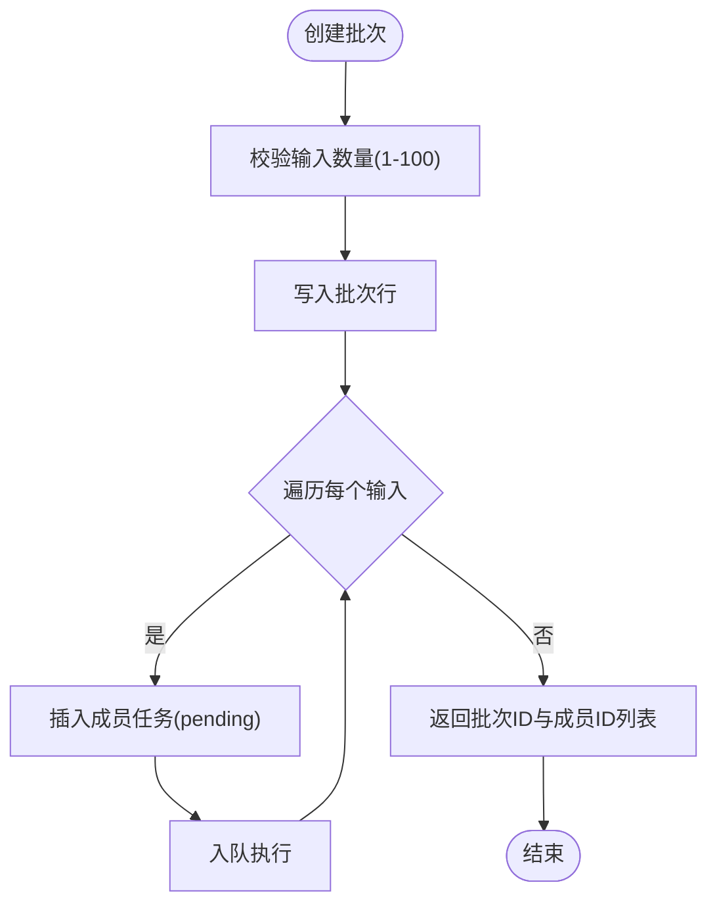
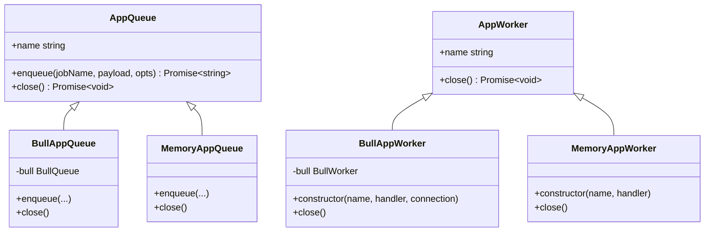
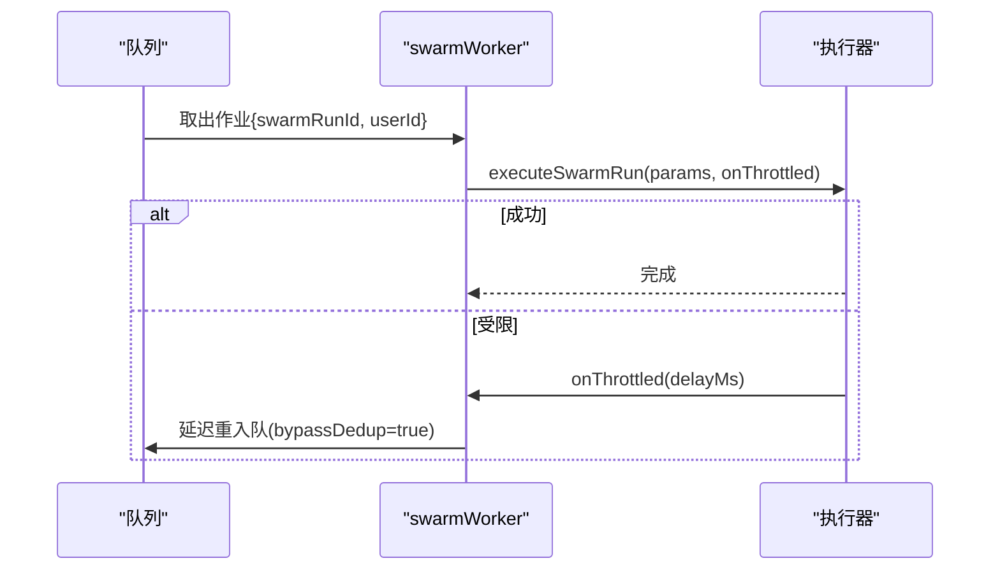
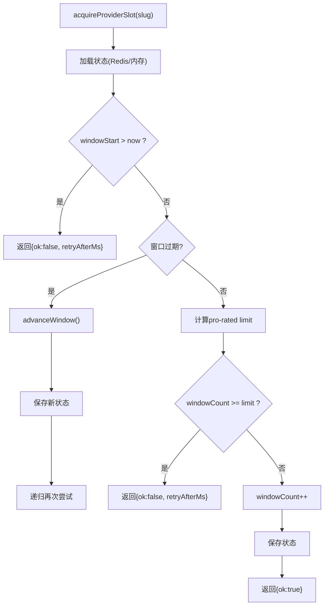
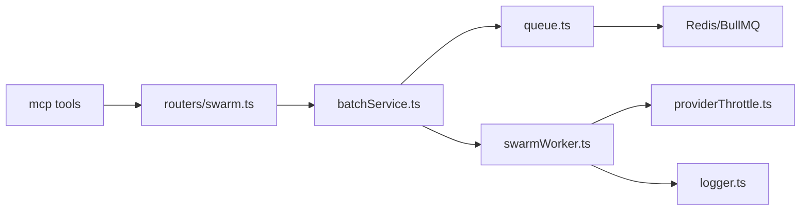

# 批量处理调度器

<cite>
**本文引用的文件**
- [api/services/batchService.ts](file://api/services/batchService.ts)
- [api/workers/swarmWorker.ts](file://api/workers/swarmWorker.ts)
- [api/infra/queue.ts](file://api/infra/queue.ts)
- [api/lib/providerThrottle.ts](file://api/lib/providerThrottle.ts)
- [api/lib/rateLimiter.ts](file://api/lib/rateLimiter.ts)
- [api/mcp/tools/runBatch.ts](file://api/mcp/tools/runBatch.ts)
- [api/mcp/tools/batchStatus.ts](file://api/mcp/tools/batchStatus.ts)
- [api/mcp/tools/resumeBatch.ts](file://api/mcp/tools/resumeBatch.ts)
- [api/routers/swarm.ts](file://api/routers/swarm.ts)
- [api/lib/logger.ts](file://api/lib/logger.ts)
- [research/orchestration-economics/code/cramp_test.mjs](file://research/orchestration-economics/code/cramp_test.mjs)
</cite>

## 目录
1. [简介](#简介)
2. [项目结构](#项目结构)
3. [核心组件](#核心组件)
4. [架构总览](#架构总览)
5. [详细组件分析](#详细组件分析)
6. [依赖关系分析](#依赖关系分析)
7. [性能考量](#性能考量)
8. [故障排查指南](#故障排查指南)
9. [结论](#结论)
10. [附录](#附录)

## 简介
本技术文档面向“批量处理调度器”，聚焦大规模AI任务的调度与执行机制。内容涵盖任务队列管理、资源分配、负载均衡、提供商限流、优先级与重试策略、超时处理、监控指标与日志记录，以及完整的任务调度示例和故障排查指南。系统通过统一的队列抽象在Redis（BullMQ）与内存模式间自动切换，结合AIMD自适应限流实现跨提供商的并发控制与稳定吞吐，并通过批处理服务完成任务创建、状态跟踪、进度聚合与结果导出。

## 项目结构
围绕批量处理的关键代码分布在以下模块：
- 批处理服务：负责批次生命周期管理、成员任务入队、进度更新与结果导出
- 工作进程：消费队列并执行具体运行逻辑，支持节流重入队
- 队列抽象：统一封装BullMQ与内存队列，提供幂等入队与优雅关闭
- 提供商限流：基于AIMD的动态RPM控制，持久化到Redis或回退到内存
- 通用速率限制：固定窗口/令牌桶限流，支持按客户分层
- MCP工具与路由：暴露run_batch、batch_status、resume_batch等操作入口
- 日志与可观测性：结构化JSON日志，便于采集与分析

图表来源
- [api/mcp/tools/runBatch.ts:1-65](file://api/mcp/tools/runBatch.ts#L1-L65)
- [api/routers/swarm.ts:610-654](file://api/routers/swarm.ts#L610-L654)
- [api/services/batchService.ts:45-142](file://api/services/batchService.ts#L45-L142)
- [api/infra/queue.ts:1-71](file://api/infra/queue.ts#L1-L71)
- [api/workers/swarmWorker.ts:1-75](file://api/workers/swarmWorker.ts#L1-L75)
- [api/lib/providerThrottle.ts:1-275](file://api/lib/providerThrottle.ts#L1-L275)
- [api/lib/logger.ts:1-32](file://api/lib/logger.ts#L1-L32)

章节来源
- [api/mcp/tools/runBatch.ts:1-65](file://api/mcp/tools/runBatch.ts#L1-L65)
- [api/routers/swarm.ts:610-654](file://api/routers/swarm.ts#L610-L654)
- [api/services/batchService.ts:45-142](file://api/services/batchService.ts#L45-L142)
- [api/infra/queue.ts:1-71](file://api/infra/queue.ts#L1-L71)
- [api/workers/swarmWorker.ts:1-75](file://api/workers/swarmWorker.ts#L1-L75)
- [api/lib/providerThrottle.ts:1-275](file://api/lib/providerThrottle.ts#L1-L275)
- [api/lib/logger.ts:1-32](file://api/lib/logger.ts#L1-L32)

## 核心组件
- 批处理服务：创建批次、插入成员任务、原子更新进度、查询状态、取消/恢复、导出CSV
- 队列抽象：BullMQ与内存双后端；支持延迟、幂等键、失败清理、优雅关闭
- 工作进程：单一共享队列实例，解析作业负载，调用执行器，支持节流重入队
- 提供商限流：AIMD算法，60秒窗口，Redis持久化+内存回退，支持Retry-After暂停
- 通用速率限制：固定窗口/令牌桶，支持按客户分层（solo/team/admin）
- MCP工具与路由：对外暴露批处理操作，权限校验与审计日志

章节来源
- [api/services/batchService.ts:45-321](file://api/services/batchService.ts#L45-L321)
- [api/infra/queue.ts:1-334](file://api/infra/queue.ts#L1-L334)
- [api/workers/swarmWorker.ts:1-75](file://api/workers/swarmWorker.ts#L1-L75)
- [api/lib/providerThrottle.ts:1-275](file://api/lib/providerThrottle.ts#L1-L275)
- [api/lib/rateLimiter.ts:1-216](file://api/lib/rateLimiter.ts#L1-L216)
- [api/mcp/tools/runBatch.ts:1-65](file://api/mcp/tools/runBatch.ts#L1-L65)
- [api/mcp/tools/batchStatus.ts:1-53](file://api/mcp/tools/batchStatus.ts#L1-L53)
- [api/mcp/tools/resumeBatch.ts:1-35](file://api/mcp/tools/resumeBatch.ts#L1-L35)
- [api/routers/swarm.ts:610-654](file://api/routers/swarm.ts#L610-L654)

## 架构总览
批量任务从MCP工具进入，经路由鉴权后交由批处理服务创建批次与成员任务，随后入队由工作进程异步执行。执行过程中通过提供商限流控制并发，避免API超限；任务完成后原子更新批次进度，最终状态可查询并可导出结果。

图表来源
- [api/mcp/tools/runBatch.ts:1-65](file://api/mcp/tools/runBatch.ts#L1-L65)
- [api/routers/swarm.ts:610-654](file://api/routers/swarm.ts#L610-L654)
- [api/services/batchService.ts:45-142](file://api/services/batchService.ts#L45-L142)
- [api/workers/swarmWorker.ts:24-59](file://api/workers/swarmWorker.ts#L24-L59)
- [api/lib/providerThrottle.ts:168-199](file://api/lib/providerThrottle.ts#L168-L199)

## 详细组件分析

### 批处理服务（batchService）
- 任务创建：校验输入规模（1–100），写入批次与成员任务，初始状态为pending/running，并逐个入队
- 进度更新：原子累加completedRuns/failedRuns/totalTokensUsed，当所有成员到达终态时设置批次最终状态与完成时间
- 状态查询：返回批次概览与成员列表（截断预览与错误信息）
- 取消/恢复：将批次置为cancelled；对paused状态重新入队非终态成员
- 结果导出：生成CSV，包含输入预览、状态、响应、错误、Token与耗时

图表来源
- [api/services/batchService.ts:45-105](file://api/services/batchService.ts#L45-L105)

章节来源
- [api/services/batchService.ts:45-321](file://api/services/batchService.ts#L45-L321)

### 队列抽象（queue）
- 后端选择：优先使用BullMQ（需Redis），失败则回退到内存队列
- 幂等入队：支持idempotencyKey，防止重复提交（Redis SET NX EX 或内存Map TTL）
- 延迟执行：支持delayMs
- 失败清理：BullMQ配置removeOnComplete/removeOnFail，内存队列记录错误日志
- 优雅关闭：关闭所有worker与队列，断开Redis连接

图表来源
- [api/infra/queue.ts:16-34](file://api/infra/queue.ts#L16-L34)
- [api/infra/queue.ts:149-198](file://api/infra/queue.ts#L149-L198)
- [api/infra/queue.ts:200-261](file://api/infra/queue.ts#L200-L261)

章节来源
- [api/infra/queue.ts:1-334](file://api/infra/queue.ts#L1-L334)

### 工作进程（swarmWorker）
- 单一共享队列实例，安全注册一次
- 作业负载校验与日志记录
- 执行器回调支持节流重入队（带bypassDedup与delayMs）
- 健康检查：是否已启动worker

图表来源
- [api/workers/swarmWorker.ts:24-59](file://api/workers/swarmWorker.ts#L24-L59)

章节来源
- [api/workers/swarmWorker.ts:1-75](file://api/workers/swarmWorker.ts#L1-L75)

### 提供商限流（providerThrottle）
- AIMD算法：慢启动翻倍、拥塞避免加法增加、遇429乘法减半
- 60秒窗口：按elapsed比例计算可用槽位，超过则拒绝并返回retryAfterMs
- 持久化：Redis哈希存储，失败回退到内存Map
- 配置：支持环境变量按slug覆盖init/floor/ceiling RPM
- 指标：暴露当前RPM、窗口计数、是否处于慢启动

图表来源
- [api/lib/providerThrottle.ts:168-199](file://api/lib/providerThrottle.ts#L168-L199)
- [api/lib/providerThrottle.ts:135-162](file://api/lib/providerThrottle.ts#L135-L162)

章节来源
- [api/lib/providerThrottle.ts:1-275](file://api/lib/providerThrottle.ts#L1-L275)

### 通用速率限制（rateLimiter）
- 令牌桶：进程内固定窗口/令牌桶，用于接口级限流
- 固定窗口：Redis INCR+PEXPIRE，跨节点共享预算；失败回退到内存
- 客户分层：solo/team/admin不同配额
- 预置配置：auth/execute/batch/read/screenshot等场景

章节来源
- [api/lib/rateLimiter.ts:1-216](file://api/lib/rateLimiter.ts#L1-L216)

### MCP工具与路由
- run_batch：创建批次并立即返回，支持链式目标项目
- batch_status：轮询批次进度，返回成员摘要
- resume_batch：恢复暂停批次，重新入队非终态成员
- 路由层：开关控制（batch_mode特性）、鉴权、审计日志

章节来源
- [api/mcp/tools/runBatch.ts:1-65](file://api/mcp/tools/runBatch.ts#L1-L65)
- [api/mcp/tools/batchStatus.ts:1-53](file://api/mcp/tools/batchStatus.ts#L1-L53)
- [api/mcp/tools/resumeBatch.ts:1-35](file://api/mcp/tools/resumeBatch.ts#L1-L35)
- [api/routers/swarm.ts:610-654](file://api/routers/swarm.ts#L610-L654)

## 依赖关系分析
- 批处理服务依赖队列抽象与工作进程进行任务编排
- 工作进程在执行中依赖提供商限流以避免API超限
- 队列抽象依赖Redis（可选）以支撑多节点与持久化
- 日志贯穿各层，便于追踪与排障
- 路由与MCP工具作为外部入口，驱动批处理流程

图表来源
- [api/services/batchService.ts:45-142](file://api/services/batchService.ts#L45-L142)
- [api/workers/swarmWorker.ts:1-75](file://api/workers/swarmWorker.ts#L1-L75)
- [api/infra/queue.ts:1-71](file://api/infra/queue.ts#L1-L71)
- [api/lib/providerThrottle.ts:1-275](file://api/lib/providerThrottle.ts#L1-L275)
- [api/routers/swarm.ts:610-654](file://api/routers/swarm.ts#L610-L654)

章节来源
- [api/services/batchService.ts:45-142](file://api/services/batchService.ts#L45-L142)
- [api/workers/swarmWorker.ts:1-75](file://api/workers/swarmWorker.ts#L1-L75)
- [api/infra/queue.ts:1-71](file://api/infra/queue.ts#L1-L71)
- [api/lib/providerThrottle.ts:1-275](file://api/lib/providerThrottle.ts#L1-L275)
- [api/routers/swarm.ts:610-654](file://api/routers/swarm.ts#L610-L654)

## 性能考量
- 批量提交：单次创建最多100个输入，减少往返开销；建议合理分片批次大小
- 连接池管理：BullMQ使用专用ioredis连接，maxRetriesPerRequest=null，提升稳定性
- 内存优化：BullMQ removeOnComplete/Fail限制保留时间与数量；内存队列定期清理TTL键
- 并发控制：队列concurrency受环境变量控制；AIMD动态调整RPM避免拥塞
- 节流与重试：遇到429时指数退避式重入队（delayMs），降低无效重试
- 观察性：结构化日志便于聚合分析；可通过调试端点获取项目级统计

[本节为通用指导，不直接分析具体文件]

## 故障排查指南
- 队列不可用：检查Redis连通性与BullMQ连接；若失败将自动回退到内存队列
- 任务未执行：确认worker已注册且队列中有作业；查看worker日志中的作业名与负载校验
- 频繁限流：关注提供商限流日志与当前RPM；必要时调整环境变量或等待窗口重置
- 幂等冲突：检查idempotencyKey是否重复；必要时使用bypassDedup重新入队
- 批次卡住：查询批次状态与成员状态；必要时调用恢复接口重新入队非终态成员
- 超时与取消：轮询时设置超时；如需终止，调用取消接口并将成员置为cancelled

章节来源
- [api/infra/queue.ts:43-71](file://api/infra/queue.ts#L43-L71)
- [api/workers/swarmWorker.ts:37-59](file://api/workers/swarmWorker.ts#L37-L59)
- [api/lib/providerThrottle.ts:207-235](file://api/lib/providerThrottle.ts#L207-L235)
- [api/services/batchService.ts:201-273](file://api/services/batchService.ts#L201-L273)
- [research/orchestration-economics/code/cramp_test.mjs:61-75](file://research/orchestration-economics/code/cramp_test.mjs#L61-L75)

## 结论
该批量处理调度器通过“统一队列抽象 + AIMD限流 + 批处理服务”的组合，实现了高可靠、可扩展的大规模AI任务调度。其关键优势包括：
- 弹性降级：Redis不可用时自动回退到内存队列，保证开发/单节点可用性
- 智能限流：AIMD自适应调节RPM，有效应对提供商限流与突发流量
- 幂等与容错：幂等入队、失败清理、优雅关闭，保障任务一致性
- 可观测性：结构化日志与状态查询，便于监控与排障
- 易用接口：MCP工具与路由提供简洁的批处理操作入口

[本节为总结性内容，不直接分析具体文件]

## 附录

### 完整任务调度示例
- 创建批次：调用run_batch传入projectId与inputs数组，立即返回批次ID与成员ID列表
- 轮询进度：周期性调用batch_status，直至状态达到终态（completed/completed_with_failures/cancelled）
- 恢复任务：若批次因额度耗尽或提供商中断而暂停，调用resume_batch重新入队非终态成员
- 导出结果：调用导出接口获取CSV，包含输入预览、状态、响应、错误、Token与耗时

章节来源
- [api/mcp/tools/runBatch.ts:1-65](file://api/mcp/tools/runBatch.ts#L1-L65)
- [api/mcp/tools/batchStatus.ts:1-53](file://api/mcp/tools/batchStatus.ts#L1-L53)
- [api/mcp/tools/resumeBatch.ts:1-35](file://api/mcp/tools/resumeBatch.ts#L1-L35)
- [api/services/batchService.ts:275-321](file://api/services/batchService.ts#L275-L321)

### 监控指标与日志方案
- 提供商限流指标：currentRpm、windowCount、inSlowStart，可用于仪表盘展示
- 队列后端：getQueueBackend用于健康检查
- 日志级别：通过LOG_LEVEL控制输出粒度；所有关键路径均记录结构化JSON日志
- 调试统计：可通过调试端点获取项目级运行统计（总数、Token、延迟、角色分布、标记数）

章节来源
- [api/lib/providerThrottle.ts:237-275](file://api/lib/providerThrottle.ts#L237-L275)
- [api/infra/queue.ts:267-270](file://api/infra/queue.ts#L267-L270)
- [api/lib/logger.ts:1-32](file://api/lib/logger.ts#L1-L32)
- [api/routers/debug.ts:125-173](file://api/routers/debug.ts#L125-L173)