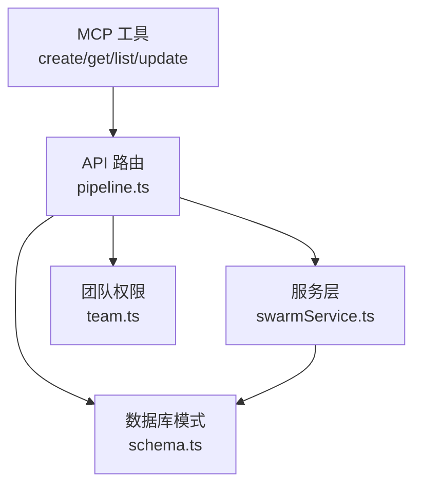
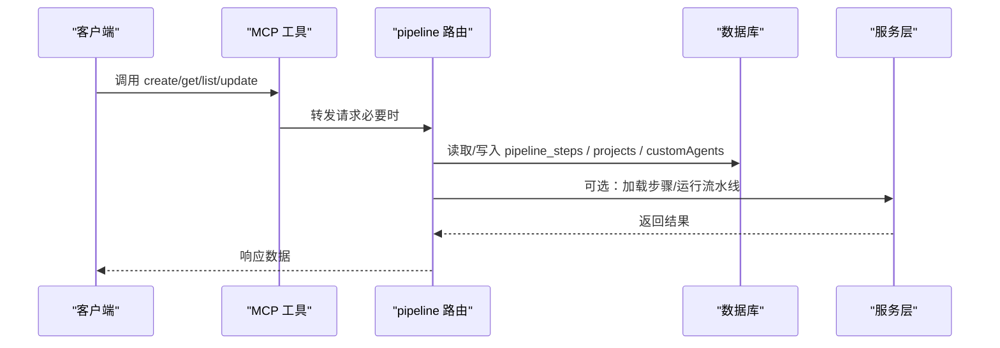
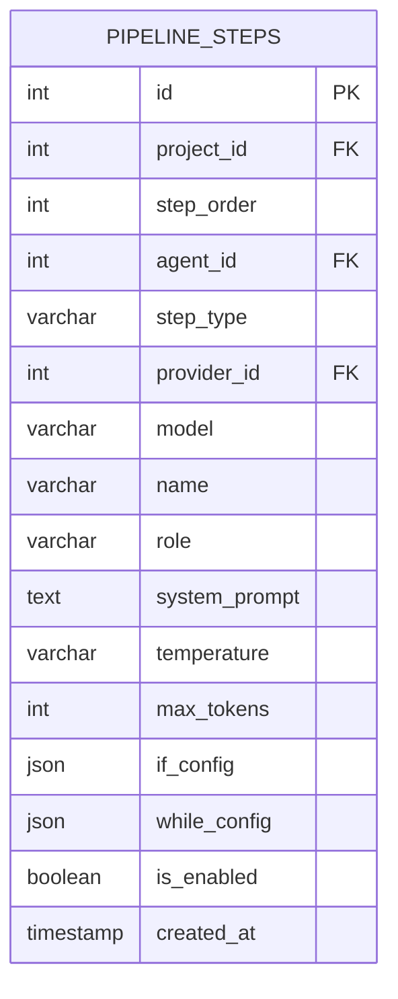
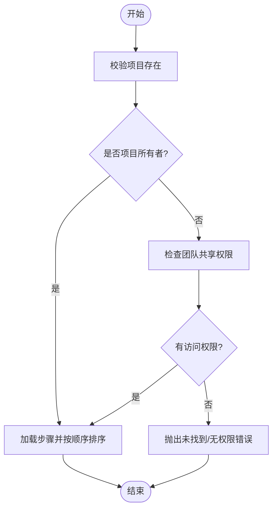
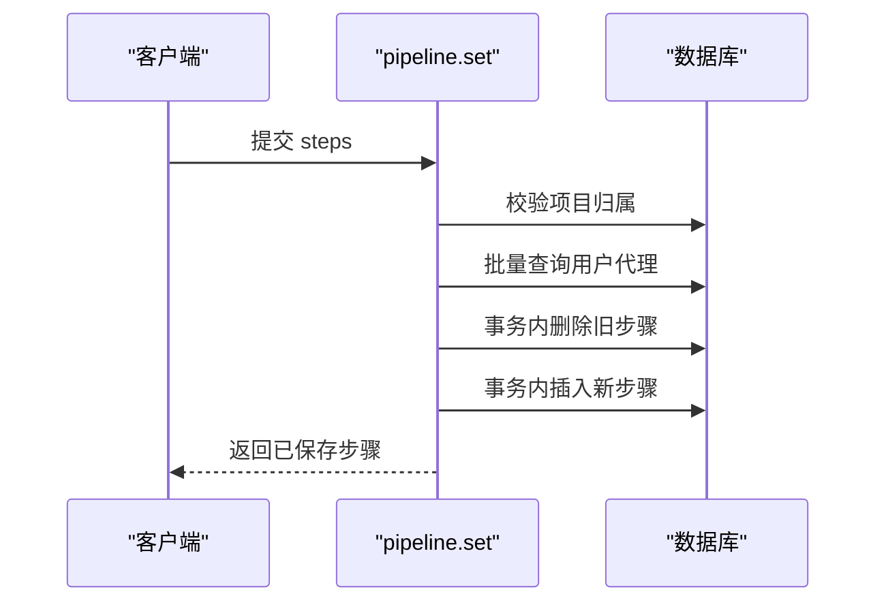
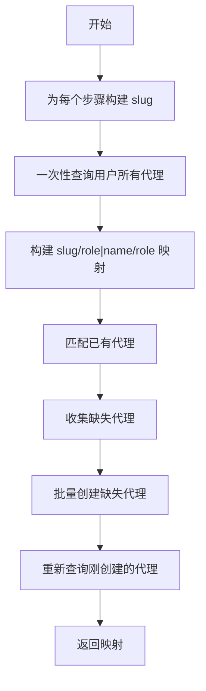
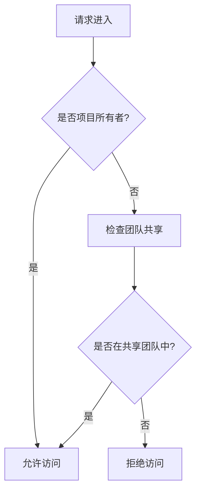
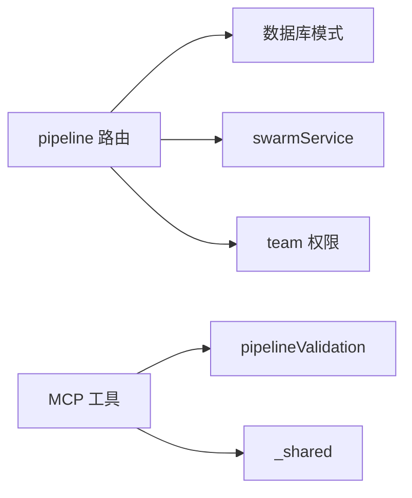

# 流水线创建与管理

<cite>
**本文引用的文件**
- [api/routers/pipeline.ts](file://api/routers/pipeline.ts)
- [api/mcp/tools/createPipeline.ts](file://api/mcp/tools/createPipeline.ts)
- [api/mcp/tools/getPipeline.ts](file://api/mcp/tools/getPipeline.ts)
- [api/mcp/tools/listPipelines.ts](file://api/mcp/tools/listPipelines.ts)
- [api/mcp/tools/updatePipeline.ts](file://api/mcp/tools/updatePipeline.ts)
- [api/mcp/tools/pipelineValidation.ts](file://api/mcp/tools/pipelineValidation.ts)
- [db/schema.ts](file://db/schema.ts)
- [api/services/swarmService.ts](file://api/services/swarmService.ts)
- [api/routers/team.ts](file://api/routers/team.ts)
</cite>

## 目录
1. [简介](#简介)
2. [项目结构](#项目结构)
3. [核心组件](#核心组件)
4. [架构总览](#架构总览)
5. [详细组件分析](#详细组件分析)
6. [依赖关系分析](#依赖关系分析)
7. [性能考量](#性能考量)
8. [故障排查指南](#故障排查指南)
9. [结论](#结论)
10. [附录：API 调用示例与错误处理](#附录api-调用示例与错误处理)

## 简介
本技术文档聚焦“流水线创建与管理”能力，覆盖以下目标：
- 流水线的 CRUD 接口：获取项目中的流水线步骤、设置流水线步骤、创建默认流水线模板等。
- 流水线步骤的数据结构定义：步骤名称、角色、系统提示词、提供商配置、模型参数等字段说明。
- 批量代理解析机制：通过一次查询解决多个步骤的代理引用，避免 N+1 查询问题。
- 事务处理机制：确保流水线步骤设置的原子性。
- 权限验证逻辑：检查项目所有权和团队共享权限。
- 完整的 API 调用示例与错误处理指南。

## 项目结构
与流水线相关的代码主要分布在以下位置：
- API 路由层：提供 REST/内部接口（如 pipeline router）。
- MCP 工具层：对外暴露 create_pipeline、get_pipeline、list_pipelines、update_pipeline 等工具。
- 数据模式层：定义 pipeline_steps、pipeline_templates 等表结构。
- 服务层：执行流水线运行、加载步骤、错误上报等。
- 团队与权限：项目共享与成员访问控制。

图表来源
- [api/routers/pipeline.ts:82-327](file://api/routers/pipeline.ts#L82-L327)
- [api/mcp/tools/createPipeline.ts:20-108](file://api/mcp/tools/createPipeline.ts#L20-L108)
- [api/mcp/tools/getPipeline.ts:11-60](file://api/mcp/tools/getPipeline.ts#L11-L60)
- [api/mcp/tools/listPipelines.ts:13-107](file://api/mcp/tools/listPipelines.ts#L13-L107)
- [api/mcp/tools/updatePipeline.ts:91-120](file://api/mcp/tools/updatePipeline.ts#L91-L120)
- [db/schema.ts:452-505](file://db/schema.ts#L452-L505)
- [api/services/swarmService.ts:286-305](file://api/services/swarmService.ts#L286-L305)
- [api/routers/team.ts:369-411](file://api/routers/team.ts#L369-L411)

章节来源
- [api/routers/pipeline.ts:82-327](file://api/routers/pipeline.ts#L82-L327)
- [api/mcp/tools/createPipeline.ts:20-108](file://api/mcp/tools/createPipeline.ts#L20-L108)
- [api/mcp/tools/getPipeline.ts:11-60](file://api/mcp/tools/getPipeline.ts#L11-L60)
- [api/mcp/tools/listPipelines.ts:13-107](file://api/mcp/tools/listPipelines.ts#L13-L107)
- [api/mcp/tools/updatePipeline.ts:91-120](file://api/mcp/tools/updatePipeline.ts#L91-L120)
- [db/schema.ts:452-505](file://db/schema.ts#L452-L505)
- [api/services/swarmService.ts:286-305](file://api/services/swarmService.ts#L286-L305)
- [api/routers/team.ts:369-411](file://api/routers/team.ts#L369-L411)

## 核心组件
- 流水线步骤数据模型：定义在数据库模式中，包含步骤顺序、类型、代理关联、提供商与模型覆盖、温度与最大 token、条件与循环配置、启用状态等。
- 流水线路由：提供 get/set/createDefault/availableProviders 等能力。
- MCP 工具：封装 create/get/list/update 流水线操作，包含输入校验、权限检查、能力门控（IF/WHILE 需要自定义层级）。
- 批量代理解析：一次性拉取用户所有代理并构建映射，避免 N+1 查询。
- 事务保障：删除旧步骤 + 插入新步骤在同一事务中提交，保证原子性。
- 权限控制：支持项目所有者或团队成员访问。

章节来源
- [db/schema.ts:452-505](file://db/schema.ts#L452-L505)
- [api/routers/pipeline.ts:82-327](file://api/routers/pipeline.ts#L82-L327)
- [api/mcp/tools/pipelineValidation.ts:1-84](file://api/mcp/tools/pipelineValidation.ts#L1-L84)
- [api/mcp/tools/createPipeline.ts:20-108](file://api/mcp/tools/createPipeline.ts#L20-L108)
- [api/mcp/tools/getPipeline.ts:11-60](file://api/mcp/tools/getPipeline.ts#L11-L60)
- [api/mcp/tools/listPipelines.ts:13-107](file://api/mcp/tools/listPipelines.ts#L13-L107)
- [api/mcp/tools/updatePipeline.ts:91-120](file://api/mcp/tools/updatePipeline.ts#L91-L120)

## 架构总览
下图展示了从 MCP 工具到路由再到数据库与服务层的整体交互流程。

图表来源
- [api/mcp/tools/createPipeline.ts:20-108](file://api/mcp/tools/createPipeline.ts#L20-L108)
- [api/mcp/tools/getPipeline.ts:11-60](file://api/mcp/tools/getPipeline.ts#L11-L60)
- [api/mcp/tools/listPipelines.ts:13-107](file://api/mcp/tools/listPipelines.ts#L13-L107)
- [api/mcp/tools/updatePipeline.ts:91-120](file://api/mcp/tools/updatePipeline.ts#L91-L120)
- [api/routers/pipeline.ts:82-327](file://api/routers/pipeline.ts#L82-L327)
- [api/services/swarmService.ts:286-305](file://api/services/swarmService.ts#L286-L305)

## 详细组件分析

### 流水线步骤数据结构
- 表名：pipeline_steps
- 关键字段：
  - id：自增主键
  - project_id：所属项目
  - step_order：执行顺序
  - agent_id：关联自定义代理（可为空）
  - step_type：agent/if/while/approval
  - provider_id：可覆盖使用的 LLM 提供商
  - model：可覆盖具体模型
  - name：显示名称
  - role：角色
  - system_prompt：系统提示词
  - temperature：采样温度
  - max_tokens：最大 token
  - if_config：条件分支配置（选项与映射）
  - while_config：循环配置（目标步骤与最大迭代次数）
  - is_enabled：是否启用
  - created_at：创建时间

图表来源
- [db/schema.ts:452-480](file://db/schema.ts#L452-L480)

章节来源
- [db/schema.ts:452-480](file://db/schema.ts#L452-L480)

### 流水线 CRUD 接口

#### 获取项目中的流水线步骤（GET）
- 功能：按项目 ID 获取有序的步骤列表。
- 权限：项目所有者或团队成员均可访问。
- 实现要点：
  - 先校验项目是否存在。
  - 若非所有者，则检查该用户是否属于共享该项目的团队。
  - 按 step_order 排序返回步骤。

图表来源
- [api/routers/pipeline.ts:84-126](file://api/routers/pipeline.ts#L84-L126)

章节来源
- [api/routers/pipeline.ts:84-126](file://api/routers/pipeline.ts#L84-L126)

#### 设置流水线步骤（SET）
- 功能：替换某项目的所有步骤，自动创建缺失的代理，并在事务中完成原子更新。
- 输入字段：name、role、systemPrompt、providerId、model、temperature、maxTokens、isEnabled、stepType、ifConfig、whileConfig。
- 关键逻辑：
  - 校验项目归属（仅所有者可设置）。
  - 限制每个流水线最多使用 3 个不同提供商（仅统计 agent 步骤）。
  - 批量解析代理：一次性查询用户所有代理，构建映射，避免 N+1。
  - 事务包裹：删除旧步骤 + 插入新步骤，保证一致性。
  - 返回保存后的步骤列表。

图表来源
- [api/routers/pipeline.ts:128-219](file://api/routers/pipeline.ts#L128-L219)

章节来源
- [api/routers/pipeline.ts:128-219](file://api/routers/pipeline.ts#L128-L219)

#### 创建默认流水线模板（CREATE DEFAULT）
- 功能：为项目创建标准四步流水线（Builder → Critic → Refiner → Polisher），若用户不存在对应代理则自动创建。
- 事务保障：代理与步骤的创建在同一事务中，保证原子性。
- 输出：返回该项目的新建步骤列表。

章节来源
- [api/routers/pipeline.ts:221-318](file://api/routers/pipeline.ts#L221-L318)

#### 列出可用提供商（AVAILABLE PROVIDERS）
- 功能：返回当前用户的 LLM 提供商列表，供步骤选择使用。

章节来源
- [api/routers/pipeline.ts:320-325](file://api/routers/pipeline.ts#L320-L325)

### MCP 工具：创建/获取/列表/更新流水线

#### 创建流水线（create_pipeline）
- 功能：一次性创建项目与可选的完整步骤链；支持 IF/WHILE 控制流（需自定义层级能力）。
- 校验：步骤链长度、while 目标合法性、控制流能力门控。
- 行为：创建项目后，若包含步骤则插入步骤并生成模板以便 Web UI 同步。

章节来源
- [api/mcp/tools/createPipeline.ts:20-108](file://api/mcp/tools/createPipeline.ts#L20-L108)

#### 获取流水线详情（get_pipeline）
- 功能：返回项目基本信息、执行配置与有序步骤（含提示词与配置）。
- 权限：要求对项目的访问权限。

章节来源
- [api/mcp/tools/getPipeline.ts:11-60](file://api/mcp/tools/getPipeline.ts#L11-L60)

#### 列出流水线（list_pipelines）
- 功能：聚合三类来源：
  - 用户拥有的项目及其步骤数
  - 用户保存的流水线模板
  - 通过购买能力获得的市集流水线
- 优化：使用 inArray 批量计数，避免多次查询。

章节来源
- [api/mcp/tools/listPipelines.ts:13-107](file://api/mcp/tools/listPipelines.ts#L13-L107)

#### 更新流水线（update_pipeline）
- 功能：支持替换步骤链，并在完成后重建代理与模板以保持 Web UI 一致。
- 行为：若传入 steps 则删除旧步骤并插入新步骤；否则仅返回现有步骤数量。

章节来源
- [api/mcp/tools/updatePipeline.ts:91-120](file://api/mcp/tools/updatePipeline.ts#L91-L120)

### 批量代理解析机制（避免 N+1）
- 背景：当设置多个步骤时，每个步骤可能引用一个代理。传统做法会为每个步骤单独查询代理，导致 N+1 问题。
- 方案：
  - 一次性查询用户所有代理，构建三种查找表：slug、role|name、role。
  - 首次遍历步骤，匹配已有代理；收集缺失的代理进行批量创建。
  - 再次查询刚创建的代理，填充映射。
- 效果：将 N 次查询降为常数级查询，显著降低数据库压力。

图表来源
- [api/routers/pipeline.ts:13-80](file://api/routers/pipeline.ts#L13-L80)

章节来源
- [api/routers/pipeline.ts:13-80](file://api/routers/pipeline.ts#L13-L80)

### 事务处理机制
- 场景：设置步骤时，需先删除旧步骤再插入新步骤，必须保证原子性。
- 实现：使用数据库事务包裹 delete 与 insert 操作，任一失败则整体回滚。
- 其他：创建默认模板时也使用事务确保代理与步骤的一致性。

章节来源
- [api/routers/pipeline.ts:178-210](file://api/routers/pipeline.ts#L178-L210)
- [api/routers/pipeline.ts:243-285](file://api/routers/pipeline.ts#L243-L285)

### 权限验证逻辑
- 项目访问：
  - 直接检查项目所有者。
  - 若非所有者，检查用户是否属于共享该项目的团队。
- 团队共享：
  - 仅项目所有者可分享项目给团队。
  - 重复分享会被数据库唯一约束拦截，代码中容忍重复错误。

图表来源
- [api/routers/pipeline.ts:89-117](file://api/routers/pipeline.ts#L89-L117)
- [api/routers/team.ts:369-411](file://api/routers/team.ts#L369-L411)

章节来源
- [api/routers/pipeline.ts:89-117](file://api/routers/pipeline.ts#L89-L117)
- [api/routers/team.ts:369-411](file://api/routers/team.ts#L369-L411)

## 依赖关系分析
- 路由层依赖：
  - 数据库模式（pipeline_steps、projects、customAgents、llmProviders、teamMembers、teamProjects）。
  - 服务层（swarmService）用于加载步骤与运行流水线。
- MCP 工具依赖：
  - 输入校验（pipelineValidation）。
  - 共享工具（_shared）用于截断文本与项目访问校验。
- 权限依赖：
  - team.ts 负责团队共享与成员角色控制。

图表来源
- [api/routers/pipeline.ts:82-327](file://api/routers/pipeline.ts#L82-L327)
- [api/mcp/tools/pipelineValidation.ts:1-84](file://api/mcp/tools/pipelineValidation.ts#L1-L84)
- [api/mcp/tools/getPipeline.ts:11-60](file://api/mcp/tools/getPipeline.ts#L11-L60)
- [api/routers/team.ts:369-411](file://api/routers/team.ts#L369-L411)

章节来源
- [api/routers/pipeline.ts:82-327](file://api/routers/pipeline.ts#L82-L327)
- [api/mcp/tools/pipelineValidation.ts:1-84](file://api/mcp/tools/pipelineValidation.ts#L1-L84)
- [api/mcp/tools/getPipeline.ts:11-60](file://api/mcp/tools/getPipeline.ts#L11-L60)
- [api/routers/team.ts:369-411](file://api/routers/team.ts#L369-L411)

## 性能考量
- 批量代理解析：将 N+1 查询优化为常数级查询，减少数据库往返。
- 批量计数：list_pipelines 中对项目步骤数使用 inArray 分组计数，避免逐条查询。
- 索引优化：pipeline_steps 针对 project_id 与 (project_id, step_order) 建立索引，提升查询效率。
- 事务粒度：仅在必要处使用事务，避免长事务带来的锁竞争。

章节来源
- [api/routers/pipeline.ts:13-80](file://api/routers/pipeline.ts#L13-L80)
- [api/mcp/tools/listPipelines.ts:36-53](file://api/mcp/tools/listPipelines.ts#L36-L53)
- [db/schema.ts:477-480](file://db/schema.ts#L477-L480)

## 故障排查指南
- 常见错误：
  - 项目未找到：检查项目 ID 是否正确，以及用户是否有访问权限（所有者或团队成员）。
  - 步骤校验失败：确认 stepType 与必填字段（如 ifConfig/whileConfig）、长度限制、while 目标合法性。
  - 提供商数量超限：每个流水线最多 3 个不同提供商（仅统计 agent 步骤）。
  - 能力门控：IF/WHILE 步骤需要自定义层级能力，否则会拒绝。
- 调试建议：
  - 查看日志：pipeline.set 会记录保存的步骤信息。
  - 检查事务：若设置步骤失败，确认事务是否回滚。
  - 权限问题：确认团队共享关系与成员角色。

章节来源
- [api/routers/pipeline.ts:162-170](file://api/routers/pipeline.ts#L162-L170)
- [api/mcp/tools/pipelineValidation.ts:26-52](file://api/mcp/tools/pipelineValidation.ts#L26-L52)
- [api/mcp/tools/createPipeline.ts:43-52](file://api/mcp/tools/createPipeline.ts#L43-L52)
- [api/routers/pipeline.ts:212-217](file://api/routers/pipeline.ts#L212-L217)

## 结论
本模块提供了完整的流水线创建与管理能力，涵盖步骤数据的结构化定义、CRUD 接口、批量代理解析、事务保障与权限控制。通过合理的查询优化与严格的输入校验，系统在可扩展性与安全性方面具备良好基础。后续可考虑增加更细粒度的审计日志与变更历史追踪，以进一步提升可维护性与合规性。

## 附录：API 调用示例与错误处理

### 获取项目中的流水线步骤（GET）
- 输入：projectId
- 成功响应：步骤数组（按 step_order 排序）
- 错误：
  - 项目未找到
  - 无访问权限

章节来源
- [api/routers/pipeline.ts:84-126](file://api/routers/pipeline.ts#L84-L126)

### 设置流水线步骤（SET）
- 输入：
  - projectId
  - steps[]：包含 name、role、systemPrompt、providerId、model、temperature、maxTokens、isEnabled、stepType、ifConfig、whileConfig
- 成功响应：保存后的步骤数组
- 错误：
  - 项目未找到
  - 提供商数量超过限制
  - 步骤校验失败

章节来源
- [api/routers/pipeline.ts:128-219](file://api/routers/pipeline.ts#L128-L219)

### 创建默认流水线模板（CREATE DEFAULT）
- 输入：projectId
- 成功响应：新建的步骤数组
- 错误：
  - 项目未找到

章节来源
- [api/routers/pipeline.ts:221-318](file://api/routers/pipeline.ts#L221-L318)

### 列出可用提供商（AVAILABLE PROVIDERS）
- 成功响应：用户配置的提供商列表

章节来源
- [api/routers/pipeline.ts:320-325](file://api/routers/pipeline.ts#L320-L325)

### MCP 工具：创建流水线（create_pipeline）
- 输入：name、description、defaultModel、defaultProviderId、pipelineConfig、steps
- 成功响应：项目 ID、名称、步骤数、是否需要自定义层级能力
- 错误：
  - while 目标非法
  - 缺少自定义层级能力
  - 提供商不属于用户

章节来源
- [api/mcp/tools/createPipeline.ts:20-108](file://api/mcp/tools/createPipeline.ts#L20-L108)

### MCP 工具：获取流水线详情（get_pipeline）
- 输入：id
- 成功响应：项目信息与有序步骤
- 错误：
  - 项目未找到
  - 无访问权限

章节来源
- [api/mcp/tools/getPipeline.ts:11-60](file://api/mcp/tools/getPipeline.ts#L11-L60)

### MCP 工具：列出流水线（list_pipelines）
- 成功响应：项目、模板、市集流水线聚合列表
- 注意：步骤数通过批量计数获得

章节来源
- [api/mcp/tools/listPipelines.ts:13-107](file://api/mcp/tools/listPipelines.ts#L13-L107)

### MCP 工具：更新流水线（update_pipeline）
- 输入：id、可选 steps
- 成功响应：更新字段、步骤数、是否需要自定义层级能力
- 行为：若提供 steps，则替换并重建代理与模板

章节来源
- [api/mcp/tools/updatePipeline.ts:91-120](file://api/mcp/tools/updatePipeline.ts#L91-L120)