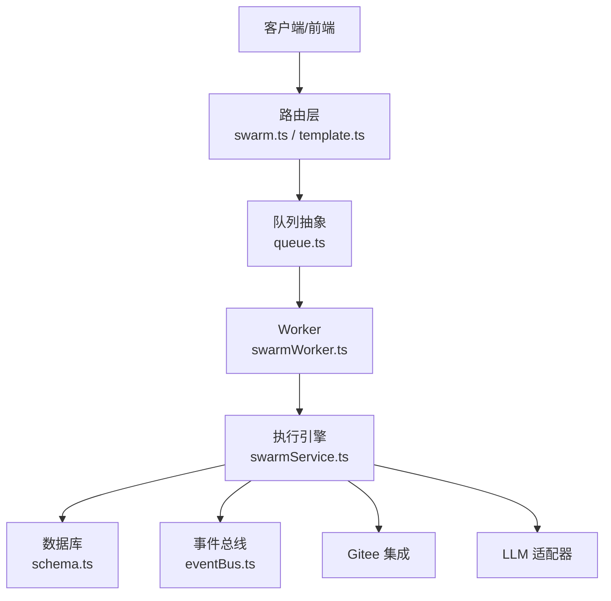
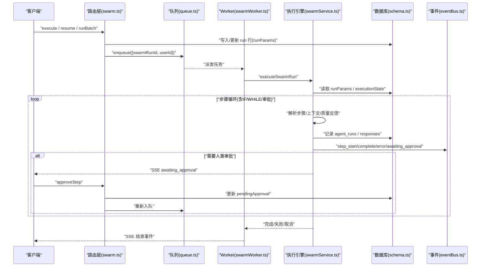
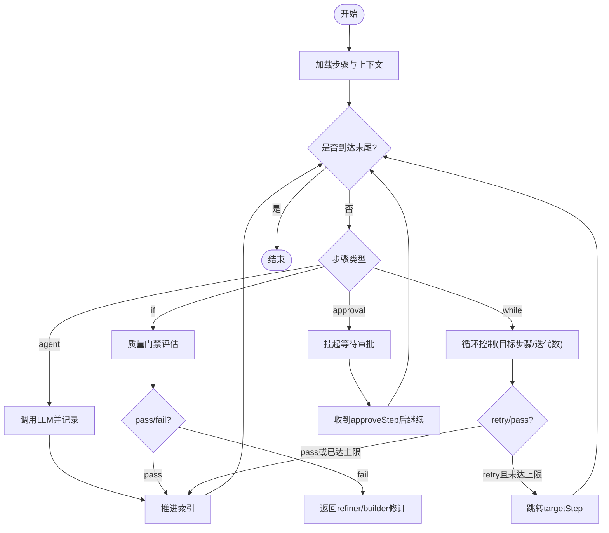
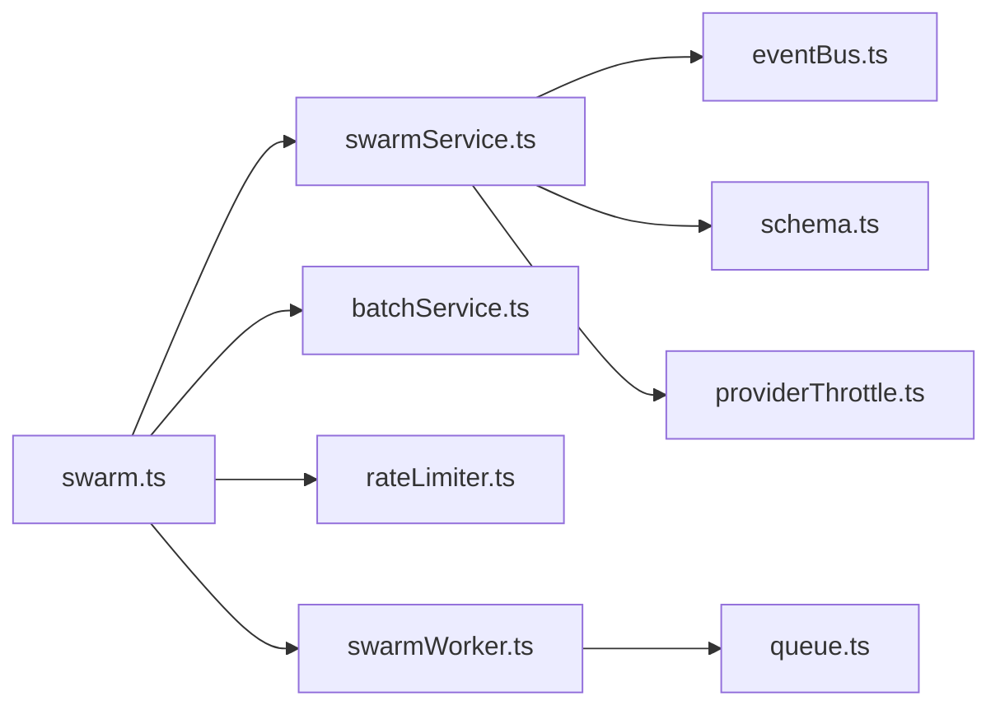

# 流水线引擎API

<cite>
**本文引用的文件**
- [api/routers/swarm.ts](file://api/routers/swarm.ts)
- [api/services/swarmService.ts](file://api/services/swarmService.ts)
- [api/workers/swarmWorker.ts](file://api/workers/swarmWorker.ts)
- [api/infra/queue.ts](file://api/infra/queue.ts)
- [api/lib/rateLimiter.ts](file://api/lib/rateLimiter.ts)
- [api/services/batchService.ts](file://api/services/batchService.ts)
- [api/routers/template.ts](file://api/routers/template.ts)
- [db/schema.ts](file://db/schema.ts)
- [api/services/eventBus.ts](file://api/services/eventBus.ts)
- [src/pages/PipelineEditor.tsx](file://src/pages/PipelineEditor.tsx)
- [src/components/pipeline/PipelineConfigurator.tsx](file://src/components/pipeline/PipelineConfigurator.tsx)
- [DeeWaanAI-Next/RESEARCH-MODE-SPEC.md](file://DeeWaanAI-Next/RESEARCH-MODE-SPEC.md)
</cite>

## 目录
1. [简介](#简介)
2. [项目结构](#项目结构)
3. [核心组件](#核心组件)
4. [架构总览](#架构总览)
5. [详细组件分析](#详细组件分析)
6. [依赖关系分析](#依赖关系分析)
7. [性能与资源管理](#性能与资源管理)
8. [故障排查指南](#故障排查指南)
9. [结论](#结论)
10. [附录：API 调用示例与最佳实践](#附录api-调用示例与最佳实践)

## 简介
本技术文档面向“可视化 AI 工作流（流水线）”的构建、执行控制与状态管理，覆盖步骤定义、条件分支、循环逻辑、错误处理、批量任务调度、资源管理、限流控制、进度跟踪，以及模板系统与版本复用机制。系统采用“HTTP 路由 + 队列 Worker + 服务层执行引擎”的分层架构，支持在 Redis 或内存队列下运行，具备幂等入队、重试与退避、熔断保护、SSE 实时事件推送等能力。

## 项目结构
围绕流水线引擎的关键代码组织如下：
- 路由层：暴露 tRPC 接口，负责鉴权、参数校验、权限检查、速率限制、持久化 run 行与入队。
- 服务层：实现流水线执行引擎（步骤解析、上下文重建、LLM 调用、Gitee 增量保存、状态机推进）。
- Worker 与队列：将长耗时执行移出 HTTP 请求，使用统一队列抽象（BullMQ/内存）消费任务并执行。
- 批处理：Research Mode 下的批量提交、进度聚合、暂停/恢复与导出。
- 模板系统：模板 CRUD、从项目生成模板、应用模板到项目。
- 数据库模式：swarm_runs、agent_runs、agent_responses、pipeline_steps、pipeline_templates、swarm_batches 等表。
- 事件总线：SSE 通道与本地缓冲回放，用于前端实时进度与审批提示。

**图表来源**
- [api/routers/swarm.ts:56-199](file://api/routers/swarm.ts#L56-L199)
- [api/infra/queue.ts:272-319](file://api/infra/queue.ts#L272-L319)
- [api/workers/swarmWorker.ts:24-59](file://api/workers/swarmWorker.ts#L24-L59)
- [api/services/swarmService.ts:568-855](file://api/services/swarmService.ts#L568-L855)
- [db/schema.ts:173-260](file://db/schema.ts#L173-L260)
- [api/services/eventBus.ts:35-61](file://api/services/eventBus.ts#L35-L61)

**章节来源**
- [api/routers/swarm.ts:56-199](file://api/routers/swarm.ts#L56-L199)
- [api/infra/queue.ts:272-319](file://api/infra/queue.ts#L272-L319)
- [api/workers/swarmWorker.ts:24-59](file://api/workers/swarmWorker.ts#L24-L59)
- [api/services/swarmService.ts:568-855](file://api/services/swarmService.ts#L568-L855)
- [db/schema.ts:173-260](file://db/schema.ts#L173-L260)
- [api/services/eventBus.ts:35-61](file://api/services/eventBus.ts#L35-L61)

## 核心组件
- 路由层（swarm.ts）：提供 prepareRun、getPipeline、execute、resumePipeline、approveStep、cancelRun、listRuns、getRunStatus、runBatch 等接口；负责权限、限流、入队与状态查询。
- 执行引擎（swarmService.ts）：加载 pipeline 步骤、维护执行上下文、驱动 IF/WHILE/审批分支、调用 LLM、记录 token/延迟、增量写入 Gitee、更新 batch 进度、抛出可重试/不可重试异常。
- Worker（swarmWorker.ts）：注册队列消费者，接收 {swarmRunId, userId}，调用 executeSwarmRun；支持按 delayMs 重入队以应对限流。
- 队列抽象（queue.ts）：统一 BullMQ/内存两种后端，提供 idempotencyKey 去重、延迟任务、关闭与后端选择。
- 批处理（batchService.ts）：创建批次、原子更新完成/失败计数、暂停/恢复、CSV 导出。
- 模板系统（template.ts）：模板列表/详情/更新/创建/复制/删除，以及应用到项目（自动创建/复用自定义 Agent）。
- 事件总线（eventBus.ts）：按 swarmRunId 建立频道，进程内广播与缓冲回放，供 SSE 消费。

**章节来源**
- [api/routers/swarm.ts:56-655](file://api/routers/swarm.ts#L56-L655)
- [api/services/swarmService.ts:1-855](file://api/services/swarmService.ts#L1-L855)
- [api/workers/swarmWorker.ts:1-75](file://api/workers/swarmWorker.ts#L1-L75)
- [api/infra/queue.ts:1-334](file://api/infra/queue.ts#L1-L334)
- [api/services/batchService.ts:1-321](file://api/services/batchService.ts#L1-L321)
- [api/routers/template.ts:1-265](file://api/routers/template.ts#L1-L265)
- [api/services/eventBus.ts:35-61](file://api/services/eventBus.ts#L35-L61)

## 架构总览
流水线执行的生命周期：
- 客户端调用 execute/resume/runBatch，路由层校验权限与限流，持久化 run 行并写入 runParams，随后入队。
- Worker 拉取任务，从 DB 重建上下文，进入执行循环；遇到审批则挂起等待 approveStep。
- 每一步通过 providerThrottle 获取并发槽位，调用 LLM，记录 token/延迟，必要时增量保存到 Gitee。
- 若遇限流/配额不足，分别走“重试重入队”或“暂停批次”策略；最终汇总结果并通过 SSE 推送。

**图表来源**
- [api/routers/swarm.ts:109-199](file://api/routers/swarm.ts#L109-L199)
- [api/workers/swarmWorker.ts:24-59](file://api/workers/swarmWorker.ts#L24-L59)
- [api/services/swarmService.ts:568-855](file://api/services/swarmService.ts#L568-L855)
- [api/services/eventBus.ts:35-61](file://api/services/eventBus.ts#L35-L61)
- [db/schema.ts:173-260](file://db/schema.ts#L173-L260)

## 详细组件分析

### 流水线步骤定义与执行状态机
- 步骤类型：agent（普通）、if（条件分支）、while（循环）、approval（人工审批）。
- 步骤配置：
  - ifConfig：options 与 mappings，决定分支目标步骤。
  - whileConfig：targetStep 与 maxIterations，控制回环目标与最大迭代次数。
- 执行上下文：currentIndex、chain（历史响应）、iterationCounts、visitCounts、pendingApproval。
- 全局保护：单步访问上限 MAX_STEP_VISITS，防止死循环；WHILE 硬上限 MAX_WHILE_ITERATIONS。

**图表来源**
- [api/services/swarmService.ts:568-855](file://api/services/swarmService.ts#L568-L855)
- [db/schema.ts:452-480](file://db/schema.ts#L452-L480)

**章节来源**
- [api/services/swarmService.ts:226-353](file://api/services/swarmService.ts#L226-L353)
- [api/services/swarmService.ts:568-855](file://api/services/swarmService.ts#L568-L855)
- [db/schema.ts:452-480](file://db/schema.ts#L452-L480)

### 条件分支与循环逻辑
- IF 步骤：作为质量门禁，输出完整评估并在最后一行给出 pass/fail（或扩展选项），由映射决定下一步。
- WHILE 步骤：对同一产出进行多轮评审，结合 refiner/builder 的修订，达到标准后 pass 前进；超过最大迭代强制通过。
- 上下文构造：避免把门禁评估文本误当作内容输入给 refiner；会回溯最近非门禁输出作为“待改进内容”。

**章节来源**
- [api/services/swarmService.ts:634-759](file://api/services/swarmService.ts#L634-L759)
- [api/services/swarmService.ts:816-843](file://api/services/swarmService.ts#L816-L843)

### 错误处理与重试策略
- 分类：
  - 额度耗尽（CreditExhaustedError）：立即失败，不重试，触发批次暂停。
  - 供应商限流（ProviderThrottledError/RateLimit）：指数退避重试，仍受限则重入队（带 delayMs）。
  - 其他错误：最多重试后失败，标记 run 为 failed。
- 批次级：根据错误模式暂停批次（credit/outage），用户充值后可恢复。
- 幂等性：队列入队使用 idempotencyKey，避免重复执行。

**章节来源**
- [api/services/swarmService.ts:124-214](file://api/services/swarmService.ts#L124-L214)
- [api/services/swarmService.ts:463-483](file://api/services/swarmService.ts#L463-L483)
- [api/workers/swarmWorker.ts:54-57](file://api/workers/swarmWorker.ts#L54-L57)
- [api/services/batchService.ts:233-273](file://api/services/batchService.ts#L233-L273)

### 批量任务调度与进度跟踪
- 创建批次：一次提交 1–100 个输入，每个输入对应一个 swarm_run，并立即入队。
- 进度聚合：成员完成/失败时原子递增 completedRuns/failedRuns/totalTokensUsed，全部完成后标记批次状态。
- 暂停/恢复：因额度/故障暂停后，可恢复并重入队所有未完成成员。
- 导出：按 run 维度导出 CSV（输入预览、状态、最终响应、错误、token/延迟）。

**章节来源**
- [api/services/batchService.ts:45-142](file://api/services/batchService.ts#L45-L142)
- [api/services/batchService.ts:144-186](file://api/services/batchService.ts#L144-L186)
- [api/services/batchService.ts:201-273](file://api/services/batchService.ts#L201-L273)
- [api/services/batchService.ts:275-321](file://api/services/batchService.ts#L275-L321)

### 资源管理与限流控制
- 提供者级限流：acquireProviderSlot 基于声明 RPM 分配槽位，拒绝则抛 ProviderThrottledError。
- 应用级限流：checkRateLimitAsync 固定窗口计数器（Redis 优先，内存降级），区分 execute/batch/read 等场景。
- 队列并发：BullMQ worker 并发度受环境变量控制；内存模式下进程内串行/并发可控。
- 熔断保护：可选 circuit-breaker 插件，按步骤估算成本与用量限制，超限中止流水线。

**章节来源**
- [api/services/swarmService.ts:432-436](file://api/services/swarmService.ts#L432-L436)
- [api/lib/rateLimiter.ts:64-103](file://api/lib/rateLimiter.ts#L64-L103)
- [api/infra/queue.ts:235-260](file://api/infra/queue.ts#L235-L260)
- [api/services/swarmService.ts:589-599](file://api/services/swarmService.ts#L589-L599)

### 进度跟踪与实时事件
- 事件类型：step_start、step_complete、step_error、awaiting_approval、pipeline_error 等。
- 通道：按 swarmRunId 命名频道，进程内订阅+本地缓冲回放，便于断线重连补发。
- 前端：通过 SSE 订阅对应 run 频道，渲染步骤进度、审批横幅与错误信息。

**章节来源**
- [api/services/eventBus.ts:35-61](file://api/services/eventBus.ts#L35-L61)
- [api/services/swarmService.ts:382-515](file://api/services/swarmService.ts#L382-L515)

### 模板系统与版本复用
- 模板 CRUD：创建空模板、从当前项目步骤生成模板、更新/复制/删除。
- 应用到项目：删除现有步骤，按模板顺序插入；如 stepType 非 approval，尝试匹配或创建自定义 Agent。
- 项目引用：projects.pipelineTemplateId 指向所用模板，便于后续复用与追踪。

**章节来源**
- [api/routers/template.ts:8-153](file://api/routers/template.ts#L8-L153)
- [api/routers/template.ts:155-265](file://api/routers/template.ts#L155-L265)
- [db/schema.ts:482-500](file://db/schema.ts#L482-L500)

### Swarm 分布式执行要点
- 队列后端：Redis（BullMQ）多节点共享队列；无 Redis 时自动降级到内存队列，保证开发体验。
- 幂等入队：idempotencyKey 防重，确保多次提交不会重复执行。
- 重入队：限流时通过 delayMs 重入队，避免阻塞主流程。
- 健康检查：startSwarmWorker/isSwarmWorkerRunning 可用于就绪探针。

**章节来源**
- [api/infra/queue.ts:36-71](file://api/infra/queue.ts#L36-L71)
- [api/infra/queue.ts:200-260](file://api/infra/queue.ts#L200-L260)
- [api/workers/swarmWorker.ts:37-75](file://api/workers/swarmWorker.ts#L37-L75)

## 依赖关系分析

**图表来源**
- [api/routers/swarm.ts:1-21](file://api/routers/swarm.ts#L1-L21)
- [api/services/swarmService.ts:13-24](file://api/services/swarmService.ts#L13-L24)
- [api/workers/swarmWorker.ts:7-9](file://api/workers/swarmWorker.ts#L7-L9)
- [api/infra/queue.ts:1-15](file://api/infra/queue.ts#L1-L15)

**章节来源**
- [api/routers/swarm.ts:1-21](file://api/routers/swarm.ts#L1-L21)
- [api/services/swarmService.ts:13-24](file://api/services/swarmService.ts#L13-L24)
- [api/workers/swarmWorker.ts:7-9](file://api/workers/swarmWorker.ts#L7-L9)
- [api/infra/queue.ts:1-15](file://api/infra/queue.ts#L1-L15)

## 性能与资源管理
- 并发与吞吐：
  - 队列并发：BullMQ worker 并发度可调；内存模式适合单机开发。
  - 提供者限流：按 declaredRPM 分配槽位，避免打爆上游。
- 重试与退避：指数退避 + Retry-After 解析，缓解瞬时拥塞。
- 存储与 IO：
  - agent_runs/responses 仅存摘要/关键元数据，减少大对象落盘。
  - Gitee 增量保存每步产物，便于审计与回溯。
- 监控指标：
  - 每步 token 与延迟累计至 swarm_runs.totalTokensUsed/totalLatencyMs。
  - 批次维度统计 completedRuns/failedRuns/totalTokensUsed。

[本节为通用性能讨论，无需特定文件来源]

## 故障排查指南
- 常见问题定位：
  - 额度耗尽：查看 step_error 中的 CREDIT_EXHAUSTED 标记；需充值后恢复批次。
  - 供应商限流：出现 ProviderThrottledError，系统会自动重试并重入队；观察 retryAfterMs。
  - 审批卡住：检查 executionState.pendingApproval 是否为空；确认 approveStep 已调用并成功。
  - 死循环：MAX_STEP_VISITS 保护会强制推进；检查 whileConfig.targetStep 与 while 判定逻辑。
- 日志与调试：
  - 使用 SSE 事件逐步定位问题步骤。
  - 查看 agent_runs/agent_responses 的 metadata（模型、提供商、token、延迟）。
  - 利用 debug 工具查询 run 统计（前端页面调用 trpc.debug.getRunStats）。

**章节来源**
- [api/services/swarmService.ts:463-483](file://api/services/swarmService.ts#L463-L483)
- [api/routers/swarm.ts:326-383](file://api/routers/swarm.ts#L326-L383)
- [src/pages/Audit.tsx:233-252](file://src/pages/Audit.tsx#L233-L252)

## 结论
该流水线引擎以“路由-服务-Worker-队列”的分层设计实现了高可靠、可扩展的 AI 工作流编排。通过步骤类型（agent/if/while/approval）组合出丰富的控制流；借助限流、重试、熔断与批次管理，满足大规模 Research Mode 场景。SSE 事件与模板系统进一步提升了可观测性与复用效率。建议在生产环境启用 Redis 队列与熔断插件，并结合业务阈值调优并发与重试策略。

[本节为总结性内容，无需特定文件来源]

## 附录：API 调用示例与最佳实践

### 主要 API（tRPC）
- 准备运行
  - 方法：prepareRun
  - 输入：projectId
  - 作用：创建 queued 状态的 run 行，返回 runId
- 获取流水线
  - 方法：getPipeline
  - 输入：projectId
  - 作用：返回自定义步骤或回退到 legacy agents
- 执行流水线
  - 方法：execute
  - 输入：projectId, prompt, isTestRun?, memoryMode?, attachments?, includeProjectFiles?, chain?, giteeToken?
  - 作用：创建/续跑 run，持久化 runParams 并入队
- 恢复流水线
  - 方法：resumePipeline
  - 输入：runId, giteeToken?, memoryMode?
  - 作用：更新状态并重新入队
- 审批步骤
  - 方法：approveStep
  - 输入：runId, action, instructions?
  - 作用：写入 pendingApproval 并重新入队
- 取消运行
  - 方法：cancelRun
  - 输入：id
- 查询运行
  - 方法：getRun/listRuns/getRunStatus
- 批量任务
  - 方法：runBatch/getBatchStatus/listBatches/cancelBatch/resumeBatch/exportBatchResults

**章节来源**
- [api/routers/swarm.ts:56-655](file://api/routers/swarm.ts#L56-L655)

### 模板 API
- 列表/详情/更新/创建空模板/从项目生成/复制/删除
- 应用到项目：useInProject（自动创建/复用自定义 Agent）

**章节来源**
- [api/routers/template.ts:8-265](file://api/routers/template.ts#L8-L265)

### 最佳实践
- 使用链式执行（chain）将前一步结果注入下游项目，注意 depth 与 lineage 防环。
- 合理设置 whileConfig.maxIterations 与 targetStep，避免过度循环。
- 开启测试模式（isTestRun=true）进行自动化验证，自动跳过审批。
- 生产环境启用 Redis 队列与熔断，配合 rate limiter 控制入口流量。
- 关注 SSE 事件，及时捕获 awaiting_approval 与 step_error 进行干预。

[本节为通用指导，无需特定文件来源]