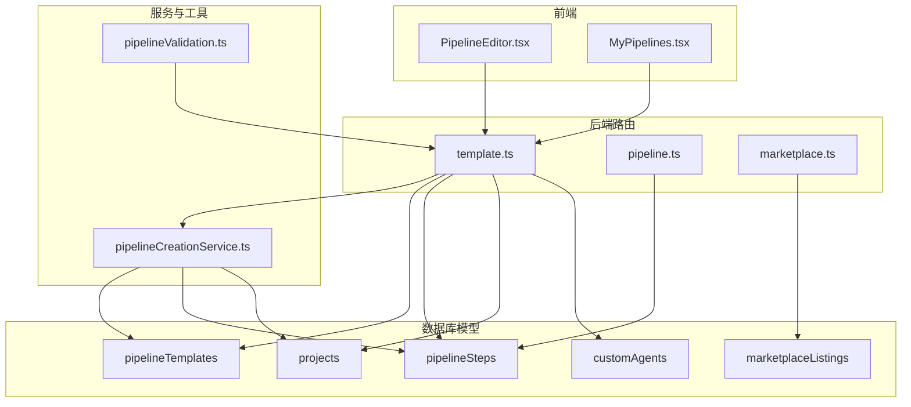
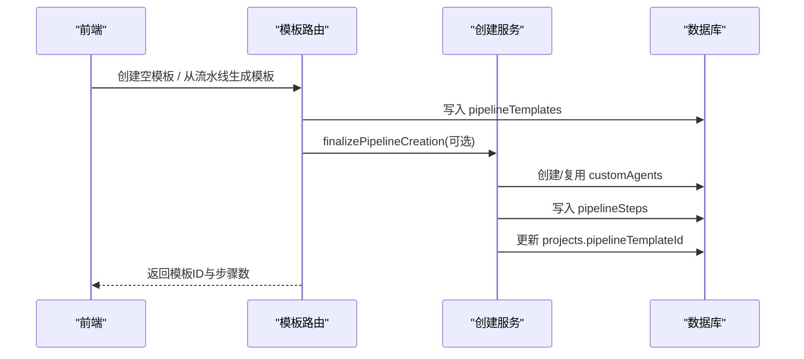
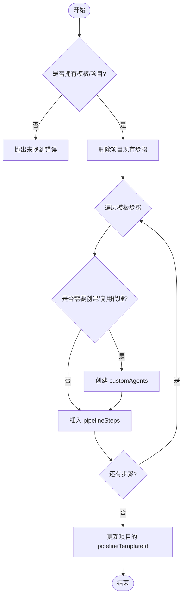
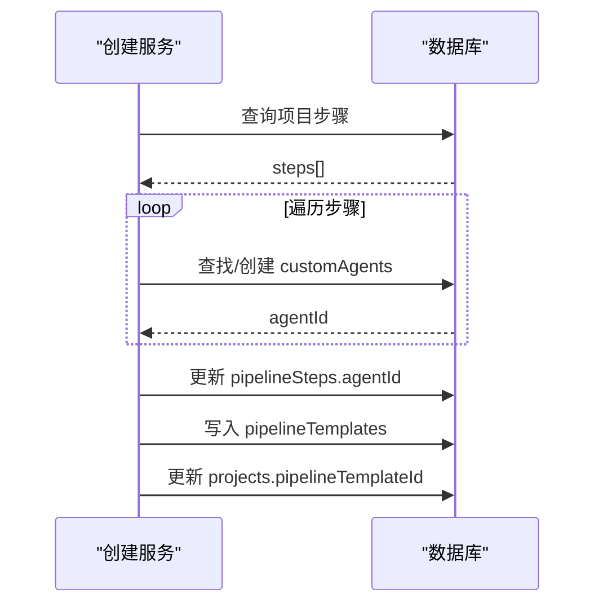
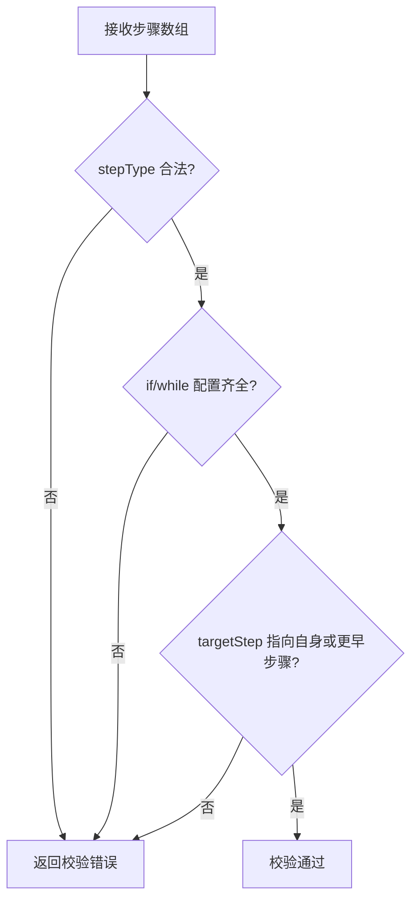
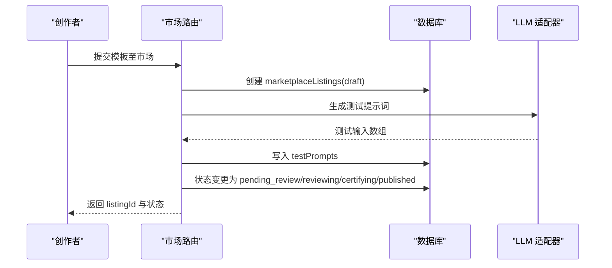
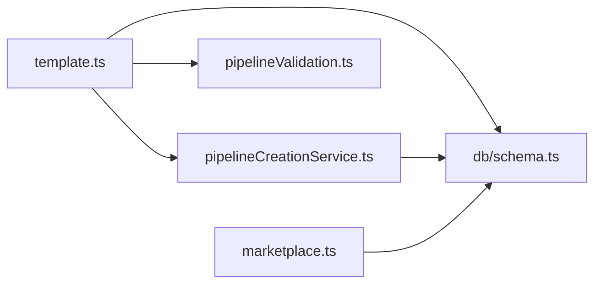

# 流水线模板与版本管理

<cite>
**本文引用的文件**
- [api/routers/template.ts](file://api/routers/template.ts)
- [api/services/pipelineCreationService.ts](file://api/services/pipelineCreationService.ts)
- [api/mcp/tools/pipelineValidation.ts](file://api/mcp/tools/pipelineValidation.ts)
- [db/schema.ts](file://db/schema.ts)
- [api/routers/marketplace.ts](file://api/routers/marketplace.ts)
- [src/pages/PipelineEditor.tsx](file://src/pages/PipelineEditor.tsx)
- [src/pages/MyPipelines.tsx](file://src/pages/MyPipelines.tsx)
</cite>

## 目录
1. [简介](#简介)
2. [项目结构](#项目结构)
3. [核心组件](#核心组件)
4. [架构总览](#架构总览)
5. [详细组件分析](#详细组件分析)
6. [依赖关系分析](#依赖关系分析)
7. [性能考量](#性能考量)
8. [故障排查指南](#故障排查指南)
9. [结论](#结论)
10. [附录：API 示例与迁移指南](#附录api-示例与迁移指南)

## 简介
本技术文档围绕“流水线模板与版本管理”展开，覆盖模板的创建、存储、复用与分享机制（含预定义模板库与用户自定义模板），版本控制策略（迭代、变更追踪、回滚）、模板继承与组合模式（基于基础模板构建复杂流水线）、模板验证机制（语法正确性与依赖完整性）、模板市场（发布、搜索、评价）以及最佳实践与设计模式。同时提供完整的模板管理 API 示例与迁移指南，帮助团队在现有代码基础上高效落地。

## 项目结构
与模板和版本管理直接相关的后端路由与服务位于 api 层，数据模型集中在 db/schema.ts，前端通过页面组件调用 trpc 接口进行模板编辑与应用。

图表来源
- [api/routers/template.ts:8-265](file://api/routers/template.ts#L8-L265)
- [api/services/pipelineCreationService.ts:20-116](file://api/services/pipelineCreationService.ts#L20-L116)
- [api/mcp/tools/pipelineValidation.ts:1-84](file://api/mcp/tools/pipelineValidation.ts#L1-L84)
- [db/schema.ts:453-505](file://db/schema.ts#L453-L505)
- [db/schema.ts:512-564](file://db/schema.ts#L512-L564)

章节来源
- [api/routers/template.ts:8-265](file://api/routers/template.ts#L8-L265)
- [db/schema.ts:453-505](file://db/schema.ts#L453-L505)
- [db/schema.ts:512-564](file://db/schema.ts#L512-L564)

## 核心组件
- 模板路由（template.ts）：提供模板列表、获取、更新、创建空模板、从当前流水线生成模板、删除、复制、应用到项目等能力。
- 流水线创建服务（pipelineCreationService.ts）：在项目步骤已存在后，自动创建或复用自定义代理并生成可复用的 pipelineTemplate，同时将项目关联到模板。
- 模板验证（pipelineValidation.ts）：对步骤类型、控制流配置、步数上限等进行纯函数校验，确保模板语法正确与依赖完整。
- 数据模型（schema.ts）：定义 pipelineTemplates、pipelineSteps、projects、customAgents、marketplaceListings 等表结构及字段约束。
- 模板市场（marketplace.ts）：支持将模板发布为 listing，包含测试用例生成、安全扫描、评审流程、购买与订阅等。

章节来源
- [api/routers/template.ts:8-265](file://api/routers/template.ts#L8-L265)
- [api/services/pipelineCreationService.ts:20-116](file://api/services/pipelineCreationService.ts#L20-L116)
- [api/mcp/tools/pipelineValidation.ts:1-84](file://api/mcp/tools/pipelineValidation.ts#L1-L84)
- [db/schema.ts:453-505](file://db/schema.ts#L453-L505)
- [db/schema.ts:512-564](file://db/schema.ts#L512-L564)

## 架构总览
系统采用前后端分离架构：前端通过 trpc 调用后端路由；后端路由负责权限校验、参数校验、业务编排与持久化；服务层封装跨模块逻辑；数据层使用 Drizzle ORM 操作 MySQL。模板生命周期包括创建、保存、复用、应用、发布与市场交易。

图表来源
- [api/routers/template.ts:84-153](file://api/routers/template.ts#L84-L153)
- [api/services/pipelineCreationService.ts:20-116](file://api/services/pipelineCreationService.ts#L20-L116)
- [db/schema.ts:453-505](file://db/schema.ts#L453-L505)

## 详细组件分析

### 模板路由（template.ts）
- 功能要点
  - 列出用户模板并统计被项目引用次数。
  - 获取单个模板详情。
  - 更新模板名称、描述与步骤数组。
  - 创建空模板（内置默认步骤）。
  - 从项目当前步骤生成模板，并将项目关联到该模板。
  - 删除、复制模板。
  - 将模板应用到项目：清空原步骤，按模板顺序插入新步骤，必要时创建/复用 customAgents，并更新项目关联。
- 关键实现路径
  - 列表与计数：[api/routers/template.ts:8-32](file://api/routers/template.ts#L8-L32)
  - 更新步骤：[api/routers/template.ts:44-82](file://api/routers/template.ts#L44-L82)
  - 从流水线生成模板：[api/routers/template.ts:99-153](file://api/routers/template.ts#L99-L153)
  - 应用到项目：[api/routers/template.ts:186-263](file://api/routers/template.ts#L186-L263)

图表来源
- [api/routers/template.ts:186-263](file://api/routers/template.ts#L186-L263)

章节来源
- [api/routers/template.ts:8-265](file://api/routers/template.ts#L8-L265)

### 流水线创建服务（pipelineCreationService.ts）
- 职责
  - 在项目步骤已存在后，统一创建或复用 customAgents，并生成 pipelineTemplate，最后将项目关联到模板。
- 关键点
  - 去重：按 role+name 键避免重复创建代理。
  - 批量更新：先收集步骤，再统一更新 agentId。
  - 模板步骤映射：将 pipelineSteps 转换为 pipelineTemplates.steps。
- 关键实现路径
  - 主流程：[api/services/pipelineCreationService.ts:20-116](file://api/services/pipelineCreationService.ts#L20-L116)

图表来源
- [api/services/pipelineCreationService.ts:20-116](file://api/services/pipelineCreationService.ts#L20-L116)

章节来源
- [api/services/pipelineCreationService.ts:20-116](file://api/services/pipelineCreationService.ts#L20-L116)

### 模板验证（pipelineValidation.ts）
- 规则
  - 步骤类型限制：agent、if、while、approval。
  - 控制流类型（if、while）需要特定能力层级。
  - 最大步数与 while 最大迭代次数限制。
  - ifConfig/whileConfig 必填校验与 targetStep 合法性检查。
- 关键实现路径
  - 输入校验与常量：[api/mcp/tools/pipelineValidation.ts:1-84](file://api/mcp/tools/pipelineValidation.ts#L1-L84)

图表来源
- [api/mcp/tools/pipelineValidation.ts:1-84](file://api/mcp/tools/pipelineValidation.ts#L1-L84)

章节来源
- [api/mcp/tools/pipelineValidation.ts:1-84](file://api/mcp/tools/pipelineValidation.ts#L1-L84)

### 数据模型（schema.ts）
- 关键字段
  - pipelineTemplates：id、userId、name、description、steps(JSON)、isAuto、sourceProjectId、createdAt。
  - pipelineSteps：projectId、stepOrder、agentId、stepType、providerId、model、name、role、systemPrompt、temperature、maxTokens、ifConfig、whileConfig、isEnabled。
  - projects：pipelineTemplateId（可空，用于引用模板）。
  - marketplaceListings：creatorId、templateId、title、description、objectives、input_format、output_format、category、price、status、grade、reviewCount 等。
- 关键实现路径
  - 模板与步骤：[db/schema.ts:453-505](file://db/schema.ts#L453-L505)
  - 市场条目：[db/schema.ts:512-564](file://db/schema.ts#L512-L564)

章节来源
- [db/schema.ts:453-505](file://db/schema.ts#L453-L505)
- [db/schema.ts:512-564](file://db/schema.ts#L512-L564)

### 模板市场（marketplace.ts）
- 功能要点
  - 将模板发布为 listing，支持标题、描述、分类、价格、订阅价、状态流转（草稿→生成测试→待审→审核中→认证→批准→发布/下架）。
  - 自动生成测试提示词，结合 LLM 生成多样化测试输入。
  - 安全扫描与 AI 辅助评审，记录评分与反馈。
  - 购买与订阅流程（集成计费服务）。
- 关键实现路径
  - 发布 listing：[api/routers/marketplace.ts:1044-1072](file://api/routers/marketplace.ts#L1044-L1072)
  - 测试提示词生成与重试机制：[api/routers/marketplace.ts:55-122](file://api/routers/marketplace.ts#L55-L122)

图表来源
- [api/routers/marketplace.ts:55-122](file://api/routers/marketplace.ts#L55-L122)
- [api/routers/marketplace.ts:1044-1072](file://api/routers/marketplace.ts#L1044-L1072)

章节来源
- [api/routers/marketplace.ts:55-122](file://api/routers/marketplace.ts#L55-L122)
- [api/routers/marketplace.ts:1044-1072](file://api/routers/marketplace.ts#L1044-L1072)

### 前端集成（PipelineEditor.tsx / MyPipelines.tsx）
- PipelineEditor.tsx：调用模板更新、创建空模板、应用到项目、复制模板等 mutation，并在成功后刷新列表。
- MyPipelines.tsx：调用删除、复制、应用等 mutation，并提供用户反馈。
- 关键实现路径
  - 编辑器交互：[src/pages/PipelineEditor.tsx:98-112](file://src/pages/PipelineEditor.tsx#L98-L112)
  - 我的流水线交互：[src/pages/MyPipelines.tsx:74-93](file://src/pages/MyPipelines.tsx#L74-L93)

章节来源
- [src/pages/PipelineEditor.tsx:98-112](file://src/pages/PipelineEditor.tsx#L98-L112)
- [src/pages/MyPipelines.tsx:74-93](file://src/pages/MyPipelines.tsx#L74-L93)

## 依赖关系分析
- 耦合与内聚
  - template.ts 与 pipelineCreationService.ts 高内聚：前者负责路由与权限，后者专注创建流程。
  - pipelineValidation.ts 作为纯函数模块，无数据库依赖，便于单元测试与复用。
  - schema.ts 集中定义数据契约，降低各模块间耦合。
- 外部依赖
  - Drizzle ORM 用于数据库访问。
  - 市场模块依赖加密、安全扫描、计费服务等。
- 潜在循环依赖
  - 未发现明显循环导入；服务与路由分层清晰。

图表来源
- [api/routers/template.ts:8-265](file://api/routers/template.ts#L8-L265)
- [api/services/pipelineCreationService.ts:20-116](file://api/services/pipelineCreationService.ts#L20-L116)
- [api/mcp/tools/pipelineValidation.ts:1-84](file://api/mcp/tools/pipelineValidation.ts#L1-L84)
- [db/schema.ts:453-505](file://db/schema.ts#L453-L505)
- [api/routers/marketplace.ts:55-122](file://api/routers/marketplace.ts#L55-L122)

章节来源
- [api/routers/template.ts:8-265](file://api/routers/template.ts#L8-L265)
- [api/services/pipelineCreationService.ts:20-116](file://api/services/pipelineCreationService.ts#L20-L116)
- [api/mcp/tools/pipelineValidation.ts:1-84](file://api/mcp/tools/pipelineValidation.ts#L1-L84)
- [db/schema.ts:453-505](file://db/schema.ts#L453-L505)
- [api/routers/marketplace.ts:55-122](file://api/routers/marketplace.ts#L55-L122)

## 性能考量
- 批量解析代理：在设置流水线步骤时，一次性查询并批量创建缺失的 customAgents，避免 N+1 查询。
- 事务原子性：删除与插入步骤使用事务保证一致性。
- 缓存与限流：市场浏览使用短 TTL 缓存；LLM 调用具备重试与指数退避。
- 资源限制：限制每流水线最多 3 个不同 LLM 提供者，防止过度分散。

章节来源
- [api/routers/pipeline.ts:128-200](file://api/routers/pipeline.ts#L128-L200)
- [api/routers/marketplace.ts:162-199](file://api/routers/marketplace.ts#L162-L199)

## 故障排查指南
- 常见错误
  - 模板未找到或未拥有：检查 userId 与模板 id 匹配。
  - 项目未找到：确认 projectId 归属或团队共享权限。
  - 步骤配置非法：校验 stepType、ifConfig、whileConfig 与目标步骤范围。
  - 代理冲突：slug 重复导致创建失败，需调整角色或名称。
- 定位方法
  - 查看路由返回的错误消息。
  - 检查数据库记录是否存在（pipelineTemplates、pipelineSteps、customAgents）。
  - 使用验证器输出定位具体步骤问题。

章节来源
- [api/routers/template.ts:34-82](file://api/routers/template.ts#L34-L82)
- [api/mcp/tools/pipelineValidation.ts:38-52](file://api/mcp/tools/pipelineValidation.ts#L38-L52)

## 结论
本系统提供了完善的流水线模板全生命周期管理能力：从创建、保存到复用与发布，配合严格的验证机制与健壮的服务编排，确保模板质量与执行稳定性。模板市场进一步打通了社区共享与商业化路径。建议在生产环境中结合审计日志与版本快照，完善回滚与追溯能力。

## 附录：API 示例与迁移指南

### 模板管理 API 示例（trpc 风格）
- 列出模板
  - 请求：GET /template/list
  - 响应：模板数组（含 usageCount）
  - 参考：[api/routers/template.ts:8-32](file://api/routers/template.ts#L8-L32)
- 获取模板详情
  - 请求：GET /template/getById?id=...
  - 响应：模板对象
  - 参考：[api/routers/template.ts:34-42](file://api/routers/template.ts#L34-L42)
- 更新模板步骤
  - 请求：POST /template/update { id, name, description, steps }
  - 响应：{ success: true }
  - 参考：[api/routers/template.ts:44-82](file://api/routers/template.ts#L44-L82)
- 创建空模板
  - 请求：POST /template/createEmpty { name }
  - 响应：{ id }
  - 参考：[api/routers/template.ts:84-97](file://api/routers/template.ts#L84-L97)
- 从流水线生成模板
  - 请求：POST /template/createFromPipeline { name, description?, projectId, isAuto? }
  - 响应：{ id, name, stepCount }
  - 参考：[api/routers/template.ts:99-153](file://api/routers/template.ts#L99-L153)
- 删除模板
  - 请求：POST /template/delete { id }
  - 响应：{ success: true }
  - 参考：[api/routers/template.ts:155-163](file://api/routers/template.ts#L155-L163)
- 复制模板
  - 请求：POST /template/duplicate { id }
  - 响应：{ id }
  - 参考：[api/routers/template.ts:165-184](file://api/routers/template.ts#L165-L184)
- 应用到项目
  - 请求：POST /template/useInProject { templateId, projectId }
  - 响应：{ applied: number }
  - 参考：[api/routers/template.ts:186-263](file://api/routers/template.ts#L186-L263)

章节来源
- [api/routers/template.ts:8-265](file://api/routers/template.ts#L8-L265)

### 版本控制策略与回滚建议
- 现状
  - 模板表包含 createdAt，但未见显式 version 字段或历史快照表。
  - 项目通过 pipelineTemplateId 引用模板，便于“以模板为中心”的版本绑定。
- 建议
  - 引入版本号：在 pipelineTemplates 增加 version 字段，每次重大变更递增。
  - 历史快照：新增 pipeline_template_versions 表，保存 steps 的快照与 diff。
  - 回滚流程：通过 API 将项目 pipelineTemplateId 切换至历史版本。
  - 审计日志：记录模板变更人、时间、差异摘要。

章节来源
- [db/schema.ts:483-505](file://db/schema.ts#L483-L505)

### 模板继承与组合模式
- 基础模板
  - 使用 createEmpty 创建通用基础模板（如 Builder、Reviewer）。
- 组合复杂流水线
  - 通过 update 合并多个基础模板的步骤，形成复合流水线。
  - 使用 if/while 控制流实现条件分支与循环。
- 复用策略
  - 将常用步骤抽象为独立模板，按需组合。
  - 通过 useInProject 快速应用到新项目。

章节来源
- [api/routers/template.ts:84-97](file://api/routers/template.ts#L84-L97)
- [api/routers/template.ts:44-82](file://api/routers/template.ts#L44-L82)
- [api/mcp/tools/pipelineValidation.ts:1-84](file://api/mcp/tools/pipelineValidation.ts#L1-L84)

### 模板市场 API 示例
- 发布模板
  - 请求：POST /marketplace/createListing { templateId, title, description?, objectives?, inputFormat?, outputFormat?, remarks?, category, price, isSubscription?, subscriptionPrice? }
  - 响应：{ listingId }
  - 参考：[api/routers/marketplace.ts:1044-1072](file://api/routers/marketplace.ts#L1044-L1072)
- 生成测试提示词
  - 后台任务：根据模板描述调用 LLM 生成 10 条测试输入。
  - 参考：[api/routers/marketplace.ts:55-122](file://api/routers/marketplace.ts#L55-L122)

章节来源
- [api/routers/marketplace.ts:55-122](file://api/routers/marketplace.ts#L55-L122)
- [api/routers/marketplace.ts:1044-1072](file://api/routers/marketplace.ts#L1044-L1072)

### 迁移指南
- 数据迁移
  - 若引入版本字段，需新增列与索引，并回填历史版本。
  - 新增历史快照表，迁移现有模板步骤为 v1。
- 代码迁移
  - 在 template.ts 中增加版本化写入逻辑。
  - 在 pipelineCreationService.ts 中适配新版本化模板创建。
  - 在前端增加版本选择与切换 UI。
- 回滚脚本
  - 提供脚本将项目 pipelineTemplateId 切换至指定版本。
  - 记录回滚事件到审计日志。

章节来源
- [db/schema.ts:483-505](file://db/schema.ts#L483-L505)
- [api/routers/template.ts:99-153](file://api/routers/template.ts#L99-L153)
- [api/services/pipelineCreationService.ts:20-116](file://api/services/pipelineCreationService.ts#L20-L116)