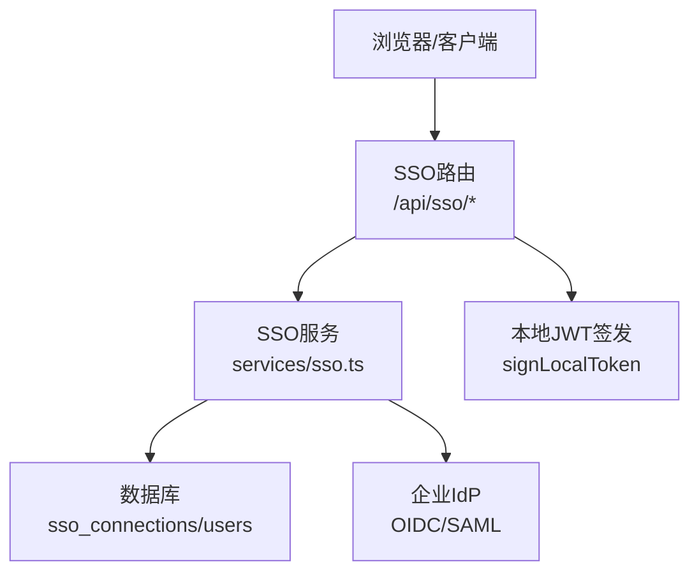
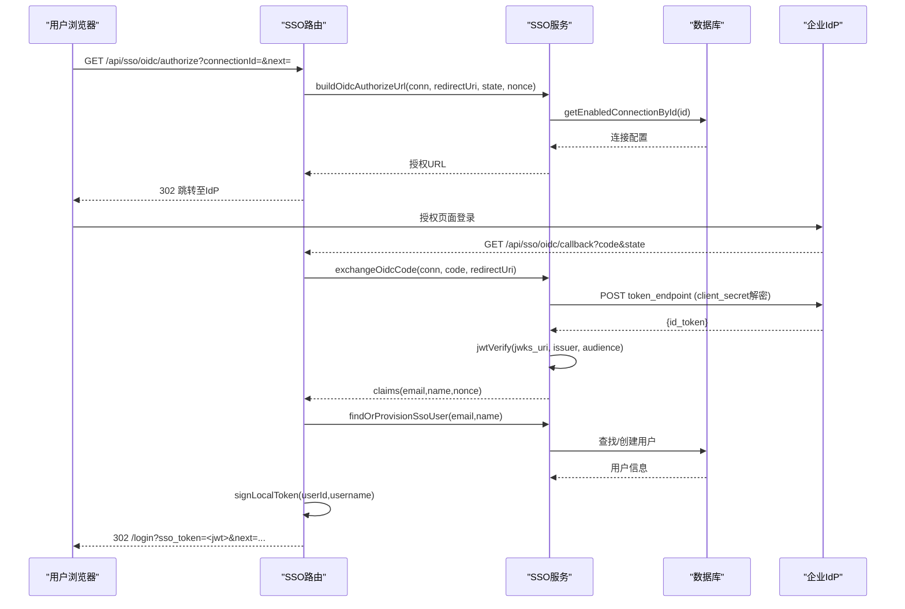
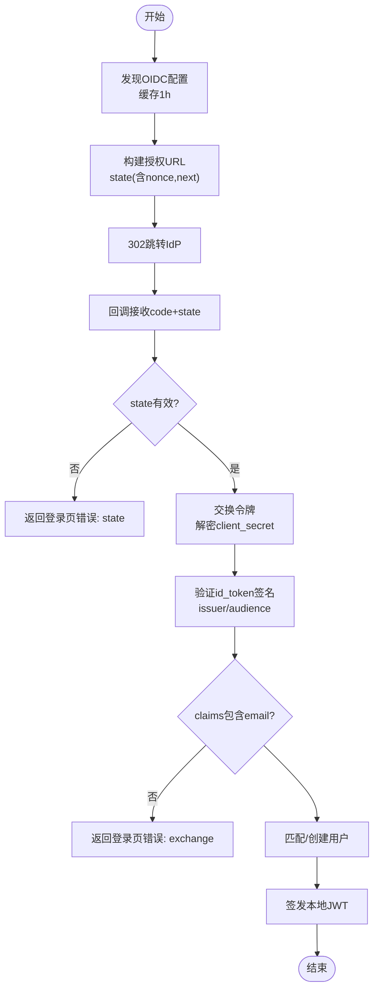
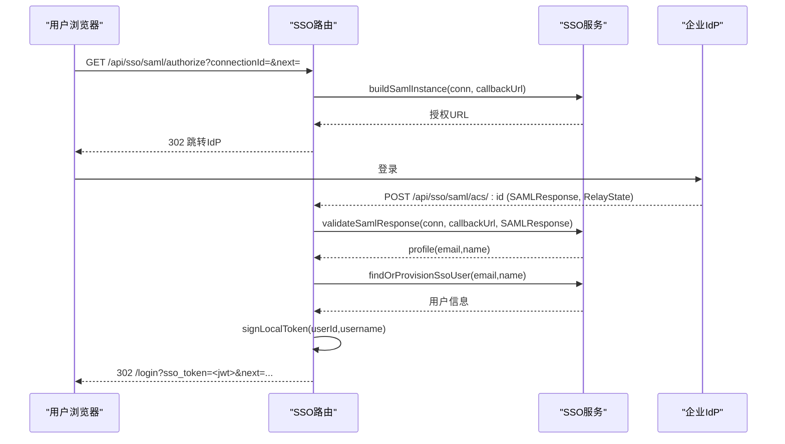
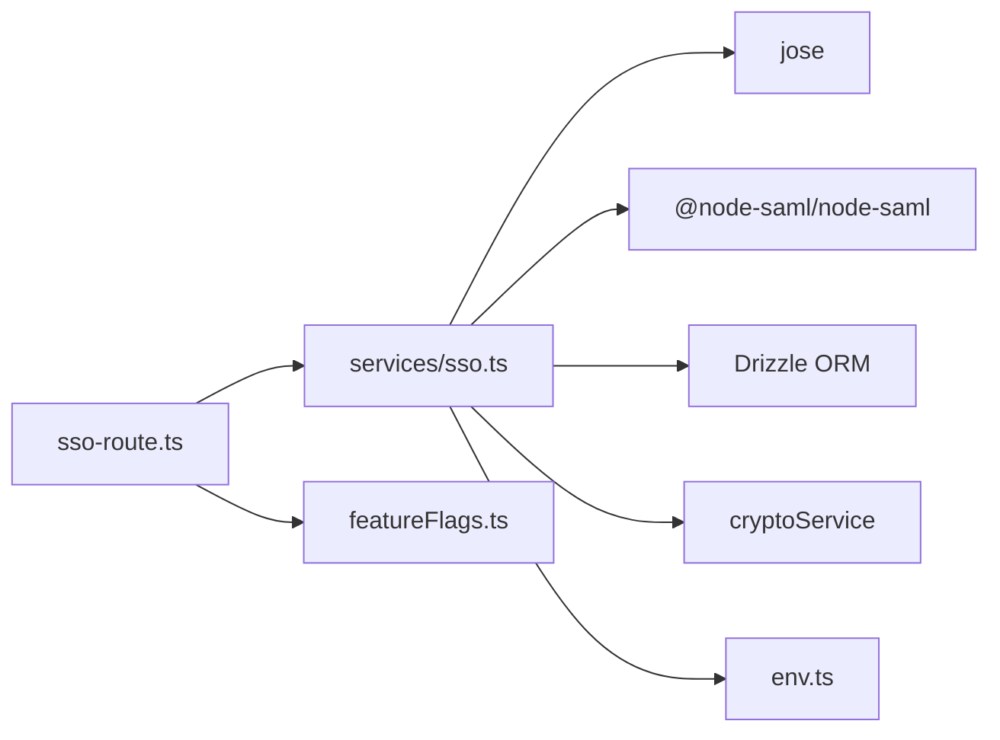

# SSO集成

<cite>
**本文引用的文件**
- [api/services/sso.ts](file://api/services/sso.ts)
- [api/sso-route.ts](file://api/sso-route.ts)
- [db/migrations/013_enterprise.sql](file://db/migrations/013_enterprise.sql)
- [api/lib/env.ts](file://api/lib/env.ts)
- [api/plugins/featureFlags.ts](file://api/plugins/featureFlags.ts)
- [scripts/smoke-enterprise.mjs](file://scripts/smoke-enterprise.mjs)
- [DeeWaanAI-Next/PHASE3-SPEC.md](file://DeeWaanAI-Next/PHASE3-SPEC.md)
</cite>

## 目录
1. [简介](#简介)
2. [项目结构](#项目结构)
3. [核心组件](#核心组件)
4. [架构总览](#架构总览)
5. [详细组件分析](#详细组件分析)
6. [依赖关系分析](#依赖关系分析)
7. [性能与可扩展性](#性能与可扩展性)
8. [部署与安全配置](#部署与安全配置)
9. [故障排查指南](#故障排查指南)
10. [结论](#结论)

## 简介
本文件为企业单点登录（SSO）集成的权威技术文档，覆盖 OAuth 2.1 / OpenID Connect 协议实现、SAML 支持、企业身份提供商配置、认证流程、令牌交换、用户信息同步、回调URL设置、安全考虑、状态管理、会话同步与故障处理机制，并提供实际集成示例与排错指引。该实现以“企业特性开关”为门控，默认关闭，启用后提供 OIDC 与 SAML 两种企业登录路径，并通过本地JWT完成应用内会话。

## 项目结构
SSO相关代码主要分布在以下位置：
- 服务层：api/services/sso.ts（OIDC/SAML核心逻辑、发现、校验、用户供给）
- 路由层：api/sso-route.ts（对外HTTP接口，受特性开关保护）
- 数据库迁移：db/migrations/013_enterprise.sql（sso_connections表等）
- 环境配置：api/lib/env.ts（APP_SECRET等）
- 特性开关：api/plugins/featureFlags.ts（enterprise_sso）
- 冒烟脚本：scripts/smoke-enterprise.mjs（用于开启/关闭特性标志）
- 规范说明：DeeWaanAI-Next/PHASE3-SPEC.md（Phase 3契约与行为约定）

图表来源
- [api/sso-route.ts:108-287](file://api/sso-route.ts#L108-L287)
- [api/services/sso.ts:103-181](file://api/services/sso.ts#L103-L181)
- [db/migrations/013_enterprise.sql:8-23](file://db/migrations/013_enterprise.sql#L8-L23)

章节来源
- [api/sso-route.ts:1-291](file://api/sso-route.ts#L1-L291)
- [api/services/sso.ts:1-369](file://api/services/sso.ts#L1-L369)
- [db/migrations/013_enterprise.sql:1-54](file://db/migrations/013_enterprise.sql#L1-L54)

## 核心组件
- 特性开关：通过 enterprise_sso 控制SSO功能是否可用；未启用时所有SSO路由返回404，避免暴露能力。
- 域名解析与连接选择：根据邮箱或域名匹配启用的SSO连接（OIDC或SAML）。
- OIDC流程：
  - 发现：从 issuer/.well-known/openid-configuration 获取授权端点、令牌端点、JWKS URI，并缓存1小时。
  - 授权：构建授权URL，携带 state（无状态CSRF/nonce JWT）、nonce、scope等。
  - 令牌交换：使用授权码换取ID Token，基于JWKS验证签名，校验issuer/audience，提取email/name。
  - 客户端密钥：仅在与令牌交换时解密，内存中持有，不落盘明文。
- SAML流程：
  - 元数据生成：按连接配置生成SP元数据XML供IdP侧配置。
  - ACS校验：验证SAMLResponse，接受响应或断言任一有效签名，兼容不同IdP签名策略。
  - 用户映射：NameID优先作为email，否则回退到常见属性。
- 用户供给：按email匹配现有用户或自动创建新用户（角色user），不覆盖已有密码哈希，更新最后登录时间。
- 状态管理：state/nonce采用HS256签名的无状态JWT（APP_SECRET，10分钟TTL），防重放与跨站点请求伪造。

章节来源
- [api/sso-route.ts:46-89](file://api/sso-route.ts#L46-L89)
- [api/services/sso.ts:30-59](file://api/services/sso.ts#L30-L59)
- [api/services/sso.ts:61-122](file://api/services/sso.ts#L61-L122)
- [api/services/sso.ts:130-181](file://api/services/sso.ts#L130-L181)
- [api/services/sso.ts:183-224](file://api/services/sso.ts#L183-L224)
- [api/services/sso.ts:226-299](file://api/services/sso.ts#L226-L299)
- [api/services/sso.ts:301-357](file://api/services/sso.ts#L301-L357)

## 架构总览
SSO整体由“路由层 + 服务层 + 外部IdP + 数据库”构成。路由层负责入口、鉴权门控、错误归一化与跳转；服务层封装OIDC/SAML协议细节、加密与用户供给；数据库持久化SSO连接与用户信息；外部IdP负责认证与颁发令牌/断言。

图表来源
- [api/sso-route.ts:137-203](file://api/sso-route.ts#L137-L203)
- [api/services/sso.ts:103-181](file://api/services/sso.ts#L103-L181)
- [api/services/sso.ts:301-357](file://api/services/sso.ts#L301-L357)

## 详细组件分析

### 组件A：OIDC认证与令牌交换
- 发现与缓存：对每个issuer的openid配置进行进程内缓存（1小时），减少网络开销。
- JWKS缓存：按jwks_uri复用远程JWK集合实例，避免重复拉取。
- 授权URL构造：强制response_type=code，携带state（含connectionId/nonce/next）和nonce。
- 令牌交换：POST到token_endpoint，使用AES解密的client_secret，校验返回id_token的签名与声明。
- 安全校验：严格校验issuer与audience，确保令牌来自预期IdP且面向当前应用。

图表来源
- [api/services/sso.ts:61-122](file://api/services/sso.ts#L61-L122)
- [api/services/sso.ts:130-181](file://api/services/sso.ts#L130-L181)
- [api/services/sso.ts:183-224](file://api/services/sso.ts#L183-L224)
- [api/services/sso.ts:301-357](file://api/services/sso.ts#L301-L357)

章节来源
- [api/services/sso.ts:61-181](file://api/services/sso.ts#L61-L181)
- [api/sso-route.ts:137-203](file://api/sso-route.ts#L137-L203)

### 组件B：SAML认证与ACS处理
- SP元数据：按连接配置生成SP元数据XML，便于在IdP侧注册。
- ACS校验：使用@node-saml/node-saml验证SAMLResponse，接受响应或断言任一有效签名，兼容多厂商差异。
- 用户映射：NameID优先作为email，否则回退到mail或特定OID属性；同时提取displayName/cn作为显示名。
- 状态传递：SP发起流程通过RelayState传递state JWT，ACS处校验并恢复next目标。

图表来源
- [api/sso-route.ts:205-287](file://api/sso-route.ts#L205-L287)
- [api/services/sso.ts:226-299](file://api/services/sso.ts#L226-L299)
- [api/services/sso.ts:301-357](file://api/services/sso.ts#L301-L357)

章节来源
- [api/sso-route.ts:205-287](file://api/sso-route.ts#L205-L287)
- [api/services/sso.ts:226-299](file://api/services/sso.ts#L226-L299)

### 组件C：用户供给与会话同步
- 匹配策略：按email精确匹配用户；若不存在则自动创建，角色固定为user，用户名取自email前缀并做冲突处理。
- 安全约束：绝不覆盖已有用户的passwordHash，确保SSO账户无法被本地密码登录。
- 会话同步：认证成功后签发本地JWT，前端存储并在后续请求中使用；logout为客户端管理，服务端可扩展黑名单。

章节来源
- [api/services/sso.ts:301-357](file://api/services/sso.ts#L301-L357)
- [api/auth-router.ts:1-13](file://api/auth-router.ts#L1-L13)

## 依赖关系分析
- 路由层依赖服务层提供的OIDC/SAML工具函数与用户供给逻辑。
- 服务层依赖：
  - jose库进行JWT/JWKS操作。
  - @node-saml/node-saml处理SAML协议。
  - Drizzle ORM访问数据库（sso_connections、users）。
  - cryptoService对敏感字段（如client_secret）进行AES-256-GCM加解密。
  - env读取APP_SECRET等环境变量。
- 特性开关依赖featureFlags模块，统一控制企业功能可见性。

图表来源
- [api/sso-route.ts:21-41](file://api/sso-route.ts#L21-L41)
- [api/services/sso.ts:16-24](file://api/services/sso.ts#L16-L24)
- [api/plugins/featureFlags.ts:18-20](file://api/plugins/featureFlags.ts#L18-L20)

章节来源
- [api/sso-route.ts:21-41](file://api/sso-route.ts#L21-L41)
- [api/services/sso.ts:16-24](file://api/services/sso.ts#L16-L24)
- [api/plugins/featureFlags.ts:18-81](file://api/plugins/featureFlags.ts#L18-L81)

## 性能与可扩展性
- OIDC发现缓存：对每个issuer的配置缓存1小时，降低频繁网络请求。
- JWKS缓存：按jwks_uri复用远程JWK集合实例，避免重复下载。
- 速率限制：lookup接口针对IP进行限流，防止域名枚举滥用。
- 并发安全：用户供给时对并发登录场景做了重试与竞态处理，避免重复创建。
- 可扩展点：
  - 增加更多企业IdP只需在数据库中新增sso_connections记录。
  - 可通过特性开关逐步灰度发布企业功能。

[本节为通用指导，无需具体文件引用]

## 部署与安全配置
- 必需环境变量：
  - APP_SECRET：用于签发state JWT与本地JWT，生产环境必须强随机且不可用开发默认值。
  - DATABASE_URL：数据库连接字符串。
  - AI_SWARM_MASTER_KEY：主密钥，用于敏感数据加解密。
- 可选基础设施：
  - REDIS_URL：可选，用于扩展能力。
  - TRUSTED_PROXY：决定是否信任反向代理设置的XFF头，影响速率限制准确性。
- 特性开关：
  - 通过feature_flags表中的enterprise_sso键控制SSO功能；可使用冒烟脚本开启/关闭。
- 回调URL设置：
  - OIDC回调：/api/sso/oidc/callback（需在企业IdP中配置）。
  - SAML ACS：/api/sso/saml/acs/:id（需在企业IdP中配置）。
  - 元数据：/api/sso/saml/metadata/:id（用于向IdP导入SP元数据）。
- 安全要点：
  - client_secret仅在令牌交换时解密，内存中持有，不落盘明文。
  - state/nonce采用HS256签名，10分钟过期，防重放与CSRF。
  - OIDC令牌验证严格检查issuer与audience。
  - SAML接受响应或断言任一有效签名，兼容不同IdP实现。
  - 登录失败统一返回302到/login并附带错误键，避免500泄露内部细节。

章节来源
- [api/lib/env.ts:21-22](file://api/lib/env.ts#L21-L22)
- [api/lib/env.ts:24-95](file://api/lib/env.ts#L24-L95)
- [scripts/smoke-enterprise.mjs:21-33](file://scripts/smoke-enterprise.mjs#L21-L33)
- [api/sso-route.ts:75-101](file://api/sso-route.ts#L75-L101)
- [api/services/sso.ts:130-181](file://api/services/sso.ts#L130-L181)
- [api/services/sso.ts:183-224](file://api/services/sso.ts#L183-L224)
- [api/services/sso.ts:226-299](file://api/services/sso.ts#L226-L299)

## 故障排查指南
- 常见问题定位：
  - 特性未启用：检查enterprise_sso是否开启；未启用时所有SSO路由返回404。
  - 域名匹配失败：确认sso_connections中domain已正确配置且enabled为真。
  - OIDC发现失败：检查issuer是否正确、网络可达、openID配置完整。
  - 令牌交换失败：核对client_secret是否配置正确、redirect_uri一致、scope包含email。
  - 令牌验证失败：检查issuer与audience是否与连接配置一致。
  - SAML校验失败：确认IdP证书格式正确（PEM或Base64均可自动转换）、ACS URL配置正确。
  - 用户供给失败：检查email唯一性与用户名冲突处理。
- 日志与监控：
  - 路由与服务层均记录关键步骤与错误，关注SSO相关日志条目。
  - 使用rate limiter与IP解析确保限流准确。
- 快速修复建议：
  - 重新导入SP元数据到IdP，确保ACS与Entity ID匹配。
  - 清理浏览器缓存并重试，确保state/nonce未被重用。
  - 调整scope以获取必要声明（email/name）。

章节来源
- [api/sso-route.ts:108-287](file://api/sso-route.ts#L108-L287)
- [api/services/sso.ts:61-181](file://api/services/sso.ts#L61-L181)
- [api/services/sso.ts:226-299](file://api/services/sso.ts#L226-L299)

## 结论
本SSO实现提供了企业级OAuth 2.1/OpenID Connect与SAML双通道认证能力，具备完善的发现、校验、用户供给与状态管理机制。通过特性开关与严格的输入校验、加密与日志记录，可在企业环境中安全部署与运维。建议在生产环境启用特性开关前完成回调URL配置、证书校验与限流策略验证，并结合监控与日志持续优化用户体验与稳定性。

[本节为总结，无需具体文件引用]