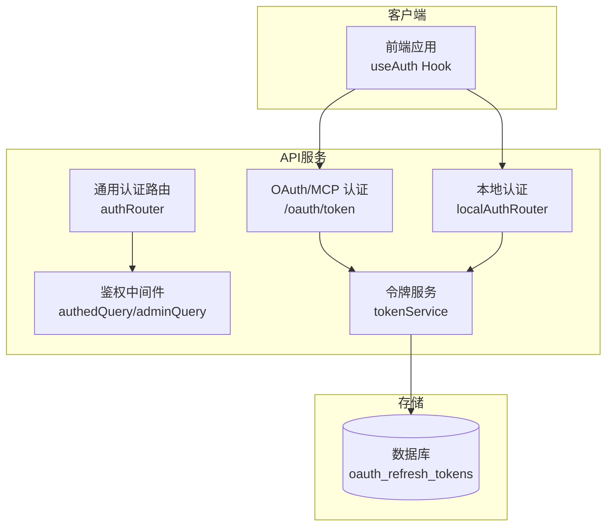
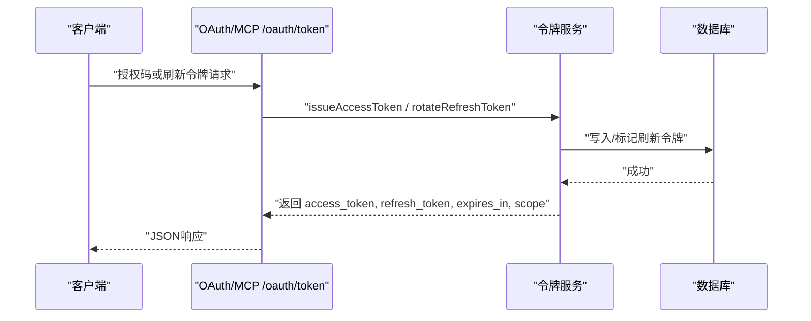
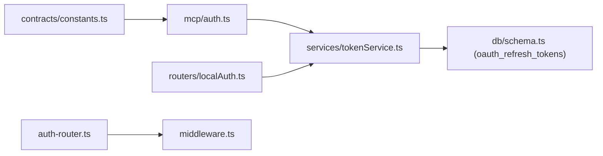
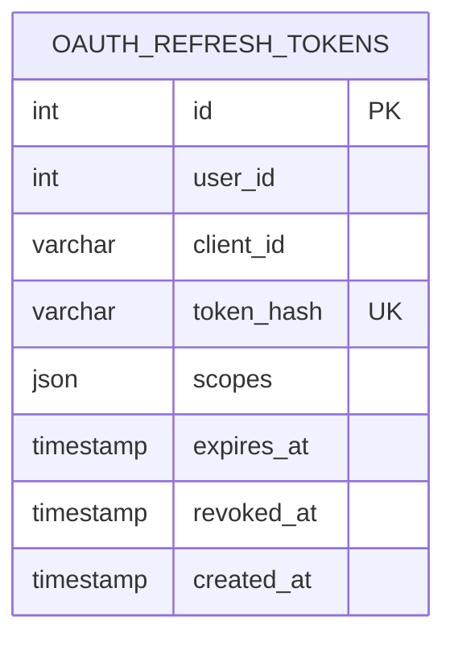

# 会话管理

<cite>
**本文引用的文件**
- [api/services/tokenService.ts](file://api/services/tokenService.ts)
- [api/mcp/auth.ts](file://api/mcp/auth.ts)
- [api/mcp/server.ts](file://api/mcp/server.ts)
- [api/routers/localAuth.ts](file://api/routers/localAuth.ts)
- [api/auth-router.ts](file://api/auth-router.ts)
- [api/middleware.ts](file://api/middleware.ts)
- [contracts/constants.ts](file://contracts/constants.ts)
- [db/schema.ts](file://db/schema.ts)
- [src/hooks/useAuth.ts](file://src/hooks/useAuth.ts)
- [api/beacon-save-route.ts](file://api/beacon-save-route.ts)
</cite>

## 目录
1. [简介](#简介)
2. [项目结构](#项目结构)
3. [核心组件](#核心组件)
4. [架构总览](#架构总览)
5. [详细组件分析](#详细组件分析)
6. [依赖关系分析](#依赖关系分析)
7. [性能与并发](#性能与并发)
8. [故障排查指南](#故障排查指南)
9. [结论](#结论)
10. [附录](#附录)

## 简介
本文件面向“会话管理”主题，覆盖以下方面：
- 会话生命周期：创建、更新、续期、销毁
- 存储策略：无状态JWT访问令牌 + 有状态刷新令牌（数据库）+ Web会话Cookie
- 并发控制：基于数据库的刷新令牌旋转（一次使用即失效）
- 安全机制：HS256签名、最小化载荷、过期时间、客户端ID绑定、速率限制
- JWT与刷新令牌：颁发、验证、轮换、拒绝策略
- 会话超时：访问令牌短期有效、刷新令牌长期有效并支持轮换
- 查询与强制登出：当前用户查询、本地登出、服务端黑名单扩展点
- 数据结构与序列化：JWT载荷、刷新令牌表字段
- 多设备登录与会话冲突：按设备/客户端维度管理刷新令牌，支持并发与冲突处理

## 项目结构
与“会话管理”直接相关的代码分布在以下模块：
- 令牌服务：访问令牌签发/校验、刷新令牌签发/轮换
- OAuth/MCP认证：授权码流程、Token端点、刷新令牌处理、Web会话解析
- 本地认证：用户名密码登录、本地JWT签发与校验
- 中间件与路由：鉴权中间件、登出接口
- 前端Hook：本地登出、状态刷新
- 数据模型：刷新令牌持久化表
- 常量：Web会话Cookie名称与过期配置

图表来源
- [api/mcp/auth.ts:337-427](file://api/mcp/auth.ts#L337-L427)
- [api/services/tokenService.ts:34-128](file://api/services/tokenService.ts#L34-L128)
- [api/routers/localAuth.ts:38-54](file://api/routers/localAuth.ts#L38-L54)
- [api/middleware.ts:17-50](file://api/middleware.ts#L17-L50)
- [db/schema.ts:1117-1140](file://db/schema.ts#L1117-L1140)

章节来源
- [api/mcp/auth.ts:337-427](file://api/mcp/auth.ts#L337-L427)
- [api/services/tokenService.ts:34-128](file://api/services/tokenService.ts#L34-L128)
- [api/routers/localAuth.ts:38-54](file://api/routers/localAuth.ts#L38-L54)
- [api/middleware.ts:17-50](file://api/middleware.ts#L17-L50)
- [db/schema.ts:1117-1140](file://db/schema.ts#L1117-L1140)

## 核心组件
- 令牌服务（tokenService）
  - 访问令牌：HS256 JWT，包含用户ID、作用域、客户端ID，短TTL
  - 刷新令牌：不透明随机串，哈希后存入数据库，支持一次性轮换
- OAuth/MCP认证（mcp/auth）
  - 授权码流程与Token端点：返回access_token、refresh_token、expires_in、scope
  - 刷新令牌端点：调用rotateRefreshToken实现“旧令牌失效+新对生成”
- 本地认证（routers/localAuth）
  - 本地JWT签发与校验，用于Web/Beacon等场景
- 中间件（middleware）
  - 提供authedQuery/adminQuery，统一未认证/权限不足错误
- 通用认证路由（auth-router）
  - me查询当前用户；logout为客户端清理入口（可扩展服务端黑名单）
- 前端Hook（useAuth）
  - 本地登出：清除本地令牌并刷新状态

章节来源
- [api/services/tokenService.ts:34-128](file://api/services/tokenService.ts#L34-L128)
- [api/mcp/auth.ts:337-427](file://api/mcp/auth.ts#L337-L427)
- [api/routers/localAuth.ts:38-54](file://api/routers/localAuth.ts#L38-L54)
- [api/middleware.ts:17-50](file://api/middleware.ts#L17-L50)
- [api/auth-router.ts:3-11](file://api/auth-router.ts#L3-L11)
- [src/hooks/useAuth.ts:17-21](file://src/hooks/useAuth.ts#L17-L21)

## 架构总览
系统采用“无状态访问令牌 + 有状态刷新令牌”的混合模式：
- 访问令牌（Access Token）：无状态JWT，便于横向扩展与缓存友好
- 刷新令牌（Refresh Token）：有状态，存于数据库，支持撤销与轮换
- Web会话：通过Cookie（kimi_sid）在浏览器侧维持会话上下文
- 多设备支持：以clientId区分不同设备/客户端，每个设备可拥有独立刷新令牌

图表来源
- [api/mcp/auth.ts:337-427](file://api/mcp/auth.ts#L337-L427)
- [api/services/tokenService.ts:72-128](file://api/services/tokenService.ts#L72-L128)

## 详细组件分析

### 访问令牌（JWT）
- 签发
  - 算法：HS256
  - 载荷：用户ID（sub）、作用域（scope）、客户端ID（client_id）
  - 有效期：默认1小时，可配置
- 校验
  - 校验签名、发行者、过期时间
  - 失败时返回空而非抛错，便于上层优雅降级
- 安全要点
  - 密钥由应用密钥派生，避免硬编码
  - 最小化载荷，减少泄露面
  - 客户端ID绑定，便于设备级管理

章节来源
- [api/services/tokenService.ts:23-66](file://api/services/tokenService.ts#L23-L66)

### 刷新令牌（有状态）
- 签发
  - 生成不透明随机串，计算SHA-256哈希后入库
  - 记录用户ID、客户端ID、作用域、过期时间
- 轮换（Rotate）
  - 查找未撤销且未过期的刷新令牌
  - 将旧令牌标记为已撤销，同时签发新的访问令牌和刷新令牌
  - 保证“一次使用即失效”，防止重放攻击
- 错误处理
  - 未知、已撤销或过期均视为无效，返回相应错误

章节来源
- [api/services/tokenService.ts:68-128](file://api/services/tokenService.ts#L68-L128)

### OAuth/MCP Token端点
- 授权码流程
  - 生成授权码并保存至数据库（含codeChallenge、scopes、过期时间）
  - 回调时将授权码换取access_token与refresh_token
- Token端点
  - 支持authorization_code与refresh_token两种grant_type
  - 刷新令牌走rotateRefreshToken，确保安全性
- 响应头
  - 禁止缓存（Cache-Control: no-store; Pragma: no-cache）

章节来源
- [api/mcp/auth.ts:314-356](file://api/mcp/auth.ts#L314-L356)
- [api/mcp/auth.ts:411-427](file://api/mcp/auth.ts#L411-L427)

### 本地认证与会话
- 本地JWT
  - 类型标识为“local”，有效期7天，用于本地登录场景
  - 校验失败返回空，便于容错
- Web会话Cookie
  - Cookie名称：kimi_sid，最大存活期为一年
  - 解析顺序：优先从Cookie读取，其次回退到请求头x-local-auth-token
- Beacon保存偏好
  - 支持通过查询字符串携带token进行认证（兼容sendBeacon无法设置自定义头的限制）

章节来源
- [api/routers/localAuth.ts:38-54](file://api/routers/localAuth.ts#L38-L54)
- [contracts/constants.ts:1-4](file://contracts/constants.ts#L1-L4)
- [api/mcp/auth.ts:95-113](file://api/mcp/auth.ts#L95-L113)
- [api/beacon-save-route.ts:27-57](file://api/beacon-save-route.ts#L27-L57)

### 会话查询与强制登出
- 查询当前用户
  - 通过鉴权中间件注入ctx.user，路由暴露me查询
- 强制登出
  - 客户端侧：删除本地令牌并刷新状态
  - 服务端侧：当前logout为占位实现，可扩展为令牌黑名单或撤销所有刷新令牌

章节来源
- [api/auth-router.ts:3-11](file://api/auth-router.ts#L3-L11)
- [src/hooks/useAuth.ts:17-21](file://src/hooks/useAuth.ts#L17-L21)

### MCP会话与资源隔离
- 每会话McpServer
  - 每次连接构建独立的McpServer实例，绑定认证上下文
  - 工具能力与作用域按会话隔离，避免跨会话污染

章节来源
- [api/mcp/server.ts:188-208](file://api/mcp/server.ts#L188-L208)

## 依赖关系分析
- tokenService依赖数据库表oauth_refresh_tokens进行刷新令牌的持久化与撤销
- mcp/auth依赖tokenService完成令牌签发与轮换
- localAuth独立签发本地JWT，不依赖刷新令牌表
- middleware提供统一的鉴权中间件，供各路由复用
- contracts/constants定义Web会话Cookie名与过期策略

图表来源
- [api/mcp/auth.ts:337-427](file://api/mcp/auth.ts#L337-L427)
- [api/services/tokenService.ts:72-128](file://api/services/tokenService.ts#L72-L128)
- [api/routers/localAuth.ts:38-54](file://api/routers/localAuth.ts#L38-L54)
- [api/middleware.ts:17-50](file://api/middleware.ts#L17-L50)
- [db/schema.ts:1117-1140](file://db/schema.ts#L1117-L1140)
- [contracts/constants.ts:1-4](file://contracts/constants.ts#L1-L4)

章节来源
- [api/mcp/auth.ts:337-427](file://api/mcp/auth.ts#L337-L427)
- [api/services/tokenService.ts:72-128](file://api/services/tokenService.ts#L72-L128)
- [api/routers/localAuth.ts:38-54](file://api/routers/localAuth.ts#L38-L54)
- [api/middleware.ts:17-50](file://api/middleware.ts#L17-L50)
- [db/schema.ts:1117-1140](file://db/schema.ts#L1117-L1140)
- [contracts/constants.ts:1-4](file://contracts/constants.ts#L1-L4)

## 性能与并发
- 访问令牌无状态，适合高并发与水平扩展
- 刷新令牌操作涉及数据库读写，建议：
  - 索引优化：对tokenHash、userId、clientId、expiresAt建立合适索引
  - 批量清理：定期清理过期与已撤销的刷新令牌
- 速率限制：登录/注册等敏感操作具备IP维度的限流保护
- 内存回退：当Redis不可用时，部分限速逻辑回退到进程内内存窗口

章节来源
- [api/lib/rateLimiter.ts:126-166](file://api/lib/rateLimiter.ts#L126-L166)

## 故障排查指南
- 访问令牌校验失败
  - 检查签名算法、发行者、过期时间
  - 确认客户端ID存在且匹配
- 刷新令牌无效
  - 可能已被撤销、过期或不存在
  - 检查数据库记录是否被标记revokedAt
- 本地认证失败
  - 检查本地JWT类型是否为“local”
  - 检查过期时间与密钥一致性
- 登出不生效
  - 客户端需清除本地令牌
  - 如需服务端强制登出，可扩展令牌黑名单或批量撤销刷新令牌

章节来源
- [api/services/tokenService.ts:50-66](file://api/services/tokenService.ts#L50-L66)
- [api/services/tokenService.ts:96-128](file://api/services/tokenService.ts#L96-L128)
- [api/routers/localAuth.ts:46-54](file://api/routers/localAuth.ts#L46-L54)
- [api/auth-router.ts:7-11](file://api/auth-router.ts#L7-L11)

## 结论
本会话管理方案通过“无状态访问令牌 + 有状态刷新令牌”的组合，兼顾了扩展性、安全性与可操作性：
- 访问令牌轻量、易缓存、适合高频鉴权
- 刷新令牌支持设备级管理与一次性轮换，降低重放风险
- Web会话Cookie简化浏览器侧体验
- 提供清晰的查询与登出入口，并可按需扩展服务端黑名单
- 多设备登录通过clientId区分，支持并发与会话冲突解决

## 附录

### 会话生命周期流程图

```mermaid
flowchart TD
Start(["开始"]) --> Create["创建会话<br/>登录/授权码换取令牌"]
Create --> Use["使用访问令牌访问受保护资源"]
Use --> Expired{"访问令牌是否过期?"}
Expired --> |否| Continue["继续业务处理"]
Expired --> |是| Refresh["使用刷新令牌获取新令牌对"]
Refresh --> Rotate{"刷新令牌是否有效?"}
Rotate --> |否| Logout["强制登出/提示重新登录"]
Rotate --> |是| NewTokens["获得新的访问令牌与刷新令牌"]
NewTokens --> Use
Logout --> End(["结束"])
Continue --> End
```

图表来源
- [api/mcp/auth.ts:337-427](file://api/mcp/auth.ts#L337-L427)
- [api/services/tokenService.ts:96-128](file://api/services/tokenService.ts#L96-L128)

### 数据模型（刷新令牌）

图表来源
- [db/schema.ts:1117-1140](file://db/schema.ts#L1117-L1140)

### 关键实现路径参考
- 访问令牌签发与校验：[api/services/tokenService.ts:34-66](file://api/services/tokenService.ts#L34-L66)
- 刷新令牌签发与轮换：[api/services/tokenService.ts:72-128](file://api/services/tokenService.ts#L72-L128)
- OAuth Token端点：[api/mcp/auth.ts:337-427](file://api/mcp/auth.ts#L337-L427)
- 本地JWT签发与校验：[api/routers/localAuth.ts:38-54](file://api/routers/localAuth.ts#L38-L54)
- 鉴权中间件：[api/middleware.ts:17-50](file://api/middleware.ts#L17-L50)
- 登出接口：[api/auth-router.ts:7-11](file://api/auth-router.ts#L7-L11)
- 前端登出：[src/hooks/useAuth.ts:17-21](file://src/hooks/useAuth.ts#L17-L21)
- Web会话Cookie常量：[contracts/constants.ts:1-4](file://contracts/constants.ts#L1-L4)
- Beacon认证回退：[api/beacon-save-route.ts:27-57](file://api/beacon-save-route.ts#L27-L57)