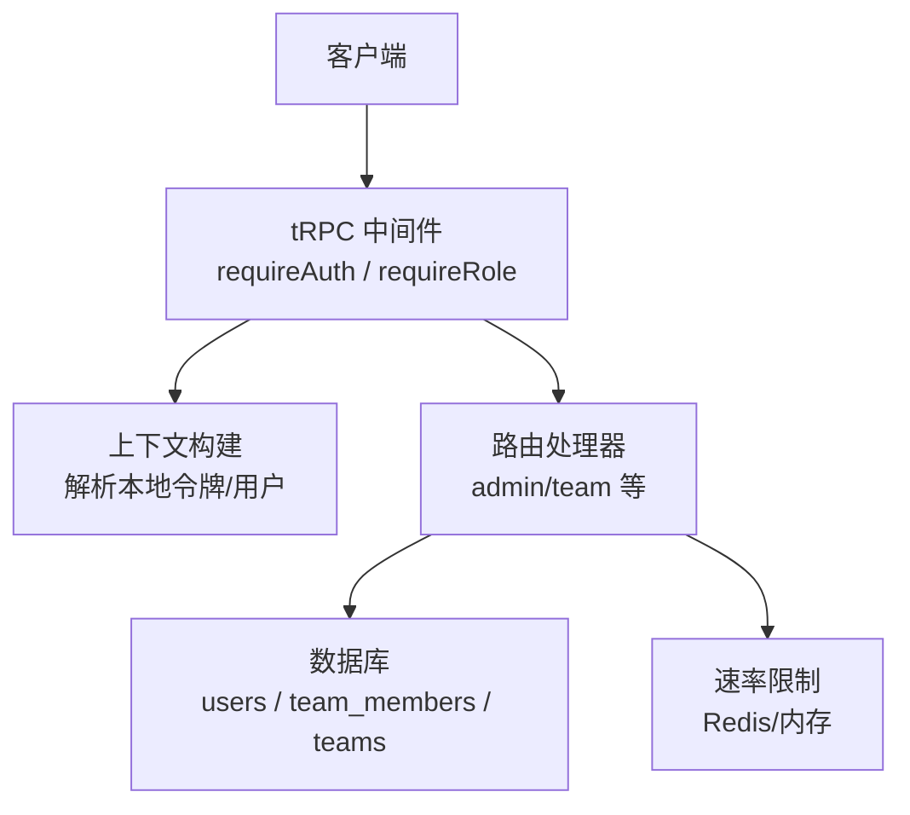
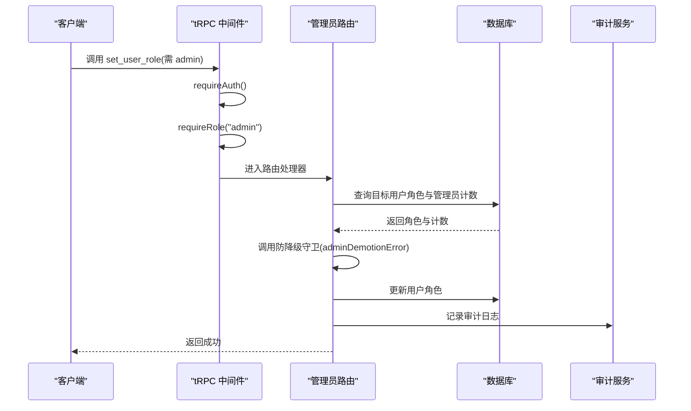
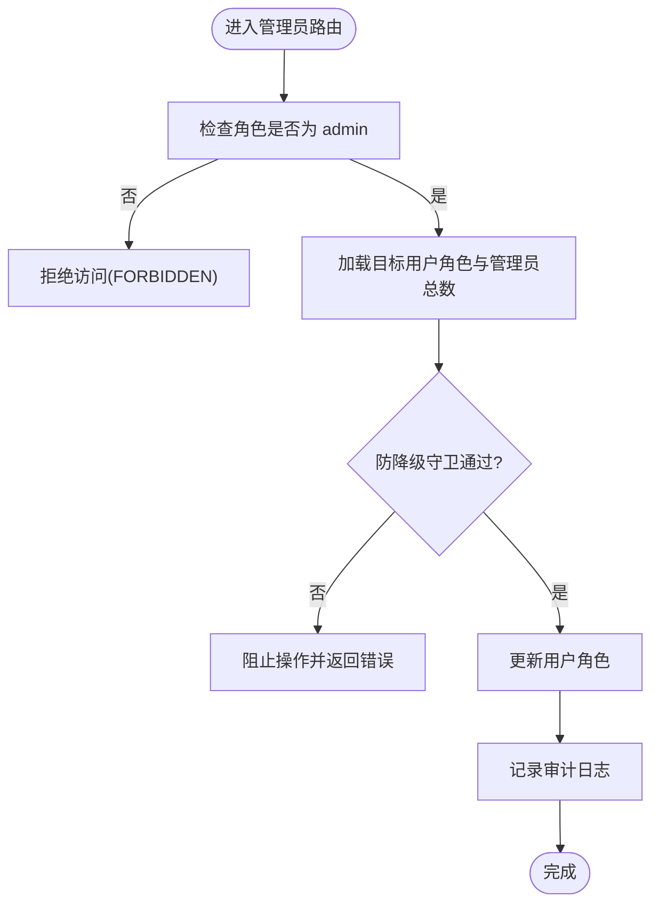
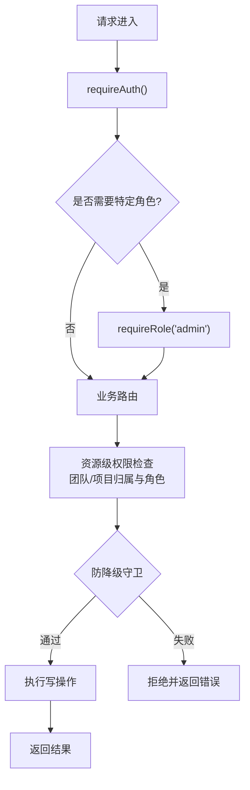
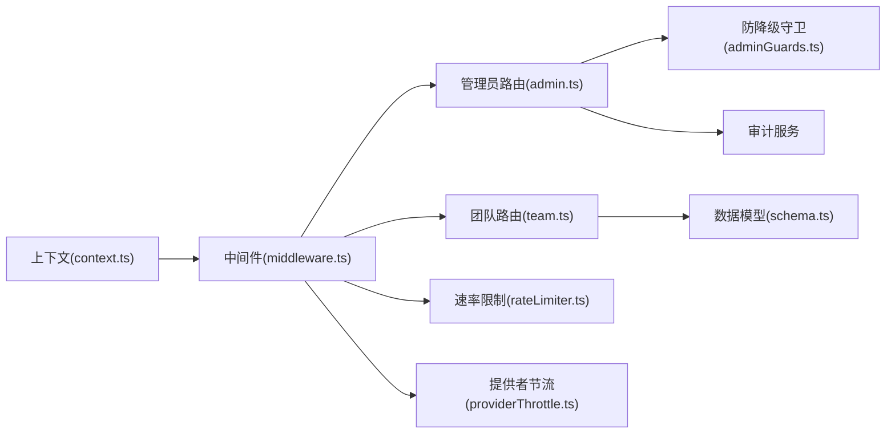

# 权限控制

<cite>
**本文引用的文件**
- [api/middleware.ts](file://api/middleware.ts)
- [api/context.ts](file://api/context.ts)
- [api/routers/admin.ts](file://api/routers/admin.ts)
- [api/routers/team.ts](file://api/routers/team.ts)
- [db/schema.ts](file://db/schema.ts)
- [api/lib/adminGuards.ts](file://api/lib/adminGuards.ts)
- [api/auth-router.ts](file://api/auth-router.ts)
- [api/lib/rateLimiter.ts](file://api/lib/rateLimiter.ts)
- [api/lib/providerThrottle.ts](file://api/lib/providerThrottle.ts)
- [DeeWaanAI-Next/TEAM-FEATURE-TEST-SPEC.md](file://DeeWaanAI-Next/TEAM-FEATURE-TEST-SPEC.md)
</cite>

## 目录
1. [简介](#简介)
2. [项目结构](#项目结构)
3. [核心组件](#核心组件)
4. [架构总览](#架构总览)
5. [详细组件分析](#详细组件分析)
6. [依赖关系分析](#依赖关系分析)
7. [性能与缓存策略](#性能与缓存策略)
8. [故障排查指南](#故障排查指南)
9. [结论](#结论)
10. [附录](#附录)

## 简介
本文件系统化梳理了系统的基于角色的访问控制（RBAC）实现，覆盖管理员权限、普通用户权限以及团队权限模型。重点说明：
- 中间件如何验证用户身份与角色
- 权限检查流程与授权决策逻辑
- 权限配置、角色定义与继承机制
- 权限检查的代码示例路径与最佳实践
- 权限相关缓存策略与性能优化方案

## 项目结构
权限控制由“上下文解析 + 中间件鉴权 + 路由级细粒度校验 + 数据层约束”四层构成：
- 上下文解析：从请求头解析本地令牌并加载用户信息到上下文
- 中间件鉴权：统一要求登录态，并提供按角色拦截的中间件
- 路由级校验：在业务路由中做资源归属、团队成员与角色等细粒度判断
- 数据层约束：通过数据库枚举、唯一索引、外键等保证一致性



**图示来源**
- [api/middleware.ts:17-50](file://api/middleware.ts#L17-L50)
- [api/context.ts:20-54](file://api/context.ts#L20-L54)
- [api/routers/admin.ts:1-85](file://api/routers/admin.ts#L1-L85)
- [api/routers/team.ts:25-117](file://api/routers/team.ts#L25-L117)
- [db/schema.ts:18-51](file://db/schema.ts#L18-L51)
- [db/schema.ts:786-836](file://db/schema.ts#L786-L836)
- [api/lib/rateLimiter.ts:57-92](file://api/lib/rateLimiter.ts#L57-L92)

**章节来源**
- [api/middleware.ts:17-50](file://api/middleware.ts#L17-L50)
- [api/context.ts:20-54](file://api/context.ts#L20-L54)
- [db/schema.ts:18-51](file://db/schema.ts#L18-L51)
- [db/schema.ts:786-836](file://db/schema.ts#L786-L836)

## 核心组件
- 认证上下文：从请求头读取本地令牌，校验后注入用户对象到 tRPC 上下文
- 鉴权中间件：
  - requireAuth：强制登录态，未登录返回未认证错误
  - requireRole("admin")：仅允许 admin 角色进入受保护路由
- 管理员路由：使用 adminQuery 保护，包含用户角色变更、系统统计、审计日志等
- 团队路由：基于 team_members.role 进行细粒度授权（owner/admin/tester/viewer）
- 数据模型：users.role、team_members.role 等枚举约束，配合唯一索引防止重复

**章节来源**
- [api/context.ts:20-54](file://api/context.ts#L20-L54)
- [api/middleware.ts:17-50](file://api/middleware.ts#L17-L50)
- [api/routers/admin.ts:16-85](file://api/routers/admin.ts#L16-L85)
- [api/routers/team.ts:25-117](file://api/routers/team.ts#L25-L117)
- [db/schema.ts:18-51](file://db/schema.ts#L18-L51)
- [db/schema.ts:798-817](file://db/schema.ts#L798-L817)

## 架构总览
下图展示一次需要管理员权限的请求处理链路：从 tRPC 中间件鉴权到管理员路由执行，再到数据库更新与审计记录。



**图示来源**
- [api/middleware.ts:17-50](file://api/middleware.ts#L17-L50)
- [api/routers/admin.ts:57-85](file://api/routers/admin.ts#L57-L85)
- [api/lib/adminGuards.ts:17-28](file://api/lib/adminGuards.ts#L17-L28)
- [db/schema.ts:18-51](file://db/schema.ts#L18-L51)

## 详细组件分析

### 管理员权限（全局 RBAC）
- 入口保护：所有管理员接口均使用 adminQuery，自动要求登录且角色为 admin
- 关键操作：
  - 设置用户角色：包含防降级守卫，禁止自降或移除最后一个管理员
  - 设置用户套餐层级：可调整 tier
  - 审计追踪：所有敏感操作写入审计表
- 安全要点：
  - 使用纯函数守卫隔离风险逻辑，便于单元测试
  - 对管理员数量进行动态计算，避免误删导致无管理员可用



**图示来源**
- [api/middleware.ts:30-50](file://api/middleware.ts#L30-L50)
- [api/routers/admin.ts:57-85](file://api/routers/admin.ts#L57-L85)
- [api/lib/adminGuards.ts:17-28](file://api/lib/adminGuards.ts#L17-L28)

**章节来源**
- [api/routers/admin.ts:16-85](file://api/routers/admin.ts#L16-L85)
- [api/lib/adminGuards.ts:17-28](file://api/lib/adminGuards.ts#L17-L28)

### 团队权限模型（Team RBAC）
- 角色定义：owner、admin、tester、viewer
- 成员关系：team_members 表维护用户与团队的关联及角色
- 共享资源：team_projects 将项目共享给团队，用于跨成员协作
- 典型流程：
  - 加入团队：校验邀请码、去重、默认 tester
  - 查看团队详情：校验成员资格，返回成员列表与共享项目
  - 修改成员角色：仅 owner/admin 可操作，禁止修改 owner 角色
  - 移除成员：支持自删或管理员删除他人，禁止删除 owner
  - 共享/取消共享项目：仅 owner/admin 可操作，需校验项目归属
  - 导入流水线/智能体：需验证来源属于团队共享范围

```mermaid
classDiagram
class Users {
+id
+username
+role
+tier
}
class Teams {
+id
+name
+ownerId
+inviteCode
}
class TeamMembers {
+id
+teamId
+userId
+role
+joinedAt
}
class Projects {
+id
+userId
+name
}
class TeamProjects {
+id
+teamId
+projectId
+addedBy
}
Users ||--o{ TeamMembers : "拥有成员关系"
Teams ||--o{ TeamMembers : "包含成员"
Teams ||--o{ Projects : "拥有项目"
Teams ||--o{ TeamProjects : "共享项目"
Projects ||--o{ TeamProjects : "被共享"
```

**图示来源**
- [db/schema.ts:18-51](file://db/schema.ts#L18-L51)
- [db/schema.ts:786-836](file://db/schema.ts#L786-L836)

**章节来源**
- [api/routers/team.ts:25-117](file://api/routers/team.ts#L25-L117)
- [api/routers/team.ts:164-280](file://api/routers/team.ts#L164-L280)
- [api/routers/team.ts:347-438](file://api/routers/team.ts#L347-L438)
- [api/routers/team.ts:576-719](file://api/routers/team.ts#L576-L719)
- [db/schema.ts:786-836](file://db/schema.ts#L786-L836)

### 权限检查流程与授权决策
- 全局鉴权：
  - requireAuth：若上下文无用户则返回未认证
  - requireRole("admin")：若非 admin 则返回禁止访问
- 资源级鉴权：
  - 团队操作前校验 membership 与 role
  - 项目共享前校验 ownership
  - 导入操作前校验来源是否属于团队共享范围
- 防降级守卫：
  - 禁止自降管理员
  - 禁止移除最后一个管理员



**图示来源**
- [api/middleware.ts:17-50](file://api/middleware.ts#L17-L50)
- [api/routers/team.ts:234-280](file://api/routers/team.ts#L234-L280)
- [api/routers/team.ts:347-438](file://api/routers/team.ts#L347-L438)
- [api/lib/adminGuards.ts:17-28](file://api/lib/adminGuards.ts#L17-L28)

**章节来源**
- [api/middleware.ts:17-50](file://api/middleware.ts#L17-L50)
- [api/routers/team.ts:234-280](file://api/routers/team.ts#L234-L280)
- [api/routers/team.ts:347-438](file://api/routers/team.ts#L347-L438)
- [api/lib/adminGuards.ts:17-28](file://api/lib/adminGuards.ts#L17-L28)

### 权限配置、角色定义与继承机制
- 用户角色：users.role 枚举 user/admin，用于全局管理权限
- 团队角色：team_members.role 枚举 owner/admin/tester/viewer，用于团队内权限
- 继承机制：
  - 全局 admin 可访问管理员路由
  - 团队内 owner/admin 可执行管理操作（改角色、移除成员、共享/取消共享项目）
  - 普通成员（tester/viewer）受限访问，仅能参与协作与消费共享资源
- 配置点：
  - 中间件提供 requireRole 扩展点，可按需新增角色检查
  - 路由级输入校验使用 Zod 约束角色取值范围

**章节来源**
- [db/schema.ts:18-51](file://db/schema.ts#L18-L51)
- [db/schema.ts:798-817](file://db/schema.ts#L798-L817)
- [api/middleware.ts:30-50](file://api/middleware.ts#L30-L50)
- [api/routers/team.ts:226-280](file://api/routers/team.ts#L226-L280)

### 权限检查代码示例与最佳实践
- 示例路径（不直接粘贴代码，仅给出位置）：
  - 管理员设置用户角色：[api/routers/admin.ts:57-85](file://api/routers/admin.ts#L57-L85)
  - 团队修改成员角色：[api/routers/team.ts:226-280](file://api/routers/team.ts#L226-L280)
  - 团队共享项目：[api/routers/team.ts:347-398](file://api/routers/team.ts#L347-L398)
  - 团队导入流水线/智能体：[api/routers/team.ts:576-719](file://api/routers/team.ts#L576-L719)
- 最佳实践：
  - 始终先校验登录态，再校验角色
  - 资源级操作必须校验归属（如项目 userId 与当前用户一致）
  - 团队操作必须校验 membership 与 role
  - 使用防降级守卫保护管理员集合完整性
  - 对幂等操作（如重复共享）容忍并发导致的重复插入

**章节来源**
- [api/routers/admin.ts:57-85](file://api/routers/admin.ts#L57-L85)
- [api/routers/team.ts:226-280](file://api/routers/team.ts#L226-L280)
- [api/routers/team.ts:347-398](file://api/routers/team.ts#L347-L398)
- [api/routers/team.ts:576-719](file://api/routers/team.ts#L576-L719)

### 权限缓存策略与性能优化
- 速率限制缓存：
  - Redis 优先：固定窗口计数器，跨节点共享配额
  - 内存回退：当 Redis 不可用时使用进程内 Map，保证可用性
- 提供者节流缓存：
  - Redis 存储状态（currentRpm、windowStart、windowCount 等）
  - 内存回退，确保降级运行
- 建议：
  - 高频鉴权路径可考虑缓存用户角色与团队角色（注意失效策略）
  - 对团队共享资源列表进行短期缓存，减少重复 JOIN 查询
  - 使用连接池与索引优化查询（schema 已定义常用索引）

**章节来源**
- [api/lib/rateLimiter.ts:57-92](file://api/lib/rateLimiter.ts#L57-L92)
- [api/lib/rateLimiter.ts:126-166](file://api/lib/rateLimiter.ts#L126-L166)
- [api/lib/providerThrottle.ts:68-153](file://api/lib/providerThrottle.ts#L68-L153)

## 依赖关系分析
- 中间件依赖上下文中的用户信息；上下文依赖本地令牌验证
- 管理员路由依赖防降级守卫与审计服务
- 团队路由依赖数据库 schema 的角色枚举与唯一索引
- 速率限制与提供者节流依赖 Redis（可选），具备内存回退



**图示来源**
- [api/context.ts:20-54](file://api/context.ts#L20-L54)
- [api/middleware.ts:17-50](file://api/middleware.ts#L17-L50)
- [api/routers/admin.ts:16-85](file://api/routers/admin.ts#L16-L85)
- [api/routers/team.ts:25-117](file://api/routers/team.ts#L25-L117)
- [api/lib/adminGuards.ts:17-28](file://api/lib/adminGuards.ts#L17-L28)
- [db/schema.ts:786-836](file://db/schema.ts#L786-L836)
- [api/lib/rateLimiter.ts:57-92](file://api/lib/rateLimiter.ts#L57-L92)
- [api/lib/providerThrottle.ts:68-153](file://api/lib/providerThrottle.ts#L68-L153)

**章节来源**
- [api/context.ts:20-54](file://api/context.ts#L20-L54)
- [api/middleware.ts:17-50](file://api/middleware.ts#L17-L50)
- [api/routers/admin.ts:16-85](file://api/routers/admin.ts#L16-L85)
- [api/routers/team.ts:25-117](file://api/routers/team.ts#L25-L117)
- [db/schema.ts:786-836](file://db/schema.ts#L786-L836)

## 性能与缓存策略
- 使用 Redis 作为分布式限流与节流状态存储，提升多实例一致性
- 内存回退保障高可用，避免单点故障影响鉴权
- 建议在热点读路径引入短 TTL 缓存（如团队列表、共享项目列表）
- 利用数据库索引减少 JOIN 开销（schema 已定义常用索引）

[本节为通用性能指导，不直接分析具体文件]

## 故障排查指南
- 常见错误与定位：
  - 未认证：检查上下文是否正确解析本地令牌
  - 禁止访问：确认中间件 requireRole 与路由级角色校验
  - 团队权限不足：检查 team_members.role 与 membership
  - 管理员降级风险：使用防降级守卫避免误操作
- 参考测试与规范：
  - 团队功能测试规范指出若干权限漏洞修复点（如 shareProject 需校验项目归属、importPipeline/importAgent 需校验来源可达性、updateMemberRole 禁止更改 owner 角色）

**章节来源**
- [api/context.ts:20-54](file://api/context.ts#L20-L54)
- [api/middleware.ts:17-50](file://api/middleware.ts#L17-L50)
- [api/routers/team.ts:234-280](file://api/routers/team.ts#L234-L280)
- [api/routers/team.ts:347-398](file://api/routers/team.ts#L347-L398)
- [DeeWaanAI-Next/TEAM-FEATURE-TEST-SPEC.md:18-41](file://DeeWaanAI-Next/TEAM-FEATURE-TEST-SPEC.md#L18-L41)

## 结论
本系统采用分层 RBAC 设计：全局管理员角色与团队内角色共同构成权限体系。通过中间件统一鉴权、路由级细粒度校验与数据层约束，实现了安全可控的访问控制。结合防降级守卫与审计日志，有效降低了误操作风险。借助 Redis 与内存回退的缓存策略，系统在可用性与性能之间取得平衡。未来可在热点读路径引入更精细的缓存策略，进一步提升性能。

[本节为总结性内容，不直接分析具体文件]

## 附录
- 公开接口：authRouter.me 返回当前用户信息（含角色），可用于前端能力判断
- 角色枚举：
  - 用户角色：user、admin
  - 团队角色：owner、admin、tester、viewer

**章节来源**
- [api/auth-router.ts:1-13](file://api/auth-router.ts#L1-L13)
- [db/schema.ts:18-51](file://db/schema.ts#L18-L51)
- [db/schema.ts:798-817](file://db/schema.ts#L798-L817)