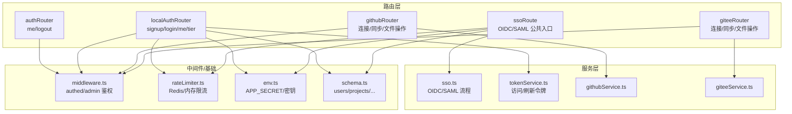
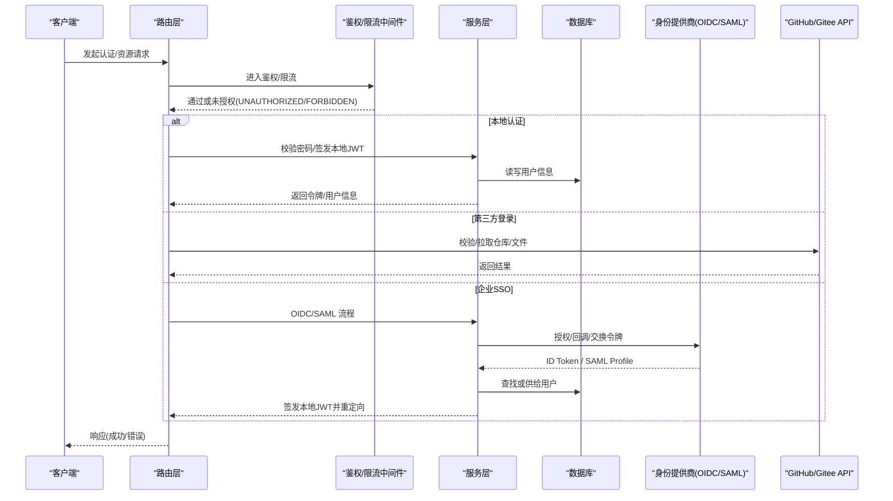
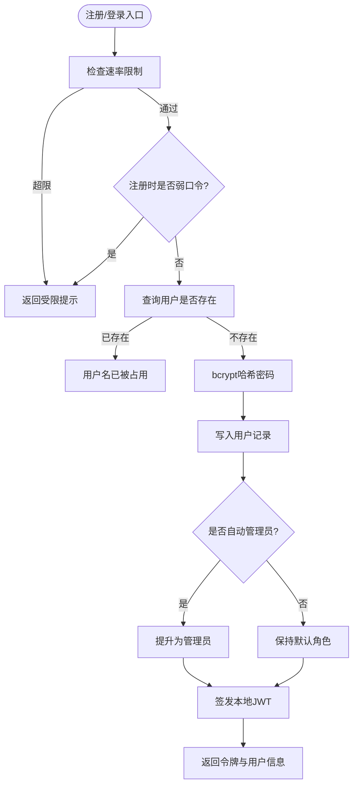
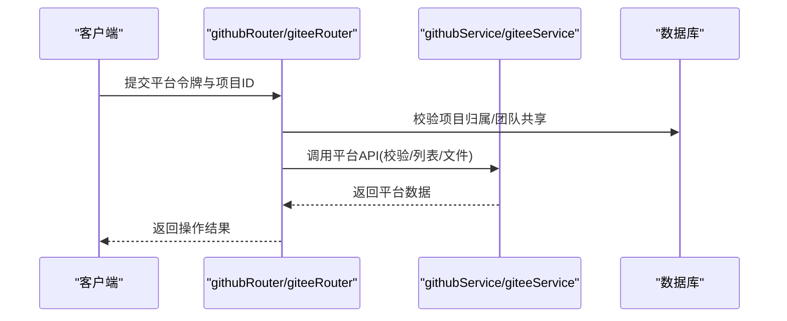
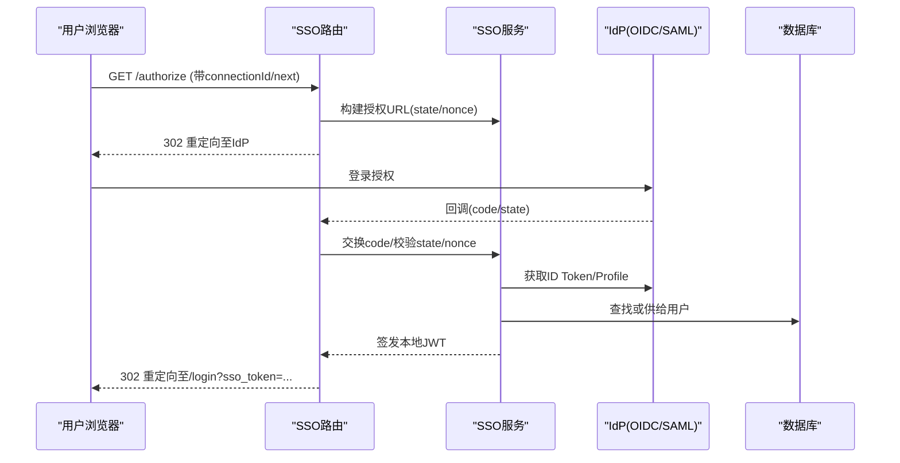
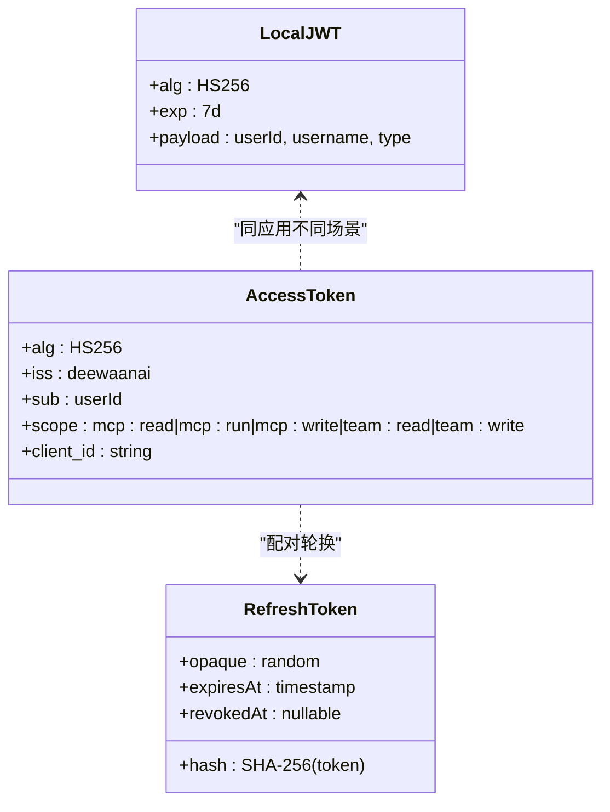
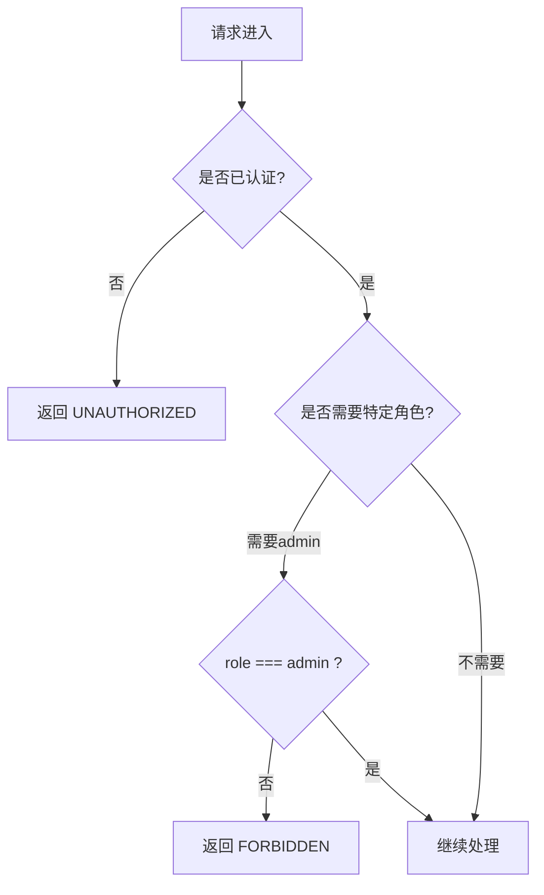
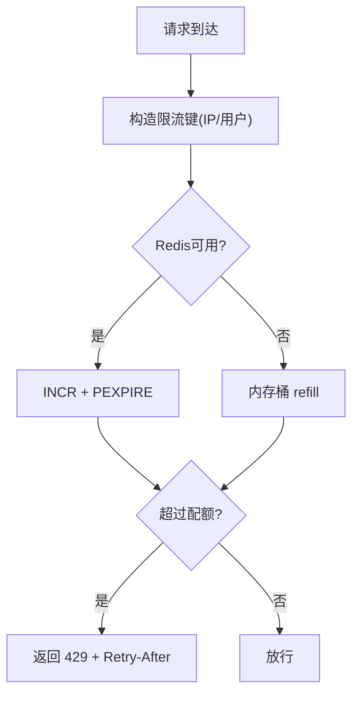
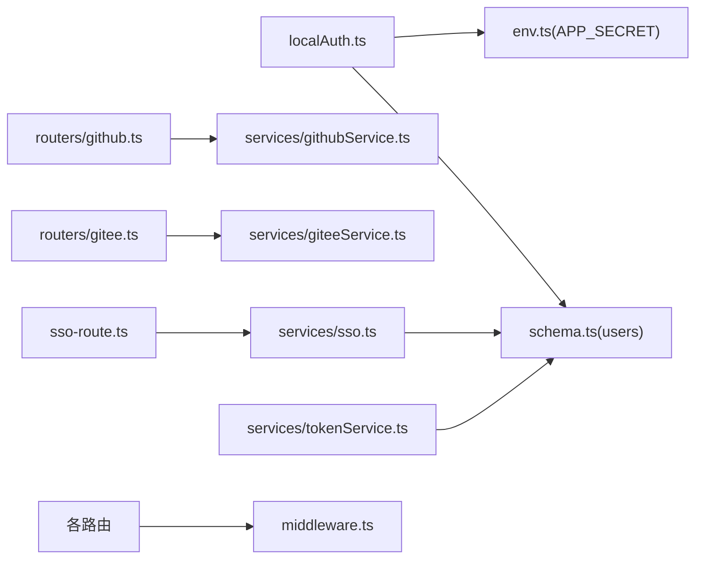

# 用户管理API

<cite>
**本文引用的文件**
- [api/auth-router.ts](file://api/auth-router.ts)
- [api/routers/localAuth.ts](file://api/routers/localAuth.ts)
- [api/routers/github.ts](file://api/routers/github.ts)
- [api/routers/gitee.ts](file://api/routers/gitee.ts)
- [api/sso-route.ts](file://api/sso-route.ts)
- [api/services/sso.ts](file://api/services/sso.ts)
- [api/middleware.ts](file://api/middleware.ts)
- [api/lib/rateLimiter.ts](file://api/lib/rateLimiter.ts)
- [api/services/tokenService.ts](file://api/services/tokenService.ts)
- [db/schema.ts](file://db/schema.ts)
- [api/lib/env.ts](file://api/lib/env.ts)
- [src/hooks/useAuth.ts](file://src/hooks/useAuth.ts)
</cite>

## 目录
1. [简介](#简介)
2. [项目结构](#项目结构)
3. [核心组件](#核心组件)
4. [架构总览](#架构总览)
5. [详细组件分析](#详细组件分析)
6. [依赖关系分析](#依赖关系分析)
7. [性能与可扩展性](#性能与可扩展性)
8. [故障排查指南](#故障排查指南)
9. [结论](#结论)
10. [附录：端点清单与安全最佳实践](#附录端点清单与安全最佳实践)

## 简介
本文件为用户管理API的权威文档，覆盖本地认证、第三方登录（GitHub、Gitee）、企业SSO（OIDC/SAML）、会话与令牌机制、权限控制、速率限制与安全加固。重点说明OAuth 2.1流程、JWT令牌机制、密码加密、用户状态管理与常见错误处理，并提供端到端调用序列图与最佳实践建议。

## 项目结构
用户认证与授权相关代码主要分布在以下模块：
- 路由层：本地认证、GitHub/Gitee集成、企业SSO、通用鉴权路由
- 服务层：SSO协议实现、令牌签发与校验、第三方平台API封装
- 中间件：tRPC过程级鉴权与角色校验
- 基础设施：Redis/内存限流、环境变量配置、数据库Schema
- 前端：本地认证Hook（用于读取/清理本地令牌）

图表来源
- [api/auth-router.ts:1-13](file://api/auth-router.ts#L1-L13)
- [api/routers/localAuth.ts:60-216](file://api/routers/localAuth.ts#L60-L216)
- [api/routers/github.ts:8-136](file://api/routers/github.ts#L8-L136)
- [api/routers/gitee.ts:33-289](file://api/routers/gitee.ts#L33-L289)
- [api/sso-route.ts:108-291](file://api/sso-route.ts#L108-L291)
- [api/services/sso.ts:1-369](file://api/services/sso.ts#L1-L369)
- [api/middleware.ts:17-51](file://api/middleware.ts#L17-L51)
- [api/lib/rateLimiter.ts:64-103](file://api/lib/rateLimiter.ts#L64-L103)
- [api/lib/env.ts:21-35](file://api/lib/env.ts#L21-L35)
- [db/schema.ts:17-51](file://db/schema.ts#L17-L51)

章节来源
- [api/auth-router.ts:1-13](file://api/auth-router.ts#L1-L13)
- [api/routers/localAuth.ts:60-216](file://api/routers/localAuth.ts#L60-L216)
- [api/routers/github.ts:8-136](file://api/routers/github.ts#L8-L136)
- [api/routers/gitee.ts:33-289](file://api/routers/gitee.ts#L33-L289)
- [api/sso-route.ts:108-291](file://api/sso-route.ts#L108-L291)
- [api/services/sso.ts:1-369](file://api/services/sso.ts#L1-L369)
- [api/middleware.ts:17-51](file://api/middleware.ts#L17-L51)
- [api/lib/rateLimiter.ts:64-103](file://api/lib/rateLimiter.ts#L64-L103)
- [api/lib/env.ts:21-35](file://api/lib/env.ts#L21-L35)
- [db/schema.ts:17-51](file://db/schema.ts#L17-L51)

## 核心组件
- 本地认证（用户名/密码）
  - 注册：输入校验、弱口令拦截、bcrypt哈希存储、自动管理员引导（首用户或指定环境变量）
  - 登录：IP级速率限制、密码比对、更新最后登录时间、签发本地JWT
  - 当前用户查询：通过请求头中的本地令牌解析并返回用户信息
  - 等级管理：管理员接口与开发模式切换
- 第三方登录
  - GitHub：令牌校验、仓库列表、项目关联/解绑、文件树读取与创建/更新
  - Gitee：同上，含“我的数据”仓库浏览与调试能力
- 企业SSO（OIDC/SAML）
  - 域名发现、OIDC授权码流程、SAML元数据与ACS回调
  - 无状态state JWT、nonce校验、JWKS远程验证、用户自动供给
- 令牌与会话
  - 本地JWT：HS256，7天有效期，载荷包含userId/username/type
  - OAuth 2.1风格访问令牌：HS256 JWT，受作用域控制；刷新令牌为不透明字符串，哈希存储并支持轮换
- 鉴权与授权
  - tRPC中间件：未认证抛出UNAUTHORIZED；按角色（admin）强制校验
- 速率限制
  - Redis优先、内存降级；针对认证等敏感路径设置严格阈值

章节来源
- [api/routers/localAuth.ts:60-216](file://api/routers/localAuth.ts#L60-L216)
- [api/routers/github.ts:8-136](file://api/routers/github.ts#L8-L136)
- [api/routers/gitee.ts:33-289](file://api/routers/gitee.ts#L33-L289)
- [api/sso-route.ts:108-291](file://api/sso-route.ts#L108-L291)
- [api/services/sso.ts:103-181](file://api/services/sso.ts#L103-L181)
- [api/services/tokenService.ts:34-66](file://api/services/tokenService.ts#L34-L66)
- [api/middleware.ts:17-51](file://api/middleware.ts#L17-L51)
- [api/lib/rateLimiter.ts:64-103](file://api/lib/rateLimiter.ts#L64-L103)

## 架构总览
下图展示从客户端到后端各层的交互：浏览器/客户端通过HTTP调用tRPC路由，路由层调用服务层完成业务逻辑，必要时访问数据库与外部系统（GitHub/Gitee/IdP），并通过中间件进行鉴权与限流。

图表来源
- [api/routers/localAuth.ts:60-216](file://api/routers/localAuth.ts#L60-L216)
- [api/routers/github.ts:8-136](file://api/routers/github.ts#L8-L136)
- [api/routers/gitee.ts:33-289](file://api/routers/gitee.ts#L33-L289)
- [api/sso-route.ts:108-291](file://api/sso-route.ts#L108-L291)
- [api/services/sso.ts:103-181](file://api/services/sso.ts#L103-L181)
- [api/middleware.ts:17-51](file://api/middleware.ts#L17-L51)

## 详细组件分析

### 本地认证（用户名/密码）
- 注册
  - 输入校验：用户名长度、密码强度（拒绝常见弱口令）
  - 安全：bcrypt哈希存储；首次注册用户或匹配特定环境变量的用户可自动提升为管理员
  - 速率限制：按IP限制每分钟尝试次数
  - 返回：本地JWT与用户基本信息
- 登录
  - 速率限制：按IP限制每分钟尝试次数
  - 校验：用户名存在性与密码正确性；更新最后登录时间
  - 返回：本地JWT与用户基本信息
- 当前用户
  - 通过请求头携带的本地令牌解析用户信息
- 等级管理
  - 管理员接口：修改用户等级
  - 开发模式：允许当前用户切换自身等级（生产禁用）

图表来源
- [api/routers/localAuth.ts:60-122](file://api/routers/localAuth.ts#L60-L122)
- [api/routers/localAuth.ts:124-158](file://api/routers/localAuth.ts#L124-L158)
- [api/lib/rateLimiter.ts:64-103](file://api/lib/rateLimiter.ts#L64-L103)

章节来源
- [api/routers/localAuth.ts:60-216](file://api/routers/localAuth.ts#L60-L216)
- [api/lib/rateLimiter.ts:64-103](file://api/lib/rateLimiter.ts#L64-L103)

### 第三方登录（GitHub/Gitee）
- GitHub
  - 令牌校验、仓库列表、项目关联/解绑、文件树读取与创建/更新
- Gitee
  - 令牌校验、仓库列表、项目同步、文件树读取与创建/更新、“我的数据”仓库浏览与调试
- 权限控制
  - 所有操作需已认证用户；项目访问校验（所有者或团队成员）

图表来源
- [api/routers/github.ts:8-136](file://api/routers/github.ts#L8-L136)
- [api/routers/gitee.ts:33-289](file://api/routers/gitee.ts#L33-L289)
- [api/services/githubService.ts:1-124](file://api/services/githubService.ts#L1-L124)
- [api/services/giteeService.ts:1-185](file://api/services/giteeService.ts#L1-L185)

章节来源
- [api/routers/github.ts:8-136](file://api/routers/github.ts#L8-L136)
- [api/routers/gitee.ts:33-289](file://api/routers/gitee.ts#L33-L289)

### 企业SSO（OIDC/SAML）
- 域名发现：根据邮箱/域名匹配启用的SSO连接
- OIDC流程
  - authorize：生成state与nonce，重定向至IdP
  - callback：校验state/nonce，交换code获取id_token，使用JWKS验证签名，提取email/name，查找或供给用户，签发本地JWT并重定向
- SAML流程
  - authorize：生成state与nonce，重定向至IdP
  - metadata：生成SP元数据供IdP配置
  - ACS：校验SAMLResponse，提取profile，查找或供给用户，签发本地JWT并重定向
- 安全要点
  - state JWT短期有效、绑定connectionId与next
  - nonce防重放
  - JWKS缓存减少网络开销
  - 客户端密钥加密存储，仅在交换令牌时解密

图表来源
- [api/sso-route.ts:137-203](file://api/sso-route.ts#L137-L203)
- [api/sso-route.ts:205-287](file://api/sso-route.ts#L205-L287)
- [api/services/sso.ts:103-181](file://api/services/sso.ts#L103-L181)
- [api/services/sso.ts:226-299](file://api/services/sso.ts#L226-L299)
- [api/services/sso.ts:301-357](file://api/services/sso.ts#L301-L357)

章节来源
- [api/sso-route.ts:108-291](file://api/sso-route.ts#L108-L291)
- [api/services/sso.ts:1-369](file://api/services/sso.ts#L1-L369)

### 令牌与会话管理
- 本地JWT（本地认证）
  - 算法：HS256；有效期：7天；载荷：userId、username、type
  - 用途：本地登录后的会话标识
- OAuth 2.1风格访问令牌
  - 算法：HS256；受作用域控制；issuer固定；由APP_SECRET派生密钥
  - 刷新令牌：不透明随机串，哈希存储，支持轮换
- 前端会话
  - 本地存储令牌键名；登出时清除并刷新页面

图表来源
- [api/routers/localAuth.ts:38-54](file://api/routers/localAuth.ts#L38-L54)
- [api/services/tokenService.ts:34-66](file://api/services/tokenService.ts#L34-L66)
- [api/services/tokenService.ts:72-128](file://api/services/tokenService.ts#L72-L128)
- [src/hooks/useAuth.ts:17-21](file://src/hooks/useAuth.ts#L17-L21)

章节来源
- [api/routers/localAuth.ts:38-54](file://api/routers/localAuth.ts#L38-L54)
- [api/services/tokenService.ts:34-66](file://api/services/tokenService.ts#L34-L66)
- [api/services/tokenService.ts:72-128](file://api/services/tokenService.ts#L72-L128)
- [src/hooks/useAuth.ts:17-21](file://src/hooks/useAuth.ts#L17-L21)

### 鉴权与授权
- 中间件
  - 未认证：抛出UNAUTHORIZED
  - 角色校验：仅admin可访问管理员接口
- 项目访问控制
  - 校验项目归属或团队共享成员资格

图表来源
- [api/middleware.ts:17-51](file://api/middleware.ts#L17-L51)
- [api/routers/gitee.ts:11-31](file://api/routers/gitee.ts#L11-L31)

章节来源
- [api/middleware.ts:17-51](file://api/middleware.ts#L17-L51)
- [api/routers/gitee.ts:11-31](file://api/routers/gitee.ts#L11-L31)

### 速率限制与防暴力破解
- 认证路径：每IP每分钟最多5次尝试
- SSO域名查询：每IP每分钟20次
- 实现：Redis固定窗口计数，失败回退到进程内内存桶
- 效果：有效抵御暴力破解与枚举攻击

图表来源
- [api/lib/rateLimiter.ts:64-103](file://api/lib/rateLimiter.ts#L64-L103)
- [api/sso-route.ts:110-117](file://api/sso-route.ts#L110-L117)
- [api/routers/localAuth.ts:68-73](file://api/routers/localAuth.ts#L68-L73)
- [api/routers/localAuth.ts:127-132](file://api/routers/localAuth.ts#L127-L132)

章节来源
- [api/lib/rateLimiter.ts:64-103](file://api/lib/rateLimiter.ts#L64-L103)
- [api/sso-route.ts:110-117](file://api/sso-route.ts#L110-L117)
- [api/routers/localAuth.ts:68-73](file://api/routers/localAuth.ts#L68-L73)
- [api/routers/localAuth.ts:127-132](file://api/routers/localAuth.ts#L127-L132)

## 依赖关系分析
- 路由依赖中间件进行鉴权与角色校验
- 本地认证依赖数据库Schema（users表）与环境变量（APP_SECRET）
- SSO依赖外部IdP（OIDC/SAML）与数据库（ssoConnections/users）
- GitHub/Gitee路由依赖各自的服务层以调用平台API
- 令牌服务依赖APP_SECRET派生的密钥与数据库（刷新令牌表）

图表来源
- [api/routers/localAuth.ts:60-216](file://api/routers/localAuth.ts#L60-L216)
- [api/sso-route.ts:108-291](file://api/sso-route.ts#L108-L291)
- [api/services/sso.ts:1-369](file://api/services/sso.ts#L1-L369)
- [api/routers/github.ts:8-136](file://api/routers/github.ts#L8-L136)
- [api/routers/gitee.ts:33-289](file://api/routers/gitee.ts#L33-L289)
- [api/services/tokenService.ts:34-128](file://api/services/tokenService.ts#L34-L128)
- [api/middleware.ts:17-51](file://api/middleware.ts#L17-L51)
- [db/schema.ts:17-51](file://db/schema.ts#L17-L51)
- [api/lib/env.ts:21-35](file://api/lib/env.ts#L21-L35)

章节来源
- [api/routers/localAuth.ts:60-216](file://api/routers/localAuth.ts#L60-L216)
- [api/sso-route.ts:108-291](file://api/sso-route.ts#L108-L291)
- [api/services/sso.ts:1-369](file://api/services/sso.ts#L1-L369)
- [api/routers/github.ts:8-136](file://api/routers/github.ts#L8-L136)
- [api/routers/gitee.ts:33-289](file://api/routers/gitee.ts#L33-L289)
- [api/services/tokenService.ts:34-128](file://api/services/tokenService.ts#L34-L128)
- [api/middleware.ts:17-51](file://api/middleware.ts#L17-L51)
- [db/schema.ts:17-51](file://db/schema.ts#L17-L51)
- [api/lib/env.ts:21-35](file://api/lib/env.ts#L21-L35)

## 性能与可扩展性
- 速率限制采用Redis固定窗口计数，跨节点共享配额；不可用时优雅降级到内存桶
- OIDC discovery与JWKS缓存降低外部依赖延迟
- 企业SSO在失败时统一重定向到登录页并附带错误键，避免500暴露内部细节
- 令牌签发与校验均为无状态JWT，便于水平扩展

[本节提供通用指导，无需具体文件引用]

## 故障排查指南
- 数据库连接异常
  - 现象：连接被拒绝或字段不存在
  - 处理：提示启动容器与执行数据库迁移
- 数据库模式不同步
  - 现象：未知列或表不存在
  - 处理：执行数据库推送命令
- 速率限制触发
  - 现象：频繁请求被拒
  - 处理：遵循Retry-After提示，降低频率
- SSO错误
  - 现象：回调失败或状态无效
  - 处理：检查state/nonce、IdP配置与回调地址
- 令牌校验失败
  - 现象：访问令牌过期或签名无效
  - 处理：刷新令牌或重新登录

章节来源
- [api/routers/localAuth.ts:23-36](file://api/routers/localAuth.ts#L23-L36)
- [api/sso-route.ts:160-203](file://api/sso-route.ts#L160-L203)
- [api/sso-route.ts:250-287](file://api/sso-route.ts#L250-L287)
- [api/lib/rateLimiter.ts:64-103](file://api/lib/rateLimiter.ts#L64-L103)

## 结论
本用户管理API提供了完善的本地认证、第三方登录与企业SSO能力，结合JWT令牌、角色授权与严格的速率限制，满足多场景下的安全与可用性需求。建议在部署中启用Redis以提升限流一致性，并为生产环境配置强密钥与合适的超时策略。

[本节总结性内容，无需具体文件引用]

## 附录：端点清单与安全最佳实践

### 端点清单（摘要）
- 通用鉴权
  - GET /api/auth/me：返回当前用户（基于上下文）
  - POST /api/auth/logout：注销（本地令牌由客户端管理）
- 本地认证
  - POST /api/localAuth/signup：注册（用户名、密码、可选姓名）
  - POST /api/localAuth/login：登录（用户名、密码）
  - GET /api/localAuth/me：通过x-local-auth-token查询当前用户
  - POST /api/localAuth/setTier：管理员修改用户等级
  - POST /api/localAuth/devTierSwitch：开发模式切换自身等级
- 第三方登录
  - GitHub
    - POST /api/github/validateToken：校验令牌
    - GET /api/github/listRepos：列出仓库
    - POST /api/github/connectProject：关联项目
    - POST /api/github/disconnectProject：解绑项目
    - POST /api/github/syncProject：同步项目
    - GET /api/github/getFileTree：获取文件树
    - POST /api/github/createOrUpdateFile：创建/更新文件
  - Gitee
    - POST /api/gitee/validateToken：校验令牌
    - GET /api/gitee/listRepos：列出仓库
    - POST /api/gitee/syncProject：同步项目
    - GET /api/gitee/getFile：获取文件（需配置令牌）
    - GET /api/gitee/getFileTree：获取文件树
    - POST /api/gitee/createOrUpdateFile：创建/更新文件
    - GET /api/gitee/getMyDataTree：浏览“我的数据”仓库
    - GET /api/gitee/getMyDataFile：读取“我的数据”文件
    - POST /api/gitee/loadFolder：加载文件夹内容
    - GET /api/gitee/debugGitee：调试原始API调用
- 企业SSO
  - GET /api/sso/lookup：域名发现
  - GET /api/sso/oidc/authorize：OIDC授权
  - GET /api/sso/oidc/callback：OIDC回调
  - GET /api/sso/saml/authorize：SAML授权
  - GET /api/sso/saml/metadata/:id：SAML元数据
  - POST /api/sso/saml/acs/:id：SAML ACS

### 请求/响应示例（描述性）
- 本地注册
  - 请求：POST /api/localAuth/signup，主体包含用户名、密码、可选姓名
  - 响应：包含本地JWT与用户基本信息（id、name、username、role、tier）
- 本地登录
  - 请求：POST /api/localAuth/login，主体包含用户名、密码
  - 响应：包含本地JWT与用户基本信息
- 当前用户查询
  - 请求：GET /api/localAuth/me，头部携带x-local-auth-token
  - 响应：用户对象或null
- 企业SSO回调
  - 请求：GET /api/sso/oidc/callback?code=...&state=...
  - 响应：302重定向至/login?sso_token=<jwt>&next=...

### 错误码说明（典型）
- 400：请求参数无效（如缺少必要字段）
- 401：未认证（缺少令牌或令牌无效）
- 403：权限不足（非admin访问管理员接口或功能未启用）
- 404：资源不存在（如SSO连接未启用或配置缺失）
- 429：请求过多（触发速率限制）
- 500：服务器内部错误（如数据库连接失败或模式不同步）

### 安全最佳实践
- 密码安全
  - 使用bcrypt哈希存储；注册时拒绝常见弱口令
- 令牌安全
  - 本地JWT与访问令牌均使用HS256；刷新令牌哈希存储并支持轮换
  - 前端仅将本地令牌存储在内存/cookie，登出时清理
- 速率限制
  - 对认证与SSO域名查询实施严格限流；生产环境启用Redis
- 企业SSO
  - 使用state与nonce防重放；校验IdP签名（JWKS）；客户端密钥加密存储
- 权限控制
  - 使用中间件强制认证与角色校验；项目访问需校验归属或团队共享

[本节为概念性指导，无需具体文件引用]