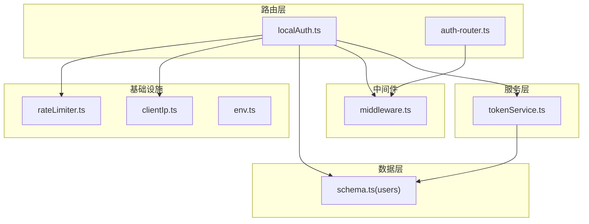
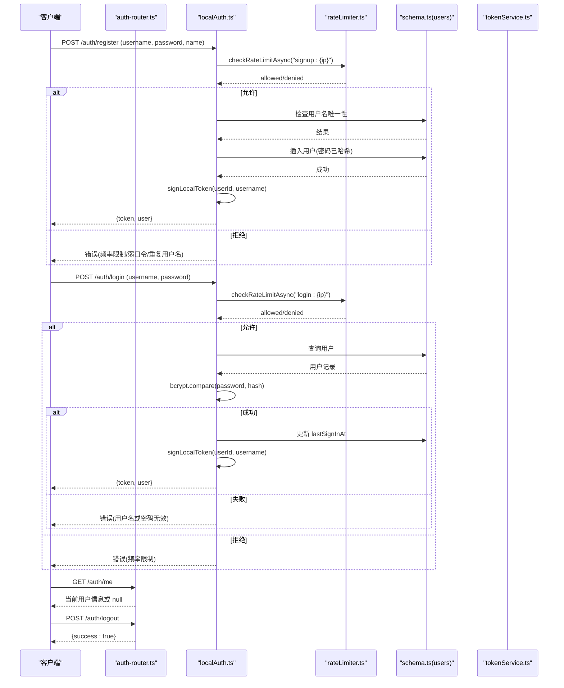
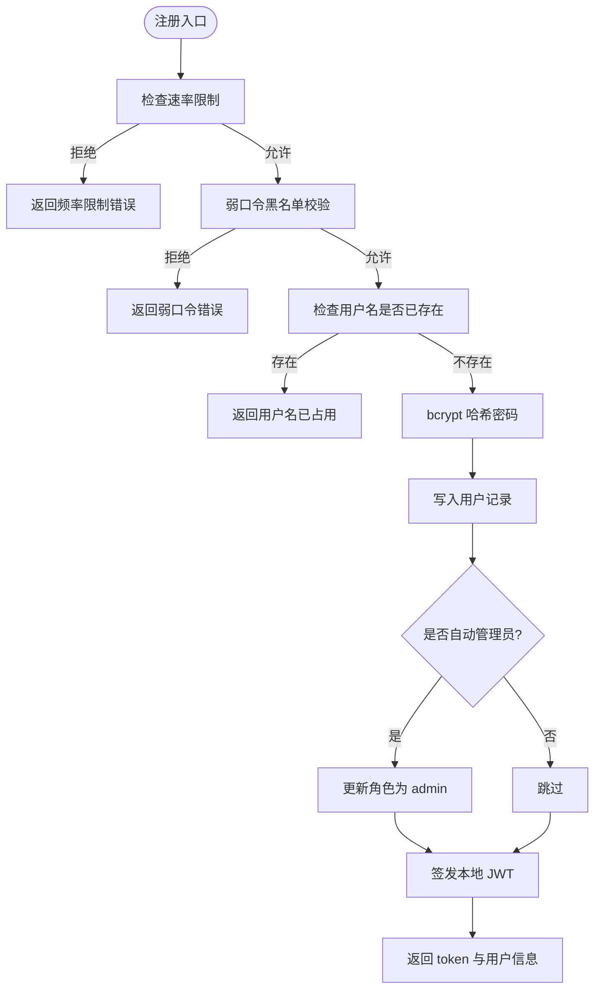
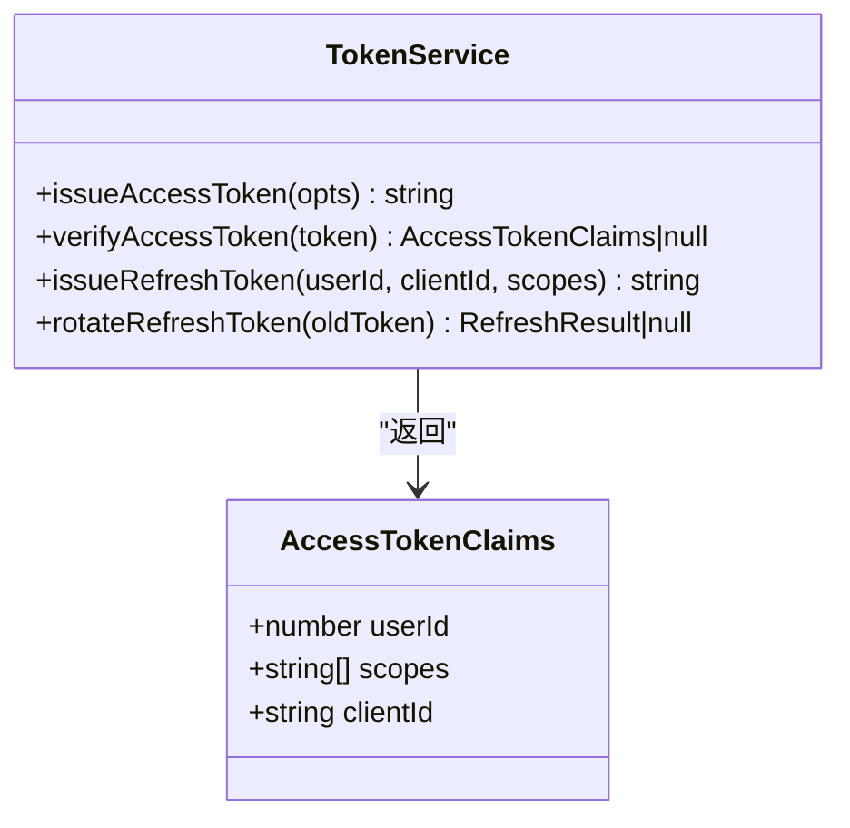
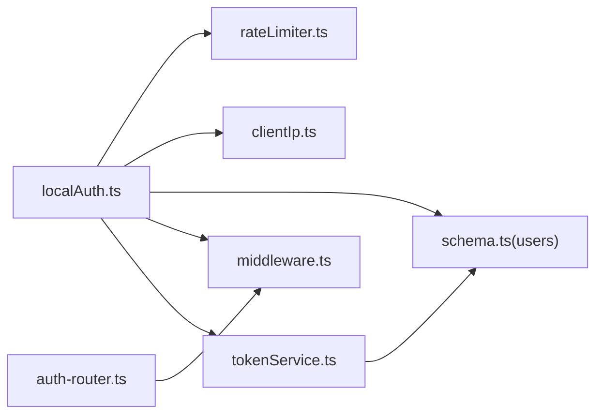

# 用户认证

<cite>
**本文引用的文件**
- [api/routers/localAuth.ts](file://api/routers/localAuth.ts)
- [api/auth-router.ts](file://api/auth-router.ts)
- [api/services/tokenService.ts](file://api/services/tokenService.ts)
- [api/middleware.ts](file://api/middleware.ts)
- [api/lib/rateLimiter.ts](file://api/lib/rateLimiter.ts)
- [api/lib/clientIp.ts](file://api/lib/clientIp.ts)
- [db/schema.ts](file://db/schema.ts)
- [contracts/constants.ts](file://contracts/constants.ts)
</cite>

## 目录
1. [简介](#简介)
2. [项目结构](#项目结构)
3. [核心组件](#核心组件)
4. [架构总览](#架构总览)
5. [详细组件分析](#详细组件分析)
6. [依赖关系分析](#依赖关系分析)
7. [性能与安全考量](#性能与安全考量)
8. [故障排查指南](#故障排查指南)
9. [结论](#结论)
10. [附录：API 端点规范与集成指南](#附录api-端点规范与集成指南)

## 简介
本文件面向“本地认证”能力，覆盖用户注册、登录、密码校验、会话管理、JWT 令牌生成/验证/刷新机制，以及完整的 API 端点规范（/auth/login、/auth/register、/auth/logout）。文档同时说明密码加密算法、安全策略与防暴力破解措施，并提供实际代码路径与集成指引，帮助开发者快速理解并正确集成。

## 项目结构
认证相关代码主要分布在以下模块：
- 路由层：本地认证路由、通用认证路由
- 服务层：OAuth 风格令牌服务（访问令牌与刷新令牌）
- 中间件：tRPC 认证与权限控制
- 基础设施：速率限制、客户端 IP 解析、环境变量
- 数据模型：用户表结构

图表来源
- [api/routers/localAuth.ts:1-216](file://api/routers/localAuth.ts#L1-L216)
- [api/auth-router.ts:1-13](file://api/auth-router.ts#L1-L13)
- [api/services/tokenService.ts:1-129](file://api/services/tokenService.ts#L1-L129)
- [api/middleware.ts:1-51](file://api/middleware.ts#L1-L51)
- [api/lib/rateLimiter.ts:1-216](file://api/lib/rateLimiter.ts#L1-L216)
- [api/lib/clientIp.ts:1-37](file://api/lib/clientIp.ts#L1-L37)
- [db/schema.ts:17-51](file://db/schema.ts#L17-L51)

章节来源
- [api/routers/localAuth.ts:1-216](file://api/routers/localAuth.ts#L1-L216)
- [api/auth-router.ts:1-13](file://api/auth-router.ts#L1-L13)
- [api/services/tokenService.ts:1-129](file://api/services/tokenService.ts#L1-L129)
- [api/middleware.ts:1-51](file://api/middleware.ts#L1-L51)
- [api/lib/rateLimiter.ts:1-216](file://api/lib/rateLimiter.ts#L1-L216)
- [api/lib/clientIp.ts:1-37](file://api/lib/clientIp.ts#L1-L37)
- [db/schema.ts:17-51](file://db/schema.ts#L17-L51)

## 核心组件
- 本地认证路由（localAuth.ts）
  - 提供注册、登录、查询当前用户等能力
  - 使用 bcryptjs 进行密码哈希存储与比对
  - 使用 jose 签发本地 JWT（HS256，有效期 7 天），用于后续鉴权
  - 内置弱口令黑名单与基于 IP 的速率限制
- 通用认证路由（auth-router.ts）
  - 提供 /auth/me、/auth/logout 等通用端点
  - 登出为无状态返回（本地令牌由客户端管理）
- 令牌服务（tokenService.ts）
  - 提供 OAuth 风格的访问令牌与刷新令牌
  - 访问令牌：HS256 JWT，带 scope 与 client_id
  - 刷新令牌：不透明随机串，服务端以 SHA-256 哈希存储，支持轮换
- 中间件（middleware.ts）
  - tRPC 过程级认证与角色校验（UNAUTHORIZED/FORBIDDEN）
- 速率限制（rateLimiter.ts）
  - Redis 优先的固定窗口计数，失败回退到内存桶
  - 预置 auth 等场景的限流配置
- 客户端 IP 解析（clientIp.ts）
  - 根据 TRUSTED_PROXY 决定是否信任 x-forwarded-for/x-real-ip
- 数据模型（schema.ts）
  - users 表包含用户名、密码哈希、角色、层级、最后登录时间等字段

章节来源
- [api/routers/localAuth.ts:1-216](file://api/routers/localAuth.ts#L1-L216)
- [api/auth-router.ts:1-13](file://api/auth-router.ts#L1-L13)
- [api/services/tokenService.ts:1-129](file://api/services/tokenService.ts#L1-L129)
- [api/middleware.ts:1-51](file://api/middleware.ts#L1-L51)
- [api/lib/rateLimiter.ts:1-216](file://api/lib/rateLimiter.ts#L1-L216)
- [api/lib/clientIp.ts:1-37](file://api/lib/clientIp.ts#L1-L37)
- [db/schema.ts:17-51](file://db/schema.ts#L17-L51)

## 架构总览
下图展示本地认证的关键流程：注册时创建用户并签发本地 JWT；登录时校验密码并签发本地 JWT；受保护接口通过中间件校验 JWT；OAuth 访问令牌与刷新令牌由 tokenService 统一管理。

图表来源
- [api/routers/localAuth.ts:60-158](file://api/routers/localAuth.ts#L60-L158)
- [api/auth-router.ts:3-12](file://api/auth-router.ts#L3-L12)
- [api/lib/rateLimiter.ts:64-93](file://api/lib/rateLimiter.ts#L64-L93)
- [db/schema.ts:17-51](file://db/schema.ts#L17-L51)

## 详细组件分析

### 本地认证路由（localAuth.ts）
- 注册（signup）
  - 输入校验：用户名长度、密码强度范围、可选姓名
  - 速率限制：按 IP 限制每分钟尝试次数
  - 弱口令拦截：在哈希前比对常见密码黑名单
  - 数据库操作：检查用户名唯一性、写入用户记录（密码经 bcrypt 哈希）
  - 自动管理员引导：首个用户或匹配特定环境变量时提升为 admin
  - 签发本地 JWT：HS256，含 userId、username、type=local，有效期 7 天
  - 响应：返回 token 与精简用户信息
- 登录（login）
  - 速率限制：按 IP 限制每分钟尝试次数
  - 数据库查询：按用户名获取用户记录
  - 密码校验：bcrypt.compare
  - 更新最后登录时间
  - 自动管理员引导：登录时确保匹配环境变量的用户保持 admin
  - 签发本地 JWT 并返回
- 查询当前用户（me）
  - 从请求头读取本地认证令牌并验证，返回用户对象或 null
- 管理员与开发模式
  - setTier：仅管理员可修改用户层级
  - devTierSwitch：开发模式下允许用户切换自身层级

图表来源
- [api/routers/localAuth.ts:60-122](file://api/routers/localAuth.ts#L60-L122)

章节来源
- [api/routers/localAuth.ts:60-158](file://api/routers/localAuth.ts#L60-L158)

### 通用认证路由（auth-router.ts）
- /auth/me：返回当前上下文中的用户信息（若未登录则为 null）
- /auth/logout：返回成功标记；本地认证为无状态，令牌由客户端管理

章节来源
- [api/auth-router.ts:3-12](file://api/auth-router.ts#L3-L12)

### 令牌服务（tokenService.ts）
- 访问令牌（Access Token）
  - HS256 JWT，包含子项（userId）、作用域（scopes）、客户端标识（clientId）
  - 签发时设置发行者、签发时间、过期时间
  - 验证时严格校验发行者与必要字段，失败返回 null
- 刷新令牌（Refresh Token）
  - 不透明随机字符串，服务端以 SHA-256 哈希存储
  - 支持轮换：旧令牌失效后签发新的访问令牌与刷新令牌对
  - 过期与撤销通过数据库字段控制

图表来源
- [api/services/tokenService.ts:28-66](file://api/services/tokenService.ts#L28-L66)
- [api/services/tokenService.ts:72-129](file://api/services/tokenService.ts#L72-L129)

章节来源
- [api/services/tokenService.ts:1-129](file://api/services/tokenService.ts#L1-L129)

### 中间件与权限控制（middleware.ts）
- 公共过程：publicQuery
- 认证过程：authedQuery（要求 ctx.user 存在且有效）
- 管理员过程：adminQuery（要求 role=admin）
- 错误码：UNAUTHORIZED（未认证）、FORBIDDEN（权限不足）

章节来源
- [api/middleware.ts:17-51](file://api/middleware.ts#L17-L51)

### 速率限制（rateLimiter.ts）
- 实现方式：Redis 固定窗口计数，失败回退到内存桶
- 预置配置：auth（5/min）、execute、batch、read 等
- 客户端维度：支持 per-customer 分层限速（solo/team/admin）

章节来源
- [api/lib/rateLimiter.ts:64-103](file://api/lib/rateLimiter.ts#L64-L103)
- [api/lib/rateLimiter.ts:118-216](file://api/lib/rateLimiter.ts#L118-L216)

### 客户端 IP 解析（clientIp.ts）
- 当启用可信代理时，优先使用 x-forwarded-for/x-real-ip
- 否则直接使用远端地址，避免被伪造头部绕过限流

章节来源
- [api/lib/clientIp.ts:1-37](file://api/lib/clientIp.ts#L1-L37)

### 数据模型（schema.ts）
- users 表关键字段：id、username（唯一）、password_hash、name、role、tier、last_sign_in_at 等
- 索引与约束保证唯一性与查询性能

章节来源
- [db/schema.ts:17-51](file://db/schema.ts#L17-L51)

## 依赖关系分析
- localAuth.ts 依赖：
  - rateLimiter.ts（IP 维度的速率限制）
  - clientIp.ts（真实客户端 IP 解析）
  - schema.ts（users 表读写）
  - middleware.ts（tRPC 过程封装）
  - services/tokenService.ts（OAuth 令牌能力，供扩展使用）
- auth-router.ts 依赖：
  - middleware.ts（统一认证上下文）
- tokenService.ts 依赖：
  - schema.ts（oauth_refresh_tokens 表）
  - env.ts（APP_SECRET 派生密钥）

图表来源
- [api/routers/localAuth.ts:1-216](file://api/routers/localAuth.ts#L1-L216)
- [api/auth-router.ts:1-13](file://api/auth-router.ts#L1-L13)
- [api/services/tokenService.ts:1-129](file://api/services/tokenService.ts#L1-L129)
- [api/middleware.ts:1-51](file://api/middleware.ts#L1-L51)
- [api/lib/rateLimiter.ts:1-216](file://api/lib/rateLimiter.ts#L1-L216)
- [api/lib/clientIp.ts:1-37](file://api/lib/clientIp.ts#L1-L37)
- [db/schema.ts:17-51](file://db/schema.ts#L17-L51)

章节来源
- [api/routers/localAuth.ts:1-216](file://api/routers/localAuth.ts#L1-L216)
- [api/auth-router.ts:1-13](file://api/auth-router.ts#L1-L13)
- [api/services/tokenService.ts:1-129](file://api/services/tokenService.ts#L1-L129)
- [api/middleware.ts:1-51](file://api/middleware.ts#L1-L51)
- [api/lib/rateLimiter.ts:1-216](file://api/lib/rateLimiter.ts#L1-L216)
- [api/lib/clientIp.ts:1-37](file://api/lib/clientIp.ts#L1-L37)
- [db/schema.ts:17-51](file://db/schema.ts#L17-L51)

## 性能与安全考量
- 性能
  - 速率限制采用 Redis 固定窗口计数，跨节点共享预算；不可用时降级为内存桶，不影响可用性
  - 登录/注册路径对数据库进行最小化查询与写入，减少锁竞争
  - JWT 签发/验证为轻量计算，适合高并发
- 安全
  - 密码存储：bcrypt 哈希，默认成本因子 10
  - 弱口令防护：注册阶段比对常见密码黑名单
  - 令牌安全：本地 JWT 使用 HS256，有效期 7 天；OAuth 访问令牌带 scope 与 client_id，刷新令牌不透明且哈希存储
  - 防暴力破解：登录/注册按 IP 限制每分钟尝试次数；客户端 IP 解析尊重可信代理配置，防止伪造头部绕过
  - 环境变量校验：生产环境禁止使用已知不安全默认值

[本节为通用指导，无需具体文件引用]

## 故障排查指南
- 数据库连接异常
  - 现象：报错包含连接或套接字相关错误
  - 处理：确认数据库容器运行并执行数据库迁移命令
- 数据库模式不同步
  - 现象：报错包含未知列或表不存在
  - 处理：执行数据库同步命令以对齐模式
- 频率限制触发
  - 现象：短时间内多次注册/登录被拒绝
  - 处理：等待重试间隔后再试，或调整客户端重试策略
- 认证失败
  - 现象：/auth/me 返回 null 或受保护接口返回未认证
  - 处理：检查本地 JWT 是否有效、是否携带正确的请求头

章节来源
- [api/routers/localAuth.ts:23-36](file://api/routers/localAuth.ts#L23-L36)
- [api/lib/rateLimiter.ts:64-93](file://api/lib/rateLimiter.ts#L64-L93)

## 结论
本地认证通过“速率限制 + 弱口令拦截 + bcrypt 密码哈希 + JWT 令牌”的组合，提供了安全、可扩展的用户认证方案。配合中间件的权限控制与 OAuth 令牌服务，系统既能满足本地账号体系，又具备向标准 OAuth 2.1 演进的能力。建议在生产环境中严格配置环境变量、启用可信代理、合理设置令牌有效期与刷新策略，并持续监控速率限制与认证失败日志。

[本节为总结，无需具体文件引用]

## 附录：API 端点规范与集成指南

### 端点总览
- /auth/register（注册）
  - 方法：POST（tRPC mutation）
  - 请求体：username（字符串，3-50 字符）、password（字符串，8-100 字符）、name（可选）
  - 响应：{ token, user: { id, name, username, role, tier } }
  - 错误：频率限制、弱口令、用户名已占用、数据库异常
- /auth/login（登录）
  - 方法：POST（tRPC mutation）
  - 请求体：username（字符串）、password（字符串）
  - 响应：{ token, user: { id, name, username, role, tier } }
  - 错误：频率限制、用户名或密码无效、数据库异常
- /auth/me（当前用户）
  - 方法：GET（tRPC query）
  - 响应：用户对象或 null
- /auth/logout（登出）
  - 方法：POST（tRPC mutation）
  - 响应：{ success: true }

章节来源
- [api/routers/localAuth.ts:60-158](file://api/routers/localAuth.ts#L60-L158)
- [api/auth-router.ts:3-12](file://api/auth-router.ts#L3-L12)

### 请求参数与响应格式
- 注册
  - 入参：username、password、name（可选）
  - 出参：token（本地 JWT）、user（精简信息）
- 登录
  - 入参：username、password
  - 出参：token（本地 JWT）、user（精简信息）
- 当前用户
  - 出参：用户对象或 null
- 登出
  - 出参：success 布尔

章节来源
- [api/routers/localAuth.ts:60-158](file://api/routers/localAuth.ts#L60-L158)
- [api/auth-router.ts:3-12](file://api/auth-router.ts#L3-L12)

### 错误码与处理逻辑
- UNAUTHORIZED：未提供有效认证信息
- FORBIDDEN：权限不足（如非管理员调用管理员接口）
- 业务错误：频率限制、弱口令、用户名已占用、数据库异常等

章节来源
- [api/middleware.ts:17-51](file://api/middleware.ts#L17-L51)
- [api/routers/localAuth.ts:60-158](file://api/routers/localAuth.ts#L60-L158)

### 密码加密算法与安全策略
- 密码哈希：bcrypt（成本因子 10）
- 弱口令拦截：注册阶段比对常见密码黑名单
- 令牌安全：本地 JWT（HS256，7 天）；OAuth 访问令牌（HS256，带 scope 与 client_id）；刷新令牌（不透明，哈希存储，支持轮换）
- 防暴力破解：按 IP 限制每分钟尝试次数；客户端 IP 解析遵循可信代理策略

章节来源
- [api/routers/localAuth.ts:15-21](file://api/routers/localAuth.ts#L15-L21)
- [api/routers/localAuth.ts:60-158](file://api/routers/localAuth.ts#L60-L158)
- [api/services/tokenService.ts:28-66](file://api/services/tokenService.ts#L28-L66)
- [api/services/tokenService.ts:72-129](file://api/services/tokenService.ts#L72-L129)
- [api/lib/rateLimiter.ts:64-103](file://api/lib/rateLimiter.ts#L64-L103)
- [api/lib/clientIp.ts:1-37](file://api/lib/clientIp.ts#L1-L37)

### 会话管理与令牌刷新
- 本地认证会话：基于客户端管理的本地 JWT；登出为无状态返回
- OAuth 令牌刷新：通过刷新令牌换取新的访问令牌与刷新令牌对；旧刷新令牌立即失效

章节来源
- [api/auth-router.ts:3-12](file://api/auth-router.ts#L3-L12)
- [api/services/tokenService.ts:91-129](file://api/services/tokenService.ts#L91-L129)

### 集成指南（示例路径）
- 注册流程
  - 参考：[api/routers/localAuth.ts:60-122](file://api/routers/localAuth.ts#L60-L122)
- 登录流程
  - 参考：[api/routers/localAuth.ts:124-158](file://api/routers/localAuth.ts#L124-L158)
- 查询当前用户
  - 参考：[api/auth-router.ts:3-12](file://api/auth-router.ts#L3-L12)
- 登出
  - 参考：[api/auth-router.ts:7-12](file://api/auth-router.ts#L7-L12)
- 速率限制与 IP 解析
  - 参考：[api/lib/rateLimiter.ts:64-103](file://api/lib/rateLimiter.ts#L64-L103)、[api/lib/clientIp.ts:1-37](file://api/lib/clientIp.ts#L1-L37)
- 数据模型
  - 参考：[db/schema.ts:17-51](file://db/schema.ts#L17-L51)

[本节为集成指引，无需额外图示]