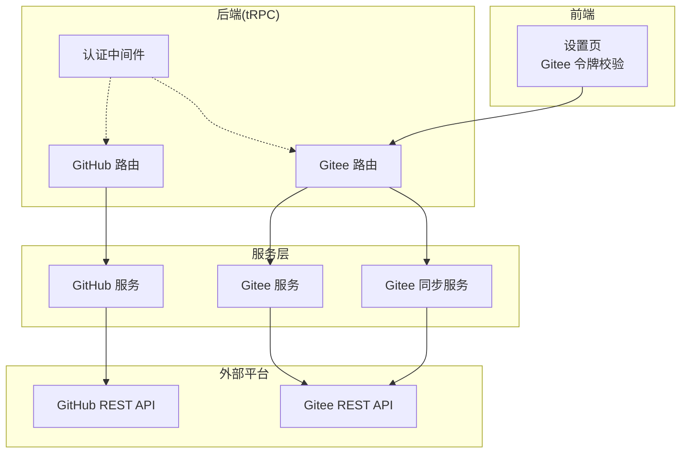
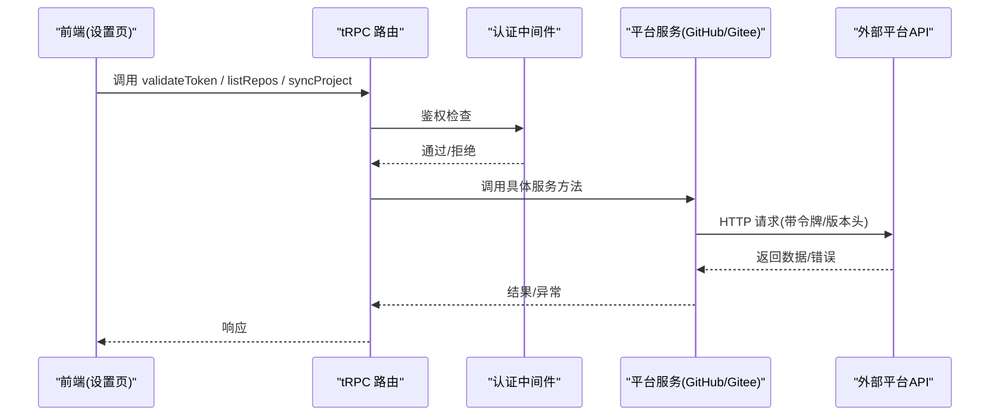
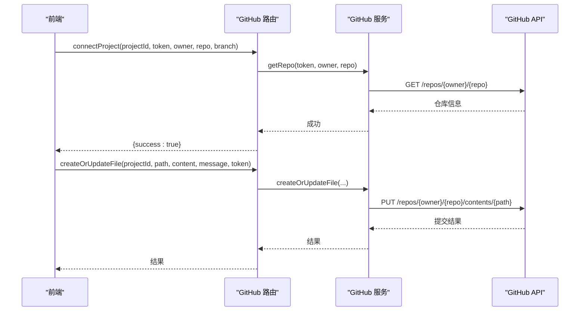
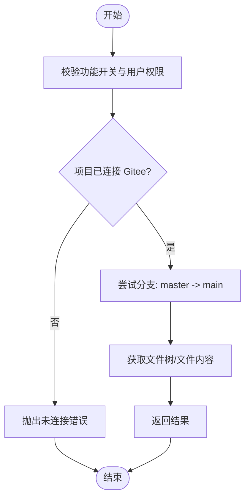
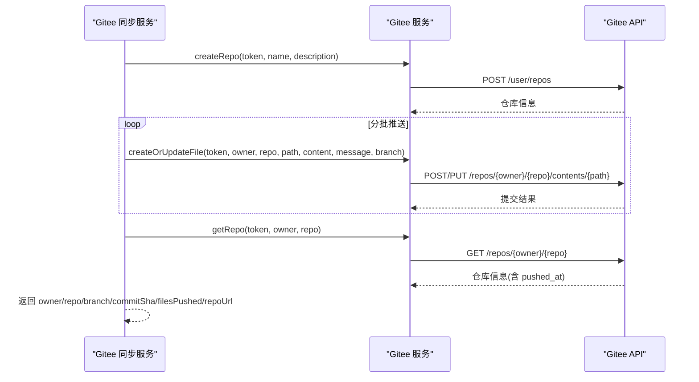
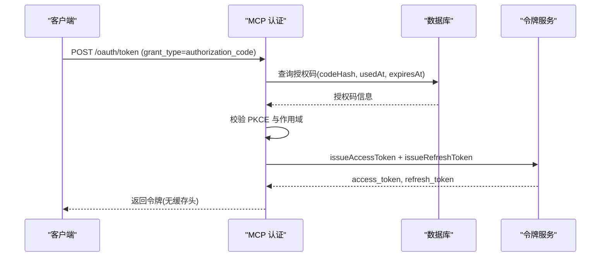
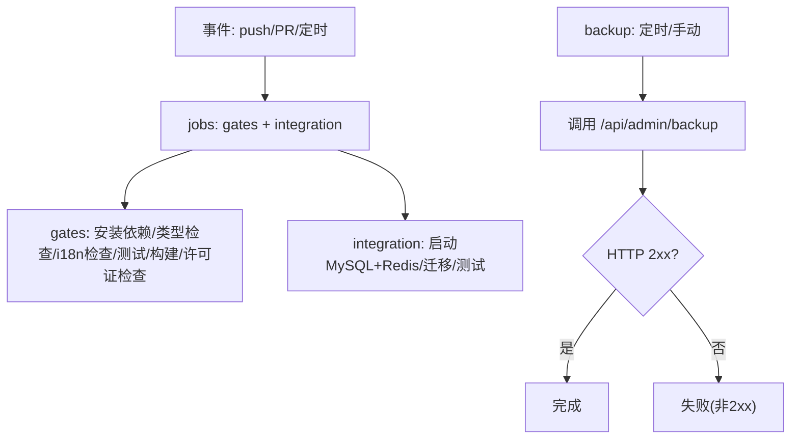
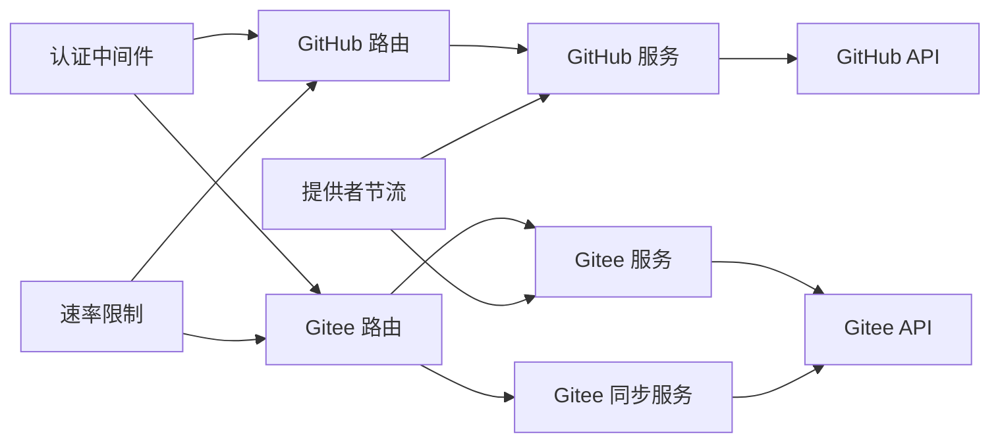
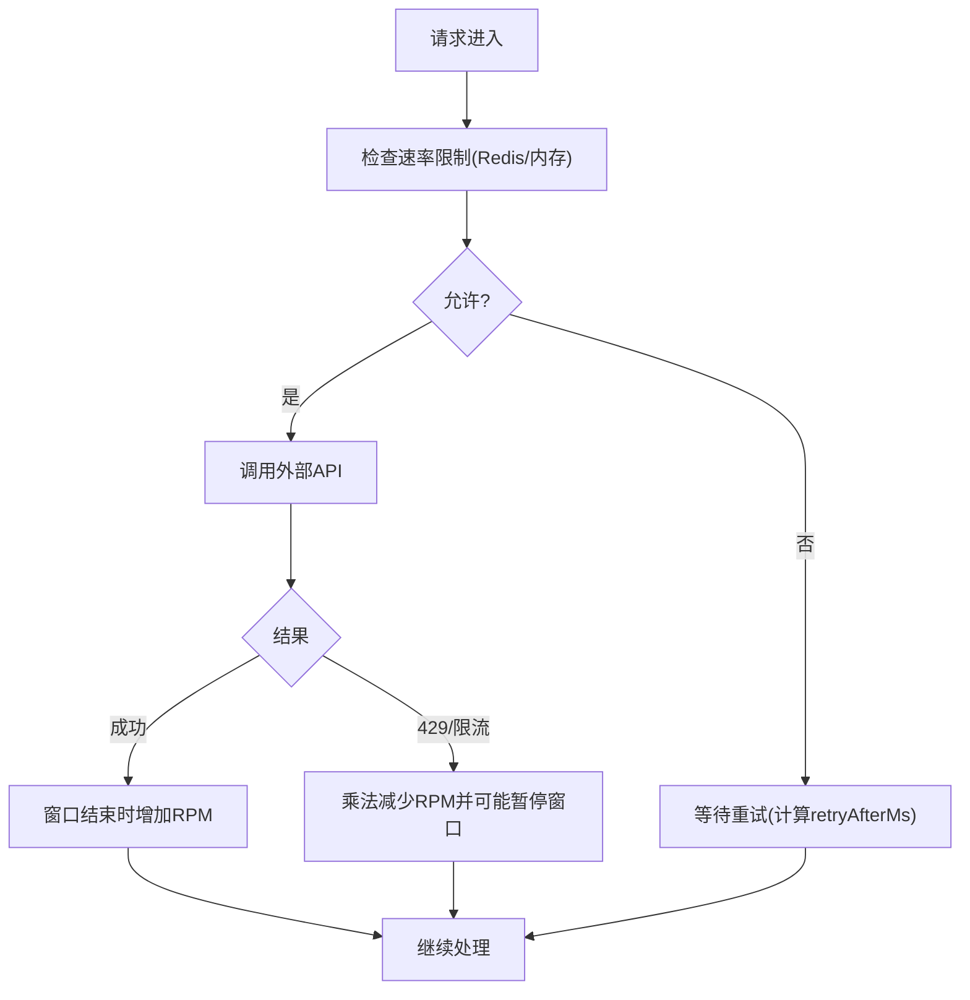

# 代码仓库集成

<cite>
**本文引用的文件**
- [api/routers/github.ts](file://api/routers/github.ts)
- [api/routers/gitee.ts](file://api/routers/gitee.ts)
- [api/services/githubService.ts](file://api/services/githubService.ts)
- [api/services/giteeService.ts](file://api/services/giteeService.ts)
- [api/services/giteeSync.ts](file://api/services/giteeSync.ts)
- [api/lib/rateLimiter.ts](file://api/lib/rateLimiter.ts)
- [api/lib/providerThrottle.ts](file://api/lib/providerThrottle.ts)
- [api/services/tokenService.ts](file://api/services/tokenService.ts)
- [api/middleware.ts](file://api/middleware.ts)
- [src/pages/Settings.tsx](file://src/pages/Settings.tsx)
- [.github/workflows/ci.yml](file://.github/workflows/ci.yml)
- [.github/workflows/backup.yml](file://.github/workflows/backup.yml)
</cite>

## 目录
1. [简介](#简介)
2. [项目结构](#项目结构)
3. [核心组件](#核心组件)
4. [架构总览](#架构总览)
5. [详细组件分析](#详细组件分析)
6. [依赖关系分析](#依赖关系分析)
7. [性能与限流](#性能与限流)
8. [故障排查指南](#故障排查指南)
9. [结论](#结论)
10. [附录](#附录)

## 简介
本技术文档聚焦于代码仓库集成的完整实现，覆盖 GitHub 与 Gitee 的 OAuth 认证、API 调用封装、Webhook（通过 CI 触发）处理机制，以及仓库发现、克隆、推送与拉取操作。同时说明分支管理、标签操作、Pull Request 处理能力边界，CI/CD 触发器配置、构建状态同步与部署自动化策略。文档还包含速率限制处理、错误重试与异常恢复机制，以及安全考虑、令牌管理与权限控制的最佳实践。

## 项目结构
本项目在后端以 tRPC 路由组织 API，按平台拆分服务层：
- GitHub 集成：路由在 api/routers/github.ts，服务封装在 api/services/githubService.ts
- Gitee 集成：路由在 api/routers/gitee.ts，服务封装在 api/services/giteeService.ts；批量同步逻辑在 api/services/giteeSync.ts
- 速率限制：统一在 api/lib/rateLimiter.ts，提供进程内与 Redis 双路径
- 提供者节流：自适应 AIMD 算法在 api/lib/providerThrottle.ts
- 令牌服务：OAuth 2.1 风格访问令牌与刷新令牌在 api/services/tokenService.ts
- 前端设置页：Gitee 令牌校验与保存于 src/pages/Settings.tsx
- CI/CD：GitHub Actions 工作流位于 .github/workflows/

**图表来源**
- [api/routers/github.ts:1-136](file://api/routers/github.ts#L1-L136)
- [api/routers/gitee.ts:1-289](file://api/routers/gitee.ts#L1-L289)
- [api/services/githubService.ts:1-124](file://api/services/githubService.ts#L1-L124)
- [api/services/giteeService.ts:1-185](file://api/services/giteeService.ts#L1-L185)
- [api/services/giteeSync.ts:1-129](file://api/services/giteeSync.ts#L1-L129)
- [api/middleware.ts:1-51](file://api/middleware.ts#L1-L51)
- [src/pages/Settings.tsx:458-494](file://src/pages/Settings.tsx#L458-L494)

**章节来源**
- [api/routers/github.ts:1-136](file://api/routers/github.ts#L1-L136)
- [api/routers/gitee.ts:1-289](file://api/routers/gitee.ts#L1-L289)
- [api/services/githubService.ts:1-124](file://api/services/githubService.ts#L1-L124)
- [api/services/giteeService.ts:1-185](file://api/services/giteeService.ts#L1-L185)
- [api/services/giteeSync.ts:1-129](file://api/services/giteeSync.ts#L1-L129)
- [api/middleware.ts:1-51](file://api/middleware.ts#L1-L51)
- [src/pages/Settings.tsx:458-494](file://src/pages/Settings.tsx#L458-L494)

## 核心组件
- GitHub 路由与服务：提供令牌校验、仓库列表、连接/断开项目、获取文件树、创建或更新文件等能力。
- Gitee 路由与服务：提供令牌校验、仓库列表、项目同步、文件读取/写入、My Data 浏览（swarm-studio 仓库）、调试接口等。
- Gitee 同步服务：自动创建仓库、分批推送文件、记录提交信息、并行拉取文件。
- 速率限制：固定窗口计数器（Redis 优先，内存降级），支持按客户分层的配额。
- 提供者节流：AIMD 自适应速率控制，持久化到 Redis，失败回退到内存。
- 令牌服务：签发与验证 HS256 JWT 访问令牌，签发与旋转不透明刷新令牌。
- 认证中间件：tRPC 鉴权与角色检查。
- 前端设置页：用户输入并校验 Gitee 令牌，成功后保存到本地存储。

**章节来源**
- [api/routers/github.ts:1-136](file://api/routers/github.ts#L1-L136)
- [api/routers/gitee.ts:1-289](file://api/routers/gitee.ts#L1-L289)
- [api/services/giteeSync.ts:1-129](file://api/services/giteeSync.ts#L1-L129)
- [api/lib/rateLimiter.ts:1-216](file://api/lib/rateLimiter.ts#L1-L216)
- [api/lib/providerThrottle.ts:1-275](file://api/lib/providerThrottle.ts#L1-L275)
- [api/services/tokenService.ts:1-129](file://api/services/tokenService.ts#L1-L129)
- [api/middleware.ts:1-51](file://api/middleware.ts#L1-L51)
- [src/pages/Settings.tsx:458-494](file://src/pages/Settings.tsx#L458-L494)

## 架构总览
下图展示了从前端到后端再到外部平台的请求链路，包括鉴权、路由分发、服务调用与外部 API 交互。

**图表来源**
- [api/middleware.ts:17-51](file://api/middleware.ts#L17-L51)
- [api/routers/github.ts:8-136](file://api/routers/github.ts#L8-L136)
- [api/routers/gitee.ts:33-289](file://api/routers/gitee.ts#L33-L289)
- [api/services/githubService.ts:8-124](file://api/services/githubService.ts#L8-L124)
- [api/services/giteeService.ts:3-185](file://api/services/giteeService.ts#L3-L185)

## 详细组件分析

### GitHub 集成
- 令牌校验与仓库列表：通过 GitHub REST API v3 获取当前用户信息与仓库列表。
- 项目连接/断开：将项目的 owner、repo、branch 持久化到数据库，并在连接前校验仓库存在性与访问权限。
- 文件树与文件读写：支持列出目录内容、读取文件内容（base64 解码）、创建或更新文件（PUT，含 sha 时更新）。

**图表来源**
- [api/routers/github.ts:21-46](file://api/routers/github.ts#L21-L46)
- [api/routers/github.ts:108-134](file://api/routers/github.ts#L108-L134)
- [api/services/githubService.ts:17-33](file://api/services/githubService.ts#L17-L33)
- [api/services/githubService.ts:60-101](file://api/services/githubService.ts#L60-L101)

**章节来源**
- [api/routers/github.ts:1-136](file://api/routers/github.ts#L1-L136)
- [api/services/githubService.ts:1-124](file://api/services/githubService.ts#L1-L124)

### Gitee 集成
- 令牌校验与仓库列表：使用 Gitee API v5，校验令牌有效性并列出个人仓库。
- 项目同步：标记 lastSyncedAt，预留双向同步扩展点。
- 文件读取/写入：支持获取文件树、读取文件内容、创建或更新文件（POST/PUT，根据是否存在 sha）。
- My Data 浏览：查找 swarm-studio 仓库，尝试 master/main 分支，返回文件或目录内容。
- 调试接口：输出各分支的文件树与错误信息，便于定位问题。

**图表来源**
- [api/routers/gitee.ts:33-171](file://api/routers/gitee.ts#L33-L171)
- [api/services/giteeService.ts:18-98](file://api/services/giteeService.ts#L18-L98)

**章节来源**
- [api/routers/gitee.ts:1-289](file://api/routers/gitee.ts#L1-L289)
- [api/services/giteeService.ts:1-185](file://api/services/giteeService.ts#L1-L185)

### Gitee 同步服务（批量推送与拉取）
- 自动创建仓库：生成唯一仓库名，初始化 README 以便有默认分支。
- 分批推送：每批 10 个文件，批次间延迟 500ms 以尊重速率限制。
- 记录提交信息：尝试获取最新提交时间戳作为 commitSha。
- 并行拉取：使用 Promise.allSettled 并发获取多个文件，过滤失败项。

**图表来源**
- [api/services/giteeSync.ts:26-93](file://api/services/giteeSync.ts#L26-L93)
- [api/services/giteeService.ts:121-146](file://api/services/giteeService.ts#L121-L146)
- [api/services/giteeService.ts:55-98](file://api/services/giteeService.ts#L55-L98)

**章节来源**
- [api/services/giteeSync.ts:1-129](file://api/services/giteeSync.ts#L1-L129)
- [api/services/giteeService.ts:1-185](file://api/services/giteeService.ts#L1-L185)

### 令牌与安全（OAuth 2.1 风格）
- 访问令牌：HS256 JWT，包含 userId、scopes、clientId，默认 TTL 1 小时。
- 刷新令牌：不透明随机字符串，SHA-256 哈希存储，支持旋转（撤销旧令牌并签发新对）。
- 授权码流程：PKCE S256，一次性授权码，校验 client_id、redirect_uri、code_verifier，作用域交集授权。
- 前端设置页：用户输入 Gitee 令牌，调用后端 validateToken，成功后保存到 localStorage。

**图表来源**
- [api/mcp/auth.ts:337-409](file://api/mcp/auth.ts#L337-L409)
- [api/services/tokenService.ts:34-66](file://api/services/tokenService.ts#L34-L66)
- [api/services/tokenService.ts:72-129](file://api/services/tokenService.ts#L72-L129)
- [src/pages/Settings.tsx:458-494](file://src/pages/Settings.tsx#L458-L494)

**章节来源**
- [api/services/tokenService.ts:1-129](file://api/services/tokenService.ts#L1-L129)
- [api/mcp/auth.ts:314-409](file://api/mcp/auth.ts#L314-L409)
- [src/pages/Settings.tsx:458-494](file://src/pages/Settings.tsx#L458-L494)

### CI/CD 触发器与构建状态同步
- CI 工作流：push/PR 触发，执行类型检查、国际化键一致性检查、单元测试、生产构建，并阻止包含占位符联系信息的合并。
- 集成测试：启动 MySQL 与 Redis 容器，执行数据库迁移与测试用例。
- 备份工作流：定时任务调用应用备份端点，若未配置则静默跳过，避免告警疲劳。

**图表来源**
- [.github/workflows/ci.yml:1-96](file://.github/workflows/ci.yml#L1-L96)
- [.github/workflows/backup.yml:1-46](file://.github/workflows/backup.yml#L1-L46)

**章节来源**
- [.github/workflows/ci.yml:1-96](file://.github/workflows/ci.yml#L1-L96)
- [.github/workflows/backup.yml:1-46](file://.github/workflows/backup.yml#L1-L46)

## 依赖关系分析
- 路由依赖服务：GitHub/Gitee 路由分别依赖对应服务进行 API 调用。
- 服务依赖外部 API：直接调用 GitHub/Gitee REST API，携带必要的认证头与版本标识。
- 中间件提供鉴权：tRPC 中间件确保请求来自已认证用户，并可附加角色检查。
- 速率限制与节流：全局速率限制与提供者节流为服务调用提供保护与自适应控制。
- 令牌服务被认证流程使用：签发与验证访问令牌，支撑 OAuth 流程。

**图表来源**
- [api/middleware.ts:17-51](file://api/middleware.ts#L17-L51)
- [api/routers/github.ts:1-136](file://api/routers/github.ts#L1-L136)
- [api/routers/gitee.ts:1-289](file://api/routers/gitee.ts#L1-L289)
- [api/services/githubService.ts:1-124](file://api/services/githubService.ts#L1-L124)
- [api/services/giteeService.ts:1-185](file://api/services/giteeService.ts#L1-L185)
- [api/services/giteeSync.ts:1-129](file://api/services/giteeSync.ts#L1-L129)
- [api/lib/rateLimiter.ts:1-216](file://api/lib/rateLimiter.ts#L1-L216)
- [api/lib/providerThrottle.ts:1-275](file://api/lib/providerThrottle.ts#L1-L275)

**章节来源**
- [api/middleware.ts:1-51](file://api/middleware.ts#L1-L51)
- [api/routers/github.ts:1-136](file://api/routers/github.ts#L1-L136)
- [api/routers/gitee.ts:1-289](file://api/routers/gitee.ts#L1-L289)
- [api/services/githubService.ts:1-124](file://api/services/githubService.ts#L1-L124)
- [api/services/giteeService.ts:1-185](file://api/services/giteeService.ts#L1-L185)
- [api/services/giteeSync.ts:1-129](file://api/services/giteeSync.ts#L1-L129)
- [api/lib/rateLimiter.ts:1-216](file://api/lib/rateLimiter.ts#L1-L216)
- [api/lib/providerThrottle.ts:1-275](file://api/lib/providerThrottle.ts#L1-L275)

## 性能与限流
- 固定窗口速率限制：基于 Redis 的 INCR + PEXPIRE 实现跨节点共享配额；不可用时降级为进程内内存计数。
- 客户分层配额：solo/team/admin 三种层级，分别限制每分钟请求数。
- 提供者节流（AIMD）：根据 429 信号动态调整 RPM，支持慢启动、冷却期与最小值保护；状态持久化到 Redis，失败回退内存。
- 批量同步限速：Gitee 同步服务分批推送，批次间延迟以避免触发平台速率限制。

**图表来源**
- [api/lib/rateLimiter.ts:31-93](file://api/lib/rateLimiter.ts#L31-L93)
- [api/lib/rateLimiter.ts:198-216](file://api/lib/rateLimiter.ts#L198-L216)
- [api/lib/providerThrottle.ts:168-235](file://api/lib/providerThrottle.ts#L168-L235)
- [api/services/giteeSync.ts:43-72](file://api/services/giteeSync.ts#L43-L72)

**章节来源**
- [api/lib/rateLimiter.ts:1-216](file://api/lib/rateLimiter.ts#L1-L216)
- [api/lib/providerThrottle.ts:1-275](file://api/lib/providerThrottle.ts#L1-L275)
- [api/services/giteeSync.ts:1-129](file://api/services/giteeSync.ts#L1-L129)

## 故障排查指南
- 令牌无效：前端设置页调用 validateToken 失败时提示无效令牌；检查后端返回与网络连通性。
- 项目未连接：路由中检查项目是否已绑定平台仓库信息，未绑定则抛出错误。
- 分支兼容：Gitee 默认分支历史变化，代码会尝试 master/main 两个分支。
- 速率限制：当触发 429 或配额耗尽，查看 retryAfterMs 与日志中的限流信息；确认 Redis 可用性与阈值配置。
- 提供者节流：观察 AIMD 状态与 RPM 变化；若持续降速，检查外部平台限流信号与重试策略。
- CI 失败：检查类型检查、i18n 键一致性、测试与构建步骤；备份工作流在未配置 BACKUP_TOKEN 时会静默跳过。

**章节来源**
- [api/routers/gitee.ts:76-103](file://api/routers/gitee.ts#L76-L103)
- [api/routers/gitee.ts:105-137](file://api/routers/gitee.ts#L105-L137)
- [api/routers/gitee.ts:173-225](file://api/routers/gitee.ts#L173-L225)
- [api/lib/rateLimiter.ts:198-216](file://api/lib/rateLimiter.ts#L198-L216)
- [api/lib/providerThrottle.ts:207-235](file://api/lib/providerThrottle.ts#L207-L235)
- [.github/workflows/ci.yml:1-96](file://.github/workflows/ci.yml#L1-L96)
- [.github/workflows/backup.yml:1-46](file://.github/workflows/backup.yml#L1-L46)

## 结论
本项目实现了 GitHub 与 Gitee 的代码仓库集成，涵盖 OAuth 认证、API 封装、仓库发现与文件操作、批量同步与并行拉取，并通过 CI/CD 工作流保障质量与备份。速率限制与提供者节流提供了稳定的吞吐与弹性恢复能力。建议在生产环境中完善 Webhook 回调与 Pull Request 处理流程，增强分支与标签管理能力，并持续优化令牌轮换与权限控制策略。

## 附录
- 最佳实践
  - 令牌管理：使用短期访问令牌与可旋转的刷新令牌；前端仅临时持有平台令牌用于校验与操作。
  - 权限控制：路由层校验用户身份与项目访问权限；结合团队共享项目表进行细粒度控制。
  - 安全考虑：对外部 API 调用添加必要的安全头与版本标识；对敏感信息使用环境变量与密钥派生。
  - 错误处理：区分计费类错误与临时限流错误；对限流采用重试与重入队列，避免误判为余额不足。
  - 性能优化：批量操作分批执行并加入延迟；并行拉取时使用 allSettled 容忍部分失败。

[本节为通用指导，不直接分析具体文件]