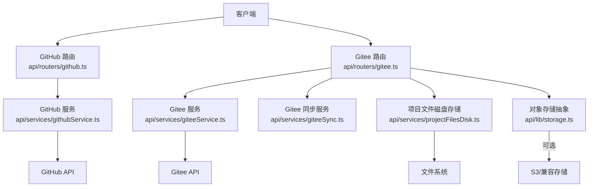
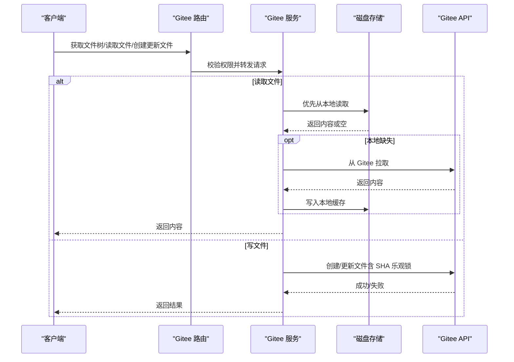
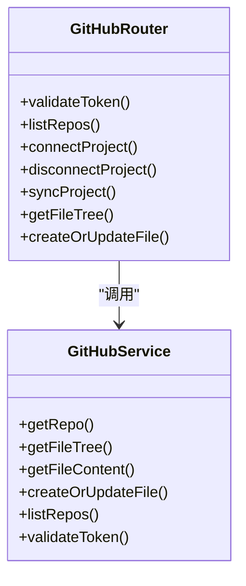
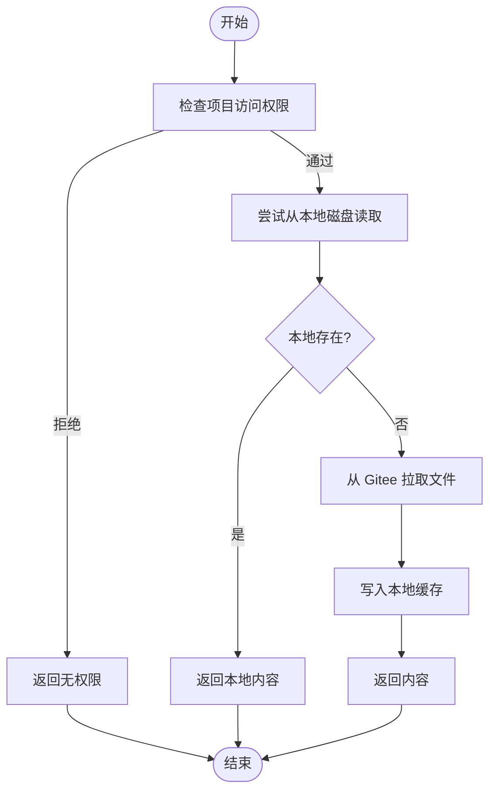
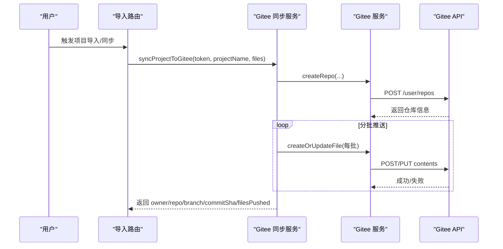
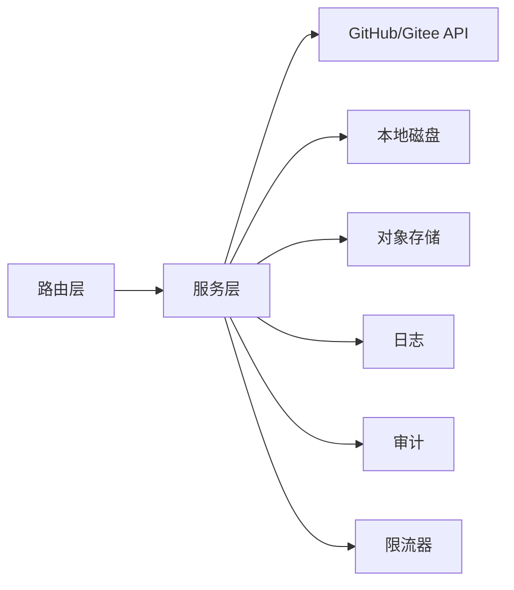

# 文件同步集成

<cite>
**本文引用的文件**
- [api/routers/github.ts](file://api/routers/github.ts)
- [api/routers/gitee.ts](file://api/routers/gitee.ts)
- [api/services/githubService.ts](file://api/services/githubService.ts)
- [api/services/giteeService.ts](file://api/services/giteeService.ts)
- [api/services/giteeSync.ts](file://api/services/giteeSync.ts)
- [api/services/projectFilesDisk.ts](file://api/services/projectFilesDisk.ts)
- [api/lib/storage.ts](file://api/lib/storage.ts)
- [api/routers/projectImport.ts](file://api/routers/projectImport.ts)
- [api/routers/project.ts](file://api/routers/project.ts)
- [api/lib/logger.ts](file://api/lib/logger.ts)
- [api/services/adminAudit.ts](file://api/services/adminAudit.ts)
- [api/mcp/server.ts](file://api/mcp/server.ts)
- [api/lib/providerThrottle.ts](file://api/lib/providerThrottle.ts)
</cite>

## 目录
1. [简介](#简介)
2. [项目结构](#项目结构)
3. [核心组件](#核心组件)
4. [架构总览](#架构总览)
5. [详细组件分析](#详细组件分析)
6. [依赖关系分析](#依赖关系分析)
7. [性能与容量优化](#性能与容量优化)
8. [故障排查指南](#故障排查指南)
9. [结论](#结论)
10. [附录：集成示例与最佳实践](#附录：集成示例与最佳实践)

## 简介
本技术文档面向“文件同步集成”能力，覆盖 GitHub 与 Gitee 代码仓库的同步机制、分支管理、文件上传/下载、大文件处理策略与存储优化、Git 操作封装、冲突解决思路、版本控制集成、权限控制、访问日志与审计、同步状态监控、错误重试与性能优化策略，并提供可操作的集成示例与排障指引。

## 项目结构
本项目采用分层路由与服务分离的设计：
- 路由层（routers）：对外暴露 tRPC 接口，负责鉴权、参数校验、权限检查与调用服务。
- 服务层（services）：封装具体业务逻辑，包括 GitHub/Gitee API 调用、本地磁盘存储、批量同步等。
- 基础设施（lib）：日志、限流、存储后端抽象等通用能力。
- 数据持久化：通过数据库记录项目元信息（如连接信息、最后同步时间），文件内容以本地磁盘为主，Gitee 作为跨设备/团队共享与备份。

图表来源
- [api/routers/github.ts:1-136](file://api/routers/github.ts#L1-L136)
- [api/routers/gitee.ts:1-289](file://api/routers/gitee.ts#L1-L289)
- [api/services/githubService.ts:1-124](file://api/services/githubService.ts#L1-L124)
- [api/services/giteeService.ts:1-185](file://api/services/giteeService.ts#L1-L185)
- [api/services/giteeSync.ts:1-129](file://api/services/giteeSync.ts#L1-L129)
- [api/services/projectFilesDisk.ts:1-143](file://api/services/projectFilesDisk.ts#L1-L143)
- [api/lib/storage.ts:1-137](file://api/lib/storage.ts#L1-L137)

章节来源
- [api/routers/github.ts:1-136](file://api/routers/github.ts#L1-L136)
- [api/routers/gitee.ts:1-289](file://api/routers/gitee.ts#L1-L289)
- [api/services/githubService.ts:1-124](file://api/services/githubService.ts#L1-L124)
- [api/services/giteeService.ts:1-185](file://api/services/giteeService.ts#L1-L185)
- [api/services/giteeSync.ts:1-129](file://api/services/giteeSync.ts#L1-L129)
- [api/services/projectFilesDisk.ts:1-143](file://api/services/projectFilesDisk.ts#L1-L143)
- [api/lib/storage.ts:1-137](file://api/lib/storage.ts#L1-L137)

## 核心组件
- GitHub 路由与服务：提供令牌校验、仓库列表、项目连接/断开、文件树读取、文件创建/更新等能力。
- Gitee 路由与服务：提供令牌校验、仓库列表、项目文件树读取、文件创建/更新、删除文件夹、My Data 浏览等能力；支持按分支（master/main）回退尝试。
- Gitee 同步服务：自动创建私有仓库、分批推送文件、记录提交引用、并行拉取多文件。
- 项目文件磁盘存储：按项目隔离目录，安全路径清洗，批量保存/读取/列出/删除。
- 对象存储抽象：统一 disk/s3 后端，用于截图等用户上传文件的存取。
- 日志与审计：结构化日志、MCP 工具调用审计、管理员操作审计。
- 限流与重试：基于 Redis/内存的提供者限流窗口，指数退避重试与速率限制处理。

章节来源
- [api/routers/github.ts:1-136](file://api/routers/github.ts#L1-L136)
- [api/routers/gitee.ts:1-289](file://api/routers/gitee.ts#L1-L289)
- [api/services/giteeSync.ts:1-129](file://api/services/giteeSync.ts#L1-L129)
- [api/services/projectFilesDisk.ts:1-143](file://api/services/projectFilesDisk.ts#L1-L143)
- [api/lib/storage.ts:1-137](file://api/lib/storage.ts#L1-L137)
- [api/lib/logger.ts:1-32](file://api/lib/logger.ts#L1-L32)
- [api/services/adminAudit.ts:1-41](file://api/services/adminAudit.ts#L1-L41)
- [api/mcp/server.ts:41-82](file://api/mcp/server.ts#L41-L82)
- [api/lib/providerThrottle.ts:68-199](file://api/lib/providerThrottle.ts#L68-L199)

## 架构总览
系统采用“本地优先 + 远端备份/共享”的混合架构：
- 本地磁盘为项目文件主存，保证读写性能与离线可用。
- Gitee 作为跨设备/团队协作与备份源，支持按需从远端拉取到本地。
- GitHub 主要用于只读或单向同步场景（当前实现侧重连接与文件树/文件操作）。
- 所有外部 API 调用均带鉴权头与错误处理，关键路径具备批处理与并发控制。

图表来源
- [api/routers/gitee.ts:76-171](file://api/routers/gitee.ts#L76-L171)
- [api/services/giteeService.ts:18-98](file://api/services/giteeService.ts#L18-L98)
- [api/services/projectFilesDisk.ts:42-81](file://api/services/projectFilesDisk.ts#L42-L81)
- [api/routers/projectImport.ts:247-438](file://api/routers/projectImport.ts#L247-L438)

## 详细组件分析

### GitHub 集成
- 路由能力：令牌校验、仓库列表、项目连接/断开、文件树读取、文件创建/更新。
- 服务实现：使用 GitHub REST v3，统一 Header 设置，文件内容 Base64 编解码，目录检测与错误提示。
- 分支策略：默认 main，可通过项目配置指定。

图表来源
- [api/routers/github.ts:1-136](file://api/routers/github.ts#L1-L136)
- [api/services/githubService.ts:1-124](file://api/services/githubService.ts#L1-L124)

章节来源
- [api/routers/github.ts:1-136](file://api/routers/github.ts#L1-L136)
- [api/services/githubService.ts:1-124](file://api/services/githubService.ts#L1-L124)

### Gitee 集成
- 路由能力：令牌校验、仓库列表、项目文件树读取、文件创建/更新、删除文件夹、My Data 浏览（自动在 master/main 间回退）。
- 服务实现：使用 Gitee API v5，文件内容 Base64 编解码，目录检测，支持 PUT/POST 根据是否存在文件选择方法，删除文件夹递归遍历 tree 后逐个删除。
- 分支策略：默认 master，部分场景会尝试 main。

图表来源
- [api/routers/gitee.ts:76-171](file://api/routers/gitee.ts#L76-L171)
- [api/services/giteeService.ts:18-98](file://api/services/giteeService.ts#L18-L98)
- [api/services/projectFilesDisk.ts:42-81](file://api/services/projectFilesDisk.ts#L42-L81)

章节来源
- [api/routers/gitee.ts:1-289](file://api/routers/gitee.ts#L1-L289)
- [api/services/giteeService.ts:1-185](file://api/services/giteeService.ts#L1-L185)

### Gitee 同步服务（自动建库与批量推送）
- 自动创建仓库：生成唯一仓库名，附带描述，初始化 README 以便有默认分支。
- 批量推送：按批次大小推送文件，批次间短暂延迟以避免触发速率限制。
- 拉取多文件：并行拉取多个文件，使用 Promise.allSettled 容忍部分失败。

图表来源
- [api/services/giteeSync.ts:26-93](file://api/services/giteeSync.ts#L26-L93)
- [api/services/giteeService.ts:121-137](file://api/services/giteeService.ts#L121-L137)
- [api/services/giteeService.ts:55-98](file://api/services/giteeService.ts#L55-L98)

章节来源
- [api/services/giteeSync.ts:1-129](file://api/services/giteeSync.ts#L1-L129)
- [api/services/giteeService.ts:121-137](file://api/services/giteeService.ts#L121-L137)

### 项目文件磁盘存储
- 目录隔离：每个项目独立目录，防止越权访问。
- 安全路径：规范化并清理目录穿越字符。
- 批量写入：批量保存时逐文件 try/catch，统计成功/失败数。
- 递归遍历：列出项目全部文件，便于前端展示或同步。

章节来源
- [api/services/projectFilesDisk.ts:1-143](file://api/services/projectFilesDisk.ts#L1-L143)

### 对象存储抽象（截图等上传）
- 双后端：本地磁盘与 S3/兼容存储，依据环境变量动态选择。
- 键命名：统一前缀隔离不同用途的对象。
- 懒加载：仅在首次使用时初始化 SDK，减少启动开销。

章节来源
- [api/lib/storage.ts:1-137](file://api/lib/storage.ts#L1-L137)

### 导入与双向同步流程
- 导入时：优先本地读取，缺失则从 Gitee 拉取并落盘；支持批量拉取与失败计数。
- 删除项目：同时清理 Gitee 对应目录与本地文件目录，再删除项目记录。

章节来源
- [api/routers/projectImport.ts:247-438](file://api/routers/projectImport.ts#L247-L438)
- [api/routers/project.ts:268-311](file://api/routers/project.ts#L268-L311)

## 依赖关系分析
- 路由层依赖服务层进行具体业务处理，服务层直接调用第三方 API 或本地文件系统。
- 日志与审计贯穿各层：路由/服务中记录关键事件，MCP 工具调用与管理员操作分别写入审计表。
- 限流器用于外部服务调用保护，避免突发流量导致被限流或封禁。

图表来源
- [api/routers/gitee.ts:1-289](file://api/routers/gitee.ts#L1-L289)
- [api/services/giteeService.ts:1-185](file://api/services/giteeService.ts#L1-L185)
- [api/lib/logger.ts:1-32](file://api/lib/logger.ts#L1-L32)
- [api/services/adminAudit.ts:1-41](file://api/services/adminAudit.ts#L1-L41)
- [api/mcp/server.ts:41-82](file://api/mcp/server.ts#L41-L82)
- [api/lib/providerThrottle.ts:68-199](file://api/lib/providerThrottle.ts#L68-L199)

章节来源
- [api/routers/gitee.ts:1-289](file://api/routers/gitee.ts#L1-L289)
- [api/services/giteeService.ts:1-185](file://api/services/giteeService.ts#L1-L185)
- [api/lib/logger.ts:1-32](file://api/lib/logger.ts#L1-L32)
- [api/services/adminAudit.ts:1-41](file://api/services/adminAudit.ts#L1-L41)
- [api/mcp/server.ts:41-82](file://api/mcp/server.ts#L41-L82)
- [api/lib/providerThrottle.ts:68-199](file://api/lib/providerThrottle.ts#L68-L199)

## 性能与容量优化
- 批量与并发
  - 文件推送：按固定批次大小推送，批次间短暂延迟，降低速率限制风险。
  - 文件拉取：并行拉取多个文件，使用 allSettled 容忍部分失败。
- 本地优先
  - 读取路径优先本地磁盘，命中率高时显著降低网络开销。
  - 缺失时再从远端拉取并缓存至本地，提升后续访问速度。
- 存储后端选择
  - 非生产环境默认本地磁盘，生产可切换 S3/兼容存储，避免冷启动开销。
- 限流与退避
  - 基于窗口的提供者限流，结合指数退避重试，缓解瞬时拥塞。
- 大文件策略
  - 当前实现以 Base64 传输文本类文件；对超大二进制文件建议分块/流式传输或改用 Git LFS 等方案（需扩展服务层）。

[本节为通用指导，不直接分析具体文件]

## 故障排查指南
- 常见错误定位
  - 令牌无效：路由层调用服务验证令牌，若失败返回未授权或禁用功能。
  - 仓库不存在：服务层对 API 响应码进行判断并抛出明确错误。
  - 路径为目录：服务层检测到 type=dir 或数组返回时抛出错误，提示路径错误。
  - 文件过大或为空：服务层检测到 content 缺失时抛出错误，提示可能过大或符号链接。
- 日志与审计
  - 结构化日志：统一 logger 输出 JSON 格式，包含时间戳、级别、消息与上下文。
  - MCP 审计：工具调用记录耗时、状态与错误摘要，便于追踪问题。
  - 管理员审计：关键变更持久化记录，失败不影响主流程但会记录错误。
- 重试与限流
  - 指数退避：对临时性错误（如速率限制）进行重试，超过最大次数后抛出异常。
  - 限流窗口：基于 Redis/内存维护每分钟请求数，超限则等待窗口结束。
- 同步失败恢复
  - 导入时统计成功/失败数量，失败项可单独重试。
  - 删除项目时清理远端与本地资源，确保一致性。

章节来源
- [api/routers/gitee.ts:33-171](file://api/routers/gitee.ts#L33-L171)
- [api/services/giteeService.ts:28-98](file://api/services/giteeService.ts#L28-L98)
- [api/lib/logger.ts:1-32](file://api/lib/logger.ts#L1-L32)
- [api/mcp/server.ts:41-82](file://api/mcp/server.ts#L41-L82)
- [api/services/adminAudit.ts:1-41](file://api/services/adminAudit.ts#L1-L41)
- [api/lib/providerThrottle.ts:68-199](file://api/lib/providerThrottle.ts#L68-L199)

## 结论
本集成以“本地优先、远端备份/共享”为核心，提供了 GitHub/Gitee 的双通道能力：GitHub 侧重连接与基础文件操作，Gitee 提供更完整的同步与协作体验。通过批量与并发、本地缓存、限流与重试、结构化日志与审计，系统在可用性、性能与可观测性方面具备良好基础。针对大文件与复杂冲突场景，可在现有基础上引入分块传输与更完善的合并策略。

[本节为总结，不直接分析具体文件]

## 附录：集成示例与最佳实践
- 连接 GitHub 仓库
  - 步骤：校验令牌 → 列出仓库 → 选择仓库与分支 → 保存项目连接信息。
  - 参考：[api/routers/github.ts:15-46](file://api/routers/github.ts#L15-L46)、[api/services/githubService.ts:103-124](file://api/services/githubService.ts#L103-L124)
- 连接 Gitee 仓库
  - 步骤：校验令牌 → 列出仓库 → 选择仓库与分支 → 保存项目连接信息。
  - 参考：[api/routers/gitee.ts:33-50](file://api/routers/gitee.ts#L33-L50)、[api/services/giteeService.ts:139-146](file://api/services/giteeService.ts#L139-L146)
- 读取项目文件树
  - 步骤：校验权限 → 调用服务获取树 → 返回节点列表。
  - 参考：[api/routers/gitee.ts:105-137](file://api/routers/gitee.ts#L105-L137)、[api/services/giteeService.ts:18-26](file://api/services/giteeService.ts#L18-L26)
- 读取文件内容（本地优先）
  - 步骤：先读本地 → 缺失则从 Gitee 拉取 → 写入本地缓存 → 返回内容。
  - 参考：[api/routers/projectImport.ts:247-438](file://api/routers/projectImport.ts#L247-L438)、[api/services/projectFilesDisk.ts:87-99](file://api/services/projectFilesDisk.ts#L87-L99)
- 创建/更新文件
  - 步骤：校验权限 → 调用服务创建或更新（含 SHA 乐观锁）→ 返回结果。
  - 参考：[api/routers/gitee.ts:139-171](file://api/routers/gitee.ts#L139-L171)、[api/services/giteeService.ts:55-98](file://api/services/giteeService.ts#L55-L98)
- 自动同步到 Gitee（导入时）
  - 步骤：创建仓库 → 分批推送文件 → 记录 commit 引用 → 返回仓库 URL。
  - 参考：[api/services/giteeSync.ts:26-93](file://api/services/giteeSync.ts#L26-L93)
- 删除项目（清理远端与本地）
  - 步骤：删除 Gitee 目录 → 删除本地文件目录 → 删除项目记录。
  - 参考：[api/routers/project.ts:268-311](file://api/routers/project.ts#L268-L311)
- 权限控制与访问日志
  - 步骤：路由层校验用户对项目访问权限 → 记录关键操作日志 → 必要时写入审计表。
  - 参考：[api/routers/gitee.ts:11-31](file://api/routers/gitee.ts#L11-L31)、[api/lib/logger.ts:1-32](file://api/lib/logger.ts#L1-L32)、[api/services/adminAudit.ts:24-41](file://api/services/adminAudit.ts#L24-L41)
- 错误重试与限流
  - 步骤：捕获速率限制错误 → 指数退避重试 → 达到上限后抛出限流异常。
  - 参考：[api/lib/providerThrottle.ts:68-199](file://api/lib/providerThrottle.ts#L68-L199)

[本节为示例与最佳实践，不直接分析具体文件]