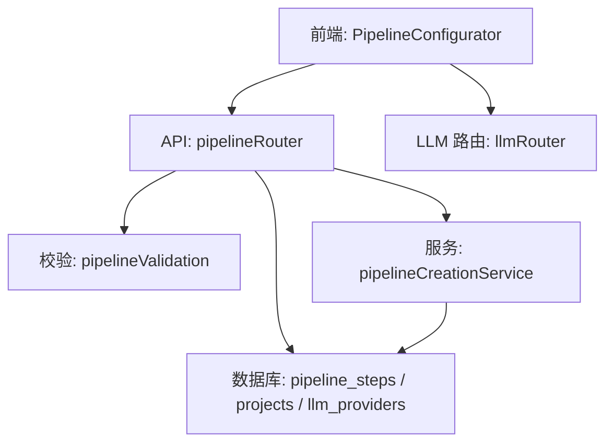
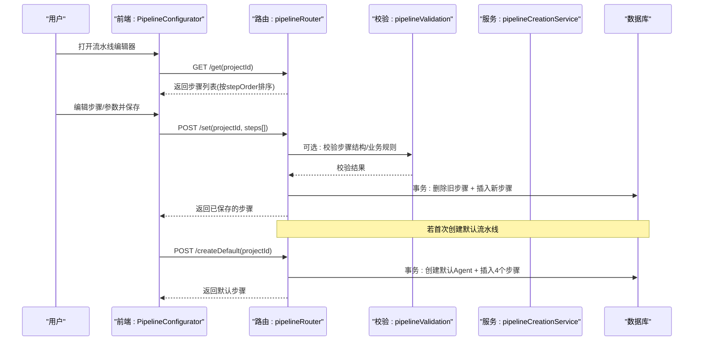
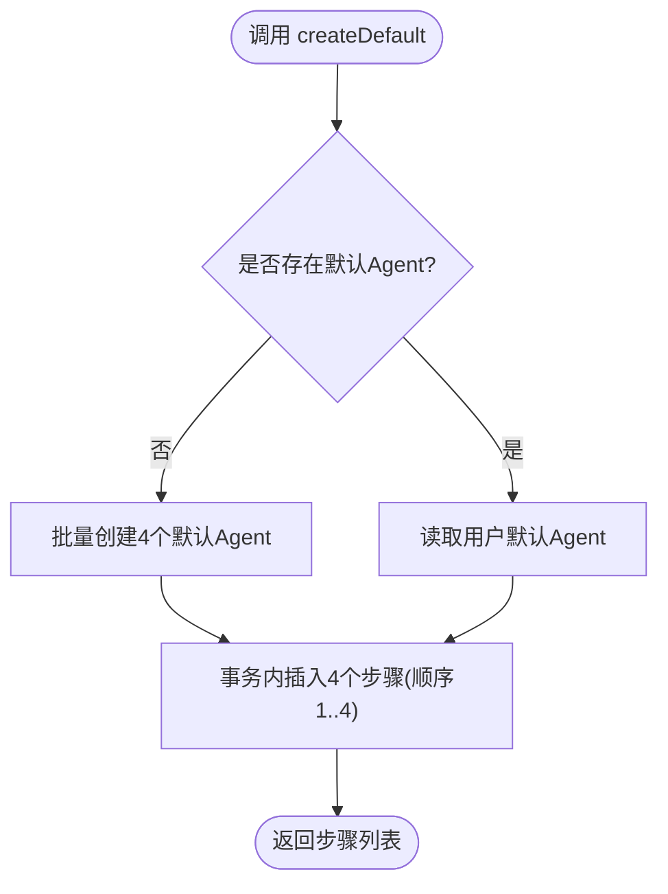
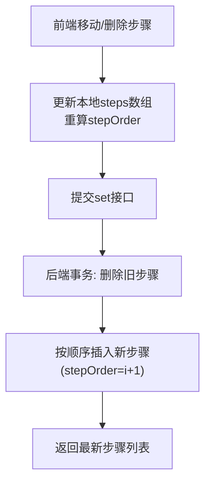
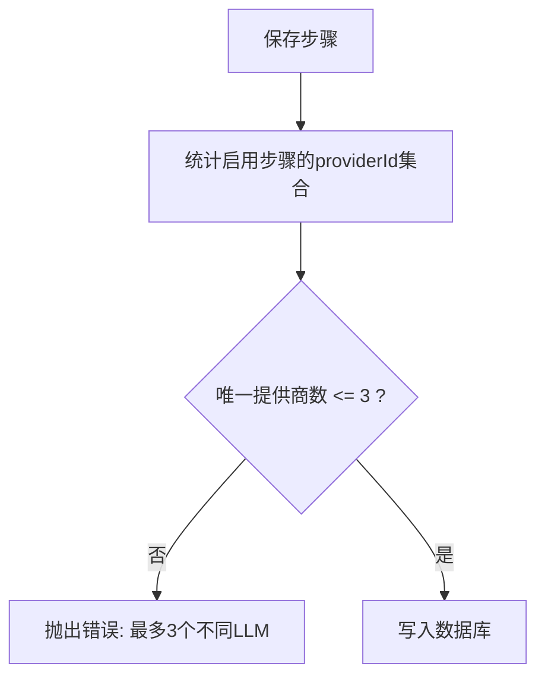
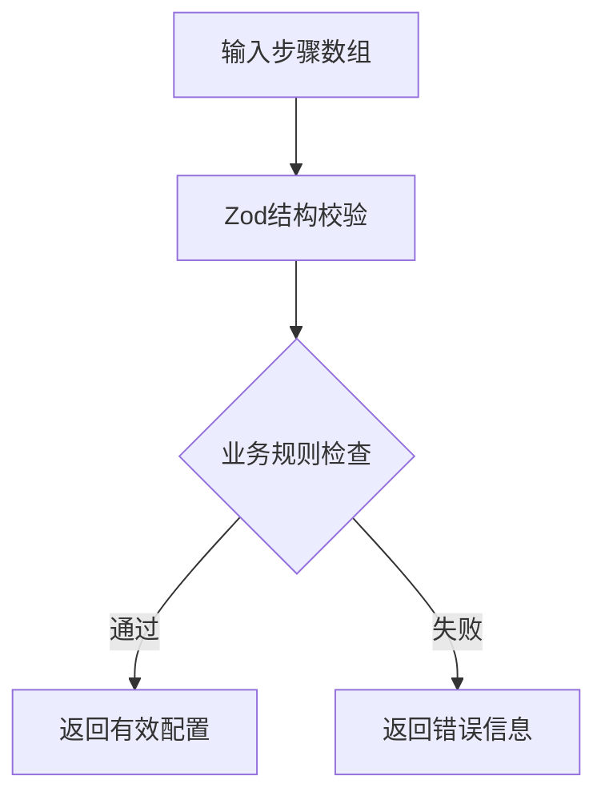
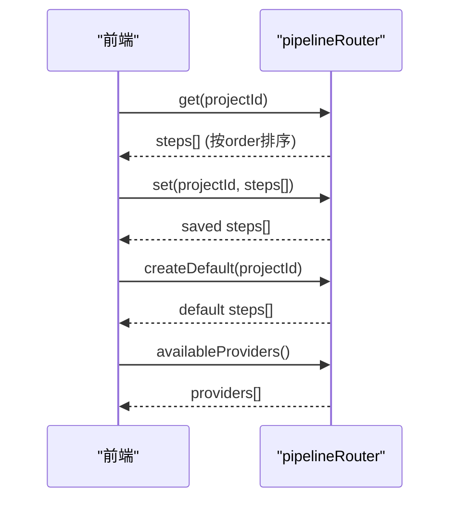
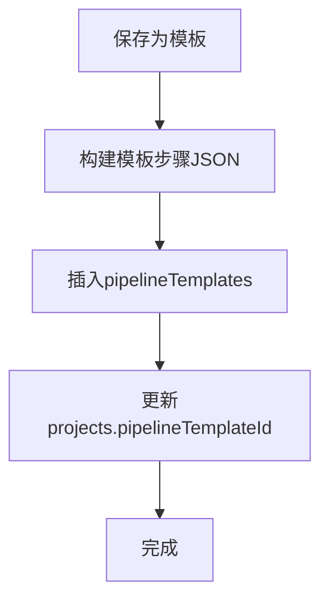
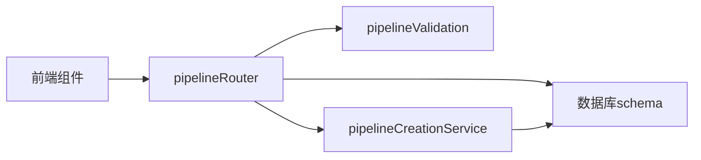

# 流水线配置管理

<cite>
**本文引用的文件**
- [api/routers/pipeline.ts](file://api/routers/pipeline.ts)
- [api/mcp/tools/pipelineValidation.ts](file://api/mcp/tools/pipelineValidation.ts)
- [api/services/pipelineCreationService.ts](file://api/services/pipelineCreationService.ts)
- [src/components/pipeline/PipelineConfigurator.tsx](file://src/components/pipeline/PipelineConfigurator.tsx)
- [db/schema.ts](file://db/schema.ts)
- [api/routers/llm.ts](file://api/routers/llm.ts)
- [api/services/swarmService.ts](file://api/services/swarmService.ts)
</cite>

## 目录
1. [简介](#简介)
2. [项目结构](#项目结构)
3. [核心组件](#核心组件)
4. [架构总览](#架构总览)
5. [详细组件分析](#详细组件分析)
6. [依赖关系分析](#依赖关系分析)
7. [性能考虑](#性能考虑)
8. [故障排查指南](#故障排查指南)
9. [结论](#结论)
10. [附录：配置示例与最佳实践](#附录：配置示例与最佳实践)

## 简介
本技术文档围绕“流水线配置管理”展开，覆盖以下能力：
- 默认流水线步骤的自动创建（Builder、Critic、Refiner、Polisher 四个阶段）
- 步骤顺序管理与状态控制（启用/禁用、顺序调整）
- 多 LLM 提供商的配置限制（最多 3 个不同提供商）与模型参数设置（温度、最大令牌数）
- 流水线配置的获取、更新接口，以及配置验证与业务规则检查
- 具体配置示例与最佳实践建议

该功能面向标准版与 Pro Designer 用户：标准版可编辑提示词与开关；Pro 用户可自定义步骤、添加条件分支与循环、选择不同 LLM 提供商与模型。

## 项目结构
与流水线配置相关的关键位置如下：
- API 路由层：提供获取/设置流水线步骤、创建默认流水线、查询可用提供商等接口
- 校验层：纯函数校验步骤结构与业务约束（如 while 目标步、步骤数量上限）
- 服务层：批量解析/创建 Agent、最终化模板与关联
- 前端组件：可视化编排步骤、编辑参数、保存为模板
- 数据库模式：定义 pipeline_steps、pipeline_templates、projects 等表结构

**图表来源**
- [api/routers/pipeline.ts:82-326](file://api/routers/pipeline.ts#L82-L326)
- [api/mcp/tools/pipelineValidation.ts:1-84](file://api/mcp/tools/pipelineValidation.ts#L1-L84)
- [api/services/pipelineCreationService.ts:20-116](file://api/services/pipelineCreationService.ts#L20-L116)
- [db/schema.ts:84-150](file://db/schema.ts#L84-L150)
- [src/components/pipeline/PipelineConfigurator.tsx:44-236](file://src/components/pipeline/PipelineConfigurator.tsx#L44-L236)
- [api/routers/llm.ts:20-209](file://api/routers/llm.ts#L20-L209)

**章节来源**
- [api/routers/pipeline.ts:82-326](file://api/routers/pipeline.ts#L82-L326)
- [db/schema.ts:84-150](file://db/schema.ts#L84-L150)

## 核心组件
- 流水线步骤（pipeline_steps）：每个步骤包含名称、角色、系统提示词、是否启用、所属 LLM 提供商与模型、温度、最大令牌数、步骤类型（agent/if/while/approval）及对应配置
- 项目配置（projects.pipeline_config）：全局迭代次数、启用的 Agent 列表、无改进时停止等
- 模板（pipeline_templates）：将当前流水线保存为可复用模板
- 提供商（llm_providers）：用户配置的 LLM 提供商及其模型列表
- 校验器（pipelineValidation）：对步骤输入进行结构化校验与业务规则检查

关键职责边界：
- 路由层负责权限校验、数据持久化与事务封装
- 校验层保证输入合法且满足业务约束
- 服务层负责跨表操作（Agent 批量解析/创建、模板生成）
- 前端负责交互与参数收集

**章节来源**
- [db/schema.ts:84-150](file://db/schema.ts#L84-L150)
- [db/schema.ts:473-480](file://db/schema.ts#L473-L480)
- [api/mcp/tools/pipelineValidation.ts:1-84](file://api/mcp/tools/pipelineValidation.ts#L1-L84)
- [api/services/pipelineCreationService.ts:20-116](file://api/services/pipelineCreationService.ts#L20-L116)

## 架构总览
下图展示了从前端到后端的完整调用链，包括默认步骤创建、步骤保存与提供商限制校验。

**图表来源**
- [api/routers/pipeline.ts:82-326](file://api/routers/pipeline.ts#L82-L326)
- [api/mcp/tools/pipelineValidation.ts:1-84](file://api/mcp/tools/pipelineValidation.ts#L1-L84)
- [api/services/pipelineCreationService.ts:20-116](file://api/services/pipelineCreationService.ts#L20-L116)

## 详细组件分析

### 默认流水线步骤自动创建（Builder → Critic → Refiner → Polisher）
- 触发点：调用 createDefault 接口
- 行为：
  - 若用户不存在 Builder/Critic/Refiner/Polisher 四个默认 Agent，则批量创建并赋予默认温度与最大令牌数
  - 在事务中插入四个步骤，顺序固定为 1..4，默认启用
- 回退路径：若已有用户级默认 Agent，则按角色顺序插入步骤，使用用户设置的温度与最大令牌数

**图表来源**
- [api/routers/pipeline.ts:221-318](file://api/routers/pipeline.ts#L221-L318)

**章节来源**
- [api/routers/pipeline.ts:221-318](file://api/routers/pipeline.ts#L221-L318)

### 步骤顺序管理与状态控制
- 顺序管理：
  - 前端支持上移/下移步骤，自动重算 stepOrder
  - 后端 set 接口按传入顺序写入 stepOrder（i+1）
- 状态控制：
  - isEnabled 字段控制步骤是否参与执行
  - 执行加载时仅加载 isEnabled 为 true 或 null 的步骤

**图表来源**
- [src/components/pipeline/PipelineConfigurator.tsx:122-143](file://src/components/pipeline/PipelineConfigurator.tsx#L122-L143)
- [api/routers/pipeline.ts:178-218](file://api/routers/pipeline.ts#L178-L218)
- [api/services/swarmService.ts:286-305](file://api/services/swarmService.ts#L286-L305)

**章节来源**
- [src/components/pipeline/PipelineConfigurator.tsx:122-143](file://src/components/pipeline/PipelineConfigurator.tsx#L122-L143)
- [api/routers/pipeline.ts:178-218](file://api/routers/pipeline.ts#L178-L218)
- [api/services/swarmService.ts:286-305](file://api/services/swarmService.ts#L286-L305)

### 多 LLM 提供商配置限制与模型参数
- 限制：
  - 同一流水线中启用的 agent 步骤最多使用 3 个不同的 providerId（去重计数）
  - 前端在 Pro 模式下保存前会做客户端校验，后端 set 接口也会再次校验
- 模型参数：
  - temperature：字符串形式存储，默认 "0.7"
  - maxTokens：整数，默认 4096，最大受限于模型能力（校验层允许至 128000）
- 提供商查询：
  - availableProviders 接口返回当前用户配置的提供商列表与模型

**图表来源**
- [api/routers/pipeline.ts:162-170](file://api/routers/pipeline.ts#L162-L170)
- [src/components/pipeline/PipelineConfigurator.tsx:216-220](file://src/components/pipeline/PipelineConfigurator.tsx#L216-L220)
- [api/routers/llm.ts:20-36](file://api/routers/llm.ts#L20-L36)

**章节来源**
- [api/routers/pipeline.ts:162-170](file://api/routers/pipeline.ts#L162-L170)
- [src/components/pipeline/PipelineConfigurator.tsx:216-220](file://src/components/pipeline/PipelineConfigurator.tsx#L216-L220)
- [api/routers/llm.ts:20-36](file://api/routers/llm.ts#L20-L36)

### 配置验证与业务规则检查
- 步骤类型：agent、if、while、approval
- 必填字段：
  - approval 无需 role/systemPrompt
  - 其他类型必须提供 role 与 systemPrompt
- if 步骤需配置 options 与 mappings
- while 步骤需配置 targetStep 与 maxIterations（maxIterations 上限为 10）
- 步骤总数上限：20
- while 目标步校验：targetStep 不能指向自身之后的步骤

**图表来源**
- [api/mcp/tools/pipelineValidation.ts:1-84](file://api/mcp/tools/pipelineValidation.ts#L1-L84)

**章节来源**
- [api/mcp/tools/pipelineValidation.ts:1-84](file://api/mcp/tools/pipelineValidation.ts#L1-L84)

### 流水线配置的获取与更新接口
- 获取步骤：GET /get(projectId)，按 stepOrder 升序返回
- 设置步骤：POST /set(projectId, steps[])，原子替换所有步骤
- 创建默认：POST /createDefault(projectId)，初始化默认步骤
- 可用提供商：GET /availableProviders，返回用户配置的提供商

**图表来源**
- [api/routers/pipeline.ts:82-326](file://api/routers/pipeline.ts#L82-L326)

**章节来源**
- [api/routers/pipeline.ts:82-326](file://api/routers/pipeline.ts#L82-L326)

### 模板化与复用
- 将当前流水线保存为模板：前端提供“保存到我的流水线”入口
- 服务层 finalizePipelineCreation：
  - 基于已保存的步骤创建/复用 customAgents
  - 生成 pipelineTemplates 并关联 sourceProjectId
  - 更新项目的 pipelineTemplateId

**图表来源**
- [api/services/pipelineCreationService.ts:85-115](file://api/services/pipelineCreationService.ts#L85-L115)

**章节来源**
- [api/services/pipelineCreationService.ts:85-115](file://api/services/pipelineCreationService.ts#L85-L115)

## 依赖关系分析
- 路由层依赖：
  - 数据库 schema（pipeline_steps、projects、llm_providers、customAgents、pipelineTemplates）
  - 校验模块（pipelineValidation）
  - 服务模块（pipelineCreationService）
- 前端依赖：
  - trpc 调用路由接口
  - 本地状态管理步骤顺序与参数
- 执行侧依赖：
  - swarmService 加载步骤时过滤 isEnabled 并按 order 执行

**图表来源**
- [api/routers/pipeline.ts:82-326](file://api/routers/pipeline.ts#L82-L326)
- [api/mcp/tools/pipelineValidation.ts:1-84](file://api/mcp/tools/pipelineValidation.ts#L1-L84)
- [api/services/pipelineCreationService.ts:20-116](file://api/services/pipelineCreationService.ts#L20-L116)
- [db/schema.ts:84-150](file://db/schema.ts#L84-L150)

**章节来源**
- [api/routers/pipeline.ts:82-326](file://api/routers/pipeline.ts#L82-L326)
- [api/mcp/tools/pipelineValidation.ts:1-84](file://api/mcp/tools/pipelineValidation.ts#L1-L84)
- [api/services/pipelineCreationService.ts:20-116](file://api/services/pipelineCreationService.ts#L20-L116)
- [db/schema.ts:84-150](file://db/schema.ts#L84-L150)

## 性能考虑
- 批量解析 Agent：避免 N+1 查询，一次性拉取用户全部 Agent 并匹配
- 事务封装：删除旧步骤与插入新步骤在同一事务中，确保一致性
- 执行加载优化：仅加载启用的步骤，减少无效计算
- 提供商限流：执行时使用速率限制，避免超限导致失败

[本节为通用性能指导，不直接分析具体文件]

## 故障排查指南
- 无法保存步骤（超过3个提供商）：
  - 检查启用步骤的 providerId 去重数量，确保不超过 3
  - 参考后端校验逻辑与前端客户端校验
- while 步骤报错：
  - 确认 whileConfig.targetStep 指向自身或更早的步骤
  - 检查 maxIterations 是否在允许范围内
- 步骤未生效：
  - 确认 isEnabled 为 true
  - 执行加载时会按 stepOrder 排序，检查顺序是否正确
- 默认步骤未创建：
  - 检查用户是否已有默认 Agent；若无，则会在 createDefault 中创建
  - 查看事务是否成功提交

**章节来源**
- [api/routers/pipeline.ts:162-170](file://api/routers/pipeline.ts#L162-L170)
- [api/mcp/tools/pipelineValidation.ts:72-83](file://api/mcp/tools/pipelineValidation.ts#L72-L83)
- [api/services/swarmService.ts:286-305](file://api/services/swarmService.ts#L286-L305)
- [api/routers/pipeline.ts:221-318](file://api/routers/pipeline.ts#L221-L318)

## 结论
本方案提供了完整的流水线配置管理能力：
- 默认四阶段流水线一键创建
- 灵活步骤编排与状态控制
- 严格的业务规则校验与提供商限制
- 模板化复用与项目级配置
- 前后端一致的参数与流程设计

建议在团队内统一使用模板与默认步骤，结合 while/if 实现质量门控与迭代优化，并通过提供商限流与参数调优保障稳定性与成本可控。

[本节为总结性内容，不直接分析具体文件]

## 附录：配置示例与最佳实践

- 默认流水线（标准版）
  - 步骤顺序：Builder → Critic → Refiner → Polisher
  - 参数建议：temperature 0.7，maxTokens 4096
  - 适用场景：快速产出高质量初稿并进行多轮改进

- 高级流水线（Pro 版）
  - 在 Critic 后加入 IF 门控：根据评估结果决定继续或退回 Refiner
  - 在 Refiner 后加入 WHILE 循环：最多 3 次迭代，直到达到质量标准
  - 提供商限制：同一流水线最多使用 3 个不同提供商
  - 参数建议：IF/WHILE 步骤使用较低 temperature（如 0.3），提高判断稳定性

- 模板化建议
  - 将常用流水线保存为模板，便于新项目快速复用
  - 模板中包含步骤顺序、提示词、提供商与模型、参数

- 执行与监控
  - 关注 isEnabled 与 stepOrder，确保执行顺序正确
  - 使用提供商限流与重试策略，避免超时与配额耗尽

[本节为概念性指导，不直接分析具体文件]